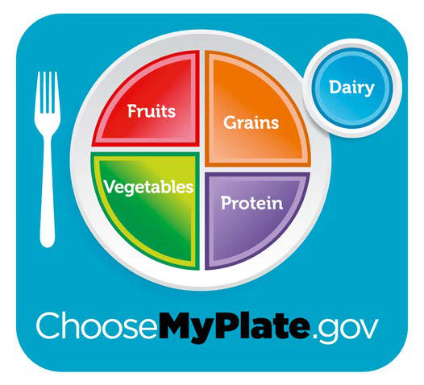

# Chapter 61: Feeding Healthy Infants, Children, and Adolescents

*Katherine J. Barrett, Stephanie P. Gilley, Matthew A. Haemer, Nancy F. Krebs, and Susan L. Johnson*

<!-- p.567 -->
weight-for-length are used in the WHO growth charts from birth to 2 years. *Body mass index* (BMI) can be calculated but is not recommended for use in children <2 years. Stature, weight, and BMI are used in the CDC 2000 growth charts from 2 to 20 years of age. These charts can be used to categorize children as *underweight* (<5th BMI percentile), normal weight (5-85th), overweight (85-95th), and obese (≥95th BMI percentile).

*Severe obesity* is defined as BMI ≥120% of the 95th percentile or BMI ≥35 kg/m2 (whichever is lower). This assessment corresponds to approximately the 99th percentile or a BMI *z* score ≥2.33. Severe obe sity that exceeds the 99th percentile is tracked on a specialized percen tile curve for obesity. Furthermore, adult classification is used for BMI ≥27 kg/m2 in adolescents over age 18 for consideration of medication and bariatric surgery.

It is important to consider the limitations in the use of WHO and CDC growth charts for certain populations such as premature infants, children with certain genetic disorders (e.g., Turner syndrome, Down syndrome, Wolf-Hirschhorn syndrome, achondroplasia) and chil dren with cerebral palsy. Specific growth charts addressing the unique growth characteristics of these children are available from various resources, including the AAP.

*Visit Elsevier eBooks+ at eBooks.Health.Elsevier.com** for Bibliography.*

Early feeding experiences can support the development of healthy eating habits, optimal growth and development, and prevention of chronic disease throughout the life course. Childhood nutrition is known to play a role in the origin of adult diseases such as type 2 diabe tes, hypertension, obesity, and metabolic syndrome. To support devel opment and to prevent chronic disease, appropriate feeding practices are best established in the neonatal period and continued throughout childhood and adolescence to adulthood. Healthful feeding in children requires partnerships between family members, the healthcare system, schools, the community, and policy makers.

**FEEDING DURING THE FIRST YEAR OF LIFE Breastfeeding** The American Academy of Pediatrics (AAP) and World Health Orga nization (WHO) have declared breastfeeding and the administration of human milk to be the ideal practice for infant feeding and nutrition. Breastfeeding has documented short- and long-term medical and neu rodevelopmental advantages and rare contraindications (Tables 61.1, 61.2, and 61.3). The AAP and the WHO recommend that infants be exclusively fed human breast milk for approximately 6 months. Breast feeding ideally should be continued with the introduction of comple mentary foods until 24 months of age or longer, if mutually desired by the mother and infant. We recognize that there are some lactating indi viduals who do not identify as women/mothers and may prefer the use of other terms, including the use of chestfeeding in lieu of breastfeed ing. This is a consideration that a practitioner may need to make when speaking to a family member who uses these alternative terms. The suc cess of breastfeeding initiation and continuation depends on multiple

*Katherine J. Barrett, Stephanie P. Gilley, 
 Matthew A. Haemer, Nancy F. Krebs, and Susan L. Johnson*

factors, such as education about breastfeeding, hospital breastfeeding practices and policies, routine and timely follow-up care, family and societal support, and the health of the mother (Tables 61.4 and 61.5). Breastfeeding support from both professionals and lay individuals has a positive impact on breastfeeding success, and the importance of such support cannot be overstated.

Feedings are initiated soon after birth unless medical conditions preclude them. Mothers can be encouraged to feed at both breasts at each feeding, starting with the breast offered second at the last feeding. For optimal milk production, it is preferable to fully empty the first breast before moving to the second breast, rather than par tially emptying both sides. It is not unusual for an infant to fall asleep after the first breast and refuse the second. Table 61.6 summarizes patterns of milk supply in the first week. Pacifiers may help prevent sudden infant death syndrome in breastfed infants, but it is not rec ommended to introduce until breastfeeding is well established and should not be used to try to increase time between feeds or in lieu of a feed in a baby showing hunger cues.

Breastfeeding is a learned skill for both mother and infant, and support from a provider knowledgeable in breastfeeding is critical, especially as milk production is established in the first few weeks post partum. It is helpful to instruct new mothers about infant hunger cues and correct nipple latch, positioning of the infant on the breast, and feeding frequency. It is also suggested that someone trained in lactation observe a feeding to evaluate positioning, latch, milk transfer, maternal responses, and infant satiety. Attention to these issues during the new born period allows dialog with the mother and family and can prevent problems that could occur with improper technique or knowledge of breastfeeding. Discussions about normal infant feeding, infant elimina tion patterns, breast engorgement, breast care, and maternal nutrition are important aspects of the hospital discharge process. A follow-up appointment with a lactation specialist is recommended within 24-48 hours after hospital discharge. The AAP recommends that exclusively breastfed infants start supplementation with vitamin D (10 mcg, or 400 IU) by 2 weeks of life.

Compared with Infant Formula

κ-Casein Antiadhesive, bacterial flora

#### **Table 61.1** Selected Beneficial Properties of Human Milk

| Category / Parameter | Clinical Details & Findings |
| --- | --- |
| **ANTIBACTERIAL FACTORS** | Secretory IgA; Specific antigen-targeted antiinfective; action; Lactoferrin; Immunomodulation, iron chelation,; antimicrobial action, antiadhesive,; trophic for intestinal growth; Oligosaccharides; Prevention of bacterial attachment; Cytokines; Antiinflammatory, epithelial barrier; function |
| **GROWTH FACTORS** | Epidermal growth factor; Luminal surveillance, repair of intestine; Transforming growth; factor (TGF); Promotes epithelial cell growth (TGF-β); Suppresses lymphocyte function (TGF-β); Nerve growth factor; Promotes neural growth |
| **ENZYMES** | Platelet-activating factor; (PAF)–acetylhydrolase; Blocks action of PAF; Glutathione peroxidase; Prevents lipid oxidation; Nucleotides; Enhance antibody responses, bacterial; flora; Adapted from Hamosh M. Bioactive factors in human milk. Pediatr Clin North Am.; 2001;48:69–86. |

<!-- p.569 -->
Breastfeeding Because of Maternal Health Conditions

#### **Table 61.2** Absolute and Relative Contraindications to

| Category / Parameter | Clinical Details & Findings |
| --- | --- |
| **DEGREE OF RISK** | HIV and HTLV; infection; In the United States, breastfeeding is; contraindicated.; In other settings, health risks of not; breastfeeding must be weighed against the; risk of transmitting the virus to the infant.; Tuberculosis; infection; Direct breastfeeding is contraindicated until; completion of approximately 2 wk of; appropriate maternal therapy.; Varicella-zoster; infection; Infant should not have direct contact with active; lesions.; Infant should receive immune globulin.; Herpes simplex; infection; Breastfeeding is contraindicated with active; herpetic lesions of the breast.; CMV infection; May be found in milk of mothers who are CMV; seropositive.; Transmission through human milk causing; symptomatic illness in term infants is uncommon.; Hepatitis B; infection; Infants routinely receive hepatitis B immune; globulin and hepatitis B vaccine if mother is; HBsAg positive.; No delay in initiation of breastfeeding is required.; Hepatitis C; infection; Breastfeeding is not contraindicated. |
| **COVID-19** | Maternal infection is not a contraindication for; breastfeeding or feeding expressed milk.; Ebola; Confirmed maternal Ebola infection is a; contraindication to breastfeeding and; expressed milk.; Brucellosis; Active untreated brucellosis is a contraindication; to breastfeeding and expressed milk.; Live vaccines; Smallpox and yellow fever live-virus; vaccines are contraindicated for; breastfeeding mothers.; Alcohol intake; Limit maternal alcohol intake to <0.5 g/kg/day; (for a woman of average weight—this is the; equivalent of 2 cans of beer, 2 glasses of wine,; or 2 oz of liquor).; Cigarette smoking; Discourage cigarette smoking, but smoking is; not a contraindication to breastfeeding.; Marijuana usage; Metabolites, including tetrahydrocannabinol, are; detectable in breast milk. Marijuana; usage is not recommended but is not a strict; contraindication to breastfeeding.; Chemotherapy,; radio; pharmaceuticals; Breastfeeding is generally contraindicated.; CMV, Cytomegalovirus; HBsAg, hepatitis B surface antigen; HIV, human; immunodeficiency virus; HTLV, human T-lymphotropic virus.; Adapted from Schanler RJ, Krebs NF, Mass SB (eds). Breastfeeding Handbook for Physicians,; 2nd ed. Elk Grove Village, IL: American Academy of Pediatrics; 2014: 223–226. |

**Nipple pain** is one of the most common complaints of breastfeeding mothers in the immediate postpartum period. Poor infant position ing and improper latch are the most common reasons for nipple pain beyond the mild discomfort felt early in breastfeeding. If the problem persists and the infant refuses to feed, evaluation for **nipple candidia sis** is indicated. If candidiasis is present, the nipples can be treated with an antifungal cream that is wiped off of the breast before feeding, and the infant is treated with an oral antifungal medication.

**Tongue-tie (ankyloglossia)** has been associated with nipple pain, poor latching, and poor weight gain in breastfed and bottle-fed infants. Ankyloglossia is defined as a lingual frenulum that attaches close to the anterior tongue tip and is estimated to be present in 4–11% of new

Protective Effect

#### **Table 61.3** Conditions for Which Human Milk May Have a

| Category / Parameter | Clinical Details & Findings |
| --- | --- |
| **MOTHER** | • Diarrhea; • Otitis media; • Urinary tract; infection; • Necrotizing; enterocolitis; • Septicemia; • Infant botulism; • Insulin-dependent; diabetes mellitus; • Celiac disease; • Crohn disease; • Lymphoma; • Leukemia; • Recurrent otitis media; • Atopy; • Hospitalizations for; respiratory illness; • Sudden infant death; syndrome; • Obesity; • Uterine atony; • Breast cancer; • Ovarian cancer; • Cardiovascular; disease; • Obesity; • Type 2 diabetes |

Support Breastfeeding*†

#### **Table 61.4** Ten Hospital Practices to Encourage and

| Category / Parameter | Clinical Details & Findings |
| --- | --- |
| **General** | 1.	 Have a written breastfeeding policy that is routinely; communicated to all healthcare staff.; 2.	 Train all healthcare staff in the skills necessary to implement this; policy.; 3.	 Inform all pregnant women about the benefits and management; of breastfeeding.; 4.	 Help women initiate breastfeeding within 1 hour of birth.; 5.	 Show women how to breastfeed and how to maintain lactation,; even if they are separated from their newborns.; 6.	 Give newborns no food or drink other than breast milk unless; medically indicated.; 7.	 Practice rooming-in; allow mothers and newborns to remain; together 24 hours a day.; 8.	 Encourage breastfeeding on demand.; 9.	 Give no pacifiers or artificial nipples to breastfeeding infants.‡; 10.	 Foster the establishment of breastfeeding support groups and; refer to them on discharge from the hospital or birth center. |
| **WHILE SKIN-TO-SKIN**** | 1.	 Infant’s face can be seen.; 2.	 Infant’s head is in “sniffing” position.; 3.	 Infant’s nose and mouth are not covered.; 4.	 Infant’s head is turned to one side.; 5.	 Infant’s neck is straight, not bent.; 6.	 Infant’s shoulders and chest face mother.; 7.	 Infant’s legs are flexed.; 8.	 Infant’s back is covered with blankets.; 9.	 Mother-infant dyad is monitored continuously by staff in the; delivery environment and regularly on the postpartum unit.; 10.	 When mother wants to sleep, infant is placed in bassinet or with; another support person who is awake and alert.; *The 1994 report of the Healthy Mothers, Healthy Babies National Coalition Expert; Work Group recommend that the UNICEF-WHO Baby Friendly Hospital Initiative; be adapted for use in the United States as the United States Breastfeeding Health; Initiative, using the adapted 10 hospital practices noted.; †Data from Baby-Friendly USA. Guidelines and evaluation criteria for facilities seeking baby-; friendly designation. Sandwich, MA: Baby Friendly USA; 2010. Available at https://www.b; abyfriendlyusa.org/for-facilities/practice-guidelines/. Accessed 10 November 2022. From; ACOG Committee Opinion. Optimizing support for breastfeeding as part of obstetric; practice. Obstet Gynecol. 2018;132(4):e187–e195, Boxes 1 and 2, pp. e191–e192.; ‡The American Academy of Pediatrics endorsed the UNICEF-WHO Ten Steps to; Successful Breastfeeding, but does not support a categorical ban on pacifiers; because of their role in reducing the risk of sudden infant death syndrome and their; analgesic benefit during painful procedures when breastfeeding cannot provide the; analgesia.; **Data from Ludington-Hoe SM, Morgan K. Infant assessment and reduction of sudden; unexpected postnatal collapse risk during skin-to-skin contact. Newborn Infant Nurs; Rev. 2014;14:28–33. |

<!-- p.570 -->
and has been used as a treatment option for ankyloglossia with increas ing frequency despite *insufficient evidence* that it improves breastfeed ing outcomes, making its use somewhat controversial. Most infants with ankyloglossia have no feeding problems, and most infants with nursing problems do not have ankyloglossia. Providing a feeding evaluation and assessment of latch while monitoring weight over the course of 2-3 weeks may be more valuable than proceeding immedi ately to frenotomy. During that time many feeding issues resolve, thus avoiding unnecessary frenotomy.

**Engorgement** may occur in the second stage of lactogenesis (typi cally days 3-10 postpartum) and is characterized by the breasts feeling

firm, overfilled, and sometimes painful. Incomplete removal of milk as a result of ineffective breastfeeding technique or infant illness can cause engorgement. Breastfeeding immediately at signs of infant hunger can prevent this from occurring. To reduce engorgement, breasts may be softened before infant feeding with a combination of hot compresses and manual expression of milk. To reduce inflamma tion and pain, between feedings mothers can wear a supportive bra, apply cold compresses, and take oral nonsteroidal antiinflammatory drugs (NSAIDs).

**Mastitis** occurs in 2–3% of lactating women and is usually unilateral, manifesting with localized warmth, tenderness, edema, and erythema after the second postdelivery week. Sudden onset of breast pain, myal gia, and fever with fatigue, nausea, vomiting, and headache can also occur. Organisms implicated in mastitis include *Staphylococcus aureus, Escherichia coli,* group A streptococcus, *Haemophilus influenzae, Kleb siella pneumoniae,* and *Bacteroides* species. Diagnosis is confirmed by physical examination. Treatment is with oral antibiotics (most com monly dicloxacillin or cephalexin) and analgesics, while at the same time promoting breastfeeding or emptying of the affected breast. A **breast abscess** is a much less common complication of mastitis, but it is a more serious infection that requires intravenous antibiotics and incision and drainage, along with continued breast emptying. Wash ing hands thoroughly before breastfeeding or pumping, especially after changing the baby’s diapers, can help minimize risk for breast infections.

**Insufficient milk intake**, dehydration, and jaundice in the infant can occur within the first weeks of life. In fact, retrospective studies suggest higher rates of hospitalization—primarily caused by jaundice and poor weight gain—in the first month of life for breastfed versus formulafed babies, highlighting the *critical importance of lactation support*. Breastfed neonates feed 8-12 times a day. Signs that milk intake is not adequate include lethargy, delayed stooling, decreased urine output, weight loss >10% of birthweight, hypernatremic dehydration, incon solable crying, and increased hunger. Insufficient milk intake may be caused by inadequate milk production and/or health conditions in the infant that prevent proper breast stimulation. Careful attention to prenatal history can identify maternal factors associated with low milk production (for example, obesity, type 2 diabetes, postpartum hemor rhage, or failure of breasts to enlarge during pregnancy or within the first few days after delivery). Excess weight loss or failure to return to birthweight by 7-10 days in an exclusively breastfed infant should trig ger an evaluation of breastfeeding effectiveness. Direct observation of breastfeeding can help identify improper technique, and test weighs (weighing the infant before and after feeding) may help assess milk transfer. If a large volume of milk is expressed manually after breast feeding, the infant might not be extracting enough milk, eventually leading to decreased milk output. Late preterm infants (34-36 weeks) are at particular risk for insufficient milk intake because of weak suck, difficulty coordinating suck and swallow patterns, or medical issues.

**Breastfeeding jaundice**, also referred to as *suboptimal intake jaun dice,* is related to insufficient fluid intake during the first week of life and is a common reason for hospital readmission of healthy breast fed infants (see Chapter 137). Breastfeeding jaundice is associated with dehydration and hypernatremia. Treatment may require supple mentation with expressed maternal breast milk, donor milk, or infant formula**. Breast milk**** jaundice** is a different disorder that causes per sistently high serum indirect bilirubin in thriving, healthy, well-fed infants. Breast milk contains inhibitors of glucuronyl transferase and causes enhanced absorption of bilirubin from the gut. Breast milk jaundice becomes evident later than breastfeeding jaundice and gen erally declines in the second to third week of life. Infants with severe or persistent jaundice or a direct hyperbilirubinemia need evaluation for other medical causes (see Chapter 137). Persistently high bilirubin levels may require treatment with phototherapy without cessation of breastfeeding or changing from breast milk to infant formula for 24-48 hours if phototherapy is not available or if a rapid reduction in total serum bilirubin is urgently needed. Breastfeeding can resume after the decline in serum bilirubin. Parents can be encouraged to continue col lecting breast milk during the period the infant is taking formula.

Management for Healthy Term Infants

#### **Table 61.5** Recommendations on Breastfeeding

| Category / Parameter | Clinical Details & Findings |
| --- | --- |
| **General** | 1.	 Exclusive breastfeeding for about 6 months; • Breastfeeding preferred; alternatively, expressed mother’s milk or donor; breast milk; • To continue for 2 years or beyond as long as mutually desired by mother; and child; • Complementary foods rich in iron, zinc, and other micronutrients should; be introduced at about 6 mo of age; 2.	 Peripartum policies and practices that optimize breastfeeding; initiation and maintenance should be compatible with the AAP; and Academy of Breastfeeding Medicine Model Hospital Policy; and include the following:; • Direct skin-to-skin contact with mothers immediately after delivery; until the first feeding is accomplished and encouraged throughout the; postpartum period; • Delay in routine procedures (weighing, measuring, bathing, blood tests,; vaccines, and eye prophylaxis) until after the first feeding is completed; • Delay in administration of intramuscular vitamin K until after the first; feeding is completed but within 6 hr of birth; • Ensure 8-12 feedings at the breast every 24 hr; • Ensure formal evaluation and documentation of breastfeeding by; trained caregivers (including position, latch, milk transfer, examination); at least once for each nursing shift; • Give no supplements (water, glucose water, commercial infant; formula, or other fluids) to breastfeeding newborn infants unless; medically indicated using standard evidence-based guidelines for the; management of hyperbilirubinemia and hypoglycemia; • Avoid routine pacifier use in the postpartum period; • Begin daily oral vitamin D drops (400 IU) at hospital discharge; 3.	 All breastfeeding infants should be seen by a pediatrician within; 48-72 hr after discharge from the hospital; • Evaluate hydration and elimination patterns; • If weight >7% below birthweight or there is additional weight loss on; day 5 or later, providers should consider more frequent follow-ups and/; or referral to a lactation consultant.; • Discuss maternal/infant issues; • Observe feeding; 4.	 Mother and infant should sleep in proximity to each other to; facilitate breastfeeding; 5.	 Pacifier should be offered, while placing infant in back-to-sleep-; position, no earlier than 3-4 weeks of age and after breastfeeding; has been established; From American Academy of Pediatrics (AAP). Breast-feeding and the use of human; milk. Pediatrics. 2012;129:e827–e841. |

#### **Table 61.6** Patterns of Milk Supply

| Category / Parameter | Clinical Details & Findings |
| --- | --- |
| **MILK SUPPLY** | Day 1; Some milk (∼5 mL) may be expressed.; Days 2-4; Lactogenesis; milk production increases.; Day 5; Milk present; fullness and leaking are felt.; Day 6 onward; Breasts should feel “empty” after feeding.; Adapted from Neifert MR. Clinical aspects of lactation: promoting breastfeeding; success. Clin Perinatol. 1999;26:281–306. |

<!-- p.571 -->
**Breast milk collection** by pumping is a common practice when the mother and baby are separated and when families wish for other care givers to engage in infant feeding. Electric breast pumps are generally more efficient and better tolerated by mothers than manual pumps or hand-expression, but not all insurance companies cover electric pumps. Good handwashing and hygiene are important during all steps of pumping. Collection kits should be cleaned with hot soapy water, rinsed, and air-dried after each use. Glass or plastic containers can be used to collect the milk. Fresh milk can be stored at room temperature for up to 4 hours and in the refrigerator for up to 4 days. Expressed breast milk can be frozen and used for up to 6-12 months; frozen milk should be used within 24 hours of thawing. Human milk should never be microwaved. **Paced bottle feeding** helps support breastfeeding dur ing bottle feeds by matching the slower pace of direct breastfeeding.

**Growth of the breastfed infant** differs from that of the formulafed infant; the infant’s risk for excess weight gain during late infancy may be associated with bottle feeding (whether formula or expressed human milk). The WHO growth charts are based on growth patterns of healthy breastfed infants through the first year of life. The infants were selected based on being breastfed, having good healthcare, an absence of socioeconomic constraints, and nonsmoking mothers, so that they reflect the growth pattern of breastfed infants in optimal conditions and can be used as prescriptive standards rather than as normative ref erence curves. Charts are available for growth monitoring. The Centers for Disease Control and Prevention (CDC) recommends use of the WHO growth charts for infants from birth to 2 years and CDC growth charts for ages 2 to 20 years (see Chapter 27).

**Formula Feeding** Despite efforts to promote exclusive breastfeeding through 6 months, only ~55% of women in the United States continue any breastfeeding at 6 months. Parental preferences are the most common reason for using infant formula and may relate to return to work, perceived poor milk supply, lack of support, or other factors. Most parents make their infant feeding choices early in pregnancy. However, infant formula is also indicated for infants whose intake of breast milk is contraindicated for infant factors (e.g., inborn errors of metabolism) or maternal factors (see Table 61.2). In addition, infant formula may be used as a supple ment to support inadequate weight gain in breastfed infants, though often formula is used to supplement based upon caregiver perception of benefit rather than medical necessity.

Infant formulas marketed in the United States are safe and nutrition ally adequate as the sole source of nutrition for healthy infants for the first 6 months of life. Infant formulas are available in ready-to-feed, concentrated liquid, and powder forms. Ready-to-feed products gener ally provide 19-20 kcal/30 mL (1 oz) and approximately 64-67 kcal/100 mL. Concentrated liquid products, when diluted according to instruc tions, and powder formulas, when mixed according to instructions (typically 2 ounces of water plus one scoop of powder), will result in similar caloric density.

Although infant formulas are manufactured in adherence to good manufacturing practices and are regulated by the U.S. Food and Drug Administration (FDA), there are potential safety issues. Ready-to-feed and concentrated liquid formulas are commercially sterile, but pow der preparations are not. Although the number of bacterial colonyforming units per gram (CFU/g) of powder formula is generally lower than allowable limits, outbreaks of infections with *Cronobacter sakazakii* (previously *Enterobacter sakazakii*) have been documented, especially in premature infants. The powder preparations can contain other coliform bacteria but have not been linked to disease in healthy term infants. Care must be taken to follow the mixing instructions to avoid overdilution or underdilution, to use clean water, and to use the specific scoops provided by the manufacturer because scoop sizes vary. Water that has been boiled must cool fully to prevent degrada tion of heat-labile nutrients, specifically vitamin C. Well water should be tested regularly for bacteria and toxin contamination. Testing may also identify high lead concentrations in water flowing through pipes installed before 1986. Municipal water can contain variable concentra tions of fluoride, and if the concentrations are higher than 2.0 mg/L,

use of bottled water that is defluoridated is preferred to avoid possible toxicity and tooth discoloration.

Proper handwashing is important before preparing formula for the infant. Formula storage guidelines vary based on preparation. Once opened, ready-to-feed and concentrated liquid containers can be covered and stored in the refrigerator for no longer than 48 hours. Manufacturer guidelines recommend storing powder formula in a cool, dry place but not in the refrigerator; once opened, cans can be covered with the original plastic cap or aluminum foil, and the pow dered product used within 4 weeks. The CDC recommends using pre pared formula within 24 hours, regardless of type. The CDC further recommends using formula within 2 hours of removal from the refrig erator and within 1 hour from the start of a feed. Prepared formula stored in the refrigerator can be warmed by placing the container in warm water for about 5 minutes. Formula should *never* be heated in a microwave because it can heat unevenly and result in burns, despite appearing to be at the right temperature when tested.

Formula feedings are ideally provided ad libitum, with the goal of achieving growth and development to the child’s genetic potential. The usual intake to allow a weight gain of 20-30 g/day in the first 2-3 months of life is approximately 140-180 mL/kg/day, although some may require intake outside this range. The average rate of weight gain declines from 3 to 12 months of age (see Chapters 27 and 64). **Over feeding** with resultant rapid weight gain increases the risk for develop ing obesity and is to be prevented. **Paced bottle feeding** may help avoid overfeeding.

**COW’S MILK PROTEIN–BASED FORMULAS** Intact cow’s milk protein–based formulas are appropriate for most term infants. There are nutritional differences between formula and breast milk, although the effects of these differences on long-term health are unknown. Formulas contain 10-35 times higher iron com pared with breast milk and higher zinc, sodium, and vitamin D. Most formulas in the United States also contain considerably higher protein than in mature breast milk. This concentration is designed to meet the needs of the youngest infants but may lead to excess protein intake for older infants and has been associated with increased risk of obesity. In contrast, breast milk protein content decreases over time to match needs. Protein concentration and composition differences between human milk and cow’s milk–based formulas result in different plasma amino acid profiles in infants on different feeding patterns, but clinical significance has not been demonstrated.

Fat provides 40–50% of the energy in cow’s milk–based formulas and is primarily from plant and animal oils. Fat blends are better absorbed than dairy fat and provide saturated, monounsaturated, and polyun saturated fatty acids (PUFAs). All infant formulas are supplemented with long-chain PUFAs, specifically docosahexaenoic acid (DHA) and arachidonic acid (ARA). DHA and ARA are found at varying concen trations in human milk and vary by geographic region and maternal diet. The DHA and ARA added to formulas are derived from single-cell microfungi and microalgae and are classified as “generally recognized as safe” (GRAS) for use in infant formulas at approved concentrations and ratios. Long-term studies are lacking on the relationship between routine supplementation of formula with long-chain PUFAs and physi cal, neurodevelopmental, or visual outcomes of term infants.

Lactose is the major carbohydrate in breast milk and in standard cow’s milk–based formulas for term infants. Formulas for term infants may also contain modified starch or other complex carbohydrates like prebiotic oligosaccharides similar to those in human milk.

**SOY PROTEIN–BASED FORMULAS** Soy protein–based formulas on the market are all free of cow’s milk–based protein and lactose. They meet the vitamin, mineral, and electrolyte guidelines from the AAP and the FDA for feeding term infants. In term infants, although soy protein–based formulas have been used to provide nutrition resulting in normal growth pat terns, there are few indications for use in place of cow’s milk–based formula. Indications for soy formula include galactosemia, prefer ence for a vegetarian diet, and hereditary lactase deficiency, because

<!-- p.572 -->
soy-based formulas are lactose free. Most healthy infants with acute gastroenteritis can be managed after rehydration with continued use of breast milk or cow’s milk–based formulas and do not require a lactose-free formula. However, soy protein–based formulas may be indicated when documented secondary lactose intolerance occurs. Soy protein–based formulas have no advantage over cow’s milk pro tein–based formulas as a supplement for the breastfed infant, unless the infant has one of the indications noted previously. Soy protein– based formulas are *contraindicated for preterm infants* because of concerns about protein quality and aluminum content. The rou tine use of soy protein–based formula has no proven value in the prevention or management of infantile colic, fussiness, or atopic disease. Infants with documented cow’s milk protein–induced enteropathy or enterocolitis often are also sensitive to soy protein and should be fed using an extensively hydrolyzed or amino acid– based formula.

**PROTEIN HYDROLYSATE FORMULAS** Protein hydrolysate formulas may be partially hydrolyzed, contain ing oligopeptides with a molecular weight of <5,000 daltons (range 3,000-10,000 Da), or extensively hydrolyzed, containing peptides with a molecular weight <3,000 Da. These formulas are lactose free and can include medium-chain triglycerides, making them use ful in infants with gastrointestinal malabsorption caused by cystic fibrosis, short bowel syndrome, prolonged diarrhea, or hepatobili ary disease. **Partially hydrolyzed protein** formulas have fat blends similar to cow’s milk–based formulas, and carbohydrates are sup plied by corn maltodextrin or corn syrup solids. Because the pro tein is only partially hydrolyzed, these formulas are not appropriate for infants who are allergic to cow’s milk protein. There is insuf ficient evidence to recommend use of hydrolyzed formulas to pre vent atopic dermatitis or other atopic diseases in high-risk infants. **Extensively hydrolyzed formulas** are recommended for infants intolerant to cow’s milk or soy proteins.

**AMINO ACID FORMULAS** Amino acid (elemental) formulas are peptide-free formulas that con tain mixtures of essential and nonessential amino acids. They are designed for infants with cow’s milk–based protein allergy who fail to thrive on extensively hydrolyzed protein formulas. The effective ness of amino acid formulas to prevent atopic disease has not been studied.

**OTHER FLUIDS IN INFANTS AND TODDLERS** Neither breastfed nor formula-fed infants require additional water unless dictated by a specific condition involving excess water loss, such as diabetes insipidus. Vomiting and spitting up are common in healthy infants. When weight gain and general well-being are noted, no change in formula is necessary. Whole cow’s milk can impair iron absorption and is not recommended for infants younger than 12 months. Nondairy, very low-protein milks are also inadequate to meet infant nutritional needs. Prune or apple juice may be used in small amounts for treatment of constipation, but juice is not recom mended for routine consumption in infants. Infants with vomiting caused by gastroenteritis may need to consume an oral electrolyte solution but will need close monitoring and ideally will consume the solution for less than 24 hours. Goat milk is not an appropriate substitution for formula. Goat milk has been shown to cause sig nificant electrolyte disturbances and anemia because it has low folic acid concentrations. Likewise, homemade formulas, which typically involve a combination of raw cow, raw goat, or plant-based milk, cod liver oil, molasses, and other ingredients, cannot be considered safe for infant feeding. Mixing homemade formula incorrectly can put unnecessary stress on a newborn’s kidneys and intestines and may not provide sufficient calories or micronutrients. Infants and young children are also particularly susceptible to infections such as *Escherichia coli*, *Campylobacter*, *Listeria*, *Brucella*, and *Salmo nella* found in **raw or unpasteurized milk**.

**COMPLEMENTARY FEEDING** The timely introduction of complementary foods (solid and liquid foods other than breast milk or formula, also called **weaning foods**) during infancy is important for nutritional and developmental reasons (Table 61.7). The AAP recommends exclusive breastfeeding for about the first 6 months, after which nutrient requirements cannot be met by breastfeeding alone. Table 61.7 summarizes the AAP recommen dations for introducing complementary foods, though nearly 25% of parents do not adhere to current guidelines (e.g., introducing comple mentary foods too early or introducing inappropriate foods, such as cow’s milk, in children under 12 months).

Complementary foods should be introduced around 6 months and be varied to ensure adequate macronutrient and micronutrient intake. Although there is not currently evidence to promote a rec ommended order in which to introduce foods, information about important nutrients is included here. Additionally, a wide variety of textures is important for oral motor development, typically starting with pureed or very soft (easy to mash with the gums) foods. This is also a good time to establish consistent eating routines, including providing predictable meal and snack times for solid foods, eating in a safe dedicated space (such as in a highchair at the family table), and eating with family members to the extent possible. Continued breastfeeding up to 24 months of age and use of infant formula until 12 months is encouraged. Some complementary foods are more nutritionally beneficial than others. *Iron- and zinc-rich foods* (such as fortified infant cereals, ageappropriate meats, eggs, and legumes) are especially important for breastfed infants, whose iron and zinc stores decline over time and are not sufficiently replaced through consumption of breast milk. Yogurt and cheese (including soy-based products) without added sugars are appropriate for infants receiving complementary foods, but full-fat cow’s milk as a replacement for infant milk is inappropriate before 12 months. In addition to honey and unpasteurized consumables, foods and beverages with added sugars and those high in sodium are not rec ommended. Overconsumption of energy-dense complementary foods (e.g., cakes, cookies, fried foods, and sugar-sweetened beverages) can lead to excessive weight gain in infancy, increasing the risk of obesity in childhood.

Early introduction of peanuts and eggs around 4-6 months helps to prevent the development of food allergies. Although data are limited for other highly allergenic foods, the strength of current evidence sug gests that introducing other allergenic foods early in complementary

#### **Table 61.7** Important Principles for Weaning

| Category / Parameter | Clinical Details & Findings |
| --- | --- |
| **General** | • Begin around 6 mo of age.; • Introduce one new food at a time.; • Choose foods that provide key nutrients and help meet energy needs.; • Iron-containing foods (meat, iron-supplemented cereals) are; required, especially for breastfed infants.; • Zinc intake should be encouraged with foods such as meat, dairy; products, and fortified infant cereal.; • Phytate intake should be low to enhance mineral absorption.; • By 7-8 mo infants should be consuming foods from all food groups.; • Between 9 and 12 mo of age, encourage a cup rather than a bottle.; • Fluids other than breast milk, formula, and water should be; discouraged.; • Breast milk can continue up to 24 mo of age; cow’s milk can be; introduced at 12 mo of age and up to 24 oz/day of cow’s milk can; be consumed if breastfeeding is discontinued.; • Give no more than 4 oz/day of 100% fruit juice; no sugar-; sweetened beverages.; • Encourage routine mealtimes and responsive feeding, watching; for and responding to the child’s hunger and satiety cues.; Adapted from American Academy of Pediatrics. Pediatric Nutrition Handbook, 8th ed.; Elk Grove Village, IL: American Academy of Pediatrics; 2019. |

<!-- p.573 -->
feeding may prevent IgE-mediated food allergies. The most recent guidelines from the American Academy of Allergy, Asthma, and Immunology recommend early introduction of the top 9 highly aller genic foods (dairy, soy, eggs, peanuts, tree nuts, sesame, wheat, fish, and shellfish) for all children, especially those at higher risk for atopic disease. For more information, see Chapter 192.

**TRANSITION TO MILK Whole cow’s milk** can be introduced at 12 months, and formulafed children are transitioned to milk at this time. In children 12-24 months, for whom overweight or obesity is a concern or who have a family history of obesity, dyslipidemia, or cardiovascular disease, the use of reduced-fat milk may be appropriate. Otherwise, whole milk is recommended until age 24 months, after which changing to 1% milk helps reduce overall dietary intake of fat if this is a con cern. The Special Supplemental Nutrition Program for Women, Infants, and Children (WIC) does not provide 2% or whole milk for children over 24 months unless authorized by a medical provider. Regardless of the type, all animal milk consumed should be pasteur ized because of the infection risk with raw or unpasteurized milk, as discussed earlier.

Nondairy alternatives to milk from plant-based (e.g., soy, hemp, pea, oat, rice) and nut-based (e.g., almond, cashew, peanut) sources are popular. When counseling parents, it is important to emphasize that the overall nutritional content and quality of plant-based milk alternatives is not equivalent to cow’s milk. Although most are forti fied with vitamin A, vitamin D, and calcium, only some soy-, hemp-, and pea-based milk alternatives have comparable protein content, and all products have inferior protein quality. Many plant-based products have added oils and sugars. No nondairy alternative milks are appro priate substitutions for infant formula or breast milk in infants. Nutbased milks may be suitable for toddlers ≥12 months of age without allergies who have an otherwise adequate diet. Nondairy (vegan) milks vary between products; a careful assessment of ingredients, including protein and micronutrient fortification, must be determined.

**RESPONSIVE FEEDING Responsive feeding** begins in infancy and is associated with desir able growth outcomes. Responsive feeding refers to recognizing and responding to children’s signs of hunger and satiety in a timely and developmentally appropriate manner. Parents are encouraged to learn to recognize signs of hunger (e.g., child leans forward or reaches for food, or opens mouth when offered food) and satiety (e.g., child closes mouth or turns away from food) in infants who receive solid foods so that they can respond appropriately.

The period from 6 months to 15 months is characterized by acquisi tion of self-feeding skills as the infant learns to grasp finger foods, use a spoon, and eat soft foods (Table 61.8). Around 12 months of age, the child learns to drink from a cup, and bottle weaning around 12- 15 months is recommended. To prevent dental caries, bedtime bottles should be discouraged, and it is best that cups contain only water out side of mealtimes. Sugar-sweetened beverages and 100% fruit juice are not recommended for infants less than 12 months. Cups without a lid or with a straw rather than a hard spout are preferred.

**Baby-led weaning** (BLW) typically refers to allowing infants to selffeed soft (often well-cooked) solid or table foods from the very begin ning of complementary feeding. Presently, many parents are choosing to give their infants finger foods rather than, or in combination with, purees. There is little evidence that BLW leads to improved nutrient status, weight gain, or food acceptance longitudinally. In general, all food textures, including purees, are encouraged to be included in the infant’s diet. Parents should be counseled on avoidance of foods that are common choking hazards.

**FEEDING TODDLERS AND PRESCHOOL-AGED CHILDREN** Toddlerhood is a period when eating behaviors and healthful habits can be established, and it is often a confusing and anxiety-generating period for parents. Important goals of early childhood nutrition are to

offer foods that are developmentally appropriate and to begin to foster healthful eating habits that will last a lifetime. Growth after the first year slows dramatically, appetite decreases, motor activity increases, and children naturally become leaner until they reach an adiposity nadir at 4-6 years. Using growth charts to illustrate adequate growth and provide guidance about typical behavior and eating habits can help allay parents’ concerns if they are explained in a way that parents can understand (Table 61.9). Eating behavior can be erratic, and chil dren can appear distracted from eating as they explore the environ ment. Young children may consume a limited variety of foods, and it is common for children to “like” a particular food for a period and then reject the favored food. It can take many offers before children become familiar with and decide to try a novel food, and it is important to help children learn about food without expectations regarding how much they will eat.

**Recommended Intake and Serving Sizes** Toddlers and preschool-aged children usually eat three healthy meals and one to two snacks daily. Recommended daily amounts for each food group can be found in Table 61.10. Toddlers and preschool chil dren often fail to meet the recommended servings of fruits, vegetables, and fiber, whereas intakes of food with fat and added sugar are exces sive. Recommended serving sizes of fruits, vegetables, and grains are approximately the size of the child’s fist, and a serving size of protein can be the size of the child’s palm. It is important to be mindful that some children become overwhelmed when large portions are offered, fearing that they will be expected to finish the entire portion. If parents are concerned about their children eating enough vegetables, giving vegetables at the beginning of the meal has been shown, in some cir cumstances, to be an effective strategy for increasing vegetable con sumption in preschool children. Milk continues to be an important

#### **Table 61.8** Feeding Skills Birth to 36 Months

| Category / Parameter | Clinical Details & Findings |
| --- | --- |
| **FEEDING/ORAL SENSORIMOTOR SKILLS** | Birth to 4-6; Nipple feeding, breast or bottle; Hand on bottle during feeding (2-4 mo); Maintains semiflexed posture during feeding; Promotion of infant-parent interaction; 6-9 (transition; feeding); Head and neck control; Feeding more in upright position; Spoon-feeding thin, pureed foods; Both hands to hold bottle; Finger feeding of easily dissolvable solids; introduced; Vertical munching of easily dissolvable solids; 9-12; Cup drinking; Eats lumpy, mashed food; Finger feeding for easily dissolvable solids; Chewing includes rotary jaw action; 12-18; Self-feeding; grasps spoon with whole hand; Holds cup with two hands; Drinking with four to five consecutive swallows; Holding and tipping bottle; >18-24; Swallowing with lip closure; Self-feeding predominates; Chewing broad range of food; Up-down tongue movements; 24-36; Circulatory jaw rotations; Chewing with lips closed; One-handed cup holding and open cup drinking; with no spilling; Using fingers to fill spoon; Eating wide range of solid food; Total self-feeding, using fork; Adapted from Arvedson JC. Swallowing and feeding in infants and young children. GI; Motility Online. 2006. https://doi.org/10.1038/gimo17. |

<!-- p.574 -->
source of nutrition, particularly protein, fat, calories, and vitamin D, and it is recommended that children consume up to 2-3 cups (16-24 ounces) per day (see Table 61.10). Sugar-sweetened beverages like soda, sports drinks, sweetened tea, or fruit punch are not recom mended. Toddlers ages 12 months and older can be given up to 4 oz/ day of 100% fruit juice. Grapefruit juice can affect medications metab olized by CYP34A (e.g., antifungals such as fluconazole and ketocon azole, antiretrovirals, erythromycin, clarithromycin, fluoxetine, and amiodarone).

**Feeding Practices** In the second year of life, self-feeding is learned, becomes the norm with time, and provides more opportunities for the family to eat together. Self-feeding also provides the child with the autonomy to self-regulate their intake. Child feeding is an interactive process, especially because children receive cues regarding appropriate eating behaviors from par ents. Parents are encouraged to notice and comment on positive and ignore negative eating behaviors unless the behavior jeopardizes the health and safety of the child. Parents should avoid pressuring young children to eat, particularly pressuring them to eat larger, adult-sized portions. Instead, parents are encouraged to focus on acceptance of a wide variety of healthful foods. In addition, parents are encouraged to eat the same foods with their toddlers to model positive eating behav iors such as trying and consuming healthful foods.

The 2-year-old child can progress from small pieces of soft finger foods to prepared table foods with care. They can also learn how to eat with utensils (as culturally appropriate) over the preschooler period. The young child is not capable of completely chewing and swallowing chewy or hard foods, and hard foods present a chok ing risk. Hard candies, nuts, popcorn, and raw carrots should be avoided before age 4 years. Foods like hot dogs, sausages, and grapes can be sliced lengthwise to avoid choking. Caregivers should always be vigilant and present during feeding, and the child placed in a

highchair or booster seat. The AAP discourages eating in the pres ence of distractions such as television, tablets, mobile devices, and other screens and eating in a car where an adult cannot adequately observe and assist the child.

**FEEDING SCHOOL-AGED CHILDREN AND ADOLESCENTS MyPlate** The U.S. Department of Agriculture (USDA) MyPlate (www.myplate.gov) is a basis for building an optimal diet for children and adults (Fig. 61.1). MyPlate is based on the 2020 **Dietary Guidelines for Americans**. MyPlate provides a visual representation of the different food groups and portion sizes designed for the general public. The website provides reci pes, weight management strategies, and tools to track calories and physi cal activity goals. A personalized eating plan based on these guidelines provides, on average over a few days, all the essential nutrients necessary for health and growth, while limiting nutrients associated with chronic disease development. MyPlate can also be used as an interactive tool for customized recommendations based on age, sex, physical activity, and for some populations, weight and height. Print materials from the USDA are also available for families without internet access.

The MyPlate model emphasizes making half the plate vegetables and fruits, prioritizing whole grains, and eating protein from both animal and plant sources. A separate dairy section is included. Physical activity recom mendations to achieve a healthful energy balance are not visually displayed but are provided on the website. MyPlate has removed foods that have low nutritional value, such as sugar-sweetened beverages and sweetened baked goods.

In the United States, the vast majority of children and adolescents do not consume a diet that follows the recommendations of MyPlate. The intake of high-calorie/low-nutrient-density foods is much higher than recommended, with frequent consumption of sugar-sweetened beverages (e.g., soda, juice drinks, iced tea, sport drinks), snack foods,

#### **Table 61.10** Recommended Daily Amounts for Children

| Category / Parameter | Clinical Details & Findings |
| --- | --- |
| **CHILDREN AGES 9 YR AND OLDER** | Calories per day*; 700-1,000; 1,000-1,400; 1,600-3,200; Vegetables; 2⁄3-1 cup; 1-1½ cups; 2-4 cups; Fruits; ½-1 cup; 1-1½ cups; 1½-2½ cups; Grains; 1¾-3 ounces; 3-5 ounces; 5-10 ounces; Dairy; 12⁄3-2 cups; 2-2½ cups; 3 cups; Protein foods; 2 ounces; 2-4 ounces; 5-7 ounces; Oils; 9-13 grams; 15-17 grams; 22-51 grams; *Calorie needs may be higher for children who are active far above typical levels for age. Additionally, calorie needs may change on a daily basis as children experience illness,; growth spurts, and variations in activity.; Adapted from the U.S. Department of Agriculture and U.S. Department of Health and Human Services. Dietary Guidelines for Americans, 2020-2025, 9th Edition. December 2020.; Available at DietaryGuidelines.gov. |

#### **Table 61.9** Suggested Language for Discussing Growth Charts with Families

| Category / Parameter | Clinical Details & Findings |
| --- | --- |
| **OVERWEIGHT OR OBESE** | • Looking at how your child’s weight is; matched for their height, only 2 of 100; children are at a weight that is lower at the; same height.; • Your child’s weight for their height is lower; than what is generally thought to be; healthy.; • BMI looks at the way height and weight are; balanced with each other. Currently your; child’s BMI is too low, which has a higher; risk of developing health problems related; to weight.; • Looking at how your child’s weight is; matched for their height, 75 of 100 children; are at a weight that is lower at the same; height.; • Your child’s weight and height are matched; for each other in a way that is generally; thought to be healthy.; • If you were to line up 100 children of the; same age by weight, your child would be; right in the middle.; • Looking at how your child’s weight is; matched for their height, 99 of 100 children; are at a weight that is lower at the same; height.; • Your child’s weight for their height is heavier; than what is generally thought to be; healthy.; • BMI looks at the way height and weight are; balanced with each other. Currently your; child’s BMI is too high, which has a higher; risk of developing health problems related; to weight. |

<!-- p.575 -->
high-fat meat (e.g., bacon, sausage), and high-fat dairy products (e.g., cheese, ice cream). Intake of dark-green and orange vegetables (vs fried white potatoes), whole fruits, reduced-fat dairy products, and whole grains is typically lower than recommended (see Table 61.10 for rec ommendations). Other common unhealthful eating habits include consuming larger-than-recommended portion sizes; preparing foods with added fat, sugar, or salt; skipping breakfast and/or lunch; graz ing; consuming packaged snack foods; and following fad diets. MyPlate offers a helpful and customer-friendly tool to assist pediatricians coun seling families on optimal eating plans for short- and long-term health.

Diet quality tends to decline with child age, and ensuring that chil dren and adolescents consume sufficient nutrient-dense foods is a chal lenge for many parents. The vast majority of children and adolescents consume more than the recommended amounts of added sodium, sat urated fats, and added sugars, with ∼17% of calorie intake coming from highly processed packaged foods. Frequent snacking and consumption of sugar-sweetened beverages are major contributors to this excess and are valuable targets for dietary counseling. Among adolescents, night eating may be an important source of lower-quality food intake that may be missed during a standard diet recall. In the United States, nearly 85% of adolescents consume caffeinated beverages. Although moderate consumption (up to 2.5 mg/kg/day, equivalent to 6 ounces of coffee for a 30-kg child) is generally considered safe, higher levels of caffeine consumption are associated with impaired sleep and with negative physiologic, emotional, and behavioral outcomes.

**NUTRITION ISSUES OF IMPORTANCE ACROSS PEDIATRIC AGES Eating at Home** At home, parents control much of what children and adolescents eat because they typically shop for groceries and monitor which foods are available in the household. Home food availability is associated with child dietary intake: availability of foods such as fruits, vegetables, and dairy has been associated with intake of those foods, whereas availability of foods such as sugar-sweetened beverages is associated with lower diet quality. Parents can help to influence children’s healthy food choices by model ing healthful eating behaviors themselves. Dietary counseling includes encouraging parents to make healthier food choices available and attrac tive at home and part of routine family meals. Improved diet quality for children is associated with regular family meals while sitting at a table (vs eating alone or watching a TV or other screen), perhaps because of increased opportunities for *positive parenting* during meals. Although there are many reasons families may be unable to provide an ideal meal

setting (busy schedules, parents working multiple jobs, no kitchen table), family meals at predictable times are encouraged to the extent families are able.

Another important aspect of *food parenting* is helping children learn to be mindful of and respond to internal cues of hunger and satiety. This can be a challenge for some families who have children with a propensity to overeat or to eat in response to nonhunger sig nals (such as eating as an emotional response). Parents can sup port their children to eat at a slower pace and to chew their food properly. Useful strategies when the child is still hungry after a meal include a 15- to 20-minute pause (to allow the child to engage in another activity) before providing a second serving or offering foods that are insufficiently consumed, such as vegetables, whole grains, or fruits.

**Eating in Childcare and School Settings** Many U.S. toddlers and preschool children attend formal or infor mal childcare and receive meals and snacks in this setting. There is wide variation in the quality of food offered (if food is provided) and level of mealtime supervision. Parents are encouraged to assess the quality of the food and supervision by asking questions, visiting the center, and taking part in parent committees. Free or reducedprice snacks and meals are provided in childcare centers for lowand medium-income communities through the **USDA Child and Adult Care Food Program**. Participating programs are required to provide meals and snacks that meet meal regulations set by the USDA, enabling a certain level of food quality. However, many cen ters and schools still struggle to provide high-quality meals and snacks due to cost.

The National School Lunch Program and the School Breakfast Pro gram provide low-cost meals to millions of children. Guidelines for meals are taken from the Dietary Guidelines for Americans. Recommen dations include the use of age-grade portion sizes and the amounts of vegetables and fruits, grains, and fats (Table 61.11). Among the necessary components of these programs are training and equipment for school food service staff, school community engagement, parent education, and food industry involvement. Parents are encouraged to assist their child with food choices at school. If children bring their lunch from home, lunch should include, at a minimum, a fruit and/or vegetable, a whole grain, and a protein source. Parents can be directed to www.myplate.gov for healthful lunch ideas. Additionally, parents are encouraged to be aware of school and classroom parties and work with teachers and other parents to ensure children have access to healthy choices.

**Fig. 61.1** MyPlate food guide. (From U.S. Department of Agriculture: http://www.myplate.gov/.)

School Breakfast Program Recommendations

#### **Table 61.11** Revised National School Lunch Program and

| Category / Parameter | Clinical Details & Findings |
| --- | --- |
| **General** | 1.	 Portion sizes of food are to be based on age-grade groups.; 2.	 School lunches and breakfasts will have a minimum and; maximum calorie level, maximum saturated fat content, and a; maximum sodium content.; 3.	 Foods must contain zero grams of trans fat per serving.; 4.	 The inclusion of unsaturated vegetable oils is encouraged within; calorie limits.; 5.	 Vegetables and fruits are not interchangeable.; 6.	 Vegetable offerings at lunch must include cup equivalent of the; following: dark-green vegetables, bright-orange vegetables, and; legumes.; 7.	 No more than half of fruit servings may be in the form of juice.; 8.	 At least one half of bread/grain offered must be whole grain.; 9.	 Milk must be fat free if flavored and either fat free or 1% fat if; plain.; 10.	 Students must select a fruit option at breakfast with their meal; and either a fruit or a vegetable at lunch for the meal to be; reimbursable.; Adapted from the National Academies of Engineering, Science and Medicine. School; Meals: Building Blocks for Healthy Children. Washington, DC: National Academies; Press; 2010. |

<!-- p.576 -->
**Eating Outside the Home** The number of meals eaten outside the home or brought home from takeout restaurants continues to increase among all age-groups in the United States. The increased convenience of this meal pattern is under mined by the generally lower nutritional value of the meals compared with home-cooked meals. Typically, meals from fast-food or casual restaurants are of large portion size; are dense in calories; and con tain large amounts of saturated fat, salt, and sugar and low amounts of whole grains, fruits, and vegetables. Although an increasing number of restaurants offer healthier alternatives, the vast majority of what is consumed at restaurants does not fit MyPlate recommendations. Par ents are encouraged to evaluate menu labels when available, select the healthiest available options, and consider sharing meals to supplement children’s meals, which often comprise highly palatable options with low nutrient density.

With increasing age, more meals and snacks are also consumed dur ing peer social gatherings at friends’ houses and parties. When a large part of a child’s or adolescent’s diet is consumed on these occasions, diet quality can suffer because food offerings are typically of low nutri tional value. Parents and pediatricians need to guide children and teens in navigating these occasions while maintaining a healthful diet and enjoying meaningful social interactions. These occasions may also be opportunities for teens to consume alcohol; consequently, adult super vision is important.

**Food Environment** Environmental and social challenges can make it difficult for families to make healthful food choices. Although *taste* is the main determi nant of food choice, many other complex factors influence that choice, including cost, availability, accessibility, convenience, and marketing strategies, including shelf placement and special pricing. Recognizing the context of food and lifestyle choices can help providers understand lack of changes or “poor adherence” to dietary recommendations and can decrease the frustration often experienced by the pediatricians who might otherwise “blame the victim” for behavior that is not entirely under their control. Local and national efforts to improve access to fresh and unprocessed foods are ongoing but often struggle to address broader issues such as cost or time to prepare foods at home.

**Responsive Feeding and Contingent Feeding Practices** Responsive feeding entails recognizing and responding to children’s hunger and satiety cues in an age-appropriate and developmentally appropriate way across all stages of childhood and adolescence (Table 61.12). It also includes providing routines and structure with clear expectations (e.g., providing meals and snacks at scheduled intervals with a variety of healthy foods to choose from) and a warm emotional context that promotes positive interactions about food and eating. Responsive feeding strategies can include encouraging

children to eat foods that are healthful, teaching them about various foods, and involving them in the selection and preparation of meals. Allowing children to select (within reason) how much to eat of each offered food encourages children to listen to internal cues of hunger and satiety.

It is common for parents to use food as a reward or sometimes with draw preferred foods as punishment. Most parents use this practice occasionally, and some use it systematically, starting at young ages. The practice is also commonly used in other settings, such as in child care, school, or even athletics. Although it is a good idea to limit some unhealthful but desirable foods to special occasions, using food as a reward can be problematic. Making access to food contingent on an accomplishment increases the desirability of that food. Conversely, pressuring children to consume some healthful foods renders those foods less desirable. Therefore phrases such as, “Finish your vegeta bles, and you will get ice cream for dessert” can result in establishing unhealthful eating habits once the child has more autonomy in food choices. Parents are encouraged to choose items other than food as rewards, such as stickers, inexpensive toys or sporting equipment, additional time for a favorite activity, special family events, or collect ible items. Similar types of behavior are also seen in schools and extra curricular events, and parents are encouraged to work with teachers and coaches to identify appropriate alternative rewards.

**Cultural Considerations in Nutrition and Feeding** Food choices, food preparation, eating patterns, and infant feeding practices all have very deep cultural roots. Beliefs, attitudes, and prac tices related to food and eating are some of the most important com ponents of cultural identity (Fig. 61.2). In multicultural societies, high dietary variability can be observed. In a world where global marketing forces tend to reduce geographic differences in the types and brands of food that are available, most families are still influenced by their cultural background, especially during family meals at home. There fore pediatricians are encouraged to become familiar with the dietary characteristics of various cultures in their community, so that they can identify the potential nutritional benefits and concerns related to their patients’ diets and address concerns in a nonjudgmental way.

**Vegetarianism** Vegetarianism is the practice of following a diet that excludes animal flesh foods, including beef, pork, poultry, fish, and shellfish. There are several variations on the vegetarian diet, some of which also exclude eggs and/or some products produced from animal labor, such as dairy products and honey. Another expression used for different varieties of vegetarianism is **plant-based diets**.

It is important to ask parents or adolescents about their diets when they report following a vegetarian, vegan, or plant-based diet, because these terms may mean different restrictions for different families. Veg etarian and vegan diets, with extensive knowledge and forethought, can be safely followed by children. Some people practice diets that are even more restrictive, such as those that exclude foods from the allium fam ily (e.g., onion, garlic, chives) or include only raw foods cooked below a certain temperature. The safety of these *more restrictive diets,* which can be very limited in macronutrients and micronutrients, has not been studied in children, and these more restrictive diets are not recom mended. Although being on a vegetarian or vegan diet does not appear to increase the risk of an eating disorder, some teenagers with disor dered eating may choose such diets to aid in limiting their caloric intake.

Vegetarianism, or following a plant-based diet, is considered a health ful and viable diet: both the U.S. Academy of Nutrition and Dietetics and the Dietitians of Canada have found that a properly planned and well-balanced vegetarian diet can satisfy the nutritional goals for all stages of life. Recommendations for healthy vegetarian dietary patterns at all ages can be found in the 2020 Dietary Guidelines for Americans. Families may benefit from consultation with a registered dietitian to ensure all nutrient requirements are being met.

Compared with meat-based diets, vegetarian diets tend to have lower intakes of saturated fat, cholesterol, and animal protein and relatively higher levels of complex carbohydrates, fiber, magnesium, potassium,

#### **Table 61.12** Responsive Feeding Recommendations

| Category / Parameter | Clinical Details & Findings |
| --- | --- |
| **WHAT TO AVOID** | • Have set meal and snack; times and a consistent place; to eat.; • Select and provide healthful; snack and meal options.; • Allow child to decide what to; eat and how much.; • Sit and eat with the child.; • Encourage child to try what is; on the plate.; • Notice when child attempts; to try a food: “You tried your; broccoli,” or “good job trying; your broccoli.”; • Allow child to “graze” or eat; small bites throughout the; day.; • Allow child to eat whatever; they want.; • Make child eat all of the food; on their plate.; • Leave child to eat by; themselves.; • Offer the child a (food) reward; for eating their food.; • Offer person praise to child:; “You are a good person for; trying your broccoli.” |

<!-- p.577 -->
folate, vitamins C and E, and phytochemicals. Vegetarians tend to have a lower body mass index, cholesterol level, and blood pressure and are at decreased risk for cancer and ischemic heart disease. Specific nutri ents of concern in vegetarian diets include the following: • **Iron** (see Chapter 72): Vegetarian diets may have similar levels

of iron intake as nonvegetarian diets, but iron from plant sources has lower bioavailability than iron from meat sources. Addition ally, iron absorption may be inhibited by other dietary constituents, such as phytate (found in leafy green vegetables and whole grains). Iron stores are lower in vegetarians and vegans than in nonvegetar ians, and iron deficiency is more common in vegetarian and vegan women and children. Plant-based foods rich in iron include ironfortified cereals, black beans, cashews, kidney beans, lentils, oat meal, raisins, black-eyed peas, soybeans, sunflower seeds, chickpeas, molasses, chocolate, and tempeh. Iron absorption from plants is increased when consumed with vitamin C–containing foods (e.g., bell peppers, citrus fruits, strawberries, tomatoes, broccoli). Periodic monitoring of iron stores may be valuable in vegan and vegetarian children and adolescents with low iron intake. • **Vitamin B****12****:** Plants are not a good source of B12 (see Chapter 67.7).

Vegetarians may consume vitamin B12 through dairy products and eggs; vegans need fortified foods or supplements. Breastfeeding by B12-unsupplemented vegan mothers can place an infant at risk for vitamin B12 deficiency. Only some infant liquid multivitamins con tain B12. Vegan children and adolescents may need assessment of vitamin B12 levels if supplementation is inconsistent. • **Fatty acids:** Vegetarians and vegans may be at risk for insufficient

eicosapentaenoic acid (EPA) and DHA. The inclusion of sources of linolenic acid (a precursor of EPA and DHA), such as walnuts, soy products, flaxseed oil, and canola oil, is recommended. • **Calcium and vitamin D:** Without supplementation, vegan diets

can be low in calcium and vitamin D, putting vegans at risk for im paired bone mineralization (see Chapter 69). Monitoring serum 25-hydroxyvitamin D levels can identify patients with deficiency (<30 ng/mL) and start supplementation. Calcium sources include leafy greens with low oxalate, such as broccoli, kale, and Chinese cabbage. Calcium and vitamin D are found in some fortified plantbased milks and yogurts and some brands of orange juice.

• **Zinc:** The bioavailability of zinc in plant sources tends to be low be

cause of the presence of phytates and fiber that inhibit zinc absorp tion (see Chapter 72). Zinc is found in soy products, legumes, grains, cheese, and nuts. • **Iodine:** Plant-based diets can be low in iodine, and vegetarians and

vegans who do not consume iodized salt or sea vegetables (which have variable iodine content) may be at risk of iodine deficiency. The exclusive use of noniodized salt such as Himalayan, sea, or kosher salts could further increase that risk. Iodized salt is not typically used in processed foods such as crackers, although some bread products are fortified with iodine. Families may also choose to restrict specific foods in the form of elimination diets to prevent allergies or to treat real or presumed gas trointestinal disorders. Figure 61.3 provides an approach to elimina tion/restrictive diets.

**Organic Food** Organic food is defined as produce and ingredients grown without the use of synthetic pesticides, synthetic fertilizers, sewage sludge, geneti cally modified organisms, or ionizing radiation. Animals that produce organic meat, poultry, eggs, and dairy products are not given antibi otics or growth hormones. In the United States, certification must be obtained, and USDA regulations must be followed to market food as “organic.”

**Genetically modified organisms (GMOs)** in themselves are not thought to be harmful to consume. However, GMOs are modified to be resistant to the effects of herbicides, including glyphosate and 2,4-dichlorophenoxyacetic acid (2,4-D), which give GMOs a selective growth advantage and facilitate use of these chemicals. Glyphosate and 2,4-D have been designated by the International Agency for Research on Cancer as probable and possible human carcinogens, respectively. Therefore higher concentrations of these chemicals in GMO foods are of concern.

Parents may prefer organic foods to feed children secondary to concerns regarding chemical and hormonal content of animals and produce. Although nutritional differences between organic and con ventional foods have been reported (e.g., higher levels of PUFAs, α-tocopherol, and iron and lower levels of cadmium, selenium, and

**Fig. 61.2** A conceptual framework of the context of food and lifestyle choices. Child risk factors (shown in uppercase lettering) refer to child behaviors associated with the development of overweight. Characteristics of the child (shown in italic lettering) interact with child risk factors and contextual factors to influence the development of overweight (i.e., moderator variables). (From Davison KK, Birch LL. Childhood overweight: a con textual model and recommendations for future research. Obes Rev. 2001;2:159–171. © 2001 The International Association for the Study of Obesity.)

Ethnicity

Child feeding

practices

Types of foods

available in

the home

Nutritional knowledge

Parent dietary intake

DIETARY

INTAKE

SEDENTARY

BEHAVIOR

PHYSICAL

ACTIVITY

Parent food preferences

Parent weight

status

Parent encouragement

of child activity

Parent activity

patterns

Parent preference

for activity

Parent monitoring of child TV viewing

Family TV

viewing

Peer and sibling

interactions

Gender Age

Familial susceptibility

to weight gain

School lunch

programs

Work hours

Leisure time

Accessibility of recreational facilities

Family leisure time

activity

School physical

education programs

Crime rates and

neighborhood

safety

Socioeconomic

status

Accessibility of convenience

foods and restaurants

**Child weight**

**status**

**Child characteristics and child risk factors***

**Parenting styles and family characteristics**

**Community, demographic, and societal characteristics**

<!-- p.578 -->
iodine), they may not be clinically relevant. Similarly, children con suming organic foods have lower levels of pesticides in their urine compared with those consuming nonorganic foods, but it remains unclear whether such a reduction is clinically meaningful. However, other chemicals in the environment, such as the endocrine disruptors bisphenol-A and phthalates (found in plastics), are best avoided. A high frequency of organic food ingestion has been associated with a lower risk of cancer in adults.

**Nutritional Supplements** The use of nutritional supplements as complementary or alterna tive medicine is increasing, despite limited data on safety and effi cacy, especially in children. Many parents assume that if a food or

supplement is “natural” or “organic,” there is no potential for risk and some potential for benefit. However, adverse effects of some dietary supplements have been documented, and some supplements have been discovered to contain common allergens. In the United States, dietary supplements, including botanical and herbal products, are regulated differently from medications. Manufacturers do not have to prove safety or efficacy before marketing the supplement; the potential for adverse effects, inefficacy, unnecessary cost, and con tamination is therefore high. It can be difficult to compete against the aggressive marketing of food supplements. Medical professionals must also compete against advice from people without a scientific background and those with significant conflicts of interest, particu larly on the internet.

**Assess nutritional risk**

**0-5 years**

**Indicators for follow-up:** • Weight for height or height for age ≤ –2 z-score • Recent static weight/growth faltering or downward crossing of ≥2 centiles or 1 z-score • Feeding difficulties • Exclusion of cow’s milk • Food allergy and concomitant atopic eczema • Multiple food elimination • Family is vegetarian or vegan • Other food restrictions due to religious or cultural factors

**Indicators for follow-up:** • Weight for height/BMI ≤ –2 z-score growth faltering or downward crossing of ≥2 centiles or 1 z-score • Avoidant restrictive food intake disorder • Multiple food elimination • Family are vegetarian or vegan • Other food restrictions due to religious or cultural factors

**Indicators for follow-up:**

• BMI <18.5 • Exclusion of milk or wheat or multiple foods ≥6 months • Vegetarian or vegan • Other food restrictions due to religious or cultural factors • Presence of another chronic condition • Other dietary restrictions, e.g., diabetes

**6-17 years**

**Review intake of key staple foods, amount and frequency, and advise on substitute foods**

• Age-dependent substitute milk • Other cheese and yogurt substitutes, e.g., soy or coconutbased • Assess protein and energy intakes • Calcium, iron, zinc, vitamins A and D supplements may be required

**Milk Avoidance**

• Check need to avoid barley and rye • Advise alternative sources of grains, e.g., oats, rice, corn, quinoa, teff, and buckwheat • Check if wheat substitute foods (gluten-free products) are being eaten • B vitamin and iron supplements may be required

**Wheat Avoidance**

• If **vegetarian,** ensure diet is enhanced with other high-protein foods including beans and lentils

**Egg Avoidance**

• Omega 3 supplements may be required

**Fish Avoidance**

**High nutritional risk if avoiding both wheat**

**and milk**

Check individual requirement for vitamin D and follow country-specific guidelines for age-appropriate vitamin D supplementation

**Vitamin D**

• Legumes, e.g., beans and lentils, will often be tolerated, and can be substituted for peanuts or tree nuts • **Vegans** may need iron, calcium, and B vitamin supplements

**Soy, peanut, tree nut, and seed avoidance**

**18 years or over**

**Fig. 61.3** Approach to evaluate risk for adverse elimination diets. BMI, Body mass index. (Modified from Skypala IJ, McKenzie R. Nutritional issues in food allergy. Clin Rev Allergy Immunol. 2019;57:166–178, Fig. 1, p. 172.)

<!-- p.579 -->
Pediatricians may be asked whether a child needs to receive a daily multivitamin. Many children do not follow all the guidelines of MyPlate, and parents and pediatricians may be tempted to use multivitamin supplements to fill gaps. The average U.S. diet pro vides more than a sufficient amount of most nutrients. Therefore multivitamins are recommended only where there is concern for dietary inadequacy, especially when intake of one of the major food groups is very limited or absent (fruits, vegetables, proteins, whole grains, dairy or equivalent). Using vitamin supplements as a sup port while working to expand dietary variety can help avoid micro nutrient deficiencies in cases of dietary restriction whether due to food selectivity or for health, cultural, or religious reasons.

**Food Safety** Food safety issues are an important aspect of feeding infants, chil dren, and adolescents. In addition to choking hazards and food allergies, pediatricians and parents need to be aware of food safety issues related to infectious agents and environmental contaminants. **Food poisoning** with bacteria, viruses, or their toxins is most com mon with raw or undercooked food, such as meat, poultry, eggs, and seafood, or cooked foods that have not been handled or stored properly. Unwashed fruits and vegetables may also be contami nated. The specific bacteria and viruses involved in food poisoning are described in Chapter 259. Many chemical contaminants, such as heavy metals, pesticides, and organic compounds, are present in various foods, usually in small amounts. Because of concerns regarding their child’s neurologic development and cancer risk, many questions arise from parents, especially after media coverage of isolated incidents. A recurring debate is the balance between the benefits of seafood for the growing brain and cardiovascular health and the risk of mercury contamination from consuming large, pred atory fish species. The **Food Safety Modernization Act** provides the FDA with authority to have stricter control over food produc tion and distribution, including requirements that manufacturers develop food safety plans. A good source of information for patients and parents can be found at www.foodsafety.gov. Other reliable sources of information include the websites of the U.S. Environ mental Protection Agency (EPA), FDA, and CDC.

**Preventive Nutrition Counseling in Pediatric Primary Care** An important part of the primary care well child visit focuses on nutrition and growth because most families turn to pediatric health care providers for guidance on child nutrition. Preventive nutrition is one of the cornerstones of preventive pediatrics and a critical aspect of anticipatory guidance. The first steps of nutrition counsel ing are nutritional status assessments, primarily achieved through growth monitoring and dietary intake assessment. Although **dietary assessment** is somewhat simple in infants who have a relatively monotonous diet, it is more challenging at older ages. The goals of dietary assessment in the primary care setting need to include an idea of the eating patterns (time, location, and environment) and usual diet. A basic assessment of the child’s intake includes eval uating meal routine, dietary diversity (ensuring that a child eats foods from all food groups, namely vegetables, fruits, whole grains, sources of iron and protein, and low-fat or nonfat dairy products), and consumption of sugar-sweetened beverages, including 100% fruit juice. Pediatricians can encourage regularly scheduled meals and one or two healthy snacks (depending on the child’s age) with avoidance of grazing, particularly on foods and beverages that are energy dense but of low nutritional value. For more ambitious goals of dietary assessment, referral to a registered dietitian with pediat ric experience is recommended.

After understanding the child’s usual diet, existing or anticipated nutritional problems can be addressed, such as diet quality, dietary

habits, and portion size. Most nutritional issues, such as overeating or poor food choices, are not solely the result of lack of parents’ knowledge but can be the result of access, availability, and economic factors. Therefore nutrition education alone is insufficient in these situations, and pediatricians need to acquire training in behaviormodification techniques such as motivational interviewing (see Chapter 18) or refer to specialists to assist their patients in engaging in healthful feeding and eating behaviors. The physical, cultural, and family environment in which the child lives must be considered so that nutrition counseling is relevant and changes feasible (see Fig. 61.2). The phone app ChangeTalk from the AAP provides free training on motivational interviewing for the prevention and treat ment of pediatric obesity.

One important aspect of nutrition counseling is providing fami lies with sources of additional information and behavioral change tools. Although some handouts are available from government agencies, the AAP, and other professional organizations for families without internet access, an increasing number of families rely on the internet to find nutrition information. Therefore pediatricians need to become familiar with common websites so that they can point families to reliable and unbiased sources of information. Per haps the most useful websites for children are the AAP and USDA MyPlate sites and those of the CDC, FDA, National Institutes of Health, The National Academies, and Food and Nutrition Board for government sources. Other professional resources include the American Heart Association and Academy of Nutrition and Dietet ics. Unfortunately, there are websites that provide biased or even dangerous information. Examples include dieting sites, sites that openly promote dietary supplements or other food products, and the sites of “nonprofit” organizations that are mainly sponsored by food companies or that have other social or political agendas.

**Food Security and U.S. Food Assistance Programs** Food insecurity is defined as the state of being without reliable access to a sufficient quantity of affordable, nutritious food. In 2016, minoritized households were 1.5 to almost 2 times more likely to be food insecure than the national average of 12.3%. Children in foodinsecure homes are more likely to have medical problems, includ ing asthma and depression, and are more likely to seek emergency medical care. Patients from all backgrounds can experience food insecurity, and selective screening risks reinforcing bias and miss ing children in need. Answering “often true” or “sometimes true” (versus “never”) to the following two-question screen has a sensitiv ity of 97% and specificity of 83% for identifying food insecurity: For the last 12 months: (1) “We worried whether our food would run out before we got money to buy more.” (2) “The food we bought just didn’t last, and we didn’t have money to get more.”

Several programs exist in the United States to help meet the needs of families experiencing food insecurity. One of the most utilized fed eral programs is the **Special Supplemental Nutrition Program for Women, Infants, and Children (WIC)**. This program provides nutri tion supplements to a large proportion of pregnant and postpartum women and children up to their fifth birthday. One of its strengths is that families regularly visit a WIC nutritionist, who can be a useful resource for nutritional counseling. For older children, federal pro grams provide school lunches, breakfasts, and after-school meals, as well as daycare and summer nutrition. Lower-income families are also eligible for the **Supplemental Nutrition Assistance Program (SNAP)**, formerly known as the Food Stamp Program. This program provides funds directly to families to purchase various food items in regular food stores. **Food insecurity screening should be universal in clinical settings.** Eligibility criteria for both WIC and SNAP can be found on the programs’ federal websites.

*Visit Elsevier eBooks+ at eBooks.Health.Elsevier.com** for Bibliography.*

<!-- p.580 -->
