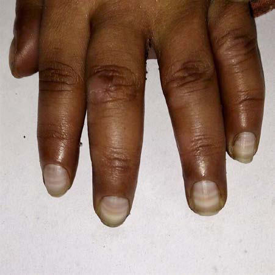

# Chapter 62: Nutrition, Food Security, and Health

*Jason M. Nagata and Christine M. McDonald*

<!-- p.581 -->
**MALNUTRITION AS THE INTERSECTION OF FOOD INSECURITY AND HEALTH INSECURITY Undernutrition** is usually an outcome of three factors, often in com bination: household food supply insecurity, suboptimal childcare practices, and restricted access to or use of health and water/sanita tion services. In famine and emergency settings, food shortage is the foremost factor, but in many countries with widespread undernutri tion, food production or access to food might not be the most limiting factor. More important causes might be repeated childhood infections, especially diarrheal diseases associated with an unsanitary environ ment, poor infant and young child feeding practices, or various chal lenges that may prevent families from using quality maternal and child health services. Figure 62.1 shows some of the many causal factors on the pathway to undernutrition and how they extend from household and community levels to national/international levels. Inequitable dis tribution of resources because of political, economic, and agricultural policies often denies families their right to adequate land, water, food, healthcare, education, and a safe environment, all of which can influ ence nutritional status.

Families with few economic resources who know how to care for their children and are enabled to do so can often use available food and health services to produce well-nourished children. If food resources and health services are not available in a community, not used, or not accessible to some families, children might become undernourished. Undernutrition is not confined to low-income countries. It has been noted in chronically ill patients in neonatal and pediatric intensive care units in high-income countries and among patients with burns, human immunodeficiency virus (HIV) infection, tuberculosis, cys tic fibrosis, chronic diarrhea syndromes, malignancies, bone marrow

transplantation, and inborn errors of metabolism (see Chapter 64). Severe malnutrition has been reported in affluent communities in infants whose families believe in fad diets and in infants with food allergies fed nutritionally inadequate foods such as rice “milk,” which has a very low protein and micronutrient content (Figs. 62.2 and 62.3; also see Fig. 61.3).

**FOOD SECURITY** Food security exists when all people, at all times, have access to suf ficient, safe, nutritious food to maintain a healthy and active life. Four main dimensions of food security can be identified: availability, access, utilization, and stability. **Availability** refers to the *supply* of food, reflecting the level of food production, food stocks, and net trade. **Access** is typically defined at the household level, reflecting purchasing power, household food production, and food/cash transfers received through social “safety net” programs. The **utilization** dimension recog nizes that even when a household has access to food, it is not necessar ily shared equitably within a household. **Stability** refers to being “food secure” at all times: Examples of situations that affect stability are the “lean seasons” before a harvest, natural disasters, political unrest, and rising food prices. To be food secure, all four dimensions must be met simultaneously.

**Measuring Food Insecurity** The most commonly used measurement of food insecurity is *under nourishment* (chronic hunger), which is the proportion of the popu lation who are unable to meet daily energy requirements for light activities. It is an estimate calculated by the **Food and Agriculture Organization (FAO)** based on country-level food balance sheets. It does not take nutrient adequacy into account, but has the advantage of being available for almost all countries annually (although with a time lag) and assists in monitoring global trends. In addition, FAO measures food access by asking individuals about their experiences over the last 12 months, such as whether they ran out of food or skipped meals. The responses are graded from mild to severe food insecurity. This rela tively simple monitoring tool, the **Food Insecurity Experience Scale**, provides timely information to guide decision-making at national and local levels.

In 2020, the FAO estimated that between 720 and 811 million peo ple, or approximately 9.9% of the world’s population, were undernour ished. More than half of the world’s undernourished were found in

*Jason M. Nagata and Christine M. McDonald*

**Inadequate**

**Education** Poverty, women’s disempowerment, closely-spaced births

**Inadequate Care**

**for Mothers and**

**Children** Psychosocial

deprivation

**Poor Growth** Impaired immunity, frequent, more severe

infections

**Undernutrition**

**Health Insecurity** Inadequate health services, unhealthy

environment

**Food Insecurity** Food unavailable,

unaffordable

**Disease** Anorexia, nutrient losses, increased

requirements

**Inadequate Dietary Intake**

Poor feeding practices, maternal competence, cultural

beliefs

**Conflict** Population displacement, migration, disruption

to agriculture/food

supply

**Resources and**

**Control**

**Natural Disasters**

Drought, flood, hurricane, earthquake

**Political, Economic** Weak social systems,

corruption, low GDP,

high foreign debt, poor infrastructure

**Fig. 62.1** Basic, underlying, and immediate causes of undernutrition.

<!-- p.582 -->
Asia, and more than one third were found in Africa. The majority are rural poor people subsisting on small plots of land or hired as labor ers and urban poor people who lack the means to grow or buy food. Alongside the 768 million people who are underfed are 1.9 billion who are overweight or obese, reflecting global inequalities and the “double burden of malnutrition” in low- and middle-income countries.

**Nutrition, Food Security, and Poverty** Household food security tracks income closely. With rising incomes, very poor households first increase their dietary energy intake to avert hunger. If incomes rise further, there is a shift to more expensive sta ple foods and then to a more varied diet with a greater proportion of energy from animal sources, fruits/vegetables, and fats/sugars and less from cereals, roots, and tubers. National economic growth tends to be accompanied by reductions in stunting, but economic growth can pass by poor persons if they work in unaffected sectors or are unable to take advantage of new opportunities because of lack of education, access to credit, or transportation, or if governments do not channel resources accruing from economic growth to healthcare, education, social pro tection, and other public services and infrastructure. There is good evi dence that economic growth reduces poverty but does not necessarily reduce undernutrition.

**Food Security and Nutrition Targets** The period of the Millennium Development Goals (MDGs) ended in 2015. All developing regions except sub-Saharan Africa achieved the tar get to halve the proportion of people living in extreme poverty, with the proportion falling from 47% in 1990 to 14% in 2015. Reductions in hun ger were broadly consistent with those of poverty reduction, and rates of undernourishment in developing regions fell from 23% in 1990 to 13% in 2015. The prevalence of underweight among children under 5 years (another MDG indicator of “hunger”) fell from 29% in 1990 to 15% in 2015 for the developing regions combined. Rural children are almost twice as likely to be underweight as urban children, and the poorest quintile is almost 3 times as likely to be underweight as the richest quintile.

Eradicating poverty and hunger continue to be core targets of the **Sustainable Development Goals**, as agreed by 193 countries of the United Nations General Assembly in September 2015, and are to be achieved by 2030. In addition, in 2012 the World Health Assembly agreed to six global nutrition targets to be reached by 2025, measured against a 2010 baseline, and the United Nations Secretary-General launched the **Zero Hunger Challenge** with five objectives that “would boost economic growth, reduce poverty and safeguard the environ ment” and “would foster peace and stability” (Table 62.1).

**Future Food Security** Between now and 2050 the world’s population is expected to exceed 9 billion, and an increase in the food supply of 70–100% will be needed to feed this larger, more urban, and more affluent populace. Over this same period, the world’s food supply is expected to diminish unless action is taken. Accelerating the decline in fertility rates and reduc ing overconsumption are basic but difficult actions to bridge the gap between increasing demand and diminishing supply. Equally chal lenging actions include limiting climate disruption, increasing the effi ciency of food production, reducing waste, and reducing the demand for meat and dairy foods. The COVID-19 pandemic significantly dis rupted food systems and exacerbated food insecurity globally.

u	 *Limit climate disruption.* Drought, floods, and other extreme weather

events are becoming more prevalent and destroy crops and livestock, often on a huge scale. Rising sea levels will lead to loss of productive land through inundation and salinization. Acidification of oceans will reduce marine harvests. Because curbing greenhouse gas emis sions is essential to minimize climate disruption, the goals are (1) to cut fossil fuel use by at least half of present levels by 2050 so as to reduce carbon dioxide (CO2) emissions and (2) change livestock husbandry and agronomic practices to reduce methane and nitrous oxide (N2O) emissions.

u	 *Increase efficiency of food production.* Expanding the area of agricul

tural land to any large extent (e.g., by deforestation) is not a sus tainable option because of adverse consequences on ecosystems and biodiversity, although some expansion of food production could be

**Fig. 62.2** A 14-month-old girl with “flaky paint” dermatitis. (From Katz KA, Mahlberg MH, Honig PJ, et al. Rice nightmare: Kwashiorkor in 2 Philadelphia-area infants fed Rice Dream beverage. J Am Acad Derma tol. 2005;52:S69–S72.)

**Fig. 62.3** Paired, transverse, homogeneous, and smooth bordered lines noted in all fingernails suggestive of Muehrcke lines in an infant fed diluted cow’s milk since birth. Muehrcke lines are an apparent leukonychia most often associated with hypoalbuminemia. (From Williams V, Jayashree M. Muehrcke lines in an infant. J Pediatr. 2017;189:234.)

#### **Table 62.1** Global Food Security and Nutrition Targets

| Category / Parameter | Clinical Details & Findings |
| --- | --- |
| **FOR 2025** | 1.	 Access to an adequate and; stable food supply for all; 2.	 Elimination of stunting; in children <2 yr, and no; malnutrition in pregnancy and; early childhood; 3.	 Sustainable food systems; 4.	 Doubling of smallholder; productivity and income,; particularly for women; 5.	 No loss or waste of food and; responsible consumption; 1.	 A 40% reduction in the; number of stunted children; <5 yr; 2.	 A 50% reduction in anemia in; women of reproductive age; 3.	 A 30% reduction in low; birthweight; 4.	 No increase in childhood; overweight; 5.	 Increase exclusive; breastfeeding rates to at least; 50% in the first 6 mo; 6.	 Reduce and maintain; childhood wasting to <5% |

<!-- p.583 -->
achieved by switching good-quality land away from first-generation biofuels. For example, almost 40% of the U.S. corn harvest in 2016– 2017 went to biofuels. Efforts to increase the intensity of production need to be environmentally sustainable. These include optimizing yields by soil and water conservation, removal of technical and fi nancial constraints faced by farmers, and breeding resource-efficient crops and livestock that are also climate resilient and pest/disease resistant.

u	 *Reduce waste.* Approximately 30–40% of food is wasted, between

harvesting and the market, during retail, at home, and in the food service industry. Better transport and storage facilities in develop ing countries, less stringent sell-by dates, lower cosmetic standards for fruits and vegetables, and ending supersized portions would help reduce waste.

u	 *Change diets.* As wealth increases, so does the demand for processed

foods, meat, dairy products, and fish. About one third of global ce real production is fed to animals, so reducing consumption of meat from grain-fed livestock and increasing the proportion derived from the most efficient sources (pigs and poultry) would allow more peo ple to be fed from the same amount of land.

**UNDERNUTRITION** The greatest risk of undernutrition (underweight, stunting, wasting, and micronutrient deficiencies) occurs in the first 1,000 days, from conception to 24 months of age, and this early effect on growth and development can have adverse consequences on health, intellectual ability, school achievement, work productivity, and earnings in later life. Governments and agencies are therefore advised to focus interven tions on this critical window of opportunity.

**Measurement of Undernutrition** The term **malnutrition** encompasses both ends of the nutrition spec trum, undernutrition as well as overweight and obesity. Many poor nutritional outcomes begin in utero and are manifest as low birth weight (LBW, <2,500 g). Preterm birth and fetal growth restriction are the two main causes of LBW, with prematurity relatively more common in richer countries and fetal growth restriction relatively more com mon in lower-income countries.

Nutritional status is often assessed in terms of anthropometry (Table 62.2). International standards of normal child growth under optimum conditions from birth to 5 years have been established by the World Health Organization (WHO). To compile the standards, longitudinal data from birth to 24 months of healthy, breastfed, term infants were combined with cross-sectional measurements of children ages 18-71 months. The standards allow normalization of anthropometric mea sures in terms of *z* scores (standard deviation [SD] scores). A *z* score is the child’s height (weight) minus the median height (weight) for the child’s age and sex divided by the relevant SD. The standards are applicable to all children everywhere, having been derived from a large, multicountry study reflecting diverse ethnic backgrounds and cultural settings.

**Height-for-age** (or length-for-age for children <2 years) is a mea sure of linear growth, and a deficit represents the cumulative impact of adverse events, usually in the first 1,000 days from conception, that result in *stunting,* or chronic undernutrition. A low height-for-age typi cally reflects socioeconomic disadvantage. A low **weight-for-height**, or *wasting*, usually indicates acute malnutrition. Conversely, a high weight-for-height indicates *overweight*. **Weight-for-age** is the most commonly used index of nutritional status, although a low value has limited clinical significance because it does not differentiate between wasting and stunting. Weight-for-age has the advantage of being some what easier to measure than indices that require height measurements. In humanitarian emergencies and some community or outpatient set tings, **mid-upper arm circumference** is used as a screening tool to identify wasted children (Fig. 62.4).

**Body mass index (BMI)** is calculated by dividing weight in kilo grams by the square of height in meters. For children, BMI is age and gender specific. **BMI-for-age** can be used from birth to 20 years and is a screening tool for *thinness* (less than −2 SD), *overweight* (between

+1 SD and +2 SD), and *obesity* (greater than +2 SD). To diagnose obesity, additional measures of adiposity are desirable because a high BMI can result from high muscularity and not only from excess sub cutaneous fat.

**Micronutrient deficiencies** are another dimension of undernu trition. Those of particular public health significance are vitamin A, iodine, iron, and zinc deficiencies.

**Vitamin A deficiency** is caused by a low intake of retinol (in animal foods) or its carotenoid precursors, mainly beta-carotene (in orangecolored fruits and vegetables and dark-green leaves) (see Chapter 66). The prevalence of *clinical deficiency* is assessed from symptoms and signs of xerophthalmia (principally night blindness and Bitot spots). *Subclinical deficiency* is defined as serum retinol concentration ≤0.70 μmol/L. Vitamin A deficiency is the leading cause of preventable blind ness in children. It is also associated with a higher morbidity and mor tality among young children.

#### **Table 62.2** Classification of Undernutrition

| Category / Parameter | Clinical Details & Findings |
| --- | --- |
| **GRADING** | Gomez (underweight); 90–75% of median; weight-for-age; Grade 1 (mild); 75–60%; Grade 2 (moderate); <60%; Grade 3 (severe); Waterlow (wasting); 90–80% of median; weight-for-height; Mild; 80–70%; <70%; Moderate; Severe; Waterlow (stunting); 95–90% of median; height-for-age; Mild; 90–85%; Moderate; <85%; Severe; WHO (wasting); < −2 to > −3 SD; weight-for-height; Moderate; < −3; Severe; WHO (stunting); < −2 to > −3 SD; height-for-age; Moderate; < −3; Severe; WHO (wasting) (for; age-group 6-59 mo); 115-125 mm; mid-upper arm; circumference; Moderate; <115 mm; Severe; SD, Standard deviation; WHO, World Health Organization. |

**Fig. 62.4** Measuring mid-upper arm circumference. (Courtesy Nyani Quarmyne/Panos Pictures.)

<!-- p.584 -->
**Iodine deficiency** is the world’s leading cause of preventable intellectual impairment (see Chapter 72). An enlarged thyroid (goi ter) is a sign of deficiency. Severe deficiency in pregnancy causes fetal loss and permanent damage to the brain and central nervous system in surviving offspring (cretinism). It can be prevented by iodine supplementation before conception or during the first tri mester of pregnancy. Postnatal iodine deficiency is associated with impaired mental function and growth stunting. The median urinary iodine concentration in children age 6-12 years is used to assess the prevalence of deficiency in the general population, and a median of <100 μg/L indicates insufficient iodine intake.

**Iron-deficiency anemia** is common in childhood either from low iron intakes or poor absorption, or as a result of illness or parasite infestation (see Chapter 72). Women also have relatively high rates of anemia as a result of menstrual blood loss, pregnancy, low iron intake, poor absorption, and illness. Hemoglobin cutoffs to define anemia are 110 g/L for children 6-59 months, 115 g/L for children 5-11 years, and 120 g/L for children 12-14 years. Cutoffs to define anemia are 120 g/L for nonpregnant women, 110 g/L for pregnant women, and 130 g/L for men.

**Zinc deficiency** increases the risk of morbidity and mortality from diarrhea, pneumonia, and possibly other infectious diseases (see Chap ter 72). Zinc deficiency also has an adverse effect on linear growth. Deficiency at the population level is assessed from dietary zinc intakes or serum zinc concentrations. For children under 10 years of age, serum zinc cutoffs of <65 μg/dL and <57 μg/dL are used to define zinc deficiency according to whether the blood sample was obtained in the morning or afternoon, respectively. For females 10 years of age or older, cutoffs of <70 μg/dL, <66 μg/dL, and <59 μg/dL are used depending on whether the blood sample was obtained in the morning in a fasted state, the morning in a nonfasted state, or in the afternoon in a non fasted state, respectively.

**Prevalence of Undernutrition** It is estimated that approximately 14.6% of births worldwide in 2015 were LBW*.* Rates of LBW are highest (48%) in southern Asia, which are twice those of sub-Saharan Africa. Globally, in 2015, 14% of children <5 years of age were *underweight* (weight-for-age < −2 SD). The global prevalence of *stuntin*g (height-for-age < −2 SD) has declined from 33% in 2000 to 22% in 2017, with the greatest reduc tions occurring in Asia. Stunting prevalence is highest in the Afri can region (30%). *Wasting* (weight-for-height < −2 SD) affects 7% of children <5 years, with minimal change in prevalence over the past 2 decades. These figures represent 149 million stunted children and 50 million wasted children under 5 years of age. Asia carries most of the global burden of underweight children because of the com bination of large population size and high prevalence. In 2017, 55% of all stunted children and 69% of all wasted children lived in Asia. Africa carries most of the remaining global burden.

Approximately 29% of children under 5 years of age in low- and middle-income countries (LMICs) suffer from vitamin A defi ciency. Nationally representative data on the zinc status of children are sparse, but an estimated 17% of the global population is believed to be at risk of inadequate zinc intake. The estimated prevalence of anemia in children and women of reproductive age in 2016 was 42% and 33%, respectively. Iron deficiency is considered to be the primary cause of anemia in 25–42% and 50–60% of anemia cases among children and women, respectively. Universal salt iodiza tion has made great strides in reducing the global burden of iodine deficiency. However, mild to moderate iodine deficiency remains a public health concern in 25 countries.

**Consequences of Undernutrition** The most profound consequence of undernutrition is premature death (Table 62.3). Fetal growth restriction together with suboptimal breast feeding in the first month of life contribute to 19% of all deaths in chil dren <5 years (1.3 million deaths/year). When the effects of stunting, wasting, and deficiencies of vitamin A and zinc are also considered, these six items jointly contribute to 45% of global child deaths (3.1

million deaths/year), and many more are disabled or stunted for life. Anemia contributes to over one quarter of maternal deaths.

The risk of child death from infectious diseases increases even with mild undernutrition, and as the severity of undernutrition increases, the risk increases exponentially (Table 62.4). Undernu trition impairs immune function and other host defenses; conse quently, childhood infections are more severe and longer lasting and more likely to be fatal than the same illnesses in well-nourished children. Infections can adversely affect nutritional status, and young children can quickly enter a cycle of repeated infections and ever-worsening malnutrition. Even for the survivors, physical and cognitive damage as a result of undernutrition can affect their future health and economic well-being. For females, the cycle of undernutrition is passed on to the next generation when under nourished women give birth to LBW babies.

Fetal growth restriction and early childhood undernutrition have con sequences for adult chronic illness. LBW is associated with an increased risk of hypertension, stroke, and type 2 diabetes in adults. This increased risk is thought to reflect “fetal programming,” a process by which fetal undernutrition leads to permanent changes in the structure and metab olism of organs and systems that manifest as disease in later life. The risk is exacerbated by low weight gain during the first 2 years of life. The increased risk of adult chronic disease from undernutrition early in life is a particular challenge to LMICs with rapid economic growth.

Stunting before age 3 years is associated with poorer motor and cog nitive development and altered behavior in later years. The develop mental quotient (DQ; see Chapter 28) is reduced by 6-13 points. Iodine and iron deficiencies also lead to loss of cognitive potential. Indications are that children living in areas of chronic iodine deficiency have an average reduction in intelligence quotient (IQ) of 12-13.5 points com pared with children in iodine-sufficient areas. Iron deficiency has a detrimental effect on the motor development of children <4 years and on cognition of school-aged children. The estimated deficit is 1.73 IQ points for each 10 g/L decrease in hemoglobin concentration.

Undernutrition can have substantial economic consequences for survivors and their families. The consequences can be quantified in five categories: (1) increased costs of healthcare, either neonatal care for LBW babies or treatment of illness for infants and young children; (2) productivity losses (and thus reduced earnings) associated with smaller stature and muscle mass; (3) productivity losses from reduced cognitive ability and poorer school performance; (4) increased costs of chronic diseases associated with fetal and early child malnutrition; and

to Nutritional Conditions

#### **Table 62.3** Global Deaths in Children <5 Years Attributed

| Category / Parameter | Clinical Details & Findings |
| --- | --- |
| **DEATHS <5 YR** | (a) Fetal growth; restriction (<1 mo); 817,000; 11.8; (b) Stunting (1-59 mo); 1,017,000; 14.7; (c) Wasting (1-59 mo); 875,000; 12.6; (d) Zinc deficiency; (12-59 mo); 116,000; 1.7; (e) Vitamin A deficiency; (6-59 mo); 157,000; 2.3; (f) Suboptimal; breastfeeding (0-; 23 mo); 804,000; 11.6; Joint effects of (a) + (f); 1,348,000; 19.4; Joint effects of all 6; factors; 3,097,000; 44.7; From Black RE, Victora CG, Walker SP, et al. Maternal and child undernutrition and; overweight in low- and middle-income countries. Lancet. 2013;382:427–451. |

<!-- p.585 -->
(5) consequences of maternal undernutrition on future generations. The impact of nutrition on earnings appears to be independent of the effects of childhood deprivation.

**Interventions for Undernutrition** Interventions to address child undernutrition can be divided into those that address immediate causes *(nutrition-specific interventions)* and those that address underlying or indirect causes *(nutrition-sensitive interven tions)* (Table 62.5). In the short-term, nutrition-specific interventions (e.g., salt iodization) can have substantial impact even in the absence of economic growth, and micronutrient interventions (supplementation and fortification) are consistently ranked as the most cost-effective investment. However, there is increased attention to nutrition-sensitive interventions as the best means of sustainably eliminating malnutrition and to multisec toral policies that harness the synergism between the two types of inter ventions (e.g., cross-sectoral linkages among agriculture, nutrition, and health).

To reduce the adverse consequences of undernutrition on mor tality, morbidity, and cognitive development, interventions must encompass both fetal and postnatal periods. Preventing LBW is essential, with emphasis on prevention of low maternal BMI and anemia, and in the longer term, prevention of low maternal stature. Maternal height is a strong predictor of birth outcomes, and approx imately 6.5 million small-for-gestational age (SGA) or preterm births are associated with maternal short stature each year. Other measures include smoking cessation, birth spacing, delaying preg nancy until after 18 years of age, and intermittent preventive treat ment of malaria in malaria-endemic areas. In the postnatal period, promotion and support of exclusive breastfeeding is a high priority. Although the Baby Friendly Hospital Initiative has a marked benefit on rates of exclusive breastfeeding in hospitals, postnatal counsel ing from community workers or volunteers is needed to facilitate continuation of exclusive breastfeeding at home for 6 months (see Chapter 61). Most studies show a lower risk of HIV transmission with exclusive breastfeeding than with mixed breastfeeding. The risk of HIV transmission by breastfeeding is approximately 5–20%

depending on duration, but can be reduced to <2% with antiretro viral drugs. Even without antiretroviral drugs, exclusively breastfed children of HIV-infected mothers in low-income countries have lower mortality than nonbreastfed children, because the latter are at increased risk of death from diarrhea and pneumonia.

Interventions to improve infant feeding must be designed for the local setting and thus require careful formative research dur ing their development. Messages should be few, feasible, and

Children <5 Years

≥ −1 1.0 1.0 1.0 1.0 1.0

≥ −1 1.0 1.0 1.0 1.0 1.0

≥ −1 1.0 1.0 1.0 1.0 1.0

#### **Table 62.4** Hazard Ratios for All-Cause and Cause-Specific Deaths Associated with Stunting, Wasting, and Underweight in

| Category / Parameter | Clinical Details & Findings |
| --- | --- |
| **HEIGHT/LENGTH-FOR-AGE** | < −3; 5.5; 6.4; 6.3; 6.0; 3.0; −3 to < −2; 2.3; 2.2; 2.4; 2.8; 1.9; −2 to < −1; 1.5; 1.6; 1.7; 1.3; 0.9 |
| **WEIGHT-FOR-LENGTH** | < −3; 11.6; 9.7; 12.3; 9.6; 11.2; −3 to < −2; 3.4; 4.7; 3.4; 2.6; 2.7; −2 to < −1; 1.6; 1.9; 1.6; 1.0; 1.7 |
| **WEIGHT-FOR-AGE** | < −3; 9.4; 10.1; 11.6; 7.7; 8.3; −3 to < −2; 2.6; 3.1; 2.9; 3.1; 1.6; −2 to < −1; 1.5; 1.9; 1.7; 1.0; 1.5; From Black RE, Victora CG, Walker SP, et al. Maternal and child undernutrition and overweight in low- and middle-income countries. Lancet. 2013;382:427–451. |

Nutrition-Sensitive Interventions

#### **Table 62.5** Examples of Nutrition-Specific and

| Category / Parameter | Clinical Details & Findings |
| --- | --- |
| **INTERVENTIONS** | •	 Promotion and support for; exclusive breastfeeding for; 6 mo, and continued; breastfeeding for at least 2 yr; •	 Promotion of adequate, timely,; and safe complementary; feeding from 6 mo; •	 Increased micronutrient intake; through dietary diversity; •	 Micronutrient supplements for; pregnant women (iron/folate); and young children (vitamin A,; iron, zinc) in deficient areas; •	 Zinc supplements to children; during and after diarrhea; (10-20 mg/day for 2 wk); •	 Prevention and treatment of; severe acute malnutrition; •	 Crop biofortification, food; fortification, salt iodization; •	 Reduced heavy physical; activity in pregnancy; •	 Increased access to; affordable, nutritious food;; smallholder agriculture; credit; and microfinance; •	 Postharvest food processing; and preservation; •	 Vaccination against neonatal; and childhood illness; access; to healthcare; •	 Improved water/sanitation and; hygiene (e.g., handwashing; with soap); •	 Education; women’s; empowerment; gender equality; •	 Social protection (e.g., cash; transfers); •	 Malaria prevention (vector; control/bednets); intermittent; preventive treatment during; pregnancy and in children; 3-59 mo; •	 Birth spacing; delaying; pregnancy until after 18 yr of; age |

<!-- p.586 -->
culturally appropriate. For complementary feeding, the introduc tion of nutrient-rich energy-dense mixtures of foods at 6 months of age and responsive feeding are often emphasized. Where adequate complementary feeding is difficult to achieve and subclinical defi ciencies are common, high-dose vitamin A supplementation every 6 months in children 6-59 months of age reduces all-cause mortality and death caused by diarrhea by 12%, and zinc supplementation can reduce 1- to 4-year mortality by 18%, diarrhea incidence by 13%, and pneumonia by 19%. Monitoring of child growth provides an early alert to a nutrition or health problem but is only worthwhile if accompanied by good counseling and growth promotion activities. The impact of growth monitoring and promotion will depend on coverage, intensity of contact, health worker performance and com munication skills, adequacy of resources, and the motivation and ability of families to follow agreed actions.

**Other Nutritional Interventions** Treatment of vitamin and mineral deficiencies is discussed in Chapters 66-72. Treatment of LBW and intrauterine growth restriction is dis cussed in Chapter 119.

**SEVERE ACUTE MALNUTRITION** Severe acute malnutrition is defined as severe wasting and/or bilateral edema. *Severe wasting* is extreme thinness diagnosed by a weight-for-length (or height) < −3 SD of the WHO Child Growth Standards. In children ages 6-59 months, a mid-upper arm cir cumference <115 mm also denotes severe acute malnutrition: a color-banded tape (see Fig. 62.4) is a convenient way of screening children in need of treatment.

*Bilateral edema* is diagnosed by grasping both feet, placing a thumb on top of each, and pressing gently but firmly for 10 seconds. A pit (dent) remaining under each thumb indicates bilateral edema.

This definition of severe acute malnutrition distinguishes wasted/ edematous children from those who are stunted because stunted children (although underweight) are not a priority for acute clinical care because their deficits in height and weight cannot be corrected in the short term. The previous name *protein-energy malnutrition* is avoided because it oversimplifies the complex, multifactorial etiology. Other terms are *marasmus* (severe wasting), *kwashiorkor* (characterized by edema), and *marasmic-kwashiorkor* (severe wast ing and edema).

Children with severe acute malnutrition have had a diet insuffi cient in energy and nutrients relative to their needs. The magnitude of the deficits will differ depending on the duration of inadequacy, quantity and diversity of food consumed, presence of antinutrients (e.g., phytate), individual variation in requirements, and number and severity of coexisting infections and their duration. Infections can lead to profound nutrient deficits and imbalances: For exam ple, amino acids are diverted to form acute-phase proteins, potas sium, magnesium, vitamin A, and zinc are lost through diarrhea, and losses of glycine and taurine are linked to small bowel bacterial overgrowth. Ingested microbes can cause villous atrophy and loss of nutrients from maldigestion and malabsorption, as well as dis ruption of gut barrier function leading to microbial translocation, chronic immune activation, and altered gut microbiome (environ mental enteric dysfunction). Deficits can also arise from increased nutrient utilization in response to toxins (e.g., cysteine and methio nine to detoxify dietary cyanogens).

Children affected by severe acute malnutrition may have different clinical presentations and metabolic disturbances due to variations in the type and extent of deficits and imbalances in their bodies. This heterogeneity is a result of diverse pathways that lead to severe acute malnutrition. Children who develop edematous malnutrition are more likely than nonedematous children to have had exposures that generate oxidative stress and/or to have greater deficits in free radical–scavenging antioxidants (glutathione; vitamins A, C, and E; and essential fatty acids) or cofactors (zinc, copper, selenium).

**Clinical Manifestations of Severe Acute Malnutrition (****Table 62.6****) Severe wasting** is most visible on the thighs, buttocks, and upper arms and over the ribs and scapulae, where loss of fat and skeletal muscle is greatest (Fig. 62.5). Wasting is preceded by failure to gain weight and then by weight loss. The skin loses turgor and becomes loose as subcutaneous tissues are broken down to provide energy. The face may retain a relatively normal appearance, but eventually becomes wasted and wizened. The eyes may be sunken from loss of retroorbital fat, and lacrimal and salivary glands may atrophy, leading to lack of tears and a dry mouth. Weakened abdominal muscles and gas from bacterial over growth of the upper gut may lead to a distended abdomen. Severely wasted children are often fretful and irritable.

In **edematous malnutrition** the edema is most likely to appear first in the feet and then in the lower legs. It can quickly develop into generalized edema affecting also the hands, arms, and face (Fig. 62.6). Skin changes typically occur over the swollen limbs and include dark, crackled peeling patches (“flaky paint” dermatosis) with pale skin underneath that is easily infected (see Figs. 62.2 and 62.6). The hair is sparse, easily pulled out, and may lose its curl. In dark-haired children, the hair may turn pale or reddish. The liver is often enlarged with fat. Children with edema are uncomfortable, irritable and/or apathetic, and often refuse to eat.

#### **Table 62.6** Clinical Signs of Malnutrition

| Category / Parameter | Clinical Details & Findings |
| --- | --- |
| **SIGNS** | Face; Moon face (kwashiorkor), simian facies (marasmus); Eye; Dry eyes, pale conjunctiva, Bitot spots (vitamin A),; periorbital edema; Mouth; Angular stomatitis, cheilitis, glossitis, spongy; bleeding gums (vitamin C), parotid enlargement; Teeth; Enamel mottling, delayed eruption; Hair; Dull, sparse, brittle hair; hypopigmentation; flag; sign (alternating bands of light and normal; color); broomstick eyelashes; alopecia; Skin; Loose and wrinkled (marasmus); shiny and; edematous (kwashiorkor); dry, follicular; hyperkeratosis; patchy hyperpigmentation and; hypopigmentation (“crazy paving” or “flaky paint”; dermatoses); erosions; poor wound healing; Nails; Koilonychia; thin and soft nail plates, fissures, or; ridges; Musculature; Muscle wasting, particularly buttocks and thighs;; Chvostek or Trousseau sign (hypocalcemia); Skeletal; Deformities, usually as a result of calcium, vitamin; D, or vitamin C deficiencies; Abdomen; Distended: hepatomegaly with fatty liver; ascites; may be present; Cardiovascular; Bradycardia, hypotension, reduced cardiac; output, small vessel vasculopathy; Neurologic; Global developmental delay, loss of knee and; ankle reflexes, impaired memory; Hematologic; Pallor, petechiae, bleeding diathesis; Behavior; Lethargic, apathetic, irritable on handling; Gastrointestinal; tract; Atrophy of small intestine mucosa, lactase; deficiency common; Modified from Grover Z, Ee LC. Protein energy malnutrition. Pediatr Clin North Am.; 2009;56:1055–1068. |

<!-- p.587 -->
**Pathophysiology** When a child’s intake is insufficient to meet daily needs, physiologic and metabolic changes take place in an orderly progression to con serve energy and prolong life. This process is called *reductive adap tation*. Fat stores are mobilized to provide energy. Later, protein in muscle, skin, and the gastrointestinal tract is mobilized. Energy is conserved by reducing physical activity and growth, reducing basal metabolism and the functional reserve of organs, and reducing inflammatory and immune responses. These changes have impor tant consequences:

u	 The liver makes glucose less readily, making the child more prone

to hypoglycemia. It produces less albumin, transferrin, and other transport proteins. It is less able to cope with excess dietary protein and to excrete toxins.

u	 Heat production is less, making the child more vulnerable to hypo

thermia.

u	 The kidneys are less able to excrete excess fluid and sodium, and

fluid easily accumulates in the circulation, increasing the risk of fluid overload.

u	 The heart is smaller and weaker and has a reduced output, and fluid

overload readily leads to death from cardiac failure.

u	 Sodium builds up inside cells because of leaky cell membranes and

reduced activity of the sodium-potassium pump, leading to excess body sodium, fluid retention, and edema.

u	 Potassium leaks out of cells and is excreted in urine, contributing to

electrolyte imbalance, fluid retention, edema, and anorexia.

u	 Loss of muscle protein is accompanied by loss of potassium, magne

sium, zinc, and copper.

u	 The gut produces less gastric acid and enzymes. Motility is reduced,

and bacteria may colonize the stomach and small intestine, damag ing the mucosa and deconjugating bile salts. Digestion and absorp tion are impaired.

u	 Cell replication and repair are reduced, increasing the risk of bacte

rial translocation through the gut mucosa.

u	 Immune function is impaired, especially cell-mediated immunity.

The usual responses to infection may be absent, even in severe ill ness, increasing the risk of undiagnosed infection.

u	 Red blood cell mass is reduced, releasing iron, which requires glu

cose and amino acids to be converted to ferritin, increasing the risk of hypoglycemia and amino acid imbalances. If conversion to fer ritin is incomplete, unbound iron promotes pathogen growth and formation of free radicals.

u	 Micronutrient deficiencies limit the body’s ability to deactivate free

radicals, which cause cell damage. Edema and hair/skin changes are outward signs of cell damage. When prescribing treatment, it is essential to take these changes in function into account. Otherwise, organs and systems will be over whelmed, and death will rapidly ensue.

**Principles of Treatment** Figure 62.7 shows the 10 steps of treatment, which are separated into two phases: stabilization and rehabilitation. These steps apply to all clinical forms and all geographic locations, including North America and Europe. The aim of the **stabilization** phase is to repair cellular function, correct fluid and electrolyte imbalance, restore homeostasis, and prevent death from the interlinked triad of hypo glycemia, hypothermia, and infection. The aim of the **rehabilita tion** phase is to restore wasted tissues (i.e., catch-up growth). It is essential that treatment proceeds in an ordered progression and that the metabolic machinery is repaired before any attempt is made to promote weight gain. Pushing ahead too quickly risks inducing the potentially fatal “refeeding syndrome” (see Chapter 63).

Caregivers bring children to health facilities because of illness, rarely because of their malnutrition. A common mistake among healthcare providers is to focus on the illness and treat as for a wellnourished child. This approach ignores the deranged metabolism in malnourished children and can be fatal. Such children should be considered as severely malnourished with a complication, and

**Fig. 62.5** Child with severe wasting.

**Fig. 62.6** Child with generalized edema.

<!-- p.588 -->
treatment should follow the 10 steps. *Two other potentially fatal mis takes are to treat edema with a diuretic and to give a high-protein diet in the early phase of treatment.*

**Emergency Treatment** Table 62.7 summarizes emergency treatment for malnourished children with shock and other emergency conditions. Note that treatment of shock in these children is different (less rapid, smaller volume, different fluid) from treatment of shock in well-nourished children. However, shock from dehydration and shock from sepsis often coexist and are difficult to differentiate on clinical grounds. Thus the physician must be guided by the response to treatment: children with dehydration respond to IV fluid, whereas those with septic shock will not respond. Because severely malnourished chil dren can quickly succumb to fluid overload, they must be moni tored closely.

**Stabilization** Table 62.8 summarizes the therapeutic directives for stabilization steps 1-7 (see Fig. 62.7). Giving broad-spectrum antibiotics (Table 62.9) and feeding frequent small amounts of F75 (a specially formulated low-lactose milk with 75 kcal and 0.9 g protein per 100 mL to which potassium, magnesium, and micronutrients are added) will reestablish metabolic control, treat edema, and restore appetite. The parenteral route should be avoided; children who lack appetite should be fed by nasogastric tube, because nutrients delivered within the gut lumen help in its repair. Table 62.10 provides recipes for preparing the spe cial feeds and their nutrient composition. Of the two recipes for F75, one requires no cooking, and the other is cereal based and has a lower osmolality, which may benefit children with persistent diarrhea. F75 is also commercially available; maltodextrins replace some of the sugar, and potassium, magnesium, minerals, and vitamins are already added.

Stabilization Rehabilitation

Day 1–2 Day 3–7 Week 2–6 1. Prevent/treat hypoglycemia

2. Prevent/treat hypothermia

3. Treat/prevent dehydration

4. Correct imbalance of electrolytes

5. Treat infections

6. Correct deficiencies of micronutrients no iron with iron

7. Start cautious feeding

8. Rebuild wasted tissue (catch-up growth)

9. Provide loving care and play

10. Prepare for follow-up

#### **Table 62.7** Emergency Treatment in Severe Malnutrition

| Category / Parameter | Clinical Details & Findings |
| --- | --- |
| **IMMEDIATE ACTION** | Shock; •	 Lethargic or unconscious and; •	 Cold hands; Plus either:; •	 Slow capillary refill (>3 sec) or; •	 Weak fast pulse; 1.	 Give oxygen.; 2.	 Give sterile 10% glucose (5 mL/kg) rapidly by IV injection.; 3.	 Give IV fluid at 15 mL/kg over 1 hr, using:; •	 Ringer lactate with 5% dextrose or; •	 Half-normal saline* with 5% dextrose or; •	 Half-strength Darrow solution with 5% dextrose; •	 If all these are unavailable, Ringer lactate; 4.	 Measure and record pulse and respirations at the start and every 10 min. If there are signs of improvement; (pulse and respiration rates fall), repeat IV drip, 15 mL/kg for 1 more hr. Then switch to oral or nasogastric; rehydration with ReSoMal, 5-10 mL/kg in alternate hr (see Table 62.8 step 3).; If there are no signs of improvement, assume septic shock and:; 1.	 Give maintenance fluid IV (4 mL/kg/hr) while waiting for blood.; 2.	 Order 10 mL/kg fresh whole blood and transfuse slowly over 3 hr. If signs of heart failure, give 5-7 mL/kg; packed cells rather than whole blood.; 3.	 Give furosemide, 1 mg/kg IV at start of transfusion.; Hypoglycemia; Blood glucose <3 mmol/L; See Table 62.8 step 1 for treatment.; Severe dehydration; Do not give IV fluids except in shock.; See Table 62.8 step 3 for treatment.; Very severe anemia; Hgb <4 g/dL; If very severe anemia (or Hgb 4-6 g/dL and respiratory distress):; 1.	 Give whole blood 10 mL/kg slowly over 3 hr. If signs of heart failure, give 5-7 mL/kg packed cells rather; than whole blood.; 2.	 Give furosemide 1 mg/kg IV at the start of the transfusion.; Emergency eye care; Corneal ulceration; If corneal ulceration:; 1.	 Give vitamin A immediately (age <6 mo: 50,000 IU; 6-12 mo: 100,000 IU; >12 mo: 200,000 IU); 2.	 Instill 1 drop atropine (1%) into affected eye to relax the eye and prevent the lens from pushing out.; *Some would recommend 5% dextrose in normal saline.; Hgb, Hemoglobin; IV, intravenous(ly). |

**Fig. 62.7** The 10 steps of treatment for severe acute malnutrition and their approximate time frames.

<!-- p.589 -->

#### **Table 62.8** Therapeutic Directives for Stabilization of Malnourished Children

| Category / Parameter | Clinical Details & Findings |
| --- | --- |
| **TREATMENT** | 1.	 Prevent/treat; hypoglycemia blood; glucose <3 mmol/L.; Avoid long gaps without food and; minimize need for glucose:; 1.	 Feed immediately.; 2.	 Feed every 3 hr day and night (2 hr; if ill).; 3.	 Feed on time.; 4.	 Keep warm.; 5.	 Treat infections (they compete for; glucose).; Note: Hypoglycemia and hypothermia; often coexist and are signs of severe; infection. |
| **If conscious:** | 1.	 Give 10% glucose (50 mL), or a feed (see step 7), or 1 tsp sugar under; tongue, whichever is quickest.; 2.	 Feed every 2 hr for at least first day. Initially give 1⁄4 of feed every 30 min.; 3.	 Keep warm.; 4.	 Start broad-spectrum antibiotics. |
| **If unconscious:** | 1.	 Immediately give sterile 10% glucose (5 mL/kg) rapidly by IV.; 2.	 Feed every 2 hr for at least first day. Initially give 1⁄4 of feed every 30 min.; Use nasogastric (NG) tube if unable to drink.; 3.	 Keep warm.; 4.	 Start broad-spectrum antibiotics.; 2.	 Prevent/treat; hypothermia axillary; <35°C (95°F); rectal |
| **<35.5°C (95.9°F).** | Keep warm and dry and feed; frequently.; 1.	 Avoid exposure.; 2.	 Dress warmly, including head, and; cover with blanket.; 3.	 Keep room hot; avoid drafts.; 4.	 Change wet clothes and bedding.; 5.	 Do not bathe if very ill.; 6.	 Feed frequently day and night.; 7.	 Treat infections.; Actively rewarm.; 1.	 Feed.; 2.	 Skin-to-skin contact with caregiver (“kangaroo technique”) or dress in; warmed clothes, cover head, wrap in warmed blanket, and provide; indirect heat (e.g., heater; transwarmer mattress; incandescent lamp).; 3.	 Monitor temperature hourly (or every 30 min if using heater).; 4.	 Stop rewarming when rectal temperature is 36.5°C (97.7°F).; 3.	 Prevent/treat; dehydration.; Replace stool losses.; 1.	 Give ReSoMal after each watery; stool. ReSoMal (37.5 mmol Na/L) is; a low-sodium rehydration solution; for malnutrition.; Do not give IV fluids unless the child is in shock.; 1.	 Give ReSoMal 5 mL/kg every 30 min for first 2 hr orally or NG tube.; 2.	 Then give 5-10 mL/kg in alternate hours for up to 10 hr. Amount depends; on stool loss and eagerness to drink. Feed in the other alternate hour.; 3.	 Monitor hourly and stop if signs of overload develop (pulse rate increases; by 25 beats/min and respiratory rate by 5 breaths/min; increasing edema;; engorged jugular veins).; 4.	 Stop when rehydrated (≥3 signs of hydration: less thirsty, passing urine,; skin pinch less slow, eyes less sunken, moist mouth, tears, less lethargic,; improved pulse and respiratory rate).; 4.	 Correct electrolyte; imbalance—deficit; of potassium and; magnesium, excess; sodium.; 1.	 Give extra potassium (4 mmol/kg/day) and magnesium (0.6 mmol/kg/day); for at least 2 wk (see Table 62.12).; Note: Potassium and magnesium are already added in Nutriset F75 and F100; packets.; 5.	 Prevent/treat; infections.; Minimize risk of cross-infection.; 1.	 Avoid overcrowding.; 2.	 Wash hands.; 3.	 Give measles vaccine to; unimmunized children age >6 mo.; Infections are often silent. Starting on first day, give broad-spectrum; antibiotics to all children.; 1.	 For antibiotic choices/schedule, see Table 62.9.; 2.	 Ensure all doses are given, and given on time.; 3.	 Cover skin lesions so that they do not become infected. Note: Avoid; steroids because they depress immune function.; 6.	 Correct micronutrient; deficiencies.; Note: Folic acid, multivitamins, zinc,; copper, and other trace minerals are; already added in Nutriset F75 and; F100 packets.; Do not give iron in the stabilization phase.; 1.	 Give vitamin A on day 1 (<6 mo 50,000 units; 6-12 mo 100,000 units; >12; mo 200,000 units) if child has any eye signs of vitamin A deficiency or has; had recent measles. Repeat this dose on days 2 and 14.; 2.	 Give folic acid, 1 mg (5 mg on day 1).; 3.	 Give zinc (2 mg/kg/day) and copper (0.3 mg/kg/day). These are in the; electrolyte/mineral solution and Combined Mineral Vitamin mix (CMV) and; can be added to feeds and ReSoMal.; 4.	 Give multivitamin syrup or CMV.; 7.	 Start cautious; feeding.; 1.	 Give 8-12 small feeds of F75 to provide 130 mL/kg/day, 100 kcal/kg/day,; and 1-1.5 g protein/kg/day.; 2.	 If gross edema, reduce volume to 100 mL/kg/day.; 3.	 Keep a 24-hr intake chart. Measure feeds carefully. Record leftovers.; 4.	 If child has poor appetite, coax and encourage to finish the feed. If unfinished,; reoffer later. Use NG tube if eating ≤80% of the amount offered.; 5.	 If breastfed, encourage continued breastfeeding but also give F75.; 6.	 Transfer to F100 when appetite returns (usually within 1 wk) and edema has; been lost or is reduced.; 7.	 Weigh daily and plot weight. |

<!-- p.590 -->
*Dehydration* status is easily misdiagnosed in severely wasted chil dren, because the usual signs (e.g., slow skin pinch, sunken eyes) may be present even without dehydration. Rehydration must therefore be closely monitored for signs of fluid overload. Serum electrolyte levels can be misleading because of sodium leaking from the blood into cells and potassium leaking out of cells. Keeping the intake of electrolytes and nutrients constant (see Table 62.8) allows systems to stabilize more quickly than adjusting intake in response to laboratory results.

#### **Table 62.11** provides a recipe for the special rehydration solu tion used in severe malnutrition (ReSoMal). Therapeutic Combined

**Mineral Vitamin mix (CMV)** contains electrolytes, minerals, and vita mins and is added to ReSoMal and feeds. If unavailable, potassium, magnesium, zinc, and copper can be added as an electrolyte/mineral stock solution (Table 62.12 provides a recipe), and a multivitamin sup plement can be given separately.

**Rehabilitation** The signals for entry to the rehabilitation phase are reduced or minimal edema and return of appetite. A controlled transition over 3 days is recommended to prevent refeeding syndrome (see Chap ter 63). After the transition, unlimited amounts should be given of a high-energy, high-protein milk formula such as F100 (100 kcal and 3 g protein per 100 mL), or a **ready-to-use therapeutic food**

#### **Table 62.10** Recipes for Milk Formulas F75 and F100

| Category / Parameter | Clinical Details & Findings |
| --- | --- |
| **(CATCH-UP)** | Dried skimmed milk (g); 25; 25; 80; Sugar (g); 100; 70; 50; Cereal flour (g); —; 35; —; Vegetable oil (g); 30; 30; 60; Electrolyte/mineral solution (mL)a; 20; 20; 20; Water: make up to (mL); 1000; 1000; 1000; Content/100 mL; Energy (kcal); 75; 75; 100; Protein (g); 0.9; 1.1; 2.9; Lactose (g); 1.3; 1.3; 4.2; Potassium (mmol); 4.0; 4.2; 6.3; Sodium (mmol); 0.6; 0.6; 1.9; Magnesium (mmol); 0.43; 0.46; 0.73; Zinc (mg); 2.0; 2.0; 2.3; Copper (mg); 0.25; 0.25; 0.25; % Energy from protein; 5; 6; 12; % Energy from fat; 32; 32; 53; Osmolality (mOsm/L); 413; 334; 419; Whisk at high speed to prevent oil from separating out.; aSee Table 62.12 for recipe, or use commercially available therapeutic Combined Mineral Vitamin mix (CMV).; bA comparable F75 can be made from 35 g dried whole milk, 100 g sugar, 20 g oil, 20 mL electrolyte/mineral solution, and water to 1,000 mL or from 300 mL full-cream cow’s milk, 100; g sugar, 20 g oil, 20 mL electrolyte/mineral solution, and water to 1,000 mL.; cThis lower-osmolality formula may be helpful for children with dysentery or persistent diarrhea. Cook for 4 min.; dA comparable F100 can be made from 110 g dried whole milk, 50 g sugar, 30 g oil, 20 mL electrolyte/mineral solution, and water to 1000 mL or from 880 mL full-cream cow’s milk, 75 |

Children*

#### **Table 62.9** Recommended Antibiotics for Malnourished

| Category / Parameter | Clinical Details & Findings |
| --- | --- |
| **GIVE** | If no complications; Amoxicillin, 25 mg/kg PO twice; daily for 5 days; If complications (shock,; hypoglycemia, hypothermia,; skin lesions, respiratory or; urinary tract infections, or; lethargy/sickly); Gentamicin, 7.5 mg/kg IV or IM; once daily for 7 days; and; Ampicillin, 50 mg/kg IV or IM; every 6 hr for 2 days, then; amoxicillin, 25-40 mg/kg PO; every 8 hr for 5 days; If specific infections are identified, add appropriate antibiotics.; For persistent diarrhea or small bowel overgrowth, add metronidazole, 7.5 mg/kg PO; every 8 hr for 7 days.; *Local resistance patterns may require these to be adjusted: Ensure that there is gram-; negative coverage.; PO, Orally; IM, intramuscularly; IV, intravenously. |

Malnutrition (ReSoMal)

#### **Table 62.11** Recipe for Rehydration Solution for

| Category / Parameter | Clinical Details & Findings |
| --- | --- |
| **AMOUNT** | Water |
| **WHO ORS** | One 1-L sachet*; Sucrose; 50 g; Electrolyte/mineral solution†; 40 mL; ReSoMal contains 37.5 mmol sodium and 40 mmol potassium/L.; *Sachet contains 2.6 g sodium chloride, 2.9 g trisodium citrate dihydrate, 1.5 g; potassium chloride, and 13.5 g glucose.; †See Table 62.12 for recipe, or use commercially available therapeutic Combined; Mineral Vitamin mix (CMV).; WHO ORS, World Health Organization Oral Rehydration Solution. |

<!-- p.592 -->
