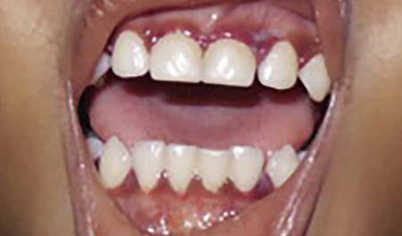

# Chapter 68: Vitamin C (Ascorbic Acid) Deficiency and Excess

*Dheeraj Shah and H.P.S. Sachdev*

<!-- p.641 -->
Vitamin C is important for synthesis of collagen at the level of hydroxyl ation of lysine and proline in precollagen. It is also involved in neurotrans mitter metabolism (conversion of dopamine to norepinephrine and tryptophan to serotonin), cholesterol metabolism (conversion of choles terol to steroid hormones and bile acids), and the biosynthesis of carnitine. Vitamin C functions to maintain the iron and copper atoms, cofactors of the metalloenzymes, in a reduced (active) state. Vitamin C is an important antioxidant (electron donor) in the aqueous milieu of the body. Vitamin C enhances nonheme iron absorption, the transfer of iron from transferrin to ferritin, and the formation of tetrahydrofolic acid and thus can affect the cellular and immunologic functions of the hematopoietic system. Though vitamin C has antiinflammatory and immunomodulating effects, there is no evidence of clinical benefit of vitamin C supplementation in pediatric critical illnesses and respiratory tract infections, including COVID-19.

**DIETARY NEEDS AND SOURCES OF VITAMIN C** Humans depend on dietary sources for vitamin C. An adequate intake is 40 mg for ages 0-6 months and 50 mg for 6-12 months. For older children, the recommended dietary allowance is 15 mg for ages 1-3 years, 25 mg for 4-8 years, 45 mg for 9-13 years, and 65-75 mg for 14-18 years. The recommended dietary allowances during preg nancy and lactation are 85 mg/day and 120 mg/day, respectively. The requirement for vitamin C is increased during infectious and diarrheal diseases. Children exposed to smoking or environmental tobacco smoke also require increased amounts of foods rich in vita min C. The best food sources of vitamin C are citrus fruits and fruit juices, peppers, berries, melons, guava, kiwifruit, tomatoes, cauli flower, and green leafy vegetables. Vitamin C is easily destroyed by prolonged storage, overcooking, and processing of foods.

Absorption of vitamin C occurs in the upper small intestine by an active process or by simple diffusion when large amounts are ingested. Vitamin C is not stored in the body but is taken up by all tissues; the highest levels are found in the pituitary and adrenal glands. The brain ascorbate con tent in the fetus and neonate is markedly higher than the content in the adult brain, a finding probably related to its function in neurotransmitter synthesis.

When a mother’s intake of vitamin C during pregnancy and lactation is adequate, the newborn will have adequate tissue lev els of vitamin C related to active placental transfer, subsequently maintained by the vitamin C in breast milk or commercial infant formulas. Breast milk contains sufficient vitamin C to prevent deficiency throughout infancy. Infants consuming pasteurized or boiled animal milk are at significant risk of developing deficiency if the other sources of vitamin C are also lacking in the diet. Neo nates whose feeding has been delayed because of a clinical condi tion can also have ascorbic acid deficiency. For patients receiving total parenteral nutrition (TPN), 80 mg/day is recommended for full-term infants and 25 mg/kg/day for preterm infants. Parents and children who choose a limited (selective) diet or those on fad diets are at risk for vitamin C deficiency.

**VITAMIN C DEFICIENCY** A deficiency of vitamin C results in the clinical presentation of **scurvy**. Children fed predominantly heat-treated (ultrahightemperature or pasteurized) milk or unfortified formulas and not receiving fruits and fruit juices are at significant risk for symptomatic

disease. In the last decade, most cases of scurvy from North Amer ica and Europe have been reported in children with developmental and behavioral disorders, *especially autism spectrum disorders,* on highly restrictive diets. Such dietary patterns occur mainly due to severe self-imposed dietary restrictions due to child preference or parental belief in unsubstantiated claims of benefit of such restric tions in autism and other developmental disorders. In scurvy, there is defective formation of connective tissues and collagen in skin, cartilage, dentine, bone, and blood vessels, leading to their fragility. In the long bones, osteoid is not deposited by osteoblasts, the cortex is thin, and the trabeculae become brittle and fracture easily.

**Clinical Features** The early manifestations of vitamin C deficiency are irritability, loss of appetite, low-grade fever, musculoskeletal pain, and tenderness in the legs. These signs and symptoms are followed by leg swelling—most marked at the knees and the ankles—and **pseudoparalysis**. The infant might lie with the hips and knees semiflexed and the feet rotated out ward. Subperiosteal hemorrhages in the lower-limb bones sometimes acutely increase the swelling and pain, and the condition might mimic acute osteomyelitis or arthritis. A “rosary” at the costochondral junc tions and depression of the sternum are other typical features (Fig. 68.1). The angulation of scorbutic beads is usually sharper than that of a rachitic rosary. Gum changes are seen in older children after teeth have erupted, manifested as bluish purple, spongy swellings of the mucous membrane, especially over the upper incisors (Fig. 68.2). **Anemia**, a common finding in infants and young children with scurvy, is related to impaired iron absorption and coexistent hematopoietic nutrient deficiencies, including iron, vitamin B12, and folate. Hemorrhagic manifestations of scurvy include petechiae, purpura, and ecchymo ses at pressure points; epistaxis; gum bleeding; and the characteristic perifollicular hemorrhages (Fig. 68.3). Other manifestations are poor wound and fracture healing, hyperkeratosis of hair follicles, arthralgia, and muscle weakness.

**Laboratory Findings and Diagnosis** The diagnosis of vitamin C deficiency is usually based on the char acteristic clinical picture, the radiographic appearance of the long bones, and a history of poor vitamin C intake. A high index of suspicion is required in children on restrictive diets, particularly those with autism and other developmental disorders, and they should be evaluated for scurvy whenever they present with diffi culty in walking or bone pains. The typical radiographic changes occur at the distal ends of the long bones and are particularly com mon at the knees. The shafts of the long bones have a ground-glass appearance because of trabecular atrophy. The cortex is thin and dense, giving the appearance of *pencil outlining* of the diaphysis and epiphysis. The *white line of Fränkel,* an irregular but thickened white line at the metaphysis, represents the zone of well-calcified cartilage. The epiphyseal centers of ossification also have a groundglass appearance and are surrounded by a sclerotic ring (Fig. 68.4). The more specific but late radiologic feature of scurvy is a zone of rarefaction under the white line at the metaphysis. This zone of rarefaction *(Trümmerfeld zone),* a linear break in the bone that is proximal and parallel to the white line, represents an area of debris of broken-down bone trabeculae and connective tissue. A *Pelkan spur* is a lateral prolongation of the white line and may be present at the cortical ends. Epiphyseal separation can occur along the line of destruction, with either linear displacement or compression of the epiphysis against the shaft (Fig. 68.5). Subperiosteal hemorrhages are not visible using plain radiographs during the active phase of scurvy. However, during healing, the elevated periosteum becomes calcified and radiopaque (see Fig. 68.5), sometimes giving a dumb bell or club shape to the affected bone. MRI can demonstrate both acute and healing subperiosteal hematomas along with periostitis, metaphyseal changes (Fig. 68.4), and heterogeneous bone marrow signal intensity, even in the absence of changes in plain radiographs. Gelatinous transformation of bone marrow on aspiration has been reported in children with suspected malignancy.

*Dheeraj Shah and H.P.S. Sachdev*

<!-- p.642 -->

**Fig. 68.1** Sharp angulation of beading at costochondral junction (scorbutic rosary) in scurvy. (Courtesy Dr. J.D. MacLean, McGill Centre for Tropical Diseases, Montreal.)

**Fig. 68.2** Clinical photograph showing inflamed marginal gingiva in scurvy. (From Agarwal A, Shaharyar A, Kumar A, Bhat MS, Mishra M. Scurvy in pediatric age group: a disease often forgotten? J Clin Orthop Trauma. 2015;6:101–107, Fig. 1, p. 103.)

A

B

**Fig. 68.3** Scurvy. A, Perifollicular hemorrhages. B, Corkscrew hairs with perifollicular hyperkeratotic papules. (Modified from Lipner S. A classic case of scurvy. Lancet. 2018;392[10145]:431.)

A B

**Fig. 68.4** A, Radiograph of the knee in scurvy demonstrates a radi odense band at the chondroosseous junction (Fränkel line; long arrows) and a translucent band in the metaphysis (Trümmerfeld zone; short ar rows) of the distal femora and the proximal tibiae. B, Magnetic reso nance imaging (coronal fat saturation T2-weighted imaging) of the knee demonstrates ill-defined T2 hyperintensities in the metaphyses and jux taosseous soft tissue. The diaphysis was spared. (From Seya M, Handa A, Hasegawa D, et al. Scurvy: from a selective diet in children with developmental delay. J Pediatr. 2016;177:331, Fig. A and B, p. 331.)

Biochemical tests are not very useful in the diagnosis of scurvy, because they do not reflect the tissue status. A plasma ascorbate concentration of <0.2 mg/dL usually is considered deficient. Leu kocyte concentration of vitamin C is a better indicator of body stores, but this measurement is technically more difficult to per form. Leukocyte concentrations of ≤10 μg/108 white blood cells are considered deficient and indicate latent scurvy, even in the absence of clinical signs of deficiency. Saturation of the tissues with vitamin C can be estimated from the urinary excretion of the vitamin after a test dose of ascorbic acid. In healthy children, 80% of the test dose appears in the urine within 3-5 hours after parenteral administra tion. Generalized nonspecific aminoaciduria is common in scurvy, whereas plasma amino acid levels remain normal.

**Differential Diagnosis** Scurvy is often misdiagnosed as infectious or juvenile idiopathic arthritis, osteomyelitis, nonaccidental trauma (child abuse), malig nancy, or acrodynia. The early irritability and bone pain are sometimes attributed to nonspecific pains or other nutritional deficiencies. Cop per deficiency results in a radiographic picture similar to that of scurvy. Henoch-Schönlein purpura, (IgA vasculitis) thrombocytopenic pur pura, or leukemia is sometimes suspected in children presenting with hemorrhagic manifestations.

**Treatment** Vitamin C supplements of 100-200 mg/day orally or parenterally ensure rapid and complete cure. The clinical improvement is seen within 1 week in most cases, but the treatment should be continued for up to 3 months for complete recovery.

<!-- p.644 -->
