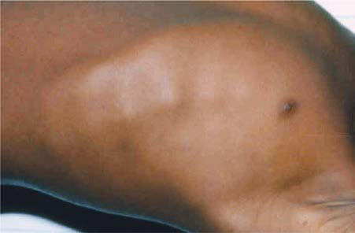

# Chapter 69: Vitamin D Deficiency (Rickets) and Excess

*Larry A. Greenbaum*

<!-- p.643 -->
**Prevention** Breastfeeding protects against vitamin C deficiency throughout infancy. In children consuming milk formula, fortification with vitamin C must be ensured. Children consuming heat-treated milk or plant-based beverages (e.g., almond milk, soy milk) should consume adequate vitamin C–rich foods in infancy. Dietary or medicinal supplements are required in children on restrictive diets deficient in vitamin C, severely malnourished children, and those with chronic debilitating conditions (e.g., malignancies, neurologic disorders). Providing antenatal supplements of vitamin C to smok ing mothers may mitigate some of the harmful effects of smoking on fetal and infant lung development and function.

**VITAMIN C TOXICITY** Daily intake of <2 g of vitamin C is generally without adverse effects in adults. Larger doses can cause gastrointestinal problems, such as abdominal pain and osmotic diarrhea. Hemolysis has rarely been reported after high doses of ascorbic acid. Megadoses of vitamin C should be avoided in patients with a history of urolithiasis or condi tions related to excessive iron accumulation, such as thalassemia and hemochromatosis. Data are sparse regarding vitamin C toxicity in children. The following values for tolerable upper intake levels are extrapolated from data for adults based on body weight differ ences: ages 1-3 years, 400 mg; 4-8 years, 650 mg; 9-13 years, 1,200 mg; and 14-18 years, 1,800 mg.

*Visit Elsevier eBooks+ at eBooks.Health.Elsevier.com** for Bibliography.*

CAL

SH

LD

CE

**Fig. 68.5** Large subperiosteal hematoma (SH) with areas of calcifica tion (CAL) is seen along the shaft of the right femur of a child with ad vanced scurvy. Epiphyseal separation is seen in both knees, with linear displacement (LD) in the left knee and compression (CE) against the shaft in the right knee.

**RICKETS** Bone consists of a protein matrix called *osteoid* and a mineral phase, principally composed of calcium and phosphate, mostly in the form of *hydroxyapatite*. **Osteomalacia** occurs with inadequate mineral ization of bone osteoid in children and adults. **Rickets** is a disease of growing bone caused by unmineralized matrix at the growth plates in children only before fusion of the epiphyses. Because growth plate cartilage and osteoid continue to expand but mineralization is inadequate, the growth plate thickens. Circumference of the growth plate and metaphysis is also greater, increasing bone width at the growth plates and causing classic clinical manifestations, such as widening of the wrists and ankles. The general softening of the bones causes them to bend easily when subject to forces such as weight bearing or muscle pull. This softening leads to a variety of bone deformities.

Rickets is principally caused by vitamin D deficiency. Although largely corrected through public health measures that provided chil dren with adequate vitamin D, rickets remains a persistent problem in developed countries, especially in children with restrictive diets (autism) or elimination diets (fear of allergies). It remains a significant problem in developing countries and may be secondary to nutritional vitamin D deficiency and inadequate intake of calcium (Table 69.1).

**Etiology** There are many causes of rickets, including vitamin D disorders, cal cium deficiency, phosphorus deficiency, and distal renal tubular aci dosis (Table 69.2).

**Clinical Manifestations** Most manifestations of rickets are a result of skeletal changes (Table 69.3). **Craniotabes** is a softening of the cranial bones and can be detected by applying pressure at the occiput or over the parietal bones. The sensation is similar to the feel of pressing into a Ping-Pong ball and then releasing. Craniotabes may also be secondary to osteogenesis imperfecta, hydrocephalus, and syphilis. It is a normal finding in many newborns, especially near the suture lines, but typically disappears within a few months of birth. Widening of the costochondral junctions results in a **rachitic “rosary,”** which feels like the beads of a rosary as the examiner’s fingers move along the costochondral junctions from rib to rib (Fig. 69.1). Growth plate widening is also responsible for the enlargement at the wrists and ankles (Fig. 69.2). The horizontal depres sion along the lower anterior chest known as the *Harrison groove* occurs from pulling of the softened ribs by the diaphragm during inspi ration. Softening of the ribs also impairs air movement and predisposes patients to atelectasis and pneumonia. Valgus or varus deformities of the legs are common; **windswept deformity** occurs when one leg is in extreme valgus and the other is in extreme varus (Fig. 69.3).

The clinical presentation of rickets may vary based on the etiology. Changes in the lower extremities tend to be the dominant feature in X-linked hypophosphatemic rickets. Symptoms secondary to hypocalce mia occur only in those forms of rickets associated with decreased serum calcium.

*Larry A. Greenbaum*

<!-- p.645 -->

#### **Table 69.3** Clinical Features of Rickets

| Category / Parameter | Clinical Details & Findings |
| --- | --- |
| **GENERAL** | Failure to thrive (malnutrition); Listlessness; Protruding abdomen; Muscle weakness (especially proximal); Hypocalcemic dilated cardiomyopathy; Fractures (pathologic, minimal trauma); Increased intracranial pressure |
| **HEAD** | Craniotabes; Frontal bossing; Delayed fontanel closure (usually closed by 2 yr); Delayed dentition; No incisors by age 10 mo; No molars by age 18 mo; Caries; Craniosynostosis |
| **CHEST** | Rachitic rosary; Harrison groove; Respiratory infections and atelectasis* |
| **BACK** | Scoliosis; Kyphosis; Lordosis |
| **EXTREMITIES** | Enlargement of wrists and ankles; Valgus or varus deformities; Windswept deformity (valgus deformity of one leg with varus; deformity of other leg); Anterior bowing of tibia and femur; Coxa vara; Leg pain |
| **HYPOCALCEMIC SYMPTOMS†** | Tetany; Seizures; Stridor caused by laryngeal spasm |
| **VITAMIN D** | Vitamin D3; (3-cholecalciferol), which; is synthesized in the; skin, and vitamin D2; (from plants or yeast) are; biologically equivalent;; 1 μg = 40 IU vitamin D; Fat-soluble, stable; to heat, acid, alkali,; and oxidation;; bile necessary for; absorption;; hydroxylation in; the liver and kidney; necessary for biologic; activity; Necessary for GI; absorption of; calcium; also; increases absorption; of phosphate; direct; actions on bone,; including mediating; resorption; Rickets in growing; children;; osteomalacia;; hypocalcemia can; cause tetany and; seizures; Hypercalcemia,; which can cause; emesis, anorexia,; pancreatitis,; hypertension,; arrhythmias, CNS; effects, polyuria,; nephrolithiasis, renal; failure; Exposure to; sunlight (UV light);; fish oils, fatty fish,; egg yolks, and; vitamin D–fortified; formula, milk,; cereals, bread |
| **VITAMIN E** | Group of related; compounds with; similar biologic; activities; α-tocopherol; is the most potent and; most common form; Fat-soluble; readily; oxidized by oxygen,; iron, rancid fats; bile; acids necessary for; absorption; Antioxidant;; protection of cell; membranes from; lipid peroxidation; and formation of; free radicals; Red cell hemolysis in; premature infants;; posterior column; and cerebellar; dysfunction;; pigmentary; retinopathy; Unknown; Vegetable oils,; seeds, nuts, green; leafy vegetables,; margarine |
| **VITAMIN K** | Group of; naphthoquinones; with similar biologic; activities; K1; (phylloquinone); from diet; K2; (menaquinones) from; intestinal bacteria; Natural compounds; are fat-soluble;; stable to heat and; reducing agents;; labile to oxidizing; agent, strong acids,; alkali, light; bile; salts necessary for; intestinal absorption; Vitamin K–dependent; proteins include; coagulation factors; II, VII, IX, and X;; proteins C, S, Z;; matrix Gla protein,; osteocalcin; Hemorrhagic; manifestations;; long-term bone; and vascular health; Not established;; analogs (no longer; used) caused; hemolytic; anemia, jaundice,; kernicterus, death; Green leafy; vegetables, liver,; certain legumes; and plant oils;; widely distributed; CNS, Central nervous system; GI, gastrointestinal; UV, ultraviolet. |

#### **Table 69.2** Causes of Rickets

| Category / Parameter | Clinical Details & Findings |
| --- | --- |
| **VITAMIN D DISORDERS** | Nutritional vitamin D deficiency; Congenital vitamin D deficiency; Secondary vitamin D deficiency; Malabsorption; Increased degradation; Decreased liver 25-hydroxylase; Vitamin D–dependent rickets types 1A and 1B; Vitamin D–dependent rickets types 2A and 2B; Chronic kidney disease |
| **CALCIUM DEFICIENCY** | Low intake; Diet; Premature infants (rickets of prematurity); Malabsorption; Primary disease; Dietary inhibitors of calcium absorption |
| **PHOSPHORUS DEFICIENCY** | Inadequate intake; Premature infants (rickets of prematurity); Aluminum-containing antacids |
| **RENAL LOSSES** | X-linked hypophosphatemic rickets*; Autosomal dominant hypophosphatemic rickets*; Autosomal recessive hypophosphatemic rickets types 1, 2, and 3*; Hereditary hypophosphatemic rickets with hypercalciuria; Hypophosphatemic rickets with nephrolithiasis and osteoporosis; types 1 and 2; Overproduction of fibroblast growth factor-23; Tumor-induced rickets*; McCune-Albright syndrome*; Epidermal nevus syndrome (cutaneous skeletal hypophosphatemia; syndrome)*; Neurofibromatosis*; Fanconi syndrome; Dent disease; Distal renal tubular acidosis; *Disorders secondary to excess fibroblast growth factor-23. |

<!-- p.646 -->
The chief complaint in a child with rickets is quite variable. Many children present because of skeletal deformities, whereas others have difficulty walking owing to a combination of deformity and weakness. Other common presenting complaints include failure to thrive (malnutrition) and symptomatic hypocalcemia (see Chapters 610-612).

**Radiology** Rachitic changes are most easily visualized on posteroanterior radio graphs of the wrist, although characteristic rachitic changes can be seen at other growth plates (Figs. 69.4 and 69.5). Decreased calcifica tion leads to thickening of the growth plate. The edge of the metaphysis loses its sharp border, which is described as *fraying.* The edge of the metaphysis changes from a convex or flat surface to a more concave surface. This change to a concave surface is termed *cupping* and is most easily seen at the distal ends of the radius, ulna, and fibula. There is widening of the distal end of the metaphysis, corresponding to the clin ical observation of thickened wrists and ankles, as well as the rachitic rosary. Other radiologic features include coarse trabeculation of the diaphysis and generalized rarefaction.

**Diagnosis** The diagnosis of rickets is based on the presence of classic radio graphic abnormalities. It is supported by physical examination find ings, history, and laboratory results consistent with a specific etiology (Table 69.4).

**Clinical Evaluation** Because the majority of children with rickets have a nutritional defi ciency, the initial evaluation should focus on a **dietary history**,

emphasizing intake of both vitamin D and calcium. Most children in industrialized nations receive vitamin D from formula, fortified milk, or vitamin supplements. Along with the amount, the exact composi tion of the formula or milk is pertinent, because rickets has occurred in children given products that are called “milk” (e.g., soy milk) but are deficient in vitamin D and minerals.

**Cutaneous synthesis** mediated by sunlight exposure is an important source of vitamin D. It is important to ask about time spent outside, sunscreen use, and clothing, especially if there may be a cultural reason for increased covering of the skin. Because winter sunlight is ineffective at stimulating cutaneous synthesis of vitamin D, the season is an addi tional consideration. Children with increased skin pigmentation are at increased risk for vitamin D deficiency because of decreased cutaneous synthesis.

The presence of **maternal** risk factors for nutritional vitamin D deficiency, including diet and sun exposure, is an important consider ation when a neonate or young infant has rachitic findings, especially if the infant is breastfed (Table 69.5). Determining a child’s intake of dairy products, the main dietary source of calcium, provides a general sense of calcium intake. High dietary fiber can interfere with calcium absorption.

The child’s **medication** use is relevant, because certain medica tions, such as the anticonvulsants phenobarbital and phenytoin, increase degradation of vitamin D, and phosphate binders or aluminum-containing antacids interfere with the absorption of phosphate.

**Malabsorption** of vitamin D is suggested by a history of liver or intestinal disease. Undiagnosed liver or intestinal disease should be suspected if the child has gastrointestinal (GI) symptoms, although occasionally rickets is the presenting complaint. Fat malabsorption is often associated with diarrhea or oily stools, and there may be signs or symptoms suggesting deficiencies of other fat-soluble vitamins (A, E, and K; see Chapters 66, 70, and 71).

**Fig. 69.1** Rachitic “rosary” in a child with rickets. (Courtesy Dr. Thom as D. Thacher, Rochester, MN.)

**Fig. 69.2** Hands and forearms of a young child with rickets show prominence above the wrist, resulting from flaring and poor mineraliza tion of lower end of the radius and ulna. (From Bullough PG. Orthopae dic Pathology, 5th ed. St Louis: Mosby: 2010: Fig 8-31.)

**Fig. 69.3** Windswept deformity of the legs in an older child with rick ets. (From Rickets and osteomalacia. In Hochberg MC, Silman AJ, Smo len JS, et al., eds. Rheumatology, 4th ed. London: Mosby; 2008: Fig 192-6.)

<!-- p.647 -->
A B

**Fig. 69.4** Radiographs of the wrist in normal child (A) and child with rickets (B), who has metaphyseal fraying and cupping of the distal ra dius and ulna.

#### **Table 69.4** Laboratory Findings in Various Disorders Causing Rickets

| Category / Parameter | Clinical Details & Findings |
| --- | --- |
| **URINE Pi** | Vitamin D deficiency |
| **N, ↓** | ↓; ↑; ↓ |
| **↓, N, ↑** | ↑; ↓; ↑; VDDR, type 1A |
| **N, ↓** | ↓; ↑ |
| **N** | ↓; ↑; ↓; ↑; VDDR, type 1B |
| **N, ↓** | ↓; ↑; ↓ |
| **N** | ↑; ↓; ↑; VDDR, type 2A |
| **N, ↓** | ↓; ↑ |
| **N** | ↑↑; ↑; ↓; ↑; VDDR, type 2B |
| **N, ↓** | ↓; ↑ |
| **N** | ↑↑; ↑; ↓; ↑; Chronic kidney disease |
| **N, ↓** | ↑; ↑ |
| **N** | ↓; ↑ |
| **N, ↓** | ↓; Dietary Pi deficiency |
| **N** | ↓ |
| **N** | ↑; ↑; ↑; ↓ |
| **N** | ↓ |
| **RD** | ↑; ↓; ↑ |
| **N** | ↓ |
| **RD** | ↑; ↓; ↑ |
| **N** | ↓ |
| **N** | ↑; ↑; ↑; ↑; ARHR, type 1 or type 2* |
| **N** | ↓ |
| **RD** | ↑; ↓; ↑; Tumor-induced rickets† |
| **N** | ↓ |
| **RD** | ↑; ↓; ↑; Fanconi syndrome |
| **N** | ↓ |
| **N** | RD or ↑; ↑; ↓ or ↑; ↑; Dent’s disease |
| **N** | ↓ |
| **N** | ↑; ↑; ↑; Dietary Ca deficiency |
| **N, ↓** | ↓; ↑ |
| **N** | ↑; ↑; ↓; ↑; *Elevated fibroblast growth factor-23 (FGF-23).; †FGF-23 elevated in some patients.; ADHR, Autosomal dominant hypophosphatemic rickets; ALP, alkaline phosphatase; ARHR, autosomal recessive hypophosphatemic rickets; Ca, calcium; HHRH, hereditary; hypophosphatemic rickets with hypercalciuria; N, normal; Pi, inorganic phosphorus; PTH, parathyroid hormone; RD, relatively decreased (because it should be increased given the; concurrent hypophosphatemia); VDDR, vitamin D–dependent rickets; XLH, X-linked hypophosphatemic rickets; 1,25-(OH)2D, 1,25-dihydroxyvitamin D; 25-OHD, 25-hydroxyvitamin; D; ↓, decreased; ↑, increased; ↑↑, extremely increased. |

**Fig. 69.5** Radiographs of the knees in 7-year-old female with distal re nal tubular acidosis and rickets. A, At initial presentation, there is widen ing of the growth plate and metaphyseal fraying. B, Dramatic improve ment after 4 months of therapy with alkali.

A B

A history of **renal disease** (proteinuria, hematuria, urinary tract infections) is an additional significant consideration, given the impor tance of chronic kidney disease as a cause of rickets. Polyuria can occur in children with chronic kidney disease or Fanconi syndrome.

Children with rickets might have a history of dental caries, poor growth, delayed walking, waddling gait, pneumonia, and hypocalce mic symptoms.

The family history is critical, given the large number of **genetic causes** of rickets, although most of these causes are rare. Along with bone disease, it is important to inquire about leg deformities,

<!-- p.648 -->
difficulties with walking, or unexplained short stature, because some parents may be unaware of their diagnosis. Undiagnosed dis ease in the mother is not unusual in X-linked hypophosphatemia. A history of an unexplained sibling death during infancy may be pres ent in the child with cystinosis, the most common cause of Fanconi syndrome in children.

The physical examination focuses on detecting manifestations of rickets (see Table 69.3). It is important to observe the child’s gait, auscultate the lungs to detect atelectasis or pneumonia, and plot the patient’s growth. *Alopecia* suggests vitamin D–dependent rick ets type 2.

The initial **laboratory tests** in a child with rickets should include serum calcium, phosphorus, alkaline phosphatase (ALP), parathy roid hormone (PTH), 25-hydroxyvitamin D, 1,25-dihydroxyvitamin D (1,25-D), creatinine, and electrolytes (see Table 69.4 for interpre tation). Urinalysis is useful for detecting the glycosuria seen with Fanconi syndrome. Evaluation of urinary excretion of calcium (24hour collection for calcium or calcium:creatinine ratio) is helpful if hereditary hypophosphatemic rickets with hypercalciuria or Dent disease is suspected. Direct measurement of other fat-soluble vita mins (A, E, and K) or indirect assessment of deficiency (prothrom bin time for vitamin K deficiency) is appropriate if malabsorption is a consideration.

**VITAMIN D DISORDERS Vitamin D Physiology** Vitamin D can be synthesized in skin epithelial cells and therefore technically is not a vitamin. Cutaneous synthesis is normally the most important source of vitamin D and depends on the conversion of 7-dehydrocholesterol to vitamin D3 (3-cholecalciferol) by ultravio let B (UVB) radiation from the sun. The efficiency of this process is decreased by melanin; therefore more sun exposure is necessary for

vitamin D synthesis in people with increased skin pigmentation. Mea sures to decrease sun exposure, such as covering the skin with cloth ing or applying sunscreen, also decrease vitamin D synthesis. Children who spend less time outside have reduced vitamin D synthesis. The winter sun away from the equator is ineffective at stimulating vitamin D synthesis.

There are few natural dietary sources of vitamin D. Fish liver oils have a high vitamin D content. Other good dietary sources include fatty fish and egg yolks. Most children in industrialized countries receive vitamin D via fortified foods, especially formula and milk (both of which contain 400 IU/L) and some breakfast cereals and breads. Supplemental vitamin D may be vitamin D2 (which comes from plants or yeast) or vitamin D3. Breast milk has a low vitamin D content, approximately 12-60 IU/L.

Vitamin D is transported bound to vitamin D–binding pro tein to the liver, where 25-hydroxlase converts vitamin D into 25-hydroxyvitamin D (25-D), the most abundant circulating form of vitamin D. Because there is little regulation of this liver hydrox ylation step, measurement of 25-D is the standard method for determining a patient’s vitamin D status. The final step in activa tion occurs in the kidney, where the enzyme 1α-hydroxylase adds a second hydroxyl group, resulting in 1,25-D. The 1α-hydroxylase is upregulated by PTH and hypophosphatemia and inhibited by hyperphosphatemia and 1,25-D. Most 1,25-D circulates bound to vitamin D–binding protein.

1,25-Dihydroxyvitamin D acts by binding to an intracellular receptor, and the complex affects gene expression by interact ing with vitamin D response elements. In the intestine, this bind ing results in a marked increase in calcium absorption, which is highly dependent on 1,25-D. There is also an increase in phos phorus absorption, but this effect is less significant because most dietary phosphorus absorption is vitamin D independent. 1,25-D also has direct effects on bone, including mediating resorption. 1,25-D directly suppresses PTH secretion by the parathyroid gland, thus completing a negative feedback loop. PTH secretion is also suppressed by the increase in serum calcium mediated by 1,25-D. 1,25-D inhibits its own synthesis in the kidney and increases the synthesis of inactive metabolites.

**Nutritional Vitamin D Deficiency** Vitamin D deficiency remains the most common cause of rickets glob ally and even occurs in industrialized countries. Because vitamin D can be obtained from dietary sources or from cutaneous synthesis, most patients in industrialized countries have a combination of risk factors that lead to vitamin D deficiency.

**Etiology** Vitamin D deficiency most frequently occurs in infancy because of a combination of poor intake and inadequate cutaneous synthesis. Transplacental transport of vitamin D, mostly 25-D, typically pro vides enough vitamin D for the first or second months of life unless there is severe maternal vitamin D deficiency. Infants who receive formula receive adequate vitamin D, even without cutaneous syn thesis. Because of the low vitamin D content of breast milk, breast fed infants rely on cutaneous synthesis or vitamin supplements. Cutaneous synthesis can be limited because of the ineffectiveness of the winter sun in stimulating vitamin D synthesis; avoidance of sunlight because of concerns about cancer, neighborhood safety, or cultural practices; and decreased cutaneous synthesis because of increased skin pigmentation.

The effect of skin pigmentation explains why most cases of nutri tional rickets in the United States and Northern Europe occur in breastfed children of African descent or other dark-pigmented populations. The additional impact of the winter sun is supported by such infants more often presenting in the late winter or spring. In some groups, complete covering of infants or the practice of not taking infants outside has a significant role, explaining the occur rence of rickets in infants living in areas of abundant sunshine, such as the Middle East. Because the mothers of some infants can

Osteomalacia and Their Prevention

#### **Table 69.5** Risk Factors for Nutritional Rickets and

| Category / Parameter | Clinical Details & Findings |
| --- | --- |
| **MATERNAL FACTORS** | Vitamin D deficiency; Dark skin pigmentation; Full body clothing cover; High latitude during winter/spring season; Other causes of restricted sun (UVB) exposure (e.g., predominant; indoor living, disability, pollution, cloud cover); Low–vitamin D diet; Low-calcium diet; Poverty, malnutrition, special diets |
| **INFANT/CHILDHOOD FACTORS** | Neonatal vitamin D deficiency secondary to maternal deficiency/; vitamin D deficiency; Lack of infant supplementation with vitamin D; Prolonged breastfeeding without appropriate complementary; feeding from 6 mo; High latitude during winter/spring season; Dark skin pigmentation and/or restricted sun (UVB) exposure (e.g.,; predominant indoor living, disability, pollution, cloud cover); Avoidant restrictive food intake disorder; Low–vitamin D diet; Low-calcium diet; Poverty, malnutrition, special diets |
| **PREVENTIVE MEASURES** | Sun exposure (UVB content of sunlight depends on latitude and; season); Vitamin D supplementation; Strategic fortification of the habitual food supply; Normal calcium intake; Adapted from Munns CF, Shaw N, Kiely M, et al. Global consensus recommendations; on prevention and management of nutritional rickets. J Clin Endocrinol Metab.; 2016;101:394–415, p. 401. |

<!-- p.649 -->
have the same risk factors, decreased maternal vitamin D can also contribute, both by leading to reduced vitamin D content in breast milk and by lessening transplacental delivery of vitamin D. Rickets caused by vitamin D deficiency can also be secondary to dietary practices, such as vegan diets that use unfortified soy milk or rice milk. Children with restrictive food habits (autism) or food elimination diets (fear of allergies) may be at risk for vitamin D deficiency.

**Clinical Manifestations** The clinical features are typical of rickets (see Table 69.3), with a significant minority presenting with symptoms of hypocalcemia. Prolonged laryngospasm is occasionally fatal. These children have an increased risk of pneumonia and muscle weakness leading to a delay in motor development.

**Laboratory Findings** Table 69.4 summarizes the principal laboratory findings. Hypocalce mia is a variable finding because the elevated PTH acts to increase the serum calcium concentration. The hypophosphatemia is caused by PTH-induced renal losses of phosphate, combined with a decrease in intestinal absorption.

The wide variation in 1,25-D levels (low, normal, or high) is secondary to the upregulation of renal 1α-hydroxylase caused by concomitant hypophosphatemia and hyperparathyroidism. Because serum levels of 1,25-D are much lower than the levels of 25-D, even with low levels of 25-D, there is often enough 25-D still present to act as a precursor for 1,25-D synthesis in the presence of upregu lated 1α-hydroxylase. The level of 1,25-D is only low when there is severe vitamin D deficiency.

Some patients have a metabolic acidosis secondary to PTHinduced renal bicarbonate wasting. There may also be generalized aminoaciduria.

**Diagnosis and Differential Diagnosis** The diagnosis of nutritional vitamin D deficiency is based on the combination of a history of poor vitamin D intake and risk factors for decreased cutaneous synthesis, radiographic changes consistent with rickets, and typical laboratory findings (see Table 69.4). A normal PTH level almost never occurs with vitamin D deficiency and suggests a pri mary phosphate disorder.

**Treatment** Children with nutritional vitamin D deficiency should receive vita min D and adequate nutritional intake of calcium and phospho rus. There are two strategies for administration of vitamin D. With **stoss therapy**, vitamin D (300,000-600,000 IU) is administered orally (preferred) or intramuscularly as 2-4 doses over 1 day (vita min D3 is preferred to D2 because of the longer half-life of D3). Because the doses are observed, stoss therapy is ideal in patients in whom adherence to therapy is questionable. The alternative strat egy is daily vitamin D with a minimum dose of 2,000 IU/day for a minimum of 3 months. Either strategy should be followed by daily vitamin D intake of 400 IU/day if <1 year old or 600 IU/day if >1 year old. It is important to ensure that children receive adequate dietary calcium (minimum of 500 mg/day) and phosphorus; this dietary intake is usually provided by milk, formula, and other dairy products, although calcium supplements may be needed in some patients.

Children who have symptomatic hypocalcemia might need intra venous (IV) calcium acutely, followed by oral calcium supplements, which typically can be tapered over 2-6 weeks in children who receive adequate dietary calcium. Transient use of IV or oral 1,25-D (**calcitriol**) is often helpful in reversing hypocalcemia in the acute phase by providing active vitamin D during the delay, as supple mental vitamin D is converted to active vitamin D. Calcitriol doses are typically 0.05 μg/kg/day. IV calcium is initially given as an acute bolus for symptomatic hypocalcemia (20 mg/kg calcium chloride

or 100 mg/kg calcium gluconate). Some patients require a continu ous IV calcium drip, titrated to maintain the desired serum calcium level. These patients should transition to enteral calcium, and most infants require approximately 1,000 mg of elemental calcium.

**Prognosis** Most children with nutritional vitamin D deficiency have an excel lent response to treatment, with radiologic healing occurring within a few months. Laboratory test results should also normal ize rapidly. Many of the bone malformations improve dramatically, but children with severe disease can have permanent deformities and short stature. Rarely, patients benefit from orthopedic interven tion for leg deformities, although this is generally not done until the metabolic bone disease has healed, there is clear evidence that the deformity will not self-resolve, and the deformity is causing func tional problems.

**Prevention** Most cases of nutritional rickets can be prevented by universal admin istration of 400 IU of vitamin D to infants <1 year old. Older children with risk factors for inadequate intake should receive 600 IU/day. Vita min D may be administered as a component of a multivitamin or as a vitamin D supplement.

**Congenital Vitamin D Deficiency Congenital rickets** is quite rare in industrialized countries and occurs when there is severe maternal vitamin D deficiency dur ing pregnancy. Maternal risk factors include poor dietary intake of vitamin D, lack of adequate sun exposure, and closely spaced pregnancies. These newborns can have symptomatic hypocalcemia, intrauterine growth restriction, and decreased bone ossification, along with classic rachitic changes (craniotabes, large fontanelle, fractures). In addition, neonates with congenital rickets may have bone pain, weakness, elevated PTH and ALP levels, and hypocalce mia with low serum 25-hydroxyvitamin D levels. Subtler maternal vitamin D deficiency can have an adverse effect on neonatal bone density and birthweight, cause a defect in dental enamel, and pre dispose infants to neonatal hypocalcemic tetany. Treatment of con genital rickets includes vitamin D supplementation and adequate intake of calcium and phosphorus. Use of prenatal vitamins con taining vitamin D (600 IU) prevents this entity.

**Secondary Vitamin D Deficiency Etiology** Along with inadequate intake, vitamin D deficiency can result from inadequate absorption, decreased hydroxylation in the liver, and increased degradation. Because vitamin D is fat soluble, its absorp tion may be decreased in patients with a variety of liver and GI diseases, including cholestatic liver disease, defects in bile acid metabolism, cystic fibrosis and other causes of pancreatic dysfunc tion, celiac disease, and Crohn disease. Malabsorption of vitamin D can also occur with intestinal lymphangiectasia and after intestinal resection.

Severe liver disease, which usually is also associated with mal absorption, can cause a decrease in 25-D formation as a result of insufficient enzyme activity. Because of the large reserve of 25-hydroxlase activity in the liver, vitamin D deficiency caused by liver disease usually requires a loss of >90% of liver function. A variety of medications increase the degradation of vitamin D by inducing the cytochrome P450 (CYP) system. Rickets from vita min D deficiency can develop in children receiving anticonvulsants (e.g., phenobarbital, phenytoin) or antituberculosis medications (e.g., isoniazid, rifampin).

**Treatment** Treatment of vitamin D deficiency attributable to malabsorption requires high doses of vitamin D. Because of its better absorption, 25-D (25-50 μg/day or 5-7 μg/kg/day) is superior to vitamin D3. The dose is adjusted based on monitoring of serum levels of 25-D. Alternatively,

<!-- p.650 -->
patients may be treated with 1,25-D, which also is better absorbed in the presence of fat malabsorption, or with parenteral vitamin D. Chil dren with rickets as a result of increased degradation of vitamin D by the CYP system require the same acute therapy as indicated for nutri tional deficiency (discussed earlier), followed by long-term adminis tration of high doses of vitamin D (e.g., 1,000 IU/day), with dosing titrated based on serum levels of 25-D. Some patients require as much as 4,000 IU/day.

**Vitamin D–Dependent Rickets, Type 1** Children with vitamin D–dependent rickets **type 1A**, an autoso mal recessive disorder, have pathologic gene variants in *CYP27B,* which encodes the renal 1α-hydroxylase, preventing conversion of 25-D into 1,25-D. These patients normally present during the first 2 years of life and can have any of the classic features of rick ets (see Table 69.3), including symptomatic hypocalcemia. They have normal levels of 25-D but low levels of 1,25-D (see Table 69.4). Occasionally, 1,25-D levels are at the lower limit of normal, inappropriately low given the high PTH and low serum phospho rus levels, both of which should increase the activity of renal 1αhydroxylase and cause elevated levels of 1,25-D. As in nutritional vitamin D deficiency, renal tubular dysfunction can cause a meta bolic acidosis and generalized aminoaciduria.

Vitamin D–dependent rickets **type 1B** is secondary to pathologic variants in the gene (*CYP2R1*) for the principal 25-hydroxylase. Patients have low levels of 25-D but normal levels of 1,25-D (see Table 69.4).

**Treatment** Vitamin D–dependent rickets type 1A responds to long-term treat ment with 1,25-D (calcitriol). Initial doses are 0.25-2 μg/day, and lower doses are used once the rickets has healed. Especially during initial therapy, it is important to ensure adequate intake of calcium. The dose of calcitriol is adjusted to maintain a low-normal serum calcium level, a normal serum phosphorus level, and a high-normal serum PTH level. Targeting a low-normal calcium concentration and a high-normal PTH level avoids excessive dosing of calcitriol, which can cause hypercalciuria and nephrocalcinosis. Therefore patient monitor ing includes periodic assessment of urinary calcium excretion, with a target of <4 mg/kg/day.

Vitamin D–dependent rickets type 1B may respond to pharma cologic doses of vitamin D2 (3,000 U/day) as a result of alternative enzymes with 25-hydroxylase activity or residual activity of the abnor mal protein.

**Vitamin D–Dependent Rickets, Type 2** Patients with vitamin D–dependent rickets **type 2A** have pathologic variants in *VDR,* the gene encoding the vitamin D receptor, pre venting a normal physiologic response to 1,25-D. Levels of 1,25-D are extremely elevated in this autosomal recessive disorder (see Table 69.4). Most patients present during infancy, although rick ets in less severely affected patients might not be diagnosed until adulthood. Less severe disease is associated with a partially func tional vitamin D receptor. Approximately 50–70% of children have **alopecia**, which tends to be associated with a more severe form of the disease and can range from alopecia areata to alopecia totalis. Epidermal cysts are a less common manifestation.

Vitamin D–dependent rickets **type 2B** appears to result from over expression of a hormone response element–binding protein that inter feres with the actions of 1,25-D. Alopecia may be present.

**Treatment** Some patients respond to extremely high doses of vitamin D2 (25-D or 1,25-D), especially patients without alopecia. This response is caused by a partially functional vitamin D receptor in patients with vitamin D–dependent rickets type 2A, but may also occur in vitamin D–depen dent rickets type 2B. All patients should be given a 3- to 6-month trial of high-dose vitamin D and oral calcium. The initial dose of 1,25-D should be 2 μg/day, but some patients require doses as high as 50-60

μg/day. Calcium doses are 1,000-3,000 mg/day. Patients who do not respond to high-dose vitamin D may be treated with long-term IV calcium, with possible transition to very high-dose oral calcium sup plements. Treatment of patients who do not respond to vitamin D is difficult.

**Chronic Kidney Disease** With chronic kidney disease, there is decreased activity of 1αhydroxylase in the kidney, leading to diminished production of 1,25-D. In chronic kidney disease, unlike the other causes of vitamin D defi ciency, patients have hyperphosphatemia as a result of decreased renal excretion (see Table 69.4 and Chapter 572.2).

**Treatment** Therapy requires the use of a form of vitamin D that can act without 1-hydroxylation by the kidney (calcitriol), which both permits ade quate absorption of calcium and directly suppresses the parathyroid gland. Because hyperphosphatemia is a stimulus for PTH secretion, normalization of the serum phosphorus level through a combination of dietary phosphorus restriction and use of oral phosphate binders is as important as the use of activated vitamin D.

**CALCIUM DEFICIENCY Pathophysiology** Rickets secondary to inadequate dietary calcium is a significant problem in some countries in Africa, although there are cases in other regions of the world, including industrialized countries. Because breast milk and formula are excellent sources of calcium, this form of rickets develops after children have been weaned from breast milk or formula and is more likely to occur in children who are weaned early. Rickets develops because the diet has low calcium content, typically <200 mg/day if <12 months old or <300 mg/day if >12 months old. The child has minimal intake of dairy products or other sources of calcium. In addition, because of reliance on grains and green leafy vegetables, the diet may be high in phytate, oxalate, and phosphate, which decrease absorption of dietary calcium. In industrialized countries, rickets caused by calcium deficiency can occur in children who consume an unconventional diet. Examples include children with milk allergy who have low dietary calcium and children who transition from formula or breast milk to juice, soda, or a calcium-poor soy drink, without an alternative source of dietary calcium.

This type of rickets can develop in children who receive IV nutri tion without adequate calcium. Malabsorption of calcium can occur in celiac disease, intestinal abetalipoproteinemia, and after small bowel resection. There may be concurrent malabsorption of vitamin D.

**Clinical Manifestations** Children with calcium deficiency have the classic signs and symp toms of rickets (see Table 69.3). Presentation can occur during infancy or early childhood, although some cases are diagnosed in teenagers. Because calcium deficiency occurs after the cessation of breastfeed ing, it tends to occur later than the nutritional vitamin D deficiency that is associated with breastfeeding. In Nigeria, nutritional vitamin D deficiency is most common at 4-15 months of age, whereas calcium deficiency rickets typically occurs at 15-25 months.

**Diagnosis** Laboratory findings include increased levels of ALP, PTH, and 1,25-D (see Table 69.4). Calcium levels may be normal or low, although symp tomatic hypocalcemia is uncommon. There is decreased urinary excre tion of calcium, and serum phosphorus levels may be low as a result of renal wasting of phosphate from secondary hyperparathyroidism. In some children, there is coexisting nutritional vitamin D deficiency, with low 25-D levels.

**Treatment** Treatment focuses on providing adequate calcium, typically as a dietary supplement (doses of 700 [age 1-3 years], 1,000 [4-8 years],

<!-- p.651 -->
and 1,300 [9-18 years] mg/day of elemental calcium are effective). Vitamin D supplementation is necessary if there is concurrent vita min D deficiency (discussed earlier). Prevention strategies include discouraging early cessation of breastfeeding and increasing dietary sources of calcium. In countries such as Kenya, where many chil dren have diets high in cereal with negligible intake of cow’s milk, school-based milk programs have been effective in reducing the prevalence of rickets.

**PHOSPHORUS DEFICIENCY Inadequate Intake** With the exception of starvation or severe anorexia, it is almost impossible to have a diet that is deficient in phosphorus, because phosphorus is present in most foods. Decreased phosphorus absorption can occur in diseases associated with malabsorption (celiac disease, cystic fibrosis, cholestatic liver disease), but if rick ets develops, the primary problem is usually malabsorption of vita min D and/or calcium.

Isolated malabsorption of phosphorus occurs in patients with long-term use of **aluminum-containing antacids**. These com pounds are very effective at chelating phosphate in the GI tract, leading to decreased absorption. This decreased absorption results in hypophosphatemia with secondary osteomalacia in adults and rickets in children. This entity responds to discontinuation of the antacid and short-term phosphorus supplementation.

**Fibroblast Growth Factor-23** Fibroblast growth factor-23 (**FGF-23**) is a humoral mediator that decreases renal tubular reabsorption of phosphate and therefore decreases serum phosphorus. FGF-23, synthesized by osteocytes, also decreases the activity of renal 1α-hydroxylase, resulting in a decrease in the production of 1,25-D. Increased levels of FGF-23 cause many of the renal phosphate-wasting diseases (see Table 69.2).

**X-Linked Hypophosphatemic Rickets** Among the genetic disorders causing rickets because of hypophos phatemia, X-linked hypophosphatemic rickets (**XLH**) is the most common, with a prevalence of 1/20,000. The defective gene is on the X chromosome, but female carriers are affected, so it is an X-linked– dominant disorder.

**Pathophysiology** The pathologic variants are in a gene called *PHEX* because it is a *ph*osphate-regulating gene with homology to *e*ndopeptidases on the *X* chromosome. The product of this gene appears to have an indirect role in inactivating FGF-23. Thus pathologic variants in *PHEX* lead to increased levels of FGF-23. Because the actions of FGF-23 include inhi bition of phosphate reabsorption in the proximal tubule, phosphate excretion is increased. FGF-23 also inhibits renal 1α-hydroxylase, lead ing to decreased production of 1,25-D.

**Clinical Manifestations** These patients have rickets, but abnormalities of the lower extremities and poor growth are the dominant features. Delayed dentition and tooth abscesses are also common. Some patients have hypophosphate mia and short stature without clinically evident bone disease.

**Laboratory Findings** Patients have high renal excretion of phosphate, hypophosphate mia, and increased ALP; PTH and serum calcium levels are normal (see Table 69.4). Hypophosphatemia normally upregulates renal 1αhydroxylase and should lead to an increase in 1,25-D, but these patients have low or inappropriately normal levels of 1,25-D.

**Treatment** Burosumab is a monoclonal antibody to FGF-23 that is approved for treating XLH in children >1 year, although cost may limit its availabil ity in low-resourced countries. Outcomes are better and side effects decreased when compared with conventional therapy. The dose of

burosumab is titrated to normalize the serum phosphorus; it is contra indicated in patients with severe renal impairment.

Conventional treatment is a combination of oral phosphorus and 1,25-D (calcitriol). The daily need for phosphorus supplementation is 1-3 g of elemental phosphorus divided into four or five doses. Frequent dosing helps to prevent prolonged decrements in serum phosphorus because there is a rapid decline after each dose. In addi tion, frequent dosing decreases diarrhea, a complication of highdose oral phosphorus. Calcitriol is administered at 30-70 ng/kg/day in two doses.

Complications of conventional treatment occur when there is not an adequate balance between phosphorus supplementation and cal citriol. Excess phosphorus, by decreasing enteral calcium absorption, leads to secondary hyperparathyroidism, with worsening of the bone lesions. In contrast, excess calcitriol causes hypercalciuria and neph rocalcinosis and can even cause hypercalcemia. Therefore laboratory monitoring of treatment includes serum calcium, phosphorus, ALP, PTH, and urinary calcium, as well as periodic renal ultrasound to evaluate patients for nephrocalcinosis. Because of variation in the serum phosphorus level and the importance of avoiding excessive phosphorus dosing, normalization of ALP levels is a more useful method of assessing the therapeutic response than measuring serum phosphorus. For children with significant short stature, growth hor mone is an effective option. Children with severe deformities might need osteotomies, but these procedures should be done only when treatment has led to resolution of the bone disease.

**Prognosis** The response to therapy is usually good, although frequent dosing can lead to problems with compliance with conventional therapy. Girls generally have less severe disease than boys, probably because of the X-linked inheritance. Short stature can persist despite healing of the rickets. Adults generally do well with less aggressive treatment, and options include burosumab, conventional treatment, and no treatment. Adults with bone pain, poorly healing fractures, or other symptoms improve with treatment.

**Autosomal Dominant Hypophosphatemic Rickets** Autosomal dominant hypophosphatemic rickets (**ADHR**) is much less common than XLH. There is incomplete penetrance and vari able age of onset. Patients with ADHR have a pathologic variant in the gene encoding FGF-23 *(FGF23).* The pathologic variant prevents degradation of FGF-23 by proteases, leading its level to increase. The actions of FGF-23 include decreased reabsorption of phosphate in the renal proximal tubule, which results in hypophos phatemia, and inhibition of 1α-hydroxylase in the kidney, causing a decrease in 1,25-D synthesis.

In ADHR, as in XLH, abnormal laboratory findings are hypophospha temia, elevated ALP level, and a low or inappropriately normal 1,25-D level (see Table 69.4). Treatment is similar to the conventional approach with phosphate supplementation and calcitriol used in XLH. However, iron deficiency, which upregulates FGF-23 synthesis, should be corrected if present.

**Autosomal Recessive Hypophosphatemic Rickets** Autosomal recessive hypophosphatemic rickets (**ARHR**) **type 1** is an extremely rare disorder caused by pathologic variants in the *DMP1* gene. ARHR **type 2** occurs in patients with pathologic variants in *ENPP1*. Pathologic variants in *ENPP1* also cause generalized arterial calcification of infancy. **Raine syndrome**, also called **ARHR type 3**, is an autosomal recessive disorder caused by pathologic variants in *FAM20C* and is an osteosclerotic bone dysplasia that is often fatal in the neonatal period. However, patients who survive into childhood may develop rickets.

The three types of ARHR are associated with elevated levels of FGF- 23, leading to renal phosphate wasting, hypophosphatemia, and low or inappropriately normal levels of 1,25-D. Treatment is similar to the approach used in XLH, although monitoring for arterial calcification is prudent in patients with *ENPP1* pathologic variants.

<!-- p.652 -->
**Hereditary Hypophosphatemic Rickets with Hypercalciuria** Hereditary hypophosphatemic rickets with hypercalciuria (**HHRH**) is a rare disorder that is mainly found in the Middle East.

**Pathophysiology** This autosomal recessive disorder is caused by pathologic variants in the gene for a sodium-phosphate co-transporter in the proximal tubule *(SLC34A3).* The renal phosphate leak causes hypophospha temia, which then stimulates production of 1,25-D. The high level of 1,25-D increases intestinal absorption of calcium, suppressing PTH. Hypercalciuria ensues as a result of the high absorption of calcium and the low level of PTH, which normally decreases renal excretion of calcium.

**Clinical Manifestations** The dominant symptoms of HHRH are rachitic leg abnormalities (see Table 69.3), muscle weakness, and bone pain. Patients can have short stature, with a disproportionate decrease in the length of the lower extremities. The severity of the disease varies, and some fam ily members have no evidence of rickets but have kidney stones sec ondary to hypercalciuria.

**Laboratory Findings** Laboratory findings include hypophosphatemia, renal phosphate wast ing, elevated serum ALP levels, and elevated 1,25-D levels. PTH levels are low (see Table 69.4).

**Treatment** Therapy for HHRH patients relies on oral phosphorus replacement (1-2.5 g/day of elemental phosphorus in five divided doses). Treat ment of the hypophosphatemia decreases serum levels of 1,25-D and corrects the hypercalciuria. The response to therapy is usually excellent, with resolution of pain, weakness, and radiographic evi dence of rickets.

**Hypophosphatemic Rickets with Nephrolithiasis and Osteoporosis Types 1 and 2** Hypophosphatemic rickets with nephrolithiasis and osteoporosis type 1 is an autosomal recessive disorder caused by pathologic variants of *SL34A1,* which encodes a phosphate transporter in the proximal tubule. Pathologic variants in the same gene can also cause Fanconi syndrome and infantile hypercalcemia. Hypophosphatemic rickets with nephrolithiasis and osteoporosis type 2 is an autosomal dominant disorder resulting from pathologic variants in *SLC9A3R1* that cause renal phosphate wasting. Laboratory findings and treatment for these disorders are similar to HHRH, with the exception of the features of Fanconi syndrome (see later and Chapter 569) in some patients with the type 1 disorder.

**Overproduction of FGF-23 Tumor-induced osteomalacia** is more common in adults; in children it can produce classic rachitic findings. Most tumors are mesenchymal in origin and are usually benign, small, and located in bone. These tumors secrete FGF-23 and produce a biochemical phenotype similar to XLH, including urinary phosphate wasting, hypophosphatemia, ele vated ALP levels, and low or inappropriately normal 1,25-D levels (see Table 69.4). Curative treatment is excision of the tumor. If the tumor cannot be removed, treatment is identical to that for XLH, including use of burosumab.

Renal phosphate wasting leading to hypophosphatemia and rickets (or osteomalacia in adults) is a potential complication in **McCune-Albright syndrome**, an entity that includes the triad of polyostotic fibrous dysplasia, hyperpigmented macules, and poly endocrinopathy (see Chapter 600.06). Affected patients have inap propriately low levels of 1,25-D and elevated ALP levels. The renal phosphate wasting and inhibition of 1,25-D synthesis are related

to the polyostotic fibrous dysplasia. Patients have elevated FGF- 23, presumably caused by the dysplastic bone. Hypophosphatemic rickets can also occur in children with isolated polyostotic fibrous dysplasia. Although it is rarely possible, removal of the abnormal bone can cure this disorder in children with McCune-Albright syn drome. Most patients receive the same conventional treatment as children with XLH, with case reports describing off-label treatment with burosumab. Bisphosphonate treatment decreases the pain and fracture risk associated with the bone lesions.

Rickets is an unusual complication of **epidermal nevus syn drome**, which is caused by somatic pathologic variants (Ras family of genes and others). It is called **cutaneous skeletal hypophospha temia syndrome** when associated with hypophosphatemic rickets or osteomalacia (see Chapter 692). Excessive production of FGF-23 causes renal phosphate wasting and an inappropriately normal or low level of 1,25-D. The timing of presentation with rickets var ies from infancy to early adolescence. Hypophosphatemia and rickets have resolved after excision of the epidermal nevi in some patients, but not in others. In most the skin lesions are too extensive to be removed, necessitating treatment with phosphorus supple mentation and 1,25-D. Rickets caused by phosphate wasting is an extremely rare complication in children with **neurofibromatosis** (see Chapter 636.1).

**Fanconi Syndrome** Fanconi syndrome is secondary to generalized dysfunction of the renal proximal tubule (see Chapter 569.1). There are renal losses of phosphate, amino acids, bicarbonate, glucose, urate, and other mol ecules that are normally reabsorbed in the proximal tubule. Some patients have partial dysfunction, with less generalized losses. The most clinically relevant consequences are hypophosphatemia caused by phosphate losses and proximal renal tubular acidosis caused by bicarbonate losses. Patients have rickets as a result of hypophospha temia, with exacerbation from the chronic metabolic acidosis, which causes bone dissolution. Failure to thrive is a consequence of both rickets and renal tubular acidosis. Treatment is dictated by the etiol ogy (see Chapter 569).

**Dent Disease** Dent disease is an X-linked disorder usually caused by pathologic variants in the gene encoding a chloride channel expressed in the kidney *(CLCN5).* Some patients have pathologic variants in the *OCRL1* gene, which can also cause Lowe syndrome (see Chapter 571.3). Affected males have variable manifestations, including hematuria, nephrolithiasis, nephrocalcinosis, rickets, and chronic kidney disease. Almost all patients have low-molecular-weight pro teinuria and hypercalciuria. Other, less universal abnormalities are aminoaciduria, glycosuria, hypophosphatemia, and hypokalemia. Rickets occurs in approximately 25% of patients, and it responds to oral phosphorus supplements. Some patients also need 1,25-D, but this treatment should be used cautiously because it can worsen the hypercalciuria.

**RICKETS OF PREMATURITY** Rickets in very low birthweight infants has become a significant prob lem as the survival rate for this group of infants has increased (see Chapter 119.2).

**Pathogenesis** The transfer of calcium and phosphorus from mother to fetus occurs throughout pregnancy, but 80% occurs during the third tri mester. Premature birth interrupts this process, with rickets devel oping when the premature infant does not have an adequate supply of calcium and phosphorus to support mineralization of the grow ing skeleton.

Most cases of rickets of prematurity occur in infants with a birth weight <1,000 g. It is more likely to develop in infants with lower

<!-- p.653 -->
birthweight and younger gestational age. Rickets occurs because unsupplemented breast milk and standard infant formula do not contain enough calcium and phosphorus to supply the needs of the premature infant. Other risk factors include cholestatic jaundice, a complicated neonatal course, prolonged use of parenteral nutri tion, the use of soy formula, and medications such as diuretics and corticosteroids.

**Clinical Manifestations** Rickets of prematurity occurs 1-4 months after birth. Infants can have nontraumatic fractures, especially of the legs, arms, and ribs. Most fractures are not suspected clinically. Because fractures and softening of the ribs lead to decreased chest compliance, some infants have respiratory distress from atelectasis and poor ventila tion. This rachitic respiratory distress usually develops >5 weeks after birth, distinguishing it from the early-onset respiratory dis ease of premature infants. These infants have poor linear growth, with negative effects on growth persisting beyond 1 year of age. An additional long-term effect is enamel hypoplasia. Poor bone min eralization can contribute to dolichocephaly. There may be classic rachitic findings, such as frontal bossing, rachitic rosary (see Fig. 69.1), craniotabes, and widened wrists and ankles (see Table 69.3). Most infants with rickets of prematurity have no clinical manifesta tions, and the diagnosis is based on radiographic and laboratory findings.

**Laboratory Findings** Because of inadequate intake, the serum phosphorus level is low or low-normal in patients with rickets of prematurity. The renal response is appropriate, with conservation of phosphate leading to a low urine phosphate level; tubular reabsorption of phosphate is >95%. Most patients have normal levels of 25-D unless there has been inadequate intake or poor absorption (discussed earlier). The hypophosphatemia stimulates renal 1α-hydroxylase, so levels of 1,25-D are high or high-normal. These high levels can contribute to bone demineralization because 1,25-D stimulates bone resorp tion. Serum levels of calcium are low, normal, or high, and patients often have hypercalciuria. Elevated serum calcium levels and hyper calciuria are secondary to increased intestinal absorption and bone dissolution caused by elevated 1,25-D levels and inability to deposit calcium in bone because of an inadequate phosphorus supply. The hypercalciuria indicates that phosphorus is the limiting nutrient for bone mineralization, although increased provision of phospho rus alone often cannot correct the mineralization defect; increased calcium is also necessary. Thus there is an inadequate supply of cal cium and phosphorus, but the deficiency in phosphorus is greater.

Alkaline phosphatase levels are often elevated, but some affected infants have normal levels. In some cases, normal ALP levels may be secondary to resolution of the bone demineralization because of an adequate mineral supply despite the continued presence of radiologic changes, which take longer to resolve. However, ALP lev els may be normal despite active disease. No single blood test is 100% sensitive for the diagnosis of rickets. The diagnosis should be suspected in infants with ALP >5-6 times the upper limit of nor mal (UL) for adults (unless there is concomitant liver disease) or phosphorus <5.6 mg/dL. The diagnosis is confirmed by radiologic evidence of rickets, which is best seen on radiographs of the wrists and ankles. Films of the arms and legs might reveal fractures. The rachitic rosary may be visible on chest radiograph. Unfortunately, radiographs cannot show early demineralization of bone because changes are not evident until there is >20–30% reduction in the bone mineral content.

**Diagnosis** Because many premature infants have no overt clinical manifestations of rickets, screening tests are recommended. These tests should include

weekly measurements of calcium, phosphorus, and ALP. Periodic mea surement of the serum bicarbonate concentration is also important because metabolic acidosis causes dissolution of bone. At least one screening radiograph for rickets at 6-8 weeks of age is appropriate in infants who are at high risk for it; additional films may be indicated in high-risk infants.

**Prevention** Provision of adequate amounts of calcium, phosphorus, and vita min D significantly decreases the risk of rickets of prematurity. Parenteral nutrition is often necessary initially in very premature infants. In the past, adequate parenteral calcium and phosphorus delivery was difficult because of limits secondary to insolubility of these ions when their concentrations were increased. Current amino acid preparations allow higher concentrations of calcium and phos phate, decreasing the risk of rickets. Early transition to enteral feed ings is also helpful. These infants should receive either human milk fortified with calcium and phosphorus or preterm infant formula, which has higher concentrations of calcium and phosphorus than standard formula. Soy formula should be avoided because there is decreased bioavailability of calcium and phosphorus. Increased mineral feedings should continue until the infant weighs 3-3.5 kg. These infants should also receive approximately 400 IU/day of vita min D through formula and vitamin supplements.

**Treatment** Therapy for rickets of prematurity focuses on ensuring adequate deliv ery of calcium, phosphorus, and vitamin D. If mineral delivery has been good and there is no evidence of healing, it is important to screen for vitamin D deficiency by measuring serum 25-D. Measurement of PTH, 1,25-D, and urinary calcium and phosphorus may be helpful in some cases.

**DISTAL RENAL TUBULAR ACIDOSIS** Distal renal tubular acidosis usually manifests with failure to thrive. Patients have a metabolic acidosis with an inability to acidify the urine appropriately. Hypercalciuria and nephrocalcinosis are typically pres ent. The many etiologies include autosomal recessive and autosomal dominant forms. Rickets is variable and responds to alkali therapy (see Fig. 69.5 and Chapter 569.2).

**HYPERVITAMINOSIS D Etiology** Hypervitaminosis D is caused by excessive intake of vitamin D. It can occur with long-term high intake or with a substantial, acute ingestion (see Table 69.1). Most cases are secondary to misuse of prescribed or nonprescription vitamin D supplements, but other cases have been secondary to accidental overfortification of milk, contamination of table sugar, and inadvertent use of vitamin D sup plements as cooking oil. The recommended upper limits for longterm vitamin D intake are 1,000 IU for children <1 year old and 2,000 IU for older children and adults. Hypervitaminosis D can also result from excessive intake of syn thetic vitamin D analogs (25-D, 1,25-D). Vitamin D intoxication is never secondary to excessive exposure to sunlight, probably because ultraviolet irradiation can transform vitamin D3 and its precursor into inactive metabolites.

**Pathogenesis** Although vitamin D increases intestinal absorption of calcium, the dominant mechanism of the hypercalcemia is excessive bone resorption.

**Clinical Manifestations** The signs and symptoms of vitamin D intoxication are second ary to hypercalcemia. GI manifestations include nausea, vomit ing, poor feeding, constipation, abdominal pain, and pancreatitis.

<!-- p.655 -->
