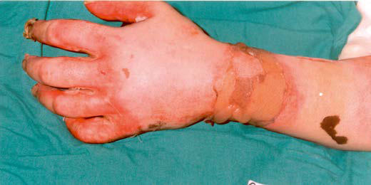

# Chapter 89: Burn Injuries

*Tina L. Palmieri*

<!-- p.851 -->
Burns are among the top five leading causes of *unintentional injury* in children, after motor vehicle crashes, suffocation, drowning, and poison ing. There has been a decline in the incidence of burn injury requiring medical care that has coincided with a stronger focus on burn treatment and prevention, increased fire and burn prevention education, greater availability of regional treatment centers, widespread use of smoke detec tors, greater regulation of consumer products and occupational safety, and societal changes such as reductions in smoking and alcohol abuse.

**EPIDEMIOLOGY** Approximately 1.1 million people in the United States require medical care for burn injuries each year, with over 100,000 children admitted to a hospital or treated in the emergency department (ED). **Fires** remain a major cause of mortality in children, but children <14 years old have a lower relative risk of dying in a fire than the general population.

**Thermal burns** are caused when an external heat source comes in contact with the skin and tissues causing injury; thermal burns may occur from contact with hot surfaces, hot liquids, steam, or flame. **Scald burns** are most prevalent in children ≤4 years old and account for 65% of burn-related admissions in this age-group. Although the incidence of hot water scalding has been reduced by legislation requir ing water heaters to be preset at 48.9°C (120°F), scald injury remains the leading cause of hospitalization for burns in this age-group. **Steam** inhalation used as a home remedy to treat respiratory infections is a rare potential cause of burns. **Flame burns** are the most common cause of burn injury in all age-groups ≥5 years old. Electrical and chemi cal burns are also more common in older children and adults than in young children. **Clothing ignition** events have declined since passage of the Federal Flammable Fabric Act requiring sleepwear to be flameretardant. Polyester is the fabric most resistant to ignition by a small flame source. Polyester burns deeply as it melts, but it self-extinguishes when the flame source is removed. Cotton*,* on the other hand, contin ues to burn after the flame source has been removed, resulting in large, deep burns. Polyester melts downward, sparing the face and respira tory tract; cotton burns upward toward the face. Pellet stoves, glass front stoves, and flat top stoves are frequent sources of hand burns in children, as is contact with hot hair appliances, such as curling irons and hair straighteners. Approximately 18% of burns are the result of **child abuse** (usually scalds), making it important to assess the pattern and site of injury and their consistency with the patient’s history (see Chapter 17). **Friction burns** from treadmills are also a problem. Hands are the most commonly injured sites, with burns ranging from deep second-degree to fourth-degree with tendon disruption and fractures from the friction injury. *Anoxia,* not the actual burn, is a major cause of morbidity and mortality in house fires.

Review of the history usually shows a common pattern: a v-shaped distribution of the scald burns to the chest and abdomen if liquid is pulled from a table or stove, burns in the pant leg area if clothing ignites, burns in a splash pattern from a hot liquid spill, and burns on the palm of the hand from contact with a hot stove or curling iron. However, **glove or stocking burns** of the hands and feet; single-area deep burns on the trunk, buttocks, or back; and small, full-thickness burns (e.g., cigarette burns) in young children should raise the suspi cion of child abuse.

**Burn care** involves a range of activities: prevention, acute care and resuscitation, wound management, pain relief, reconstruction, reha bilitation, and psychosocial adjustment. Children with massive burns require early and appropriate psychologic and social support as well as resuscitation. Surgical debridement, wound closure, and rehabilitative

efforts should be instituted concurrently to promote optimal outcomes. To maximize survival, the clinical approach includes aggressive surgi cal removal of devitalized tissue with timely skin closure via grafting, infection control, and judicious use of antibiotics; life support with endotracheal intubation and mechanical ventilation; and use of early enteral nutrition. Children who have sustained burn injuries differ in appearance from their peers, necessitating supportive efforts for reen try to school and social and sporting activities.

**PREVENTION** The aim of burn prevention is a continuing reduction in the number of serious burn injuries (Table 89.1). Effective first aid and triage can decrease both the extent (area) and the severity (depth) of injuries. The use of flame-retardant clothing and smoke detectors, control of hot water temperature (thermostat settings) to 48.9°C (120°F) within build ings, and prohibition of cigarette smoking have been partially successful in reducing the incidence of burn injuries. Treatment of children with significant burn injuries in dedicated burn centers facilitates medically effective care, improves survival, and leads to greater cost efficiency. Survival of at least 80% of patients with burns of 90% of the total body surface area (TBSA) is possible for children and young adults. Death is more likely in children with irreversible anoxic brain injury sustained at the time of the burn. Some burns occur on a seasonal basis, including: *Winter:* • Glass-front fireplaces/pellet stoves and radiators increase hand burns • Treadmill injuries as more people exercise inside—child imitates

adults or young child touches belt • Soup scald burns from spilling liquid while removing bowl from mi

crowave *Summer:* • Fireworks, sparklers—temperatures reach 537.8°C (1,000°F) • Burn contact with hot grill; hand/feet burn from hot embers • Burns from children walking or falling into a campfire • Lawnmowers *Spring/Fall:* • Burning leaves • Gasoline burns • Tap water scalds • House fires from propane heater explosion

Pediatricians can play a major role in preventing the most com mon burns by educating parents and healthcare providers. Simple, effective, efficient, and cost-effective preventive measures include the use of appropriate clothing and smoke detectors and the planning of routes for emergency exit from the home. The National Fire Protection Association (NFPA) recommends replacing smoke detector batteries

*Tina L. Palmieri*

#### **Table 89.1** Burn Prophylaxis

| Category / Parameter | Clinical Details & Findings |
| --- | --- |
| **PREVENT FIRES** | Install and use smoke detectors.; Control the hot water thermostat; maximum water temperature; should be 48.9°C (120°F).; Keep fire, matches, and lighters out of the reach of children.; Avoid cigarette smoking, especially in bed.; Do not leave lit candles unattended.; Keep hair appliances such as curling irons and straighteners out of; the reach of children.; Use caution when cooking, especially with oil.; Keep cloth items off heaters. |
| **PREVENT INJURY** | Stop, drop, and roll (do not run) if clothing catches fire; wrap in a; blanket.; Practice escape procedures.; Crawl beneath smoke if a fire occurs indoors.; Use educational materials.*; *National Fire Protection Association pamphlets and videos. |

<!-- p.852 -->
annually and the smoke detector alarm every 10 years (or earlier, if indicated on the device).

**ACUTE CARE, RESUSCITATION, AND ASSESSMENT Indications for Admission** Burns covering >10% TBSA, burns associated with smoke inhala tion, burns resulting from high-tension (voltage) electrical injuries, and burns associated with suspected child abuse or neglect should be treated emergently and referred to a burn center for definitive care (Table 89.2). Small first- and second-degree burns of the hands, feet, face, perineum, and joint surfaces may require admission if close fol low-up care is difficult to provide. Children who have been in enclosedspace fires and those who have significant face and neck burns should be evaluated carefully for airway or neurologic compromise, including monitoring for 24 hours in the hospital for potential central nervous system (CNS) effects of anoxia from carbon monoxide (CO) poisoning or pulmonary effects from smoke inhalation.

**First Aid Measures** Acute care should include the following measures: 1.	Extinguish flames by rolling the child on the ground; cover the child

with a blanket, coat, or carpet. 2.	Remove smoldering clothing or clothing saturated with hot liquid.

Jewelry, particularly rings and bracelets, should be removed or cut away to prevent constriction and vascular compromise during the edema phase in the first 24-72 hours after burn injury. 3.	In cases of **chemical injury**, brush off any remaining chemical, if

powdered or solid; then use copious irrigation or wash the affected area with water. Call the local poison control center for the neutral izing agent to treat a chemical ingestion. 4.	Wash the burned area with soap and cool running water. For burns

on less than 10% of the body, irrigate with cool tap water for 10-20 minutes. Significant large-burn injury (>15% TBSA) decreases body temperature control so the use of cold water is contraindicated. 5.	Cover the burned area with clean, dry sheeting or dressing. Avoid

using tape. 6.	If the burn is caused by *hot tar,* cool the burn and then use mineral

oil to remove the tar. 7.	Administer analgesic medications.

**Emergency Care** Supportive measures are as follows (Table 89.3 and Table 89.4): 1.	 Rapidly review the cardiovascular and pulmonary status and docu

ment preexisting or physiologic lesions (asthma, congenital heart disease, renal or hepatic disease). 2.	 Ensure and maintain an adequate airway (Fig. 89.1). For any child

with a facial burn or suspected inhalation of smoke, the following actions are indicated:

a.	 Start 100% oxygen and measure carboxyhemoglobin (CO) lev

els as well as a blood gas, because cutaneous oxygen saturations are not accurate in CO poisoning (see Chapters 79 and 86). b.	 Assess for laryngeal edema (examine mouth; assess for stridor,

retractions) and intubate for evidence of significant airway com promise. c.	 Assess oxygenation to evaluate for lung damage from smoke in

halation. Bronchoscopy may be helpful in the intubated child to further delineate the extent of smoke inhalation injury. Use a humidified ventilator circuit to prevent dry secretions that can obstruct an airway. 3. Children with burns >15% TBSA require intravenous (IV) fluid

resuscitation to maintain adequate perfusion. IV access is prefer ably obtained in a nonburned area, but if none is readily available, placing the initial line through a burn may be necessary. Monitor peripheral IV sites closely for infiltration, as extremities will be come edematous after burn injury. In an emergency situation in which IV access is unattainable, an intraosseous (IO) line may be placed. The IO line should be replaced in a timely fashion with a central line, as IO needles may be unable to sustain the large fluid volume needed for major burn resuscitation. Patients with inhala tion injury, regardless of the extent of TBSA burn, require large volumes of fluid for resuscitation due to insensible losses from the injured airway epithelium. Significant high-tension and electrical injuries require venous access to ensure sufficient fluid resuscita tion volumes, as forced alkaline diuresis may be needed in fluidrefractory myoglobinuria to avoid renal damage. Lactated Ringer solution, 10-20 mL/kg/hr (normal saline may be used if lactated Ringer solution is not available), is initially infused until proper flu id replacement can be calculated. Consultation with a specialized burn unit should be made to coordinate fluid therapy, including the type of fluid, the preferred formula for calculation, and prefer ences for the use of colloid agents, particularly if transfer to a burn center is anticipated. 4.	 For patients with circumferential burns of the extremities, elevate

the extremities and monitor perfusion (capillary refill, pulses), as compartment syndrome (see Chapter 80) may develop and require escharotomy. 5.	 Evaluate the child for associated injuries. Children with burns may

have associated accidental traumatic injuries (fall) or nonacciden tal injuries (child abuse). In cases of high-voltage electrical burn (>1,000 volts), especially if there has also been a fall from a height, injuries to the spine, bones, and thoracic or intraabdominal organs may occur (see Chapter 80). Cervical spine precautions should be observed until this injury is ruled out. If ventricular fibrillation oc curs at the scene of an electrocution, cardiopulmonary resuscita tion (CPR) should be instituted promptly, and cardiac monitoring started on the patient’s arrival at the ED (see Chapter 79). 6. Children with burns of >15% TBSA should not initially receive oral

fluids because gastric distention may develop. These children may re quire insertion of a nasogastric tube in the ED to prevent aspiration. 7.	 A Foley catheter should be inserted into the bladder to monitor

urine output in children who require IV fluid resuscitation.

#### **Table 89.2** Indications for Referral to a Burn Center

| Category / Parameter | Clinical Details & Findings |
| --- | --- |
| **General** | Partial-thickness burns affecting >10% TBSA; Full-thickness burn affecting >5% TBSA; Third-degree burns; Electrical burns caused by high-tension wires or lightning; Chemical burns; Inhalation injury, regardless of the amount of TBSA burned; Inadequate home or social environment; Suspected child abuse or neglect; Burns to the face, hands, feet, perineum, genitals, or major joints; Burns in patients with preexisting medical conditions that may; complicate the acute recovery phase; Associated injuries (fractures); TBSA, Total body surface area.; Adapted from American Burn Association/American College of Surgeons. Guidelines; for the operation of burn centers. J Burn Care Res. 2007;28(1):134–141 and Bettencourt; AP, Romanowski KS, Joe V, et al. Updating the Burn Center Referral Criteria: Results; from the 2018 eDelphi Consensus Study. J Burn Care Res. 2020;41(5):1052–1062. |

#### **Table 89.3** Acute Treatment of Burns

| Category / Parameter | Clinical Details & Findings |
| --- | --- |
| **General** | First aid, including washing of wounds and removal of devitalized; tissue; Fluid resuscitation; Provision of energy requirements; Control of pain; Prevention of infection; Early excision and grafting; Prevention of excessive metabolic expenditures; Control of bacterial wound flora; Early mobility, range of motion, and strength exercises |

<!-- p.853 -->
8.	 In general, wounds should be wrapped with a clean sheet or dress

ing until it is decided whether to treat the patient on an outpatient basis or refer to an appropriate facility. 9.	 For children trapped in a fire, a CO measurement (carboxyhemo

globin [HbCO]) should be obtained and 100% oxygen adminis tered until the result is known. Pulse oximetry is unreliable in CO poisoning. 10.	Review child immunizations, including tetanus immunization.

Use diphtheria, tetanus toxoids, and acellular pertussis (DTaP) for tetanus prophylaxis for children <7 years old, and use tetanus, diphtheria, and pertussis (TdaP) for children ≥7 years old (see Chapter 257).

**Classification of Burns** Proper triage and treatment of burn injury require assessment of the extent and depth of the injury (Table 89.5 and Fig. 89.2). **First-degree burns** involve only the epidermis and are characterized by swelling, erythema, and pain (similar to mild sunburn). Tissue damage is usually minimal, and there is no blistering. Pain resolves in 48-72 hours; in a small percentage of patients, the damaged epithelium peels off, leaving no residual scars.

A **second-degree burn** involves injury to the entire epidermis and a variable portion of the dermal layer (vesicle and blister formation are characteristic). A *superficial* second-degree burn is extremely painful because many remaining viable nerve endings are exposed. Superficial

#### **Table 89.4** Phases of Burn Care

| Category / Parameter | Clinical Details & Findings |
| --- | --- |
| **1: Resuscitation, 0-72 hours** | Massive capillary leak, edema, and burn; shock; Airway, breathing, and circulation optimization via; accurate fluid resuscitation and thorough evaluation |
| **2: Acute treatment phase, day 3 through** | discharge; Hyperdynamic and catabolic state,; immunosuppression, risk of infection; Enteral nutrition to optimize wound healing; excision; and biologic wound closure of full-thickness wounds; with excision and grafting within 7 days of injury |
| **3: Rehabilitation, day 1 through discharge** | Gradual waning of initial catabolic state,; wounds heal, scars form, and strength; recovers; Maintain and restore range of motion; reduce edema;; strengthen muscles; facilitate return to home, work,; and school |

**Fig. 89.1** Algorithm for primary survey of a ma jor burn injury. (From Hettiaratchy S, Papini R. Ini tial management of a major burn. I. Overview. BMJ. 2004;328:1555–1557.)

**Airway** Compromised or at risk of compromise?

Intubate

Escharotomies

Go back and re-evaluate

**Breathing** Compromised?

**Cause:** Mechanical Carboxyhemoglobin Smoke inhalation

Blast injury

Consider: Hypoxia (carboxyhemoglobin level?) Hypovolemia

Escharotomies Intubate and ventilate; O2 Nebulizers; O2 Noninvasive ventilation Invasive ventilation Invasive ventilation Chest drains

Yes

Yes

No

**Circulation** Compromised perfusion to an extremity?

No

**Neurological disability** Impaired score on Glasgow coma scale?

No Yes

Yes

**Exposure** Fully assess burn area and depth Full examination for concomitant injuries Keep warm

**Fluids** Calculate resuscitation formula based on surface area and time since burn

No

<!-- p.854 -->
second-degree burns heal in 7-14 days as the epithelium regenerates in the absence of infection. *Mid-level to deep* second-degree burns will generally heal in 14-21 days, but often result in significant scarring. Deep second-degree burns tend to be dry, pale, and white (flame) or red (scald); they are often grafted to mitigate scarring (Fig. 89.3). Pain may be less with these burns than in more superficial burns because fewer nerve endings remain viable; however, the edge of the burn, which will be less deep, will still cause pain. Fluid losses and metabolic effects of deep dermal (second-degree) burns are essentially the same as those of third-degree burns. If a blister is intact in a burned area, the burn is at least second-degree but may be deeper. Definitive diagnosis of burn depth is not possible because the blister blocks visualization of the burned tissue under the blister.

**Full-thickness**, or **third-degree burns**, involve destruction of the entire epidermis and dermis, leaving no residual epidermal cells to repopulate the damaged area. The wound heals by wound contraction or skin grafting. Wounds are either white or leathery (flame burn) or mottled, nonblanching, and cherry red (scald) (Fig. 89.4). The absence of painful sensation and capillary filling demonstrates the loss of nerve and capillary elements. Pain exists at the edges of the burn. Hence, using pain to determine burn depth is not accurate.

Technologies can help accurately determine the depth of burns. Laser *Doppler imaging* can be used from 25 days after the burn. It pro duces a color map of the affected tissue; *yellow* indicates second-degree burns, reflecting the presence of capillaries, arterioles, and venules, and *blue* reflects very low or absence of blood flow, which indicates thirddegree burns. Although early reports are promising, the clinical utility

of laser Doppler imaging for burn depth determination is not clearly established.

**Estimation of Total Body Surface Area for a Burn** Appropriate burn charts for different childhood age-groups should be used to accurately estimate the extent of TBSA burned. The extent and depth of the burn are the largest determinants of fluid resuscitation requirements. Mortality and morbidity also depend on the extent and depth of the burn. Children have a larger surface area to mass ratio than adults, and the variable growth rate of the child’s head and extremities makes it necessary to use body surface area (BSA) charts, such as that modified by Lund and Brower, to accurately calculate burn size (Fig. 89.5). Another method of estimating burn size is to employ the palm rule. The palm of the child’s hand (from base of palm to fingertip) is 1% of the child’s TBSA. A quick method of estimating burn size is to hold your hand up to the child’s hand to gauge the area and use that to determine burn size. The **rule of nines** used in adults should only be used in children >14 years old or >20 kg as a rough estimate to institute therapy before transfer to a burn center. The rule of nines divides body regions by 9% BSA: head and neck, chest and upper back, each arm, abdomen, lower back, upper leg, and lower leg; hand or genitals (1%).

**TREATMENT Outpatient Management of Minor Burns** A patient with first- and second-degree burns <10% TBSA may be treated on an outpatient basis unless pain is uncontrolled on oral agents, the family cannot successfully complete wound care, or there are issues of child neglect or abuse. These outpatients do not require prophylactic antibiotics. Blisters should be left intact and dressed with a nonstick dressing such as Telfa or Xeroform. Topical creams do not penetrate the blister and are not indicated unless the blister ruptures. Dressings should be changed once daily, after the wound is washed with lukewarm water. Very small wounds, especially those on the face, may be treated with bacitracin ointment and left open. **Debridement** (i.e., removal) of the devitalized skin is indicated when the blisters rupture. A variety of wound dressings are available for application to seconddegree burns; the affected area should be subsequently wrapped with a dry, clean dressing. Silver dressings are popular because they provide pain relief, prevent wound desiccation, reduce wound colonization, and can be left in place for 5-7 days (Table 89.6). Although silver dressings are antimicrobial, wound infections can occur beneath these dressings. Patients should be instructed to seek immediate medical care for signs and symptoms of infection (elevated temperature, malaise, pain) and should be reevaluated at least weekly by the medical team. The great majority of superficial burns heal in 7-10 days, with deep seconddegree burns taking longer to heal. Burns that have not healed within 2 weeks (or clearly will not be healed in 2 weeks) have a >97% chance of developing a significant scar and should be referred to a burn center.

Epidermis

Superficial

Superficial

dermal

Deep dermal

Fullthickness

Dermis

Subcutaneous

**Fig. 89.2** Diagram of different burn depths. (From Hettiaratchy S, Papini R. Initial management of a major burn. II. Assessment and resus citation. BMJ. 2004;329:101–103.)

#### **Table 89.5** Categories of Burn Depth

| Category / Parameter | Clinical Details & Findings |
| --- | --- |
| **Surface appearance** | Dry, no blisters; Minimal or no edema; Erythematous; Blanches, bleeds; Moist blebs, blisters; Underlying tissue is mottled pink and white,; with fair capillary refill; Bleeds; Dry, leathery eschar; Mixed white, waxy, khaki, mahogany,; soot-stained; No blanching or bleeding |
| **Pain** | Very painful; Very painful; Insensate centrally, edges (usually less; deep) may still have sensation |
| **Histologic depth** | Epidermal layers only; Epidermis, papillary, and reticular layers of; dermis; May include domes of subcutaneous layers; Through all layers of the skin to; subcutaneous tissue (loss of muscle,; bone is fourth-degree burn) |
| **Healing time** | 2-5 days with no scarring; Superficial: 5-21 days with no grafting; Deep partial: 21-35 days with no infection, but; scar is expected; if infected, converts to; full-thickness burn; Large areas require grafting, but small; areas may heal from the edges after; weeks |

<!-- p.855 -->
The palm of the hand is one of the most frequently burned areas in children, particularly toddlers. Because the skin on the palm of the hand is thicker than other parts of the body, burns to the palm often heal. Generally, blisters of the palm can be left intact unless they are already open, or they are so large that they will likely rupture (usually about 1-2 cm in height), or purulence is draining from the blister. If leaving a blister intact, inform the family to either return to the office if the blister ruptures or instruct them on how to remove the blister and apply bacitracin to the wound. If a palm burn has not healed in 2 weeks (or it is clear that it will not be healed), referral to a burn center is needed.

The depth of scald injuries is difficult to assess early, as the wounds are often reddish in color. Nonoperative treatment is appropriate ini tially. Generally, third-degree scald burns will become increasingly pale and white by 4-5 days post injury, whereas those that heal will be a lighter pink color. A wound that has not healed in 2 weeks will likely need grafting (Fig. 89.6). This conservative approach obviates the risk of anesthesia and unnecessary grafting.

**Fluid Resuscitation** Fluid resuscitation, if required, should begin as soon as possible (at the scene, in the ED, or before transfer) after the injury has occurred because delays of as little as 30 minutes affect outcomes. Numerous formulas exist to help guide practitioners in calculating fluid resus citation needs in patients with burns. For most children, the *Park land formula* is an appropriate *guideline* to determine starting IV fluid resuscitation rate; however, fluids should be adjusted hourly based on the patient’s response. The steps in calculating the starting rate are as follows: 1.	Calculate the 24-hour fluid requirement: 4 mL lactated Ringer solu

tion per (times) weight in kg per (times) % TBSA burned. The TBSA burned is a whole number, NOT a percentage. 2.	Determine the volume of fluid to be given in the first 8 hours: for the

Parkland formula, that is half of the 24-hour requirement. 3.	Calculate the starting hourly infusion rate: divide the volume to be

given in the first 8 hours by 8 to determine the starting rate. The

A B

**Fig. 89.3** Second-degree burns. A, Superficial partial-thickness (second-degree) burn, which is pink and glistening. B, Deep partial-thickness (second-degree) burn. The white-appearing area over the dorsum of the hand is a deep partial-thickness burn. (From Singer AJ, Lee CC. Thermal burns. In: Walls RM, Hockberger RS, Gausche-Hill M, et al., eds. Rosen’s Emergency Medicine, 9th ed. Philadelphia: Elsevier; 2018: Figs. 56.1 and 56.2, p. 717.)

**Fig. 89.4** Full-thickness (third-degree) burn over both feet. The cen tral area is depressed and has a yellowish color indicating it is full thick ness. (Modified from Singer AJ, Lee CC. Thermal burns. In: Walls RM, Hockberger RS, Gausche-Hill M, et al., eds. Rosen’s Emergency Medi cine, 9th ed. Philadelphia: Elsevier; 2018: Fig. 56.3, p. 717.)

1

A

B

C

D

E

F

G

H

J

NEWBORN

18% 40% 16% 26%

3 YR 15% 40% 16% 29%

6 YR 12% 40% 16% 32%

12+ YR

%BURNED ANT HEAD TRUNK R. ARM L. ARM R. LEG L. LEG TOTAL

POST

6% 38% 18% 38%

HEAD TRUNK

ARMS

LEGS

2 3 4 5 6 7 8 % 1°

2°

3°

Date Burned Date of Evaluation

**Fig. 89.5** Chart to determine developmentally related percentage of body surface area affected by burn injury. ANT, Anterior; POST, poste rior; R., right; L., left. (Courtesy Shriners Hospital, Burn Institute, Boston Unit.)

#### **Table 89.6** Select Silver Antimicrobial Dressings for Burns

| Category / Parameter | Clinical Details & Findings |
| --- | --- |
| **CHARACTERISTIC(S)** | Mepitel Ag; Silicone mesh dressing; Mepilex Ag; Foam dressing |
| **ACTICOAT** | Polyethylene nonadherent net dressing; AQUACEL Ag; Absorptive Hydrofiber; Silverlon; Knitted nylon nonadherent dressing |

<!-- p.856 -->
infusion rate is adjusted hourly based on urine output goals of 0.8-1 mL/hour in children <20 kg or <12 years of age and 0.4-0.5 mL/kg/ hr (maximum of 30 mL/hr) in children >12 years or >20 kg. Providers should increase the fluid rate by 10% if urine output is below the hourly target and decrease the fluids by 10% if over the tar get. Because major burns have a hypermetabolic response, tachycardia is NOT an accurate measure of resuscitation in a child with a major burn. Acid-base balance, mental status, serum lactate, and noninvasive monitoring are useful adjuncts to evaluate the adequacy of resuscita tion. Because of interstitial edema and sequestration of fluid in muscle cells, patients may gain up to 20% over baseline (preburn) body weight. Patients with burns of >20% TBSA often require a large venous access (central venous line) to deliver the fluid required over the critical first 24 hours; these patients are best cared for in a specialized pediatric burn unit. In addition to fluid resuscitation, children <20 kg should receive standard maintenance fluids (see Chapter 74).

During the second 24 hours after the burn, patients begin to reab sorb edema fluid and to experience diuresis. IV fluid requirements after resuscitation will consist of isotonic crystalloid infusion for insen sible losses (see Chapter 73) plus the fluid losses from the burn wound. Controversy surrounds whether *colloid* should be provided in the early period of burn resuscitation. One preference is to administer albumin if a patient is not responding to crystalloid resuscitation. In children <12 months old, sodium tolerance is limited; the volume and sodium concentration of the resuscitation solution should be decreased if the urinary sodium level is rising. The adequacy of resuscitation should be constantly reassessed by integrating vital signs with urine output, blood gas, serum lactate, base deficit, hematocrit, and serum protein measurements. Some patients require arterial and central venous lines, particularly those undergoing multiple excision and grafting proce dures, for monitoring and fluid replacement purposes. Central venous pressure monitoring may be indicated to assess circulation in patients with hemodynamic or cardiopulmonary instability. Femoral vein can nulation is a safe access for fluid resuscitation, especially in infants and children. Burn patients who require frequent blood gas monitoring benefit from radial or femoral arterial catheterization.

Oral supplementation may start as soon as enteral access is obtained. Early nutrition helps to minimize effects of the hypermetabolic response. Milk formula, artificial feedings, homogenized milk, or soybased products can be given by bolus or constant infusion through a nasogastric or small bowel feeding tube. These feedings are not part of the initial 24-hour fluid resuscitation, as absorption may be variable. When oral fluids are tolerated after several days, IV fluids are decreased proportionately to keep the total fluid intake constant, particularly if pulmonary dysfunction is present.

Colloids such as albumin are lost through the burn wound. To maintain oncotic pressure and protein binding, a **5% or 25% albumin**

**infusion** may be used to maintain the serum albumin levels at a desired 2 g/dL. Infusion of **packed red blood cells** is recommended if the hematocrit falls to <20% (hemoglobin = 7 g/dL). Most patients are hemoconcentrated during resuscitation; thus transfusion in the first 24-48 hours is rare unless there is accompanying trauma. **Fresh-frozen plasma** (FFP) is indicated if clinical and laboratory assessment shows a deficiency of clotting factors, a prothrombin level >1.5 times control, or a partial thromboplastin time >1.2 times control in children who are bleeding or are scheduled for an invasive procedure or a grafting pro cedure that could result in an estimated blood loss of more than half of blood volume. Although FFP use for volume resuscitation during the first 24 hours of injury is advocated by some, this strategy has not yet undergone rigorous evaluation through randomized prospective trials.

**Sodium supplementation** may be required for children with burns of >20% TBSA, particularly if 0.5% silver nitrate solution is used as the topical antibacterial burn dressing. Sodium losses with silver nitrate therapy are regularly as high as 350 mEq/m2 burn surface area. The aim is to maintain serum sodium levels >130 mEq/L and urinary sodium concentration >30 mEq/L. Young children <5 years are especially sus ceptible to hyponatremia and cerebral edema. IV **potassium supple mentation** is supplied to maintain a serum potassium level >3 mEq/ dL. Potassium losses may be significantly increased when 0.5% silver nitrate solution is used as the topical antibacterial agent or when ami noglycoside, diuretic, or amphotericin therapy is required. Magnesium and ionized calcium can also become rapidly depleted and should be assessed at least daily for the first week and weekly thereafter in major burns.

**Prevention of Infection and Surgical Management of the Burn Wound** In general, prophylactic antibiotic administration is not indicated for burn injuries because it predisposes patients to development of resis tant pathogens. Topical antimicrobial creams or silver agents reduce wound colonization; systemic antibiotics do not reach the nonviable tissue in the burn wound. There is conflicting evidence as to whether relocation of the IV catheter every 48-72 hours decreases or increases the incidence of catheter-related sepsis in burn injury. Central venous catheters should be monitored closely for infection. Many burn units replace or relocate central lines every 5-7 days, even if the site is not inflamed and there is no suspicion of catheter-related sepsis, particu larly if the line is near a burn wound. The incidence of central line– associated bloodstream infection is directly related to the distance between the catheter and the burn wound. The fragile tissue and fre quency of patient turning and movement, combined with the mois ture of the burn wound, make it imperative to securely attach central venous catheters with sutures placed securely in at least three locations to prevent catheter movement, kinking, or accidental removal.

Mortality related to burn injury is associated not with the toxic effect of thermally injured skin, but with the metabolic and bacterial con sequences of a large open wound, reduction of the patient’s immune response, and malnutrition. These abnormalities set the stage for life-threatening bacterial infection originating from the burn wound. Thorough early wound cleaning, application of topical antimicrobial creams, and early wound excision and grafting promote wound healing and improve aesthetic and functional outcomes. Topical antimicrobial agents for burn wound treatment include bacitracin (second-degree burns or burns that will heal in a week), silver sulfadiazine cream (third-degree burns), mafenide acetate (Sulfamylon) cream (thirddegree burns on ears, cartilage), or 0.5% silver nitrate solution (thirddegree burns with sulfa allergy) (Table 89.7). Regardless of the choice of topical antimicrobial agent, it is essential that all third-degree burn tissue be fully excised and grafted before bacterial colonization pro gresses to systemic infection. Children with a burn of >20% TBSA should be housed in reverse isolation with all personnel required to wear gown, gloves, mask, and hat to prevent cross-contamination and to provide a temperature- and humidity-controlled environment that minimizes hypermetabolism.

Deep third-degree burns of >10% TBSA benefit from early excision and grafting. To improve outcome, sequential excision and grafting of

D

S

**Fig. 89.6** Tea scald over the chest and shoulder of a child showing heterogeneity of burn depth. D, Deep; I, intermediate; S, superficial. (From Enoch S, Roshan A, Shah M. Emergency and early management of burns and scalds. BMJ. 2009;338:937–941.)

<!-- p.857 -->
third-degree and deep second-degree burns may be required in chil dren with large burns. Prompt excision with immediate wound clo sure is achieved with **autografts**, skin obtained from another part of the patient’s body, which may be meshed to increase the efficiency of coverings. Alternatives for wound closure, such as allografts, dermal substitutes, and other biologic dressings, may be important for wound coverage in patients with extensive injury to limit fluid, electrolyte, and protein losses and to reduce pain and minimize temperature loss. Cul tured epidermal cells (autologous keratinocytes), grown from a skin biopsy from the patient, are a costly alternative and are not always successful. Another approach employs an autologous cell spray (theo retically containing stem cells) as an adjunct to meshed skin for wound closure. An experienced burn team can safely perform early stage or total excision while burn fluid resuscitation continues. Important keys to success are (1) accurate preoperative and intraoperative determi nation of burn depth, (2) the choice of excision area and appropriate timing, (3) control of intraoperative blood loss, (4) specific instrumen tation, and (5) the type of wound coverage chosen.

**Nutritional Support** Supporting the increased energy requirements of a patient with a burn is a high priority. The burn injury produces a hypermetabolic response characterized by both protein and fat catabolism. Depending on the time lapse since the burn, children with a burn of 40% TBSA require basal energy expenditure (oxygen consumption) approximately 50–100% higher than predicted for their age. Early excision and grafting can decrease the energy requirement. Pain, anxiety, and immobiliza tion increase the physiologic demands. Additional energy expenditure is caused by cold stress if environmental humidity and temperature are not controlled; this is especially true in young infants, in whom the large BSA:mass ratio allows proportionately greater heat loss than in adolescents and adults. Providing environmental temperatures of 28–33°C (82.4–91.4°F), adequate covering during transport, and lib eral use of analgesics and anxiolytics can decrease caloric demands. Appropriate sleep intervals are necessary and should be part of the reg imen. Early enteral nutrition, initially with high-carbohydrate, highprotein caloric content (1,800 kcal/m2/24-hr maintenance plus 2,200 kcal/m2 of burn/24 hr) reduces metabolic stress.

The objective of nutrition supplementation programs is to maintain body weight and minimize weight loss by meeting metabolic demands.

This reduces the loss of lean body mass. Calories are provided at approximately 1.5 times the basal metabolic rate, with 3-4 g/kg of pro tein/day. The focus of nutritional therapy is to support and compen sate for the metabolic needs. Multivitamins, particularly the B vitamin group, vitamin C, vitamin A, vitamin D, vitamin E, copper, selenium, and zinc, are also necessary.

Alimentation should be started as soon as is practical, preferably enterally, to meet all caloric needs and maintain gastrointestinal (GI) tract function throughout treatment. Patients with burns of >40% of TBSA need a flexible nasogastric or small bowel feeding tube to facili tate continuous delivery of calories without the risk of aspiration at the time of admission. To decrease the risk of infectious complica tions, parenteral nutrition should be avoided or discontinued as soon as is practical after delivery of sufficient enteral calories is established. Continuous GI feeding is essential, even if feeding is interrupted for frequent visits to the operating room, until full grafting takes place. In third-degree burns >20% the use of anabolic agents such as *oxan drolone* to improve wound healing and promote protein synthesis or anticatabolic agents (propranolol) to reduce metabolic stress is com mon practice. It is vital to continue enteral feeding while using these agents to obtain maximal response. Liver function studies should be monitored weekly when giving oxandrolone, and oxandrolone should be discontinued if liver function deteriorates.

**Topical Therapy** Topical therapy is widely used to decrease wound colonization from a wide variety of wound pathogens (see Table 89.7). Preferences vary among burn units. Each topical agent has advantages and disadvan tages in application, comfort, and bacteriostatic spectrum. However, all agents impair wound healing. The type of organism on a wound varies with the age of the wound. In the first week, gram-positive organisms predominate. During weeks 2-4, gram-negative organisms are frequently found in burn wounds. Prolonged open burn wounds eventually tend to develop resistant gram-negative organisms, fun gus, or mold. The choice of topical antimicrobial depends on wound age and depth. *Bacitracin* is a clear ointment effective against grampositive organisms and is often used in wounds that will heal within a week. If placed on nonburned skin, it may cause a yeast rash or pimples that resolve with discontinuation. *Silver sulfadiazine* is a white cream containing silver with a broad spectrum of coverage, including

#### **Table 89.7** Topical Agents Used for Burns

| Category / Parameter | Clinical Details & Findings |
| --- | --- |
| **EASE OF USE** | Bacitracin; Gram-positive organisms; good for; wounds that will heal in 7-10 days; May cause yeast overgrowth rash or; pustules if on intact skin; resolves; with discontinuation; Clear ointment, 1-2 times daily,; easy to clean off; Silver sulfadiazine cream; (Silvadene); Broad spectrum including gram-; positive and -negative organisms,; some fungus; may cause leukopenia; Leukopenia, self-limited; may be; painful; Changed twice daily; Leaves adherent residue; Residue must be washed off with; each dressing change; Mafenide acetate cream*; (Sulfamylon); Targets resistant gram-negative; organisms, particularly Pseudomonas,; some gram-positive coverage; Carbonic anhydrase inhibitor, may; cause metabolic acidosis; Changed twice daily; application; may be painful; Rapid and deep wound penetration;; used on cartilage (ears) and deep; wound infection; Residue must be washed off with; each dressing change; 0.5% Silver nitrate solution; Bacteriostatic; Permanent staining of surfaces; from silver oxidation;; electrolyte disturbances from; hypotonic solution, potential; methemoglobinemia; Closed bulky dressing soaked; every 2 hr and changed 1-2 times; daily; Broad spectrum, including some fungi; Superficial penetration; *Mafenide acetate solution at concentrations of 2.5% or 5% for use on heavily colonized, multidrug-resistant organisms to be used for 5 days only. |

<!-- p.858 -->
gram-positive and gram-negative organisms and some fungi. It is used commonly in deep third-degree burns that require grafting and may cause transient self-limiting leukopenia if applied over large areas. *Mafenide acetate* is a white cream with the ability to diffuse through the burn eschar; it is the treatment of choice for injury to cartilagi nous surfaces, such as the ear. Mafenide acetate solution at a concentra tion of 5% is useful for the treatment of burn wounds that are heavily colonized with multidrug-resistant gram-negative bacteria and is often used postoperatively to keep grafts moist. The carbonic anhydrase inhibition activity of mafenide acetate may cause metabolic acidosis if large surface areas are treated in a small child. No sulfa-containing agent should be used if the child has a history of sulfa allergies. Silver nitrate solution may be used in children with sulfa allergy because of its broad spectrum of coverage. However, it causes gray staining of the environment and wound from silver oxidation as well as electrolyte disturbances because of the hypotonic nature of the solution.

**Inhalation Injury** Inhalation injury is serious in the infant and child, particularly if pre existing pulmonary conditions are present (see Chapter 86). Inhalation injury should be suspected based on history of sustained exposure to smoke in association with the burn injury, such as being confined in a closed space or from an indoor explosion, with decreased level of con sciousness or with evidence of carbon deposits in the oropharynx or nose, singed facial hair, or carbonaceous sputum. Mortality estimates vary, depending on the type of inhalation injury and the extent of expo sure. Each of the three types of inhalation injury (toxic gases, upper air way edema, and lower airway injury) has a different treatment.

**Toxic Gases** Carbon monoxide poisoning from the burning of organic materials is caused by displacement of oxygen from the hemoglobin molecule by CO, leading to tissue hypoxia (see Chapter 94). CO poisoning should be treated with 100% oxygen until carboxyhemoglobin levels drop below 10%. Toxic fumes, including cyanides from combustible plas tics as well as sulfur and nitrogen oxides and alkalis formed during the combustion of synthetic fabrics, produce corrosive chemicals that may erode the mucosa and cause significant tissue sloughing. Exposure to smoke may cause degradation of surfactant and decrease its produc tion, resulting in atelectasis. Inhalation injury and burn injury are syn ergistic, and the combined effect can increase morbidity and mortality.

Injury from gases generally manifests early in the course of treat ment. Acute asphyxia is the leading cause of death at the fire scene and can cause anoxic brain injury, particularly in children. Signs of CNS injury from hypoxemia caused by asphyxia or CO poisoning vary from irritability to depression. CO poisoning may be *mild,* with slight dys pnea, headache, nausea, and decreased visual acuity and higher cere bral functions; *moderate,* with irritability, agitation, nausea, dimness of vision, impaired judgment, and rapid fatigue; or *severe,* producing confusion, hallucination, ataxia, cardiovascular collapse, acidosis, and coma. Measurement of HbCO is important for diagnosis and treat ment. Pulse oximetry is NOT a reliable marker of oxygenation in CO poisoning. If significant CO exposure is suspected, a blood gas with co-oximetry and a HbCO level should be obtained to determine Pao2 and CO toxicity extent. CO poisoning and hypoxia are assumed to be present until the tests are performed, and patients should receive 100% oxygen until the HbCO level is <10% and adequate oxygenation is con firmed. Significant CO poisoning (level >25%) may require hyperbaric oxygen therapy; the risk of transporting a burn patient to the hyper baric chamber needs to be carefully considered. **Cyanide poisoning** should be suspected if a metabolic acidosis persists despite adequate fluid resuscitation and in environments containing synthetic polymers (see Chapter 94). Unless specifically suspected, most burn centers do not routinely screen for cyanide poisoning.

**Upper Airway Edema** The treatment priority for edema of the upper airway caused by inhala tion injury focuses on establishing and maintaining a patent airway. If airway obstruction is apparent, prompt and early nasotracheal or

orotracheal intubation is indicated to maintain airway patency and assure adequate ventilation and oxygenation. The most experienced provider should perform the intubation, as edema may allow only one attempt. The endotracheal tube size should be chosen carefully, as replacement during the first 1-3 days is often not possible. Endotra cheal tubes should *not be secured* with tape if a facial burn is present, as the tape will not adhere to the moist surface. The endotracheal tube can be secured to a tooth, to the maxilla, or tied in two planes. Monitoring the security of the endotracheal tube and assuring it remains in the same location at the level of the teeth is essential, as edema may alter tube position.

**Parenchymal Injury** Intubation and mechanical ventilation may be required in patients who have significant hypoxia, hypercarbia, or mental status changes caused by smoke inhalation. Wheezing and bronchospasm are common, and use of inhaled bronchodilators is often helpful. Smoke inhalation injury is gauged via clinical progression and bronchoscopy. Aggressive pulmonary toilet and chest physiotherapy are necessary, as casts and airway obstruction from debris are common. Extubation should be delayed until the patient has adequate oxygenation and ventilation, is able to sustain the increased minute ventilation and work of breathing that accompanies burn injury, and edema has resolved. A spontane ous breathing trial and a cuff leak test are often used to gauge readi ness for extubation. Children with an anticipated need for mechanical ventilation >2 weeks may benefit from tracheostomy, as it provides a secure, comfortable airway with decreased sedation requirements. Tracheostomy should only be performed under general anesthesia by experienced surgeons using optimal positioning, proper tracheostomy tube size, and hemostatic conditions. In children with deep burns of the face, tracheostomy provides a secure airway that facilitates excision and grafting yet allows for oral movement, including a pacifier.

Patients with severe inhalation injury or with other causes of respi ratory deterioration that lead to pediatric acute respiratory distress syndrome who do not improve with conventional pressure-controlled ventilation (progressive oxygenation failure, as manifested by oxygen saturation <90% while receiving Fio2 of 0.9-1.0 and positive endexpiratory pressure of at least 12 cm H2O) may benefit from highfrequency ventilation or nitric oxide inhalation treatment. Nitric oxide usually is administered through the ventilator at 5 parts per million (ppm) and increased to 30 ppm. This method of therapy reduces the need for extracorporeal membrane oxygenation (ECMO; see Chap ter 86). ECMO may be indicated for failure of these conventional techniques.

**Pain Relief and Psychologic Adjustment** See Chapter 93.

It is important to provide adequate analgesia, anxiolysis, sedation, and psychologic support to reduce early metabolic stress, decrease the potential for posttraumatic stress disorder (PTSD), and allow future stabilization as well as physical and psychologic rehabilitation. Patients and family members require team support to work through the griev ing process and accept long-term changes in appearance.

Children with burn injury have frequent and wide fluctuations in pain intensity. Appreciation of pain depends on the depth of the burn; the stage of healing; the patient’s age, stage of emotional development, and cognition; the experience and efficiency of the treating team; the use of analgesics and other drugs; the patient’s pain threshold; and interpersonal and cultural factors. From the onset of treatment, **pre emptive pain control** during dressing changes is crucial. The use of a variety of nonpharmacologic interventions and pharmacologic agents must be reviewed throughout the treatment period. Opioid analgesia, prescribed in an adequate dose and timed to cover dressing changes, is essential to comfort management. A supportive person who is consistently present and knows the patient profile can integrate and encourage patient participation in burn care. The problem of *under medication* is most prevalent in adolescents, in whom fear of drug dependence may inappropriately influence treatment. A related prob lem is that the child’s specific pain experience may be misinterpreted;

<!-- p.859 -->
for anxious patients, those who are confused and alone, or those with preexisting emotional disorders, even small wounds may illicit intense pain. Anxiolytic medication added to the analgesic is usually helpful and has more than a synergistic effect. Equal attention is necessary to decrease stress in the intubated patient. Other modalities of pain and anxiety relief **(relaxation techniques)** can decrease the physiologic stress response.

A multimodal pain strategy is recommended for burns, as burn pain is a combination of background, acute, procedural, neuropathic, and inflammatory pain. The specific agents used will vary by institu tion and provider training. *Background pain,* which exists primar ily in burns >20%, should be addressed with long-acting oral agents administered twice daily, such as methadone or long-acting morphine. This helps to maintain a steady state of pain relief. *Acute pain* from the injury (all burn sizes) is generally treated initially with oral acetamino phen, escalating to a short-acting opioid such as morphine, hydromor phone, oxycodone, or similar agents orally. If oral administration is not sufficient (a common scenario in major burn injury), intermittent IV opioids are used. The use of *codeine* is not recommended because of the possibility of ultrarapid metabolism of codeine. *Procedural pain,* such as for dressing changes, is short-lived but severe. Potent IV opi oids such as fentanyl, morphine, or hydromorphone are effective but require appropriate monitoring. Naloxone is rarely needed but should be immediately available to reverse the effect of IV narcotics. Ketamine 1-4 mg/kg IV can be employed for children with high opioid require ments; however, continuous cardiovascular monitoring is manda tory, and ketamine should be administered by a provider trained in advanced airway techniques. *Neuropathic pain* (pins and needles sen sation) should be addressed with scheduled oral gabapentin given 4 times daily. *Inflammatory pain* can be effectively treated with nonste roidal antiinflammatory agents unless the patient has upcoming sur gery, as this may increase surgical complications. *Midazolam* is very useful for conscious sedation at a dose of 0.01-0.02 mg/kg for nonintu bated patients and 0.05-0.1 mg/kg for intubated patients as an IV bolus and may be repeated in 10 minutes; if used with an opioid, continuous cardiovascular monitoring is warranted. Oral midazolam for premedi cation before a dressing change at 0.5 mg/kg can be highly effective in reducing anxiety surrounding dressings. Dexmedetomidine infusion may be required for children with high levels of anxiety or who are refractory to benzodiazepine therapy, but this requires monitoring in an intensive care unit (ICU) setting. Postoperative pain after burn sur gery, which is severe because of the combination of donor sites and the wound itself, is often treated with a multimodal continuous infusion of an opioid (hydromorphone or morphine) and sedative (dexmedeto midine and/or ketamine). This combination decreases opioid require ments and improves pain but requires monitoring in an ICU. Regional blocks by a trained anesthesiologist can mitigate donor site pain.

During the process of weaning from IV analgesics, the dose of opi ates is reduced by 25% over 1-3 days, sometimes with the addition of oral opioids and then acetaminophen as opioids are tapered. When weaning off antianxiety medications, the approach involves reducing the dose of benzodiazepines, at 25–50% per dose, daily over 1-3 days.

Regular evaluation of burned children during hospitalization by a trained psychologist or psychiatrist is necessary, as PTSD, anxiety, depression, acute stress disorder, and other psychiatric issues are com mon after burn injury. Early recognition and treatment of the patient and family improve psychosocial outcomes. As a result, there is a grow ing use of *psychotropic medication* in the care of children with burns, including prescription of selective serotonin reuptake inhibitors as antidepressants, the use of neuroleptic agents in the critical care set ting, and the treatment of PTSD with prazosin.

**Reconstruction and Rehabilitation** To ensure maximum cosmetic and functional outcome, occupational and physical therapy must begin on the day of admission, continue throughout hospitalization, and for many patients, continue after dis charge. Physical rehabilitation involves body and limb positioning, splinting, exercises (active and passive movement), assistance with activities of daily living, and gradual ambulation. These measures

maintain adequate joint and muscle activity with as normal a range of movement as possible after healing or reconstruction. **Pressure therapy** is necessary to reduce hypertrophic scar formation; a variety of prefabricated and custom-made garments are available for use in different body areas. These custom-made garments deliver consistent pressure on scarred areas; shorten the time of scar maturation; and decrease scar thickness, redness, and associated itching. Continued adjustments to scarred areas (scar release, grafting, rearrangement) and multiple minor cosmetic surgical procedures are necessary to optimize long-term function and improve appearance. Replacement of areas of alopecia and scarring has been achieved with the use of tissue-expander techniques. The use of ultrapulse laser for reduction of scarring is an adjunct in scar management. Pruritis can be a severe issue in the rehabilitative phase. Commonly used oral agents include antihistamines such as loratadine, hydroxyzine, and diphenhydramine, as well as gabapentin or H2 blockers. Topical agents include moistur izers, topical steroid creams, or colloidal oatmeal baths. Refractory itching may be treated with desensitization therapy or laser treatment, although literature supporting these therapies is scarce.

**School Reentry and Long-Term Outcome** Optimally the child will return to school immediately after discharge. Occasionally, a child may need to attend on an altered schedule because of rehabilitation needs. It is important for the child to return to the normal routine of attending school and being with peers to begin the resocialization process. Planning for a return to home and school often requires a **school reentry program** that is individualized to each child’s needs. For a school-age child, planning for the return to school occurs simultaneously with planning for discharge. The hospital schoolteacher contacts the local school and plans the program with the school faculty, nurses, social workers, recreational/child-life therapists, and rehabilita tion therapists. This team should work with students and staff to ease anxiety, answer questions, and provide information. Burns and scars evoke fears in those who are not familiar with this type of injury and can result in a tendency to withdraw from or reject the burned child. A school reentry program designed based on the child’s developmental and educational needs can alleviate these fears and facilitate the child’s reintegration into the school environment.

Major medical advances have made it possible to save the lives of children with massive burns. Although some children have lingering physical difficulties, most have a satisfactory quality of life. The com prehensive burn care that includes experienced multidisciplinary after care plays an important role in recovery. Table 89.8 lists the long-term disabilities and complications of burns.

**ELECTRICAL BURNS** Three types of burns are caused by electricity: electrical burns, caused by electricity passing through the body; arc burns, caused by the heat released from high-amperage currents discharging through the air; and thermal contact burns, from touching a hot electrical device. Electrical burns are divided into high voltage (>1,000 volts) and low voltage (<1,000 volts). Electricity is delivered via alternating current (AC), which is generally used in households, or direct current (DC), often used in industry or car batteries. The majority of pediatric electri cal burns involve 110 volts AC electricity and occur in the household. **Minor electrical burns** in children usually occur as a result of biting on an extension cord or inserting an object in an electrical outlet. These injuries produce localized burns to the mouth or finger. Children who chew electrical cords usually sustain burns to portions of the upper and lower lips that come in contact with the extension cord, particularly the corners of the mouth. Because these are *nonconductive* injuries (do not extend beyond the site of injury), hospital admission is not necessary. Care is focused on the area of the injury visible in the mouth, ensuring it is low voltage and does not cause entry or exit wounds or cardiac issues. Treatment with topical antibiotic creams is sufficient until the patient is seen in a burn unit outpatient department or by a plastic sur geon for potential reconstruction or excision of the burn site.

A more serious category of electrical burn is the **high-voltage elec trical burn**, for which children must be admitted for observation,

<!-- p.860 -->
regardless of the extent of the surface area burn. Deep muscle injury is typical and cannot be readily assessed initially. These injuries occur in high-voltage installations, such as electric power stations or railroads; children climb an electric pole and touch an electric box out of curios ity or accidentally touch a high-tension electrical wire. Such injuries have a mortality rate of 3–15% for children who arrive at the hospi tal for treatment. Survivors have a high rate of morbidity, including major limb amputations. Points of entry of current through the skin and the exit site show characteristic features consistent with current density and heat. The majority of entrance wounds involve the upper extremity, with small exit wounds in the lower extremity. The current is conducted throughout the body, regardless of entry and exit points. Virtually any structure in the body is at risk (Table 89.9). Damage to the abdominal viscera, thoracic structures, and nervous system (con fusion, coma, paralysis) in areas remote from obvious extremity injury occurs and must be sought, particularly in injuries with multiple cur rent pathways or those in which the victim falls from a high pole. *Cardiac abnormalities,* manifested as ventricular fibrillation or car diac arrest, are common; patients with high-tension electrical injury need an initial electrocardiogram (ECG) and cardiac monitoring until they are stable and have been fully assessed. Higher-risk patients have abnormal ECG findings and a history of loss of consciousness. Renal damage from *deep muscle necrosis* and subsequent myoglobinuria is another complication; such patients need forced alkaline diuresis to minimize renal damage. Soft tissue (muscle) injury of an extremity may produce a **compartment syndrome** (see Chapter 80). Aggressive removal of all dead and devitalized tissue, even with the risk of func tional loss, remains the key to effective management of the electrically damaged extremity. Early debridement facilitates early closure of the wound. Damaged major vessels must be isolated and buried in a viable muscle to prevent exposure. Survival depends on immediate intensive care; functional result depends on long-term care and delayed recon structive surgery. The incidence of cataract formation is also increased in patients who have sustained electrical injuries; patients should be referred to an ophthalmologist for regular examinations.

**Arc burns** generally are caused by clothing *ignition* from the super heated arc that can be emitted from high-amperage current discharge. The hallmark of this injury is a large cutaneous burn following clothing

lines and covered in thick soot. Discreet entrance and exit points are not generally seen. Muscle injury is rare, as current does not actually traverse the skin. Treatment should follow the principles for major flame burn injury treatment.

**Contact burns**, in which tissue destruction is localized to a small area of contact with an electrical box with no evidence of electricity conducted through the body, are generally treated as any other burn injury. Careful history and physical examination should be performed to assure that there was no transmission of electricity.

*Visit Elsevier eBooks+ at eBooks.Health.Elsevier.com** for Bibliography.*

## 89.1  Lightning Burns Tina L. Palmieri

Worldwide, lightning occurs approximately 50 times per second, pri marily via ground strikes involving 30,000-100,000 amperes at 30,000 Kelvin temperature. Fortunately, the incidence of lightning burns is low, with 400 injuries and 40 deaths per year attributed to lightning. Light ning injury occurs via (1) direct strike (electrical current), (2) thermal burns from conversion of electrical energy to heat, or (3) mechanical trauma from the acoustic shock wave, flying debris, fall, or muscle con traction. The most common form of lightning burn, accounting for approximately half of lightning injuries, is **ground current**, in which lightning strikes the ground or an object near an individual and trav els through the ground to the individual. **Side splash** injuries consti tute ∼30% of lightning injuries and occurs when current jumps from a nearby object, then follows the path of least resistance to an individual. Direct strikes account for 5% of lightning injuries. Sudden death after a direct strike is due to simultaneous cardiac and respiratory arrest from depolarization of cardiac muscle cells and paralysis of the medullary respiratory center.

Lightning cutaneous burns depend on the current path, the type of clothing worn, the presence of metal, and cutaneous moisture. Entry, exit, and path lesions are possible; the prognosis is poorest for lesions of the head or legs. Internal organ injury along the path is common

#### **Table 89.8** Common Long-Term Complications and Disabilities in Patients with Burn Injuries

| Category / Parameter | Clinical Details & Findings |
| --- | --- |
| **COMPLICATIONS AFFECTING THE SKIN AND SOFT TISSUE** | Hypertrophic scars; Susceptibility to minor trauma; Dry skin; Contractures; Itching and neuropathic pain; Alopecia; Chronic open wounds; Skin cancers; Epidermal inclusion cysts; Cutaneous abscesses |
| **ORTHOPEDIC DISABILITIES** | Amputations; Contractures; Heterotopic ossification; Temporary reduction in bone density; Decreased endurance and weakness |
| **METABOLIC DISABILITIES** | Heat sensitivity; Obesity; Glucose intolerance; Hypertension |
| **PSYCHIATRIC AND NEUROLOGIC DISABILITIES** | Sleep disorders; Adjustment disorders; Posttraumatic stress disorder; Depression; Body image issues; Neuropathy and neuropathic pain; Long-term neurologic effects of carbon monoxide poisoning; Anoxic brain injury |
| **LONG-TERM COMPLICATIONS OF CRITICAL CARE** | Deep vein thrombosis, venous insufficiency, or varicose veins; Tracheal stenosis, vocal cord disorders, or swallowing disorders; Renal or adrenal dysfunction; Hepatobiliary or pancreatic disease; Cardiovascular disease; Reactive airway disease or bronchial polyposis |
| **INJURIES** | Risk-taking behavior; Untreated or poorly treated psychiatric disorder; Modified from Sheridan RL, Schultz JT, Ryan CM, et al. Case records of the Massachusetts General Hospital. Weekly clinicopathological exercises. Case 6-2004: A 35-year-old woman; with extensive, deep burns from a nightclub fire. N Engl J Med. 2004;350:810–821. |

<!-- p.861 -->

<!-- p.862 -->
and *does not* relate to the severity of the cutaneous burn. Linear burns, usually first- or second-degree, are in the locations where sweat is pres ent. **Feathering**, also called *Lichtenberg figures,* is an arborescent pat tern appearing on the skin and is pathognomonic for lightning injury (Fig. 89.7). The feathering skin appearance, thought to be caused by changes in cutaneous blood flow, is transient and disappears within several hours. Lightning may ignite clothing or produce serious cuta neous burns from heated metal in the clothing. Internal complications of lightning burns include cardiac arrest caused by asystole, transient hypertension, premature ventricular contractions, ventricular fibril lation, and myocardial ischemia. Most severe cardiac complications

resolve if the patient is supported with CPR (see Chapter 79). CNS complications include cerebral edema, hemorrhage, seizures, mood changes, depression, and paralysis of the lower extremities. Rhabdo myolysis and myoglobinuria (with possible renal failure) also occur but are rare. Ocular manifestations include vitreous hemorrhage, iridocy clitis, retinal tearing, or retinal detachment. Rupture of the tympanic membrane occurs in 50–80% of those sustaining a direct strike.

Treatment of lightning injury generally follows traditional trauma management with one exception: In the event of multiple lighting inju ries (mass casualty), a “reverse triage” system is employed, in which initial treatment is focused on those who appear to be in cardiac arrest,

#### **Table 89.9** Electrical Injury: Clinical Considerations

| Category / Parameter | Clinical Details & Findings |
| --- | --- |
| **MANAGEMENT** | General; —; • Extricate the patient; • Perform ABCs of resuscitation; immobilize the spine; • Obtain history: voltage, type of current; • Obtain complete blood count with platelets, electrolytes, BUN,; creatinine, and glucose; Cardiac; Dysrhythmias: asystole, ventricular fibrillation,; sinus tachycardia, sinus bradycardia, premature; atrial contractions, premature ventricular; contractions, conduction defects, atrial; fibrillation, ST- and T-wave changes; • Treat dysrhythmias; • Provide cardiac monitor, electrocardiogram, and radiographs with; suspected thoracic injury; • Perform creatinine phosphokinase with isoenzyme measurements if; indicated; Pulmonary; Respiratory arrest, acute respiratory distress,; aspiration syndrome; • Protect and maintain the airway; • Provide mechanical ventilation if indicated, chest radiograph, and; arterial blood gas levels; Renal; Acute kidney injury, myoglobinuria; • Provide aggressive fluid management unless central nervous system; injury is present; • Maintain adequate urine output, >1 mL/kg/hr if myoglobinuria;; addition of HCO3−, mannitol may be needed to alkalinize urine and; stimulate diuresis, respectively; • Consider central venous or pulmonary artery pressure monitoring; • Measure urine myoglobin; perform urinalysis; measure BUN, creatinine; Neurologic; Immediate: loss of consciousness, motor; paralysis, visual disturbances, amnesia,; agitation; intracranial hematoma; • Treat seizures; • Provide fluid restriction if indicated; Secondary: pain, paraplegia, brachial plexus; injury, syndrome of inappropriate antidiuretic; hormone secretion, autonomic disturbances,; cerebral edema; • Consider spine radiographs and MRI, especially cervical; Delayed: paralysis, seizures, headache, peripheral; neuropathy; • Perform CT or MRI scan of the brain if indicated; Cutaneous/oral; Oral commissure burns, tongue and dental; injuries; skin burns resulting from ignition of; clothes, entrance and exit burns, and arc burns; • Document entrance and exit wounds; • Treat cutaneous burns; determine patient’s tetanus status; • Obtain consultation for plastic surgery of ear, nose, and throat, if indicated; Electrical burns to mouth could include oral; commissures and lips; low-voltage electrical; burns secondary to high conductivity of saliva; • Ensure no entry or exit wounds and no cardiac involvement; • Confirm all injuries are localized; • Management is observation until eschar sloughs off and granulation; tissue fills in; • If bleeding at corner of mouth from labial artery, pinch lower lip to stop; bleeding and consult surgeon; • High risk for scarring; refer to burn center for long-term management; Abdominal; Viscus perforation and solid-organ damage; ileus;; abdominal injury rare without visible abdominal; burns; • Place nasogastric tube if patient has airway compromise or ileus; • Obtain serum ALT, AST, amylase, BUN, and creatinine measurements; and CT scans as indicated; Musculoskeletal; Compartment syndrome from subcutaneous; necrosis limb edema and deep burns; • Monitor patient for possible compartment syndrome; Long-bone fractures, spine injuries; • Obtain radiographs and orthopedic/general surgery consultations as; indicated; Ocular; Visual changes, optic neuritis, cataracts,; extraocular muscle paresis; • Obtain an ophthalmology consultation to document and follow for; cataract formation; AST, Aspartate transaminase; ALT, alanine transaminase; BUN, blood urea nitrogen.; Adapted from Hall ML, Sills RM. Electrical and lightning injuries. In: Barkin RM, ed. Pediatric Emergency Medicine. St Louis: Mosby; 1997: p. 484. |
