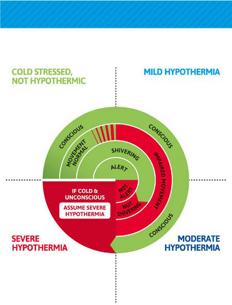

# Chapter 90: Cold Injuries

*Jennifer Dow*

<!-- p.863 -->
which is often reversible. Early attention to ventilation after restoration of cardiac rhythm in lightning-injured patients is crucial to prevent recurrent cardiovascular collapse and hypoxic brain injury. This triage algorithm is employed because those who have cardiorespiratory func tion immediately after the strike rarely succumb to their injury before hospital arrival. Ultimate outcomes depend on injury severity, mental status, organ involvement, cardiac arrest presence, and arrhythmias. Lightning survivors who have a normal ECG and normal vital signs and no obvious injury can be discharged home if they *do not* have history of a direct strike, loss of consciousness, focal neurologic complaint, major trauma, significant burns, or chest pain or dyspnea. However, they should be referred for ophthalmologic evaluation and audio-vestibular evalua tion should there be ocular or otic injury. Neurologic effects of lightning injury may be significant. CNS dysfunction can be immediate or delayed and includes spinal cord injury, ischemic stroke, or *keraunoparalysis* (temporary condition that mimics spinal cord injury) as well as traumarelated injuries such as skull fractures or spinal cord injury. Personality alterations and sleep disorders may develop over time post injury.

*Visit Elsevier eBooks+ at eBooks.Health.Elsevier.com** for Bibliography.*

**Fig. 89.7** Lightning burn: Lichtenberg feathering. (Courtesy Dr. Mary Ann Cooper.)

Children and youth are exposed to cold environments through out door recreation, occupational activities, or housing crises. Although cold injuries are commonly attributed to subfreezing temperatures, it is a misnomer that it must be below 0°C (32°F) for systemic injury or local tissue damage to occur. Injury from cold occurs when the body’s ability to generate heat is overwhelmed by environmental loss.

**MECHANISMS OF HEAT TRANSFER** Environmental heat or cold injury occurs when the metabolic capacity for thermoregulation cannot maintain core body temperature in the setting of extreme environmental temperatures. The hypothalamus

*Jennifer Dow*

controls the production and conservation of heat, responding to central and peripheral receptors. Local skin temperature is partially responsible for the regulation of peripheral blood flow. Heat produc tion is a product of cellular metabolism and by both voluntary (exer cise) and involuntary (shivering) muscle use, while vasoconstriction and behavioral action influence conservation. Heat is transferred to the environment by five mechanisms: radiation, conduction, convection, respiration, and evaporation.

**Radiation** is the transfer of heat from one object to another without physical contact. This type of heat loss is moderated by vasoconstric tion, diminishing warm blood flow to the periphery, and behavioral adaptation of wearing insulating layers. Medications or conditions that prohibit the vasoconstrictive response contribute to heat loss by radia tion. Children may not have the knowledge or experience to recognize when additional clothing is necessary; adults are obliged to ensure that appropriate clothing is available. In a dry environment, radiation is the predominant method of heat transfer. **Conduction** is the direct trans fer of heat to another object and is the primary mechanism of heat loss when a body is immersed, as water has up to 30 times more ther mal conductivity than air. Heat is also conducted when an individual touches a cold object (e.g., a cold rock, snow, metal chair). Behavioral adaptations include avoidance and placement of insulation between the individual and the surface. **Convective** loss of body heat to cooler circulating air or water can be mitigated by clothing and vasoconstric tion. Convection is a method of rewarming, using hot air as a delivery method. **Evaporative** heat loss results from the conversion of water (sweat) to vapor; like *respiratory* loss*,* it is a small but obligate contribu tion to thermal balance.

**HYPOTHERMIA** Accidental hypothermia is the unintentional drop in core temperature below 35°C (95°F), occurring when the combination of physiologic and behavioral mechanisms to maintain core temperature are over whelmed by environmental losses. Although cold and wet environ ments pose the most significant risk, accidental hypothermia can occur in any season and in most climates. The predominant clinical manifes tations are reflective of disruptions of the cardiopulmonary and central nervous systems (Table 90.1). Cerebral function begins to diminish at a core temperature of 33–34°C (91.4–93.2°F), with early manifestations being irritability, confusion, and poor decision-making, progressing to lethargy, somnolence, and coma. Cerebral oxygen requirements are decreased by cooling, affording transient protection in cardiac standstill or cold-water drowning events. The initial cardiopulmonary response to cold is an increase in cardiac output and ventilation to sup port the metabolic demand of shivering. Further cardiac cooling mani fests as bradycardia and abnormalities of cardiac conduction (atrial and ventricular dysrhythmias, including fibrillation) (Fig. 90.1). The crucial factors for reducing morbidity and mortality due to hypother mia are prevention, prompt recognition, and rapid treatment.

**Risk Factors and Prevention of Hypothermia** The risk factors associated with hypothermia are extensive. Ill nesses, medications, and substance use can disrupt the normal phys iologic responses to cold. Vasoconstriction is disrupted by ethanol, vasodilatory medications, and infections. Central nervous system (CNS) trauma, stroke, medications (antidepressants, mood stabi lizers, anxiolytics), and endocrine disorders (hypothyroid, adrenal insufficiency, diabetes, hypoglycemia, hypopituitarism) disrupt the hypothalamic response to cold. Mental illness, intoxication (opi ates, organophosphates, barbiturates, carbon monoxide), and lack of awareness, as seen in the extremes of age, may impair the ability to recognize cold. General conditions of malnutrition and inabil ity to move make it such that the patient does not have the caloric reserves to shiver or cannot move safely out of the cold. Autonomic dysfunction may produce hypothermia. Knowledge of these condi tions ideally results in a heightened attentiveness to the potential for hypothermia. Active prevention includes awareness of the weather conditions and the utilization of appropriate clothing. Insulation

<!-- p.864 -->

<!-- p.865 -->
and ease of layering are factors to be considered when choosing clothing. Removing a layer while engaging in aerobic activity helps prevent sweating and subsequent evaporative heat loss; replacing it when activity slows prevents loss by radiation through the inad equate insulation. Socks and gloves should fit properly, without circulatory impingement, and be constructed of materials other than cotton. Covering the head and face prevents losses through these exposed areas. Infants and young children will lose more heat by radiation through the head than adults because of its relatively increased surface area. The utilization of wind-blocking materials mitigates loss due to convection, and waterproofing keeps clothing dry and minimizes losses resulting from convection and radiation. Additional preventative measures are ensuring adequate nutrition for the activity, recognizing an increased metabolic demand in the cold, and having access to shelter for warmth.

**Clinical Presentation of Hypothermia** Hypothermia is a cold injury syndrome with progressive signs and symptoms (see Table 90.1 and Fig. 90.2). The differential diagno sis is broad, and the clinician must be aware of the environment from which the patient presents. It is also essential that the clinician recognize that each patient is unique and presents with subtle dif ferences. A patient may continue to shiver below the 30°C (86°F) “cut-off” but manifest all other signs of moderate to severe hypo thermia. Standard classification is based on measured core temper ature, whereas field classification is based on signs and symptoms (see Fig. 90.2). Treatment of all stages includes preventing further heat loss and initiating rewarming (Fig. 90.3).

J

#### **Table 90.1** Physiologic Characteristics of the Four Zones of Hypothermia

| Category / Parameter | Clinical Details & Findings |
| --- | --- |
| **CHARACTERISTICS** | Mild; 35 (95); Urine temperature, 34.8°C (94.6°F); increased shivering thermogenesis; increase in metabolic; rate; 34 (93.2); Amnesia and dysarthria develop; normal blood pressure; maximum respiratory stimulation; 33 (91.4); Ataxia, apathy develop; Moderate; 32 (89.6); Stupor; 25% decrease in oxygen consumption; 31 (87.8); Decreased shivering thermogenesis; 30 (86); Atrial fibrillation and other dysrhythmias; poikilothermia; pulse and cardiac output two-thirds; normal; insulin ineffective; 29 (85.2); Progressive decrease in level of consciousness, pulse, and respiration; pupils dilated; Severe; 28 (82.4); Ventricular fibrillation susceptibility; 50% decrease in oxygen consumption and pulse; 27 (80.6); Losing reflexes and voluntary motion; 26 (78.8); Major acid-base disturbances; no reflexes or response to pain; 25 (77); Cerebral blood flow one-third normal; cardiac output 45% normal; pulmonary edema may; develop; 24 (75.2); Significant hypotension; 23 (73.4); No corneal or oculocephalic reflexes; 22 (71.6); Maximum risk of ventricular fibrillation; 75% decrease in oxygen consumption; Profound; 20 (68); Lowest resumption of cardiac electromechanical activity; pulse 20% of normal; 19 (66.2); Flat electroencephalogram; 18 (64.4); Asystole develops; 14.2 (57.6); Lowest accidental hypothermia survival in an infant; 13.7 (56.7); Lowest accidental hypothermia survival in an adult; 9 (48.2); Lowest therapeutic hypothermia survival; From Zafren K, Danzl DF. Accidental hypothermia. In: Walls RM, Hockberger RS, Gausche-Hill M, et al., eds. Rosen’s Emergency Medicine, 9th ed. Philadelphia: Elsevier; 2018, Table; 132.1, p. 1744. |

**Fig. 90.1** Characteristic J or Osborne wave of hypothermia (temp <32°C) closely follows QRS. It may be mistaken for a T wave with narrow QT interval if the true T wave is not appreciated. The slightly rounded peak distinguishes it from R′ of bundle branch block. (From Gunnarsson B, Heard CMB. Accidental hypothermia. In: Zimmerman JJ, Clark RSB, Fuhrman BP, et al., eds. Fuhrman & Zimmerman’s Pediatric Critical Care, 6th ed. Elsevier: Philadelphia; 2022: Fig. 114.1, p. 1333.)

<!-- p.866 -->
**Cold Stress** Cold stress is marked by shivering and a core temperature >35°C (95°F). Measures to prevent further heat loss and increase heat produc tion are all that are necessary for reversal. This may entail increasing physical activity to generate warmth, relocating to a warm environ ment, or adding clothing layers.

**Mild Hypothermia** Patients with mild hypothermia are conscious and alert with measured core temperatures of 32–35°C (89.6–95°F). Most will shiver, even vio lently, if there are enough energy reserves. As the core temperature drops, the patient may begin to demonstrate discoordination or loss of fine motor control. Hemodynamic parameters are generally stable, with tachycardia and tachypnea observed due, in part, to the increased catecholamine response and support of the metabolic demands of shiv ering. Protection from further heat loss, removal and replacement of wet clothing, and calorie replacement should be initiated simultane ously. Application of insulation (e.g., sleeping bag) and a vapor bar rier will optimize passive rewarming. Active external rewarming can be initiated using hot water bottles or rewarming heat packs applied to the neck, chest, upper torso, axilla, and groin. Try to avoid burns to exposed skin. Patients with mild hypothermia retain consciousness but may demonstrate diminished alertness. Transport for further evalua tion and observation is recommended if they do not return to full alert ness and function in the field.

**Moderate Hypothermia** Moderate hypothermia, with core temperatures of 28–32°C (82.4– 89.6°F), is the slowing phase of symptom progression. Patients pres ent with bradycardia, respiratory depression, and altered mental status, manifesting as depressed level of consciousness, often stuporous, and hyporeflexia. Shivering generally stops at 30°C (86°F), but there is variation among patients. Active external rewarming should be initi ated with heat applied to the upper torso, chest, axilla, and back. Fluid

replacement is initiated with intravenous fluids, ideally containing glu cose, warmed to 40–42°C (104–107.6°F). Cardiac monitoring is indi cated, as a cold heart and hypothermia-associated acidosis increases the risk of unstable arrhythmias. Hemodynamically stable patients may be transported to any hospital; however, if unstable, a hospital with extracorporeal membrane oxygenation (ECMO) is recommended.

**Severe/Profound Hypothermia** Core temperatures <28°C (82.4°F) are characterized by stupor, lead ing to coma with loss of cerebrovascular autoregulation. Further car diovascular instability manifests as bradycardia, hypotension, and a significant risk for unstable tachycardias, often beginning as atrial fibrillation with progression to ventricular dysrhythmias. There is no coordinated musculoskeletal activity. Patients with severe hypothermia may appear dead. Cardiopulmonary resuscitation (CPR) should be ini tiated if there is no cardiac activity, as determined by a pulse check of at least 1 minute duration or the absence of organized electrical activity on a monitor. Bedside echocardiography may also be used to identify cardiac activity. Vasoactive medications should be held until the core temperature is >30°C (86°F) and then administered at twice the dosing interval until 35°C (95°F). Defibrillation or cardioversion, if indicated, is attempted once, at maximum power, then held until the core tem perature is above 30°C (86°F).

In hypothermic cardiac arrest, rescuers should initiate CPR regard less of the patient’s temperature. Contraindications to initiation of CPR include if there is obvious fatal injury, ice or snow is visualized in the airway, chest wall compression is impossible, or rescuers are at risk. The usual signs of death—rigor, pupillary dilation, and lividity—are unreli able in the hypothermic patient.

Complications of hypothermia include compartment syndrome, rhabdomyolysis, hyperkalemia or hypokalemia, hemoconcentration, hypercoagulability, disseminated intravascular coagulation (DIC), confusion (paradoxical undressing), Takotsubo cardiomyopathy, and mydriasis. Core temperature **afterdrop** is a decrease in core tempera ture after removal from the cold and/or when external rewarming begins; external rewarming extremities with frostbite is another risk factor.

Hypothermia is fatal if not treated. Prevention and risk mitiga tion through awareness of weather conditions, appropriate cloth ing and layering systems, and breaks for rewarming during outdoor activities will limit its incidence. Adults supervising children and adolescents participating in outdoor activities must be aware that behavior changes and apparent clumsiness might signal the onset of hypothermia.

**SOFT TISSUE COLD INJURY** Soft tissue injuries caused by cold are divided into freezing and non freezing injuries. Frostbite is a freezing injury, whereas frostnip, chil blains (pernio), cold immersion, and cold-induced fat necrosis are nonfreezing injuries.

**FROSTBITE** Frostbite is an injury occurring at or below freezing temperatures. It can have devastating effects with tissue loss leading to functional debility. It is preventable. Frostbite, like hypothermia, is a condition occurring when tissue heat loss is greater than the warmth delivered by peripheral perfusion. Minimizing exposure to cold, either by avoidance, use of appropriate clothing, and responding to changing conditions appropriately, are keys to frostbite prevention. Clothing, especially hand and footwear, should insulate well and not be con stricting. Vasoconstriction inhibits peripheral cutaneous warming. Inhibitors of peripheral perfusion, such as vasoconstricting medica tions, circulatory disorders (e.g., Raynaud syndrome), and chronic skin conditions (e.g., psoriasis), increase frostbite risk. Emollients applied to the skin do not protect from the cold. Any complaints of numbness are to be taken seriously, and the child should be assessed for signs of cold injury in a protected environment. Frostnip, although not a freezing injury, does indicate that the temperature and exposure conditions may promote frostbite.

**Prehospital Assessment of a Cold Patient**

**1. From outside ring to center assess Consciousness,     Movement, Shivering, Alertness 2. Assess whether normal function****, or impaired or no function 3. Treat according to appropriate result-quadrant**

**1.** Reduce heat loss (e.g., add dry clothing) **2.** Provide high-calorie food or drink

**1.** Treat as Moderate Hypothermia, and **1.** Handle gently **2.** Keep horizontal **3.** No standing/walking **4.** No drink or food **5.** Insulate/ vapor barrier

**6.** Heat applied to upper trunk **7.** Volume replacement with warm intravenous fluid **8.** Evacuate carefully

**a) IF** no obvious vital signs,

**THEN** 60-second breathing /

**THEN** Start CPR

pulse check **b) IF** no breathing / pulse,

**2.** Evacuate carefully ASAP

**1.** Handle gently **2.** Keep horizontal **3.** No standing/ walking for at least 30 min.

**4.** lnsulate/ vapour barrier **5.** Heat applied to upper trunk **6.** High-calorie food/drink **7.** Monitor until improvement (at least 30 min.) **8.** Evacuate if no improvement

**3.** Increase heat production (e.g., exercise)

**Fig. 90.2** Algorithm for field assessment and treatment of a cold pa tient. (Sources: BICOrescue.com; Zafren K, Giesbrecht GG, Danzl DF, et al. Wilderness Medical Society practice guidelines for the out-of-hospi tal evaluation and treatment of accidental hypothermia: 2014 update. Wilderness Environ Med. 2014;25(4 Suppl):S66-S85.)

<!-- p.867 -->
**Suspect hypothermia** Normal mental

status?

**Signs of life** or **organized rhythm on ECG?** Respiration/pulse check for up to 1 min

Shivering?

Shivering?

Functioning normally/able to care for self?

Yes

Yes

Yes

No

No

No

Yes

Conscious?

No

No

Yes

Yes

**Lethal injury?** or **Chest too stiff for CPR?** or **Avalanche burial >35 min** and** airway obstructed by snow?**

Yes

No

No

**Ensure Scene Safety Handle gently. Keep horizontal.** Stabilize injuries. Consider causes of altered mental status other than hypothermia.

**Severe/Profound Hypothermia** <**28°C**

**Treat as above**

**Intubate or use supraglottic device.** Anesthetic and paralytic drugs: Lower dosage and extend dosing interval below 30°C. • **Ventilation:** With advanced airway, ventilate at half standard (normothermic) rate. • Without advanced airway, ventilate at standard rate or use ETCO2 to guide ventilation. • Use supplemental O2, especially above 2500 m. • Naso/orogastric tube if advanced airway in place. **CPR if no signs of life.** (Can use cardiac monitor, ETCO2, US to confirm) • Chest compressions at standard normothermic rate. • If <30°C VT or VF or AED advises shock: one shock at max power. • Warm 1–2°C or >30°C prior to additional shocks. • No vasoactive drugs until 30°C or above. From 30–35°C, increase dosing interval to twice as long as normal. • CPR may be delayed or given intermittently if necessary to accomplish evacuation. • No temperature cut-off for CPR. **No CPR if signs of life or perfusing rhythm** (unless no cardiac activity on US). Consider transcutaneous pacing if bradycardic with hypotension. **Terminate CPR if potassium >12.**

Hospital with ICU and ECC capabilities if possible.

**During Transport**

**Handle gently. Keep horizontal. Continue rewarming.** Warm ambulance or helicopter to 24°C if possible.

**Moderate Hypothermia 28–32°C**

**Treat as above**

**Active warming:** apply heat to upper torso: chest, axilla and back. Use large heat pads, HPMK, Norwegian Heat Pac, forced-air. **Monitor. Circulatory access:** peripheral IV or IO or femoral line. **Volume replacement:** 40–42°C saline boluses. IV or IO **glucose. No standing or walking.**

**Hemodynamically stable:** closest hospital. **Otherwise:** hospital with ICU. Hospital with ICU and ECC capabilities if possible.

**Mild Hypothermia 32–35°C**

**Protect from further cooling** using insulation and vapor barrier. **Seek shelter.** Remove (cut off) wet clothing only with shelter. **Measure temperature** if possible. **Passive warming:** Support shivering with calorie replacement. After protected from heat loss: **No standing or walking for 30 min. Active warming** is beneficial. (See moderate hypothermia, below.)

**Cold Stressed - Not Hypothermic >35°C**

Reduce heat loss, increase heat production.

**Death**

Do not resuscitate.

**Not Hypothermic**

**Uninjured, alert and shivering:** may not need hospital. **Trauma patients: active rewarming,** trauma center. **Asphyxiated patients:** closest hospital for observation.

**Fig. 90.3** Recommendations for out-of-hospital evaluation and treatment of accidental hypothermia. AED, Automatic external defibrillator; CPR, cardiopulmonary resuscitation; ECC, extracorporeal circulation; ECG, electrocardiogram; ETCO2, end-tidal carbon dioxide; HPMK, Hypothermia Prevention Management Kit; ICU, intensive care unit; IO, intraosseous; IV, intravenous; US, ultrasound; VF, ventricular fibrillation; VT, ventricular tachycardia. (From Zafren K, Giesbrecht GG, Danzl DF, et al. Wilderness Medical Society practice guidelines for the out-of-hospital evaluation and treatment of accidental hypothermia: 2014 update. Wilderness Environ Med. 2014;25:S66–S85, Fig. 2.)

#### **Table 90.2** Different Degrees of Frostbite and Their Physiologic Characteristics

| Category / Parameter | Clinical Details & Findings |
| --- | --- |
| **GRADE IV INJURY** | • Superficial; • Edema and redness without tissue; necrosis in the affected area; • Numbness, firm white-yellow; plaque; • No blisters or necrosis; • Occasional skin desquamation; (5-10 days later); • Blister formation; • Erythema, substantial edema; • Vesicles with clear or milky; fluid; • Blisters; • Desquamation and black; eschar formed; • Tissue necrosis; • Hemorrhagic deeper; blisters; • Skin necrosis; • Blue-gray discoloration; • Development of gangrene,; requiring amputation; • Full-thickness skin, subcutaneous; tissue, muscle, tendon, and bone; freezing; • Little edema; • Initially mottled, deep red or; eventually dry, black, and mummified; Modified from Joshi K, Goyary D, Mazumder B, et al. Frostbite: Current status and advancements in therapeutics. J Therm Biol. 2020;93:102716, Table 1. |

<!-- p.868 -->
**Pathophysiology of Frostbite** Frostbite is a freezing injury with four phases: prefreeze, freeze-thaw, vascular stasis, and late ischemic. The degree of cold, duration of exposure, and physiologic compromise caused by medications and

underlying illness determine how severe the injury will be. The tissue cooling of **prefreeze** is marked by local vasoconstriction and ischemia without the formation of ice crystals. Intracellular and extracellular ice crystal development causes cellular damage during the **freeze-thaw phase**. Reperfusion leads to ischemic-reperfusion injury and initiation of the inflammatory cascade. **Vascular stasis** is characterized by both blood leaking from vessels and the formation of thrombi. Progressive tissue ischemia from micro-emboli, local thrombosis, and persistent

**Fig. 90.4** Frostbite with clear vesiculations. (Courtesy Dr. Bill Mills.)

**Fig. 90.5** Early appearance of severe frostbite of the hand after thaw ing. A purple color and absence of blisters are very unfavorable prog nostic signs. (Courtesy Dr. Ken Zafren.)

**Wound care** • Do not break blisters and do not aspirate hemorrhagic bullae • Broken blisters should be debrided, cleaned and covered with an antimicrobial • Pain control medication should be administered (aspirin/ibuprofen)

**On-field medical care**

**Special medical procedures** • Sympathetic nerve block for vasodilatation and increased blood flow

**Rewarming** • Rapid rewarming in 37–39°C water bath for 30 minutes (should be done if no further refreezing is ensured) • Tetanus prophylaxis

**Therapeutic treatment**

**Adjuvant therapy** • Vasodilator such as papaverine to reduce vasospasm • Antiplatelet drug: Pentoxifylline • Aloe vera (topical)

**Anticoagulant therapy** • Heparin

**Synthetic analogue of prostacyclin PGI2** • Iloprost (used when thrombolytics are contraindicated or ineffective)

**Thrombolytic therapy in frostbite**

• Intra-arterial thrombolysis using tissue plasminogen activator within 24 hours of injury

**Active rewarming**

**Immediate medical care**

**External** • Heated jacket systems • Forced air systems

**Internal**

**Invasive:**

**Non-invasive:** • Administration of warm IV fluid

• Extracorporeal blood warming • Arteriovenous rewarming • Hemodialysis

**Passive rewarming** Preserve body heat Eg. Using blankets

**Fig. 90.6** Treatment protocol for the management of frostbite. (Modified from Joshi K, Goyary D, Mazumder B, et al. Frostbite: Current status and advancements in therapeutics. J Therm Biol. 2020;93:102716, Fig. 2.)

A

B

**Fig. 90.7** A, Perniosis (chilblains). Edematous, red, painful nodules ap peared on the fingers after exposure to cold. B, Perniosis (chilblains). Note the inflamed nodules on the toes of this adolescent girl. Although nodules resolved, painful nodules continued to develop on an annual basis beginning in January and lasting until April. She was otherwise healthy. (From Paller AS, Mancini AJ. Hurwitz Clinical Pediatric Dermatol ogy, 6th ed. Elsevier: Philadelphia; 2022, Figs. 20.48 and 20.49, p. 566.)

<!-- p.869 -->

<!-- p.870 -->
reperfusion injury marks the **late-ischemic phase**. Compromise of microcirculation and cellular destruction from crystal formation are the main factors contributing to cellular death.

**Clinical Presentation of Frostbite** The depth of injury is the basis for the classification of frostbite injury. In the field, frostbite is classified as superficial or deep. Upon arrival to a healthcare facility, a degree or grade of injury is assigned after the tissue has thawed and any advanced imaging is performed (Table 90.2).

**First-degree** frostbite is marked by numbness and local erythema with a pale raised plaque in the area of injury. Only mild tissue slough ing occurs, and there is no infarction. **Second-degree** injury presents with clear, fluid-filled blisters and surrounding erythema (Fig. 90.4). Local edema may be present. First- and second-degree frostbite injury results in minimal tissue loss and is considered superficial in the field. **Third-degree** frostbite extends into the dermis and dermal vascular plexus. The resulting blisters are hemorrhagic. **Fourth-degree** injury involves the dermis and underlying tissues, extending into muscle and bone (Fig. 90.5). Third- and fourth-degree frostbite has anticipated tis sue loss and is field classified as deep.

**Treatment of Frostbite** Prevention is preferred for any environmental injury, but rapid rec ognition and treatment will mitigate the long-term impact. Once frostbite is suspected, the patient should be assessed for concomi tant hypothermia. The injury must be protected from the cold and prevented from refreezing if spontaneous thawing has begun. Any constricting items, such as jewelry, are removed. Thawing should be initiated with a circulating water bath at 37–39°C (98.6–102.2°F). Pain medication should be administered. There are numerous com bined therapies for frostbite, including anticoagulants, thrombolyt ics, and vasodilators (Fig. 90.6). The indications for each therapy depend on the extent of injury, length of time since tissue thaw, local availability, and individual national regulatory decisions. It is recom mended that the clinician be aware of their local resources and proto cols. Regardless, treatment with these agents must be initiated within 12-72 hours of tissue thaw.

**NONFREEZING COLD INJURY** Nonfreezing cold injuries include but are not limited to frostnip, chil blains (pernio), cold-immersion foot, and cold-induced fat necrosis.

**Frostnip** is associated with vasoconstriction of skin exposed to the cold with ice crystals, or frost, forming on the skin surface. The tissue may be numb, and local pallor is present. There is no cellular dam age, and the condition resolves rapidly upon warming. Frostnip does indicate that conditions are appropriate for frostbite, and preventative measures should be taken.

**Chilblains**, also called **pernio**, is an idiopathic condition suspected to be a vasculopathy. Typically occurring in cold, damp conditions, vasculitic-appearing lesions develop on the fingers and toes, ears, and exposed areas of the legs after environmental exposure (Fig. 90.7). It is suspected that vasoconstriction and inflammatory reaction are respon sible for the lesions. Recognition and prevention of further cold expo sure is key to treatment. The lesions are self-limiting, and symptoms may be addressed with nonsteroidal antiinflammatory drugs (NSAIDs) and topical soothing creams. Continued exposure to cold can cause persistent lesions. Lesions similar to chilblains have been noted in chil dren with COVID-19 infection. **Familial chilblain lupus**, an autoso mal dominant variant of lupus, is caused by variants in the *TREX1* and *SAMHD1* genes (see Chapter 90.1). Patients develop cold-induced ery thematous peripheral skin lesions and manifest systemic disease typi cal of lupus. In addition, fever and arthralgias may be present.

**Immersion foot** or **trench foot** occurs with continuous immersion in warm or cold water. The injury occurs more rapidly in cold water. Continuous exposure to the wet environment, whether through actual immersion in water or saturated footwear, causes hyperemia, edema, and ultimately blister formation with skin sloughing. The condition can progress to ischemia and gangrene. Awareness of wet footwear and

subsequent changing, or drying, of shoes and socks is the method of prevention. Vapor barrier socks or boots do not prevent sweat from accumulating and creating a wet environment. Like other cold injuries, treatment consists of thoroughly drying and warming the tissue. Anti biotics are not necessary unless signs of infection are present.

**Cold-induced fat necrosis** is secondary to local cold injury to the superficial adipose tissue. It presents with raised, erythematous nodules or plaques, evolving over 12-72 hours after exposure to cold. Distribution in children is predominantly on the face, specifically the cheeks and forehead. Obese children and adolescents may have lesions on areas poorly protected from the cold, including the but tocks, thighs, abdominal pannus, and under the chin. Lesions are self-limiting and typically resolve in 10-20 days. Treatment consists of rewarming, avoidance of the cold, and NSAIDs as necessary for discomfort.

*Visit Elsevier eBooks+ at eBooks.Health.Elsevier.com** for Bibliography.*

## 90.1  Cold-Induced Autoinflammatory and Other Genetic Disorders James J. Nocton and James W. Verbsky

A number of **autoinflammatory** and other genetic disorders have been identified that are characterized by an *exacerbation of symptoms upon exposure to cold temperatures*. These disorders differ from **cold injury**, **cold urticaria**, and problems related primarily to vasoconstric tion because they typically manifest very early in life and are associ ated with a wider spectrum of signs and symptoms, reflecting either underlying systemic inflammation or the protean effects of specific genetic variants. A relatively lower ambient temperature or rapid cool ing and evaporation from the skin are often sufficient to produce the signs and symptoms of these disorders; therefore the relationship to cold temperature is not always obvious. The genetic variants associated with most of these disorders impact cellular signaling pathways that lead to the expression of proinflammatory cytokines in the absence of an extrinsic trigger; therefore most of these diseases are classified as autoinflammatory.

These conditions should be suspected primarily in infants or very young children who develop persistent, recurrent, or periodic fevers associated with rashes or arthralgias that cannot be explained by an infectious disease or another chronic inflammatory or rheumatic dis ease. Signs and symptoms associated with these diseases may begin as early as the first week of life. The very early onset distinguishes these genetic diseases from acquired conditions such as Raynaud phenom enon, pernio, cryoglobulinemia, cold urticaria, and other cold-induced problems potentially related to acquired autoimmunity. The rashes are most often evanescent and appear similar to urticaria; however, they are usually not pruritic and are histologically different from urticaria. Laboratory evidence of chronic inflammation is often present, includ ing elevations of the erythrocyte sedimentation rate and C-reactive protein. The association with cold exposure may be subtle and not ini tially apparent.

The diagnostic algorithm for these disorders should begin with a thorough history and a careful examination, paying particular attention to potential additional signs of conjunctivitis, a frequent accompany ing feature, decreased limb movement that might indicate arthralgia or arthritis, the morphology of any cutaneous lesions, and the association of symptoms and signs with cooling or colder temperatures. Unlike cold urticaria, the hivelike lesions often associated with these disorders cannot be precipitated by a cold stimulation test using the application of an ice cube to the skin. Measurement of serum inflammatory mark ers may help distinguish autoinflammatory disease from more benign conditions; infectious diseases may need to be excluded with appro priate testing. A skin biopsy may provide information that will help narrow the differential diagnosis by identifying either a neutrophilic dermatosis, granulomatous inflammation, or vasculitis characteristic of one of these diseases. Ultimately, focused genetic sequencing can

<!-- p.871 -->
be performed, searching for specific genetic variants that will confirm a diagnosis.

**Familial cold autoinflammatory syndrome (FCAS)**, along with neonatal-onset multisystem inflammatory disorder (NOMID) and Muckle-Wells syndrome (MWS), constitute the **cryopyrin**-**associated periodic syndromes (CAPS)** (see Chapter 204). These diseases are all the result of pathogenic variants in *NLRP3* which encodes the protein **cryopyrin**, a component of the inflammasome complex, which is criti cal in the production of the proinflammatory cytokines interleukin (IL)-1β and IL-18. Although each of these diseases may be exacerbated by cold exposure or cooling, the association with cold is most consis tent in those with **FCAS**. **FCAS** should be considered in infants who develop episodes of a hivelike rash, often beginning in the neonatal period, accompanied by fever, conjunctivitis, joint pain, neutrophilia, thrombocytosis, and elevated inflammatory markers, and triggered by exposure to cold or low ambient temperatures. The rash is typically not pruritic and histologically consists of a neutrophilic perivascular and perieccrine inflammatory infiltrate. Episodes are short and gener ally last less than 24 hours. **MWS** is more severe than FCAS, causing more frequent hivelike rashes and fevers, along with arthralgias, con junctivitis, and aseptic meningitis, and with potential eventual progres sion to hearing loss. Like FCAS, the onset of symptoms is most often in infancy, and the histology of skin lesions in these two disorders is similar. **NOMID** is the most severe form of CAPS and is associated with a nonpruritic urticarial rash often present at birth and more pro found neurologic and bone disease. CAPS are inherited in an auto somal dominant manner, and the diagnosis is made based on clinical features and the identification of a variant in the NLRP3 gene. Variants in *NLRP12* and in *NLRC4* have also been associated with similar clini cal syndromes sometimes referred to as **FCAS2** and **FCAS4**, respec tively. Treatment with the IL-1 inhibitors anakinra and canakinumab has been effective in most individuals with CAPS.

**PLCG2-associated antibody deficiency and immune dysreg ulation (PLAID)** (sometimes referred to as **FCAS3**) is an auto somal dominant disease resulting from a pathogenic variant of *PLCG2*, which encodes a transmembrane enzyme expressed pri marily in myeloid and lymphoid cells that regulates inflamma some activity and proinflammatory cytokine production. PLAID causes pruritic urticaria from birth induced by ambient cold tem peratures or cooling and lasting for minutes to hours. In some individuals, acral blistering lesions resembling a burn may also be present during infancy on the ears, nose, and fingers. Histology of urticarial lesions reveals increased mast cells. Because PLCG2 is expressed in mast cells and affects mast cell degranulation, these subjects can have more classic hives as compared with other FCAS syndromes. Other lesions reveal noncaseating granulomas. Older individuals may develop syncope induced by cold exposure and a burning sensation in the throat when eating cold foods. Hypo gammaglobulinemia may lead to frequent sinopulmonary and other infections. The diagnosis is made based on clinical features and the identification of variants in the PLCG2 gene. Treatment of PLAID includes avoiding evaporative cooling and minimiz ing cold exposure, antihistamines, and for those with evidence of immunodeficiency, intravenous immunoglobulin infusions to prevent frequent infections.

**STING-associated vasculopathy with onset in infancy (SAVI)** is an autosomal dominant disease resulting from a pathogenic variant in *TMEM173*, which encodes **stimulator of interferon genes (STING)**, an activator of interferon gene transcription (see Chapter 205). Signs

and symptoms usually appear in infancy but may also appear later and include fever and a variety of cutaneous lesions. Violaceous nodules and plaques on the cheeks, ears, and nose and telangiectasias, pustules, or blisters, often most noticeable on the extremities, may occur. The skin lesions are exacerbated by cold temperatures, and some develop ulcerative or gangrenous lesions. In time, interstitial lung disease pro gressing to fibrosis has been described. Histology reveals vasculitis of medium and small vessels. The diagnosis is made based on clinical features and the identification of the variant in the TMEM173 gene. Responses to treatment with corticosteroids and immunomodulators, including cyclophosphamide and mycophenolate mofetil, have been variable and inconsistent. Janus kinase inhibitors, which inhibit inter feron receptor signaling, have shown promise in treatment of these disorders.

**Familial chilblain lupus** is a rare condition triggered by cold expo sure that presents with painful, bluish-red, papular or nodular lesions of the skin in acral locations. Ulceration can occur, but deep ulceration and necrosis are infrequent, and the lesions tend to heal without scar ring. This is an autosomal dominant disorder caused by heterozygous variants in *TREX1* or *SAMHD1*, the same genes containing variants associated with Aicardi-Goutières syndrome (AGS). AGS is a syn drome characterized by developmental delay, abnormal neurologic signs, microcephaly with brain calcifications, and CNS pleocytosis, as well as skin lesions resembling chilblains. Both *TREX1* and *SAMHD1* are involved in DNA degradation, and their deficiencies result in intra cellular nucleic acid that stimulates interferon production. AGS and familial chilblain lupus can be considered a spectrum of severity of the same genetic defect.

**Factor XII–associated cold autoinflammatory syndrome** is an autosomal dominant disease resulting from a pathogenic variant in *F12* encoding the coagulation factor XII. The variant leads to spon taneous activation of factor XII, which in turn increases bradykinin and IL-1 levels. Individuals with this mutation develop an urticariallike rash that begins in the first few weeks of life precipitated by cold. The rash is nonpruritic and evanescent, and as individuals age it is accompanied by more severe systemic symptoms of chills, headaches, arthralgias, and fatigue. Serum inflammatory markers are elevated, and skin histology reveals perivascular macrophage and neutrophilic infiltrates. The diagnosis is made by identifying a variant in *F12*. Treatment with the IL-1 receptor antagonist anakinra or the brady kinin B2 receptor antagonist icatibant has shown promise in a small number of individuals.

**Crisponi syndrome/cold-induced sweating syndrome (CS/CISS)** is an autosomal recessive disease resulting from variants in *CRLF1* or *CLCF1*. These genes encode proteins involved in neurologic develop ment, including facial motor neurons and the sympathetic nervous sys tem; therefore this syndrome is not classified as an autoinflammatory syndrome. Symptoms and signs are typically apparent in the neona tal period and include fever, camptodactyly, and involuntary episodic contractions of facial and pharyngeal muscles resulting in breathing and feeding difficulties. There is high neonatal mortality, and those that survive develop cold-induced profuse sweating in childhood. Scoliosis and other dysmorphic features (depressed nasal bridge, high arched palate) are also common. The diagnosis is made by identifying a vari ant most commonly in *CRLF1*. Treatment of the neonatal symptoms is supportive. The cold-induced sweating is managed with clonidine, amitriptyline, or moxonidine.

*Visit Elsevier eBooks+ at eBooks.Health.Elsevier.com** for Bibliography.*

<!-- p.872 -->
