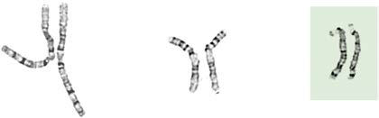

# Chapter 99: Chromosome Disorders

*Carlos A. Bacino and Brendan Lee*

<!-- p.979 -->
nucleic acid delivery, such as siRNA and mRNAs (see Fig. 98.8). A liver targeting LNP carrying an siRNA targeting transthyretin has been effective for treatment of hereditary transthyretin amyloidosis that has been recently approved. In various preclinical models, LNPs have been shown to deliver mRNA molecules to hepatocytes with high efficiency. LNPs are being used for the delivery of gene editing molecules such as ZFNs and Cas9 mRNA together with a single guide (sg)RNA. In addition, LNPs have been used for delivery of genome editing tools such as ZFNs and CRISPR/Cas9 together with a viral vector carrying a promoterless DNA sequence capable of homologous recombination that can result in high levels of the integrated sequence and short-term expression of the endonucleases.

**Correction of Genetic Diseases in the 
 Human Germline** Prevention of genetic diseases has been accomplished by **preimplanta tion genetic diagnosis (PGD)**. This procedure requires in vitro fertil ization and single–embryo cell genetic testing of the known families’ pathogenic variant and is performed with polymerase chain reaction (PCR) amplification of the affected gene. To avoid disease recurrence, only the unaffected embryos are implanted. With the advent of efficient genome editing by CRISPR/Cas9, editing human embryos is techni cally possible. The announcement of the birth of “CRISPR babies” has led to calls for a moratorium on human germline genome editing, and currently, germline and/or embryonic gene editing studies in humans have not been approved. Given the limited understanding of the con sequences of CRISPR/Cas9-mediated DSBs on the germline human genome, it is unlikely that these approaches will become available any time soon.

In contrast, **mitochondrial replacement therapies** to avoid mitochondrial DNA pathogenic variants are available. In one tech nique, the pathogenic variant carrier mother’s nuclear DNA is removed from the unfertilized oocyte and transferred to an unaf fected mitochondrial donor oocyte (minus that cell’s nuclear DNA). In another approach, the pronucleus from the pathogenic variantcarrier mother’s fertilized oocyte is transferred to the unaffected mitochondrial donor’s fertilized oocyte (minus the pronucleus).

*Visit Elsevier eBooks+ at eBooks.Health.Elsevier.com** for Bibliography.*

## 99.1  Methods of Chromosome Analysis Carlos A. Bacino and Brendan Lee

Clinical cytogenetics is the study of chromosomes, including their structure, function, inheritance, and abnormalities. Chromosome abnormalities are very common and occur in approximately 1–2% of live births, 5% of stillbirths, and 50% of early fetal losses in the first trimester of pregnancy (Table 99.1). Chromosome abnormalities are more common among individuals with intellectual disability and play a significant role in the development of some neoplasias.

Chromosome analyses are indicated in persons presenting with multiple congenital anomalies, dysmorphic features, and/or intellec tual disability. The specific indications for studies include prenatal test ing in conceptuses of women with advanced maternal age (>35 years), multiple abnormalities on fetal ultrasound, multiple congenital anom alies, unexplained growth restriction in the fetus, postnatal problems

*Carlos A. Bacino and Brendan Lee*

in growth and development, ambiguous genitalia, unexplained intel lectual disability with or without associated anatomic abnormalities, primary amenorrhea or infertility, recurrent miscarriages (≥3) or prior history of stillbirths and neonatal deaths, a first-degree relative with a known or suspected structural chromosome abnormality, clinical findings consistent with a known anomaly, some malignancies, and chromosome breakage syndromes (e.g., Bloom syndrome, Fanconi anemia).

Cytogenetic studies are usually performed on peripheral blood lym phocytes, although cultured fibroblasts obtained from a skin biopsy may also be used. Prenatal (fetal) chromosome studies are performed with cells obtained from the amniotic fluid (amniocytes), chorionic villus tissue, and fetal blood or, in the case of preimplantation diag nosis, by analysis of a *blastomere* (cleavage stage) biopsy, polar body biopsy, or blastocyst biopsy. Cytogenetic studies of bone marrow have an important role in tumor surveillance, particularly among patients with leukemia. These are useful to determine induction of remission and success of therapy, or in some cases the occurrence of relapses.

Newborn Surveys

#### **Table 99.1** Incidence of Chromosomal Abnormalities in

| Category / Parameter | Clinical Details & Findings |
| --- | --- |
| **47,XXY** | 45; 1/1,000* |
| **47,XYY** | 45; 1/1,000; Other X or Y aneuploidy; 32; 1/1,350 |
| **45,X** | 6; 1/4,000 |
| **47,XXX** | 27; 1/900; Other X aneuploidy; 9; 1/2,700 |
| **AUTOSOMAL ANEUPLOIDY (68,159 NEWBORNS)** | Trisomy 21; 82; 1/830; Trisomy 18; 9; 1/7,500; Trisomy 13; 3; 1/22,700; Other aneuploidy; 2; 1/34,000 |
| **Balanced Rearrangements** | Robertsonian; 62; 1/1,100; Other; 77; 1/885 |
| **Unbalanced Rearrangements** | Robertsonian; 5; 1/13,600; Other; 38; 1/1,800 |
| **1/154 live births** | *Recent studies show the prevalence is currently 1:580 (Morris JK, Alberman E, Scott; C, Jacobs P. Is the prevalence of Klinefelter syndrome increasing? Eur J Hum Genet.; 2008;16(2):163–170.); Data from Hsu LYF. Prenatal diagnosis of chromosomal abnormalities through; amniocentesis. In: Milunsky A, ed, Genetic Disorders and the Fetus, 4th ed. Baltimore:; Johns Hopkins University Press; 1998: pp. 179–248. |

<!-- p.981 -->
Chromosome anomalies include abnormalities of number and structure and are the result of errors during cell division. There are two types of cell division: mitosis, which occurs in most somatic cells, and meiosis, which is limited to the germ cells. In **mitosis,** two genet ically identical daughter cells are produced from a single parent cell. DNA replication (duplication of DNA material) has already occurred during **interphase** in the S phase of the cell cycle (DNA synthesis). Therefore, at the beginning of mitosis, the chromosomes consist of two double DNA strands joined together at the centromere, known as *sister chromatids.* Mitosis can be divided into four stages: prophase, metaphase, anaphase, and telophase. **Prophase** is characterized by condensation of the DNA. Also during prophase, the nuclear mem brane and the nucleolus disappear and the mitotic spindle forms. In **metaphase** the chromosomes are maximally compacted and are clearly visible as distinct structures. The chromosomes align at the center of the cell, and spindle fibers connect to the centromere of each chromosome and extend to centrioles at the two poles of the mitotic figure. In **anaphase** the chromosomes divide along their longitudinal axes to form two separate daughter chromatids, which then migrate to opposite poles of the cell. **Telophase** is characterized by forma tion of two new nuclear membranes and nucleoli, duplication of the centrioles, and cytoplasmic cleavage to form the two daughter cells.

**Meiosis** begins in the female oocyte during fetal life and is com pleted years to decades later. In males it begins in a spermatogonial cell sometime between adolescence and adult life and is completed in a few days. Meiosis is preceded by DNA replication so that at the outset, each of the 46 chromosomes consists of two chromatids. In meiosis, a **diploid cell** (2n = 46 chromosomes) divides to form four **haploid cells** (n = 23 chromosomes). Meiosis consists of two major rounds of cell division. In **meiosis I**, each of the homologous chromosomes pair pre cisely so that **genetic recombination**, involving exchange between two DNA strands **(crossing over)**, can occur. This results in reshuffling of the genetic information for the recombined chromosomes and allows further genetic diversity. Each daughter cell then receives one of each of the 23 homologous chromosomes. In oogenesis, one of the daughter cells receives most of the cytoplasm and becomes the egg, whereas the other smaller cell becomes the first polar body. **Meiosis II** is similar to a mitotic division but without a preceding round of DNA replication. Each of the 23 chromosomes divides longitudinally, and the homolo gous chromatids migrate to opposite poles of the cell. This produces four spermatogonia in males, or an egg cell and a second polar body in females, each with a haploid (n = 23) set of chromosomes. Conse quently, meiosis fulfills two crucial roles: It enables genetic recombi nation, and it reduces the chromosome number from diploid (46) to haploid (23) so that on fertilization a diploid number is restored.

Two common errors of cell division may occur during meiosis or mitosis, and either can result in an abnormal number of chromo somes. The first error is **nondisjunction**, in which two chromosomes fail to separate during meiosis and thus migrate together into one of the new cells, producing one cell with two copies of the chromosome and another with no copy. The second error is **anaphase lag**, in which a chromatid or chromosome is lost during mitosis because it fails to move quickly enough during anaphase to become incorporated into one of the new daughter cells (Fig. 99.1).

For chromosome analysis, cells are cultured (for varying periods depending on cell type), with or without stimulation, and then arti ficially arrested in mitosis during metaphase (or prometaphase), later subjected to a hypotonic solution to allow disruption of the nuclear cell membrane and proper dispersion of the chromosomes for analysis, fixed, banded, and finally stained. The most commonly used banding and staining method is the **GTG banding** (G bands by trypsin using Giemsa), also known as **G banding**, which produces a unique combination of dark (G-positive) and light (G-negative) bands that permits recognition of all individual 23 chromosome pairs for analysis.

Metaphase chromosome spreads are first evaluated microscopically, and then their images are photographed or captured by a video camera and stored on a computer for later analysis. Humans have 46 chromo somes or 23 pairs, which are classified as *autosomes* for chromosomes

1-22, and the *sex chromosomes*, often referred as *sex complement*: XX for females and XY for males. The homologous chromosomes from a metaphase spread can then be paired and arranged systematically to assemble a karyotype according to well-defined standard conventions such as those established by International System for Human Cyto genetic Nomenclature (ISCN), with chromosome 1 being the largest and 22 the smallest. According to nomenclature, the description of the karyotype includes the total number of chromosomes followed by the sex chromosome constitution. A normal karyotype is 46,XX for females and 46,XY for males (Fig. 99.2). Abnormalities are noted after the sex chromosome complement.

Although the internationally accepted system for human chromo some classification relies largely on the length and banding pattern of each chromosome, the position of the centromere relative to the ends of the chromosome also is a useful distinguishing feature (Fig. 99.3). The centromere divides the chromosome in two, with the short arm designated the **p arm** and the long arm designated the **q arm**. A plus or minus sign before the number of a chromosome indicates that there is an extra or missing chromosome, respectively. Table 99.2 lists some of the abbreviations used for the descriptions of chromosomes and their abnormalities. A metaphase chromosome spread usually

46,N

A

B

C

46,N

Nondisjunction

Nondisjunction

Anaphase

lag

46,N

45,–21 47,+21

47,+21

47,+21 47,+21

47,+21 47,+21 47,+21

46,N/47,+21

46,N/47,+21

46,N

46,N

46,XX

46,XX

46,XX 46,XX 45,X

45,X/46,XX/47,XXX

47,XXX

46,XX

46,N

**Fig. 99.1** Generation of mosaicism. A, Postzygotic nondisjunction in an initially normal conceptus. In this example, one cell line (mono somic 21) is subsequently lost, with the final karyotype 46,N/47,+21. B, Postzygotic nondisjunction in an initially 46,XX conceptus, resulting in 45,X/46,XX/47,XXX mosaicism. C, Postzygotic anaphase lag in an ini tially 47,+21 conceptus. (From Gardner RJM, Sutherland GR. Chromo some Abnormalities and Genetic Counseling, 3rd ed. New York: Oxford University Press; 2003: Fig. 43.1, p. 33.)

<!-- p.982 -->
shows 450-550 bands. Prophase and prometaphase chromosomes are longer, are less condensed, and often show 550-850 bands. Highresolution analysis may detect small chromosome abnormalities, although this has been mostly replaced by chromosome **microarray analysis (CMA)**, also called array comparative genomic hybridiza tion (aCGH).

Molecular techniques (e.g., fluorescence in situ hybridization [FISH], CMA) identify subtle abnormalities that are often below the resolution of standard cytogenetic studies. **FISH** is used to identify the presence, absence, or rearrangement of *specific* DNA segments and is performed with gene- or region-specific DNA probes. Several FISH probes are used in the clinical setting: unique sequence or single-copy probes, repetitive-sequence probes (alpha satellites in the pericentromeric regions), and multiple-copy probes (chromosome specific or painting) (Fig. 99.4A,B). FISH involves using a unique, known DNA sequence or probe labeled with a fluorescent dye that is complementary to the studied region of disease interest. The labeled probe is exposed to the DNA on a microscope slide, typically metaphase or interphase chromo somal DNA. When the probe pairs with its complementary DNA

1 2 3 4 5

6 7 8 9 10 11 12

13 14 15 16 17 18

19 20 21 22 X Y

**Fig. 99.2** Karyotype of a normal male at the 550-600 band level. The longer the chromosomes are captured at metaphase or sometimes pro metaphase, the more bands can be visualized.

1

11 13

**Fig. 99.3** Example of different chromosome types according to the position of the centromere. On the left is a chromosome one pair with the centromere equidistant from the short and long arm (also known as metacentric). In the center is a chromosome 11 pair that is submeta centric. On the right is a chromosome 13 pair that is an example of an acrocentric chromosome. Acrocentric chromosomes contain a very small short arm, stalks, and satellite DNA. The black arrow indicates the position of the centromere. The blue arrow shows the long arm of a chromosome. The red arrow shows the short arm of a chromosome. The green arrow highlights the satellite region, which is made of DNA repeats. The light area between the short arm and the satellite is known as the stalk.

sequence, it can then be visualized by fluorescence microscopy (Fig. 99.5). In metaphase chromosome spreads, the exact chro mosomal location of each probe copy can be documented, and often the *number of copies* (deletions, duplications) of the DNA sequence as well. When the interrogated segments (as in genomic duplications) are close together, interphase cells can accurately determine the presence of two or more copies or signals, because in chromosome-condensed metaphase cells some duplications might falsely appear as a single signal.

Chromosome rearrangements <5 million bp (5 Mbp) cannot be detected by conventional cytogenetic techniques. FISH has facilitated the clinical characterization of several **microdeletion syndromes** (50- 200 kb of DNA). Some FISH probes hybridize to repetitive sequences located in the pericentromeric regions. Pericentromeric probes are still used for rapid identification of certain trisomies in interphase cells of blood smears, or even in the rapid analysis of prenatal samples from cells obtained through amniocentesis. Such probes are available for chromosomes 13, 18, and 21 and for the sex pair X and Y (see Fig. 99.4C and D). FISH is *no longer* the first line of testing, and its role has also mostly changed to the confirmation of chromosome microarray findings. FISH is reserved for (1) confirmation studies of abnormalities detected by CMA, (2) rapid prenatal screening on interphase amniotic fluid cells, and (3) interphase blood smear for sex assignment of new borns who present with ambiguous genitalia.

**Array comparative genomic hybridization (aCGH)** is a type of **chro mosomal microarray (CMA)** that uses a molecular-based technique that differentially labels the patient’s DNA with a fluorescent dye (green fluorophore) and a normal reference DNA with a red fluorophore (Figs. 99.6 and 99.7). Oligonucleotides (short DNA segments) encompassing the entire genome are spotted onto a slide or **microarray** grid. Equal amounts of the two-labeled DNA samples are mixed, and the green:red fluorescence ratio is measured along each tested area. Regions of ampli fication of the patient’s DNA display an excess of green fluorescence, and regions of loss show excess red fluorescence. If the patient’s and the control DNA are equally represented, the green:red ratio is 1:1, and the tested regions are represented as yellow (see Chapter 96 and Fig. 96.5).

Another frequently used chromosome microarray type in the clinical setting is the **single nucleotide polymorphism (SNP) array**. SNPs are polymorphic variations between two nucleotides and, when analyzed in massive parallel fashion, they can provide valuable clini cal information. Several million SNPs normally occur in the human genome. SNP arrays can help with the detection of **uniparental diso mies** (i.e., genetic information derived from only one parent), as well as consanguinity in the family. Many arrays used in clinical practice combine the use of oligonucleotides for the detection of copy number variations (CNVs) in conjunction with SNPs.

The detection of abnormalities by CMA is possible at the single-exon resolution level, depending on the configuration of the array used. The many advantages of CMA include its ability to test for duplica tions or deletions in critical disease-causing regions of the genome at once, including single-gene and contiguous gene deletion syndromes. In addition, CMA does not require cell cultures to generate sufficient DNA, which may be important in the context of prenatal testing because of timing. However, CMA cannot detect balanced translo cations or inversions and may not detect low levels of chromosomal mosaicism. **Targeted CMAs** can detect clinically known cryptic chro mosomal aberrations associated with known disease phenotypes. CNV detection can also be diagnosed by next-generation sequencing in the context of whole *genome* sequencing.

There are large numbers of deletion and duplication CNVs in the human genome. Thus many detected genetic abnormalities, unless associated with well-known clinical phenotypes, may require *paren tal investigations* because a detected CNV that is inherited could be benign or an incidental polymorphic variant often described as variants of uncertain significance (VUS). A **de novo** abnormality (i.e., one found only in the child and not the parents) is often sig nificant if it is associated with an abnormal phenotype found only in the child and if it involves genes with important functions.

<!-- p.983 -->

#### **Table 99.2** Some Abbreviations Used for Description of Chromosomes and Their Abnormalities

| Category / Parameter | Clinical Details & Findings |
| --- | --- |
| **XY** | Male |
| **46,XY** | Normal male karyotype; [##]; Number [#] of cells |
| **46,XY[12]/47,XXY[10]** | Number of cells in each clone, typically inside brackets; Mosaicism in Klinefelter syndrome with 12 normal cells; and 10 cells with an extra X chromosome; cen; Centromere; del; Deletion; 46,XY,del(5p); Male with deletion of chromosome 5 short arm; der; Derivative; 46,XX,der(2),t(2p12;7q13); Female with a structurally rearranged chromosome; 2 that resulted from a translocation between; chromosomes 2 (short arm) and 7 (long arm); dup; Duplication; 46,XY,dup(15)(q11-q13); Male with interstitial duplication in the long arm; of chromosome 15 in the Prader-Willi/Angelman; syndrome region; ins; Insertion; 46,XY,ins(3)(p13q21q26); Male with an insertion within chromosome 3; A piece between q21 and q26 has reinserted on p13; inv; Inversion; 46,XY,inv(2)(p21q31); Male with pericentric inversion of chromosome 2 with; breakpoints at bands p21 and q31; ish; Metaphase FISH; 46,XX.ish del(7)(q11.23q11.23); Female with deletion in the Williams syndrome region; detected by in situ hybridization; nuc ish; Interphase FISH; nuc ish(DXZ1 × 3); Interphase in situ hybridization showing three signals for; the X chromosome centromeric region; mar; Marker; 47,XY,+mar; Male with extra, unidentified chromosome material; mos; Mosaic; mos 45,X[14]/46,XX[16]; Turner syndrome mosaicism (analysis of 30 cells showed; that 14 cells were 45,X and 16 cells were 46,XX); p; Short arm; 46,XY,del(5)(p12); Male with a deletion on the short arm of chromosome 5,; band p12 (short nomenclature); q; Long arm; 46,XY,del(5)(q14); Male with a deletion on the long arm of chromosome 5,; band 14; r; Ring chromosome; 46,X,r(X)(p21q27); Female with one normal X chromosome and a ring X; chromosome; t; Translocation; t(2;8)(q33;q24.1); Interchange of material between chromosomes 2 and 8; with breakpoints at bands 2q33 and 8q24.1; ter; Terminal; 46,XY,del(5)(p12-pter); Male with a deletion of chromosome 5 between p12 and; the end of the short arm (long nomenclature); /; Slash |
| **45,X/46,XY** | Separate lines or clones; Mosaicism for monosomy X and a male cell line; +; Gain of |
| **47,XX,+21** | Female with trisomy 21; −; Loss of |
| **45,XY,−21** | Male with monosomy 21; FISH, Fluorescence in situ hybridization. |

## 99.2  Abnormalities of Chromosome Number Carlos A. Bacino and Brendan Lee

**ANEUPLOIDY AND POLYPLOIDY** Typical human cells contain 46 chromosomes, which is a multiple of 23 chromosomes. Haploid cells contain 23 chromosomes (n=23, typically in the ovum or sperm). If a cell’s chromosomes are an exact multiple of 23 (46, 69, 92 in humans), those cells are referred to as **euploid**. **Poly ploid** cells are euploid cells with more than the normal **diploid** num ber of 46 (2n) chromosomes, such as 3n, 4n. Polyploid conceptions are usually not viable, but the presence of mosaicism with a karyotypi cally normal cell line can allow survival. **Mosaicism** is an abnormality defined as the presence of two or more different cell lines in a single

individual. **Polyploidy** is a common abnormality seen in first-trimester pregnancy losses.

**Triploid cells** are those with three haploid sets of chromosomes (3n) and are only viable in a mosaic form. Nonmosaic triploid infants can be liveborn but typically die shortly after birth. **Trip loidy** is often the result of fertilization of an egg by two sperm (dispermy). Failure of one of the meiotic divisions, resulting in a diploid egg or sperm, can also result in triploidy. The phenotype of a triploid conception depends on the origin of the extra chromo some set. If the extra set is of **paternal** origin, it results in a partial *hydatidiform mole* (excessive placental growth) with poor embry onic development, but triploid conceptions that have an extra set of **maternal** chromosomes result in severe embryonic restriction with a small, fibrotic placenta (insufficient placental development) that is typically spontaneously aborted.

<!-- p.984 -->
D

C

21

A

B

5

5

**Fig. 99.4** A, Fluorescence in situ hybridization (FISH) analysis of interphase peripheral blood cells from a patient with Down syndrome using a chromosome 21–specific probe. The three red signals mark the presence of three chromosomes 21. B, FISH analysis of a metaphase chromosome spread from a clinically normal individual using a whole chromosome paint specific for chromosome 5. Both chromosome 5s are completely labeled (yellow) along their entire length. C, FISH on metaphase cells using a unique sequence probe that hybridizes to the elastin gene on chromosome 7q11.23, inside the Williams syndrome critical region. The elastin probe is labeled in red, and a control probe on chromosome 7 is labeled in green. The left image shows normal hybridization to chromosome 7, with two signals for the elastin region and two for the control probe. The right image shows a normal chromosome on the right with control and elastin signals and a deleted chromosome 7 on the left, evidenced by a single signal for the control probe. This image corresponds to a patient with a Williams syndrome region deletion. D, FISH in interphase cells using DNA probes that hybridize to repetitive α-satellite sequences in the pericentromeric region for the sex chromosomes. Left, interphase cells with two signals, one labeled in red for the X chromosome and green for the Y chromosome, consistent with a normal male chromosome complement. Right, interphase cell showing two red signals for the X chromosome, compatible with a normal female chromosome complement.

**Fig. 99.5** FISH involves dena turation of double-stranded DNA as present in metaphase chro mosomes or interphase nuclei on cytogenetic slide preparations (A) into single-stranded DNA (B). The slide-bound (in situ) DNA is then renatured or reannealed in the presence of excess copies of a single-stranded, fluorochrome- labeled DNA base-pair sequence or probe (C). The probe anneals or “hybridizes” to sites of comple mentary DNA sequence (D) within the chromosomal genome. Probe signal is visualized and imaged on the chromosome by fluorescent microscopy. (From Lin RL, Cherry AM, Bangs CD, et  al. FISHing for answers: the use of molecular cy togenetic techniques in adolescent medicine practice. In: Hyme HE, Greydanus D, eds, Genetic Disor ders in Adolescents: State of the art reviews. Adolescent medicine. Philadelphia: Hanley and Belfus; 2002: pp. 305–313.)

Denaturation

Probe hybridization

C D

B A Renaturation with fluorochrome-labeled

DNA probe

C G T T A G C A C G A

C G T T A G C A C G A

A T C G T

A T C G T

A T C G T

A

T

C

G

T

– – – – –

Chromosomal DNA on slide

Chromosome with fluorescent probe signal

<!-- p.985 -->

**Fig. 99.7** Array comparative geno michybridization (aCGH) in a female patient with Down syndrome. Each black dot represents a piece of DNA segment specific for different chromo some location. Most of the dots dis played between the 0.0 and 0.2 axis are considered within normal range. Exceptions are often a result of poly morphic variations. A group of dots colored in green clusters on chromo some 21 and above 0.5. These rep resent a gain in copy number of DNA segments for chromosome 21, as seen in Down syndrome and consistent with trisomy 21.

1

1.5 –1.5 –1.0 1.0 –0.5 0.5 0.0

2 3 4 5 6 7 8 9 10 11 12 13 14 15 16 17 18 19 20 2122 X Y

**Fig. 99.6** Example of a cryptic mi crodeletion at a translocation break point of an apparently balanced translocation in a patient with de velopmental delay (dd) and growth defect. A, Partial karyotype shows t(15;22)(q26.1;q11.2). B, Fluores cence in situ hybridization (FISH) with clones 2O19 (top arrow) and 354M14 (bottom arrow) at 15q26.1; arrows indicate signals only present on the normal chromosome 15, suggesting a deletion on the der(15). C, Two- color array comparative genomic hybridization (aCGH) with dye swap with 244 K oligo probes; arrowhead indicates a 3.3-Mbp deletion at chromosome 15q26.1-q26.2; arrow points to the close-up view of the de letion. (From Li MM, Andersson HC. Clinical application of microarray- based molecular cytogenetics: an emerging new era of genomic medi cine. J Pediatr. 2009;155:311–317, with permission of the authors and publisher.)

A

C

B

normal 15

der (15)

q26.1

q12 q13.2

q14

q15.2

q21.1

q21.3

q22.2 q22.32

q23

q24.2

q25.1

q25.3

q26.2

q11.2

15 der (15)

46,XY,t(15;22)(q26.1;q11.2)

85 Mb

15

89 Mb 92 Mb 96 Mb

15:85716661-96053081, 10.3 Mb

22 der (22)

<!-- p.986 -->

<!-- p.987 -->
Abnormal cells that do not contain a multiple of haploid number of chromosomes are termed **aneuploid** cells. **Aneuploidy** is the most common and clinically significant type of human chromosome abnor mality, occurring in at least 3–4% of all clinically recognized pregnan cies. **Monosomies** occur when only one, instead of the normal pair (two), of a given chromosome is present in an otherwise diploid cell. In humans, most autosomal monosomies appear to be lethal early in development, and survival is possible in **mosaic forms** or by means of chromosome rescue (restoration of the normal number by duplication of single monosomic chromosome, also known as monosomy rescue). An exception to this rule is monosomy for the X chromosome (45,X), seen in Turner syndrome; nonetheless, the majority of 45,X concep tuses are believed to be lost early in pregnancy for as yet unexplained reasons.

The most common cause of aneuploidy is **nondisjunction**, the fail ure of chromosomes to disjoin normally during meiosis (see Fig. 99.1). Nondisjunction can occur during meiosis I or II or during mitosis, although maternal meiosis I is the most common nondisjunction in aneuploidies (e.g., Down syndrome, trisomy 18). After meiotic nondis junction, the resulting gamete either lacks a chromosome or has two copies instead of one normal copy, resulting in a monosomic or triso mic zygote, respectively.

**Trisomy** is characterized by the presence of three chromosomes, instead of the normal pair (two), of any particular chromosome. Tri somy is the most common form of aneuploidy. Trisomy can occur in all cells, or it may be mosaic. Most individuals with a trisomy exhibit a consistent and specific phenotype depending on the chromosome involved.

FISH is a technique that can be used for rapid diagnosis in the prenatal detection of common fetal aneuploidies, including chromo somes 13, 18, and 21, as well as sex chromosomes (see Fig. 99.4C and D). Direct detection of cell-free fetal DNA (trophoblastic or placental origin) in maternal plasma for fetal trisomy detection is a safe and highly effective screening test for fetal aneuploidy. The most com mon numerical abnormalities in liveborn children include trisomy 21 (Down syndrome) (see Chapter 57); trisomy 18 (Edwards syndrome); trisomy 13 (Patau syndrome); and sex chromosomal aneuploidies, such as Turner syndrome (usually 45,X), Klinefelter syndrome (47,XXY), 47,XXX, and 47,XYY. By far the most common type of trisomy in liveborn infants is trisomy 21 (47,XX,+21 or 47,XY,+21) (see Table 99.1). Trisomy 18 and trisomy 13 are relatively less com mon and are associated with a characteristic set of congenital anom alies and severe intellectual disability (Table 99.3). The occurrence

of trisomy 21 and other trisomies increases with advanced maternal age (≥35 years). Because of this increased risk, women who are ≥35 years old at delivery should be offered genetic counseling and prena tal diagnosis (including serum screening, ultrasonography, and cellfree DNA detection, amniocentesis, or chorionic villus sampling; see Chapter 117).

## 99.3  Abnormalities of Chromosome Structure Carlos A. Bacino and Brendan Lee

**TRANSLOCATIONS** Translocations, which involve the transfer of material from one chromosome to another, occur with a frequency of 1 in 500 live born human infants. They may be inherited from a carrier parent or appear de novo, with no other affected family member. Translo cations are usually reciprocal or Robertsonian, involving two chro mosomes (Fig. 99.8).

**Reciprocal translocations** are the result of breaks in nonhomolo gous chromosomes, with reciprocal exchange of the broken segments. Carriers of a reciprocal translocation are usually phenotypically nor mal but are at an increased risk for miscarriage caused by transmission of unbalanced reciprocal translocations and for bearing chromosom ally abnormal offspring. Unbalanced translocations are the result of abnormalities in the segregation or crossover of the translocation car rier chromosomes in the germ cells.

**Robertsonian translocations** involve two acrocentric chromo somes (chromosomes 13, 14, 15, 21, and 22) that fuse near the cen tromeric region with a subsequent loss of the short arms. Because the short arms of all five pairs of acrocentric chromosomes have multiple copies of genes encoding for ribosomal RNA, loss of the short arms of acrocentric chromosomes has no deleterious effect. The resulting karyotype has only 45 chromosomes, including the translocated chromosome, which consists of the long arms of the two fused chromosomes. Carriers of Robertsonian translocations are usually phenotypically normal. However, they are at increased risk for miscarriage and unbalanced translocations in phenotypi cally abnormal offspring.

In some rare instances, translocations can involve three or more chromosomes, as seen in complex rearrangements. Another less

#### **Table 99.3** Chromosomal Trisomies and Their Clinical Findings*

| Category / Parameter | Clinical Details & Findings |
| --- | --- |
| **CLINICAL MANIFESTATIONS** | Trisomy 13, Patau; syndrome; 1/10,000 births; Cleft lip often midline; flexed fingers with postaxial polydactyly; ocular hypotelorism,; bulbous nose; low-set, malformed ears; microcephaly; cerebral malformation, especially; holoprosencephaly; microphthalmia, cardiac malformations; scalp defects; hypoplastic or; absent ribs; visceral and genital anomalies; Early lethality in most cases, with a median survival of 12 days; ∼80% die by 1 year; 10-year; survival ∼13%; survivors have significant neurodevelopmental delay; Trisomy 18, Edwards; syndrome; 1/6,000 births; Low birthweight, closed fists with index finger overlapping the third digit and the fifth digit; overlapping the fourth, narrow hips with limited abduction, short sternum, rocker-bottom; feet, microcephaly, prominent occiput, micrognathia, cardiac and renal malformations,; intellectual disability; ∼88% of children die in the first year; 10-year survival ∼10%; survivors have significant; neurodevelopmental delay; Trisomy 8, mosaicism; 1/20,000 births; Long face; high, prominent forehead; wide, upturned nose; thick, everted lower lip;; microretrognathia; low-set ears; high-arched, sometimes cleft, palate; osteoarticular anomalies; common (camptodactyly of second through fifth digits, small patella); deep plantar and; palmar creases; moderate intellectual disability; *For trisomy 21, see Chapter 57. |

<!-- p.988 -->
A

B

2

q33

q24.1

13 14 der(13;14)

8

der(2) der(8)

**Fig. 99.8** A, Schematic diagram (left) and partial G-banded karyotype (right) of a reciprocal translocation between chromosome two (blue) and chromosome eight (pink). The breakpoints are on the long (q) arm of both chromosomes at bands 2q33 and 8q24.1, with the reciprocal exchange of material between the derivative (der) chromosomes 2 and 8. This translocation is balanced, with no net gain or loss of material. The nomenclature for this exchange is t(2;8)(q33:q24.1). B, Schematic diagram (left) and partial G-banded karyotype (right) of a Robertsonian translocation between chromosomes 13 (blue) and 14 (pink). The break points are at the centromere (band q10) of both chromosomes, with fusion of the long arms into a single derivative chromosome and loss of the short (p) arm material. The nomenclature for this exchange is der(13;14)(q10;q10).

Manifestations

#### **Table 99.4** Common Deletions and Their Clinical

| Category / Parameter | Clinical Details & Findings |
| --- | --- |
| **CLINICAL ABNORMALITIES** | 4p–; Wolf-Hirschhorn syndrome. The main features are a; typical “Greek helmet” facies secondary to ocular; hypertelorism, prominent glabella, frontal bossing,; microcephaly, dolichocephaly, hypoplasia of the; orbits, ptosis, strabismus, nystagmus, bilateral; epicanthic folds, cleft lip and palate, beaked nose; with prominent bridge, hypospadias, cardiac; malformations, and intellectual disability.; 5p–; Cri du chat syndrome. The main features are; hypotonia, short stature, characteristic shrill cry; in the first few weeks of life (also called cat’s cry; syndrome), microcephaly with protruding metopic; suture, hypertelorism, bilateral epicanthic folds,; high arched palate, wide and flat nasal bridge, and; intellectual disability.; 9p–; The main features are craniofacial dysmorphic features; with trigonocephaly, slanted palpebral fissures, discrete; exophthalmos secondary to supraorbital hypoplasia,; arched eyebrows, flat and wide nasal bridge, short; neck with low hairline, genital anomalies, long; fingers and toes with extra flexion creases, cardiac; malformations, and intellectual disability.; 13q–; The main features are low birthweight, failure to; thrive, microcephaly, and severe intellectual disability.; Facial features include high, wide nasal bridge;; hypertelorism; ptosis; and micrognathia. Ocular; malformations are common (retinoblastoma). The; hands have hypoplastic or absent thumbs and; syndactyly.; 18p–; A few patients (15%) are severely affected and; have cephalic and ocular malformations:; holoprosencephaly, cleft lip and palate, ptosis,; epicanthal folds, and varying degrees of intellectual; disability. Most (80%) have only minor malformations; and mild intellectual disability.; 18q–; The main features are growth deficiency and; hypotonia with a “froglike” position with the legs; flexed, externally rotated, and in hyperabduction.; The face is characteristic, with depressed midface; and apparent protrusion of the mandible, deep-set; eyes, short upper lip, and everted lower lip; (“carplike” mouth); antihelix of the ears is very; prominent. Varying degrees of intellectual disability; and belligerent personality are present. Myelination; abnormalities occur in the central nervous system. |

common type is the insertional translocation. **Insertional transloca tions** result from a piece of chromosome material that breaks away and later is reinserted within the same chromosome at a different site or inserted into another chromosome.

**INVERSIONS** An inversion requires that a single chromosome breaks at two points; the broken piece is then inverted and joined into the same chromo some. Inversions occur in 1 in 100 live births. There are two types of inversions, pericentric and paracentric. In **pericentric inversions** the breaks are in the two opposite arms of the chromosome and include the centromere. They are usually discovered because they change the posi tion of the centromere. The breaks in **paracentric inversions** occur in only one arm. Carriers of inversions are usually phenotypically normal, but they are at increased risk for miscarriages, typically in paracen tric inversions, and chromosomally abnormal offspring in pericentric inversions.

**DELETIONS AND DUPLICATIONS** Deletions involve loss of chromosome material and, depending on their location, can be classified as **terminal** (at the end of chromo somes) or **interstitial** (within the arm of a chromosome). They may be isolated or may occur along with a duplication of another chromosome segment. The latter typically occurs in unbalanced reciprocal chromo somal translocation secondary to abnormal crossover or segregation in a translocation or inversion carrier.

A carrier of a deletion is monosomic for the genetic information of the missing segment. Deletions are usually associated with intellectual disability and malformations. The most commonly observed deletions in routine chromosome preparations include 1p−, 4p−, 5p−, 9p−, 11p−, 13q−, 18p−, 18q−, and 21q− (Table 99.4 and Fig. 99.9), all distal or terminal deletions of the short or the long arms of chromosomes. Deletions may be observed in routine chromosome preparations, and deletions and translocations larger than 5-10 Mbp are usually visible microscopically.

High-resolution banding techniques, FISH, and molecular stud ies such as CMA can reveal deletions that are too small to be seen in ordinary or routine chromosome spreads (see Fig. 99.7). **Microdele tions** involve loss of small chromosome regions, the largest of which are detectable only with prophase chromosome studies and molecular methods. For submicroscopic deletions, the missing piece can only be detected using molecular methodologies such as DNA-based studies (e.g., CMA, FISH). The presence of extra genetic material from the same chromosome is referred to as **duplication**. Duplications can also

<!-- p.989 -->
A

C D B

**Fig. 99.9** A, Child with velocardiofacial syndrome (deletion 22q11.2). B, Child with Williams syndrome (deletion 7q11.23). C, Child with Prader- Willi syndrome (deletion 15q11-13). D, Child with Angelman syndrome (deletion 15q11-13). (From Lin RL, Cherry AM, Bangs CD, et al. FISHing for answers: the use of molecular cytogenetic techniques in adolescent medicine practice. In: Hyme HE, Greydanus D, eds, Genetic Disorders in Adolescents: state of the art reviews. Adolescent medicine. Philadelphia: Hanley and Belfus; 2002: pp. 305–313.)

#### **Table 99.5** Microdeletion and Contiguous Gene Syndromes and Their Clinical Manifestations

| Category / Parameter | Clinical Details & Findings |
| --- | --- |
| **CLINICAL MANIFESTATIONS** | 1p36; 1p deletion; Growth restriction, dysmorphic features with midface hypoplasia, straight thin eyebrows,; pointy chin, sensorineural hearing loss, progressive cardiomyopathy, hypothyroidism,; seizures, intellectual disability; 5q35; Sotos (50% are deletions of; NSD1 gene in Asians but; only 6% in Whites); Overgrowth, macrocephaly, prominent forehead, prominence of extraaxial fluid spaces on; brain imaging, large hands and feet, hypotonia, clumsiness, mental disabilities; 6p25; Axenfeld-Rieger; Axenfeld-Rieger malformation, hearing loss, congenital heart defects, dental anomalies,; developmental delays, facial dysmorphism; 7q11.23; Williams; Round face with full cheeks and lips, long philtrum, stellate pattern in iris, strabismus,; supravalvular aortic stenosis and other cardiac malformations, varying degrees of; intellectual disability, friendly personality; 8p11; 8p11; Kallmann syndrome type 2 (hypogonadotropic hypogonadism and anosmia), spherocytosis; (deletions of ankyrin 1), multiple congenital anomalies, intellectual disability; 8q24.1-q24.13; Langer-Giedion or tricho; rhinophalangeal type II; Sparse hair, multiple cone-shaped epiphyses, multiple cartilaginous exostoses, bulbous; nasal tip, thickened alar cartilage, upturned nares, prominent philtrum, large protruding; ears, mild intellectual disability; 9q22; Gorlin; Multiple basal cell carcinomas, odontogenic keratocysts, palmoplantar pits, calcification; falx cerebri; 9q34; 9q34 deletion; Distinct face with synophrys, anteverted nares, tented upper lip, protruding tongue,; midface hypoplasia, conotruncal heart defects, intellectual disability; 10p12-p13; DiGeorge type 2; Many of the DiGeorge type 1 and velocardiofacial type 1 features (conotruncal defects,; immunodeficiency, hypoparathyroidism, dysmorphic features); 11p11.2; Potocki-Shaffer; Multiple exostoses, parietal foramina, craniosynostosis, facial dysmorphism, syndactyly,; intellectual disability; 11p13 |
| **WAGR** | Hypernephroma (Wilms tumor), aniridia, male genital hypoplasia of varying degrees,; gonadoblastoma, long face, upward-slanting palpebral fissures, ptosis, beaked nose,; low-set poorly formed auricles, intellectual disability (retardation); 11q24.1-11qter; Jacobsen; Growth restriction, intellectual disability, cardiac and digit anomalies, thrombocytopenia; 15q11-q13; (paternal); Prader-Willi; Severe hypotonia and feeding difficulties at birth, voracious appetite and obesity in; infancy, short stature (responsive to growth hormone), small hands and feet,; hypogonadism, intellectual disability |

<!-- p.990 -->

#### **Table 99.5** Microdeletion and Contiguous Gene Syndromes and Their Clinical Manifestations—cont’d

| Category / Parameter | Clinical Details & Findings |
| --- | --- |
| **CLINICAL MANIFESTATIONS** | 15q11-q13; (maternal); Angelman; Hypotonia, feeding difficulties, gastroesophageal reflux, fair hair and skin, midface; hypoplasia, prognathism, seizures, tremors, ataxia, sleep disturbances, inappropriate; laughter, poor or absent speech, severe intellectual disability; 16p13.3; Rubinstein-Taybi; Microcephaly, ptosis, beaked nose with low-lying philtrum, broad thumbs and large toes,; intellectual disability; 17p11.2; Smith-Magenis; Brachycephaly, midfacial hypoplasia, prognathism, myopia, cleft palate, short stature,; severe behavioral problems, intellectual disability; 17p13.3; Miller-Dieker; Microcephaly, lissencephaly, pachygyria, narrow forehead, hypoplastic male external; genitals, growth restriction, seizures, profound intellectual disability; 20p12; Alagille; Bile duct paucity with cholestasis; heart defects, particularly pulmonary artery; stenosis; ocular abnormalities (posterior embryotoxon); skeletal defects such; as butterfly vertebrae; long nose; 22q11.2; Velocardiofacial-DiGeorge; Conotruncal cardiac anomalies, cleft palate, velopharyngeal incompetence, hypoplasia; or agenesis of thymus and parathyroid glands, hypocalcemia, hypoplasia of auricle,; learning disabilities, psychiatric disorders; 22q13.3 deletion; Hypotonia, developmental delay, normal or accelerated growth, severe expressive; language deficits, autistic behavior; Xp21.2-p21.3; Duchenne muscular dystrophy, retinitis pigmentosa, adrenal hypoplasia, intellectual; disability, glycerol kinase deficiency; Xp22.2-p22.3; Ichthyosis, Kallmann syndrome, intellectual disability, chondrodysplasia punctata; Xp22.3 |
| **MLS** | Microphthalmia, linear skin defects, poikiloderma, congenital heart defects, seizures,; intellectual disability |

#### **Table 99.6** Microduplications and Their Clinical Manifestations

| Category / Parameter | Clinical Details & Findings |
| --- | --- |
| **CLINICAL FEATURES** | 1q21.1; Macrocephaly, DD, learning disabilities; 3q29; Mild to moderate DD, ID, microcephaly; 7q11.23; Williams syndrome; DD and severe expressive language disorder, autistic features, subtle; dysmorphisms; 15q13.3; Prader-Willi/Angelman syndrome; DD, ID, autistic features in duplications of maternal origin; 15q24; Growth restriction, DD, microcephaly, digital anomalies, hypospadias,; connective tissue abnormalities; 16p11.2; FTT, severe DD, short stature, GH deficiency, dysmorphic features; 17p11.2; Potocki-Lupski syndrome; Hypotonia, cardiovascular anomalies, FTT, DD, verbal apraxia, autism,; anxiety; 17q21.31; Severe DD, microcephaly, short and broad digits, dysmorphic features; 22q11.2; Velocardiofacial-DiGeorge; syndrome; Cardiovascular defects, velopharyngeal insufficiency; Xq28; MECP2 gene (Rett syndrome); In males: infantile hypotonia, immune deficiency, dysmorphic features,; DD, speech delay, autistic behavior, regression in childhood; DD, Developmental delay; FTT, failure to thrive; GH, growth hormone; ID, intellectual disability. |

<!-- p.991 -->
be sporadic or result from abnormal segregation in translocation or inversion carriers.

Microdeletions and microduplications usually involve regions that include several genes, so the affected individuals can have a distinc tive phenotype depending on the number of genes involved. When such a deletion involves more than a single gene, the condition is referred to as a **contiguous gene deletion syndrome** (Table 99.5). With the advent of chromosome microarray, a large number of microduplications, have been uncovered. Many of those **microdu plication syndromes** are the reciprocal duplications of the known deletions or microdeletion counterparts and have distinctive clinical features (Table 99.6).

**Subtelomeric regions** are often involved in chromosome rear rangements that cannot be visualized using routine cytogenetics. *Telomeres,* which are the distal ends of the chromosomes, are generich regions. The distal repetitive sequence structure of telomeres is essentially common to all chromosomes, but proximal to these are unique regions known as *subtelomeres,* which typically are involved in deletions and other chromosome rearrangements. Small subtelo meric deletions, duplications, or rearrangements (translocations, inversions) may be relatively common in children with nonspecific intellectual disability and minor anomalies. Subtelomeric rear rangements have been found in 3–7% of children with moderate to severe intellectual disability and 0.5% of those with mild intellectual disability and can be detected by CMA studies.

Pathogenic variants affecting telomere function and length have been associated with dyskeratosis congenita and other aplastic anemia syndromes, as well as pulmonary or hepatic fibrosis. Both the subtelo meric rearrangements and the microdeletion and microduplication syndromes are typically diagnosed by molecular techniques like CMA and multiple ligation-dependent probe amplification (MLPA) studies. CMA can detect 14–18% of abnormalities in patients who previously had normal cytogenetic studies.

**INSERTIONS** Insertions occur when a piece of a chromosome broken at two points is incorporated into a break of a chromosome in another location. A total of three breakpoints are then required, and they can occur between two or within one chromosome. A form of non reciprocal translocation, insertions are rare. Insertion carriers are at risk of having offspring with deletions or duplications of the inserted segment.

**ISOCHROMOSOMES** Isochromosomes consist of two copies of the same chromosome arm joined through a single centromere and forming mirror images of one another. The most commonly reported autosomal isochromosomes tend to involve chromosomes with small arms. Some of the more com mon chromosome arms involved in this formation include 5p, 8p, 9p, 12p, 18p, and 18q. There is also a common isochromosome abnormal ity seen in long arm of the X chromosome and associated with Turner syndrome. Individuals who have one isochromosome X within 46 chromosomes are monosomic for genes in the lost short arm and triso mic for the genes present in the long arm of the X chromosome.

**MARKER AND RING CHROMOSOMES** Marker chromosomes are rare and are usually chromosome frag ments that are too small to be identified by conventional cytogenet ics; they usually occur in addition to the normal complement of 46 chromosomes. Most are sporadic (70%); mosaicism is often (50%) noted because of the mitotic instability of the marker chromosomes. The incidence in newborn infants is 1 in 3,300, and the incidence in persons with intellectual disability is 1 in 300. The associated phe notype ranges from normal to severely abnormal, depending on the

amount of chromosome material and number of genes included in the fragment.

**Ring chromosomes,** which are found for all human chromosomes, are rare. A ring chromosome is formed when both ends of a chromo some are deleted and the ends are then joined to form a ring. Depend ing on the amount of chromosome material that is lacking or in excess (if the ring has duplicated chromosomal material), a patient with a ring chromosome can appear normal or can have different degrees of intel lectual disability and/or multiple congenital anomalies.

Marker and ring chromosomes can be found in the cells of solid tumors of children. Some of these markers can be the result of tumorspecific rearrangements, such as translocations, deletions, and duplica tions, ultimately leading to gene fusions and tumor gene amplifications.

*Visit Elsevier eBooks+ at eBooks.Health.Elsevier.com** for Bibliography.*

## 99.4  Sex Chromosome Aneuploidy Carlos A. Bacino and Brendan Lee

About 1 in 400 males and 1 in 650 females have some form of sex chromosome abnormality. Considered together, sex chromosome abnormalities are the most common chromosome abnormalities seen in liveborn infants, children, and adults. Sex chromosome abnormalities can be either structural or numerical and can be pres ent in all cells or in a mosaic form. Those affected with these abnor malities might have few or no physical or developmental problems (Table 99.7).

**TURNER SYNDROME** Turner syndrome is a condition characterized by complete or partial monosomy of the X chromosome and defined by a combination of phenotypic features (see Table 99.7 and Table 99.8). Half the patients with Turner syndrome have a 45,X chromosome complement. The other half exhibit mosaicism and varied structural abnormalities of the X or Y chromosome. Maternal age is not a predisposing factor for children with 45,X. Turner syndrome occurs in approximately 1

#### **Table 99.7** Sex Chromosome Abnormalities

| Category / Parameter | Clinical Details & Findings |
| --- | --- |
| **INCIDENCE** | Klinefelter syndrome |
| **47,XXY** | 1/580 males |
| **48,XXXY** | 1/50,000-1/80,000; male births; Other (48,XXYY;; 49,XXXYY; mosaics); XYY syndrome |
| **47,XYY** | 1/800-1,000 males; Other X or Y; chromosome; abnormalities; 1/1,500 males; XX males |
| **46,XX** | 1/20,000 males; Turner syndrome |
| **45,X** | 1/2,500-1/5,000; females; Variants and mosaics; Trisomy X |
| **47,XXX** | 1/1,000 females; 48,XXXX and |
| **49,XXXXX** | Rare; Other X chromosome; abnormalities; 1/3,000 females; XY females |
| **46,XY** | 1/20,000 females |

<!-- p.992 -->

<!-- p.993 -->
in 5,000 female live births. In 75% of patients, the lost sex chromo some is of paternal origin (whether an X or a Y). 45,X is one of the chromosome abnormalities most often associated with spontaneous pregnancy losses. It has been estimated that 95–99% of 45,X concep tions are miscarried.

Clinical findings in the newborns can include small size for ges tational age, webbing of the neck, protruding ears, and lymphedema of the hands and feet, although many newborns are phenotypically normal (Fig. 99.10). Older children and adults have short stature and exhibit variable dysmorphic features. Congenital heart defects (40%) and structural renal anomalies (60%) are common. The most common heart defects are bicuspid aortic valves, coarctation of the aorta, aortic stenosis, and mitral valve prolapse. The gonads are generally streaks of fibrous tissue **(gonadal dysgenesis)** (see Chap ter 626). There is primary amenorrhea and lack of secondary sex characteristics. These children should receive regular endocrino logic testing.

Patients with **45,X/46,XY mosaicism** can have Turner syndrome, although this form of mosaicism can also be associated with male pseudohermaphroditism, male or female genitalia in association with mixed gonadal dysgenesis, or a normal male phenotype. This variant is estimated to represent approximately 6% of patients with mosaic Turner syndrome. Some of the patients with Turner syndrome pheno type and a Y cell line exhibit masculinization. Phenotypic females with 45,X/46,XY mosaicism have a 15–30% risk of developing **gonadoblas toma**. The risk for the patients with a male phenotype and external

testes is not so high, but tumor surveillance is nevertheless recom mended. The American Academy of Pediatrics (AAP) has recom mended the use of FISH analysis to look for Y chromosome mosaicism in all 45,X patients. If Y chromosome material is identified, laparo scopic gonadectomy is recommended.

**Noonan syndrome** (see Chapter 101.1) shares many clinical features with Turner syndrome and was formerly called *pseudo-Turner syn drome*, although it is an autosomal dominant disorder resulting from pathogenic variants in several genes involved in the RAS-MAPK path way. In contrast to Turner syndrome, Noonan syndrome affects both sexes and has a different pattern of congenital heart disease, typically involving right-sided heart lesions.

**KLINEFELTER SYNDROME** Persons with Klinefelter syndrome are phenotypically male. This syndrome is the most common cause of hypogonadism and infer tility in males and the most common sex chromosome aneuploidy in humans (see Chapter 623). Eighty percent of children with Klinefelter syndrome have a male karyotype with an extra chromo some X-47,XXY. The remaining 20% have multiple sex chromo some aneuploidies (48,XXXY; 48,XXYY; 49,XXXXY), mosaicism (46,XY/47,XXY), or structurally abnormal X chromosomes; the greater the aneuploidy, the more severe the mental impairment and dysmorphism. The prevalence of 47,XXY is 1 in 580 liveborn males. Errors in paternal nondisjunction in meiosis I account for ∼50% of the cases.

**47,XYY** The incidence of 47,XYY is approximately 1 in 800-1,000 males, with many cases remaining undiagnosed, because most affected individu als have a normal appearance and normal fertility. The extra Y is the result of nondisjunction at paternal meiosis II. Those with this abnor mality have normal intelligence but are at risk for learning disabilities. Behavioral abnormalities, including hyperactive behavior, pervasive developmental disorder, and aggressive behavior, have been reported. Early reports that assigned stigmata of criminality to this disorder have long been disproved.

*Visit Elsevier eBooks+ at eBooks.Health.Elsevier.com** for Bibliography.*

## 99.5  Mosaicism Carlos A. Bacino and Brendan Lee

Mosaicism describes an individual or tissue that contains ≥2 geneti cally different cell lines typically derived from a single zygote. Genetic differences can result from mitotic nondisjunction (see Fig. 99.1; Table 99.9) or sporadic variant. Study of placental tissue from chorionic villus samples collected at or before the 10th week of ges tation has shown that ≥2% of all conceptions are mosaic for a chro mosome abnormality. With the exception of chromosomes 13, 18, and 21, complete autosomal trisomies are usually nonviable, and the contribution of a normal cell line might allow these other trisomic conceptions to survive to term. Depending on the point at which the new cell line arises during early embryogenesis, mosaicism may be present in some tissues but not in others. **Germline mosaicism**, which refers to the presence of mosaicism in the germ cells of the gonad, may be associated with an increased risk for recurrence of an affected child if the germ cells are affected with a chromosomal abnormality or with a specific gene pathogenic variant.

**PALLISTER-KILLIAN SYNDROME** Pallister-Killian syndrome is characterized by coarse facies (promi nent full cheeks), abnormal ear lobes, localized alopecia (sparse hair

#### **Table 99.8** Signs Associated with Turner Syndrome

| Category / Parameter | Clinical Details & Findings |
| --- | --- |
| **General** | Short stature; Congenital lymphedema; Horseshoe kidneys; Patella dislocation; Increased carrying angle of elbow (cubitus valgus); Madelung deformity (chondrodysplasia of distal radial epiphysis); Congenital hip dislocation; Scoliosis; Widespread nipples; Shield chest; Redundant nuchal skin (in utero cystic hygroma); Low posterior hairline; Coarctation of aorta; Bicuspid aortic valve; Cardiac conduction abnormalities; Hypoplastic left heart syndrome and other left-sided heart; abnormalities; Gonadal dysgenesis (infertility, primary amenorrhea); Gonadoblastoma (increased risk if Y chromosome material is; present); Learning disabilities (nonverbal perceptual motor and visuospatial; skills) (in 70%); Developmental delay (in 10%); Social awkwardness; Hypothyroidism (acquired in 15–30%); Type 2 diabetes mellitus (insulin resistance); Strabismus; Cataracts; Red-green color blindness (as in males); Recurrent otitis media; Sensorineural hearing loss; Inflammatory bowel disease; Celiac disease (increased incidence) |

<!-- p.994 -->

<!-- p.995 -->
in the temporal regions), pigmentary skin anomalies, diaphrag matic hernia, cardiovascular anomalies, supernumerary nipples, seizures, and profound intellectual disability. The syndrome is caused by mosaicism for an isochromosome of the short chromo some of 12 (12p). The presence of the isochromosome 12p in cells gives four functional copies for the short arm of chromosome 12 in the affected cells. The isochromosome 12p is preferentially cultured from fibroblasts that can be readily obtained from a skin punch biopsy and is seldom present in lymphocytes. A CMA obtained from a buccal swab can be another tool to detect this disorder. The abnormalities seen in affected persons probably reflect the presence of abnormal cells during early embryogenesis.

**HYPOMELANOSIS OF ITO** Hypomelanosis of Ito is characterized by unilateral or bilateral macular hypo- or hyperpigmented whorls, streaks, and patches (see Chapter 694). Sometimes these pigmentary defects follow the lines of Blaschko that represent areas of early epidermal cell migration. Hair and tooth anomalies are common. Abnormalities of the eyes, musculoskeletal system (growth asymmetry, syndactyly, polydactyly, clinodactyly), and central nervous system (microcephaly, seizures, intellectual disability) may also be present. Patients with hypomela nosis of Ito might have two genetically distinct cell lines. The mosaic chromosome anomalies that have been observed involve both auto somes and sex chromosomes and have been demonstrated in about

A B C

E D

**Fig. 99.10** Physical manifestations associated with Turner syndrome. A, This newborn shows a webbed neck with low hairline, shield chest with widespread nipples, abnormal ears, and micrognathia. B, The low-set posterior hairline can be better appreciated in this older child, who also has protruding ears. C, In this frontal view, mild webbing of the neck and small, widely spaced nipples are evident, along with a midline scar from prior cardiac surgery. The ears are low-set and prominent, protruding forward. D and E, The newborn shown in A also has prominent lymphedema of the hands and feet. (From Madan-Khetarpal S, Arnold G. Genetic disorders and dysmorphic conditions. In: Zitelli BJ, McIntire SC, Nowalk AJ, eds, Zitelli and Davis’ Atlas of Pediatric Physical Diagnosis, 6th ed. Philadelphia: Elsevier; 2012: Fig. 1.25.)

<!-- p.996 -->

#### **Table 99.9** Other Rare Mosaic Aneuploidy Syndromes

| Category / Parameter | Clinical Details & Findings |
| --- | --- |
| **CLINICAL MANIFESTATIONS** | Trisomy 8 |
| **47,XX/XY,+8** | Variable growth and intellectual; deficiency; The majority of patients are; mosaic; Deep palmar and plantar furrows; Joint contractures; Trisomy 9 |
| **47,XX/XY,+9** | The majority of patients are; mosaic; Craniofacial (high forehead,; microphthalmia, low-set; malformed ears, bulbous nose); Skeletal (joint contractures); Heart defects (60%); Trisomy 16 |
| **47,XX/XY,+16** | The most commonly observed; autosomal aneuploidy in; spontaneous abortion; Recurrence risk negligible; Tetrasomy; 12p |
| **46,XX[12]/46,XX,** | +i(12p)[8]; (mosaicism; for an; isochromosome; 12p); Pallister-Killian syndrome; Sparse anterior scalp hair (more; so temporal region), eyebrows,; and eyelashes; prominent; forehead; full cheeks; long; philtrum with thin upper lip; and cupid-bow configuration;; polydactyly; streaks of hyper-; and hypopigmentation |

50% of clinically affected patients. The mosaicism might not be vis ible in lymphocyte-derived chromosome studies; it is more likely to be found when chromosomes are analyzed from skin fibroblasts. The distinct cell lines might not always be caused by observable chromo somal anomalies but might result from single-gene pathogenic vari ants or other mechanisms.

## 99.6  Chromosome Instability Syndromes Carlos A. Bacino and Brendan Lee

Chromosome instability syndromes, formerly known as *chromosome breakage syndromes,* are characterized by an increased risk of malig nancy and specific phenotypes. They display autosomal recessive inheritance and have an increased frequency of chromosome break age and/or rearrangement, either spontaneous or induced. Chromo some instability syndromes result from specific defects in DNA repair, cell cycle control, and apoptosis. The resulting chromosomal instabil ity leads to the increased risk of developing neoplasms. The classic chromosome instability syndromes are Fanconi anemia, ataxia telan giectasia, Nijmegen syndrome, ICF (immunodeficiency, centromere instability, facial anomalies) syndrome, Roberts syndrome, and Bloom syndrome (Table 99.10).

## 99.7  Uniparental Disomy and Imprinting Carlos A. Bacino and Brendan Lee

**UNIPARENTAL DISOMY** Uniparental disomy **(UPD)** occurs when both chromosomes of a pair or areas from one chromosome in any individual have been inherited from a single parent. UPD can be of two types, unipa rental *iso*disomy or uniparental *hetero*disomy. **Uniparental isodi somy** means that both chromosomes or chromosomal regions are identical (typically the result of monosomy rescue by duplication). **Uniparental heterodisomy** means that the two chromosomes are different members of a pair, both of which were still inherited from one parent. This results from a trisomy that is later reduced to disomy, leaving two copies from one parent. The phenotypic result of UPD varies according to the chromosome involved, the parent who contributed the chromosomes, and whether it is isodisomy or heterodisomy. Three types of phenotypic effects are seen in UPD: those related to imprinted genes (i.e., the absence of a gene that is normally expressed only when inherited from a parent of a specific sex), those related to the uncovering of autosomal recessive disor ders, and those related to a vestigial aneuploidy producing mosa icism (see Chapter 97).

In **uniparental isodisomy**, both chromosomes or regions (and thus the genes) in the pair are identical. This is particularly impor tant when the parent is a carrier of an autosomal recessive disor der. If the offspring of a carrier parent has UPD with isodisomy for a chromosome that carries an abnormal gene, the abnormal gene will be present in two copies, and the phenotype will be that of the autosomal recessive disorder; the child has an autosomal recessive disorder even though only one parent is a carrier of that reces sive disorder. It is estimated that all humans carry approximately 20 abnormal autosomal recessive genes. Some autosomal recessive disorders, such as spinal muscular atrophy, cystic fibrosis, cartilagehair hypoplasia, α- and β-thalassemias, and Bloom syndrome, have been reported in cases of UPD. The possibility of uniparental isodi somy should also be considered when a person is affected with >1 recessive disorder because the abnormal genes for both disorders could be carried on the same isodisomic chromosome. Uniparental isodisomy is a *rare* cause of recessively inherited disorders. Unipa rental isodisomies can also be detected by SNP microarrays.

**Maternal UPD** involving chromosomes 2, 7, 14, and 15 and **pater nal UPD** involving chromosomes 6, 11, 15, and 20 are associated with phenotypic abnormalities of growth and behavior. UPD of maternal chromosome 7 is associated with Russell-Silver syndrome with intra uterine growth restriction. These phenotypic effects may be related to imprinting (see later) (Fig. 99.11).

Although microdeletions cause the majority of cases, UPD for chromosome 15 is seen in some instances of Prader-Willi syndrome and Angelman syndrome. In **Prader-Willi syndrome**, approxi mately 25–29% of cases have maternal UPD (missing the paternal chromosome 15) (Fig. 99.12). In **Angelman syndrome**, paternal UPD of chromosome 15 is only observed in approximately 5% of the cases (missing the maternal chromosome 15). The phenotype for Prader-Willi syndrome and Angelman syndrome in cases of UPD is thought to result from the lack of specific parental contribu tions from chromosome 15. In Prader-Willi syndrome the paternal contribution is missing, and the maternal contribution is missing in Angelman syndrome. Prader-Willi syndrome may be caused by paternal deficiency of a cluster of small nucleolar RNAs (snoRNAs).

<!-- p.997 -->

#### **Table 99.10** Chromosome Instability Syndromes

| Category / Parameter | Clinical Details & Findings |
| --- | --- |
| **CLINICAL FINDINGS** | Fanconi anemia (FA); Chromosome breakage induced by diepoxybutane and; mitomycin C; There are least 21 FA genes, most are autosomal; recessive, only one is X linked; Short stature, microcephaly in 1/3 of cases, radial ray; defects including thumb anomalies, pancytopenia,; skeletal anomalies, renal anomalies, café-au-lait; macules, ear abnormalities and hearing loss; Ataxia telangiectasia; Chromosome instability with rearrangements between; chromosomes 7 and 14 in lymphocytes often involving; the T-cell receptors in those chromosomes; Decreased IgA levels; Pathogenic variants in the ATM gene. Autosomal; recessive; Progressive cerebellar ataxia with later development; of conjunctival telangiectasias, choreoathetosis,; and dystonia; Sinopulmonary infections; Predisposition to malignancies like B-cell; lymphomas, T-cell leukemias and solid tumors; Nijmegen syndrome; Translocations involving chromosomes 7 and 14 in up to; 50% of cells; Pathogenic variants in the NBN gene (autosomal; recessive); IUGR, short stature, progressive microcephaly, and; intellectual disability, recurrent sinopulmonary; infections; Susceptibility to malignancies before age 20 years; like T- and B-cell lymphomas, medulloblastomas,; gliomas, rhabdomyosarcoma; ICF (immunodeficiency,; centromere instability, facial; anomalies) syndrome, types; I and II; Pericentromeric chromosomal instability on PHA-; stimulated metaphases in chromosomes 1, 9, and 16; Decrease of IgG and IgE in type I, IgM and IgE in type II; Low T cells, like NK cells.; Pathogenic variants in DNMT3B and ZBTB24 genes in; types I and II, respectively; Autosomal recessive; Immunodeficiency, recurrent infections, intellectual; disability, facial dysmorphic features; Roberts-SC phocomelia; syndrome; Premature chromosome separation with chromatid/; centromere repulsion in prophase or early metaphase; easily detected using C-banding; Pathogenic variants in ESCO2 gene; Autosomal recessive; Prenatal growth deficiency, absent or hypoplastic arms; typically symmetric with reduction of digits’ length; including thumbs that are usually more affected; than lower extremities, bilateral cleft lip and palate,; dysmorphic features, cardiac anomalies, renal; anomalies, and intellectual disability; Bloom syndrome; Marked chromosomal increase of sister chromatid; exchange in the presence of BrdU and increased; spontaneous chromosome breakage; Decreased IgG, IgA, IgM; Pathogenic variants in the RECQL3 gene. Autosomal; recessive; Severe prenatal and postnatal growth deficiency,; microcephaly (average intelligence), sensitivity to; sunlight (butterfly distribution over the face), cafe-; au-lait macules, insulin resistance, predisposition; to malignancies: lymphomas, leukemias,; squamous cell carcinoma and solid tumors; Hypersensitivity to chemotherapy; Werner syndrome; “Variegated translocation mosaicism”: chromosomal; aberrations, including translocations, inversions, and; deletions; Telomere loss; Pathogenic variants in RECQL2; Autosomal recessive; Short stature, premature aging appearance, and; predisposition to malignancies; Loss and graying of hair, hoarseness, scleroderma-; like changes in the 20s; Cataracts, type II diabetes, osteoporosis, hypo; gonadism in the 30s; Neoplasms in >40% of cases including sarcomas,; melanomas, and thyroid cancer; Myocardial infarction and malignancies are cause of; early death; IUGR, Intrauterine growth restriction; PHA, phytohemagglutinin; NK, natural killer. |

These findings suggest that there are differences in function of cer tain regions of chromosome 15, depending on whether it is inher ited from the mother or from the father. Angelman syndrome is caused by absent function of the maternal gene *UBE3A* and can be the result of maternal deletion, maternal *UBE3A* pathogenic vari ant, paternal UPD, and abnormalities in the maternal imprinting center on chromosome 15q11-13 region.

UPD most frequently arises when a pregnancy starts off as a **trisomic conception** followed by **trisomy rescue.** Because most trisomies are lethal, the fetus can only survive if a cell line loses one of the extra chromosomes to revert to the disomic state. One third of the time, the disomic cell line is uniparental. This is the

typical mechanism for Prader-Willi syndrome, and it is often asso ciated with advanced maternal age. The embryo starts off as tri somy 15 secondary to maternal meiosis I nondisjunction, followed by random loss of the paternal chromosome. In this case the diso mic cell line becomes the more viable one and outgrows the triso mic cell line. When mosaic trisomy is found at prenatal diagnosis, care should be taken to determine whether UPD has resulted and whether the chromosome involved is one of the disomies known to be associated with phenotypic abnormalities (i.e., chromosome involved in UPD containing imprinted genes). There must always be concern that some residual cells that are trisomic are present in some tissues, leading to malformations or dysfunction. The

<!-- p.998 -->

**Fig. 99.11** Overview of the common clinical and molecu lar findings in the eight known imprinting disorders, including specific features, frequencies, and major chromosomal localiza tion. #6q24, Chromosome 6q24; EMG, exomphalos-macroglossia- gigantism; IUGR, intrauterine growth restriction; ID, intellec tual disability; MLMDs, multilocus methylation defects. (From Egg ermann T, Elbracht M, Schröder C, et  al. Congenital imprinting disorders: a novel mechanism linking seemingly unrelated dis orders. J Pediatr. 2013;163:1204.)

**Pseudohypopara-**

**thyroidism Ib**

Frequency: ?

#20q13.2 parathormone resistance,

hypoglycemia,...

**Wang syndrome**

Frequency: ?

#14q32 IUGR, ID, polyhydramnios,

bell-shaped

thorax,...

**Angelman syndrome**

1:16,000 #15q11q13 Severe ID, ataxia,

epilepsy, absent

speech,...

**Transient Neonatal**

**Diabetes Mellitus**

1:400,000 #6q24 IUGR, transient neonatal

diabetes, omphalocele,

macroglossia

**Beckwith-Wiedemann/**

**EMG syndrome**

1:13,700 #11p15 Exomphalos, macroglossia,

gigantism, Increased tumor risk

**Prader-Willi syndrome**

1:17,500 #15q11q13 Growth retardation, ID,

hypotonia, obesity/hyperphagia,...

**Temple syndrome**

Frequency: ?

#14q32 Growth retardation,

ID, scoliosis, obesity, precocious

puberty,...

**Silver-Russell**

**syndrome** 1:10,000–30,000 #7q32, 11p15 Growth retardation, rel. macrocephaly, triangular

face, asymmetry,...

**General Findings in IDs** – Non-mendelian inheritance – Discordant monozygotic twins

– Environmental contribution

**Common Molecular Findings**

– (Epi)variants

– MLMDs

**Overlapping Features**

– Aberrant growth

– Asymmetry – Hypo/hyperglycemia

– Intellectual disability

– Neonatal hypotonia

– Feeding difficulties

A

C

D B

**Fig. 99.12** Prader-Willi phenotype. A and B, Individual showing morbid obesity with facial features as shown. C, Upper extremities are notable for small hands relative to body size. D, External genitalia after laparoscopic orchiopexy at 13 months. Parental informed consent, as approved by the Baylor College of Medicine Institutional Review Board, was obtained to publish the photographs. (From Sahoo T, del Gaudio D, German JR, et al. Prader-Willi phenotype caused by paternal deficiency for the HBII-85 C/D box small nucleolar RNA cluster. Nat Genet. 2008;40:719–721.)

<!-- p.999 -->

**Fig. 99.13** In this hypothetical pedigree suggestive of imprinting, phenotypic effects occur only when the mutated gene is transmitted from the mother, but not when it is transmitted from the father, that is, maternal deficiency. Equal numbers of males and females can be affected and not affected phenotypi cally in each generation. A nonmanifesting transmitter gives a clue to the sex of the parent who passes the expressed genetic information; that is, in maternal deficiency disorders (also termed paternal imprinting), there are “skipped” nonmanifesting females. This is theoretical, because in most clinical scenarios of maternal deficiency, such as Angelman syndrome, affected persons do not reproduce.

**Fig. 99.14** In theoretical pedigrees suggestive of paternal deficiency (maternal imprinting), phenotypic effects occur only when the mutated gene is transmitted from the father but not when transmitted from the mother. Equal numbers of males and females can be affected and not affected phenotypically in each generation. In a theoretical situation, a nonmanifesting transmitter gives a clue to the sex of the parent who passes on the expressed genetic information; that is, in paternal deficiency (also known as maternal imprinting), there are “skipped” nonmanifesting males. In real-life clinical cases of Prader-Willi syndrome, affected persons do not reproduce.

#### **Table 99.11** Consensus Diagnostic Criteria for Prader-Willi Syndrome

| Category / Parameter | Clinical Details & Findings |
| --- | --- |
| **MINOR CRITERIA (1/2 POINT EACH)** | 1; Neonatal/infantile hypotonia; Decreased fetal movement and infantile lethargy; 2; Feeding problems and failure to thrive as an infant; Typical behavior problems; 3; Weight gain at 1-6 years; obesity; hyperphagia; Sleep apnea; 4; Characteristic dysmorphic facial features; Short stature for family by 15 years; 5; Small genitalia; pubertal delay and insufficiency; Hypopigmentation for the family; 6; Developmental delay/intellectual disability; Small hands and feet for height; 7; Narrow hands, straight ulnar border; 8; Esotropia, myopia; 9; Thick, viscous saliva; 10; Speech articulation defects; 11; Skin picking; From Cassidy SB, Schwartz S, Miller JL, Driscoll DJ. Prader-Willi syndrome. Genet Med. 2012;14(1):15. Table 2. |

<!-- p.1000 -->

#### **Table 99.12** Nutritional Phases in Prader-Willi Syndrome

| Category / Parameter | Clinical Details & Findings |
| --- | --- |
| **CLINICAL CHARACTERISTICS** | 0; Prenatal to birth; Decreased fetal movements and lower birthweight than siblings; 1a; 0-9 mo; Hypotonia with difficulty feeding and decreased appetite; 1b; 9-25 mo; Improved feeding and appetite and growing appropriately; 2a; 2.1-4.5 yr; Weight increasing without appetite increase or excess calories; 2b; 4.5-8 yr; Increased appetite and calories, but can feel full; 3; 8 yr to adulthood; Hyperphagic, rarely feels full; 4; Adulthood; Appetite is no longer insatiable; Modified from Miller JL, Lynn CH, Driscoll DC, et al. Nutritional phases in Prader-Willi syndrome. Am J Med Genet A. 2011;155A:1040–1049. |

#### **Table 99.13** Molecular Mechanisms Causing Prader-Willi and Angelman Syndromes

| Category / Parameter | Clinical Details & Findings |
| --- | --- |
| **ANGELMAN SYNDROME** | 15q11-q13 deletion; ∼70% (paternal); ∼70% (maternal); Uniparental disomy; ∼30% (maternal); ∼5% (paternal); Single-gene pathogenic variants; None detected; UBE3A gene encoding the E6-AP ubiquitin-protein; ligase (11% of total but mostly in familial cases); Imprinting center pathogenic variants; 5%; 1%; Unidentified; <1%; 10–15%; Data from Nicholls RD, Knepper JL. Genome organization, function and imprinting in Prader-Willi and Angelman syndromes. Annu Rev Genomics Hum Genet. 2001;2:153–175; and; Horsthemke B, Buiting K. Imprinting defects on human chromosome 15. Cytogenet Genome Res. 2006;113:292–299. |

presence of aggregates of trisomic cells might account for the spec trum of abnormalities seen in persons with some UPDs.

**IMPRINTING** Genomic imprinting occurs when the phenotypic expression of a gene depends on the *parent of origin* for certain genes or chromosome regions. Whether the genetic material is expressed or not depends on the sex of the parent from whom it was derived. Genomic imprinting can be suspected in some cases on the basis of a pedigree. In these pedi grees the disease is always transmitted from the same sex and could be passed on silently for several generations by the opposite sex (Figs. 99.13 and 99.14). Imprinting probably occurs in many different parts of the human genome and is thought to be particularly important in gene expression related to development, growth, cancer, and behavior; >60 genes have been classified as imprintable. Imprinting disorders may arise from UPD, deletions or duplications, epigenetic aberrant meth ylation patterns, or single nucleotide pathogenic variants in a specific gene.

A classic example of imprinting disorder is seen in **Prader-Willi syndrome** and **Angelman syndrome**, two very different clinical condi tions. These syndromes are both commonly caused by a deletion of the

same region in the proximal long arm of chromosome 15. A deletion of the paternally derived chromosome causes Prader-Willi syndrome, in which the maternally derived copy is still intact, for which some of the imprinted genes within this region normally remain silent. Prader- Willi syndrome can be diagnosed clinically (Table 99.11) and con firmed with genetic testing. Additional clinical features and issues of weight gain are noted in Table 99.12. The weight gain is difficult to con trol, but treatment with growth hormone has resulted in improvements in height, lean body mass, decreased adipose tissue, and improvement in cognitive function.

A maternal deletion of the same region as in Prader-Willi syndrome causes Angelman syndrome, leaving intact the paternal copy that in this case has genes that are also normally silent. In other situations, UPD can lead to the same diagnosis (Table 99.13). Many other disor ders are associated with this type of parent-of-origin effect, as in some cases of Beckwith-Wiedemann syndrome (see Chapter 598.1), Russell- Silver syndrome, and neonatal diabetes.

*Visit Elsevier eBooks+ at eBooks.Health.Elsevier.com** for Bibliography.*

<!-- p.1001 -->
