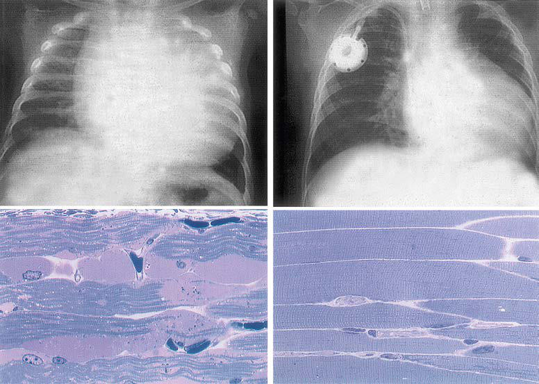

# Chapter 107: Defects in Metabolism of Carbohydrates

*Ghada Hijazi and Priya S. Kishnani †Deceased*

<!-- p.1151 -->
Carbohydrate synthesis and degradation provide the energy required for most metabolic processes. The important carbohydrates include three monosaccharides—glucose, galactose, and fructose—and a polysaccharide, glycogen. Figure 107.1 shows the relevant biochemi cal pathways of these carbohydrates. **Glucose** is the principal sub strate of energy metabolism, continuously available through dietary intake, glycogenolysis (breakdown of glycogen), and gluconeogenesis (glucose made de novo from amino acids, primarily alanine). Metab olism of glucose generates adenosine triphosphate (ATP) via glycoly sis (conversion of glucose or glycogen to pyruvate), mitochondrial oxidative phosphorylation (conversion of pyruvate to carbon dioxide and water), or both. Dietary sources of glucose come from polysac charides, primarily starch, and the disaccharides lactose, maltose, and sucrose. However, oral intake of glucose is intermittent and unreli able. Hepatic glycogenolysis provides the rapid release of glucose and is the most significant factor in maintaining euglycemia (normal levels of glucose in the blood). **Glycogen** is also the primary stored energy source in muscle, providing glucose for muscle activity during exercise. Gluconeogenesis contributes to maintaining euglycemia but is less immediate. Galactose and fructose are monosaccharides that provide fuel for cellular metabolism, though their role is less signifi cant than that of glucose. **Galactose** is derived from lactose (galactose + glucose), which is found in milk and milk products. Galactose is an important energy source in infants. Galactose (exogenous or endog enously synthesized from glucose) is also an important component of certain glycolipids, glycoproteins, and glycosaminoglycans. The dietary sources of **fructose** are fruits, vegetables, and honey. It is also found in the disaccharide sucrose (fructose + glucose) and the sugar alcohol sorbitol.

Defects in glycogen metabolism typically cause an accumulation of glycogen in the tissues, thus the name **glycogen storage disease** (Table 107.1). Defects in gluconeogenesis or the glycolytic pathway, including galactose and fructose metabolism, do not result in an accumulation of glycogen (see Table 107.1). The defects in pyruvate metabolism in the pathway of the conversion of pyruvate to carbon dioxide and water via mitochondrial oxidative phosphorylation are more often associated with **lactic acidosis**.

## 107.1  Glycogen Storage Diseases Ghada Hijazi and Priya S. Kishnani

The disorders of glycogen metabolism, the glycogen storage diseases (GSDs), result from deficiencies of enzymes or transport proteins in the pathways of glycogen metabolism (see Fig. 107.1). Glycogen found in these disorders is abnormal in quantity, quality, or both. GSDs are categorized by numerical type in accordance with the chronological order in which these enzymatic defects were identified. This numerical classification is still widely used, at least up to number VII. The GSDs can also be classified by organ involvement into liver and muscle glyco genoses (see Table 107.1).

There are more than 15 forms of GSDs. Glucose-6-phosphatase deficiency (type I), lysosomal acid α-glucosidase deficiency (type II), debrancher deficiency (type III), branching enzyme deficiency (type IV), liver phosphorylase deficiency (type VI), and liver phosphorylase kinase deficiency (type IX) are the most common of those that typically

present in early childhood. Myophosphorylase deficiency (type V, McArdle disease) is the most common in adolescents and adults. The cumulative frequency of all forms of GSD is approximately 1 in 10,000- 25,000 live births.

**LIVER GLYCOGENOSES** The GSDs that principally affect the liver include glucose-6-phosphatase deficiency **(type I)**, debranching enzyme deficiency **(type III)**, branch ing enzyme deficiency **(type IV)**, liver phosphorylase deficiency **(type VI)**, phosphorylase kinase deficiency (**type IX**), glycogen syn thase deficiency **(type 0)**, and glucose transporter-2 (GLUT2) defect (Fanconi-Bickel syndrome). Because hepatic carbohydrate metabolism is responsible for plasma glucose homeostasis, this group of disorders typically causes fasting hypoglycemia and hepatomegaly. Some GSDs (types III, IV, VI, IX) can be associated with liver fibrosis and cirrhosis. Other organs can also be involved and may manifest as renal dysfunc tion in type I; myopathy (skeletal and/or cardiomyopathy) in types III, IV, and some rare forms of phosphorylase kinase deficiency; and neurologic involvement in types III (peripheral nerves) and IV (diffuse central and peripheral nervous system dysfunction).

**Type I Glycogen Storage Disease (Glucose-6- Phosphatase or Translocase Deficiency, von Gierke Disease)** Type I GSD is caused by the absence or deficiency of **glucose-6- phosphatase activity** in the liver, kidney, and intestinal mucosa. It has two subtypes: **type Ia**, in which the defective enzyme is glucose-6-phosphatase, and **type Ib**, in which the defective enzyme is a **translocase** that transports glucose-6-phosphate across the microsomal membrane. Deficiency of the enzymes in both types Ia and Ib lead to inadequate hepatic conversion of glucose-6-phosphate to glucose through normal glycogenolysis and gluco neogenesis, resulting in fasting hypoglycemia.

Type I GSD is an autosomal recessive disorder. The gene for subtype Ia is *G6PC*, and the gene for subtype Ib is *SLC37A4*. Common patho genic variants have been identified in different ancestral populations. Carrier detection and prenatal diagnosis are possible with DNA-based methodologies.

**Clinical Manifestations** Patients with type I GSD may present in the neonatal period with hypo glycemia and lactic acidosis, but more often present at 3-4 months of age because of increased intervals between feeds and at time of weaning. Infants can present with hepatomegaly, hypoglycemic seizures, or both. Affected children are often described as having **“doll-like” faces** with full cheeks, relatively thin extremities, short stature, and a protuberant abdo men that is a consequence of massive hepatomegaly. The kidneys are also enlarged, whereas the spleen and heart are not involved.

Intermittent diarrhea may occur in GSD I. In patients with GSD Ib, diarrhea appears to be caused by the loss of mucosal barrier func tion via inflammation, which is likely related to glycogen-mediated impairment of neutrophil function. Easy bruising and epistaxis are common and are associated with a **prolonged bleeding time** as a result of impaired platelet aggregation and adhesion. A von Willebrand factor–like deficiency and/or dysfunction has also been found in GSD Ia patients.

The biochemical characteristics of type I GSD are hypoglycemia, lactic acidosis, hyperuricemia, and hyperlipidemia. Hypoglycemia and lactic acidosis can develop even after short fasts. Hyperuricemia is pres ent in young children and rarely progresses to symptomatic gout before puberty. Despite marked hepatomegaly, the liver transaminase levels are usually normal or only slightly elevated. The plasma may be “milky” in appearance due to strikingly elevated triglyceride levels. Cholesterol and phospholipids are also elevated, albeit less prominently. The lipid abnormality resembles type IV hyperlipidemia and is characterized by increased levels of very low-density lipoprotein, low-density lipopro tein, and a unique apolipoprotein profile consisting of increased levels of apolipoproteins B, C, and E, with relatively normal or reduced levels of apolipoproteins A and D. The histologic appearance of the liver is characterized by a universal distention of hepatocytes by glycogen and

*Ghada Hijazi and Priya S. Kishnani*

<!-- p.1152 -->
fat. The lipid vacuoles are particularly large and prominent, and there is no associated liver fibrosis.

Although type I GSD affects mainly the liver, multiple organ systems are involved. **Delayed puberty** is often seen. Females can have ultra sound findings consistent with **polycystic ovaries**, even though other features of polycystic ovary syndrome (acne, hirsutism) are not seen. Nonetheless, fertility appears to be normal, as evidenced in several reports of successful pregnancy in women with GSD I. Increased bleed ing during menstrual cycles, including life-threatening menorrhagia, has been reported and could be related to the impaired platelet aggre gation. Symptoms of gout usually start around puberty from long-term hyperuricemia. There is an increased risk of **pancreatitis**, secondary to the lipid abnormalities. The dyslipidemia, together with elevated eryth rocyte aggregation, could predispose these patients to atherosclerosis,

but premature atherosclerosis has not yet been clearly documented except in rare cases. Impaired platelet aggregation and increased anti oxidative defense to prevent lipid peroxidation may function as protec tive mechanisms to help reduce the risk of atherosclerosis. Frequent fractures and radiographic evidence of **osteopenia** are common, and bone mineral content is reduced, even in prepubertal patients.

By the second or third decade of life, some patients with type I GSD develop **hepatic adenomas** that can hemorrhage and become malignant in some cases. **Pulmonary hypertension** has been seen in some long-term survivors of the disease. Iron-refractory anemia and an increased prevalence of thyroid autoimmunity are also being recognized.

**Renal disease** is another late complication, and most patients with type I GSD over 20 years of age have proteinuria. Glomerular

**Fig. 107.1** Pathway related to glycogen storage diseases and galactose and fructose disorders. G, Glycogenin, the primer for glycogen synthesis; GLUT-2, glucose transporter 2; GSa, active glycogen synthase; GSb, inactive glycogen synthase; NAD/NADH, nicotinamide adenine dinucleotide; Pa, active phosphorylase; PaP, phosphorylase a phosphatase; Pb, inactive phosphorylase; PbKa, active phosphorylase b kinase; PbKb, inactive phos phorylase b kinase; UDP, uridine diphosphate. (Adapted from Beaudet AR. Glycogen storage disease. In: Harrison TR, Isselbacher KJ, eds. Harrison’s Principles of Internal Medicine, 13th ed. New York: McGraw-Hill; 1994.)

G

G

G

G

G

G

Glucose GLUT-2

Glucose

+ Pi

α-Glucosidase

Glucose

Glc-6-P

Glc-6-Pase

**E****NDOPLASMIC**

**R****ETICULUM**

**L****YSOSOME**

GLUT-2

Translocase

GLUT-2

TCA Cycle

GLUT-2

Galactose

PaP

PbKa GSa

GSb

Debrancher

Phosphoglucomutase

Glucose-6-phosphate isomerase

Phosphofructokinase

Triphosphate isomerase

Phosphoglycerate kinase

Pyruvate kinase

Phosphoglycerate mutase

Enolase

Glyceraldehyde-3-P dehydrogenase

Glyceraldehyde Aldolase B Aldolase A

Fructose-1,6 bisphosphatase

Glucokinase, hexokinase

**C****YTOSOL**

**C****YTOSOL**

**M****ITOCHONDRIA**

Glucose

Fructose Fructose F-1-P Fructokinase F-1, 6-P2

Glyceraldehyde-3-P

1,3-Bisphosphoglycerate

3-Phosphoglycerate

2-Phosphoglycerate

Phosphoenolpyruvate

Pyruvate Lactate Lactate dehydrogenase

NADH NAD

Dihydroxyacetone-P

Brancher

PbKb

Pa Pb

GSa

UDP-Glc Pyrophosphorylase

UDP-GLc

UDP-Gal UTP UDP-Gal-4-

epimerase

Gal-1-P

Galactose

Galacto-

kinase Gal-1-P Uridyl transferase Glc-1-P

Glc-6-P Glucose

F-6-P

GSb PaP

PbKa

PbKb

Pb Pa

<!-- p.1153 -->
**DISORDERS BASIC DEFECTS CLINICAL PRESENTATION COMMENTS**

LIVER GLYCOGENOSES *Type/Common Name* Ia/von Gierke Glucose-6-

phosphatase complex

Growth retardation, hepatomegaly, hypoglycemia;

elevated blood lactate, cholesterol, triglyceride, and uric acid levels

Common, severe hypoglycemia. Adulthood: hepatic adenomas and

risk for carcinoma, osteoporosis, pulmonary hypertension, and renal failure Ib Glucose-6-phosphate

translocase

Same as type Ia, with additional findings of neutropenia,

periodontal disease, inflammatory bowel disease, and increased risk of autoimmune hypothyroidism

10% of type I

IIIa/Cori or Forbes Liver and muscle

debrancher deficiency

Childhood: hepatomegaly, growth retardation, muscle

weakness, hypoglycemia, hyperlipidemia, elevated transaminase levels, hepatic fibrosis, left ventricular hypertrophy. Later childhood to adulthood: muscle atrophy

and weakness, liver cirrhosis and failure, risk for hepatocellular carcinoma, cardiac hypertrophy and fibrosis, life-threatening arrhythmia at any age.

Common, intermediate severity of

hypoglycemia. Muscle weakness may progress to

the point that ambulation assistance such as wheelchair use is required.

IIIb Liver debrancher

deficiency; normal muscle enzyme activity

Liver symptoms same as in type IIIa; no muscle or heart

symptoms

15% of type III

IV/Andersen/adult

polyglucosan body disease

Branching enzyme Infancy/childhood failure to thrive, hypotonia,

hepatomegaly, splenomegaly, cirrhosis progressing to liver failure (death usually before fifth year), elevated transaminase levels; a subset does not have overt progression to liver failure. Risk for extrahepatic manifestations, such as myopathy

and cardiomyopathy. Perinatal: decreased fetal movements, polyhydramnios,

fetal hydrops; arthrogryposis, hypotonia, muscle atrophy at birth, death in the perinatal period. Congenital: neonatal hypotonia, respiratory failure,

dilated cardiomyopathy, early infantile death. Childhood: neuromuscular manifestations,

cardiomyopathy. Adult form, adult polyglucosan body disease (APBD):

progressive muscle weakness, neuropathic bladder, gait spasticity, central and peripheral nervous system involvement.

A continuum of disease severity,

related to residual enzyme activity; multisystem involvement

VI/Hers Liver phosphorylase Hepatomegaly, hypoglycemia, hyperlipidemia, elevated

liver enzyme levels, and ketosis

Often underdiagnosed; severe

presentation also known IX/phosphorylase kinase

(PhK) deficiency

Common, X-linked GSD IX α2,

typically less severe than autosomal form GSD IX γ2; clinical variability within and between subtypes; severe cases being recognized across different subtypes IX α2 (*PHKA2* variant) Liver PhK Hypoglycemia, hyperketosis, hepatomegaly, chronic liver

disease, liver fibrosis, hyperlipidemia, elevated liver enzymes, growth retardation

X-linked

IX β (*PHKB* variant) Liver and muscle PhK Hepatomegaly, growth retardation, mild or absent

muscle disease.

Autosomal recessive

IX γ2 (*PHKG2* variant) Liver PhK More severe than IX α2; marked hepatomegaly, recurrent

hypoglycemia, hyperlipidemia, markedly elevated liver enzymes, liver fibrosis/cirrhosis

Autosomal recessive

0a/Liver glycogen synthase deficiency

Liver glycogen

synthase

Early morning drowsiness and fatigue, fasting

hypoglycemia and ketosis, no hepatomegaly

Decreased liver glycogen stores

XI/Fanconi-Bickel

syndrome

Glucose transporter 2

(GLUT-2)

Failure to thrive, rickets, hepatomegaly, renomegaly,

proximal renal tubular dysfunction, impaired glucose and galactose use

GLUT-2 expressed in liver, kidney,

pancreas, and intestine

MUSCLE GLYCOGENOSES *Type/Common Name* II/infantile Pompe Acid α-glucosidase Cardiomegaly, hypotonia, hepatomegaly; onset at birth to

age 6 mo

Common, cardiorespiratory failure

leading to death by age 1-2 yr; minimal to no residual enzyme activity II/late-onset Pompe

(juvenile and adult)

Acid α-glucosidase Myopathy (proximal limb girdle), variable

cardiomyopathy, respiratory insufficiency; onset from infancy and early childhood to adulthood

Residual enzyme activity

Danon disease Lysosome-associated

membrane protein 2 (LAMP2)

Hypertrophic cardiomyopathy, heart failure, retinopathy,

mild cognitive dysfunction

Rare, X-linked

<!-- p.1154 -->
**DISORDERS BASIC DEFECTS CLINICAL PRESENTATION COMMENTS**

PRKAG2 syndrome Adenosine

monophosphate (AMP)–activated protein kinase γ

Hypertrophic cardiomyopathy, arrhythmias, myopathy,

myalgia, seizures; congenital fetal form is rapidly fatal

Autosomal dominant

0b/muscle glycogen synthase deficiency

Muscle glycogen

synthase

Muscle weakness, hypertrophic cardiomyopathy,

abnormal heart rate, sudden cardiac arrest

Rare, few cases reported

XV/Polyglucosan body

myopathy 2

Glycogenin-1 Juvenile- or adult-onset proximal muscle weakness,

nervous system involvement uncommon

Rare, autosomal recessive

V/McArdle Myophosphorylase Exercise intolerance, muscle cramps, myoglobinuria,

“second-wind” phenomenon, muscle weakness

Common, male predominance

VII/Tarui Phosphofructokinase Exercise intolerance, muscle cramps, compensatory

hemolytic anemia, myoglobinuria, “out-of-wind” phenomenon

Prevalent in Japanese and

Ashkenazi Jewish populations

IX α1 (*PHKA1* variant) Muscle PhK Exercise intolerance, cramps, myalgia, increased CK,

myoglobinuria in some; no hepatomegaly

X-linked

Phosphoglycerate

kinase deficiency

Phosphoglycerate

kinase

As with type V Rare, X-linked

X/Phosphoglycerate

mutase deficiency

M subunit of

phosphoglycerate mutase

As with type V Rare, majority of patients are Black

XI/Lactate

dehydrogenase deficiency

M subunit of lactate

dehydrogenase

As with type V Rare

GALACTOSE DISORDERS Galactosemia with

transferase deficiency

Galactose-1-

phosphate uridyltransferase

Vomiting, feeding difficulties, liver failure/dysfunction/

hepatomegaly, cataracts, failure to thrive, *E. coli* sepsis, generalized aminoaciduria

Black patients tend to have milder

symptoms

Galactokinase

deficiency

Galactokinase Cataracts Benign

Generalized uridine

diphosphate galactose-4-epimerase deficiency

Uridine diphosphate

galactose-4epimerase

Similar to transferase deficiency with additional findings

of hypotonia and nerve deafness

Benign and intermediate variants

also exist

Galactose mutarotase

deficiency

Galactose mutarotase Cataract Benign

FRUCTOSE DISORDERS Essential fructosuria Fructokinase Urine-reducing substance Benign

Hereditary fructose

intolerance

Fructose-1-phosphate

aldolase (aldolase-B)

Acute; vomiting, hypoglycemia, sweating, lethargy, acute

liver failure/liver dysfunction

Prognosis good with fructose

restriction Chronic; failure to thrive, hepatic failure

DISORDERS OF GLUCONEOGENESIS Fructose-1,6-

bisphosphatase deficiency

Fructose-1,6-

diphosphatase

Episodic hypoglycemia, lactic acidosis, liver failure/

dysfunction

Good prognosis, avoid fasting

Phosphoenolpyruvate

carboxykinase deficiency

Phosphoenolpyruvate

carboxykinase

Hypoglycemia, hepatomegaly, hypotonia, failure to thrive Rare

DISORDERS OF PYRUVATE METABOLISM Pyruvate

dehydrogenase complex defect

Pyruvate

dehydrogenase

Severe fatal neonatal to mild late onset, lactic acidosis,

psychomotor retardation, failure to thrive, features overlapping fetal alcohol syndrome, MRI findings suggestive of Leigh syndrome, ataxia

Most commonly caused by E1α

subunit defect, X-linked

Pyruvate carboxylase

deficiency

Pyruvate carboxylase Type B: neonatal severe lactic acidosis, hyperammonemia,

hypercitrullinemia, hyperlysinemia, and hypoglycemia. Type A: late-onset mild to moderate lactic acidosis and

developmental delay. Type C: recurrent episodes of lactic acidosis, ketoacidosis, and mild neurologic deficits.

Rare, autosomal recessive

Respiratory chain

defects (oxidative phosphorylation disease)

Complexes I-V, many

mitochondrial and nuclear DNA variants

Heterogeneous with multisystem involvement (see

#### **Table 107.3** and Table 107.5)

| Category / Parameter | Clinical Details & Findings |
| --- | --- |
| **General** | Mitochondrial, autosomal; recessive, dominant, and; X-linked inheritance |
| **DISORDERS IN PENTOSE METABOLISM** | Pentosuria; l-Xylulose reductase; Urine-reducing substance; Benign; Transaldolase deficiency; Transaldolase; Intrauterine growth restriction, oligohydramnios,; dysmorphism, cardiovascular anomalies, anemia,; thrombocytopenia, hepatosplenomegaly,; endocrine abnormalities, cutis laxa; Autosomal recessive, milder form; exists; Ribose-5-phosphate; Ribose-5-phosphate; Progressive leukoencephalopathy and peripheral; Four cases reported |

<!-- p.1155 -->
hyperfiltration, increased renal plasma flow, and microalbuminuria are often found in the early stages of renal dysfunction and can occur before the onset of proteinuria. In younger patients, hyperfiltration and hyperperfusion may be the only signs of renal abnormalities. Many also have hypertension, renal stones, nephrocalcinosis, protein uria, renal tubular acidosis (proximal and distal renal acidification defects), and altered creatinine clearance. With the advancement of renal disease, focal segmental glomerulosclerosis and interstitial fibro sis become evident. In some patients, renal function has deteriorated and progressed to failure, requiring dialysis and transplantation. Other renal abnormalities include amyloidosis, a Fanconi-like syndrome, hypocitraturia, hypercalciuria, and a distal renal tubular acidification defect. Patients with *GSD Ib* can have additional features of recurrent bacterial infections from **neutropenia** and impaired neutrophil func tion. Oral involvement, including recurrent mucosal ulceration, gingi vitis, and rapidly progressive periodontal disease, may occur in type Ib. Intestinal mucosa ulceration culminating in GSD enterocolitis is also common. Type 1b is also associated with a chronic inflammatory bowel disease (IBD)–like picture involving the colon that may be associated with neutropenia and/or neutrophil dysfunction and can resemble ulcerative colitis or Crohn disease.

**Diagnosis** The clinical presentation and laboratory findings of hypoglycemia, lactic acidosis, hyperuricemia, and hyperlipidemia lead to a suspected diagnosis of type I GSD. Neutropenia is noted in *GSD Ib* patients, although neutrophil counts may be normal initially. Neutropenia has also been noted in some patients with GSD Ia, especially those with the p.G188A variant. Administration of glucagon or epinephrine leads to a negligible increase, if any, in blood glucose levels, but the lactate level rises significantly. Before the availability of genetic testing, a definitive diagnosis required enzyme testing via liver biopsy. Gene-based vari ant analysis using single-gene sequencing or multigene panel test ing provides a noninvasive way to diagnose most patients with GSD types Ia and Ib and has become the primary recommended method of diagnosis.

**Treatment** Treatment focuses on maintaining normal blood glucose levels and is achieved by continuous nasogastric (NG) infusion of glucose or administration of uncooked cornstarch. In infancy, overnight NG drip feeding may be needed to maintain normoglycemia. NG feedings can consist of a sucrose- and lactose-free enteral formula or only glucose or a glucose polymer to provide sufficient glucose to maintain eugly cemia. During the day, frequent feedings with high-complex carbohy drate content are typically sufficient.

Uncooked cornstarch acts as a slow-release form of glucose and can be introduced at a dose of 1.6 g/kg every 4 hours for children less than 2 years of age. The response of young children is variable. For older children, the cornstarch regimen can be changed to every 4-6 hours at a dose of 1.6-2.5 g/kg body weight and can be given orally mixed with water or a sucrose-, fructose-, and lactose-free beverage. Cornstarch dosing may also be calculated based on hepatic glucose production rate and can be administered more frequently in smaller amounts to improve metabolic control. Other starch products, such as extendedrelease waxy maize starch with a high amylopectin content, are shown to be beneficial in extending time between overnight feedings in some individuals with hepatic GSD. Because fructose and galactose cannot be converted directly to glucose in GSD type I, these sugars should be restricted in the diet. Sucrose (table sugar, cane sugar, other ingredi ents), fructose (fruit, juice, high-fructose corn syrup), lactose (dairy foods), and sorbitol should be avoided or limited. As a result of these dietary restrictions, vitamins and minerals such as calcium and vita min D may be deficient, and supplementation is required to prevent nutritional deficiencies.

Maintaining normoglycemia and avoiding hypoglycemia necessitate frequent blood glucose measurements in patients with hepatic GSDs. This can be accomplished by self-monitoring blood glucose (SMBG) using a finger prick before and after meals, before physical activity,

and overnight. Continuous glucose monitoring systems (CGMSs) are a newer technique that allow for 24-hour glucose monitoring. CGMSs have been shown to be safe and effective tools for monitoring glucose levels in patients with hepatic GSDs (GSD I, GSD III, GSD VI, GSD IX) at all hours of the day. Furthermore, when accompanied with the necessary dietary changes, CGMSs aid in metabolic control, improving disease parameters, avoidance of hospitalizations, and blood glucose stability in these patients.

Dietary therapy improves hyperuricemia, hyperlipidemia, and renal function, as well as slowing the development of renal failure. Blood uric acid and lipid levels may, however, be elevated in some individuals, despite good dietary compliance, especially after puberty. The control of hyperuricemia can be further augmented by the use of allopurinol, a xanthine oxidase inhibitor. Hyperlipidemia can be reduced with lipid-lowering drugs, such as β-hydroxy-β-methylglutaryl-coenzyme A (HMG-CoA) reductase inhibitors and fibrate (see Chapter 106). **Microalbuminuria**, an early indicator of renal dysfunction in type I dis ease, is treated with angiotensin-converting enzyme (ACE) inhibitors. Citrate supplements can be beneficial for patients with hypocitraturia by preventing or ameliorating nephrocalcinosis and development of urinary calculi. Products containing citric acid reduce the effectiveness of cornstarch and should not be taken concurrently. Thiazide diuret ics increase renal reabsorption of filtered calcium and decrease urinary calcium excretion, thereby preventing hypercalciuria and nephrocal cinosis. Growth hormone (GH) should be used with extreme caution and limited to only those with a documented GH deficiency. Even in those patients, there should be close monitoring of metabolic param eters and for the presence of adenomas. Kidney transplantation may be performed to treat end-stage renal disease (ESRD). As needed, com bined liver and kidney transplantation is sometimes recommended.

In patients with **type Ib GSD**, granulocyte colony-stimulating fac tor is successful in correcting neutropenia, decreasing the number and severity of bacterial infections, and improving chronic IBD; the minimum effective dose should be used, given noted side effects with this agent, including splenomegaly, hypersplenism, and bone pain, with this agent. Vitamin E administration has been shown to improve neutrophil count and function and to reduce the frequency and severity of infections in GSD1b patients. The use of sodium glucose cotransporter-2 (SGLT2) inhibitors (empagliflozin) to improve neutro phil function and reduce neutropenia and IBD symptoms in GSDIb is showing promising results. Bone marrow transplantation has been reported to correct neutropenia in type Ib GSD.

Orthotopic liver transplantation is a potential cure for type I GSD, especially for patients with liver malignancy, multiple liver adenomas, metabolic derangements refractory to medical management, and liver failure; however, because of the paucity of available organ donors, this can be challenging. Large adenomas (>2 cm) that are rapidly increas ing in size and/or number may necessitate partial hepatic resection. Smaller adenomas (<2 cm) may be treated with percutaneous ethanol injection or transcatheter arterial embolization. Recurrence of liver adenomas is a challenge and may potentiate malignant transformation in these patients, ultimately requiring a liver transplant. Before any sur gical procedure, the bleeding status must be evaluated and good meta bolic control established. Prolonged bleeding times can be normalized with intensive intravenous (IV) glucose infusion for 24-48 hours before surgery. Treatment with DDAVP (1-deamino-8-d-arginine vasopressin) can reduce bleeding complications, but it should be used with caution because of the risk of fluid overload and hyponatremia when administered as an IV infusion. Lactated Ringer solution should be avoided because it contains lactate and no glucose. Glucose levels should be maintained in the normal range throughout surgery with the use of 10% dextrose. Overall, metabolic control is assessed by growth, improvement, and correction of the metabolic abnormalities such as elevated lactate, glucose, triglyceride, cholesterol, and uric acid levels.

GSD I is a promising target for gene therapy because it is caused by pathogenic variants in a single gene. An active phase 3 clinical trial (NCT05139316) is being conducted to determine the efficacy and safety of adeno-associated virus serotype 8 (AAV8)–mediated G6P gene replacement in patients ages 8 years and older with GSD type Ia.

<!-- p.1156 -->

**Fig. 107.2** Growth and development in a patient with type IIIb gly cogen storage disease. The patient has debrancher deficiency in the liver but normal activity in muscle. As a child, he had hepatomegaly, hypoglycemia, and growth retardation. After puberty, he no longer had hepatomegaly or hypoglycemia, and his final adult height is normal. He had no muscle weakness or atrophy; this is in contrast to patients with type IIIa, in whom a progressive myopathy is seen in adulthood.

**Prognosis** Inadequate metabolic control during childhood can lead to long-term complications in adults. Clinical outcomes have improved dramatically with early diagnosis and effective treatment. However, serious compli cations such as renal disease and formation of hepatic adenomas with potential risk for malignant transformation persist. The ability to identify transformation of liver adenomas to hepatocellular carcinoma remains a challenge as α-fetoprotein (AFP) and carcinoembryonic antigen (CEA) levels often remain normal in the setting of hepatocellular carcinoma.

**Type III Glycogen Storage Disease (Cori Disease, Forbes Disease, Debrancher Deficiency, Limit Dextrinosis)** Type III GSD is caused by deficient activity of the **glycogen deb ranching enzyme**. This enzyme, together with phosphorylase and phosphorylase kinase, are responsible for complete degradation of gly cogen. When debranching enzyme is defective, glycogen breakdown is incomplete, resulting in the accumulation of an abnormal glycogen with short outer-branch chains that resemble *limit dextrin*. GSD **type IIIa** is the most common type and usually involves both liver and mus cle; GSD **type IIIb**, seen in approximately 15% of patients, appears to involve only the liver.

Type III GSD is an autosomal recessive disease that has been reported in many different ethnic groups. The frequency is relatively high in the Sephardic Jewish population from North Africa, inhabitants of the Faroe Islands, and the Inuit population. The gene for debranching enzyme *(AGL)* has been noted, with more than 260 different patho genic variants. At least two pathogenic variants in exon 2, c.18_19del (p.Gln6fs) and c.16C>T (p.Gln6Ter), are specifically associated with GSD type IIIb. Carrier detection and prenatal diagnosis are possible using DNA-based testing.

**Clinical Manifestations** In infancy and childhood, type III GSD may be indistinguishable from type I because of overlapping features such as hepatomegaly, hypogly cemia, hyperlipidemia, and growth stunting (Fig. 107.2). Hepatomeg aly in most patients with type III GSD decreases with age; however, liver fibrosis and/or cirrhosis progressing to liver failure are noted in many in late adulthood. Some patients develop hepatocellular carci noma. Hepatic adenomas with transformation to carcinomas occur less frequently in individuals with GSD III than in those with GSD I. Alpha-fetoprotein (AFP) and carcinoembryonic antigen (CEA) levels are not good predictors of malignant transformation.

In patients with GSD type IIIa, the **muscle weakness** is slowly pro gressive and associated with muscle wasting. The weakness can pres ent in early childhood but can become severe after the third or fourth decade of life. Myopathy does not follow a particular pattern of involve ment, and both proximal and distal muscles are involved. Electromy ography (EMG) reveals a widespread myopathy, and nerve conduction studies may be abnormal.

Although overt cardiac dysfunction is rare, ventricular hypertrophy is a frequent finding. **Cardiac pathology** has shown diffuse involve ment of various cardiac structures, including vacuolation of myocytes, fibrosis, glycogen accumulation in the conduction system, and hyper plasia of smooth muscles. Life-threatening arrhythmia and the need for heart transplant have been reported in some patients with GSD IIIa. Hepatic symptoms in some patients may be mild and the diagnosis is not made until adulthood, when patients show symptoms and signs of neuromuscular disease.

The initial presentation can be confused with Charcot-Marie-Tooth disease (see Chapter 653.1). Polycystic ovaries are noted; some patients can develop hirsutism, irregular menstrual cycles, and other features of polycystic ovarian syndrome. Fertility does not appear to be affected; successful pregnancies have been reported. Low bone mineral density and myopathy in patients with GSD IIIa put them at an increased risk of potential fractures.

Hypoglycemia and hyperlipidemia are common. In contrast to type I GSD, elevation of liver transaminase levels and fasting ketosis are prominent, but blood lactate and uric acid concentrations are usually

normal. Glucagon administration 2 hours after a carbohydrate meal provokes a normal increase in blood glucose. However, after an over night fast, glucagon may provoke no change in blood glucose level. Serum creatine kinase levels can be useful to identify patients with muscle involvement, although normal levels do not rule out muscle enzyme deficiency.

**Diagnosis** The histologic appearance of the liver is characterized by a universal distention of hepatocytes by glycogen and the presence of fibrous septa. The fibrosis and the paucity of fat distinguish type III glycogenosis from type I. The fibrosis, which ranges from minimal periportal fibro sis to micronodular cirrhosis, appears in most cases to be progressive. Overt cirrhosis has been seen in some patients with GSD III.

Patients with myopathy and liver symptoms have a generalized enzyme defect (type IIIa). The deficient enzyme activity can be dem onstrated not only in liver and muscle but also in other tissues such as heart, erythrocytes, and cultured fibroblasts. Patients with hepatic symptoms without clinical or laboratory evidence of myopathy have debranching enzyme deficiency only in the liver, with enzyme activ ity retained in the muscle (type IIIb). Before the availability of genetic testing, a definitive diagnosis required enzyme assay in liver, muscle, or both. Gene sequencing allows for diagnosis and subtype assignment in the majority of patients.

**Treatment** The mainstay of treatment of GSD III is dietary management, as in GSD I, although it is less demanding. Patients do not need to restrict dietary intake of fructose and galactose, although simple sugars should be avoided to prevent sudden spikes in blood glucose levels. Hypogly cemia can be prevented by small frequent meals rich in complex car bohydrates, such as cornstarch supplements or nocturnal gastric drip feedings. Additionally, a high-protein diet during the daytime as well as overnight protein enteral infusion is effective in preventing hypo glycemia. The exogenous protein can be used as a substrate for gluco neogenesis, which helps to meet energy needs and prevent endogenous

<!-- p.1157 -->
protein breakdown. Protein in the diet also reduces the overall starch requirement. Overtreatment with cornstarch should be avoided, as it can result in excessive glycogen buildup, which is detrimental and can lead to excessive weight gain. Medium-chain triglyceride (MCT) supplementation and a high-fat diet are being considered as alternative sources of energy. There is no satisfactory treatment for the progressive myopathy other than recommending a high-protein diet, physical ther apy, and high-fat diet in some patients. Close monitoring with abdomi nal MRI is needed to detect progression of liver fibrosis to cirrhosis and hepatocellular carcinoma (HCC). Additional imaging techniques, such as hepatic elastography, are being developed. Liver transplantation has been performed in GSD III patients with progressive cirrhosis and/or HCC. There are reports of cardiac transplant in GSD III patients with end-stage cardiac disease.

**Type IV Glycogen Storage Disease (Branching Enzyme Deficiency, Amylopectinosis, Polyglucosan Disease, Andersen Disease, Adult Polyglucosan Body Disease)** Type IV GSD is caused by the deficiency of **branching enzyme activ ity**, which results in the accumulation of an abnormal glycogen with poor solubility. The disease is also known as *amylopectinosis* because the abnormal glycogen has fewer α-1,6 branch points, more α-1,4 linked glucose units, and longer outer chains, resulting in a structure resembling amylopectin. These excessively long peripheral glucan chains form polyglucosan bodies, which are positive on periodic acid– Schiff (PAS) and resistant to diastase digestion. Polyglucosan body accumulation is seen in all affected patients but to different degrees and in different tissues.

Type IV GSD is an autosomal recessive disorder. The glycogen branching enzyme *(GBE1)* gene has been noted, with more than 128 pathogenic variants responsible for type IV GSD, and their charac terization in individual patients can be useful in predicting clinical outcome. The nearly complete absence of glycogen branching enzyme (GBE) activity with null alleles has been associated with perinatal death and fatal neonatal hypotonia. Residual GBE activity results in a con tinuum of disease manifestations ranging from progressive hepatic cirrhosis, slowly progressive or nonprogressive liver disease, cardiomy opathy, myopathy, peripheral neuropathy, motor neuron disease, and leukodystrophy.

**Clinical Manifestations** A high degree of clinical variability is associated with type IV GSD. The most common and classic form is characterized by **hepatic** involve ment with progressive cirrhosis of the liver and manifests in the first 18 months of life as hepatosplenomegaly and failure to thrive. Cirrhosis may present with portal hypertension, ascites, and esophageal varices and may progress to liver failure, usually leading to death by 5 years of age. Some patients survive without progression of liver disease, and they are considered to have a milder hepatic form and do not require liver transplant. Extrahepatic involvement in some patients with GSD IV consists of musculoskeletal involvement, particularly cardiac and skeletal muscles, as well as central nervous system (CNS) and periph eral nervous system (PNS) involvement.

**Neuromuscular** forms of type IV GSD have been reported, with four main subtypes recognized based on age at presentation. The **peri natal** form is characterized by a *fetal akinesia deformation sequence* (FADS) and death in the perinatal period. The **congenital** form pres ents at birth with severe hypotonia, muscle atrophy, and neuronal involvement, with death in the neonatal period; some patients have cardiomyopathy. The **childhood** form presents primarily with myopa thy or cardiomyopathy. The **adult** form, *adult polyglucosan body disease* (APBD), presents with PNS dysfunction and diffuse CNS involvement, accompanied by accumulation of polyglucosan material in the nervous system. Symptoms of neuronal involvement include progressive muscle weakness; gait spasticity; peripheral neuropathy; neuropathic bladder; and, in many cases, leukodystrophy, mood disturbances, and cognitive decline. APBD is often misdiagnosed as multiple sclerosis (MS), amyo trophic lateral sclerosis (ALS), or cerebral small-vessel disease (CSVD).

**Diagnosis** Deposition of amylopectin-like materials varies and can be dem onstrated in the liver, heart, muscle, skin, intestine, brain, brain stem, spinal cord, and peripheral nerves (i.e., sural nerve) in type IV GSD. For patients with hepatic involvement, liver histology shows micronodular cirrhosis and faintly stained basophilic inclusions in hepatocytes. The inclusions are composed of coarsely clumped, stored material that is PAS positive and partially resistant to dia stase digestion. Electron microscopy (EM) shows, in addition to the conventional α and β glycogen particles, the accumulation of fibrillar aggregations that are typical of amylopectin. Similar nonmembrane-bound cytoplasmic inclusions (PAS positive, dia stase resistant) are observed in the cardiomyocytes and skeletal muscle fibers, and polyglucosan bodies may be present in the muscle biopsy from those with neuromuscular manifestations. In APBD, a peripheral nerve biopsy reveals intra-axonal polyglucosan bodies, and histologic examination of brain tissue shows polyglu cosan bodies often visualized in the astrocytes and neurons. The distinct staining properties of the inclusions, as well as EM find ings, could be diagnostic. However, polysaccharides with histologic features reminiscent of type IV disease but without enzymatic cor relation have been observed. The diagnosis is confirmed by either identification of two pathogenic variants in *GBE1* or a reduction of GBE activity in leukocytes or fibroblasts. Prenatal diagnosis is possible by measuring enzyme activity in cultured amniocytes or chorionic villi or by DNA-based methodologies.

**Treatment** There is no specific treatment for type IV GSD. Nervous system involvement, such as gait problems and bladder involvement, requires supportive, symptomatic management. Unlike patients with other liver GSDs (I, III, VI, IX), those with GSD IV do not typ ically have hypoglycemia. Liver transplantation has been performed for patients with progressive liver disease, but patients must be carefully selected because this is a multisystem disease and, in some patients, extrahepatic involvement may manifest or worsen after transplant. Liver transplantation corrects the hepatic phenotype of the disease but has no effects on the extrahepatic manifestations such as myopathy and cardiomyopathy. Individuals with significant diffuse reticuloendothelial involvement may have greater risk of morbidity and mortality, which may affect the success rate for liver transplant. Patients with symptomatic cardiomyopathy and skel etal myopathy may benefit from heart transplantation and physical therapy, respectively.

**Type VI Glycogen Storage Disease (Liver Phosphory lase Deficiency, Hers Disease)** Type VI GSD is caused by deficiency of **liver glycogen phosphory lase**. Patients usually present with hepatomegaly and growth stunt ing in infancy or early childhood. Hypoglycemia, hyperlipidemia, and hyperketosis are of variable severity. Ketotic hypoglycemia may present after overnight or prolonged fasting. Lactic acid and uric acid levels are normal. Type VI GSD presents within a broad spec trum of involvement, some with a more severe clinical presentation. Patients with severe hepatomegaly, recurrent severe hypoglycemia and hyperketosis have been reported. Focal nodular hyperplasia of liver, hepatocellular adenoma with transformation into carcinoma, hepatic fibrosis, and cirrhosis have been reported in some patients.

**Diagnosis** GSD VI is an autosomal recessive disease. Diagnosis can be confirmed through molecular testing of the liver phosphorylase gene *(PYGL).* Many pathogenic variants are known in this gene, and a splice-site variant in intron 13 has been identified in the Mennonite population. A liver biopsy showing elevated glycogen content and decreased hepatic phosphorylase enzyme activity can also be used to make a diagnosis, especially in cases with inconclusive genetic results. However, with the availability of DNA analysis and next-generation sequencing (NGS) panels, liver biopsies are usually unnecessary.

<!-- p.1158 -->
**Treatment** Treatment is symptomatic and aimed at preventing hypoglycemia while ensuring adequate nutrition. A low-carbohydrate (45–50% of total calories), high-protein (2–3 g protein/kg body weight or 20–25% of total calories) diet and frequent feeding are effective in preventing hypoglycemia. Blood glucose and ketones should be monitored rou tinely, especially during periods of increased activity/illness. Longterm follow-up of these patients is needed to monitor and manage the complications and to expand the understanding of the natural history of this disorder.

**Type IX Glycogen Storage Disease (Phosphorylase Kinase Deficiency)** Type IX GSD represents a heterogeneous group of glycogenoses resulting from deficiency of the enzyme **phosphorylase kinase** (PhK), which is involved in the rate-limiting step of glycogenolysis. This enzyme has four subunits (α, β, γ, δ), each encoded by dif ferent genes differentially expressed in various tissues. Pathogenic variants in the *PHKA1* gene cause muscle PhK deficiency; patho genic variants in the *PHKA2* and *PHKG2* genes cause liver PhK deficiency, and pathogenic variants in the *PHKB* gene cause PhK deficiency in liver and muscle. Pathogenic variants in the *PHKG1* gene have not been identified.

**Clinical manifestations** of liver PhK deficiency are usually rec ognizable within the first 2 years of life and include short stature and abdominal distention from moderate to marked hepatomegaly. The clinical severity of liver PhK deficiency varies considerably. Hyperketotic hypoglycemia, if present, can be mild but may be severe in some cases. Ketosis may occur even when glucose levels are normal. Some children may have mild delays in gross motor development and hypotonia. It is becoming increasingly clear that GSD IX is not a benign condition. Severe phenotypes are reported, with liver fibrosis progressing to cirrhosis and HCC, particularly in patients with *PHKG2* variants and also in some patients with *PHKA2* variants. Progressive splenomegaly and portal hyperten sion are reported secondary to cirrhosis. Interventricular septal hypertrophy has been reported in a patient with GSD IX β (*PHKB* variant). Cognitive and speech delays have been reported in a few individuals, but it is not clear whether these delays are caused by PhK deficiency or are coincidental. Renal tubular acidosis has been reported in rare cases. Unlike in GSD I, lactic acidosis, bleed ing tendency, and loose bowel movements are not characteristic. Although growth is retarded during childhood, normal height and complete sexual development are eventually achieved. As with debrancher deficiency, abdominal distention and hepatomegaly usually decrease with age. Some adults with liver PhK deficiency are reportedly asymptomatic, although patients at the other end of the spectrum develop cirrhosis and liver failure. Further studies are needed to fully assess and understand the natural history of this disorder in adults.

Phenotypic variability within each subtype is being uncovered with the availability of molecular testing. The incidence of all subtypes of PhK deficiency is approximately 1:100,000 live births.

**Type IX α****2 Glycogen Storage Disease (X-Linked Liver Phosphorylase Kinase Deficiency, PHKA2 Variant)** Glycogen storage disease IX α2 is one of the most common forms of liver glycogenosis in males. A typical presentation for this condition includes a young male (age 1-5 years) with growth stunting, incidental finding of hepatomegaly, and mild delays in motor development. In addition to the liver, enzyme activity can also be deficient in erythro cytes, leukocytes, and fibroblasts, with normal enzyme activity in mus cle. Cholesterol, triglycerides, and liver enzymes are elevated. Ketosis may occur after fasting. Lactate and uric acid levels are normal. Hypo glycemia can range from mild to severe. The response in blood glu cose to glucagon is normal. Although hepatomegaly and liver enzymes might gradually reduce and normalize with age in some patients, other groups exhibit an increase in these disease parameters comparable

to those observed in patients with GSD IX γ 2. Most adults achieve a normal final height. It is increasingly recognized that this disorder is not benign, as previously thought, and there are patients with severe disease and long-term hepatic sequelae. In some cases, liver fibrosis can occur and progress to cirrhosis. Liver histology shows glycogendistended hepatocytes, steatosis, fibrosis, and/or cirrhosis. Fibrous septal formation and low-grade inflammatory changes may be seen. Adenomas have been also reported.

The gene for the common liver isoform of the PhK α subunit, *PHKA2,* is located on the X chromosome (Xp22.2). Pathogenic vari ants in the *PHKA2* gene account for 75% of all PhK cases. X-linked liver PhK deficiency is further subdivided into two biochemical sub types: XLG1, with measurable deficiency of PhK activity in both blood cells and liver, and XLG2, with normal in vitro PhK activity in blood cells and variable activity in the liver. The mechanism through which XLG2 exhibits normal or increased in vitro PhK activity is unknown. Because of X-inactivation leading to variable expression of the mutant allele, some female carriers may develop symptoms ranging from mild hepatomegaly to more severe symptoms.

**Type IX β****Glycogen Storage Disease (Autosomal Liver and Muscle Phosphorylase Kinase Deficiency, PHKB Variant)** PhK deficiency in liver and blood cells with an autosomal recessive mode of inheritance has been reported. Similar to the X-linked form, chief symptoms in early childhood include hepatomegaly and growth retardation. Some patients also exhibit muscle hypotonia. In a few cases where enzyme activity has been measured, reduced PhK activity has been demonstrated in muscle. Pathogenic variants are found in PHKB (chromosome 16q12-q13), which encodes the β subunit, and result in liver and muscle PhK deficiency (GSD IX β). Several non sense and missense variants, a single-base insertion, splice-site patho genic variants, and a large intragenic pathogenic variant have been identified.

**Type IX γ****2 Glycogen Storage Disease (Autosomal Liver Phosphorylase Kinase Deficiency, PHKG2 Variant)** This form of PhK deficiency is caused by pathogenic variants in the testis/liver isoform (TL) of the γ2 subunit of the *PHKG2* gene. In con trast to GSD IX α2, patients with GSD IX γ2 typically have more severe phenotypes, with recurrent hypoglycemia, prominent hepatomegaly, significant liver fibrosis, and progressive cirrhosis. Hepatic adenomas have been observed in several patients. Liver involvement occasionally presents with cholestasis, bile duct proliferation, esophageal varices, and splenomegaly. The spectrum of involvement continues to evolve as more cases are recognized. Many pathogenic variants in the *PHKG2* gene have been identified.

**Diagnosis** Individuals with liver PhK deficiency usually have ketotic hypogly cemia, elevated transaminases, elevated triglycerides and cholesterol, normal uric acid and lactic acid concentrations, and normal glucagon response. PhK deficiency may be diagnosed by demonstration of the enzymatic defect in affected tissues. Hepatic PhK activity can be mea sured in liver, leukocytes, and erythrocytes. The interpretation of PhK activity results is complicated by the possibility of both false-positive and false-negative results. False-positive findings are possible, owing to the labile nature of PhK, which is extremely sensitive to handling circumstances and temperature exposure. As a result, extreme caution is required when storing and transporting such diagnostic specimens. Because the PhK enzyme has several isozymes, the diagnosis can eas ily be missed without the tissue where it is deficient (liver, muscle, or cardiac studies).

Molecular genetic testing is preferable to enzyme assay for diagnosis, as liver biopsy is an invasive procedure. Gene sequencing is used for diagnostic confirmation and subtyping of GSD IX. The *PHKA2* gene encoding the α subunit is most frequently involved, followed by the *PHKB* and *PHKG2* genes encoding the β and γ subunits, respectively.

<!-- p.1159 -->
**Treatment and Prognosis** The treatment for liver PhK deficiency is symptomatic and includes a high-protein (2-3 g protein/kg body weight or 20–25% of total calo ries) diet with complex carbohydrates (45–50% of total calories) and small, frequent feedings to prevent hypoglycemia. Cornstarch can be administered, with symptom-dependent dosage and timing (0.6-2.5 g/ kg every 6 hours). Hypoglycemia should be treated with oral glucose, if tolerated; if not, IV glucose should be given.

Patients with pathogenic variants in the γ subunit typically have a more severe clinical course with progressive liver disease. In liver biopsy samples, hepatic fibrosis/cirrhosis was detected in 50% and 95% of patients with *PHKA2* and *PHKG2* pathogenic variants, respec tively. Two patients with GSD IX γ2 received liver transplantation, one for liver failure secondary to cirrhosis and the other for HCC. Liver involvement needs to be monitored in all patients with GSD IX by peri odic imaging (abdominal ultrasound or MRI every 6-12 months) and serial hepatic function tests.

**Type 0a Glycogen Storage Disease (Liver Glycogen Synthase Deficiency)** Liver glycogen synthase deficiency type 0a **(GSD 0a)** is caused by deficiency of **hepatic glycogen synthase** activity, leading to a marked decrease of glycogen stored in the liver. It is caused by pathogenic vari ants in *GYS2*. The disease appears to be rare in humans and, in the true sense, is not a type of GSD because the enzyme deficiency leads to decreased glycogen stores. Patients present in infancy with earlymorning (pre-breakfast) drowsiness, pallor, emesis, and fatigue, and occasional convulsions associated with hypoglycemia and hyperketo nemia. Blood lactate and alanine levels are low, and there is no hyper lipidemia or hepatomegaly. **Hyperglycemia**, glycosuria, lactic acidosis, and hyperalaninemia, with normal insulin levels after administration of glucose or a meal, suggest a deficiency of glycogen synthase. **Diag nosis** may be through molecular testing that identifies pathogenic vari ants in *GYS2* or by liver biopsy to measure the enzyme activity.

**Treatment** consists of frequent meals rich in protein and nighttime supplementation with uncooked cornstarch to prevent hypoglycemia and hyperketonemia. Most children with GSD 0a are cognitively and developmentally age appropriate. Short stature and osteopenia are common features. The **prognosis** seems good for patients who survive to adulthood, with a decrease in the frequency and severity of hypo glycemia. Long-term natural history studies are required to have a bet ter understanding of the disease’s outcomes and the impact of dietary therapy.

**Hepatic Glycogenosis with Renal Fanconi Syndrome (Fanconi-Bickel Syndrome)** Fanconi-Bickel syndrome is a rare autosomal recessive disorder caused by defects in the facilitative GLUT2, which transports glucose in and out of hepatocytes, pancreatic β cells, and the basolateral membranes of intestinal and renal epithelial cells. The disease is characterized by proximal renal tubular dysfunction, impaired glucose and galactose utilization, and accumulation of glycogen in the liver and kidney.

The affected child typically presents in the first year of life with fail ure to thrive, rickets, and a protuberant abdomen from hepatomegaly and nephromegaly. The disease may be confused with GSD I because a Fanconi-like syndrome can also develop in that patient population. Adult patients have short stature as a result of hypophosphatemic rick ets. Patients are more susceptible to fractures because of early-onset generalized osteopenia. In addition, intestinal malabsorption and diar rhea may occur, and HCC has been seen. Laboratory findings include glucosuria, phosphaturia, generalized aminoaciduria, bicarbonate wasting, hypophosphatemia, increased serum alkaline phosphatase levels, and radiologic findings of rickets. Mild fasting hypoglycemia and hyperlipidemia may be present. Liver transaminase, plasma lac tate, and uric acid levels are usually normal. Oral galactose or glucose tolerance tests show intolerance, which could be explained by the func tional loss of GLUT2 preventing liver uptake of these sugars. Tissue biopsy results show marked accumulation of glycogen in hepatocytes and proximal renal tubular cells, presumably from the altered glucose

transport out of these organs. Diffuse glomerular mesangial expansion, along with glomerular hyperfiltration and microalbuminuria similar to nephropathy in GSD Ia, and diabetes have been reported.

This condition is rare, and 70% of patients with Fanconi-Bickel syndrome have consanguineous parents. Most patients have homo zygous pathogenic variants; some patients are compound heterozy gotes. Several types of pathogenic variants in the *SLC2A2* gene have been described, including missense, nonsense, insertion/deletion, and intronic variants.

There is no specific treatment. Symptom-dependent treatment with phosphate, bicarbonate, and uncooked cornstarch can result in growth improvement. Growth may also improve with symptomatic replace ment of water, electrolytes, and vitamin D and restriction of galactose intake; a diet similar to that used for diabetes mellitus, with small, fre quent meals using complex carbohydrates and adequate caloric intake, is recommended.

**MUSCLE GLYCOGENOSES** The role of glycogen in muscle is to provide substrates for the generation of ATP for muscle contraction. The muscle GSDs are broadly divided into two groups. The first group is characterized by hypertrophic cardiomyopathy, progressive skeletal muscle weakness and atrophy, or both and includes deficiencies of acid α-glucosidase, a lysosomal glycogen-degrading enzyme (**type II** GSD); lysosomal-associated membrane protein 2 **(LAMP2/Danon disease)**; AMP-activated pro tein kinase γ2 **(PRKAG2/PRKAG2 syndrome)**; and muscle glycogen synthase **(type 0b)**. Glycogenin-1 deficiency **(GYG1/polyglucosan body myopathy 2)** may manifest as muscle weakness and exercise intolerance to exercise in the absence of cardiomyopathy.

The second group comprises muscle energy disorders characterized by muscle pain, exercise intolerance, myoglobinuria, and susceptibility to fatigue. This group includes myophosphorylase deficiency (McArdle disease, **type V** GSD) and deficiencies of phosphofructokinase **(type VII)**, phosphoglycerate kinase, phosphoglycerate mutase, lactate dehy drogenase (LDH), and muscle-specific phosphorylase kinase (**type IX** α1). Some of these latter enzyme deficiencies can also be associated with *compensated hemolysis,* suggesting a more generalized defect in glucose metabolism.

**Type II Glycogen Storage Disease (Lysosomal Acid α****-1,4-Glucosidase Deficiency, Pompe Disease)** Pompe disease, also referred to as *GSD type II* or **acid maltase defi ciency**, is caused by a deficiency of acid α-1,4-glucosidase, an enzyme responsible for the degradation of glycogen in lysosomes. This enzyme defect results in lysosomal glycogen accumulation in multiple tissues and cell types, predominantly affecting cardiac, skeletal, and smooth muscle cells and the nervous system. In Pompe disease, glycogen typically accu mulates within lysosomes, as opposed to its accumulation in cytoplasm in the other glycogenoses. However, as the disease progresses, lysosomal rupture and leakage lead to the presence of cytoplasmic glycogen as well.

Pompe disease is an autosomal recessive disorder. The incidence was previously reported to be approximately 1 in 40,000 live births in Whites and 1 in 18,000 live births in the Han Chinese population. Newborn screening for Pompe disease in the United States suggests that the prevalence is much higher than previously thought (between 1 in 10,000 and 1 in 25,000). More than 600 pathogenic variants have been identified in the gene for acid α-glucosidase *(GAA)* and are help ful in delineating the phenotypes. A splice-site variant (c.-32-13 T > G, formerly called IVS1-13 T > G) is commonly seen in White patients with late-onset disease.

**Clinical Manifestations** Pompe disease is broadly classified into infantile and late-onset forms. The infantile presentation is a continuum and is further divided into two categories: classic and nonclassic. Classic **infantile Pompe dis ease** (IPD) is uniformly lethal *without* enzyme replacement therapy (ERT) with *alglucosidase alfa*. Affected infants present in the first days to weeks of life with hypotonia, generalized muscle weakness with a hypotonic *floppy infant* appearance, hypertrophic cardiomyopathy

<!-- p.1160 -->
with or without left ventricular outflow obstruction, feeding difficul ties, macroglossia, and hepatomegaly; if untreated, the condition leads to death from cardiorespiratory failure or respiratory infection by 1 year of age. Nonclassic IPD has a slower disease course and a less severe cardiac phenotype at initial presentation.

**Late-onset Pompe disease** (LOPD; juvenile-, childhood-, and adult-onset disease) is characterized by proximal limb girdle muscle weakness and early involvement of respiratory muscles, especially the diaphragm. The distinguishing feature between IPD and LOPD is absence of cardiomyopathy in the first year of life in patients with LOPD. Symptoms related to progressive dysfunction of skeletal mus cles can start within the first year of life to as late as the sixth decade. The clinical picture is dominated by slowly progressive proximal mus cle weakness, with truncal involvement and greater involvement of the lower limbs than the upper limbs. The pelvic girdle, paraspinal mus cles, and diaphragm are the muscle groups most seriously affected in patients with LOPD. Cardiac involvement can occur and ranges from cardiac rhythm disturbances to cardiomyopathy. Other symptoms may include lingual weakness, ptosis, and dilation of blood vessels (e.g., basilar artery, ascending aorta). With disease progression, patients become confined to a wheelchair and require artificial ventilation. The initial symptoms in some patients may be respiratory insufficiency manifested by somnolence, morning headache, orthopnea, and exer tional dyspnea, which eventually lead to sleep-disordered breathing and respiratory failure. Respiratory failure is the cause of significant morbidity and mortality in LOPD. Basilar artery aneurysms with rup ture also contribute to mortality in some cases. Small-fiber neuropathy presenting as painful paresthesia has been identified in some LOPD patients. Gastrointestinal disturbances such as postprandial bloating, dysphagia, early satiety, diarrhea, chronic constipation, and IBD have been reported. Genitourinary tract involvement is not uncommon and may present as bladder and bowel incontinence, weak urine stream, or dribbling. If untreated, the age of death varies from early childhood to late adulthood, depending on the rate of disease progression and the extent of respiratory muscle involvement. With the advent of ERT, a new natural history is emerging for survivors of both IPD and LOPD.

**Laboratory Findings** Pertinent laboratory findings include elevated levels of serum creatine kinase (CK), aspartate transaminase (AST), alanine transaminase (ALT), and LDH. Urine glucose tetrasaccharide (Glc4), a glycogen breakdown metabolite, is a reliable biomarker for gauging disease severity and pro gression, as well as treatment response. Levels of Glc4 are extremely elevated in patients with IPD. In the infantile form, a chest x-ray film showing massive cardiomegaly is frequently the first symptom detected. **Electrocardiographic findings** include a high-voltage QRS complex, Wolff-Parkinson-White (WPW) syndrome, and a *shortened* PR inter val. **Echocardiography** reveals thickening of both ventricles and/or the intraventricular septum and/or left ventricular outflow tract obstruc tion. Dilated cardiomyopathy and a low ejection fraction have also been reported. Muscle biopsy shows the presence of vacuoles that stain positively for glycogen; acid phosphatase is increased, presumably from a compensatory increase of lysosomal enzymes. EM reveals glycogen accumulation within a membranous sac and with disease progression also in the cytoplasm. EMG reveals myopathic features with excessive electrical irritability of muscle fibers and pseudomyotonic discharges. Serum CK is not always elevated in adult patients. Depending on the muscle sampled or tested, the muscle histologic appearance and electro myography may not be abnormal. Some patients with infantile Pompe disease who had peripheral nerve biopsies demonstrated glycogen accumulation in the neurons and Schwann cells.

**Diagnosis** A diagnosis of Pompe disease can be made by either enzyme assay in dried blood spots, leukocytes, blood mononuclear cells, muscle, or cultured skin fibroblasts demonstrating deficient acid α-glucosidase activity or gene sequencing showing two pathogenic variants in the *GAA* gene. The enzyme assay should be done in a laboratory with experience using maltose, glycogen, or 4-methylumbelliferyl-α-d-glu

copyranoside (4MUG) as a substrate. In fibroblast enzyme assays, the infantile form has a more severe enzyme deficiency (less than 1% of that in normal controls) than the late-onset forms (between 1% and 30% of that in normal controls). Blood-based assays, especially dried blood spots, have the advantage of being quick and noninvasive and are increasingly being used as the first-line sample to make a diagnosis. The presence of the neutral α-glucosidase isoenzyme, which interferes with acid glucosidase, was formerly considered to be a disadvantage in blood-based assays. However, the addition of an inhibitor to this isozyme, acarbose, improves the assay’s reliability by blocking isoen zyme activity. A muscle biopsy is often done with suspected muscle disease and a broad diagnostic differential, as it yields faster results and provides additional information about glycogen content and site of glycogen storage within and outside the lysosomes of muscle cells. However, a normal muscle biopsy, especially in patients with LOPD, *does not* exclude a diagnosis of Pompe disease. Late-onset patients show variability in glycogen accumulation in different muscles and within muscle fibers, and muscle histology and glycogen content can vary depending on the site of muscle biopsy. Because of the high risk of complications, anesthesia in infantile cases with significant cardio myopathy should be reserved for situations where it is necessary. Avail ability of NGS panels and whole exome or genome sequencing allow for identification of additional patients with Pompe disease, especially when the diagnosis is ambiguous. *GAA* enzyme activity can be mea sured in chorionic villi or amniocytes for prenatal diagnosis; however, if the familial pathogenic variants are known, molecular genetic testing is the recommended approach.

**Treatment** ERT with recombinant human acid α-glucosidase (alglucosidase alfa and avalgluco) is available for treatment of Pompe disease. Recombi nant acid α-glucosidase can prevent deterioration or reversing abnor mal cardiac and skeletal muscle functions (Fig. 107.3). ERT should be initiated as soon as possible across the disease spectrum, especially for infants with the infantile form, because the disease is rapidly progres sive. Infants who are negative for cross-reacting immunologic material (CRIM) (i.e., infants that have no detectable GAA on a Western blot), develop a high-titer antibody against the infused enzyme and respond to ERT less favorably. A subset of CRIM-positive patients (presence of some protein on a Western blot) can also develop high and sustained antibody titers to ERT. Treatment using immunomodulating agents such as methotrexate, rituximab, and intravenous immunoglobulin (IVIG) have demonstrated efficacy in preventing the development of an immune response to ERT and immune tolerance. Nocturnal venti latory support, when indicated, should be used. It has been shown to improve the quality of life and is particularly beneficial during a period of respiratory decompensation. In addition to ERT, other **adjunctive therapies** have demonstrated benefit in patients with Pompe disease. For patients with late-onset disease, a high-protein, low-carbohydrate diet may be beneficial. Respiratory muscle strength training has dem onstrated improvements in respiratory parameters when combined with ERT. Submaximal aerobic exercise regimens are beneficial in improving muscle strength, pain, and fatigue.

A second-generation ERT, **avalglucosidase alfa** (NeoGAA), has been recently approved by the Food and Drug Administration (FDA) for the treatment of individuals with LOPD older than 1 year of age. Mannose-6phosphate (M6P) is more abundant in NeoGAA than in alglucosidase alfa, which improves enzyme uptake into cells. Improvements in respiratory function (forced vital capacity [FVC]) and 6-minute walk test (6MWT) in patients with LOPD have been shown by phase 1/2 and 3 trials.

There are other therapies in development for Pompe disease, includ ing intravenous **cipaglucosidase alfa** (a novel recombinant human GAA with high bis-M6P content; functions as substrate reduction therapy), **miglustat** (an oral chaperone; functions as enzyme stabilizer), smallmolecule therapy, and gene therapy.

Early diagnosis and treatment are necessary for optimal outcomes. Newborn screening using blood-based assays in Taiwan and 28 U.S. states has resulted in early identification of Pompe cases, and thus improved disease outcomes, through the early initiation of ERT.

<!-- p.1161 -->
**Danon Disease** Danon disease is caused by pathogenic variants in the *LAMP2* gene, which leads to a deficiency of **lysosomal-associated membrane protein 2** (LAMP2). This disorder is inherited in an X-linked dominant pattern. Defects in LAMP2 lead to accumulation of glycogen in the heart and skeletal muscle, presenting primarily as hypertrophic cardiomyopathy and skeletal muscle weakness. Danon disease can be distinguished from the usual causes of hypertrophic cardiomyopathy (defects in sarcomereprotein genes) by the electrophysiologic abnormalities, particularly ventricular preexcitation and conduction defects. Patients present with cardiac symptoms, including chest pain, palpitations, syncope, and car diac arrest, usually between ages 8 and 15 years. Other clinical mani festations include peripheral pigmentary retinopathy, lenticular changes, abnormal electroretinogram, and mild cognitive dysfunction. **Diagnosis** can be established by molecular testing of the *LAMP2* gene. The progno sis for LAMP2 deficiency is poor, with progressive end-stage heart failure early in adulthood. **Treatment** is directed toward management of symp toms in affected individuals, including management of cardiomyopathy, correction of arrhythmias, and physical therapy for muscle weakness. Cardiac transplantation has been successful in some patients. In male patients with Danon disease, a nonrandomized open-label phase 1 study (NCT03882437) is currently being conducted to assess the safety of gene therapy using recombinant adeno-associated virus serotype 9 (AAV9) containing the human lysosome-associated membrane protein 2 isoform B (LAMP2B) transgene.

**PRKAG2 Syndrome (Adenosine Monophosphate [AMP]–Activated Protein Kinase γ****2 Deficiency)** PRKAG2 syndrome is caused by pathogenic variants in the *PRKAG2* gene that is required for the synthesis of the enzyme AMP-activated protein kinase (AMPK), which regulates cellular pathways involved in ATP metabolism. PRKAG2 syndrome has an autosomal dominant pattern of inheritance. Common presentations include hypertrophic cardiomyopathy and electrophysiologic abnormalities such as WPW

syndrome, atrial fibrillation, and progressive atrioventricular block. Cardiac involvement is variable and includes supraventricular tachy cardia, sinus bradycardia, left ventricular dysfunction, and sudden cardiac death in some cases. In addition to cardiac involvement, there is a broad spectrum of phenotypic presentations including myalgia, myopathy, and seizures. Cardiomyopathy caused by *PRKAG2* vari ants usually allows for long-term survival, although a rare congeni tal form presenting in early infancy is associated with a rapidly fatal course. Cardiomyopathy in PRKAG2 syndrome often mimics that in other conditions, especially Pompe disease, and should be considered as a differential diagnosis in infants presenting with severe hypertro phic cardiomyopathy. **Treatment** is primarily symptomatic, including management of cardiac failure and correction of conduction defects. Patients with PRKAG2 deficiency are at risk for sudden cardiac death and require close monitoring.

**Type 0b Glycogen Storage Disease (Muscle Glycogen Synthase Deficiency)** Muscle glycogen synthase deficiency (GSD 0b) results from biallelic lossof-function pathogenic variants in the gene *GYS1*. In the true sense, this is not a type of GSD because the enzyme deficiency leads to decreased glycogen stores in skeletal and cardiac muscles. The disease is extremely rare and has only been reported in five cases. Muscle biopsies showed lack of glycogen, predominantly oxidative fibers, and mitochondrial proliferation. Glucose tolerance testing was normal. The phenotype was variable and ranged from sudden cardiac arrest, muscle fatigabil ity, hypertrophic cardiomyopathy, abnormal heart rate, and hypotension while exercising to mildly impaired cardiac function at rest.

**Type XV Glycogen Storage Disease (Glycogenin-1 Deficiency, Polyglucosan Body Myopathy 2, GYG1 Variant)** Polyglucosan body myopathy 2 is an autosomal recessive, slowly pro gressive skeletal myopathy caused by pathogenic variants in the *GYG1*

**Fig. 107.3** Chest radiograph and muscle histology findings of an infantile-onset Pompe disease patient before (A) and after (B) enzyme replace ment therapy. Note the decrease in heart size and muscle glycogen with therapy. (Modified from Amalfitano A, Bengur AR, Morse RP, et al. Recom binant human acid alpha-glucosidase enzyme therapy for infantile glycogen storage disease type II: results of a phase I/II clinical trial. Genet Med. 2001;3:132–138.)

A

**Pre-treatment**

B

**Post-treatment**

<!-- p.1162 -->
gene disrupting **glycogenin-1** biosynthesis. There is a reduced or com plete absence of glyogenin-1, which is a precursor necessary for glyco gen formation. Polyglucosan accumulation in skeletal muscles causes juvenile- or adult-onset proximal muscle weakness, prominently affect ing the hip and shoulder girdles. Some patients were noted to have a cardiac phenotype. Exertion-induced chest pain, palpitations, and shortness of breath are common early symptoms. Changes in electro physiological  (ECG) parameters and impairment of left ventricular function were reported. Heart transplantation may be necessary in some cases. The missense variant c.304G>C (p. Asp102His) has been observed in homozygosity in the majority of these patients. Compared with GSD IV–APBD, nervous system involvement is uncommon, although polyglucosan deposition is seen in both disorders. Muscle biopsies show PAS-positive, diastase-resistant storage material in 30–40% of muscle fibers. EM reveals the typical polyglucosan structure, consisting of an ovoid form composed of partly filamentous material.

**Type V Glycogen Storage Disease (Muscle Phosphor ylase Deficiency, McArdle Disease)** GSD type V, the prototype of muscle energy disorders, is one of the most common GSDs with a prevalence of ∼1 in 10,000 and is caused by deficiency of **myophosphorylase** activity. Lack of this enzyme limits muscle ATP generation from glycogenolysis, resulting in muscle gly cogen accumulation. A deficiency of myophosphorylase impairs the cleavage of glucosyl molecules from the straight chain of glycogen.

**Clinical Manifestations** Symptoms usually first develop in late childhood or in the second decade of life. Studies have shown that McArdle disease can manifest in individuals as old as in their seventh decade and in infancy in a fatal, early-onset form characterized by hypotonia, generalized mus cle weakness, and respiratory complications. Symptoms are generally characterized by exercise intolerance with muscle cramps and pain and are precipitated by two types of activity: (1) brief, high-intensity exercise, such as sprinting or carrying heavy loads and (2) less intense but sustained activity, such as climbing stairs or walking uphill. Most patients can perform moderate exercise, such as walking on level ground, for long periods. Many patients experience a characteristic *second-wind phenomenon,* with relief of muscle pain and fatigue after a brief period of rest. An increased blood flow of glucose derived from either endogenous liver glycogenolysis or exogenous glucose and free fatty acids, which may be used as an alternative energy source by the exercising muscles, causes the second-wind phenomenon. As a result of the underlying myopathy, these patients may be at risk for **statin- induced myopathy** and rhabdomyolysis. Although patients typically experience episodic muscle pain and cramping from exercise, up to 35% of patients with McArdle disease report permanent pain that has a serious impact on sleep and other activities.

Approximately 50% of patients report burgundy-colored urine after exercise as a result of exercise-induced **myoglobinuria** secondary to **rhabdomyolysis**. Excessive myoglobinuria after intense exercise may precipitate acute renal failure.

Laboratory findings include elevated serum CK levels at rest, which further increase after exercise. Exercise also elevates the levels of blood ammonia, inosine, hypoxanthine, and uric acid, which may be attrib uted to accelerated recycling of muscle purine nucleotides caused by insufficient ATP production.

**Diagnosis** Type V GSD is an autosomal recessive disorder. Testing of the gene for muscle phosphorylase *(PYGM)* helps confirm the diagnosis of GSD V. A common nonsense variant, c.148C>T (p.Arg50Ter) in exon 1, is found in 80% of White patients; deletion of a single codon, c.2128_2130del (p.Phe710del) in exon 17, is found in 61% of patients of Japanese ori gin. The c.148C>T (p.Arg50Ter) variant represents 55% of alleles in patients of Spanish descent, and the c.2392T>C (p.Trp798Arg) and c.613G>A (p.Gly205Ser) variants represent 10% and 9% of pathogenic alleles in this population. Muscle biopsy can be used to measure glyco gen content and enzyme activity in cases where genetic testing results

are inconclusive. Lack of an increase in blood lactate levels and exag gerated blood ammonia elevations suggest a defect in the conversion of muscle glycogen or glucose to lactate. An ischemic exercise test offers rapid diagnostic screening for patients suspected to have McArdle dis ease, though it should be noted that an abnormal response is *not limited* to type V GSD, as other muscle defects in glycogenolysis or glycolysis produce similar results (deficiencies of muscle phosphofructokinase, phosphoglycerate kinase, phosphoglycerate mutase, or LDH). Addi tionally, such testing was also associated with severe complications and false-positive results. A nonischemic forearm exercise test with high sensitivity that is easy to perform and is cost-effective has been deemed a more appropriate diagnostic tool; however, it also cannot differentiate abnormal exercise responses due to type V disease from other defects in glycogenolysis or glycolysis.

**Treatment** To enhance patients’ outcomes and physical activity capacity, a multidisciplinary team approach to care composed of a physician, physiotherapist, psychologist, clinical nurse, and dietitian is advised. Avoidance of strenuous exercise prevents symptoms; regular and mod erate exercise is recommended to improve exercise capacity. Patients are advised to take advantage of the second-wind phenomenon by commencing exercise slowly and to slow down or stop if muscle weak ness or discomfort, increased heart rate, or increased respiratory effort occurs. This *slow-pause-resume* pattern is intended to be maintained as needed until considerable improvement in physical activity tolerance occurs.

High-dose oral ribose, glucagon, verapamil, vitamin B6, a highprotein diet, branched-chain amino acid supplementation, dantrolene sodium, high-dose creatine, intravenous gentamicin, and intralipid infusion treatments showed no benefit according to a revised and updated systematic review in the Cochrane Database of nutritional and pharmacologic trials for GSD V. Oral sucrose ingestion before exercise, a carbohydrate-rich diet, ramipril, and low-dose creatine were treat ments that showed some promise. There is ongoing research regarding the benefits of a low-carbohydrate ketogenic diet in patients with type V GSD.

**Type VII Glycogen Storage Disease (Muscle Phospho fructokinase Deficiency, Tarui Disease)** Type VII GSD is caused by pathogenic variants in the *PFKM* gene, which result in a deficiency of **muscle phosphofructokinase** enzyme. This enzyme is a key regulatory enzyme of glycolysis and is neces sary for the ATP-dependent conversion of fructose-6-phosphate to fructose-1,6-diphosphate. Phosphofructokinase is composed of three isoenzyme subunits according to the tissue type, encoded by different genes: (*PFKM* [M: muscle], *PFKL* [L: liver], and *PFKP* [P: platelet]). Skeletal muscle has only the M subunit, whereas red blood cells (RBCs) express a combination of L and M forms. In type VII GSD, the M iso enzyme is defective, resulting in complete deficiency of enzyme activity in muscle and a partial deficiency in RBCs.

Type VII GSD is an autosomal recessive disorder with increased prevalence in individuals of Japanese ancestry and Ashkenazi Jew ish background. A splicing defect and a nucleotide deletion in *PFKM* account for 95% of pathogenic variants in the Ashkenazi Jewish popu lation. Diagnosis based on molecular testing for the common variants is possible in this population.

**Clinical Manifestations** Although the clinical picture is similar to that of type V GSD, the fol lowing features of type VII GSD are distinctive: • Exercise intolerance, which usually commences in childhood, is

more severe than in type V disease and may be associated with nau sea, vomiting, and severe muscle pain. Vigorous exercise causes se vere muscle cramps and myoglobinuria. • Compensatory hemolysis occurs, as indicated by an increased level

of serum bilirubin and an elevated reticulocyte count. • Hyperuricemia is common and exaggerated by muscle exercise to a

greater degree than that observed in type V GSD.

<!-- p.1163 -->
In addition to normal glycogen, GSD VII is characterized by the accumulation of polyglucosan bodies. The accumulation of glucose-6phosphate caused by PFKM deficiency and the inhibition of glycolysis stimulate the glycogen synthase enzyme, resulting in the formation of polyglucosan bodies.

Exercise intolerance is especially worse after carbohydrate-rich meals because the ingested glucose prevents lipolysis, thereby depriv ing muscle of fatty acid and ketone substrates. This is called the *out- of-wind phenomenon,* in contrast to patients with type V disease who can metabolize blood-borne glucose derived from either endogenous liver glycogenolysis or exogenous glucose. Indeed, glucose infusion improves exercise tolerance in patients with type V disease.

The *second-wind phenomenon* is absent because of the inability to break down blood glucose.

Several rare type VII presentations have been described. One form presents in infancy with hypotonia and limb weakness and proceeds to a rapidly progressive myopathy that leads to death by 4 years of age. A second type occurs in infancy and results in congenital myopathy and arthrogryposis, with a fatal outcome. A third form presents in infancy with hypotonia, mild developmental delay, and seizures. An additional presentation is *hereditary nonspherocytic hemolytic anemia;* although these patients do not experience muscle symptoms, it remains unclear whether these symptoms will develop later in life. Another group of individuals with asymptomatic partial red cell PFK deficiency has been described. One phenotype presents in adults and is characterized by a slowly progressive, fixed muscle weakness rather than cramps and myoglobinuria. It may also cause mitral valve thickening from glyco gen buildup. Myopathy and hemolysis are hallmarks of the classic form.

**Diagnosis** To establish a diagnosis, gene sequencing can identify pathogenic vari ants in the *PFKM* gene. Demonstration of the enzymatic deficiency in muscle may be required in some cases. The absence of the M iso enzyme of phosphofructokinase can also be demonstrated in muscle, blood cells, and fibroblasts.

**Treatment** Strenuous exercise should be avoided to prevent acute episodes of mus cle cramps, myoglobinuria, acute renal failure, and compartment syn drome. Continuous blood pressure monitoring or compressive devices, as well as the use of tourniquets, are contraindicated in these patients. Patients with GSD VII should follow the same *slow-pause-resume* rou tine as those with GSD V. Dietary therapy for GSD VII has not been thoroughly investigated. A ketogenic diet has been reported to show clinical improvement in a patient with GSD VII. Carbohydrate meals and glucose infusions have demonstrated worsening symptoms because of the body’s inability to use glucose. The administered glucose tends to lower the levels of fatty acids in the blood—a primary source of muscle fuel. *Drugs such as statins should be avoided.* Precautionary measures should be taken to avoid hyperthermia, hypothermia, hypoglycemia, and shivering while undergoing anesthesia in both GSD V and GSD VII.

**Type IX α****1 Glycogen Storage Disease (Muscle- Specific Phosphorylase Kinase Deficiency, PHKA1 Variant)** X-linked muscle PhK deficiency (IX α1 GSD) is caused by pathogenic variants in the *PHKA1* gene, which encodes a muscle-specific regu latory subunit (α subunit) of phosphorylase kinase and is located on Xq13.11. The condition is male-predominant, but affected heterozy gous females have been reported. Patients generally present with mild to severe exercise intolerance in childhood or adolescence. Most patients have elevated serum CK and, in more involved cases, myoglobulinuria. There is no evidence of hepatic or cardiac disease in these patients. Blood phosphorylase kinase enzymatic activity is normal, and the enzyme activity is decreased to deficient in the muscle. Muscle biopsy reveals subsarcolemmal accumulations of glycogen, and some patients have myopathic changes on EMG. One patient has been described with comorbid muscle PhK deficiency and intellectual disability; although a connection between *PHKA1* and neurodevelopment has not yet been

established, patients with the diagnosis should be monitored for devel opmental concerns.

The gene for the muscle γ subunit *(PHKG1)* is on chromosome 7p11.2, and no pathogenic variants in this gene have been reported to date.

**Other Muscle Glycogenoses with Muscle Energy Impairment** Five additional defects in enzymes—phosphoglycerate kinase (PGK), phosphoglycerate mutase (PGAM), LDH, fructose-1,6-bisphosphate aldolase (aldolase A), and β-enolase in the pathway of the terminal glycolysis—cause symptoms and signs of muscle energy impairment similar to those in types V and VII GSD. Deficiency in PGAM, enolase, or LDH causes a myopathic phenotype marked by exercise-induced cramps and myoglobinuria. Patients with aldolase A or PGK deficien cies may present with hemolytic anemia in conjunction with myopathy. The failure of blood lactate to increase in response to exercise is a use ful screening test and can be used to differentiate muscle glycogenoses from disorders of lipid metabolism, such as carnitine palmitoyltrans ferase II deficiency and very long-chain acyl-CoA dehydrogenase defi ciency, which also cause muscle cramps and myoglobinuria. Muscle glycogen levels can be normal in the disorders affecting terminal glycolysis, and molecular testing or muscle enzyme activity assay is needed to make a definitive diagnosis. There is no specific treatment (see preceding “Treatment” section).

*Visit Elsevier eBooks+ at eBooks.Health.Elsevier.com** for Bibliography.*

## 107.2  Defects in Galactose Metabolism Ghada Hijazi and Priya S. Kishnani

Milk and dairy products contain **lactose**, the major dietary source of galactose. The metabolism of galactose produces fuel for cellu lar metabolism through its conversion to glucose-1-phosphate (see Table 107.1). Galactose also plays an important role in the formation of galactosides, which include glycoproteins, glycolipids, and glycos aminoglycans. **Galactosemia** is a term that refers to an abnormally high quantity of galactose in the blood. It can be caused by one of four distinct inborn defects in galactose metabolism involving one of the following enzymes: galactose mutarotase (GALM), galactokinase (GALK), galactose-1-phosphate uridyl transferase (GALT), and uri dine diphosphate galactose-4-epimerase (GALE). Among these, the most serious defect is severe GALT deficiency or classic galactosemia, which is frequently referred to as *galactosemia*.

**GALACTOSE-1-PHOSPHATE URIDYL TRANSFERASE DEFICIENCY GALACTOSEMIA** Two forms of the deficiency exist: infants with complete or nearcomplete deficiency of the enzyme (classic galactosemia) and those with partial transferase deficiency. **Classic galactosemia** is a serious disease with onset of symptoms typically by the second half of the first week of life. The incidence is approximately 1 in 60,000 live births. The newborn infant receives high amounts of lactose (up to 40% in breast milk and certain formulas), which consists of equal parts of glucose and galactose. Without the transferase enzyme, the infant is unable to metabolize galactose-1-phosphate, the accumulation of which results in injury to the liver, kidney, and brain. This injury may begin prena tally in the affected fetus by endogenous fetal production of galactose.

**Clinical Manifestations** The diagnosis of uridyl transferase deficiency should be considered in newborn or young infants with any of the following features within a few days or weeks after birth: jaundice, hepatomegaly, vomiting, hypoglyce mia, seizures, lethargy, irritability, feeding difficulties, poor weight gain or failure to regain birthweight, and aminoaciduria. Untreated children may show nuclear cataracts, vitreous hemorrhage, hepatic failure, cirrhosis, ascites, splenomegaly, or intellectual disability. Patients with galactosemia

<!-- p.1164 -->

<!-- p.1165 -->
are at increased risk for *Escherichia coli* neonatal sepsis; the onset of sep sis often precedes the diagnosis of galactosemia. Pseudotumor cerebri has been reported in some patients, presenting with failure to thrive and a bulging anterior fontanel. Complete withdrawal of lactose from the diet results in improvement of the acute symptoms. If untreated, death from liver failure and sepsis may follow within days. When the diagnosis is not made at birth, damage to the liver (cirrhosis) and brain (intellectual dis ability) becomes increasingly severe and irreversible.

**Partial transferase deficiency** is classified into two subtypes: clini cal variant galactosemia (erythrocyte GALT enzyme activity is ≥1% of controls, but not more than 10–15%) and biochemical (Duarte) variant galactosemia (erythrocyte GALT enzyme activity is ≥25% of controls). Partial transferase deficiency is more common than classic galacto semia and is diagnosed in the newborn screening setting because of moderately elevated blood galactose and/or low transferase activity. Clinical variant galactosemia should be considered in the newborn or young infant who is not thriving or who exhibits any of the classical galactosemia-related symptoms. Generally, biochemical (Duarte) vari ant galactosemia is asymptomatic. There is no evidence that individuals with biochemical (Duarte) variant galactosemia have an increased risk of neurodevelopmental problems or premature ovarian insufficiency. Additional research is required to properly understand and describe the natural history of this subtype.

**Diagnosis** Historically, the detection of a reducing substance in several urine speci mens obtained when the patient is on a diet containing human milk, cow’s milk, or any other lactose-containing formula was regarded as strongly indicative of galactosemia. The clue was detecting a reducing substance in urine by Clinitest strips (e.g., glucose, galactose) that is negative by Clinistix (which is specific for glucose only). Galactose can also be identified by chromatography or an enzymatic test specific for galactose. Galactose can be detected in urine, provided the milk feeding was within the last few hours and the child is not vomiting excessively. The addition of galactosemia to the newborn screening panel resulted in a considerable reduction in the utility of Clinitest strips for galactose mia screening. Amino acids may be detected in urine (aminoaciduria) because they are excreted together with glucose as a result of proximal renal tubular dysfunction. Because galactose is injurious to persons with galactosemia, diagnostic challenge tests dependent on administering galactose orally or intravenously should not be used. Direct enzyme assay using erythrocytes establishes the diagnosis. The clinician must confirm that the patient did not receive a blood transfusion before the collec tion of the blood sample for enzyme assay activity in RBCs, because this may lead to a false-negative result, and the diagnosis could be missed. The activity of galactose-1-phosphate uridyl transferase in erythrocytes can be measured in a variety of ways, one of which involves the use of a nonradioactive assay using high-performance liquid chromatography (HPLC) separation and ultraviolet (UV) light detection. Patients with glucose-6-phosphate-dehydrogenase deficiency can have false-positive results. In classic galactosemia, metabolites (urinary galactitol, red cell galactose-1-phosphate, and blood galactose concentration) may be ele vated and can be used to confirm the diagnosis and monitor the response to dietary changes and metabolic control.

**Genetics** GALT deficiency is an autosomal recessive disorder caused by pathogenic variants in the *GALT* gene. Based on newborn screening in the United States, the frequency of the disease is approximately 1 in 47,000 live births. There are several enzymatic variants of galactosemia. More than 327 pathogenic variants have been associated with GALT deficiency. The most common pathogenic variants that result in classic galactosemia phenotype are c.563A>G (p.Gln188Arg), c.855G>T (p.Lys285Asn), and c.584T>C (p.Leu195Pro). In Whites, the p.Gln188Arg variant is linked to an increased incidence of severe disease, premature ovarian insufficiency, and speech problems in a homozygous state. In Blacks p.Ser135Leu is common, which results in a milder phenotype (clinical variant galactosemia) despite the absence of measurable GALT activity in erythrocytes. These patients retain 10% of enzyme activity in the liver and intestinal mucosa. When

treated early, Blacks who are homozygous for this variant are not at risk for neonatal *E. coli* sepsis or chronic complications (i.e., premature ovar ian insufficiency and language delay). Four pathogenic variants are unique to the Duarte variant (D2): a four–base pair (bp) deletion in the GALT promoter region (c.-119-116delGTCA), a c.378-27G>C, a c.508-24G>A, and a c.507+62G>A. A fifth variant is a single amino acid substitution (c.940A>G, p.Asn314Asp, also called *N314D*), which has been observed in both the Duarte variant and functionally normal GALT alleles. Indi viduals heterozygous for Duarte variant galactosemia typically have 25% of normal galactose activity. Symptoms are minimal or absent, metabolites range from elevated to normal, and there is no need for intervention. Car rier testing and prenatal diagnosis can be performed by molecular testing or, less commonly, direct enzyme assay on amniocytes or chorionic villi.

**Treatment and Prognosis** Consensus guidelines recommend treating patients with an RBC GALT enzyme activity of ≤10% and erythrocyte galactose-1-phosphate concentration of >10 mg/dL. The decision of whether to treat those with 10–15% RBC residual GALT activity is still a matter of debate. All galactose-containing foods should be removed from the diet on initial suspicion of galactosemia. Various non–lactose-containing milk substitutes are available (casein hydrolysates, soybean-based formula). A galactose-restricted diet, along with adequate calcium and vitamin D supplementation, reverses growth failure and hepatic dysfunction. Cataracts regress, and most patients have no persistent impairment of vision. Early diagnosis and treatment have improved the prognosis of galactosemia. On long-term follow-up, patients still manifest ovarian failure with primary or secondary amenorrhea, decreased bone min eral density, developmental delay, and learning disabilities that increase in severity with age. *Hypergonadotropic hypogonadism* is reported in 80–90+% of female patients with classic galactosemia. Although most females with classic galactosemia are infertile when they reach child bearing age, a small number have given birth. Females with the Duarte variant galactosemia and who are homozygous for p.Ser135Leu do not develop premature ovarian insufficiency. Most patients manifest speech disorders, whereas a smaller number demonstrate poor growth and impaired motor function and balance (with or without overt ataxia). Strict dietary restriction and relative control of galactose-1-phosphate levels do not always correlate with long-term outcome, leading to the belief that other factors such as elevated galactitol, decreased uridine diphosphate galactose (a donor for galactolipids and proteins), and endogenous galactose production may be responsible.

**GALACTOKINASE DEFICIENCY** The deficient enzyme is galactokinase, which normally catalyzes the phos phorylation of galactose. The principal metabolites accumulated are galac tose and galactitol. Two genes encode enzymes with galactokinase activity, *GALK1* and *GALK2,* although pathogenic variants have been noted only in *GALK1* that cause autosomal recessive galactokinase deficiency. **Cata ract** is the most common manifestation of galactokinase deficiency, and pseudotumor cerebri is a rare complication. The incidence of hypoglyce mia and infection is comparable to those found in the general population. There is a higher rate of bleeding diathesis, encephalopathy, and elevated liver transaminases than in the general population during the newborn period. Some patients have intellectual impairment and motor and lan guage delays. Heterozygous carriers may be at risk for presenile cataracts. Laboratory findings include increased concentration of blood galactose levels and urinary galactitol, provided the infant has been fed a lactosecontaining formula. The diagnosis is made by demonstrating an absence of galactokinase activity in erythrocytes or fibroblasts. GALT activity is normal. Treatment is dietary restriction of galactose.

**URIDINE DIPHOSPHATE GALACTOSE-4-EPIMERASE DEFICIENCY** There are three distinct forms of **epimerase** deficiency based on the level of enzyme activity in different cell types. The first is a **benign** form known as *peripheral epimerase deficiency galactosemia,* diagnosed incidentally through newborn screening programs. Affected indi viduals are asymptomatic because the enzyme deficiency is limited to

<!-- p.1166 -->
leukocytes and erythrocytes. This form does not require treatment. The second subtype is called **intermediate** form and is caused by epimerase deficiency in RBCs and circulating white blood cells, as well as epim erase activity below 50% of normal in all other cells. Neonates with the intermediate form are typically asymptomatic, even when fed a normal milk diet, and are diagnosed only as a result of newborn screening. The long-term consequences remain unknown. During infancy and early childhood, these individuals are treated with a galactose-/lactoserestricted diet. The third form is rarer and more **severe** as a result of generalized epimerase deficiency. Clinical manifestations resemble GALT transferase deficiency, with additional symptoms of hypotonia and nerve deafness. Clinical symptoms improve with restriction of galactose/lactose in the diet. Although this severe form of epimerase galactosemia is rare, it must be considered in a symptomatic patient with elevated RBC galactose-1-phosphate, urinary galactose, and galactitol levels but with normal GALT transferase activity. The abnor mally accumulated metabolites are similar to those in transferase defi ciency, with the addition of an increase in cellular uridine diphosphate (UDP) galactose. Biochemical diagnosis is confirmed by the assay of epimerase in erythrocytes demonstrating reduced activity. UDP galactose-4-epimerase is encoded by the *GALE* gene, and pathogenic biallelic variants result in autosomal recessive disease. Carrier detec tion is possible by measurement of epimerase activity in the erythro cytes. Prenatal diagnosis for the severe form of epimerase deficiency can be done using an enzyme assay of cultured amniotic fluid cells or testing of known familial pathogenic variants.

Patients with the severe form of epimerase deficiency cannot syn thesize UDP galactose from UDP glucose and are galactose dependent. Because galactose is an essential component of many nervous system structural proteins, patients are placed on a galactose-*restricted* diet rather than a galactose-*free* diet. Galactose restriction is also indicated for infants and young children with the intermediate form. Additional outcome data are needed to optimize these approaches and develop a better understanding of long-term issues in this patient population. Infants with mild epimerase deficiency have not required treatment.

**Galactose Mutarotase Deficiency** GALM catalyzes the first step in the Leloir pathway, the conversion of beta-D-galactose to alpha-D-galactose. There have been a few cases of GALM deficiency reported, with an overall estimated incidence of GALM deficiency in all populations of less than 1 in 200,000, with higher incidences in Black and Japanese populations. Apart from cat aracts, individuals with GALM deficiency are often healthy. In some reported cases, elevated blood galactose-1-phosphate (Gal-1-P) and galactose levels were identified during newborn screening. There are no reports of long-term implications of this condition and no formal recommendations regarding optimal dietary intake in this population.

*Visit Elsevier eBooks+ at eBooks.Health.Elsevier.com** for Bibliography.*

## 107.3  Defects in Fructose Metabolism Ghada Hijazi and Priya S. Kishnani

Two inborn errors are known in the specialized pathway of fructose metabolism: benign or essential fructosuria and hereditary fructose intolerance. Fructose-1,6-bisphosphatase deficiency, not formally a defect of the specialized fructose pathway, is discussed in Chapter 107.4.

**DEFICIENCY OF FRUCTOKINASE (ESSENTIAL OR BENIGN FRUCTOSURIA)** Deficiency of fructokinase is not associated with clinical manifesta tions. **Fructosuria** is an incidental finding identified in asymptomatic individuals with reducing substances in urine. No treatment is nec essary, and the prognosis is excellent. Inheritance of this autosomal recessive trait is caused by biallelic variants in the *KHK* gene, with an incidence of 1 in 120,000 live births.

Fructokinase catalyzes the first step of metabolism of dietary fruc tose—conversion of fructose to fructose-1-phosphate (see Fig. 107.1). Without this enzyme, fructose consumption results in a rise in the blood level of fructose, which is partially excreted in the urine, as there is little to no renal threshold for fructose. In adipose tissue and muscle, hexokinase converts the remainder to fructose-6-phosphate, which is considered a slower alternative process. Clinitest results reveal the urinary reducing substance, which can be identified as fructose by chromatography.

**DEFICIENCY OF FRUCTOSE-1-PHOSPHATE ALDOL ASE (ALDOLASE B, HEREDITARY FRUCTOSE INTOLERANCE)** In comparison to fructokinase, deficiency of fructose-1-phosphate aldolase **(aldolase-B)** is a severe condition in infants resulting from a deficiency of activity in the liver, kidney, and intestine. Fructose-1phosphate aldolase hydrolyzes fructose-1-phosphate to glyceraldehyde and dihydroxyacetone phosphate. In the glycolytic-gluconeogenic pathway, this enzyme catalyzes the hydrolysis of fructose-1,6bisphosphate to dihydroxyacetone phosphate and glyceraldehyde phosphate. In the absence of aldolase B activity, there is a rapid accu mulation of fructose-1-phosphate and depletion of ATP, which pres ents with severe symptoms when fructose-containing food is ingested. Accumulation of fructose-1-phosphate also results in inhibition of gluconeogenesis (via inhibition of aldolase A) and glycogenolysis (via inhibition of glycogen phosphorylase A), resulting in decreased glu cose production and a rapid decline in blood glucose. Because isozyme fructose-1,6-bisphosphate aldolase (aldolase A) metabolizes fructose- 1,6-bisphosphate, glycolysis and gluconeogenesis are not affected in patients with hereditary fructose intolerance in the fasting state.

**Epidemiology and Genetics** The incidence of **hereditary fructose intolerance (HFI)** is estimated to be as high as 1 in 26,000 live births. HFI is inherited in an autosomal recessive manner because of biallelic pathogenic variants in the *ALDOB* gene. At least 60 pathogenic variants causing HFI are known. The most common pathogenic variant identified in the Northern European popu lation is p.Ala150Pro. This variant, along with two other missense vari ants (p.Ala175Asp and p.Asn335Lys), account for 80–85% of HFI cases in Europe and the United States. The diagnosis of HFI can be made by gene sequencing or demonstration of hepatic fructose-1-phosphate aldolase (aldolase B) activity deficiency on liver biopsy (uncommon).

**Clinical Manifestations** Affected individuals remain asymptomatic until fructose, sucrose (table sugar), or sorbitol is introduced in the diet (usually from fruit, fruit juice, or sweetened cereal). Signs and symptoms typically manifest in infancy when foods or formulas containing these sugars are intro duced. Certain patients are very sensitive to fructose, whereas others can tolerate moderate intake (up to 250 mg/kg/day). Early clinical man ifestations resemble galactosemia and include jaundice, hepatomegaly, vomiting, lethargy, irritability, and convulsions. There may also be a higher incidence of celiac disease in patients with HFI (>10%) com pared with the general population (1–3%). With age, affected individu als typically develop an aversion to fructose-containing foods because of associated symptoms of nausea, vomiting, and abdominal pain.

Characteristic laboratory findings include lactic acidosis, hypo phosphatemia, hyperuricemia, and hypermagnesemia. A prolonged prothrombin time, hypoalbuminemia, elevation of bilirubin and trans aminase levels, and proximal tubular dysfunction are also seen. Acute fructose ingestion produces symptomatic hypoglycemia as a result of impaired gluconeogenesis, with higher intakes causing a more severe clinical picture. Chronic ingestion results in failure to thrive and hepatic disease. If the intake of fructose persists, hypoglycemic episodes recur, leading to progressive renal and hepatic failure and eventually death.

**Diagnosis** The presence of a reducing substance in urine during an acute episode raises the possibility of HFI. Oral fructose challenge is no longer con sidered a diagnostic approach because of the high risk to the patient,

<!-- p.1167 -->

<!-- p.1168 -->
who can become acutely ill after the test. A definitive diagnosis is made by demonstration of two pathogenic variants in *ALDOB* on molecular genetic testing. A common pathogenic variant (p.Ala150Pro) accounts for 53% of HFI alleles worldwide. An alternative approach to diagno sis is to demonstrate deficient hepatic fructose-1-phosphate aldolase (aldolase B) activity on liver biopsy. Carbohydrate-deficient transferrin (CDT) testing (see Chapter 107.7) is generally abnormal in patients with HFI and can be used to monitor fructose, sucrose, and sorbitol consumption in the diet.

**Treatment** Acute episodes are managed symptomatically by correcting hypogly cemia with IV glucose (dextrose) administration, providing support ive treatment of hepatic and/or renal insufficiency, and correcting metabolic acidosis. Complete elimination of fructose usually rapidly reverses symptoms and results in normalization of related metabolic disturbances. The cornerstone of long-term treatment is the complete restriction of all sources of fructose, sucrose, and sorbitol from the diet. It may be difficult because these sugars are widely used additives, found even in many medicinal preparations. With treatment, liver and kid ney dysfunction improve, and catch-up in growth is common. Intel lectual development is usually unimpaired. As the patient matures, symptoms become milder even after fructose ingestion, and the longterm prognosis is good. Because of voluntary dietary avoidance of sucrose, affected patients have few dental caries. Care should be taken to avoid fructose-containing IV fluids during hospitalizations. Regular supplementation with a “sugar-free” multivitamin is required to avoid micronutrient deficiencies resulting from reduced fruit and vegetable consumption.

*Visit Elsevier eBooks+ at eBooks.Health.Elsevier.com** for Bibliography.*

## 107.4  Defects in Intermediary Carbohydrate Metabolism Associated with Lactic Acidosis Ghada Hijazi and Priya S. Kishnani

Lactic acidosis **(type B3)** occurs with inborn errors of metabolism, including defects of carbohydrate metabolism, that interfere with the conversion of pyruvate to glucose via the pathway of *gluconeogenesis*

or to carbon dioxide and water via the mitochondrial enzymes of the Krebs cycle. Figure 107.4 depicts the relevant metabolic pathways. Type I GSD, fructose-1,6-bis phosphatase deficiency, and phosphoenolpyru vate carboxylase deficiency are disorders of gluconeogenesis associated with lactic acidosis. Other metabolic disorders, including mitochon drial respiratory chain defects, pyruvate dehydrogenase complex deficiency, pyruvate carboxylase deficiency, defects of fatty acid oxida tion, organic acidurias (see Chapters 105.6, 105.10, and 106.1), biotin synthesis, and utilization defects also can cause lactic acidosis (Table 107.2). Some of these disorders are easily distinguishable by the pres ence of an abnormal acylcarnitine profile, amino acids in the blood, and urine organic acids. Blood lactate, pyruvate, acylcarnitine profile, and urine organic acids should be ordered in infants and children with unexplained acidosis, especially if there is an increased anion gap.

Lactic acidosis unrelated to an enzymatic defect occurs in con ditions associated with hypoxemia and/or hypoperfusion (**type A** lactic acidosis). In this case, and in defects in the respiratory chain, the serum pyruvate concentration may remain normal (<1.0 mg/dL, with increased lactate to pyruvate ratio), whereas pyruvate is usually increased when lactic acidosis results from an enzymatic defect in glu coneogenesis or pyruvate dehydrogenase complex (both lactate and pyruvate are increased, and the ratio is normal). Lactate and pyruvate should be measured in the same blood specimen and on multiple blood specimens obtained when the patient is symptomatic because lactic acidosis can be intermittent. Figure 107.5 is an algorithm for the dif ferential diagnosis of lactic acidosis. Lactic acidosis is also noted with various underlying diseases **(type B1)** and drugs or toxins **(type B2)** (see Table 107.2).

**DISORDERS OF GLUCONEOGENESIS Deficiency of Glucose-6-Phosphatase (Type I 
 Glycogen Storage Disease)** Type I GSD is associated with significant fasting lactic acidosis. The chronic metabolic acidosis predisposes these patients to osteopenia; acute lactic acidosis associated with hypoglycemia is a life-threatening condition in GSD I (see Chapter 107.1).

**Fructose-1,6-Bisphosphatase Deficiency** Fructose-1,6-bisphosphatase (FBP) deficiency impairs the forma tion of glucose from all gluconeogenic precursors, including dietary fructose. Hypoglycemia occurs when glycogen reserves are limited or exhausted. The **clinical manifestations** are characterized by lifethreatening episodes of acidosis, hypoglycemia, hyperventilation,

Inactive pyruvate dehydrogenase*

E1 active pyruvate dehydrogenase

E3 E2

CO2

CO2, H2O

Pyruvate carboxylase

Phosphoenolpyruvate

carboxykinase

Glucose-6-phosphatase

(5 steps)

PDH phosphatase

Dihydrolipoyl-

dehydrogenase

Dihydrolipoyl-

acyltransferase

Lactate

dehydrogenase

Fructose-

1,6-bisphosphatase

PDH Kinase

NADH Lipoamide

Acetyllipoamide

Acetyl-CoA

Biotin Acetyl-CoA

Citric acid cycle

CoA

Carbanion of Thiamine Pyrophosphate (TPP)

NAD

NADH

NAD Dihydrolipoamide

Hydroxyethyl-TPP Pyruvate

Lactate

Oxaloacetate Phosphoenolpyruvate

Fructose-1,6-bisphosphate

Fructose-6-Phosphate

Glucose-6-Phosphate Glucose

**Fig. 107.4** Enzymatic reactions of carbohydrate metabolism, deficiencies of which can give rise to lactic acidosis, pyruvate elevations, or hypogly cemia. The pyruvate dehydrogenase (PDH) complex comprises, in addition to E1, E2, and E3, an E3-binding protein (not shown), previously called protein X, and PDH kinase and phosphatase. NAD/NADH, nicotinamide adenine dinucleotide.

<!-- p.1169 -->

<!-- p.1170 -->
Increased lactate

Urine organic acids plasma acylcarnitine profile

Normal or nonspecific findings

Fatty acid oxidation defects

Propionic acidemia Methylmalonic acidemia Other organic aciduria

Biotinidase Holocarboxylase

synthetase deficiency

Increased pyruvate Normal lactate/pyruvate ratio

Decreased or normal pyruvate increased lactate/pyruvate ratio

Glycogen storage disease type 1 Fructose, 1,6, diphosphatase Phosphoenolypyruvate carboxykinase

Diabetes mellitus

Pyruvate dehydrogenase complex Tissue hypoxia

Pyruvate carboxylase

Respiratory chain mitochondrial defects

Multisystem involvement

“ragged red fiber”

in muscle biopsy

Abnormal or diagnostic profile

Hypoglycemia “Reye-like” syndrome

Metabolic acidosis

Skin rash/alopecia

Hypoglycemia ± Ketones

Hyperglycemia

Normal glycemia

No ketosis

Normal O2 saturation

Normal to low 3 Hydroxy butyrate: acetoacetate

Increased 3 Hydroxy butyrate: acetoacetate

Decreased O2 saturation

#### **Table 107.2** Causes of Type B Lactic Acidosis

| Category / Parameter | Clinical Details & Findings |
| --- | --- |
| **TYPE B1—UNDERLYING DISEASES** | Renal failure; Hepatic failure; Diabetes mellitus; Malignancy; Systemic inflammatory response syndrome; Human immunodeficiency virus |
| **TYPE B2—DRUGS AND TOXINS** | Acetaminophen; Alcohols: ethanol, methanol, diethylene glycol, isopropanol, and; propylene glycol; Antiretroviral nucleoside analogs—zidovudine, didanosine, and; lamivudine; β-Adrenergic agonists: epinephrine, ritodrine, and terbutaline; Biguanides: phenformin and metformin; Cocaine, methamphetamine; Cyanogenic compounds: cyanide, aliphatic nitriles, and nitroprusside; Diethyl ether; Fluorouracil; Halothane; Iron; Isoniazid; Linezolid; Nalidixic acid; Niacin; Propofol; Salicylates; Strychnine; Sugars and sugar alcohols: fructose, sorbitol, and xylitol; Sulfasalazine; Total parenteral nutrition; Valproic acid; Vitamin deficiencies: thiamine and biotin |
| **TYPE B3—INBORN ERRORS OF METABOLISM** | Glucose-6-phosphatase deficiency (von Gierke disease); Fructose-1,6-diphosphatase deficiency; Phosphoenolpyruvate carboxykinase deficiency; Pyruvate carboxylase deficiency; Pyruvate dehydrogenase complex (PDHC) deficiency; Krebs cycle defects; Methylmalonic aciduria and other organic acidemias; Kearns-Sayre syndrome; Pearson syndrome; Barth syndrome; Mitochondrial DNA depletion syndromes; Nuclear DNA respiratory chain defects; Mitochondrial DNA respiratory defects; Mitochondrial encephalomyopathy, lactic acidosis, and strokelike; episodes (MELAS); Myoclonic epilepsy with ragged red fibers (MERRF); Adapted from Vernon C, LeTourneau JL. Lactic acidosis: recognition, kinetics, and associated prognosis. Crit Care Clin. 2010;26:255–283, Box 1. |

**Fig. 107.5** Algorithm of the differential diagnosis of lactic acidosis.

<!-- p.1171 -->
seizures, and coma. In about half of the cases, the deficiency pres ents in the first week of life. In certain cases, variable degrees of liver impairment (elevated liver tests) and/or failure have been docu mented, requiring supportive therapy, including intravenous glu cose infusion. In infants and small children, hypoglycemia and/or hepatopathy-like episodes are triggered by fasting or missing meals, febrile infections, gastroenteritis, vomiting, and/or poor oral intake. The frequency of these episodes decreases with age. Laboratory find ings include low blood glucose, high lactate, glycerol, and uric acid levels and high anion gap metabolic acidosis. Because of the inability of current biochemical assays for plasma triglycerides to differenti ate glycerol from triglycerides, FBP deficiency is usually associated with elevated triglyceride levels. This phenomenon is referred to as *pseudo-hypertriglyceridemia* because the plasma has a high concen tration of glycerol rather than triglycerides. In contrast to HFI, there is usually no oral aversion to sweets and fruit. Between episodes, renal tubular and liver function may be normal; however, long-term studies are limited.

The **diagnosis** is established by noninvasive molecular genetic test ing for pathogenic variants or demonstrating an enzyme deficiency in either liver biopsy or mononuclear white blood cells. The gene cod ing for fructose-1,6-bisphosphatase is *FBP1,* and pathogenic variants are known, making carrier detection and prenatal diagnosis possible. **Treatment** of acute attacks consists of correction of hypoglycemia and acidosis by IV glucose infusion, and the response is usually rapid. Avoidance of fasting, frequent feedings, aggressive management of infections, and restriction of fructose, sucrose, glycerol, and/or sorbitol from the diet can prevent further episodes. For long-term prevention of hypoglycemia, a slowly released carbohydrate such as cornstarch is useful. Children remain asymptomatic in between crises, and the majority have normal growth and psychomotor development. A few children have been documented to have suffered brain injury and/ or cognitive disabilities, most likely as a result of early and untreated hypoglycemia.

**Phosphoenolpyruvate Carboxykinase Deficiency** Phosphoenolpyruvate carboxykinase **(PEPCK)** is a key enzyme in glu coneogenesis. It catalyzes the conversion of oxaloacetate to phospho enolpyruvate and carbon dioxide (see Fig. 107.4). PEPCK deficiency may occur as a cytosolic or mitochondrial enzyme deficiency, as it is encoded by two distinct genes (*PCK1* and *PCK2,* respectively).

PEPCK deficiency has been reported in only a few cases. The **clini cal features** are heterogeneous, with hypoglycemia, lactic acidemia, hepatomegaly, hypotonia, developmental delay, and failure to thrive as the major manifestations. There may be multisystem involvement, with neuromuscular deficits, hepatocellular damage, renal dysfunc tion, and cardiomyopathy. The **diagnosis** is based on the reduced activity of PEPCK in the liver, fibroblasts, or lymphocytes. Fibroblasts and lymphocytes are not suitable for diagnosing the cytosolic form of PEPCK deficiency because these tissues possess only mitochondrial PEPCK. PEPCK deficiency can also occur as a secondary phenomenon caused by other disease, such as mitochondrial depletion disorders. As a result, molecular testing confirming the presence of two pathogenic variants in either the *PCK1* or *PCK2* gene is the recommended gold standard for diagnosis. To avoid hypoglycemia, patients should receive **treatment** with slow-release carbohydrates such as cornstarch, and fasting should be avoided.

**DISORDERS OF PYRUVATE METABOLISM** Pyruvate is formed from glucose and other monosaccharides, from lactate, and from alanine. It is metabolized through four main enzyme systems: LDH, ALT, pyruvate carboxylase, and pyruvate dehydroge nase complex. Deficiency of the M subunit of LDH causes exercise intolerance and myoglobinuria (see Chapter 107.1).

**Pyruvate Dehydrogenase Complex Deficiency** After entering the mitochondria, pyruvate is converted into acetyl-CoA by the pyruvate dehydrogenase complex **(PDHC)** and then enters the tricarboxylic acid cycle for ATP production. The complex comprises

three functional enzymes: **E****1**, an α-ketoacid decarboxylase; **E****2**, a dihy drolipoyl acyltransferase; and **E****3**, a dihydrolipoyl dehydrogenase. The complex also contains an E3-binding protein (previously called **pro tein X**) and PDHC kinase and phosphatase, which regulate the com plex’s activity via phosphorylation/dephosphorylation. Additionally, it requires thiamine pyrophosphate (TPP), lipoic acid, and flavin adenine dinucleotide (FAD) as cofactors. The E1 subunit, which is made up of two subunits, E1α and E1β, catalyzes the first and rate-limiting step in the reaction. The most common disorder is caused by a gene defect in the E1α subunit (see Fig. 107.4).

Deficiency of the PDHC is the most common of the disorders lead ing to lactic acidemia and CNS anomalies and dysfunction. The CNS dysfunction occurs because the brain obtains its energy primarily from oxidation of glucose through glycolysis. Brain acetyl-CoA is synthe sized almost exclusively from pyruvate.

PDHC deficiency is mostly caused by pathogenic variants in the gene coding for the E1α subunit, which is inherited in an X-linked dominant fashion; therefore both males and females with a pathogenic variant exhibit features.

**Clinical Manifestations** PDHC deficiency has a wide spectrum of presentations, from the most severe neonatal presentation to a mild late-onset form. The **neona tal onset** is associated with lethal lactic acidosis, white matter cystic lesions, agenesis of the corpus callosum, and severe enzyme deficiency. **Infantile/childhood onset** can be lethal or associated with psychomo tor delay and chronic lactic acidosis, cystic lesions in the brainstem and basal ganglia, and features of **Leigh syndrome** (see later and Chapter 638.2). **Late onset** cases, including males, may have less aci dosis, greater enzyme activity, and episodic ataxia upon consumption of high-carbohydrate-containing foods. Intelligence in affected males may be normal. Developmental delay, hypotonia, hypertonia, seizures, ataxia, peripheral neuropathy, dystonia, dyskinesia, and/or hemiplegia are among neurologic symptoms of PDHC deficiency. Patients of all ages may have dysmorphic facial features, resembling those seen in fetal alcohol syndrome, as a result of PDHC inhibition and reduction of energy metabolism in the latter. Typically, patients with **E****1**β deficiency are more severely affected.

The **E****2** deficiency is rare and results in a milder phenotype with vary ing brain MRI findings and survival into adolescence and adulthood.

The **E****3 lipoamide dehydrogenase** deficiency leads to reduced activ ity not only in the PDHC but also in the α-ketoglutarate and branchedchain ketoacid dehydrogenase complexes. This deficiency is more common in the Ashkenazi Jewish population. Individuals deficient in E3 may present with hypotonia and lactic acidosis during infancy, and affected infants typically die during the first few years of life. Surviving children have been shown to have growth delay and severe neurologic problems. Hepatic disease could be a component of this phenotype or may manifest separately. Only a small number of patients exhibit a myopathic phenotype including muscle weakness and elevated CK. In urine organic acid analysis, α-ketoglutarate and branched-chain ketoacids can be detected, and plasma amino acid analysis may reveal elevated levels of leucine, isoleucine, valine, and allo-isoleucine. These findings depend greatly on the phenotype of the disease. The **E****3 bind ing protein deficiency** can present with either neonatal lactic acidosis, severe psychomotor retardation, or seizure, as well as abnormalities on brain MRI. **Pyruvate dehydrogenase phosphatase** and kinase defi ciencies have also been reported. These other PDHC defects have clini cal manifestations within the variable spectrum associated with PDHC deficiency caused by E1α deficiency.

**Treatment** The general prognosis is poor, except in rare patients whose variants are associated with altered affinity for thiamine pyrophosphate because they may respond to thiamine supplementation. Because carbohy drates can aggravate lactic acidosis, a ketogenic diet is recommended. The ketogenic diet has been found to decrease blood lactate levels and to reduce seizures and improve ataxia and sleep habits. Modified keto genic diets (a 1:1 fat-to-carbohydrate and protein ratio) have also been

<!-- p.1172 -->
helpful in patients who cannot tolerate a strict ketogenic diet. Infu sions of glucose, lactated Ringer, or other drugs known to increase the risk of lactic acidosis, such as metformin, are contraindicated. A potential treatment strategy is to maintain any residual PDHC in its active form by oral administration of dichloroacetate, an inhibitor of E1 kinase. Beneficial effects of controlling postprandial lactic acidosis have been shown in some patients. Young children generally toler ate **dichloroacetate** well, but continued exposure is associated with peripheral neuropathy, a condition that could be attributable to the drug or the disease. In vitro studies have demonstrated that **phenylbu tyrate** increases PDC enzyme activity, especially in those with patho genic variants linked to residual enzyme activity. In patients with E3 deficiency, **branched-chain amino acid** restriction and **riboflavin** supplementation are recommended.

**Deficiency of Pyruvate Carboxylase** Pyruvate carboxylase is a mitochondrial, biotin-containing enzyme essential in the process of gluconeogenesis; it catalyzes the conversion of pyruvate to oxaloacetate. The enzyme is also essential for Krebs cycle function as a provider of oxaloacetate and is involved in lipogenesis and formation of nonessential amino acids. **Clinical manifestations** of this deficiency have varied from neonatal severe lactic acidosis accom panied by hyperammonemia, hypercitrullinemia, hyperlysinemia, and hypoglycemia **(type B)** to late-onset mild to moderate lactic acidosis and developmental delay **(type A)**. In both types, patients who survive usually have severe psychomotor retardation with seizures, spasticity, and microcephaly. Some patients have pathologic changes in the brain stem and basal ganglia that resemble **Leigh syndrome**. The clinical severity appears to correlate with the level of the residual enzyme activ ity. A “benign” form of pyruvate carboxylase deficiency has also been described, characterized by recurrent attacks of lactic acidosis and ketoacidosis, as well as mild neurologic deficits **(type C)**. Laboratory findings include elevated levels of blood lactate, pyruvate, and alanine and ketonuria. In type B, the lactate-to-pyruvate ratio is increased; this ratio is normal in types A and C. Additionally, in type B, blood ammo nia, citrulline, and lysine levels are elevated with low glutamine, which might suggest a primary anaplerotic defect involving the urea cycle. The mechanism is likely the result of depletion of oxaloacetate, which leads to reduced levels of aspartate, a substrate for argininosuccinate synthase in the urea cycle (see Chapter 105.12). The gene for pyruvate carboxylase is *PC,* and many pathogenic variants have been identified.

**Diagnosis** of pyruvate carboxylase deficiency is made by the mea surement of enzyme activity in cultured skin fibroblasts or lympho blasts and must be differentiated from holocarboxylase synthase (HCS) or biotinidase deficiency. Molecular genetic testing is presently the preferred approach for diagnosis. **Treatment** consists of avoidance of fasting and modifying the diet to include high amounts of carbohy drate and protein. During acute episodes of lactic acidosis, patients should receive continuous IV glucose. Metabolic abnormalities have been reduced with the use of anaplerotic compounds such as citrate, aspartate, or more recently, triheptanoin, but no improvement has been shown in neurologic symptoms or increased life span. Although liver transplantation has been shown to correct biochemical abnormal ities in two patients, the long-term benefits of this procedure are still unknown. Biotin is a cofactor used for this condition, but most patients do not respond to biotin. Lactated Ringer solution is contraindicated in this condition because of the theoretical risk of worsening lactic aci dosis in these patients.

**Deficiency of Pyruvate Carboxylase Secondary to Deficiency of Holocarboxylase Synthase or Biotinidase** Deficiency of either **HCS** or biotinidase, enzymes involved in bio tin metabolism and recycling, respectively, results in multiplecarboxylase deficiency (pyruvate carboxylase, acetyl-CoA carboxylase, 3-methyl-crotonyl-CoA carboxylase, and propionyl-CoA carboxyl ase) and in **clinical manifestations** associated with the respective deficiencies, including rash, lactic acidosis, and alopecia (see Chapter 103.6). Both enzyme deficiencies are autosomal recessive disorders.

The incidence of HCS and biotinidase deficiency is approximately 1 in 87,000 and 1 in 80,000 live births, respectively. Ancestry-specific pathogenic variants in the HCS and biotinidase (BTD) genes have been described. Two common pathogenic variants (c.98_104delinsTCC; p.Cys33PhefsTer36 and c.1612C>T; p.Arg538Cys) in the BTD account for 52% of all pathogenic alleles in symptomatic patients with biotini dase deficiency.

The course of HCS may be more protracted and less responsive to therapy than BTD deficiency. Lack of treatment may be associated with intermittent exacerbations on top of chronic lactic acidosis, failure to thrive, seizures, and hypotonia leading to spasticity, lethargy, coma, and death. Auditory and optic nerve dysfunction can lead to deafness and blindness, respectively. The course of BTD deficiency may be severe if left untreated. Late-onset milder forms have also been reported. Labo ratory findings include an anion gap metabolic acidosis, lactic acidosis, and abnormal urine organic acids. Lactate, 3-methylcrotonylglycine, 3-hydroxypropionate, 3-hydroxisovalerate, and methyl citrate may accumulate in urine organic acid chromatography (OAC), though the concentrations of metabolites differ according to the severity of the enzyme deficiency. Blood and/or urine biotin levels can be used to evaluate treatment adherence, but they do not contribute to diagno sis. Biotin concentrations in plasma and urine are normal in patients with HCS deficiency and are often decreased in patients with BTD defi ciency, particularly when the assay used does not detect biocytin.

**Diagnosis** of HCS deficiency and biotinidase deficiency can be detected through newborn screening tandem mass spectroscopy, which enables early treatment and improves outcomes. Molecular genetic testing is required to confirm the diagnosis, which involves the detection of two pathogenic variants. BTD deficiency can be diagnosed by reduced enzyme activity in the patient’s serum or plasma, which helps to classify the deficiency into two categories: profound defi ciency (biotinidase activity less than 10% of mean normal serum BTD activity) and partial deficiency (BTD activity between 10% and 30% of mean normal serum BTD activity). HCS activity in skin fibroblasts or lymphocytes can be assessed when HCS deficiency is suspected but genetic testing is equivocal.

**Treatment** Treatment consists of biotin supplementation 5-20 mg/day and is gen erally effective if started early before the onset of symptoms or devel opment of brain damage. Newborn screening has facilitated early treatment for patients with partial or profound BTD deficiency, who respond well to 5-10 mg of biotin; some patients may require higher doses during acute illness. Patients identified through newborn screen ing and treated with biotin have remained asymptomatic.

**Mitochondrial Respiratory Chain Defects (Oxidative Phosphorylation Disease)** The mitochondrial respiratory chain catalyzes the oxidation of fuel molecules and transfers the electrons to molecular oxygen, with con comitant energy transduction into ATP **(oxidative phosphorylation)** (see Chapter 108). The respiratory chain produces ATP from adenosine diphosphate and inorganic phosphate, using the energy from electrons transferred from nicotinamide adenine dinucleotide (NADH) or flavin adenine dinucleotide, and includes five specific complexes (I: NADH– coenzyme Q reductase; II: succinate–coenzyme Q reductase; III: coenzyme QH2 cytochrome-c reductase; IV: cytochrome-c oxidase; V: ATP synthase). Each complex is composed of 4-35 individual pro teins that are encoded by nuclear or maternally inherited mitochon drial DNA, with the exception of complex II, which is encoded solely by nuclear genes. Alterations of these complexes or assembly systems produce chronic lactic acidosis, presumably because of a change in the reduction-oxidation state with increased concentrations of NADH (Table 107.3).

In contrast to PDHC or pyruvate carboxylase deficiency, skeletal muscle and the heart are usually involved in the respiratory chain dis orders. On muscle biopsy, **ragged red fibers** indicating mitochondrial proliferation are suggestive of mitochondrial involvement when pres ent, especially when observed in young patients with symptoms (see

<!-- p.1173 -->

**Fig. 107.5** ). Because of the ubiquitous nature of oxidative phosphoryla tion, a defect of the mitochondrial respiratory chain accounts for a vast array of clinical manifestations and should be considered in patients of all ages presenting with multisystem involvement. Some deficien cies resemble Leigh syndrome with lactic acidosis, whereas oth ers present with strokelike episodes, myopathies, or ataxia including MELAS (mitochondrial encephalopathy, lactic acidosis, and strokelike episodes), MERRF (myoclonic epilepsy and ragged red fibers), and Kearns-Sayre syndrome (external ophthalmoplegia, ptosis, metabolic

acidosis, retinal degeneration, heart block, myopathy, and high cere brospinal fluid protein) (see Table 107.3) (see Chapters 638.2 and 651.4). There is a higher incidence of neuropsychiatric disorders in adults with a primary oxidative phosphorylation disease than in the general population.

**Diagnosis** requires identification of pathogenic variants in mito chondrial DNA or nuclear genes encoding mitochondrial proteins or demonstrating functional abnormalities of oxidative phosphorylation enzyme complex activities in tissues (e.g., skin, muscle, or liver). In

#### **Table 107.3** Clinical and Genetic Heterogeneity of Disorders Related to Pathogenic Variants in Mitochondrial DNA*

| Category / Parameter | Clinical Details & Findings |
| --- | --- |
| **CENTRAL NERVOUS SYSTEM** | Seizures; −; −; ± |
| **+++** | +; −; ±; +; −; Ataxia; +; −; ±; +; +; +; ±; −; Myoclonus; −; −; −; +; ±; −; −; −; −; Psychomotor retardation; −; −; ±; −; ±; −; −; +; −; Psychomotor regression; +; −; −; ±; +; −; ±; +; −; Hemiparesis and hemianopia; −; −; −; − |
| **+++** | −; −; −; −; Cortical blindness; −; −; −; −; +; −; −; −; −; Migraine-like headaches; −; −; −; ±; +; −; −; −; −; Dystonia; −; −; −; −; +; −; −; +; ± |
| **PERIPHERAL NERVOUS SYSTEM** | Peripheral neuropathy; ±; −; −; ±; ±; − |
| **+** | ±; ± |
| **MUSCLE** | Weakness ± exercise intolerance; + |
| **+++** | ±; +; +; −; +; +; ±; Ophthalmoplegia; +; +; ±; ±; ±; −; ±; ±; −; Ptosis; +; +; ±; ±; −; −; −; ±; − |
| **EYE** | Pigmentary retinopathy; +; −; −; ±; ±; − |
| **+** | ±; −; Optic atrophy; −; −; −; ±; ±; −; ±; ± |
| **BLOOD** | Sideroblastic anemia; -; − |
| **+** | −; −; −; −; −; − |
| **ENDOCRINE SYSTEM** | Diabetes mellitus; ±; −; ±; ±; ±; −; −; ±; −; Short stature; +; −; ±; +; +; −; ±; −; −; Hypoparathyroidism; ±; −; ±; −; ±; −; −; −; − |
| **HEART** | Conduction disorder |
| **−** | −; ±; ±; −; ±; ±; ±; Cardiomyopathy; ±; −; −; ±; ± |
| **+** | −; ±; − |
| **GASTROINTESTINAL SYSTEM** | Exocrine pancreatic dysfunction; ±; −; ±; −; −; −; −; −; −; Intestinal pseudoobstruction; −; −; −; −; ±; −; −; ±; − |
| **EAR, NOSE, AND THROAT** | Sensorineural hearing loss; ±; −; −; +; + |
| **+** | ±; ±; − |
| **KIDNEY** | Fanconi syndrome/RTA; ±; −; ±; −; ±; −; −; ±; − |
| **LABORATORY FINDINGS** | Lactic acidosis; +; ±; +; +; +; ±; ±; ±; −; Ragged-red fibers on muscle; biopsy; +; +; ±; +; +; −; −; ±; − |
| **MODE OF INHERITANCE** | Maternal; −; −; −; +; +; +; +; +; +; Sporadic; +; +; +; −; −; −; −; −; −; *Characteristic constellations of symptoms and signs are in bold.; +, Presence of a symptom, sign, or finding; −, absence of a symptom, sign, or finding; ±, possible presence of a symptom, sign, or finding; AID, aminoglycoside-induced deafness;; KSS, Kearns-Sayre syndrome; LHON, Leber hereditary optic neuropathy; MELAS, mitochondrial encephalomyopathy, lactic acidosis, and strokelike episodes; MERRF, myoclonic; epilepsy with ragged red fibers; MILS, maternally inherited Leigh syndrome; NARP, neuropathy, ataxia, and retinitis pigmentosa; PEO, progressive external ophthalmoplegia; PS,; Pearson syndrome, RTA, renal tubular acidosis.; Modified from DiMauro S, Schon EA. Mitochondrial respiratory-chain diseases. N Engl J Med. 2003;348:2656–2668. |

<!-- p.1174 -->
some instances, combined molecular and functional testing may be needed (Fig. 107.6). *NGS of single or combined mitochondrial DNA and nuclear gene panels is the preferred method of testing.* Whole exome sequencing with analysis of the mitochondrial genome or whole genome sequencing may be considered if NGS panel testing is non diagnostic. Biopsy and genetic analysis of clinically affected tissues, with or without biochemical testing, is indicated when genetic testing of blood is negative or inconclusive and there is clinical suspicion of mitochondrial disease. Muscle biopsy was considered the most reliable procedure for diagnosing mitochondrial diseases prior to the availabil ity of molecular genetic testing. Muscle histology, including EM, can detect ragged red fibers and other abnormalities typical of mitochon drial myopathies. Analysis of oxidative phosphorylation complexes I-IV from intact mitochondria isolated from fresh skeletal muscle can be helpful for the diagnosis of mitochondrial disorders; however, elec tron transport chain testing of flash-frozen muscle provides an alterna tive approach when fresh muscle testing is not available. The presence

of normal muscle biochemistry and histology does not rule out the possibility of mitochondrial disease. Several disorders, such as defects in mitochondrial maintenance, fusion/fission, translation, transcrip tion, or abnormalities in mitochondrial membrane integrity or trans port, may not manifest with substantial oxidative phosphorylation deficiency and may have normal muscle biochemistry and histology. Specific criteria may assist in making a clinical diagnosis (Table 107.4). One study conducted to reevaluate the clinical utility of mitochondrial disease criteria (MDC) determined that the criteria are still beneficial and can aid in directing the diagnostic workup and in interpreting results and deciding on muscle biopsy in certain instances. Addition ally, the study demonstrated that whole exome sequencing might be used to diagnose patients with lower MDC scores as having primary mitochondrial disorders. Table 107.5 lists clues to the diagnosis of mitochondrial diseases.

Numerous nuclear genes involved in mitochondrial function and causative for the majority of mitochondrial disorders are included in

Myopathy,

PEO

Cardiomyopathy,

ECM

ECM, LHON, myopathy, cardiomyopathy, MELAS

and parkinsonism

Cardiomyopathy, ECM

Cardiomyopathy, ECM

PEO, myopathy, sideroblastic anemia

Diabetes and deafness

Cardiomyopathy,

SIDS, ECM

Cardiomyopathy,

myaclonus

PPK, deafness, MERRF-MELAS

PEO

ECM

PEO Myopathy,

PEO

LS, ataxia, chorea, myopathy

MELAS, myoglobinuria

Parkinsonism, aminoglycoside-induced deafness

LS, MELAS, multisystem disease

Cardiomyopathy

PEO, LHON, MELAS, Myopathy, cardiomyopathy,

diabetes and deafness

Myopathy, cardiomyopathy,

PEO

LHON

Cardiomyopathy,

LHON

Myopathy, MELAS

Myopathy, lymphoma

**P T**

**E**

**L2 S2 H**

**F**

**L1**

**16S**

**12s**

**W**

**A**

**N**

**C**

**Y**

**S1**

**D**

**K G**

**R**

**Cyt b**

**ND6**

**ND5**

**ND4**

**ND4L ND3**

**COXIII A6 A8**

**COXII**

**COXI**

**ND2**

**ND1**

Diabetes and deafness

Myopathy,

PEO

Cardiomyopathy,

ECM

Cardiomyopathy, ECM

Cardiomyopathy, ECM

PEO, myopathy, sideroblastic anemia

Cardiomyopathy,

SIDS, ECM

Cardiomyopathy

PEO, MERRF, MELAS, deafness

Cardiomyopathy,

myoclonus

PPK, deafness, MERRF-MELAS

PEO

ECM

PEO Myopathy,

PEO

LS, ataxia, chorea, myopathy

MELAS, myoglobinuria

Parkinsonism, aminoglycoside-induced deafness

LS, MELAS, multisystem disease

Cardiomyopathy

PEO, LHON, MELAS, Myopathy, cardiomyopathy,

diabetes and deafness

Myopathy, cardiomyopathy,

PEO

Myopathy, MELAS

Myopathy, lymphoma

ECM, LHON, myopathy, cardiomyopathy, MELAS

and parkinsonism

LHON, MELAS,

diabetes, and dystonia

LS, MELAS

LHON, myopathy,

and dystonia

LHON

Progressive myoclonic epilepsy, and optic atropy

LS, ECM, myoglobinuria

NARP,  MILS,

FBSN

Myopathy, multisystem disease,

encephalomyopathy

Myoglobinuria, motor neuron disease,

siderblastic anemia

LHON

Cardiomyopathy,

LHON

**Fig. 107.6** Pathogenic variants in the human mitochondrial genome that are known to cause disease. Disorders that are frequently or prominently associated with pathogenic variants in a particular gene are shown in bold. Diseases caused by pathogenic variants that impair mitochondrial protein synthesis are shown in blue. Diseases caused by pathogenic variants in protein-coding genes are shown in red. ECM, Encephalomyopathy; FBSN, familial bilateral striatal necrosis; LHON, Leber hereditary optic neuropathy; LS, Leigh syndrome; MELAS, mitochondrial encephalomyopathy, lactic acidosis, and strokelike episodes; MERRF, myoclonic epilepsy with ragged red fibers; MILS, maternally inherited Leigh syndrome; NARP, neuropathy, ataxia, and retinitis pigmentosa; PEO, progressive external ophthalmoplegia; PPK, palmoplantar keratoderma; SIDS, sudden infant death syndrome. (From DiMauro S, Schon EA. Mitochondrial respiratory-chain diseases. N Engl J Med. 2003;348:2656–2668.)

<!-- p.1175 -->
clinical testing panels that are used to diagnose mitochondrial disor ders. An important consideration is that many genetic and multifacto rial conditions have been associated with defects in one or more of the four complexes assayed in mitochondrial oxidative phosphorylation testing; these latter conditions feature so-called secondary mitochon drial dysfunction because the conditions are not considered to be caus ative for primary mitochondrial dysfunction.

**Treatment** remains largely symptomatic and nonspecific and does not cure or significantly alter the outcome of disease. Mitochondrial drugs are mainly medicinal/nutritional supplements designed to sus tain and boost the mitochondrial residual oxidative phosphorylation function, while also reducing oxidative stress. Although there is no consensus on which vitamins and cofactors should be used to treat mitochondrial disease, the main supplementations used are CoQ10, lcarnitine, creatine, alpha-lipoic acid (ALA), and B vitamins. Additional medications/supplements are indicated based on the genetic diagnosis and clinical symptoms of the patient. For example, arginine (IV, oral) can be prescribed in patients with MELAS for treatment and preven tion of metabolic strokes. Citrulline and taurine have also been used with some success in ongoing clinical trials and case reports demon strating promising results. Patients with mitochondrial disease should be encouraged to exercise regularly. Patients with mitochondrial dis orders are at a greater risk of developing anesthesia-related complica tions. Avoiding prolonged fasting and receiving dextrose-containing IV fluids before, during, and after procedures and operations are criti cal for avoiding catabolism. There are an increasing number of clinical studies evaluating various therapeutic approaches, including mito chondrial augmentation therapy in pediatric children with Pearson syndrome (NCT03384420) and AAV gene therapy in individuals with Leber hereditary optic neuropathy (LHON) (NCT02161380).

**Leigh Syndrome (Subacute Necrotizing Encephalomyelopathy)** Leigh syndrome is a heterogeneous neurologic disease historically diagnosed based on neuropathologic findings of demyelination, glio sis, necrosis, relative neuronal sparing, and capillary proliferation in specific brain regions (see Chapter 638.2). Leigh syndrome is charac terized by decompensation (neurodevelopmental regression and lactic acidosis) initiated by viral infection or other metabolic stress. Patients frequently present with feeding and swallowing problems, failure to thrive, and developmental delay. The presentation is highly variable and may include seizures, altered consciousness, movement disor ders, nystagmus, ophthalmoplegia, cerebellar ataxia, and peripheral

neuropathy. Extraneurologic manifestations may include pericardial effusion, cardiomyopathy, renal tubulopathy, liver involvement, hyper trichosis, and muscle weakness. **Diagnosis** is usually confirmed by radiologic evidence of symmetric lesions affecting the basal ganglia, brainstem, and subthalamic nuclei. Patients with Leigh syndrome have defects in several enzyme complexes. Dysfunction in cytochrome-c oxidase (complex IV) is the most commonly reported defect, followed by NADH–coenzyme Q reductase (complex I), PDHC, and pyruvate carboxylase (see Chapter 108). Pathogenic variants in the nuclear *SURF1* gene, which encodes an assembly factor involved in the bio genesis of cytochrome-c oxidase, and mitochondrial DNA variants in the adenosine triphosphatase 6 (MT-ATP6) coding region have been reported in patients with Leigh syndrome in association with complex IV deficiency. The most common mitochondrial DNA variant in Leigh syndrome is the m.8993T>G variant in MT-ATP6. The **prognosis** for Leigh syndrome is poor. In a study of 14 cases, there were 7 fatalities before age 1.5 years. Pathogenic variants in *MTFMT* had a milder clini cal phenotype and disease progression, according to recent research.

Lactic acidosis and encephalopathy have also been reported in patients with thiamine transporter 2 (THTR2) deficiency and with pyridoxine-dependent epilepsy. Thiamine, either alone or in combina tion with biotin, is required for the treatment of THTR2 deficiency, whereas pyridoxine is used to treat pyridoxine-dependent epilepsy.

*Visit Elsevier eBooks+ at eBooks.Health.Elsevier.com** for Bibliography.*

## 107.5  Defects in Pentose Metabolism Ghada Hijazi and Priya S. Kishnani

Approximately 90% of glucose metabolism in the body is generated via the glycolytic pathway, with the remaining 10% generated via the hex ose monophosphate pathway. The hexose monophosphate shunt leads to the formation of pentose and provides NADPH. One of the metabo lites of this alternative pathway is ribose-5-phosphate, which is used in the biosynthesis of ribonucleotides and deoxyribonucleotides. Through the transketolase and transaldolase reactions, pentose phosphates can be converted back to fructose-6-phosphate and glucose-6-phosphate.

**ESSENTIAL PENTOSURIA** Essential pentosuria is a benign asymptomatic disorder encountered principally in the Ashkenazi Jewish population and is inherited in an

#### **Table 107.4** Mitochondrial Disease Criteria (Simplified Version for Bedside Use)*

| Category / Parameter | Clinical Details & Findings |
| --- | --- |
| **(max. 4 points)** | Ophthalmoplegia†; Developmental delay; Hematology; Elevated lactate†; Ragged red/blue fibers‡; Facies myopathica; Loss of skills; GI tract; Elevated L/P ratio; COX-negative fibers‡; Exercise intolerance; Stroke-like episode; Endocrine/growth; Elevated alanine†; Reduced COX staining‡; Muscle weakness; Migraine; Heart; Elevated CSF lactate†; Reduced SDH staining; Rhabdomyolysis; Seizures; Kidney; Elevated CSF protein; SDH positive blood vessels†; Abnormal EMG; Myoclonus; Vision; Elevated CSF alanine†; Abnormal mitochondria/EM†; Cortical blindness; Hearing; Urinary TA excretion†; Pyramidal signs; Neuropathy; Ethylmalonic aciduria; Extrapyramidal signs; Recurrent/familial; Strokelike picture/MRI; Brainstem involvement; Leigh syndrome/MRI†; Elevated lactate/MRS; *Score 1: unlikely mitochondrial disorder; score 2-4: possible mitochondrial disorder; score 5-7: probable mitochondrial disorder; score ≥8: definite mitochondrial disorder.; †This specific symptom scores 2 points.; ‡This symptom in a higher percentage scores 4 points.; GI, Gastrointestinal; L/P, lactate/pyruvate; COX, cytochrome C oxidase; SDH, succinate dehydrogenase; EM, electron microscopy; EMG, electromyography; TA, tricarbon acid.; From Morava E, van den Heuvel L, Hol F, et al. Mitochondrial disease criteria – diagnostic applications in children. Neurology. 2006;67:1823–1826. |

<!-- p.1176 -->

<!-- p.1177 -->
autosomal recessive fashion. The urine contains **l-xylulose**, which is excreted in increased amounts because of a block in the conversion of l-xylulose to xylitol as a result of **xylitol dehydrogenase deficiency**. The condition is usually discovered incidentally in a urine test for reducing substances. No treatment is required.

**TRANSALDOLASE DEFICIENCY** Transaldolase deficiency is a rare autosomal recessive inborn error of the pentose phosphate pathway. It is more common in Middle East ern countries and can manifest in three distinct phenotypes. Prena tal intrauterine growth restriction (IUGR), oligohydramnios, and/or hydrops fetalis occur with the most severe phenotype. The second is a neonatal phenotype, where patients may have dysmorphic facial fea tures (triangular-shaped face, low-set ears, wide mouth, and thin lips), cardiovascular abnormalities (ventricular and atrial septal defects), anemia, thrombocytopenia, and hepatosplenomegaly noted in the newborn period. In some cases, hepatic dysfunction was described associated with fibrosis and/or cirrhosis, and transplantation of the liver was indicated in a number of patients. Endocrine abnormalities (abnormal genitalia, vitamin D insufficiency, hypergonadotrophic

hypogonadism), renal tubulopathy, and skin abnormalities (cutis laxa, wrinkled skin, capillary hemangioma) have been observed. A third, milder phenotype is described as presenting later in life. Biochemi cal abnormalities reveal elevated levels of the polyols arabitol, ribitol, and erythritol and the seven-carbon sugars sedoheptitol, perseitol, sedoheptulose, mannoheptulose, and sedoheptulose-7P in the urine. The **diagnosis** is established with the detection of biallelic pathogenic variants in the *TALDO1* gene. When genetic testing is inconclusive, low transaldolase activity in lymphoblasts, fibroblasts, and liver tissue can be used to confirm the diagnosis. The available **treatment** is symp tomatic. Supportive management of the disease manifestations (e.g., hepatic dysfunction) is needed. Transplantation of the liver may be indicated. Regular follow-up and monitoring for complications such as anemia and thrombocytopenia is required. N-acetylcysteine (NAC) supplementation delayed the progression of disease and restored nor mal alpha fetoprotein levels in a research trial. Additional long-term studies are required to evaluate the broader effectiveness of NAC supplementation.

**RIBOSE-5-PHOSPHATE ISOMERASE DEFICIENCY** Only four cases of ribose-5-phosphatase isomerase deficiency disorder have been reported. Affected patients may present with psychomotor delay or regression, epilepsy, peripheral neuropathy, and leukoenceph alopathy. Magnetic resonance spectroscopy (MRS) and urine analysis usually reveal elevated levels of polyols arabitol and ribitol in these patients. Confirmation of diagnosis is established by identification of biallelic *RPIA* pathogenic variants or by enzyme assay in cultured fibroblasts.

*Visit Elsevier eBooks+ at eBooks.Health.Elsevier.com** for Bibliography.*

## 107.6  Disorders of Glycoprotein Degradation and Structure Margaret M. McGovern and Robert J. Desnick

The disorders of glycoprotein degradation and structure include sev eral lysosomal storage diseases that result from defects in glycoprotein degradation and the congenital disorders of glycosylation (see Chapter 107.7). *Glycoproteins* are macromolecules composed of oligosaccha ride chains linked to a peptide backbone. They are synthesized by two pathways: the glycosyltransferase pathway, which synthesizes oligosac charides linked *O*-glycosidically to serine or threonine residues, and the dolichol, lipid-linked pathway, which synthesizes oligosaccharides linked N-glycosidically to asparagine.

The **glycoprotein lysosomal storage diseases** result from the defi ciency of the enzymes that normally participate in the degradation of oligosaccharides and include sialidosis, galactosialidosis, aspartylglu cosaminuria, and α-mannosidosis. In some instances, the underlying abnormality that leads to glycoprotein accumulation also results in abnormal degradation of other classes of macromolecules that con tain similar oligosaccharide linkages, such as certain glycolipids and proteoglycans. In these cases the underlying enzymatic deficiency results in the accumulation of both glycoproteins and *glycolipids*. The classification of these types of disorders as *lipidoses* or *glycoproteinoses* depends on the nature of the predominantly stored substance. In gen eral, the glycoprotein disorders are characterized by autosomal reces sive inheritance and a progressive disease course with clinical features that resemble those seen in the mucopolysaccharidoses.

**SIALIDOSIS AND GALACTOSIALIDOSIS Sialidosis** is an autosomal recessive disorder that results from the pri mary deficiency of neuraminidase because of pathogenic variants in the gene *(NEU1)* that encodes this protein. In contrast, **galactosialido sis** is caused by the deficiency of two lysosomal enzymes—neuramini dase and β-galactosidase. The loss of these enzymatic activities results from pathogenic variants in a single gene, *CTSA,* that encodes the

Disease

#### **Table 107.5** Clues to the Diagnosis of Mitochondrial

| Category / Parameter | Clinical Details & Findings |
| --- | --- |
| **NEUROLOGIC** | Cerebral strokelike lesions in a nonvascular pattern; Basal ganglia disease; Encephalopathy, recurrent or with low/moderate dosing of valproate; Neurodegeneration; Epilepsia partialis continua; Myoclonus; Ataxia; MRI findings consistent with Leigh syndrome; Characteristic MRS peaks; Lactate peak at 1.3 ppm TE (time to echo) at 35 and 135; Succinate peak at 2.4 ppm |
| **CARDIOVASCULAR** | Hypertrophic cardiomyopathy with rhythm disturbance; Unexplained heart block in a child; Cardiomyopathy with lactic acidosis (>5 mM); Dilated cardiomyopathy with muscle weakness; Wolff-Parkinson-White arrhythmia |
| **OPHTHALMOLOGIC** | Retinal degeneration with signs of night blindness, color vision; deficits, decreased visual acuity, or pigmentary retinopathy; Ophthalmoplegia/paresis; Fluctuating, dysconjugate eye movements; Ptosis; Sudden- or insidious-onset optic neuropathy/atrophy |
| **GASTROENTEROLOGIC** | Unexplained or valproate-induced liver failure; Severe dysmotility; Pseudoobstructive episodes |
| **OTHER** | A newborn, infant, or young child with unexplained hypotonia,; weakness, failure to thrive, and a metabolic acidosis (particularly; lactic acidosis); Exercise intolerance that is not in proportion to weakness; Hypersensitivity to general anesthesia; Episodes of acute rhabdomyolysis; Elevated GDF-15 level; MRI, Magnetic resonance imaging, MRS, magnetic resonance spectroscopy; GDF,; growth and differentiation factor.; From Haas RH, Parikh S, Falk MJ, et al. Mitochondrial disease: a practical approach for; primary care physicians. Pediatrics. 2007;120:1326–1333, Table 1. |

<!-- p.1178 -->

<!-- p.1179 -->
protective protein cathepsin A, which functions to stabilize these enzy matic activities. Neuraminidase normally cleaves terminal sialyl link ages of several oligosaccharides and glycoproteins. Its deficiency results in the accumulation of oligosaccharides and the urinary excretion of sialic acid terminal oligosaccharides and sialylglycopeptides. Exami nation of tissues from affected individuals reveals pathologic storage of substrate in many tissues, including liver, bone marrow, and brain.

The clinical phenotype associated with neuraminidase deficiency is variable and includes **type I** sialidosis, which usually presents in the second decade of life with myoclonus and cherry-red spots in the macula. These patients typically present secondary to gait disturbances, myoclonus, or visual complaints. In contrast, **type II** sialidosis occurs at several ages of onset (congenital, infantile, and juvenile), depend ing on the severity of the gene pathogenic variant. The **congenital** and **infantile** forms result from isolated neuraminidase deficiency, whereas the **juvenile** form results from both neuraminidase and βgalactosidase deficiency. The congenital type II disease is characterized by hydrops fetalis, neonatal ascites, hepatosplenomegaly, stippling of the epiphyses, periosteal cloaking, and stillbirth or death in infancy. The type II infantile form presents in the first years of life with dysos tosis multiplex, moderate global developmental delays, visceromegaly, corneal clouding, cherry-red maculae, and seizures. The juvenile type II form of sialidosis, which is sometimes designated *galactosialido sis,* has a variable age of onset ranging from infancy to adulthood. In infancy, the phenotype is similar to that of GM1 gangliosidosis, with edema, ascites, skeletal dysplasia, and cherry-red spots. Patients with later-onset disease have dysostosis multiplex, visceromegaly, intellec tual disability, dysmorphism, corneal clouding, progressive neurologic deterioration, and cherry-red spots.

*No specific therapy exists* for any form of the disease, although stud ies in animal models have demonstrated improvement in the pheno type after bone marrow transplantation. The **diagnosis** of sialidosis and galactosialidosis is achieved by the demonstration of the specific enzymatic deficiency or by pathogenic variants in the responsible gene. **Prenatal diagnosis** using cultured amniotic cells or chorionic villi is available by demonstrating the enzyme defect and/or specific gene pathogenic variants.

**ASPARTYLGLUCOSAMINURIA** This is a rare autosomal recessive lysosomal storage disorder, except in Finland, where the carrier frequency is estimated at 1 in 36 adults, the high frequency due to a *founder gene.* The disorder results from the deficient activity of **aspartylglycosaminidase** and the subsequent accumulation of aspartylglycosamine, particularly in the liver, spleen, and thyroid. The gene for the enzyme is *AGA,* and in the Finnish population, a single *AGA* pathogenic variant encoding p.Cys163Ser accounts for most mutant alleles. Outside of Finland, a large number of private pathogenic variants have been described.

Affected individuals with aspartylglucosaminuria typically present in the first year of life with recurrent infections, diarrhea, and umbilical hernias. Coarsening of the facies and short stature usually develop later. Other features include joint laxity, macroglossia, hoarse voice, crystallike lens opacities, hypotonia, and spasticity. Psychomotor develop ment is usually near normal until age 5 years, when a decline is noted. Behavioral abnormalities are typically seen, and IQ values in affected adults are usually <40 (severe intellectual disability). Survival to adult hood is common, with most early deaths attributable to pneumonia or other pulmonary causes. Definitive **diagnosis** requires demonstration of markedly deficient aspartylglucosaminidase in peripheral blood leu kocytes and/or the specific *AGA* pathogenic variant(s). Several patients have undergone allogeneic bone marrow transplants, but this approach has not proved effective, and no specific treatment is available. **Pre natal diagnosis** is available by the determination of aspartylglucosa minidase deficiency and/or the specific *AGA* pathogenic variants in cultured amniocytes or chorionic villi.

**α****-MANNOSIDOSIS** This autosomal recessive disorder results from the deficient activity of **α****-mannosidase** and the accumulation of mannose-rich compounds.

The gene *MAN2B1* encodes the enzyme, and to date, >140 gene patho genic variants have been reported. Affected patients display clinical heterogeneity. There is a severe infantile form, or **type I** disease, and a milder juvenile variant, **type II** disease. All patients have psychomotor retardation, facial coarsening, and dysostosis multiplex. The **infantile** form of the disorder, however, is characterized by more rapid cogni tive deterioration, with death occurring between ages 3 and 10 years. Patients with the infantile form also have more severe skeletal involve ment and hepatosplenomegaly. The **juvenile** disorder is characterized by onset of symptoms in early childhood or adolescence, with milder somatic features and survival to adulthood. Hearing loss, destructive synovitis, pancytopenia, and spastic paraplegia have been reported in type II patients. The **diagnosis** is made by identification of biallelic pathogenic variants in *MAN2B1* and may be supplemented by the demonstration of the marked deficiency of α-mannosidase activity in white blood cells or cultured fibroblasts. Clinical trials of ERT with recombinant human α-mannosidase are underway. **Prenatal diagno sis** can be made by demonstrating the enzyme defect and/or known pathogenic variants in cultured amniocytes or chorionic villi.

*Visit Elsevier eBooks+ at eBooks.Health.Elsevier.com** for Bibliography.*

## 107.7  Congenital Disorders of Glycosylation Eva Morava and Peter Witters

**Glycosylation** is the complex multistep metabolic process of adding (oligo)saccharides to macromolecules such as proteins and lipids. The classification of **disorders of hypoglycosylation** is based on biochemi cal structures: (1) defects in protein *N*-linked glycosylation, (2) defects in protein *O*-linked glycosylation, (3) defects in glycosphingolipid and in glycosylphosphatidylinositol-anchor glycosylation, and (4) defects in multiple glycosylation pathways and in other pathways (Fig. 107.7). No disorders are known to result from abnormal *C*-linked glycosyl ation. Congenital disorders of glycosylation (CDGs) are labeled based on their genetic defect.

**Protein glycosylation** is an essential process. Most functional proteins are glycosylated, including serum proteins (e.g., transferrin, ceruloplasmin, thyroxine-binding globulin [TBG]), hormones (e.g., thyroid-stimulating hormone [TSH], follicle-stimulating hormone [FSH], luteinizing hormone [LH], adrenocorticotropic hormone [ACTH], IGFBP3), and clotting and anticoagulation factors (e.g., fac tors IX and XI, antithrombin). Membrane proteins are also highly gly cosylated. Important intracellular glycoproteins include enzymes such as glycosyltransferases or lysosomal enzymes.

**N****-glycans** are linked to the amide group of asparagine. They are syn thetized in a complicated process throughout the cytoplasm, endoplas mic reticulum (ER), and Golgi complex, starting with sugar activation and nucleotide sugar synthesis, then oligosaccharide assembly, and finally glycan processing (see Fig. 107.7). Most of the pediatric glyco sylation disorders are the result of N-glycosylation defects. **O****-glycans** are linked to the hydroxyl group of serine or threonine. These diverse glycoproteins are mostly formed in the Golgi complex; their defects can involve xylosylation, fucosylation, mannosylation, or other modi fications. An important focus is *O*-mannosylation defects because of their relevance for dystroglycanopathies.

**Lipid glycosylation** is an essential process for the synthesis of ceramide and ganglioside synthesis. **Glycosylphosphatidylinositols** (GPIs) are very special glycolipids that link various proteins to the plasma membrane, as complex lipid-sugar anchors (GPI anchors, see Fig. 107.7).

**CDGs** are predominantly multisystem diseases caused by more than 150 different genetic defects in glycoprotein and glycolipid gly can synthesis. Most patients described with CDG have N-glycosylation defects, followed by the fastest-growing groups of CDGs, involving multiple glycosylation pathways and dolicholphosphate synthesis. Smaller groups are *O*-glycosylation disorders and disorders of GPI. The “oldest” and most common CDG is PMM2-CDG, in which the

<!-- p.1180 -->

<!-- p.1181 -->
genetic defect leads to the loss of **phosphomannomutase 2** (PMM2), the enzyme that catalyzes the conversion of mannose-6-phosphate into mannose-1-phosphate. The majority of CDGs have an autosomal recessive inheritance. Only two *N*-linked CDGs are autosomal domi nant: GANAB-CDG and PRKCSH-CDG. The dominantly inherited *O*linked CDGs include EXT1-CDG, H63ST-CDG, and POFUT1-CDG. Some CDGs have both an autosomal dominant and recessive phenotype

such as EXT2-CDG, POGLUT1-CDG, GNE-CDG, DHDDS-CDG, NUS1-CDG, COG4-CDG, and SEC23B-CDG. X-linked CDGs include ALG13-CDG, MAGT1-CDG, SSR4-CDG, HS6ST2-CDG, OGT-CDG, PIGA-CDG, SLC35A2-CDG, TRAPPC2-CDG, VMA21- CDG, ATP6AP2-CDG, ATP6AP1-CDG, and SLC9A7-CDG.

CDGs can be lethal, with 20% of PMM2-CDG patients dying in the first 2 years of life. Some patients, however, stabilize throughout

**Fig. 107.7** Congenital disorders of glycosylation (CDG): an overview of the currently known subtypes. The picture shows a schematic illustration of the individual 137 CDG subtypes known to date, designated by the symbol of the affected gene, which are categorized according to the nature of the biochemical event impaired within the glycosylation pathway. Glycosylation is a complex metabolic process resulting in the attachment of an oligosaccharide chain of varying length and composition (a glycan) to proteins and lipids. It involves a set of enzyme-catalyzed reactions that take place mainly in the cytosol (1.), endoplasmic reticulum (ER; 3.) and Golgi apparatus (4.), after which the newly formed glycoconjugates are, generally, incorporated into membranes or secreted out of the cell. Depending on how a glycan is linked to the polypeptide backbone, protein glycosylation is classified into N-linked (a bond via the amide group of asparagine) or O-linked (a bond via the hydroxyl group of serine, threonine, or hydroxylysine). N-glycoproteins share a common core structure of the glycan, which is first assembled on a dolichol anchor and then transferred onto the protein in the ER; this is later followed by further modifications of the N-glycan, removing and adding different monosaccharides, in the Golgi apparatus. O-glycosylation consists of a stepwise addition of individual monosaccharide units in the ER and Golgi apparatus, while six subclasses can be dis tinguished based on which sugar (Man, GalNac, GlcNAc, Glc, Fuc, or Xyl) is the first one attached to the protein, and thus more varied O-glycan structures are produced. Other specific types of glycosylation involve lipid glycosylation and the modification of proteins by the glycosylphosphati dylinositol (GPI) anchor. The substrates for glycosylation in the form of nucleotide-monosaccharides are synthesized predominantly in the cytosol, and because they are used in different glycosylation reactions, their deficiency possibly influences the structure of various glycoconjugates. Similarly, several defects have been described that affect multiple glycosylation pathways, and, often, other cellular processes might be disturbed as well (e.g., because of altered ion homeostasis in the Golgi apparatus). ADP, adenosine diphosphate; ATP, adenosine triphosphate; COG, conserved oligomeric Golgi (complex); ER, endoplasmic reticulum; Fru-6-P, fructose-6-phosphate; Fuc, fucose; GalNAc, N-acetylgalactosamine; Glc, glucose; GlcNAc, N-acetylglucosamine; GPI, glycosylphosphatidylinositol; H+, protons; LLO, lipid-linked oligosaccharides; Man, mannose; MPI, mannose phosphate isomerase; PGM1, phosphoglucomutase 1; PMM2, phosphomannomutase 2; UDP, uridine diphosphate; UMP, uridine monophosphate; Xyl, xylose. (From Ondruskova N, Cechova A, Hansikova H, et al. Congenital disorders of glycosylation: still “hot” in 2020. Biochim Biophys Acta Gen Subj. 2021;1865[1]:129751, Fig. 1.)

<!-- p.1182 -->
young adulthood. Almost any clinical phenotype can be present in a patient with CDG. It can affect any organ or organ system and most often includes the CNS. The most **common clinical features** include developmental and speech delay, seizures, ataxia, spasticity, peripheral neuropathy, hypotonia, strabismus, abnormal fat distribution, visual loss, cardiomyopathy, feeding difficulties, liver dysfunction, endocrine abnormalities, bleeding diathesis, and thrombosis (Fig. 107.8 and Table 107.6). Single-organ presentations are rare in CDGs, although some do exist, including TUSC3-CDG and ST3GAL3-CDG: brain; DHDDS- CDG: retina; ALG14-CDG: neuromuscular junction; POFUT1-CDG and POGLUT1-CDG: skin; SEC23B-CDG: red cell lineage; EXT1/ EXT2-CDG: cartilage; and TMEM199-CDG: liver. Many CDGs are recognizable syndromes. *CDG should be considered in any patient with a developmental disability or an unexplained clinical condition, espe cially in multisystem disease with neurologic involvement.*

There are also **congenital disorders of deglycosylation**, including known lysosomal disorders and a severe neurologic condition caused by a defective *N*-glycanase function (*NGLY1* defect).

Laboratory evaluations in most *N*-linked CDGs rely on transfer rin glycoform analysis in serum or plasma. A common screening method is called serum **transferrin isoelectric focusing (TIEF)**.

Transferrin isoforms, which are hyposialylated (missing terminal sialic acid residues), show different cathodal shifts depending on either missing glycan chains or truncated glycans. A **type 1 pat tern** suggests an early metabolic defect in the cytosolic-ER–related glycan synthesis and assembly. A **type 2 pattern** suggests Golgirelated glycan-processing defects (Fig. 107.9). **Isoelectric focus ing of apolipoprotein C-III (IEF apoC-III)**, a serum mucine type *O*-glycosylated protein, can detect some *O*-glycosylation disorders (combined *N*- and *O*-linked glycosylation defects). **Mass spec trometry of intact (glycosylated) transferrin in serum** is highly sensitive for mild type 1 glycosylation abnormalities and diag nostic in most CDGs affecting N-glycosylation. Mass spectrom etry of apoC-III is useful specifically in type II CDG. Glycomics by **matrix-assisted laser desorption/ionization time of flight (MALDI-TOF)** can be diagnostic in specific types of CDG (mostly Golgi related with a type 2 pattern). Dolichol-linked glycan or lipid-linked oligosaccharide (LLO) analysis is a complicated but sensitive method to detect ER-related N-glycan assembly (CDG type 1) defects in patient fibroblasts. GPI-anchor defects can be suspected based on *recurrent elevation of alkaline phosphatase lev els* in blood.

A

D

B

E F

C

**Fig. 107.8** Patients with phosphomannomutase-2 deficiency (PMM2-CDG) and recognizable clinical features. A, Inverted nipples. B and C, Abnor mal fat distribution. D, Muscle atrophy caused by peripheral neuropathy after puberty. E, Characteristic facial features with strabismus, short nose, anteverted nares, long philtrum, and large ears. F, T1-weighted sagittal MRI of the brain showing cerebellar vermis hypoplasia (arrow) and brain atrophy.

<!-- p.1183 -->
**Fluorescence-activated cell sorting (FACS)** analysis of the membrane-anchored markers CD16 and CD24 in leukocytes is highly suggestive for a GPI-anchor abnormality, especially when alkaline phosphatase in the blood is significantly elevated. **Enzyme analysis** in

blood is only available for a few, more common CDGs (PMM2-CDG, MPI-CDG, PGM1-CDG); it is more reliable in fibroblasts. Dystrogly canopathies can be confirmed based on abnormal immunohistochem istry in a **muscle biopsy**.

Recognizable Phenotype and Abnormal Glycosylation, Detectable by Serum Transferrin Isoform Analysis (TIEF)

#### **Table 107.6** Clinical and Laboratory Features in Common Congenital Disorders of Glycosylation (CDGs), with Clinically

| Category / Parameter | Clinical Details & Findings |
| --- | --- |
| **PMM2** | Strabismus, nystagmus, smooth philtrum,; large ears, vomiting, diarrhea, FTT,; axial hypotonia, cerebellar vermis; hypoplasia, ataxia, psychomotor; disability, seizures, spasticity,; neuropathy, pigmentary retinitis; Inverted nipples and/; or abnormal fat pads,; strokelike episodes; Elevated serum; transaminases;; hypoalbuminemia,; decreased factor IX,; XI, and AT activity; low; serum ceruloplasmin and; TBG levels; Type 1 serum TIEF,; decreased PMM activity; in leukocytes and; fibroblasts |
| **MPI** | Cholestasis, hepatomegaly, feeding; difficulties, recurrent vomiting,; chronic diarrhea, ascites, recurrent; thrombosis, gastrointestinal bleeding; Hyperinsulinism, protein-; losing enteropathy; Normal intelligence and; absence of neurologic; features; Elevated transaminases;; hypoalbuminemia;; hypoglycemia;; decreased factor IX, XI,; and AT-III activity; Type 1 serum TIEF,; decreased PMI activity in; leukocytes and; fibroblasts |
| **ALG6** | Hypotonia, muscle weakness, seizures,; ataxia, intellectual disability, behavioral; abnormalities; Distal limb malformations; Elevated serum; transaminases;; hypoalbuminemia;; decreased factor IX,; XI, and AT activity; low; serum IgG level; Type 1 serum TIEF,; abnormal LLO results in; fibroblasts |
| **DPAGT1** | Microcephaly, brain malformations,; hypotonia, severe psychomotor; disability, seizures, spasticity, proximal; weakness, failure to thrive, joint; contractures; Congenital myasthenia; phenotype; In multisystem phenotype:; cataract; Decreased AT, protein C,; and protein S activity;; increased creatine kinase;; hypoalbuminemia;; normal creatine kinase in; myasthenia; Type 1 serum TIEF |
| **SRD5A3** | Developmental delay, hypotonia,; ataxia, cerebellar vermis hypoplasia,; intellectual disability, speech delay,; visual loss; Congenital cataract, retinal; and iridic coloboma,; glaucoma, optic nerve; dysplasia, ichthyosis; Low anticoagulation; factors (AT, protein C,; and protein S activity),; increased serum; transaminases; Type 1 serum TIEF but; reported false-negative |
| **ATP6V0A2** | Generalized cutis laxa, hypotonia,; strabismus, characteristic facial; features, joint laxity, seizures, motor; and language developmental delay,; spontaneous improvement of cutis; laxa by aging; Cobblestone-like brain; dysgenesis; Mild coagulation; abnormalities, increased; serum transaminase levels; Type 2 serum TIEF but; reported false-negative |
| **TIEF** | Abnormal apoC-III IEF,; characteristic MALDI; TOF profile (Note; abnormal skin histology); ATP6V1A and |
| **ATP6V1E1** | Cardiovascular anomalies; Mild coagulation; abnormalities and; increased serum; transaminase levels,; hypercholesterolemia |
| **PGM1** | Pierre Robin sequence, cholestasis,; short stature, dilated cardiomyopathy; Cleft palate,; hyperinsulinism, normal; intelligence; Hypoglycemia, increased; serum transaminase; levels, decreased AT; Mixed type 1/ serum TIEF,; decreased fibroblast; PGM1 activity |
| **MAN1B1** | Developmental delay, speech delay,; intellectual disability, muscle; weakness; Obesity, autistic features,; inverted nipples,; characteristic face; Increased serum; transaminase levels, low |
| **AT** | Type 2 serum TIEF,; abnormal apoC-III IEF,; diagnostic MALDI TOF; profile |
| **TMEM199** | Cholestasis, hepatomegaly, liver; steatosis, liver fibrosis, liver failure,; spontaneous bleedings, motor; developmental delay; Normal intelligence; Decreased serum; ceruloplasmin,; increased serum; transaminase levels,; hypercholesterolemia,; high AP; Type 2 serum TIEF,; abnormal apoC-III IEF,; characteristic MALDI; TOF profile |
| **CCDC115** | Hepatomegaly; ATP6AP1 and |
| **ATP6AP2** | Immune deficiency |
| **SLC39A8** | Seizures, hypsarrhythmia, hypotonia,; developmental and speech delay, |
| **FTT** | Dwarfism, craniosynostosis,; rhizomelia, Leigh disease; Decreased serum; manganese, high serum; transaminases, abnormal; coagulation; Type 2 serum TIEF,; abnormal apoC-III,; characteristic MALDI; TOF profile; AP, Alkaline phosphatase; AT, antithrombin; apoC-III: apolipoprotein C-III; FTT, failure to thrive; LLO, lipid-linked oligosaccharides; MALDI-TOF, matrix-assisted laser desorption/; ionization time of flight; TBG, thyroxine-binding globulin; TIEF, transferrin isoelectric focusing. |

<!-- p.1184 -->
With an abnormal TIEF pattern result or clinical suspicion of any type of CDG, most metabolic centers use a direct **CDG gene panel analysis** or **NGS** (whole exome sequencing) (see Fig. 107.9).

**CONGENITAL DISORDERS OF PROTEIN N-GLYCOSYLATION Phosphomannomutase-2 Deficiency (PMM2-CDG) Clinical Manifestations** PMM2-CDG is the most common and easily recognizable CDG. Over 900 patients have been identified with an estimated inci dence of 1:20,000-1:80,000. Most patients have alternating stra bismus, characteristic facial features (short nose, long philtrum, large ears) (see Fig. 107.8E), inverted nipples and/or abnormal fat pads (see Fig. 107.8A-C), feeding difficulties, axial hypotonia, and decreased reflexes already in the first few months of life. Nystag mus (caused by pontocerebellar and vermis hypoplasia; see Fig. 107.8F) is also common. Psychomotor disability is present in most patients, but normal intellectual development has been described in a few patients. Most patients develop a **multisystem disease**, and <25% show an isolated neurologic phenotype without other organ involvement, normal endocrine regulation, and no coagulopathy. The **neurologic involvement** is quite diverse, with ataxia, seizures, spasticity, and peripheral neuropathy (see Fig. 107.8D) the most common features. Dystonia, strokelike episodes, and proximal myopathy can also occur. PMM2-CDG is not a progressive disease, but certain features, when present, typically appear at a different age during the disease. From birth, pericardial fluid collection, cardiomyopathy, or chronic vomiting/diarrhea can occur; after the age of 7 years, retinitis pigmentosa and cataracts; and after puberty, scoliosis, neuropathy, and recurrent thrombotic events. Liver func tion anomalies are mild and usually improve by age, and only a few

patients develop cholestasis or liver fibrosis. Most patients have a hypergonadotropic hypogonadism; no successful pregnancies have been reported. Intellectual disability can be mild to severe; speech development is frequently delayed and can even be absent. Autistic behavior is common, although most patients have a cheerful per sonality. The oldest patient is 72 years old.

**Pathophysiology** PMM2 catalyzes the conversion of mannose-6-phosphate to mannose- 1-phosphate and is essential for the formation of activated mannose units used in the synthesis of the growing glycan chain in the ER. Hypoglycosylation leads to abnormal function affecting many essential glycoproteins, such as coagulation and anticoagulation factors; endo crine regulation; transport proteins; liver function; and immune, mem brane, and receptor proteins.

**Diagnosis** The primary screening method for PMM2-CDG is **serum transferrin glycoform analysis**, which is most frequently performed by TIEF or mass spectrometry. Intact transferrin has four negatively charged sialic acid residues (tetrasialotransferrin). Transferrin glycoforms, miss ing terminal sialic acid residues, show different cathodal shifts, less abundant tetrasialotransferrin, increased disialotransferrin, and some a-sialotransferrin. This is the so-called type 1 pattern, suggestive of a defect in glycan assembly in the cytosol-ER. Transferrin isoforms are detectable by mass spectrometry, which is a more reliable diagnostic method compared with TIEF. Certain other disorders can cause a *false- positive* transferrin isoform pattern, including galactosemia, hereditary fructose intolerance, and excessive alcohol use. PMM enzyme analysis is available in leukocytes and fibroblasts.

CDT% / Capillary zone electrophoresis

**Suspicion of CDG** Unexplained syndrome with or without ID3

**Type 1 pattern Type 2 pattern Normal pattern**

Abnormal

**Serum Tf****1**** isoelectrofocusing (IEF)**

PMM2-CDG or MPI-CDG phenotype

No PMM2-CDG or MPI-CDG phenotype

MAN1B1-CDG or PGM1-CDG phenotype

Gene sequencing

No MAN1B1-CDG or PGM1-CDG phenotype

Clinical suspicion eg, of PMM2-CDG (ID3, fat pads, CH4)

Validation by gene sequencing or NGS

Biochemical suspicion

eg, of GPI-CDG5

(increased serum AP6)

Serum ApoC3 IEF NGS2

NGS2

Enzymatic analysis

Gene sequencing

**Fig. 107.9** CDG diagnosis algorithm. 1Transferrin; 2Next-generation sequencing (CDG panel analysis, WES, WGS); 3Intellectual disability; 4Cer ebellar hypoplasia; 5Glycosylphosphatidylinositol anchor synthesis defect; 6Alkaline phosphatase. ID, intellectual disability; WES, whole exome sequencing; WGS, whole genome sequencing. (From Quelhas D, Martins E, Azevedo L, et al. Congenital disorders of glycosylation in Portugal – two decades of experience. J Pediatr. 2021;231:148–156.)

<!-- p.1185 -->
The presence of elevated serum transaminases, hypoalbuminemia, decreased factor IX and XI and antithrombin activity, or low ceruloplas min or TBG level is highly suggestive of CDG, including the most com mon type, PMM2-CDG.

PMM2-CDG is autosomal recessive. Genetic testing is mostly per formed by direct sequencing. The most frequent pathogenic variant (c.422G>A; R141H) is present in 75% of White patients. Prenatal diag nosis is only reliable by genetic testing.

**Treatment** The therapy in PMM2-CDG relies on supportive treatment. Even with the best treatment, mortality is about 20% in the first 2 years of life, mostly from cardiac or kidney involvement and severe infec tions. Recommended therapy includes adequate nutrition, diet or tube feeding if needed, cardiac support, hormone supplements, physical and occupational therapy, speech therapy, seizure manage ment, and strabismus surgery. Treatment with acetazolamide (7-17 mg/kg/day) resulted in improvement of ataxia and a decrease in disease severity (measured by the Nijmegen Pediatric CDG rating scale). This is likely mediated by the function of the glycosylated CaV2.1 channel. Possible dehydration, changes in plasma pH, and bicarbonate levels (renal tubular acidosis) need to be monitored throughout therapy.

Therapeutic developments include targeted (liposomal) mannosephosphate treatment, drug repurposing, and chaperone therapy; these are only in early trial phases.

**Mannosephosphoisomerase Deficiency (MPI-CDG) Clinical Manifestations** MPI deficiency is a recognizable and treatable CDG. Approximately 35 patients have been published. Most patients show early symptoms of **liver disease** (cholestasis, elevated transaminases) and feeding difficulties, with recurrent vomiting and chronic diarrhea, most fre quently with **protein-losing enteropathy**. Life-threatening episodes might appear as early as the first few months of life with recurrent thrombosis and severe gastrointestinal bleeding because of severe coagulation abnormalities. Hypoglycemia is usually caused by hyper insulinism. Hypoalbuminemia can be severe; patients might develop visible abdominal distention from a combination of ascites and hepa tomegaly. Patients with MPI-CDG have no other organ involvement, and the CNS is not affected. There are no dysmorphic features. The liver disease frequently progresses to fibrosis or cirrhosis.

**Pathophysiology** Mannosephosphoisomerase (MPI) catalyzes the conversion of fructose- 6-phosphate to mannose-6-phosphate, one step before PMM2, therefore blocking the formation of activated mannose units (GDP mannose) for oligosaccharide synthesis. Hypoglycosylation leads to abnormal glyco protein function, the same as in PMM2-CDG, especially coagulation and anticoagulation factors, liver function, and hormone receptors.

**Diagnosis** The primary screening method in a suspected MPI-CDG patient is **serum transferrin isoform analysis** by mass spectrometry or screen ing by TIEF (see Fig. 107.9). MPI deficiency leads to a type 1 pattern, as seen in PMM2 deficiency. MPI enzyme analysis is available in leu kocytes and fibroblasts. The presence of elevated serum transaminases, hypoalbuminemia, decreased factor IX and XI and antithrombin activ ity, hyperinsulinism, and nonketotic hypoglycemia are highly sugges tive for MPI-CDG.

MPI-CDG is autosomal recessive. Genetic testing is mostly per formed by direct sequencing. The exact incidence of MPI-CDG is not known, but it is estimated at 1 in 800,000 in Europe. Prenatal diagnosis is only reliable by genetic testing. Although this is a rare CDG, early diagnosis is imperative because it is treatable.

**Treatment** MPI-CDG is the first CDG type treatable by dietary therapy (Table 107.7). Mannose therapy is clinically effective by both IV and oral supplementation. The dose of oral mannose is 150-170 mg/kg/dose for four or five doses per day (maximum dosing 600-1200 mg/kg/ day and maximum of six doses per day). IV mannose should be used only in life-threatening conditions when oral intake is not pos sible. The maximum dose of IV mannose is 1 g/kg/day as a continu ous infusion, combined with IV glucose to prevent hypoglycemia. A known side effect is hemolysis. The treatment uses an alternative pathway: mannose can be phosphorylated by hexokinases to man nose 6-phosphate, bypassing the MPI defect. The clinical symptoms improve rapidly, but liver function may further deteriorate. Liver fibrosis and cirrhosis may necessitate liver transplantation, which will resolve the metabolic disease. The oldest patient known with MPI-CDG has survived into their late 30s.

**Glucosyltransferase-1 Deficiency (ALG6-CDG) Clinical Manifestations** ALG6-CDG is the second most common CDG. Most patients have hypotonia, muscle weakness, seizures, and ataxia. No patient with ALG6-CDG has been reported with normal intelligence. Speech delay and nystagmus are common neurologic signs. Brachydactyly, skeletal abnormalities, and transverse limb defects have been observed. Stra bismus and characteristic facial dysmorphism are rare (hypertelorism, oval face, short nose). Inverted nipples and/or abnormal fat pads are exceptional in ALG6-CDG.

The most severe ALG6-CDG patients show a multisystem pheno type in the first few months of life, including severe infections, proteinlosing enteropathy, hypoalbuminemia, anemia, and failure to thrive. Autistic behavior and mood changes have been observed in several patients. The oldest patient to date is almost 50 years old.

**Pathophysiology** The metabolic problem is caused by defective binding of the first of three glucoses to the lipid-linked oligosaccharide in the ER. This glucose binding is essential for attachment of the oligosaccharyl transferase enzyme complex to the newly built oligosaccharide chain and the ability to transfer it to the protein. This leads to pro tein hypoglycosylation and abnormal glycoprotein function similar to PMM2-CDG and MPI-CDG. Laboratory abnormalities are also similar, including abnormalities in coagulation and anticoagulation factors, liver function, thyroid hormones, and immunoglobulins (IgGs).

**Diagnosis** The primary screening method in a suspected ALG6-CDG patient is **serum transferrin glycoform analysis** by mass spectroscopy or TIEF analysis. ALG6 deficiency leads to a type 1 pattern (see Fig. 107.9), as seen in PMM2 and MPI deficiency. There is no avail able enzyme analysis, although LLOs could be evaluated in patient fibroblasts.

ALG6-CDG is autosomal recessive. Genetic testing is mostly per formed by direct sequencing. The most common pathogenic vari ants are p.A333V and p.I299Del. Prenatal diagnosis is only reliable by genetic testing. The exact incidence of ALG6-CDG is not known.

**Treatment** The current therapy in ALG6-CDG relies on supportive treatment. Mortality is about 10% in the first years of life, mostly from proteinlosing enteropathy and severe infections.

**UDP-GlcNAc:Dol-P-GlcNAc-P Transferase Deficiency (DPAGT1-CDG) Clinical Manifestations** DPAGT1 deficiency is a recognizable and potentially treatable CDG. About one third of patients show the **congenital myasthenia**

<!-- p.1186 -->
phenotype, indistinguishable from other genetic congenital myas thenias. CK levels are normal. These patients have a relatively good prognosis, especially with early myasthenia therapy. The other patients show a multisystem phenotype with microcephaly, brain malformations, hypotonia, severe psychomotor disability, seizures, spasticity, failure to thrive, joint contractures, and cataracts.

**Pathophysiology** The DPAGT1 defect leads to very early arrest of glycan synthesis outside the ER membrane by slowing the addition of the second GlcNAc sugar to the phosphorylated dolichol arm. Abnormal receptor glycosylation in the *neuromuscular junction* leads to myasthenia. Hypoglycosylation in the multisystem type leads to

#### **Table 107.7** Effective Therapies in CDG

| Category / Parameter | Clinical Details & Findings |
| --- | --- |
| **MPI-CDG** | Mannose; 600-1200 mg/kg BW/; day in 4-6 oral doses; Improvement of digestive symptoms (13/14),; coagulopathy (12/12), and hypoglycemia; (9/9); no long-term effect on liver symptoms; Abdominal pain and diarrhea; (5/10; responding to dose; adjustment) |
| **PGM1-CDG** | Galactose; 1 g/kg/day (500-2500; mg/kg/day; max 50; g/day), divided in up; to 6 oral doses per; day; Improvement of hepatopathy (15/18), muscle; symptoms (14/14), coagulopathy (10/12),; hypoglycemia (10/13), and pubertal delay; (2/2); minimal effect on growth (1/8), ID; (0/2), and cardiologic symptoms (0/2); Not reported |
| **SLC35C2-CDG** | Galactose; 1.5 g/kg/day (up to 3; g/kg/day), divided; in up to 5 oral doses; per day; Improvement of psychomotor development; (5/10), growth (n.s.), gastrointestinal; symptoms (n.s.), and seizures (3/5); Not reported |
| **SLC35C1-CDG** | Fucose; 400 mg/kg/day (up; to 1.2 g/kg/day; in severe cases),; divided into 2-3 oral; doses per day; Normalization of neutrophil count (5/5),; decreased incidence of severe infections; (3/3), improvement of psychomotor; development (1/5), no effect on adult form; of the disease (ID, ataxia, epilepsy, autism); Autoimmune neutropenia and; hemolysis (responding to; dose adjustment) |
| **CAD-CDG** | Uridine; 100 mg/kg/day in 4; oral doses; Cessation of pharmacoresistant seizures; (3/3), significant developmental progress; (3/3), resolution of anemia (2/2), and; anisopoikilocytosis (3/3); Not reported |
| **SLC39A8-CDG** | Manganese; 15-20 mg MnSO4/kg; BW/day in 5 oral; doses; Improvement of glycosylation (2/2), motor; abilities (2/2), epilepsy (1/1), ataxia (1/1),; and hearing (1/1); Not reported, risk of manganism; Galactose; 500-3750 mg/kg BW/; day in 5 oral doses; Improvement of glycosylation (2/2), no; clinical improvement reported; Not reported |
| **TMEM165-CDG** | Galactose; 1000 mg/kg/day orally; Improvement of glycosylation (2/2),; hepatopathy (2/2), coagulopathy (2/2), and; IGF1 levels (2/2) (clinical improvement not; mentioned); Not reported |
| **GFPT1-CDG** | Pyridostigmine; (cholinesterase; inhibitors); 2.5-15 mg/kg/day in 3; oral doses; Improvement of muscle weakness (52/56); Muscle twitching, depression,; and anxiety (2/56) |
| **ALG2-CDG** | Pyridostigmine; (cholinesterase; inhibitors); Oral, dose n.s.; Improvement of muscle weakness (1/1); Not reported |
| **ALG14-CDG** | Pyridostigmine; (cholinesterase; inhibitors); 5-8 mg/kg/day in 2-6; oral doses; Improvement of muscle weakness (4/4, in 1; patient the effect was only temporary); Not reported |
| **PIGM-CDG** | Sodium butyrate; 60-90 mg/kg/day in 3; oral doses; Effect on seizures (3/3), developmental delay; (2/2), and increase in the expression of GPI-; linked blood cell surface markers (2/4); Not reported |
| **PMM2-CDG** | Acetazolamide; 7-17 mg/kg/day in 2; oral doses; Effect on cerebellar symptoms (20/23),; speech (20/23), anxiety (20/23), some; coagulation parameters (20/23), stereotypic; movements (5/5), and SLE (1/1). No; improvement of ID and non-neurologic; symptoms.; Acidosis with significant; decrease of serum; bicarbonate (9/23), asthenia; (4/23), and paresthesia; (2/23) responding to; dose adjustments; risk of; urolithiasis, osteopenia; BW, Body weight; GPI, glycosylphosphatidylinositol; ID, intellectual disability; IGF1, insulin-like growth factor 1; n.s., not specified; SLE, strokelike episodes.; Modified from Ondruskova N, Cechova A, Hansikova H, et al. Congenital disorders of glycosylation: still “hot” in 2020. Biochim Biophys Acta Gen Subj. 2021;1865(1):129751, Table 2. |

<!-- p.1187 -->
abnormal glycoprotein function similar to PMM2-CDG, especially involving the anticoagulation factors, and interestingly leading to high serum CK (in contrast to the congenital myasthenia pheno type) and hypoalbuminemia.

**Diagnosis** The primary screening method is **serum transferrin glycoform analy sis** by mass spectroscopy or TIEF analysis. Most patients show a type 1 pattern (see Fig. 107.9), but patients with the congenital myasthenia phenotype can show normal screening. There is no clinically available enzyme analysis.

DPAGT1-CDG is autosomal recessive. Genetic testing is mostly performed by direct sequencing. The exact incidence is not known. Prenatal diagnosis is only reliable by genetic testing. Because of the false-negative TIEF results in several patients with the myasthenic phenotype, congenital myasthenia panel testing is suggested in sus pected cases, especially for determining the potential therapy.

**Treatment** The congenital myasthenia phenotype is frequently treatable by highdose pyridostigmine, eventually enhanced with salbutamol and a potassium channel blocker (amifampridine). In the multisystem phe notype of DPAGT1-CDG, treatment is supportive.

**CONGENITAL DISORDERS OF PROTEIN O****-GLYCOSYLATION Cerebro-Ocular Dysplasia–Muscular Dystrophy and Muscle-Eye-Brain Disease Spectrum (POMT1-CDG, POMT2-CDG, POMGNT1-CDG)** From isolated muscular dystrophy to **Walker Warburg syndrome**, this group of *O*-linked glycosylation disorders presents with severe muscle weakness, congenital eye malformations, and neuronal migration defects. Pachygyria, cobblestone dysgenesis, hydrocepha lus, polymicrogyria, heterotopias, and corpus callosum agenesis are variably present. Eye malformations include anophthalmia, microph thalmia, congenital cataract, or colobomas. **Congenital muscu lar dystrophy** is associated with significant CK elevations. There is severe psychomotor disability.

The underlying metabolic defect is the abnormal synthesis of the *O*mannosylglycan core, which is essential for the proper glycosylation of α-dystroglycan. The α-dystroglycan is heavily *O*-glycosylated with mannose residues and is expressed in both muscle and brain. Defec tive mannosylation of α-dystroglycan leads to muscle degeneration and migration defects. Muscle biopsy shows abnormal α-dystroglycan staining on immunohistochemistry.

Transferrin glycoform analysis, including TIEF, is normal in patients with isolated *O*-mannosylation defects. There is also no clinically avail able enzyme analysis. **Diagnosis** is based on histology (muscle biopsy) and genetic analysis.

POMT1-CDG, POMT2-CDG, and POMGNT1-CDG are the most common autosomal recessive α-dystroglycanopathies. Addi tional gene defects occur in the pathway; *POMK, FKTN, FKRP, LARGE, B3GALNT2, B4GAT1, DAG1, TMEM5,* and *ISPD* have been described in association with human disease. The exact incidence of α-dystroglycanopathies is not known.

The treatment for α-dystroglycanopathies is supportive.

**DEFECTS IN LIPID GLYCOSYLATION AND IN GLYCOSYLPHOSPHATIDYLINOSITOL ANCHOR BIOSYNTHESIS Hyperphosphatasia–Intellectual Disability 
 Syndromes: PIGA Deficiency (PIGA-CDG)** This clinically recognizable syndrome is an epilepsy syndrome with intellectual disability, hypotonia, dysmorphic facial features, skin anom alies, congenital brain malformations, and behavioral abnormalities,

including autism. Other organ malformations, including cardiac and renal defects, have also been reported. *Somatic* pathogenic variants with a *PIGA* defect can also lead to paroxysmal nocturnal hemoglobinuria.

*N*-acetylglucosamine (GlcNAc) cannot be efficiently transferred to phosphatidylinositol for glycophosphatidylinositol synthesis. Abnor mal anchoring of alkaline phosphatase leads to hyperphosphatasemia in the blood and loss of specific surface antigens on blood cells.

Transferrin isoform analysis is normal in GPI-anchor defects. FACS analysis demonstrating reduction of membrane-anchored markers CD16 and CD24 in leukocytes is highly suggestive for a GPI-anchor abnormality, especially in association with increased levels of serum alkaline phosphatase. Pathogenic variant analysis confirms the defect.

PIGA-CDG is X-linked. The exact incidence is not known. A similar phenotype has been described in *PIGO, PIGV, PIGY, PIG, PGAP2,* and *PGAP3* defects.

In PIGA-CDG the treatment is supportive.

**DEFECTS IN MULTIPLE GLYCOSYLATION PATHWAYS AND IN OTHER PATHWAYS, INCLUDING DOLI CHOLPHOSPHATE BIOSYNTHESIS DEFECTS Steroid 5****α****-Reductase Deficiency (SRD5A3-CDG) Clinical Manifestations** SRD5A3 deficiency is a clinically recognizable CDG, originally described as a **multiple-congenital malformation syndrome**. About 20 patients have been diagnosed at different ages, including one at 45 years of age. Patients have hypotonia, ataxia, and eye abnormali ties, including congenital cataracts, retinal and iridic colobomas, glaucoma, optic nerve dysplasia, and visual loss. Cerebellar vermis hypoplasia can be variable. Intellectual disability has been described in all affected patients thus far. About 30% of patients have severe *congenital ichthyosis*. Hypertrichosis and dysmorphic facial features are common, including squared face, high forehead, large ears, and coarsening. Some children with SRD5A3-CDG have a severe autism spectrum disorder. Skeletal abnormalities (scoliosis) and cardiac malformations are less common.

**Pathophysiology** SRD5A3 deficiency leads to abnormal dolichol synthesis affect ing early glycan synthesis outside the ER membrane and affects *O*mannosylation and GPI-anchor synthesis. Hypoglycosylation affects anticoagulation factors and leads to increased serum transaminases.

**Diagnosis** The primary screening method in a suspected SRD5A3-CDG patient is **serum transferrin glycoform analysis or mass spectroscopy analy sis**. Most patients show a type 1 pattern (see Fig. 107.9), but several false-negative cases have been described. There is no clinically available enzyme analysis.

SRD5A3-CDG is autosomal recessive. Genetic testing is mostly performed by direct sequencing. The exact incidence is not known. SRD5A3-CDG treatment is supportive.

**Autosomal Recessive Cutis Laxa Type 2 
 (ARCL-2A or ATP6V0A2-CDG, ATP6V1A-CDG and ATP6V1E1-CDG) Clinical Manifestations** ATP6V02-CDG is a multiple-malformation syndrome originally described as *cutis laxa syndrome* and recently discovered to be a combined *N*- and *O*-linked glycosylation disorder. Patients show generalized cutis laxa with inelastic, sagging skin at birth, hypo tonia, strabismus, myopia, characteristic facial features, and joint laxity. The facial features include hypertelorism, short nose, long philtrum, downslanting palpebral fissures with sagging eyelids, and sagging cheeks. Cardiovascular involvement is rare, and there is variable CNS involvement. Seizures and motor and language

<!-- p.1188 -->
developmental disability are common, but normal intelligence has been described as well. Sensorineural hearing loss is sometimes observed. Some patients have vermis hypoplasia, and several chil dren have been described with cobblestone-like dysgenesis and partial pachygyria on brain MRI. Skeletal abnormalities and short stature are common, as are late-closing fontanels and/or brachydac tyly and scoliosis. There is frequently enamel dysplasia. The skin features spontaneously improve with age. **ATP6V1A-CDG** and **ATP6V1E1-CDG** show a highly overlapping phenotype with asso ciated cardiovascular symptoms and hypercholesterolemia.

**Pathophysiology** ATP6V0A2 is a membrane subunit of the proton pump of the vesicular adenosine triphosphatase (V-ATPase) complex. Abnor mal function of the V-ATPase complex alters the pH gradient in the secretory pathway and affects the maturation and transport of sev eral glycosyltransferases and elastic fibers (e.g., elastin). ATP6V1A and ATP6V1E1 are other complex subunits affecting ATP6V0A2 function and cause secondary ATPase deficiency. Both *N*- and *O*linked glycosylation are affected. There are mild coagulation abnor malities and high serum transaminase levels in some patients.

**Diagnosis** The primary screening method in a suspected ATP6V0A2-CDG patient is **serum transferrin glycoform analysis** by mass spectros copy or TIEF analysis. Most patients show a type 2 pattern (see Fig. 107.9), but false-negative cases have been described before the age of 6 weeks. **Apolipoprotein III-C** (apoC-III) is a mucin-type secre tory glycoprotein that is only *O*-glycosylated. ApoC-III TIEF shows a hypoglycosylation pattern by mass spectroscopy in patients, even when the TIEF is falsely negative. Skin biopsies in patients show classic histologic changes of cutis laxa with diminished, short, abnormal, and fuzzy elastic fibers.

ATP6V0A2-CDG is autosomal recessive. Genetic testing is mostly performed by direct sequencing. The exact incidence is not known. *ATP6V1A* and *ATP6V1E1* defects have been recently described.

**Treatment** In autosomal recessive cutis laxa type 2, the treatment is support ive. Fortunately, there is continuous and spontaneous improve ment of skin symptoms throughout the disease course, especially in ATP6V0A2-CDG.

**Golgi-****α****1-2**** Mannosidase-1 Deficiency (MAN1B1-CDG) Clinical Manifestations** The *MAN1B1* defect was originally described as an intellectual dis ability syndrome in association with dysmorphic features. Additional patients were recognized with psychomotor disability, muscle hypo tonia, and inverted nipples in association with truncal obesity. The degree of intellectual disability is quite variable. Autistic behaviors, eat ing disorders, and aggressive behavior are frequent features. More than 30 patients have been reported.

**Pathophysiology** MAN1B1 codes for a Golgi mannosidase, which is essential for the final “trimming” of mannose units during the glycan processing in the Golgi apparatus. Hypermannosylation leads to abnormal, truncated glycans and CDG-II. The glycosylation abnormality in serum is rela tively mild. Increased serum transaminases and abnormal coagulation are uncommon.

**Diagnosis** Most patients show a mild type 2 pattern by TIEF, but false-negative cases have been described. MALDI-TOF analysis shows characteristic, hybrid glycans in serum. In suspected cases, direct sequence analysis is recommended, even if the TIEF is normal.

MAN1B1-CDG is autosomal recessive. The exact incidence is unknown; several adult patients are known.

**Treatment** Only supportive treatment is available.

**Phosphoglucomutase-1 Deficiency (PGM1-CDG) Clinical Manifestations** PGM1-CDG is a disorder presenting with midline malformations (cleft palate, Pierre Robin sequence, bifid uvula), liver dysfunction, hypoglycemia, and short stature in almost all patients. *Hypoglycemia* is usually caused by hyperinsulinism in the first years of life. It can resolve with aging; ketotic hypoglycemia has also been observed. Cholestasis, liver fibrosis, and even cirrhosis have been described in a few patients. About one third of patients also show proximal muscle weakness and dilated cardiomyopathy; the latter led to mortality in at least seven reported cases. Other malformations, including cardiac and skeletal anomalies, have also been described. Wound healing is frequently abnormal, and there is a very high risk for bleeding during surgery. Intelligence is normal.

**Pathophysiology** Phosphoglucomutase 1 (PGM1) is an essential enzyme for glycogenol ysis and glycolysis. It also provides substrates for the nucleotide sugars needed for normal glycosylation. PGM1 regulates the bidirectional conversion of glucose-1-phosphate and glucose-6-phosphate. During fasting it leads to a glycogenosis-like phenotype (also called GSD XIV, MIM 614921). PGM1-CDG affects both the ER- and Golgi-related glycosylation and causes a mixed type 1/type 2 hypoglycosylation pat tern. Abnormal serum proteins include coagulation and anticoagula tion factors, insulin-like growth factor–binding protein 3 (IGFBP3), TBG, and TSH, in addition to serum transaminases, hypoglycemia, and elevated CK.

**Diagnosis** The primary screening method in a suspected PGM1-CDG patient is **serum transferrin glycoform analysis** or mass spectroscopy analysis. Patients show a mixed type 1/type 2 pattern.

PGM1-CDG is autosomal recessive. It is among the relatively com mon CDGs; >40 patients have been described. Enzyme testing is pos sible in blood but is more reliable in fibroblasts. Direct sequencing is available for testing.

**Treatment** PGM1-CDG is a treatable CDG (see Table 107.1). d-Galactose replenishes depleted levels of different nucleotide-sugars (galactose- 1-phosphate, UDP-galactose, and UDP-glucose). Adding 1 g/kg/day d-galactose (500–2500 mg/kg/day, maximum 50 g/day, divided in up to six doses/day) to the diet improves glycosylation significantly after a few weeks, although the transferrin glycoform pattern does not fully normalize. This treatment improves liver transaminases and anti thrombin levels and in some patients the hormonal status. The effect of d-galactose on hypoglycemic episodes, cardiomyopathy, and myopa thy is not yet clear.

**Disorders of Golgi Homeostasis: TMEM199-CDG, CCDC115-CDG, ATP6AP2-CDG, and ATP6AP1-CDG Clinical Manifestations** These four disorders are clinically and biochemically indistinguish able. They have been described with liver function anomalies, cho lestasis, fibrosis, and cirrhosis with liver failure, necessitating liver transplantation in a few patients. The phenotype resembles **Wilson disease**, especially because of low serum ceruloplasmin and copper levels, but there is no Kayser-Fleischer ring. In CCDC115-CDG there are frequently also neurologic features. The intellectual outcome is variable. Additional abnormalities include hypercholesterolemia

<!-- p.1189 -->
and elevated alkaline phosphatase. In ATP6AP1-CDG there is also immunologic involvement.

**Pathophysiology** TMEM199-, CCDC115-, ATP6AP1-CDG, and ATP6AP2-CDG are important for Golgi homeostasis. The exact pathologic mecha nism is not yet known, but it is hypothesized that the secondary Golgi dysfunction affects and delays the normal glycosylation process.

**Diagnosis** The primary screening method in a patient with one of these suspected CDGs is serum transferrin glycoform analysis by mass spectroscopy or TIEF analysis. Patients show a type 2 pattern (see Fig. 107.9). ApoC- III TIEF is abnormal. Glycomics results by MALDI-TOF analysis are characteristic but cannot discriminate between the three defects. The final diagnosis requires pathogenic variant analysis. TMEM199-CDG and CCDC115-CDG are autosomal recessive, whereas ATP6AP1- CDG and ATP6AP2-CDG are X-linked.

**Treatment** Treatment is supportive. Two patients successfully underwent liver transplantation.

**Manganese Transporter Defect: SLC39A8-CDG Clinical Manifestations** This intriguing disorder was originally described as a neurologic dis ease with hypotonia, seizures (hypsarrhythmia), and developmen tal disability. Some of the later-described patients had severe skeletal dysplasia with rhizomelic chondrodysplasia, craniosynostosis, and dwarfism. Mitochondrial dysfunction (Leigh disease, cerebral lactic acidemia, dystonia) may also be present.

**Pathophysiology** SLC39A8 is a membrane transporter, responsible for manganese (Mn) transmembrane transport. SLC39A8 deficiency affects all Mndependent enzymes and therefore different parts of the metabolism. Because several glycosyltransferases (e.g., β-1,4-galactosyltransferase) are Mn dependent, a secondary Golgi glycosylation occurs with a type 2 glycosylation defect. Low serum Mn levels are suggestive but not always present in patients.

**Diagnosis** The primary screening method in a suspected patient with SLC39A8- CDG is **serum transferrin glycoform analysis** by mass spectroscopy or TIEF analysis. Patients show a type 2 pattern (see Fig. 107.9). MALDI-TOF analysis is suggestive but not discriminative. Low serum Mn levels are not always present in patients. The final diagno sis requires pathogenic variant analysis. SLC39A8-CDG is an auto somal recessive disease. The exact incidence for this rare disease is unknown.

**Treatment** Besides supportive treatment, a few patients have shown biochemical and clinical improvement (better seizure control) with oral d-galactose (1-3.75 g/kg/day) and manganese (II)-sulfate monohydrate (15-20 mg/ kg/day) therapy (see Table 107.7).

**CONGENITAL DISORDERS OF DEGLYCOSYLATION N-Glycanase 1 Deficiency (****NGLY1**** Defect) Clinical Manifestations** Patients with NGLY1 deficiency have a glycosylation disorder, but not from the deficient synthesis; rather, it is caused by deficient breakdown of glycoproteins. The phenotype comprises severe CNS involvement, micro cephaly, intellectual disability, seizures, neuropathy, movement disorders, and hypotonia. The presence of *alacrimia* or hypolacrimia is highly sug gestive for the diagnosis, but not all patients have problems with tearing. Other features include failure to thrive, IUGR, and liver involvement. Some patients have a recognizable oval face with a short nose, flat profile, and hypertelorism. Masklike face also occurs, imitating the phenotype of mitochondrial disorders, especially when serum lactic acid levels are also elevated.

**Pathophysiology* N*-glycanase is responsible for the deglycosylation of misfolded *N*linked glycoproteins. The enzyme is essential for cutting off the gly cans before the proteins are degraded in the ER. The exact disease pathomechanism, however, is not yet clear. Serum transaminase and α-fetoprotein levels are also frequently increased.

**Diagnosis** Serum transferrin isoform analysis shows a normal pattern. In some patients the excretion of a specific urine biomarker (aspartylglucos amine; Neu5Ac1Hex1GlcNAc1-Asn) is present and can be used as screening. The final diagnosis requires genetic analysis.

NGLY1-CDG is an autosomal recessive disease. The most common pathogenic variant is c.1201A>T/p.R401X. The exact incidence of the condition is unknown, but >50 patients have been reported in the few years since the discovery of the disease.

**Treatment** Only supportive treatment is available for the patient with NGLY1 deficiency.

**THERAPEUTIC SUMMARY (SEE TABLE 107.7****)** Most CDGs are treatable only with supportive therapy. The initially dis covered oral mannose treatment in MPI-CDG (1 g/kg/day) has proved to be efficient for coagulation problems and protein-losing enteropathy but cannot prevent liver fibrosis in all patients. Liver transplantation in MPI- CDG has been successful in a few patients. Oral d-galactose in PGM1- CDG (1g/kg/day) can improve serum transaminases and coagulation and have a positive effect on endocrine function but cannot restore glycosyl ation fully. Seizure frequency improved in patients with SLC39A8-CDG receiving oral d-galactose treatment (1 g/kg/day) and oral manganese intake. The congenital myasthenic syndrome in DPAGT1-CDG, GFPT1- CDG, and GMPPB-CDG has been successfully treated with a high dose of cholinesterase inhibitors. Several CDGs have been positively controlled by transplantation, including DOLK-CDG (DK1-CDG; heart transplanta tion), PGM3-CDG (hematopoietic stem cell transplantation), ATP6AP1- CDG, and CCDC155-CDG (liver transplantation).

Patients with CAD-CDG show significant clinical improvement on receiving oral uridine therapy, especially with seizure control. Two chil dren with SLC35C1-CDG–defective immune function improved on oral fucose therapy. GNE-CDG patients showed significant improve ment in muscle strength on *N*-acetylmannosamine therapy.

*Visit Elsevier eBooks+ at eBooks.Health.Elsevier.com** for Bibliography.*

<!-- p.1190 -->
