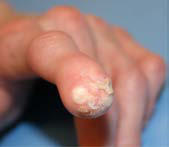

# Chapter 111: Hutchinson-Gilford Progeria Syndrome (Progeria)

*Timothy R. O’Toole and Leslie B. Gordon*

<!-- p.1218 -->
Diabetes insipidus Growth restriction

most severe

Arts syndrome

CMTX5

Psychomotor

delay

early-onset

deaf

IUGR

Visual impairment Neuropathy Hearing impairment

DFN2

late childhood

onset

post-natal

severe

moderate

early retinopathy

optic neuropathy

visually impaired

disc pallor

mild

severe

mild

moderate

slow progression

**Fig. 110.5** PRPS1-associated disorders. This schematic provides a graphical representation of the overlapping spectrum of PRPS1-associated dis orders. The four disorders are listed on the left side of the panel. The most common clinical features are shown in the top row. The white triangles depict the severity of individual clinical features for each of the disorders. For example, hearing loss may begin in adulthood with slow progression in the milder phenotypes (DFN2), whereas it may be reflected as earlier or more complete deafness in the more severe phenotypes. Conversely, growth retardation and diabetes insipidus have been reported only for the most severe phenotype. This schematic provides only a general guide, as some exceptions may occur. (Copyright H.A. Jinnah.)

Hutchinson-Gilford progeria syndrome (HGPS, or progeria) is a rare, fatal, autosomal dominant segmental premature aging disease. With an estimated incidence of 1 in 4 million live births and prevalence of 1 in 20 million living individuals, there are an estimated total of 400 children living with progeria in 2023 worldwide. There is no gender, ethnic, or regional bias.

Progeria is caused by a single-base pathogenic variant in the *LMNA* gene, which results in the production of an abnormal lamin A protein called **progerin**. Lamin A is an intermediate-filament inner nuclear membrane protein found in most differentiated cells of the body. Without progerin-directed treatment, children with progeria develop **premature progressive atherosclerosis** and die of heart failure, usually between ages 5 and 20 years. Progerin is found in increased concentra tion in the skin and vascular wall of normal older individuals com pared with younger individuals, suggesting a role in normal aging.

**CLINICAL MANIFESTATIONS** Children are born looking normal and begin to develop clinical signs of disease during year one. Physical appearance and clinical findings change

dramatically each year that they age (Figs. 111.1 and 111.2). Both clini cal and biologic overlaps with aging are segmental, or partial. The dis ease features discussed next are roughly in order of clinical appearance.

**Dermatologic Changes in Skin, Hair, and Nails** Skin findings are often apparent as initial signs of progeria—at birth in about 25% of cases and by age 2 months in 80% of cases. These are variable in severity and include areas of discoloration, stippled dyspigmentation, tightened areas that can restrict movement, and areas of the trunk or legs where small (1-2 cm), soft, bulging skin is present.

Although usually born with normal appearance, cranial hair is lost within the first few years. Initial hair loss occurs in the temporal and occipital areas, with preservation of hair on the mid-scalp and vertex for the longest period. Eventually total alopecia occurs, leaving soft, downy, sparse, immature hair on the scalp, no eyebrows, and scant eyelashes.

Nails on hands and feet are usually normal at birth but become dystrophic later in life.

**Failure to Thrive** Children with progeria experience apparently normal fetal and early postnatal development. Between several months and 1 year of age, abnormalities in growth and body composition are readily appar ent. Severe failure to thrive ensues, heralding generalized lipoat rophy, with apparent wasting of limbs, circumoral cyanosis, and prominent veins around the scalp, neck, and trunk resulting from a paucity of subcutaneous fat. The weight percentile is usually normal at birth but decreases to below the third percentile despite adequate caloric intake for normal growth and normal resting energy expen diture. A review of 35 children showed an average weight increase

*Timothy R. O’Toole and Leslie B. Gordon*

<!-- p.1220 -->
G

E

F D

A B C

H

**Fig. 111.1** Distinguishing clinical features in Hutchinson-Gilford progeria syndrome. A, Alopecia, prominent scalp veins, narrowed nasal bridge, retrognathia. B, Generalized lipoatrophy leaves muscular prominence. C, Skin tightening and mottling. D, Skin bulging. E, Digital joint contractures. F, Nail dystrophy with spooning. G, Knee joint contractures, lipodystrophy. H, Corneal scarring secondary to exposure keratopathy. I, Flat umbilicus with scarred-over appearance; J, Calcinosis cutis in a digit. (Photos courtesy The Progeria Research Foundation and Boston Children’s Hospital.)

of only 0.44 kg/year, beginning at 24 months of age and persisting through life. Weight gain over time is linear, which contrasts with the pulsatile acceleration in growth velocity for normal age- and gender-matched children. Children reach an average final height of approximately 1 meter and weight of approximately 15-20 kg. Head circumference is normal. The weight deficit is more pronounced than the height deficit and, associated with the loss of subcutaneous fat, results in the emaciated appearance with muscular prominence. Clinical problems caused by the lack of subcutaneous fat include sensitivity to cold temperatures and foot discomfort caused by lack of fat cushioning. Overt diabetes is unusual in progeria, but at least 75% of children eventually develop insulin resistance, usually start ing at around age 8 years.

**Musculoskeletal Impairments** Both upper and lower extremity range-of-motion impairments (e.g., fingers, elbows, hips, knees, ankles) may be present at birth and may progress with age. Joint contractures are caused by both bony and car tilaginous disease, along with tightened skin. Along with irregularities in the congruency of articulating joint surfaces, these changes serve to limit joint motion and affect both upper and lower extremity gross and fine motor function. *Physical therapy is recommended routinely and throughout life to maximize joint function.*

**Ocular Abnormalities** Ophthalmic signs and symptoms are caused in part by shallow orbits, tight skin, and a paucity of subcutaneous fat around the eyes. Eyes are prominent and often experience ocular surface disease

secondary to nocturnal lagophthalmos and exposure keratopathy, which produce photophobia, tearing, ocular irritation, corneal scarring, and corneal ulceration that can lead to vison loss. Most patients have relatively good acuity; however, advanced ophthalmic disease can be associated with reduced acuity. *Children with proge ria should have an ophthalmic evaluation at diagnosis and at least yearly thereafter.* Aggressive ocular surface lubrication is recom mended, including the use of tape tarsorrhaphy at night.

**Craniofacial and Dental Phenotypes** Children develop craniofacial disproportion, with micrognathia and retrognathia caused by mandibular hypoplasia. Typical oral and dental manifestations include hypodontia, delayed tooth eruption, severe dental crowding caused by hypoplastic maxilla and mandi ble, ogival palatal arch, ankyloglossia, presence of median sagittal palatal fissure, and generalized gingival recession. Eruption may be delayed for many months, and primary teeth may persist for the duration of life. Secondary teeth are present but may or may not erupt. They sometimes erupt on the lingual and palatal surfaces of the mandibular and maxillary alveolar ridges, rather than in place of the primary incisors. In some, but not all cases, extracting pri mary teeth promotes movement of secondary teeth into place.

**Skeletal Abnormalities** Development of bone structure and bone density represents a unique skeletal dysplasia that is not based in malnutrition. Acroos teolysis of the distal phalanges, distal clavicular resorption, and thin, tapered ribs are early signs of progeria (as early as 3 months

<!-- p.1221 -->
G E F

D A

B

C

ad

**Fig. 111.2** Pathologic skeletal and cardiovascular findings in Hutchinson-Gilford progeria. A, Coxa valga of the hip. B, Clavicular osteolysis. C, Acroosteolysis in a thumb. D, H&E staining of mid-right coronary artery characterized by an enlarged and highly fibrotic adventitia (arrow). The media is markedly thinned in the area with adventitial fibrosis and plaque showing clinically significant stenosis (90%) and a necrotic core with calcification (staining not shown). E, Near-complete loss of the distal vertebral artery (circle) and prominent anterior spinal artery collateral (arrow). F, Acute gyral infarcts (black arrow). Bright signal in the sulci indicates slow cortical collateral flow (white arrows). G, M1 (single black arrow) and A1 stenoses (double black arrows), internal maxillary artery collaterals (wavy black arrows), subfrontal collaterals (single white arrow), and enlarged anterior and posterior spinal arteries (double white arrows).

of age). *Facial disproportion, a narrowed nasal bridge, and retrogna thia make intubation extremely difficult, and fiberoptic intubation is recommended.* A pyriform chest structure and small clavicles can lead to reducible glenohumeral joint instability. Growth of the spine and bony pelvis is normal. Hip disease is pervasive and results in repeated dislocations in about 20% of cases that are not amenable to splinting. Dysplastic growth of the femoral head and neck axis results in coxa valgus (straightening of the femoral head-neck axis >125 degrees) and coxa magna, where the diameter of the femo ral head is disproportionately large for the acetabulum, resulting in hip instability. The resulting hip dysplasia can be progressive and may result in osteoarthritis, avascular necrosis, hip dislocation, and inability to bear weight.

In response to repeated hip dislocations, five instances of either unilateral or bilateral surgical correction of hip dysplasia using peri acetabular and femoral osteotomy have been conducted, each at dif ferent hospitals. Follow-up after 4-8 years has yielded mixed results.

Other than in a single instance, hip dislocations have not recurred. In two cases, postsurgical healing occurred normally, resulting in ability to bear weight and walk short-to-long distances. In two cases, hard ware failure with nonunion of femoral bone necessitated hardware removal and new hardware insertion; skin breakdown and need for additional bone grafting complicated one of these cases. These two cases yielded limited weight-bearing with no assistance when walk ing short distances, but the patients required wheelchair use for lon ger distances. Finally, one case healed well with no adverse events, but mobility was not restored because of postsurgery progression of joint contractures, resulting in inability to bear weight or walk and subse quent wheelchair use. Adequate vitamin D levels are likely important for bone healing in all cases.

Other changes to the appendicular skeleton include flaring of the humeral and femoral metaphyses and constriction of the radial neck. Growth plate morphology is generally normal but can be variable within a single radiograph. The appearance of ossification

<!-- p.1222 -->
centers used to define bone age is normal. Bone structure assessed by peripheral quantitative computed tomography (pQCT) of the radius demonstrates distinct and severe abnormalities in bone structural geometry, consistent with progeria representing a *skeletal dysplasia.* Areal bone mineral density (aBMD) *z* scores measured by dual-energy x-ray absorptiometry (DXA) adjusted for height and age and true (volumetric) BMD assessed by pQCT are normal to mildly reduced, refuting the assumption that patients with proge ria are osteoporotic. Fracture rates in progeria are normal and not associated with fragility fractures observed in other pediatric meta bolic bone diseases, such as osteogenesis imperfecta.

**Hearing** Low-tone conductive hearing loss is pervasive in progeria and likely indicative of a stiff tympanic membrane and/or deficits in the middle ear bony and ligamentous structures. Overall, this does not affect the ability to hear the usual spoken tones, but preferen tial classroom seating is recommended, along with annual hearing examinations.

**Cardiovascular Disease** Approximately 80% of deaths in progeria are caused by cardio vascular failure, with end-stage events sometimes precipitated by superimposed respiratory infection or stressors surrounding surgi cal intervention. Progeria is a **primary vasculopathy** characterized by pervasive accelerated vascular stiffening, followed by large- and medium-vessel occlusive disease from atherosclerotic plaque for mation, with valvular and cardiac calcification and insufficiency at advanced stages of disease. Some evidence of vascular dysfunc tion is apparent in all ages tested. ECG abnormalities are gener ally nonspecific, but indications of left ventricular hypertrophy and nonspecific ST-T wave abnormalities can occur later in disease progression. Hypertension, angina, cardiomegaly, metabolic syn drome, and congestive heart failure are common end-stage events.

Transthoracic echocardiography reveals early-onset diastolic left ventricular dysfunction associated with age-related decline in lat eral and septal early (E′) diastolic tissue Doppler velocity *z* scores and an increase in the ratio of mitral inflow (E) to lateral and sep tal E′ velocity *z* scores. Other echocardiographic findings include left ventricular hypertrophy, left ventricular systolic dysfunction, and mitral or aortic valve disease with calcification, which tend to appear later in life.

Vascular stiffening assessed using carotid and femoral ultrasound reveals elevated carotid-femoral pulse wave velocity (PWVcf) and wall echodensity with medial and adventitial thickening. These are considered early and important indicators of cardiovascular decline. In the general population, increased PWVcf is associated with increased risk of cardiac death. Intima-media thickness is normal. In addition, elevated carotid artery mean flow velocities appear early in life, and underscore the presence of arterial occlu sive disease.

*Routine blood pressure (BP) monitoring with special attention to proper cuff size is recommended.* When normalized for patient size using height and age correction, both systolic and diastolic BP are increased in about half of patients with HGPS. These elevated BP trends would be expected in the setting of significant vascular stiff ness. *Antihypertensive medications have been used in the setting of elevated BP, with special attention to maintaining adequate BP to avoid strokes.*

BP monitoring, ECG, echocardiography, carotid ultrasound for plaque evaluation, and PWVcf measures for vascular stiffening are recommended.

End-stage cardiovascular disease (CVD) in progeria is often char acterized by atherosclerotic plaques in large and medium-sized arter ies, severe aortic stenosis, and cardiac failure. Critical aortic stenosis with heart failure is amenable to transapical transcatheter aortic valve implantation and apico-aortic conduit surgeries to alleviate severe aor tic stenosis. These carry high risk of death but have yielded significant

symptomatic improvement and prolongation of life in several cases (see treatment section).

**Cerebrovascular Arteriopathy and Stroke** The earliest incidence of stroke occurred at age 0.4 years. More often, strokes occur in the later years. Over the life span, MRI evi dence of infarction can be found in as many as 60% of patients with progeria, with half of these clinically silent. Both extracranial and intracranial occlusive disease is present in the neurovascular axis, with resulting extensive collateral vessel formation that pseudonormalizes intracranial flow. Carotid artery blockages are well documented, but infarction can occur even in their absence. Both large- and small-vessel disease is found; collateral vessel formation is extensive. A propensity for strokes and an underlying stiff vas culature make maintaining adequate blood pressure through oral hydration a priority in patients with progeria; special care should be taken when considering maintenance of consistent BP during gen eral anesthesia, airplane trips, and hot weather. In addition, 15% of deaths in children with progeria occur from head injury or trauma, including subdural hematoma. This implies an underlying suscepti bility to subdural hematoma, though known risk of stroke is much higher and frequently warrants low-dose aspirin therapy.

**Sexual Development** Females with progeria can develop Tanner stage II secondary sexual characteristics, including signs of early breast development and sparse pubic hair. Progression to Tanner stage III has not been observed. Despite minimal to absent physical signs of pubertal development and markedly reduced body fat, over half of females experience spontaneous menarche at a median age of 14 years. Menarche is not preceded by gain in body mass or increase in body fat. Timing of menarche is variable; some adolescents start men struation at Tanner stage I without progression to Tanner II, while others start at Tanner stage II. Those experiencing menarche vs nonmenstruating females have similar body mass indices, percent age body fat, and serum leptin levels, all of which are vastly below the healthy adolescent population. Menorrhagia has been observed and can result in symptomatic anemia. *In addition to iron supple mentation, oral contraceptives may be indicated to regulate menses.* Progestin-only or minimal estrogen-content products are preferred because of elevated cardiovascular risks associated with estrogenbased medication in the face of HGPS-associated atherosclerosis. There are no documented cases of reproductive capacity in females or males with progeria; however, the data suggest there is poten tial for further sexual development and the possibility of fertility in these females. Secondary sexual characteristics in males have not been reported.

**Normally Functioning Systems** Liver, kidney, thyroid, immune, gastrointestinal, and neurologic func tion (other than stroke related) remain intact. Intellect is normal for age, possibly in part from downregulation of progerin expression in the brain by a brain-specific micro-RNA, miR-9.

**LABORATORY FINDINGS** The most consistent laboratory findings are low serum leptin below detectable levels (>90%) and insulin resistance (75%, usually start ing over age 8 years). Platelet count is often moderately high. Highdensity lipoprotein (HDL) cholesterol and adiponectin concentrations decrease with increasing age to values significantly below normal. Oth erwise, lipid panels, high-sensitivity C-reactive protein, blood chemis tries, liver and kidney function tests, endocrine test, and coagulation tests are generally normal.

**MOLECULAR PATHOGENESIS** Pathogenic variants in the *LMNA* gene cause progeria. The normal *LMNA/C* gene encodes the proteins lamins A and C, of which only lamin

<!-- p.1223 -->
A is associated with human diseases. The lamin proteins are the principal proteins of the nuclear lamina, a complex molecular interface located between the inner membrane of the nuclear envelope and chromatin. The integrity of the lamina is central to many cellular functions, creat ing and maintaining structural integrity of the nuclear scaffold, DNA replication, RNA transcription, organization of the nucleus, nuclear pore assembly, chromatin function, cell cycling, senescence, and apoptosis.

Progeria is a sporadic autosomal dominant disease in about 98% of cases. Two percent of cases presumably arise from parental mosaicism; The Progeria Research Foundation reports five identified sibling occur rences of genetically confirmed HGPS. HGPS is caused by the acceler ated use of an alternative, internal splice site that results in the deletion of 150 base pairs in the 3′ portion of exon 11 of the *LMNA* gene. In about 90% of cases, this results from a single C to T transition at nucle otide 1824 that is silent (Gly608Gly) but optimizes an internal splice site within exon 11. The remaining 10% of cases possess one of several single-base pathogenic variants within the intron 11 splice donor site, thus reducing specificity for this site and altering the splicing balance in favor of the internal splice. Subsequent to all these pathogenic vari ants, translation followed by posttranslational processing of the altered mRNA produces progerin, a shortened abnormal lamin A protein with a 50–amino acid deletion near its C-terminal end. An understanding of the posttranslational processing pathway and how it is altered to cre ate progerin has led to a number of treatment prospects for the disease (Fig. 111.3).

Both prelamin A and preprogerin possess a methylated farnesyl side group attached during posttranslational processing. This is a lipophilic moiety that facilitates intercalation of proteins into the inner nuclear membrane, where most of the lamin and progerin functions are performed. During posttranslational processing of normal lamin A, loss of the methylated farnesyl anchor releases prelamin from the nuclear membrane, rendering it soluble for autophagic degradation. However, preprogerin and, subsequently, progerin retain the farnesyl moiety. Progerin remains anchored to the membrane, binding other proteins, causing blebbing of the nucleus, disrupting mitosis, and altering gene expression. Progerin also retains a methyl moiety.

Disease in progeria is produced by a dominant negative mecha nism; *the action of progerin,* not the diminution of lamin A, causes the disease phenotype. The severity of disease is determined in part by progerin levels, which are regulated by the particular pathogenic variant, tissue type, or other factors influencing use of the internal splice site.

**DIAGNOSIS AND DIFFERENTIAL DIAGNOSIS** Overall, the constellation of small body habitus, bone, hair, subcu taneous fat, and skin changes results in the marked physical resem blance among patients with progeria (Fig. 111.4). For this reason, if disease signs are present, clinical diagnosis can often be achieved or excluded with relative confidence even at young ages. There are rare

*Farnesyltransferase*

CAAX CAAX

CAAX CAAX

**Lonafarnib**

50 amino acids deleted

no cleavage site **Progerin**

**B. Progerin generation A. Lamin A generation**

**Lamin A**

C-OCH3 C-OCH3

C-OCH3

*Zmpste24 or RCE1*

*Zmpste24*

*ICMT*

*Farnesyltransferase *X**

*Zmpste24 or RCE1*

*ICMT*

C

-AAX

C

-AAX

1

2

3

4

**Fig. 111.3** Posttranslational processing pathways producing lamin A and progerin, including the target site for lonafarnib. A, Prelamin A poly peptide chain, showing its central α-helical rod domain and C-terminal−CAAX box, representing cysteine (C), aliphatic amino acids (AA), and any amino acid (X). The α-helical rod domain is divided into segments that assist in displaying the progerin defect. Posttranslational processing consists of four steps: (1) a farnesyl group is attached to the cysteine residue of the −CAAX box by farnesyltransferase; (2) the last three residues are pro teolytically cleaved by the zinc metalloprotease Zmpste24 or Ras-converting enzyme (RCE1); (3) carboxy-methylation by isoprenyl-cysteine carboxyl methyltransferase (ICMT); and (4) the terminal 15 C-terminal residues, including the farnesylated and carboxymethylated cysteine, are cleaved off by Zmpste24. B, A 50–amino acid deletion in prelamin A (represented by the black segment of the lamin A rod) is the result of a pathogenic variant that activates a cryptic splice site within exon 11 of the LMNA gene. This deletion leaves progerin without an attachment site for the last processing step—cleavage of the farnesylation and carboxymethylated terminal 15 amino acid residues. Thus progerin remains farnesylated and intercalated within the inner nuclear membrane, where it causes much of its cellular damage.

<!-- p.1224 -->
cases of mosaicism or relatively low-progerin-expressing patients with extremely mild clinical signs of disease. Thus lack of early dis ease manifestation should not be considered exclusionary. Clinical suspicion should be followed by *LMNA* genetic sequence testing. In addition, a number of premature aging disorders have features that overlap with HGPS but are not progerin-producing (Table 111.1). Patients may fall under none of these diagnoses and represent ultrarare, unnamed progeroid diseases that carry either non–progerinproducing pathogenic variants in *LMNA* or the lamin-associated enzyme (ZMPSTE24), or progeroid syndromes without laminassociated pathogenic variants.

**TREATMENT** Lonafarnib (Zokinvy) is a farnesyltransferase inhibitor that blocks the addition of a farnesyl lipid moiety onto preprogerin, thus pre venting progerin from associating with the inner nuclear membrane where it effects much of its damage (see Fig. 111.3). Lonafarnib is approved by the US FDA and European Medicines Agency for use in patients with HGPS and processing-deficient progeroid laminop athies ages 12 months and older. It is the first and only approved indication for either disease. It is initiated at a dose of 115 mg/m2 orally twice daily. After four months, the dose is increased to 150 mg/m2 twice daily. The most common side effects are diarrhea, nau sea, and loss of appetite, which can be mitigated with loperamide, ondansetron HCl, and cyproheptadine, respectively.

Overall, children with HGPS treated with long-term lonafarnib therapy demonstrated an increase in mean estimated survival of 4.3 years (30%) over untreated children. Treatment decreased plasma progerin levels by an average of 38% starting at 4-6 months and persisting for up to 10 years on therapy. In a single-arm clinical trial with lonafarnib (NCT00425607), subgroups of patients experienced increased rate of weight gain, decreased vascular stiffness measured by decreased PWVcf and carotid artery echodensity, improved left ventricular diastolic function, increased radial bone structural rigidity, improved sensorineural hearing, and early evidence of decreased headache, TIA, and stroke rates. Dermatologic, dental, joint contracture, insulin resistance, lipodystrophy, BMD, and joint contractures were unaffected by drug treatment.

**Dosing:** In general, medications should be dosed according to weight or body surface area instead of age because of the small size and decreased weight for height.

**Hydration** is important for maintaining adequate blood flow in the face of generalized vascular stiffness and collateral vascular formation in the brain.

**Low-dose aspirin therapy** is recommended at 2 mg/kg/day, as an extension of what is known about decreasing cardiovascular risk in the general at-risk adult population. It is not known whether lowdose aspirin therapy has any effect on morbidity or mortality in HGPS.

**Antihypertensive medications** have been used with elevated BP, with special attention to maintaining adequate BP to avoid strokes. Due to small, thin body habitus, appropriately sized blood pressure cuff and height-age adjustments when evaluating hypertension (>95th percentile) should be employed.

**Extraskeletal calcifications** have been observed in patients with progeria radiographically and cutaneously, both at a base line off therapy (around 30% of patients) and with increasing fre quency during a clinical trial when the patients were treated with oral calcium carbonate supplementation, and/or zoledronic acid, pravastatin, and lonafarnib (around 45% of patients). Oral calcium carbonate supplementation may therefore aggravate calcium dys function in children with progeria. Given this potential concern, calcium intake via dietary means, along with vitamin D supplemen tation, is likely the safest intake strategy.

**Physical and occupational therapy** initiation are recommended as young as possible to preserve joint mobility and optimize capacity for activities of daily living.

**Cardiac intervention.** A primary cause of mortality in HGPS is critical aortic stenosis caused by premature atherosclerosis. At end stage, high-risk intervention has been performed using transcath eter aortic valve implantation (TAVI) for patients large enough to receive the smallest valve available, using a transapical approach because the femoral artery is small and calcified, precluding a trans femoral approach. The majority of patients’ aortic valves are too small to implement TAVI. In these cases, apico-aortic conduit (aor tic valve bypass) surgery has been achieved. Both procedures have resulted in postoperative symptomatic relief and lifespan extension when successful. The procedures carry high risk for perisurgical morbidity and mortality.

**Clinical trials.** One currently ongoing clinical trial adding *everoli mus* (an FDA-approved mTOR inhibitor) to a lonafarnib regimen is aimed at accelerating autophagy of progerin, thus theoretically reduc ing its accumulation and cellular damage (NCT02579044). Patient treatment phase is complete and results are pending.

**PROGNOSIS** Children with progeria develop a severe premature form of atheroscle rosis. Before death, cardiac decline with left-sided hypertrophy, valvu lar insufficiency, and pulmonary edema develop; neurovascular decline with TIAs, strokes, and occasionally seizures can result in significant morbidity.

Without lonafarnib drug treatment, death occurs generally between ages 5 and 20 years, with a median life span of 14.5 years, resulting from heart failure, sometimes with superimposed respira tory infection (approximately 80%); from head injury or trauma, including subdural hematoma (approximately 15%); and, rarely, from stroke (1–3%) or complications from anesthesia during sur gery (1–3%). With lonafarnib therapy, long-term use has been associated with up to 4.3 years’ (30%) lifespan extension. Surgical intervention for critical aortic stenosis can decrease cardiovascular morbidity and extend lifespan by an indeterminate duration.

**PATIENT RESOURCES The Progeria Research Foundation** (www.progeriaresearch.org) maintains an international progeria patient registry, provides a diagnostics program and complete patient care manual, and coor dinates clinical treatment trials. It funds preclinical and clinical research to define the underpinnings of the disorder and to discover

**Fig. 111.4** Unrelated 7-yr-old female and 10-yr-old male with prog eria. The appearance is remarkably similar between patients. (Photo graph courtesy The Progeria Research Foundation.)

<!-- p.1225 -->
treatments and a cure. Additional resources include the National Human Genome Research Institute (www.genome.gov/11007255/), National Center for Biotechnology Information Genereviews (www .ncbi.nlm.nih.gov/books/NBK1121/), National Center for Advancing

Translational Sciences (www.rarediseases.info.nih.gov/diseases/7467 /progeria) and NORD (rarediseases.org).

*Visit Elsevier eBooks+ at eBooks.Health.Elsevier.com** for Bibliography.*

Features

#### **Table 111.1** Features of Hutchinson-Gilford Progeria Syndrome and Other Premature Aging Disorders with Overlapping

| Category / Parameter | Clinical Details & Findings |
| --- | --- |
| **MAIN CLINICAL FEATURES** | Hutchinson-Gilford; progeria syndrome |
| **(HGPS)** | LMNA: de novo dominant point; pathogenic variant (c.1824C>T;; p.G608G or pathogenic variants; in first five intronic bases of intron; 11); Early childhood; Severe failure to thrive in infancy, progressive alopecia leading; to total alopecia, skin lesions, characteristic facies, loss of; subcutaneous fat, bone changes, skeletal anomalies,; musculoskeletal degeneration, hearing loss, high-pitched; voice, delayed and crowded dentition, atherosclerosis,; cerebrovascular disease, average death in mid-teens from; myocardial infarction or stroke (from cardiovascular disease).; Restrictive dermopathy |
| **(RD)** | ZMPSTE24: recessive null; pathogenic variants; Neonatal; Intrauterine growth restriction, reduced fetal movements,; and preterm delivery, tight and translucent skin with erosions,; facial dysmorphism, skeletal malformations, generalized; arthrogryposis; lethal within the first weeks of life; Mandibuloacral dysplasia; type B (MADB); ZMPSTE24: recessive pathogenic; variants: often compound; heterozygous pathogenic variants; with a null allele and one maintaining; some residual activity; Early childhood; Generalized lipodystrophy, altered skin pigmentation, alopecia,; severe bone and growth defects; Mandibuloacral dysplasia; type A (MADA); LMNA: recessive missense; pathogenic variants; Early childhood; Partial lipodystrophy at torso and limbs, bone abnormalities,; altered skin pigmentation, lipodystrophic signs and mildly; accelerated aging; Nestor-Guillermo; progeria syndrome |
| **(NGPS)** | BANF1: recessive pathogenic; variant (c.34G>A; p.Ala12Thr); Early childhood; Failure to thrive, aged appearance, growth restriction,; decreased subcutaneous fat, thin limbs, stiff joints, severe; osteolysis, absence of early cardiovascular impairment; Mandibular hypoplasia,; deafness, progeroid; features, and; lipodystrophy; syndrome (MDPL); POLD1: dominant pathogenic; variants, including the common; de novo pathogenic variant; (c.1812_1814delCTC. P.Ser605del); observed in 80% of the patients; Early childhood; Mandibular hypoplasia, prominent loss of subcutaneous; fat, progeroid appearance, skin abnormalities, metabolic; abnormalities including insulin resistance and diabetes; mellitus, sensorineural deafness, hypogonadism in males; Mandibuloacral; dysplasia associated; with MTX2 (MADaM); MTX2: recessive pathogenic; variants; Early childhood; Small viscerocranium with mandibular underdevelopment,; growth restriction, lipodystrophy, altered skin pigmentation,; distal acroosteolyses, renal focal glomerulosclerosis, severe; cardiovascular disease; Atypical progeroid; laminopathies; LMNA and ZMPSTE24; Variable from; early life to; adulthood; Several LMNA pathogenic variants, including dominant and; recessive ones, result in a spectrum of progeroid laminopathies; ranging in severity from severe RD-like forms to adult-onset; atypical WS; atypical (severe) MADB forms can result from; recessive ZMPSTE24 pathogenic variants; Werner syndrome (WS); WRN: recessive pathogenic variants; Adulthood; Lack of the pubertal growth spurt during early teen years,; graying or loss of hair, scleroderma-like skin lesions,; characteristic facies, bilateral cataracts, type 2 diabetes; mellitus, hypogonadism, skin ulcers, osteoporosis,; arteriosclerosis, increased risk of cancer; Wiedemann-; Rautenstrauch; syndrome |
| **POLR3A** | Neonatal; Severe prenatal and postnatal growth restriction, facial; dysmorphism, generalized lipodystrophy with local fatty; tissue accumulations; Cockayne syndrome |
| **CSB (ERCC6)** | Neonatal/; infancy; Skin and dental abnormalities, subcutaneous fat loss, short; stature, vasculopathy, hypogonadism, hearing loss, cataracts,; intellectual disability, neurologic disorders; Rothmund-Thompson; syndrome |
| **RECQL4** | Infancy; Diffuse hair loss, skin and dental abnormalities, short stature,; osteopenia, hypogonadism, hyperkeratosis, cataracts,; tumor predisposition; Adapted from Coppedè F. Mutations involved in premature-ageing syndromes. Appl Clin Genet. 2021;14:279–295. |

<!-- p.1226 -->
