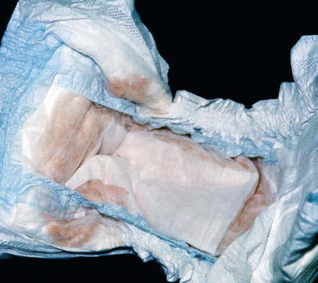
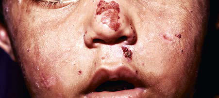

# Chapter 112: The Porphyrias

*Manisha Balwani, Robert J. Desnick, and Karl E. Anderson*

<!-- p.1227 -->
Porphyrias are metabolic diseases resulting from altered activities of specific enzymes of the heme biosynthetic pathway. These enzymes are most active in bone marrow and liver. **Erythropoietic porphyrias**, in which overproduction of heme pathway intermediates occurs primar ily in bone marrow erythroid cells, usually present at birth or in early childhood with *cutaneous photosensitivity,* or in the case of congenital erythropoietic porphyria, even in utero as *nonimmune hydrops*. Eryth ropoietic protoporphyria is the most common porphyria in children. Most porphyrias are hepatic, with overproduction and initial accu mulation of porphyrin precursors or porphyrins in the liver. Activa tion of hepatic porphyrias is very rare during childhood, reflecting the distinct hepatic regulatory mechanisms for heme biosynthesis that are influenced by pubertal development. Homozygous forms of the hepatic porphyrias may manifest clinically before puberty. Children who are heterozygous for inherited hepatic porphyrias may present with non specific and unrelated symptoms, and parents often request advice about long-term prognosis and express concerns about drugs that may exacerbate these conditions.

**THE HEME BIOSYNTHETIC PATHWAY** Heme is required for a variety of hemoproteins, such as hemoglobin, myoglobin, respiratory cytochromes, and cytochrome P450 enzymes (CYPs). It is believed that the eight enzymes in the pathway for heme

biosynthesis are active in all tissues. Hemoglobin synthesis in erythroid precursor cells accounts for approximately 85% of daily heme synthesis in humans. Hepatocytes account for most of the rest, primarily for syn thesis of CYPs, which are especially abundant in the liver endoplasmic reticulum and turn over more rapidly than many other hemoproteins, such as the mitochondrial respiratory cytochromes. Pathway interme diates are the porphyrin precursors δ**-aminolevulinic acid** (ALA, also known as *5-aminolevulinic acid*) and **porphobilinogen (PBG)**, as well as porphyrins (mostly in their reduced forms, known as **porphyrino gens**) (Fig. 112.1). These intermediates do not accumulate in signifi cant amounts or have important physiologic functions under normal conditions.

Altered activity of each enzyme in the pathway has been associated with a specific type of porphyria (Table 112.1). The first enzyme, ALA synthase (ALAS), occurs in two forms. An erythroid-specific form, ALAS2, is deficient in X-linked sideroblastic anemia as a result of pathogenic variants of the *ALAS2* gene on chromosome Xp11.2. Gainof-function pathogenic variants of *ALAS2* caused by deletions in the last exon cause **X-linked protoporphyria (XLP)**, which is phenotypi cally identical to erythropoietic protoporphyria.

Regulation of heme synthesis differs in the two major heme-forming tissues. Liver heme biosynthesis is primary controlled by the ubiquitous form of ALAS (ALAS1). Synthesis of ALAS1 in liver is regulated by a “free” heme pool (see Fig. 112.1), which can be augmented by newly synthesized heme or by existing heme released from hemoproteins and destined for breakdown to biliverdin by heme oxygenase.

In comparison, in the hematopoietic system, novel regulatory mechanisms allow the production of the very large amounts of heme needed for hemoglobin synthesis. The response to stimuli for hemoglo bin synthesis occurs during cell differentiation, leading to an increase in cell number. Also, unlike the liver, heme has a stimulatory role in hemoglobin formation, and the stimulation of heme synthesis in ery throid cells is accompanied not only by increases in ALAS2 but also by sequential induction of other heme biosynthetic enzymes. Separate

*Manisha Balwani, Robert J. Desnick, and Karl E. Anderson*

**Fig. 112.1** Enzymes and intermediates of the heme biosynthetic pathway. The pathway is regulated in the liver by the end product, heme, mainly by feedback repression (dashed red arrow).

<!-- p.1228 -->
erythroid-specific and nonerythroid, or “housekeeping,” transcripts are known for the first four enzymes in the pathway. The separate forms of ALAS are encoded by genes on different chromosomes, but for each of the other three, erythroid and nonerythroid transcripts are transcribed by alternative promoters in the same gene. Heme also regulates the rate of its synthesis in erythroid cells by controlling the transport of iron into reticulocytes.

Intermediates of the heme biosynthetic pathway are efficiently con verted to heme and, normally, only small amounts of the intermedi ates are excreted. Some may undergo chemical modifications before excretion. Whereas the porphyrin precursors ALA and PBG are col orless, nonfluorescent, and largely excreted unchanged in urine, PBG may degrade to colored products such as the brownish pigment called *porphobilin* or spontaneously polymerize to uroporphyrins. Porphy rins are red in color and display bright-red fluorescence when exposed to long-wavelength ultraviolet (UV) light. Porphyrinogens are the reduced form of porphyrins and are colorless and nonfluorescent, but are readily autoxidized to the corresponding porphyrins when they accumulate or are outside the cell. Only the type III isomers of uro porphyrinogen and coproporphyrinogen are converted to heme (see Fig. 112.1).

ALA and PBG are excreted in urine. Excretion of porphyrins and porphyrinogens in urine or bile is determined by the number of car boxyl groups. Those with many carboxyl groups, such as *uroporphyrin* (octacarboxyl porphyrin) and *heptacarboxyl porphyrin,* are water sol uble and readily excreted in urine. Those with fewer carboxyl groups, such as *protoporphyrin* (dicarboxyl porphyrin), are not water soluble and are excreted in bile and feces. *Coproporphyrin* (tetracarboxyl

porphyrin) is excreted partly in urine and partly in bile. Because cop roporphyrin I is more readily excreted in bile than coproporphyrin III, impaired hepatobiliary function may increase total urinary copropor phyrin excretion and the ratio of these isomers.

**CLASSIFICATION AND DIAGNOSIS OF PORPHYRIAS** Two useful classification schemes reflect either the underlying patho physiology or the clinical features of porphyrias (see Table 112.1). In **hepatic porphyrias** and **erythropoietic porphyrias** the source of excess production of porphyrin precursors and porphyrins is the liver and bone marrow, respectively. **Acute porphyrias** cause neurologic symptoms that are associated with increases of one or both of the por phyrin precursors, ALA and PBG. In the **cutaneous porphyrias,** pho tosensitivity results from transport of porphyrins in blood from the liver or bone marrow to the skin. **Dual porphyria** refers to the very rare cases of porphyria with deficiencies of two different heme pathway enzymes.

**Porphyria cutanea tarda (PCT), acute intermittent porphyria (AIP), and erythropoietic protoporphyria (EPP)** are the three most common porphyrias, in that order, considering all age-groups, and are very different in clinical presentation, precipitating factors, methods of diagnosis, and effective therapy (Table 112.2). Two less common acute porphyrias, **hereditary coproporphyria (HCP) and variegate porphyria (VP)**, can also cause blistering photosensitivity (see Table 112.1). **Congenital erythropoietic porphyria (CEP)** causes more severe blistering lesions, often with secondary infection and mutila tion. EPP and **X-linked protoporphyria (XLP)** have the same pheno type and are distinct from the other cutaneous porphyrias in causing

Classifications

δ-Aminolevulinate synthase

δ-Aminolevulinic acid

δ-Aminolevulinic acid

#### **Table 112.1** The Human Porphyrias: Pathogenic Variants, Time of Presentation, and Tissue- and Symptom-Based

| Category / Parameter | Clinical Details & Findings |
| --- | --- |
| **C** | X-linked protoporphyria |
| **2 (ALAS2)** | X-linked; Childhood |
| **X** | dehydratase porphyria (ADP); dehydratase (ALAD); Autosomal recessive; Mostly postpuberty |
| **X** | Acute intermittent; porphyria (AIP); Hydroxymethylbilane; synthase (HMBS); Autosomal dominant; Postpuberty |
| **X** | Homozygous AIP; Homozygous dominant; Childhood |
| **X** | Congenital erythropoietic; porphyria (CEP); Uroporphyrinogen III; synthase (UROS); Autosomal recessive; In utero or infancy |
| **X** | Porphyria cutanea tarda; (PCT) type 1; Uroporphyrinogen; decarboxylase (UROD); Sporadic; Adults |
| **X** | PCT type 2†; Autosomal dominant; Adults |
| **X** | PCT type 3; Unknown; Adults |
| **X** | Hepatoerythropoietic; porphyria (HEP); Homozygous dominant; Childhood |
| **X** | Hereditary coproporphyria |
| **(HCP)** | Coproporphyrinogen; oxidase (CPOX); Autosomal dominant; Postpuberty |
| **X** | Homozygous HCP; Homozygous dominant; Childhood |
| **X** | Variegate porphyria (VP); Protoporphyrinogen; oxidase (PPOX); Autosomal dominant; Postpuberty |
| **X** | Homozygous VP; Homozygous dominant; Childhood |
| **X** | Erythropoietic protoporphyria |
| **(EPP)** | Ferrochelatase (FECH); Autosomal recessive (most; commonly heteroallelic; with hypomorphic allele); Childhood |
| **X** | *Classification abbreviations: H, Hepatic; E, Erythropoietic; A/N, Acute/Neurologic; C, Cutaneous.; †PCT is a result of inhibition of hepatic UROD. Autosomal dominant inheritance of a partial deficiency of UROD is a predisposing factor in cases defined as familial (type 2) PCT. Other; genetic factors, such as HFE pathogenic variants, are sometimes found in all types of PCT.; ‡ADP and HEP are considered primarily hepatic porphyrias, but substantial increases in erythrocyte zinc protoporphyrin suggest an erythropoietic component. |

<!-- p.1229 -->
nonblistering photosensitivity that occurs acutely after sun exposure. EPP is also the most common porphyria to become manifest before puberty.

**First-Line Laboratory Diagnostic Testing** A few sensitive and specific first-line laboratory tests should be obtained whenever symptoms or signs suggest the diagnosis of por phyria. If a first-line or screening test is significantly abnormal, more comprehensive testing should follow to establish the type of porphyria. Overuse of laboratory tests for screening can lead to unnecessary expense and even delay in diagnosis. In patients who present with a past diagnosis of porphyria, laboratory reports that were the basis for the original diagnosis must be reviewed, and if these were inadequate, further testing considered.

Acute porphyria should be suspected in patients with neurovisceral symptoms such as abdominal pain after puberty, when initial clini cal evaluation does not suggest another cause. *Urinary PBG* should be measured. Urinary PBG is virtually always increased during acute attacks of AIP, HCP, and VP and is not substantially increased in any other medical conditions. Therefore this measurement is both sensi tive and specific. Results from spot (single-void) urine specimens are highly informative because very substantial increases are expected dur ing acute attacks of porphyria. A 24-hour collection can unnecessar ily delay diagnosis. The same spot urine specimen should be saved for quantitative determination of PBG (expressed relative to creatinine) to confirm the qualitative PBG result. ALA is often measured as well, but is usually less elevated than PBG in AIP, HCP, and VP. In **ALA dehy dratase porphyria (ADP)**, urinary ALA and porphyrins, but not PBG, are greatly elevated. Measurement of urinary porphyrins in addition to PBG is recommended to screen for acute porphyrias because PBG is often less elevated and returns to normal more rapidly in HCP and VP than in AIP. Porphyrin measurement *alone* should be avoided for screening, how ever, because it is often increased in many disorders other than porphyr ias, such as liver diseases, and misdiagnoses of porphyria can result from increases in urinary porphyrins that have no diagnostic significance.

**Blistering Cutaneous Porphyrias** Blistering skin lesions caused by porphyria are virtually always accom panied by increases in *total plasma* and *urinary porphyrins.* Porphy rins in plasma in VP are mostly covalently linked to plasma proteins and readily detected by a diagnostic peak in a fluorescence scan ning method. The normal range for plasma porphyrins is somewhat increased in patients with end-stage renal disease.

**Nonblistering Cutaneous Porphyria** Measurement of total erythrocyte protoporphyrin and, if the total amount is elevated, fractionation of protoporphyrin into its metal-free and zinc-chelated forms, is essential for diagnosis of EPP and XLP. Unfortunately, this is not offered by some major commercial laborato ries. Results of zinc protoporphyrin measurements are often recorded (even in the same report) as both *protoporphyrin* and *free erythro cyte protoporphyrin,* with each calculated differently, based on past practices for screening for lead poisoning (which only increases zinc

protoporphyrin). Thus the obsolete term *free protoporphyrin* does not mean metal-free protoporphyrin, because it was defined as iron-free protoporphyrin and dates from before it was known that (except in protoporphyrias) protoporphyrin in erythrocytes is mostly zinc che lated. This unnecessary confusion makes diagnosis and reliable exclu sion of protoporphyrias difficult. Total plasma porphyrins are elevated in most, but not all, cases of protoporphyria, so a normal level should not be relied on to exclude protoporphyria when total erythrocyte pro toporphyrin is elevated.

Increases in erythrocyte total and zinc-chelated protoporphyrin occur in many other conditions, including iron deficiency, lead poi soning, hemolysis, anemia of chronic disease, and other erythrocyte disorders. Therefore the diagnosis of EPP must be confirmed by show ing a predominant increase in free and metal-free protoporphyrin. In XLP, both free and zinc protoporphyrin are elevated.

**Second-Line Testing* More extensive testing is well justified when a first-line test is positive*. A substantial increase in PBG may be caused by AIP, HCP, or VP, and these can be distinguished by measuring urinary porphyrins (using the same spot urine sample), fecal porphyrins, and plasma porphyrins. The various porphyrias that cause blistering skin lesions are differentiated by measuring porphyrins in urine, feces, erythrocytes, and plasma. *Confirmation by genetic testing is important once the diagnosis is estab lished by biochemical testing*.

**Testing for Subclinical Porphyria** It is often difficult to diagnose or rule out porphyria in patients who had suggestive symptoms months or years in the past and in asymp tomatic relatives of patients with acute porphyrias because porphyrin precursors and porphyrins may be normal. More extensive testing and consultation with a specialist laboratory and physician may be needed. Before evaluating relatives, the diagnosis of porphyria should be firmly established in an index case and the laboratory results reviewed to guide the choice of tests for the family members. Identification of a disease-causing pathogenic variant in an index case greatly facilitates detection of additional gene carriers because biochemical tests in latent carriers may be normal.

**δ****-AMINOLEVULINIC ACID DEHYDRATASE–
 DEFICIENT PORPHYRIA ALA dehydratase–deficient porphyria (ADP)** is sometimes termed *Doss porphyria* after the investigator who described the first cases. The term *plumboporphyria* emphasizes the similarity of this condi tion to lead poisoning, but incorrectly implies that it is caused by lead exposure.

**Etiology** This porphyria results from a deficiency of ALA dehydratase (ALAD), which is inherited as an autosomal recessive trait. Only eight cases have been confirmed by pathogenic variant analysis. The prevalence of het erozygous ALAD deficiency was estimated to be <1% in Germany and approximately 2% in Sweden.

#### **Table 112.2** The Three Most Common Human Porphyrias and Major Features

| Category / Parameter | Clinical Details & Findings |
| --- | --- |
| **TREATMENT** | Acute intermittent; porphyria; Neurologic, adult onset; Drugs (mostly P450 inducers),; progesterone, dietary restriction; Urinary porphobilinogen; Hemin, glucose,; givosiran; Porphyria cutanea; tarda; Skin blistering and fragility; (chronic), adult onset; Iron, alcohol, smoking, estrogens,; hepatitis C, HIV, halogenated; hydrocarbons; Plasma or urine porphyrins; Phlebotomy, low-dose; hydroxychloroquine,; direct acting antivirals; (if hepatitis C is present); Erythropoietic; protoporphyria; Phototoxic pain and swelling; (mostly acute), childhood; onset; Sunlight exposure; Total erythrocyte; protoporphyrin with metal-; free and zinc protoporphyrin; Sun protection |

<!-- p.1230 -->
**Pathology and Pathogenesis** ALAD catalyzes the condensation of two molecules of ALA to form the pyrrole PBG (see Fig. 112.1). The enzyme is subject to inhibition by a number of exogenous and endogenous chemicals. ALAD is the principal lead-binding protein in erythrocytes, and lead can displace the zinc atoms of the enzyme. Inhibition of erythrocyte ALAD activity is a sensitive index of lead exposure.

Eleven abnormal ALAD alleles, most with point pathogenic vari ants, have been identified, some expressing partial activity, such that heme synthesis is partially preserved. The amount of residual enzyme activity may predict the phenotypic severity of this disease.

ADP is often classified as a hepatic porphyria, although the site of overproduction of ALA is not established. A patient with severe, earlyonset disease underwent liver transplantation without significant clini cal or biochemical improvement, which might suggest that the excess intermediates did not originate in the liver. Evidence suggests this disease may have an erythropoietic component. Excess urinary cop roporphyrin III in ADP might originate from metabolism of ALA to porphyrinogens in a tissue other than the site of ALA overproduction. Administration of large doses of ALA to normal individuals also leads to substantial coproporphyrinuria. Increased erythrocyte zinc proto porphyrin, as in all other homozygous porphyrias, may be explained by accumulation of earlier pathway intermediates in bone marrow erythroid cells during hemoglobin synthesis, followed by their trans formation to protoporphyrin after hemoglobin synthesis is complete. Neurologic symptoms are attributed to neurotoxic effects of ALA, but this is unproven.

**Clinical Manifestations** In most cases, symptoms resemble other acute porphyrias, including acute attacks of abdominal pain and peripheral neuropathy. Precipitat ing factors, such as exposure to harmful drugs, have not been evident in most cases. Six of the reported cases were adolescent males. A Swed ish infant had more severe disease, with neurologic impairment and failure to thrive. A 63-year-old man in Belgium developed an acute motor polyneuropathy concurrently with a myeloproliferative dis order. A Dutch patient with symptom onset in infancy presented in adulthood with acute symptoms and progressive asymmetric weakness of both extremities.

**Laboratory Findings** Urinary ALA, coproporphyrin III, and erythrocyte zinc protopor phyrin are substantially increased. Urinary PBG is normal or slightly increased. Erythrocyte ALAD activity is markedly reduced, and both parents have approximately half-normal activity of this enzyme and normal urinary ALA.

**Diagnosis and Differential Diagnosis** The other three acute porphyrias are characterized by substantial increases in both ALA and PBG. In contrast, ALA, but not PBG, is substantially increased in ADP. A marked deficiency of erythrocyte ALAD and half-normal activity in the parents support the diagno sis. Other causes of ALAD deficiency, such as **lead poisoning**, must be excluded. Succinylacetone accumulates in hereditary tyrosinemia type 1 and is structurally similar to ALA, inhibits ALAD, and can cause increased urinary excretion of ALA and clinical manifestations that resemble acute porphyria. Idiopathic acquired ALAD deficiency has been reported. Unlike lead poisoning, the deficient ALAD activity in ADP is not restored by the in vitro addition of sulfhydryl reagents such as dithiothreitol. Even if no other cause of ALAD deficiency is found, it is essential to confirm the diagnosis of ADP by molecular studies.

**Treatment** Treatment experience with ADP is limited but is similar to other acute porphyrias. Glucose seems to have minimal effectiveness but may be tried for mild symptoms. **Hemin therapy** was apparently effective for acute attacks in male adolescents, and weekly infusions prevented attacks in two of these patients. Hemin was not effective either bio chemically or clinically in the Swedish child with severe disease, and it

produced a biochemical response but no clinical improvement in the Belgian man with a late-onset form, who had a peripheral neuropathy but no acute attacks. Hemin is also effective in treating porphyria-like symptoms associated with hereditary tyrosinemia and can significantly reduce urinary ALA and coproporphyrin in lead poisoning. Avoid ance of drugs that are harmful in other acute porphyrias is advisable. Liver transplantation was not effective in the child with severe disease. In a recent report, weekly blood transfusions and hydroxycarbamide were used in addition to heme-arginate to suppress erythroid heme synthesis.

**Prognosis** Recurrent attacks may occur and require repeated treatment with hemin. The course was unfavorable in the Swedish child with more severe disease and was uncertain in adults with late-onset disease asso ciated with myeloproliferative disorders.

**Prevention and Genetic Counseling** Heterozygous parents should be aware that subsequent children are at risk for ADP, as in any autosomal recessive disorder. Prenatal diagnosis is possible but has not been reported.

**ACUTE INTERMITTENT PORPHYRIA** AIP is also termed *pyrroloporphyria, Swedish porphyria,* and *intermit tent acute porphyria* and is the most common type of acute porphyria in most countries.

**Etiology** AIP results from the deficient activity of the housekeeping form of porphobilinogen deaminase (PBGD**)**. This enzyme is also known as **hydroxymethylbilane (HMB) synthase** (the prior term, uroporphy rinogen I synthase, is obsolete). HMB synthase catalyzes the deami nation and head-to-tail condensation of four PBG molecules to form the linear tetrapyrrole, HMB (also known as *preuroporphyrinogen;* see Fig. 112.1). A unique dipyrromethane cofactor binds the pyrrole inter mediates at the catalytic site until six pyrroles (including the dipyrrole cofactor) are assembled in a linear fashion, after which the tetrapyrrole HMB is released. The apo-deaminase generates the dipyrrole cofactor to form the holodeaminase, and this occurs more readily from HMB than from PBG. Indeed, high concentrations of PBG may inhibit for mation of the holodeaminase. The product HMB can cyclize nonen zymatically to form nonphysiologic uroporphyrinogen I, but in the presence of the next enzyme in the pathway is more rapidly cyclized to form uroporphyrinogen III.

Erythroid and housekeeping forms of the enzyme are encoded by a single gene. The two isoenzymes are both monomeric proteins, differ only slightly in molecular weight (approximately 40 and 42 kDa), and result from alternative splicing of two distinct messenger RNA (mRNA) transcripts that arise from two different promoters. The housekeeping promoter functions in all cell types, including erythroid cells.

The pattern of inheritance of AIP is autosomal dominant, with very rare homozygous cases that present in childhood. More than 400 *HMBS* pathogenic variants, including missense, nonsense, and splicing pathogenic variants, and insertions and deletions have been identified in AIP and in many population groups. Most pathogenic variants are found in only one or a few families. Because of founder effects, some are more common in certain geographic areas, such as northern Swe den (W198X), Holland (R116W), Argentina (G116R), Nova Scotia (R173W), and Switzerland (W283X). De novo pathogenic variants may be found in approximately 3% of cases. The nature of the *HMBS* pathogenic variant does not account for the severity of the clinical pre sentation, which varies greatly within families. **Chester porphyria** was initially described as a variant form of acute porphyria in a large Eng lish family but was found to be caused by an *HMBS* pathogenic variant.

Most pathogenic variants lead to approximately half-normal activity of the housekeeping and erythroid isozymes and half-normal amounts of their respective enzyme proteins in all tissues of heterozygotes. In approximately 5% of unrelated AIP patients, the housekeeping isozyme is deficient, but the erythroid-specific isozyme is normal. Pathogenic

<!-- p.1231 -->
variants causing this are usually found within exon 1 or its 5′ splice donor site or initiation of translation codon.

**Pathology and Pathogenesis** Induction of the rate-limiting hepatic enzyme ALAS1 is thought to underlie acute exacerbations of this and the other acute porphyrias. AIP remains latent (or asymptomatic) in the great majority of those who are heterozygous carriers of *HMBS* pathogenic variants, and this is almost always the case before puberty. In those with no history of acute symptoms, porphyrin precursor excretion is usually normal, suggest ing that half-normal hepatic HMBS activity is sufficient unless hepatic ALAS1 activity is increased. Patients can also be asymptomatic with elevated levels of porphyrin precursors and are classified as *asymp tomatic high excretors.* These patients may have a remote history of symptoms. Many factors that lead to clinical expression of AIP, includ ing certain drugs and steroid hormones, have the capacity to induce hepatic ALAS1 and CYPs. When hepatic heme synthesis is increased, half-normal HMBS activity may become limiting, and ALA, PBG, and other heme pathway intermediates may accumulate. In addition, heme synthesis becomes impaired, and heme-mediated repression of hepatic ALAS1 is less effective.

It is not proved, however, that hepatic HMBS remains constant at approximately 50% of normal activity during exacerbations and remis sion of AIP, as in erythrocytes. An early report suggested that the enzyme activity is considerably less than half-normal in the liver dur ing an acute attack. Hepatic HMBS activity might be reduced further once AIP becomes activated if, as suggested, excess PBG interferes with assembly of the dipyrromethane cofactor for this enzyme. It also seems likely that currently unknown genetic factors play a contributing role in, for example, patients who continue to have attacks even when known precipitants are avoided.

AIP is almost always latent before puberty and becomes active mostly in adult females, which suggests that endocrine factors, and especially adult levels of female steroid hormones, may be important for clinical expression. Premenstrual attacks are probably the result of endogenous progesterone. Acute porphyrias are sometimes exacer bated by exogenous steroids, including oral contraceptive preparations containing progestins. Surprisingly, pregnancy is usually well tolerated, suggesting that beneficial metabolic changes may ameliorate the effects of high levels of progesterone.

**Drugs** that are unsafe in acute porphyrias (Table 112.3) include those with the capacity to induce hepatic ALAS1, which is closely asso ciated with induction of CYPs. Some chemicals (e.g., griseofulvin) can increase heme turnover by promoting the destruction of specific CYPs to form an inhibitor (e.g., *N*-methyl protoporphyrin) of ferrochelatase (FECH, the final enzyme in the pathway). Sulfonamide antibiotics are harmful but apparently not inducers of hepatic heme synthesis. Etha nol and other alcohols are inducers of ALAS1 and some CYPs.

**Nutritional factors**, in particular reduced intake of calories and carbohydrates, as may occur with illness or attempts to lose weight, can increase porphyrin precursor excretion and induce attacks of porphyria. Increased carbohydrate intake may ameliorate attacks. Hepatic ALAS1 is modulated by the peroxisome proliferator-activated receptor-γ coactivator-1α, which is an important link between nutri tional status and exacerbations of acute porphyria.

Other factors have been implicated. Chemicals in cigarette smoke, such as polycyclic aromatic hydrocarbons, can induce hepatic CYPs and heme synthesis. A survey of AIP patients found an association between smoking and repeated porphyric attacks. Attacks may result from metabolic stress and impaired nutrition associated with major illness, infection, or surgery. Clinical observations suggest an additive effect of multiple predisposing factors, including drugs, endogenous hormones, nutritional factors, and smoking.

**Neurologic Mechanisms** The mechanism of neural damage in acute porphyrias is poorly under stood. The most favored hypothesis at present is that one or more heme precursors, or perhaps a derivative, are neurotoxic. Increased ALA in AIP, HCP, VP, ADP, plumbism, and hereditary tyrosinemia type 1,

which have similar neurologic manifestations, suggests that this sub stance or a derivative may be neuropathic. Porphyrins derived from ALA after its uptake into cells may have toxic potential. ALA can also interact with γ-aminobutyric acid (GABA) receptors. Severe AIP greatly improves after allogeneic liver transplantation. This experience and the demonstration that recipients of AIP livers develop porphyria support the hypothesis that heme precursors from the liver cause the neurologic manifestations.

**Epidemiology** AIP occurs in all ethnic groups and is the most common acute por phyria, with an estimated prevalence in most countries of 5 in 100,000. In Sweden, prevalence was estimated to be 7.7 in 100,000, includ ing latent cases with normal porphyrin precursors. A much higher prevalence of 60-100 in 100,000 in northern Sweden is the result of a founder effect. The combined prevalence of AIP and VP in Finland is approximately 3.4 in 100,000. Population screening by erythrocyte HMBS activity or DNA analysis revealed a prevalence of 200 heterozy gotes per 100,000 people in Finland and 1 in approximately 1,675 (60 in 100,000) in France. Studies using exomic/genomic databases show that the estimated frequency of pathogenic variants in the *HMBS* gene is 0.00056 (56 in 100,000), suggesting that the penetrance of this disor der may be as low as 1% and that carriers of *HMBS* pathogenic variants that can cause AIP are much more common than previously believed. Higher penetrance in some families with AIP suggests a strong role of environmental factors and genetic modifiers.

**Clinical Manifestations** Neurovisceral manifestations of acute porphyrias may appear any time after puberty, but rarely before it (Table 112.4). Porphyria attacks are exceedingly rare before the onset of puberty. Affected children are more often males as *opposed to affected adolescents and adults*, who are predominantly females. Reported symptomatic childhood cases often lacked adequate biochemical and molecular confirmation. The prepubertal attacks in males may be explained in part by coexisting medical conditions with the potential to upregulate ALAS1. Abdom inal pain was the most common presenting symptom in such cases, but seizures, often preceding the diagnosis, were also common. Other manifestations reported in children include tachycardia, peripheral neuropathy, myalgias, hypertension, irritability, lethargy, and behav ioral abnormalities. A population-based study in Sweden indicated that symptoms suggestive of porphyria may occur in heterozygotes during childhood, even, in contrast to adults, when urinary porphyria precursors are not elevated. This study did not compare the frequency of such nonspecific symptoms in a control group of children. Very rare cases of homozygous AIP present differently, with severe neurologic manifestations early in childhood.

Acute attacks in adults are characterized by a constellation of non specific symptoms, which may become severe and life threatening. **Abdominal pain** occurs in 85–95% of AIP patients and is usually severe, steady, and poorly localized, but is sometimes cramping, and accompanied by signs of ileus, including abdominal distention and decreased bowel sounds. Nausea, vomiting, and constipation are com mon, but increased bowel sounds and diarrhea may occur. Bladder dysfunction may cause hesitancy and dysuria. **Tachycardia**, the most common physical sign, occurs in up to 80% of attacks. This is often accompanied by **hypertension**, restlessness, coarse or fine tremors, and excess sweating, which are attributed to sympathetic overactivity and increased catecholamines. Other common manifestations include mental symptoms; pain in the extremities, head, neck, or chest; muscle weakness; and sensory loss. Because all these manifestations are neuro logic rather than inflammatory, there is little or no abdominal tender ness, fever, or leukocytosis.

**Porphyric neuropathy** is primarily motor and appears to result from axonal degeneration rather than demyelinization. Sensory involvement is indicated by neuropathic pain in the extremities, which may be described as muscle or bone pain, and by numbness, paresthesias, and dysesthesias. Paresis may occur early in an attack but is more often a late manifestation in an attack that is not recognized

<!-- p.1232 -->
and adequately treated. Rarely, severe neuropathy develops when there is little or no abdominal pain. Motor weakness most commonly begins in the proximal muscles of the upper extremities and then pro gresses to the lower extremities and the periphery. It is usually sym metric, but occasionally asymmetric or focal. Initially, tendon reflexes may be little affected or hyperactive and become decreased or absent. Cranial nerves, most often X and VII, may be affected, and blind ness from involvement of the optic nerves or occipital lobes has been reported. More common central nervous system (CNS) manifesta tions include seizures, anxiety, insomnia, depression, disorientation, hallucinations, and paranoia. Seizures may result from hyponatremia, porphyria itself, or an unrelated cause. Chronic depression and other mental symptoms occur in some patients, but attribution to porphyria is often difficult.

**Hyponatremia** is common during acute attacks. Inappropri ate antidiuretic hormone (ADH) secretion is often the most likely

mechanism, but salt depletion from excess renal sodium loss, gastro intestinal (GI) loss, and poor intake have been suggested as causes of hyponatremia in some patients. Unexplained reductions in total blood and red blood cell volumes are sometimes found, and increased ADH secretion might then be an appropriate physiologic response. Other electrolyte abnormalities may include hypomagnesemia and hypercalcemia.

The attack usually resolves within several days unless treatment is delayed. Abdominal pain may resolve within a few hours and pare sis within a few days. Even severe motor neuropathy can improve over months or several years but may leave some residual weakness. Progression of neuropathy to respiratory paralysis and death seldom occurs with appropriate treatment and removal of harmful drugs. Sud den death may result from cardiac arrhythmia.

**Laboratory Findings** Levels of ALA and PBG are substantially increased during acute attacks. These levels may decrease after an attack but usually remain increased unless the disease becomes asymptomatic for a prolonged period.

Porphyrins are also markedly increased, which accounts for red dish urine in AIP. These are predominantly uroporphyrins, which can form nonenzymatically from PBG. The increased urinary porphyrins in AIP are predominantly isomer III; however, their formation is likely to be largely enzymatic, which might occur if excess ALA pro duced in the liver enters cells in other tissues and is then converted to porphyrins by the heme biosynthetic pathway. Porphobilin, a degra dation product of PBG, and dipyrrolomethanes appear to account for brownish urinary discoloration. Total fecal porphyrins and plasma porphyrins are normal or slightly increased in AIP. Erythrocyte pro toporphyrin may be somewhat increased in patients with manifest AIP.

Erythrocyte HMBS activity is approximately half-normal in most patients with AIP. The normal range is wide and overlaps with the range for AIP heterozygotes. Some *HMBS* pathogenic variants cause the enzyme to be deficient only in nonerythroid tissues. HMBS activity is also highly dependent on erythrocyte age, and an increase in eryth ropoiesis from concurrent illness in an AIP patient may raise the activ ity into the normal range. Thus measurement of erythrocyte HMBS activity alone is insufficient in testing for AIP.

**Diagnosis and Differential Diagnosis** An increased urinary PBG level establishes that a patient has one of the three most common acute porphyrias (see Table 112.2). Mea suring PBG in serum is preferred when there is coexistent severe renal disease but is less sensitive when renal function is normal. Measurement of urinary ALA is less sensitive than PBG and also less specific, but will detect ADP, the fourth type of acute por phyria. Measurement of urinary porphyrins is also useful, because they may remain elevated after ALA and PBG return to normal and are also elevated in ADP. Decreased erythrocyte PBGD activ ity helps confirm the diagnosis of AIP, but is not found in all AIP patients.

Knowledge of the *HMBS* pathogenic variant in a family enables reli able identification of other pathogenic variant carriers. Prenatal diag nosis can be performed by amniocentesis or chorionic villus sampling (CVS) in a fetus with a known *HMBS* pathogenic variant in the family. Prenatal diagnosis is typically not performed because of the low pen etrance of the disorder and favorable prognosis with treatment.

**Complications** AIP and other acute porphyrias are typically associated with mild abnormalities in liver function tests; some patients develop chronic liver disease. The risk of hepatocellular carcinoma is also increased, perhaps 60- to 70-fold after age 50, even in asymptomatic individu als. Few patients who developed this neoplasm had increases in serum α-fetoprotein. Patients with acute porphyrias, especially >50 years old, should be screened by ultrasound or an alternative imaging method at 6-month intervals.

Acute Porphyrias

#### **Table 112.3** Drugs Regarded as Unsafe and Safe in

| Category / Parameter | Clinical Details & Findings |
| --- | --- |
| **SAFE** | Barbiturates (all); Narcotic analgesics; Sulfonamide antibiotics*; Aspirin; Meprobamate* (also mebutamate,*; tybutamate*); Acetaminophen; (paracetamol); Carisoprodol*; Phenothiazines; Glutethimide*; Penicillin and derivatives; Methyprylon; Streptomycin; Ethchlorvynol*; Glucocorticoids; Mephenytoin; Bromides; Phenytoin*; Insulin; Succinimides; Atropine; Carbamazepine*; Cimetidine; Clonazepam‡; Ranitidine†; Primidone*; Acetazolamide; Valproic acid*; Allopurinol; Pyrazolones (aminopyrine, antipyrine); Amiloride; Griseofulvin*; Bethanidine; Ergots; Bumetanide; Metoclopramide* ‡; Coumarins; Rifampin*; Fluoxetine; Pyrazinamide* ‡; Gabapentin; Diclofenac* ‡; Gentamicin; Fluconazole*; Guanethidine; Oral contraceptives; Ofloxacin; Progesterone and synthetic progestins*; Propranolol; Danazol*; Succinylcholine; Alcohol; Tetracycline; ACEIs (especially enalapril) ‡; Spironolactone; CCBs (especially nifedipine) ‡; Ketoconazole; Ketamine*; *Porphyria has been listed as a contraindication, warning, precaution, or adverse; effect in U.S. labeling for these drugs. Estrogens are also listed as harmful in; porphyria but have been implicated as harmful in acute porphyrias, mostly based; only on experience with estrogen-progestin combinations. Although estrogens can; exacerbate porphyria cutanea tarda, there is little evidence they are harmful in the; acute porphyrias.; †Porphyria has been listed as a precaution in U.S. labeling for this drug. However, this; drug is regarded as safe by other sources.; ‡These drugs have been classified as probably safe by some sources, but this is contro; versial, and they should be avoided.; This partial listing does not include all available information about drug safety in acute; porphyrias. Other sources should be consulted for drugs not listed here.; ACEIs, Angiotensin-converting enzyme inhibitors; CCBs, calcium channel blockers. |

<!-- p.1233 -->
The risk of chronic hypertension and impaired renal function is increased in these patients, most often with evidence of interstitial nephritis. A nephrotoxic effect of ALA may contribute. This may prog ress to severe renal failure and require renal transplantation.

Patients with recurrent attacks may develop **chronic neuropathic pain**, although this has not been well characterized. Referral to a neu rologist is recommended for any patient with ongoing or residual neu rologic symptoms. In addition, depression and anxiety are common in these patients.

**Treatment Hemin* Intravenous (IV) hemin is the treatment of choice for most acute attacks of porphyria*. There is a favorable biochemical and clini cal response to early treatment with hemin, but less rapid clinical improvement if treatment is delayed. It is no longer recommended that therapy with hemin for a severe attack be started only after an unsuccessful trial of IV glucose for several days. Mild attacks without severe manifestations, such as paresis, seizures, hypona tremia, or pain requiring opioids, may be treated with IV glucose. After IV administration, hemin binds to hemopexin and albumin in plasma and is taken up primarily in hepatocytes, where it augments the regulatory heme pool in hepatocytes, represses the synthesis of hepatic ALAS1, and dramatically reduces porphyrin precursor overproduction.

Hemin* is available for IV administration in the United States as *lyophilized hematin* (Panhematin, Recordati). Degradation products begin to form as soon as the lyophilized product is reconstituted with sterile water, and these can cause infusion site phlebitis and a transient anticoagulant effect. Repeated treatment can lead to loss of venous access and iron overload. Reconstitution with 30% human albumin can enhance stability and prevent these adverse effects and is recommended

* Hemin is the generic name for all heme preparations used for IV administration. Hemin is also a chemical term that refers to the oxidized (ferric) form of heme (iron protoporphyrin IX) and is usually isolated as hemin chloride. In alkaline solution, the chloride is replaced by the hydroxyl ion, forming hydroxyheme, or hematin.

especially if a peripheral vein is used for the infusion. Uncommon side effects of hemin include fever, aching, malaise, hemolysis, anaphylaxis, and circulatory collapse. Heme arginate, a more stable hemin prepara tion, is available in Europe and South Africa.

Hemin treatment should be instituted only after a diagnosis of acute porphyria has been initially confirmed by a marked increase in urinary PBG. When prior documentation of the diagnosis is available for review, it is not essential to confirm an increase in PBG with every recurrent attack if other causes of the symptoms are excluded clinically. The standard regimen of hemin for treatment of acute porphyric attacks is 3-4 mg/kg/day for 4 days. Lower doses have less effect on porphyrin precursor excretion and probably less clinical benefit.

Givosiran, an ALAS1-directed interfering RNA therapeutic, is effec tive for preventing frequent attacks in adults with acute hepatic por phyrias. Clinical trials have demonstrated rapid lowering of ALA and PBG, resulting in a reduction in attacks, chronic symptoms, and hemin utilization.

**General and Supportive Measures** Drugs that may exacerbate porphyrias (see Table 112.3) should be dis continued whenever possible, and other precipitating factors identified. Hospitalization is warranted, except for mild attacks; for treatment of severe pain, nausea, and vomiting; for administration of hemin and fluids; and for monitoring vital capacity, nutritional status, neurologic function, and electrolytes. Pain usually requires an opioid; there is low risk for addiction after recovery from the acute attack. Ondansetron or promethazine is needed for nausea and vomiting and short-acting benzodiazepines for anxiety and restlessness. β-Adrenergic block ing agents may be useful to control tachycardia and hypertension but may be hazardous in patients with hypovolemia and incipient cardiac failure.

**Carbohydrate Loading** The effects of carbohydrates on repressing hepatic ALAS1 and reduc ing porphyrin precursor excretion are weak compared with those of hemin. Therefore carbohydrate loading is recommended only for

#### **Table 112.4** Common Presenting Symptoms and Signs of Acute Porphyria

| Category / Parameter | Clinical Details & Findings |
| --- | --- |
| **GASTROINTESTINAL** | Abdominal pain; 85–95; Usually unremitting (for hours or longer) and poorly localized but can be cramping.; Vomiting; 43–88; Neurologic in origin and rarely accompanied by peritoneal signs, fever, or leukocytosis.; Constipation; 48–84; Nausea and vomiting often accompany abdominal pain. May be accompanied by; bladder paresis.; Diarrhea; 5–12 |
| **NEUROLOGIC** | Pain in extremities, back; 50–70; Pain may begin in the chest or back and move to the abdomen. Extremity pain from; the chest, neck, or head indicates involvement of sensory nerves; objective sensory; loss reported in 10–40% of cases.; Paresis; 42–68; May occur early or late during a severe attack. Muscle weakness usually begins proximally; rather than distally and more often in the upper than lower extremities.; Respiratory paralysis; 9–20; Preceded by progressive peripheral motor neuropathy and paresis.; Mental symptoms; 40–58; May range from minor behavioral changes to agitation, confusion, hallucinations, and; depression.; Convulsions; 10–20; A central neurologic manifestation of porphyria or caused by hyponatremia, which; often results from syndrome of inappropriate antidiuretic hormone secretion or; sodium depletion. |
| **CARDIOVASCULAR** | Tachycardia; 64–85; May warrant treatment to control rate, if symptomatic.; Systemic arterial hypertension; 36–55; May require treatment during acute attacks, and sometimes becomes chronic.; From Anderson KE, Bloomer JR, Bonkovsky HL, et al. Desnick recommendations for the diagnosis and treatment of the acute porphyrias, Ann Intern Med. 2005;142(6):439–450. |

<!-- p.1234 -->
mild attacks (e.g., without severe nausea or vomiting, hyponatremia, seizures, paresis, or pain requiring opioids). Glucose polymer solu tions by mouth are sometimes tolerated. At least 300 g of IV glucose, usually given as a 10% solution, has been recommended for adults hospitalized with attacks of porphyria. Amounts up to 500 g daily may be more effective, but large volumes may favor the development of hyponatremia.

**Other Therapies** Liver transplantation is effective in patients with severe AIP who are refractory to pharmacologic therapy. Patients can generally expect a complete biochemical and symptomatic resolution after transplan tation. However, liver transplantation is a high-risk procedure and should be considered only as a last resort.

**Seizures and Other Complications** Patients who experience seizures during an acute attack, especially if caused by hyponatremia or other electrolyte imbalances, may not require prolonged treatment with anticonvulsant drugs, most of which have at least some potential for exacerbating acute porphyrias. Gaba pentin, pregabalin, levetiracetam, and vigabatrin are considered safe or probably safe, and clonazepam is probably less harmful than phe nytoin, barbiturates, or valproic acid.

Control of hypertension is important and may help prevent chronic renal impairment, which can progress and require renal transplantation.

**Safe and Unsafe Drugs** Patients often do well with avoidance of harmful drugs. Listings are available from the **European Porphyria Network** (www.porphyriaeurope.com) and **American Porphyria Foundation** (https://porphyr iafoundation.org/drugdatabase/), but some listings are controversial. Information regarding safety is lacking for many drugs, especially for those recently introduced.

Exogenous progestins can induce attacks of porphyria. Estrogens are seldom reported to be harmful when given alone. Synthetic steroids with an ethynyl substituent can cause a mechanism-based destruction of hepatic CYPs and should probably be avoided in patients with acute porphyria. Danazol is especially contraindicated.

**Other Situations** Major surgery can be carried out safely in patients with acute por phyria, especially if barbiturates are avoided. Halothane has been rec ommended as an inhalation agent and propofol and midazolam as IV induction agents.

Pregnancy is usually well tolerated, which is surprising, because levels of progesterone, a potent inducer of hepatic ALAS1, are consid erably increased during pregnancy. Some females do experience con tinuing attacks during pregnancy. This has sometimes been attributed to reduced caloric intake or metoclopramide, a drug sometimes used to treat hyperemesis gravidarum and considered by some to be harmful in acute porphyrias.

Diabetes mellitus and other endocrine conditions are not known to precipitate attacks of porphyria. In fact, the onset of diabetes mellitus and resulting high circulating glucose levels may decrease the frequency of attacks and lower porphyrin precursor levels in AIP.

**Prognosis** In Finland, 74% of patients with AIP or VP reported that they led normal lives, and <30% had recurrent attacks during several years of follow-up. In those presenting with acute symptoms, recurrent attacks were most likely within the next 1-3 years. Moreover, only 6% of gene carriers who had never had attacks developed symptoms. The positive outlook may result from earlier detection, better treatment of acute attacks, and replacement of harmful drugs such as barbiturates and sulfonamides with safer drugs. However, some patients continue to have recurrent attacks, chronic pain, and other symptoms, even after avoiding known exacerbating factors.

**Prevention** For prevention of attacks, it is important to identify multiple inciting factors and remove as many as possible. Drugs for concurrent medical conditions should be reviewed. Because dietary factors are often unap parent, consultation with a dietitian may be useful. A well-balanced diet that is somewhat high in carbohydrate (60–70% of total calories) and sufficient to maintain weight is recommended. There is little evi dence that additional dietary carbohydrate helps further in prevent ing attacks, and it may lead to weight gain. Patients who wish to lose excess weight should do so gradually and when they are clinically stable. Rapid weight loss after bariatric surgery may exacerbate acute porphyrias. Iron deficiency, which can be detected by a low serum fer ritin level, should be corrected.

*Gonadotropin-releasing hormone* (GnRH) analogs, which revers ibly suppress ovulation, can be dramatically effective for preventing frequently recurring luteal-phase attacks, but baseline and continuing gynecologic evaluation and bone mineral density measurements are important; transdermal estrogen or a bisphosphonate may be added to prevent bone loss. Hemin administered once or twice weekly can prevent frequent attacks of porphyria in some patients. Alternatively, single-dose hemin can be administered “on demand” at an outpatient infusion center to abort an attack and prevent hospitalization, if a patient can recognize early “prodromal” symptoms.

Givosiran (Givlaari, Alnylam) an interfering RNA therapeutic that is administered subcutaneously every month, has been approved by the Food and Drug Administration (FDA) and European Medicines Agency (EMA) for prevention of acute attacks of an AHP.

**Genetic Counseling** A pathogenic variant identified in the index case can be sought in offspring at any age. Counseling should emphasize that the great majority of those who inherit an *HMBS* pathogenic variant never develop symptoms, and the prognosis of those who do is favorable. Therefore a normal, healthy life is expected, especially with avoid ance of harmful drugs and other factors and prompt recognition and treatment of symptoms should they occur. Given this favorable out look, even during pregnancy, having children is not precluded for those who have inherited a pathogenic variant, and prenatal diag nosis of acute porphyrias is less important than it is for many other inherited diseases.

**CONGENITAL ERYTHROPOIETIC PORPHYRIA** Also termed *Günther disease,* this rare disease usually presents with photosensitivity shortly after birth or in utero as nonimmune hydrops.

**Etiology** CEP is an autosomal recessive disease caused by a marked deficiency of uroporphyrinogen III synthase (UROS). Many *UROS* pathogenic vari ants have been identified among CEP families. Later-onset disease in adults is often less severe and likely to be associated with myeloprolif erative disorders and expansion of a clone of erythroblasts that carry a *UROS* pathogenic variant.

**Pathology and Pathogenesis** UROS, which is extremely deficient in CEP, catalyzes inversion of pyr role ring D of HMB and rapid cyclization of the linear tetrapyrrole to form uroporphyrinogen III. This enzyme is also termed *uroporphy rinogen III cosynthase.* The human enzyme is a monomer. The gene for the enzyme is found on chromosome 10q25.3→q26.3 and contains 10 exons. Erythroid and housekeeping transcripts are generated by alter native promoters but encode the same enzyme.

In CEP, HMB accumulates in erythroid cells during hemoglobin synthesis and cyclizes nonenzymatically to form uroporphyrinogen I, which is auto-oxidized to uroporphyrin I. Some of the uroporphy rinogen I that accumulates is metabolized to coproporphyrinogen I, which accumulates because it is not a substrate for coproporphyrino gen oxidase. Thus both uroporphyrin I and coproporphyrin I accumu late in the bone marrow and are then found in circulating erythrocytes, plasma, urine, and feces.

<!-- p.1235 -->
A variety of *UROS* pathogenic variants have been identified in CEP, including missense and nonsense pathogenic variants, large and small deletions and insertions, splicing defects, and intronic branch-point pathogenic variants. At least four pathogenic variants have been iden tified in the erythroid-specific promoter. Many patients inherited a different pathogenic variant from each parent, and most pathogenic variants have been detected in only one or a few families. An excep tion is a common pathogenic variant, C73R, which is at a pathogenic variant hot spot and was found in approximately 33% of alleles. One child with CEP had a *GATA1* pathogenic variant, with no *UROS* pathogenic variant. The CEP phenotype may be modulated by gainof-function *ALAS2* pathogenic variants, which were first identified as causing XLP.

Genotype-phenotype correlations have been based on the in vitro expression of various CEP pathogenic variants and the severity of asso ciated phenotypic manifestations. The C73R allele, which is associated with a severe phenotype in homozygotes or in patients heteroallelic for C73R and another pathogenic variant expressing little residual activ ity, resulted in <1% of normal enzyme activity. Patients with the C73R allele and heteroallelic for other pathogenic variants expressing more residual activity have milder disease.

**Hemolysis** is a common feature of CEP. Excess porphyrins in circu lating erythrocytes cause cell damage, perhaps by a phototoxic mecha nism, leading to both intravascular hemolysis and increased splenic clearance of erythrocytes. Also important is ineffective erythropoiesis, with intramedullary destruction of porphyrin-laden erythroid cells and breakdown of heme. Expansion of the bone marrow as a result of erythroid hyperplasia may contribute, along with vitamin D defi ciency, to bone loss. Nutrient deficiencies sometimes cause erythroid hypoplasia. Despite the marked deficiency of UROS, heme production in the bone marrow is increased because of hemolysis and a compensa tory increase in hemoglobin production. This occurs, however, at the expense of marked accumulation of HMB, which is converted to por phyrinogens and porphyrins.

**Clinical Manifestations** In severe cases, CEP can cause fetal loss or may be recognized in utero as causing intrauterine hemolytic anemia and nonimmune hydrops fetalis. CEP may be associated with neonatal hyperbilirubinemia, and *phototherapy may unintentionally induce severe cutaneous photosensi tivity and scarring.*

The most characteristic presentation is reddish urine or pink staining of diapers by urine or meconium shortly after birth (Fig. 112.2). With sun exposure, severe blistering lesions appear on exposed areas of skin on the face and hands and have been termed *hydroa estivale* because they are more severe with greater sunlight exposure during summer (Fig. 112.3). Vesicles and bullae, as well as friability, hypertrichosis, scarring, thickening, and areas of hypopig mentation and hyperpigmentation, are very similar to those seen in PCT but usually much more severe. Infection and scarring some times cause loss of facial features and fingers and damage to the cor nea, ears, and nails. Porphyrins are deposited in dentin and bone in utero. Reddish-brown teeth in normal light, an appearance termed **erythrodontia**, display reddish fluorescence under long-wave UV light (Fig. 112.4). Unaffected children born to a mother with CEP may have erythrodontia. Hemolysis and splenomegaly are common in CEP. Bone marrow compensation may be adequate, especially in milder cases. Patients with severe phenotypes, however, are often transfusion dependent. Splenomegaly may contribute to the anemia and cause leukopenia and thrombocytopenia, which may be compli cated by significant bleeding. Neuropathic symptoms are absent, and there is no sensitivity to drugs, hormones, or carbohydrate restric tion. The liver may be damaged by iron overload, viral hepatitis, or other causes.

Milder cases of CEP with onset of symptoms in adult life and with out erythrodontia may be misdiagnosed initially as PCT. Late-onset cases are likely to be associated with myeloproliferative disorders and expansion of a clone of erythroid cells carrying a *UROS* pathogenic variant.

**Laboratory Findings** Urinary porphyrin excretion and circulating porphyrin levels in CEP are much higher than in almost all other porphyrias. Urinary porphy rin excretion can be as high as 50-100 mg daily and consists mostly of uroporphyrin I and coproporphyrin I. ALA and PBG are normal. Fecal porphyrins are greatly increased, with a predominance of copropor phyrin I.

**Fig. 112.2** Congenital erythropoietic porphyria (CEP). The diaper of a baby with CEP demonstrates the red color of urine. (From Paller AS, Macini AJ. Hurwitz Clinical Pediatric Dermatology, 3rd ed. Philadelphia: Saunders; 2006: p. 517.)

**Fig. 112.3** Congenital erythropoietic porphyria. Vesicles, bullae, and crusts on sun-exposed areas. (From Paller AS, Macini AJ. Hurwitz Clinical Pediatric Dermatology, 3rd ed. Philadelphia: Saunders; 2006: p. 517.)

**Fig. 112.4** Congenital erythropoietic porphyria. Brownish teeth that fluoresce under Wood’s lamp examination. (From Paller AS, Macini AJ. Hurwitz Clinical Pediatric Dermatology, 3rd ed. Philadelphia: Saunders; 2006: p. 517.)

<!-- p.1236 -->
Marked increases in erythrocyte porphyrins in CEP also consist mostly of uroporphyrin I and coproporphyrin I. These porphyrins are also increased in bone marrow, spleen, plasma, and to a lesser extent, liver. The porphyrin pattern in erythrocytes is influenced by rates of erythropoiesis and erythroid maturation. A predominance of pro toporphyrin has been noted in some CEP patients, and in one such patient, uroporphyrin and coproporphyrin increased when erythro poiesis was stimulated by blood removal.

**Diagnosis and Differential Diagnosis** The diagnosis of CEP should be documented by full characterization of porphyrin patterns and identification of the underlying pathogenic variants. In later-onset cases, an underlying myeloproliferative disor der and a *UROS* somatic pathogenic variant should be suspected and studied in detail.

The clinical picture in hepatoerythropoietic porphyria (HEP) may be similar, but the porphyrin patterns in urine and feces in HEP resem ble PCT. A predominant increase in erythrocyte protoporphyrin is not expected in CEP, except in mild cases, but is characteristic of HEP and rare homozygous cases of AIP, HCP, and VP. EPP and XLP are also dis tinguished by normal urinary porphyrins and by increases in erythro cyte metal-free protoporphyrin, whereas the increased protoporphyrin in other conditions is mostly complexed with zinc.

CEP should be suspected as a cause of nonimmune hydrops or hemolytic anemia in utero. With recognition of the disease at this stage, intrauterine transfusion can be considered, and phototherapy for hyperbilirubinemia after birth, which can cause severe blistering and scarring, can be avoided. Prenatal diagnosis is feasible by finding red-brown discoloration and increased porphyrins in amniotic fluid and measuring porphyrins in fetal erythrocytes and plasma. *UROS* pathogenic variants can be identified in chorionic villi or cultured amniotic cells.

**Treatment** Advising patients to avoid sunlight exposure is essential, because sun light exposure does not cause immediate severe pain in CEP, in con trast to the protoporphyrias. Minimizing skin trauma and prompt treatment of any cutaneous infections are also essential. Sunscreen lotions and beta-carotene are of little benefit. Transfusions to achieve a level of hemoglobin sufficient to significantly suppress erythropoiesis can be quite effective in reducing porphyrin levels and photosensitiv ity. Concurrent deferoxamine to reduce iron overload and hydroxy urea to suppress erythropoiesis further may provide additional benefit. Splenectomy reduces hemolysis and transfusion requirements in some patients. Iron restriction by phlebotomy or iron chelators may improve photosensitivity in CEP patients by decreasing ALAS2 activity and porphyrin production.

The most effective treatment is marrow stem cell transplantation in early childhood, which has greatly reduced porphyrin levels and pho tosensitivity and increased long-term survival.

**Prognosis** The outlook is favorable in milder cases and in patients with more severe disease, especially after successful bone marrow or stem cell transplantation. Otherwise, prognosis relates to adherence to sunlight avoidance.

**Prevention and Genetic Counseling** Genetic counseling is important for affected families because CEP can be recognized before birth, and a severe phenotype can often be pre dicted by identifying the nature of the *UROS* pathogenic variants.

**PORPHYRIA CUTANEA TARDA** Porphyria cutanea tarda is the most common and readily treated human porphyria (see Table 112.2). It occurs in mid or late adult life and is rare in children. Previous terms include *symptomatic por phyria, PCT symptomatica,* and *idiosyncratic porphyria.* The underly ing cause is a liver-specific acquired deficiency of uroporphyrinogen decarboxylase (UROD) with contributions by genetic and acquired

susceptibility factors, including heterozygous *UROD* pathogenic vari ants in familial PCT. HEP, the homozygous form of familial PCT, usually has a more severe presentation in childhood, resembling CEP clinically.

**Etiology** PCT is caused by a reduction of hepatic UROD activity to ≤20% of normal activity. An inhibitor of hepatic UROD has been character ized as a *uroporphomethene,* which is derived from partial oxidation of the enzyme substrate uroporphyrinogen. CYPs, such as CYP1A2, as well as iron, are involved in its formation (Fig. 112.5). Although enzyme activity is inhibited, the amount of hepatic enzyme protein measured immunochemically remains at its genetically determined level.

UROD catalyzes the decarboxylation of the four acetic acid side chains of uroporphyrinogen (an octacarboxyl porphyrinogen) to form coproporphyrinogen (a tetracarboxyl porphyrinogen). The enzyme reaction occurs in a sequential, clockwise fashion, with the interme diate formation of hepta-, hexa-, and pentacarboxyl porphyrinogens. Uroporphyrinogen III, as compared with other uroporphyrinogen iso mers, is the preferred substrate. Human UROD is a dimer with the two active site clefts juxtaposed. The *UROD* gene contains 10 exons, with only one promoter. Therefore the gene is transcribed as a single mRNA in all tissues.

The majority of PCT patients (80%) have no *UROD* pathogenic vari ants and have sporadic **(type 1)** disease. Some are heterozygous for *UROD* pathogenic variants and have familial **(type 2)** PCT. Described pathogenic variants include missense, nonsense, and splice-site patho genic variants; several small and large deletions; and small insertions, with only a few identified in more than one family. A few of these pathogenic variants may be located near the active site cleft, but most appear to involve regions with important structural roles. Being het erozygous for a *UROD* pathogenic variant is insufficient to cause PCT. Individuals with type 2 PCT are born with 50% of normal UROD activ ity, and later in life other susceptibility factors (as in type 1) lead to production of the uroporphomethene inhibitor and further reduction on hepatic UROD activity to <20% of normal. Because penetrance of the genetic trait is low, many patients with familial PCT have no family history of the disease.

Induction of hepatic ALAS1 is not a prominent feature in PCT, although alcohol may increase this enzyme slightly. Iron and estrogens are not potent inducers of ALAS1, and drugs that are potent inducers of ALAS1 and CYPs are much less frequently implicated in PCT than in acute porphyrias.

Blistering skin lesions result from porphyrins that circulate from the liver. Sunlight exposure leads to generation of reactive oxygen species (ROS) in the skin, complement activation, and lysosomal damage.

Fe2+

Glycine + Succinyl CoA

**ALAS**

**UROD**

**CYP1A2**

**Fe**

**Specific inhibitor**

Uroporphyrinogen Uroporphyrin

δ-Aminolevulinic acid

Heme

Coproporphyrinogen

**Fig. 112.5** Formation of a specific inhibitor of uroporphyrino gen decarboxylase in the liver in porphyria cutanea tarda. ALAS, δ- Aminolevulinic acid synthase; CYP1A2, cytochrome P450 1A2; UROD, uroporphyrinogen decarboxylase.

<!-- p.1237 -->
**Epidemiology** Differences in prevalence probably relate to geographic variations in susceptibility factors such as hepatitis C and ethanol use. The yearly incidence in the United Kingdom was estimated at 2-5 in 1 million in the general population, and the prevalence in the United States and Czechoslovakia was estimated at 1 in 25,000 and 1 in 5,000 in the gen eral population, respectively. The disease was reported to be prevalent in the Bantus of South Africa in association with iron overload. PCT is more common in males, possibly because of greater alcohol intake, and in women it is usually associated with estrogen use.

A massive outbreak of PCT occurred in eastern Turkey in the 1950s. Wheat intended for planting and treated with hexachlorobenzene as a fungicide was consumed by many during a food shortage. Cases and small outbreaks of PCT after exposure to other chemicals, including di- and trichlorophenols and 2,3,7,8-tetrachlorodibenzo-*p*-dioxin (TCDD, dioxin), have been reported. The manifestations improved in most cases when the exposure was stopped. There are reported cases of delayed onset many years after chemical exposure.

**Pathology and Pathogenesis** Generation of a UROD inhibitor in the liver plays an important role in all three types of PCT. Eighty percent of patients with type 1 **(spo radic)** PCT have no *UROD* pathogenic variants, and UROD activity is normal in nonhepatic tissues such as erythrocytes. In type 2 **(famil ial)** PCT, a heterozygous *UROD* pathogenic variant results in a partial (approximately 50%) deficiency of UROD in all tissues from birth, and the disease becomes active in some heterozygotes after further reduc tion of hepatic UROD activity to ≤20% of normal. **Type 3** is rare and describes PCT without a *UROD* pathogenic variant occurring in more than one family member. Another genetic basis, such as *HFE* patho genic variants, may be identified. HEP results from inheritance of a *UROD* pathogenic variant from each parent and typically causes severe photosensitivity resembling CEP starting in early childhood. Some developed symptoms in childhood more typical of PCT.

CYPs, especially CYP1A2, can catalyze the oxidation of uropor phyrinogen to uroporphyrin. This uroporphyrinogen oxidase activity is enhanced by iron and leads to formation of a UROD inhibitor (see Fig. 112.5). CYP1a2 seems essential for development of uroporphyria in rodents, because experimental uroporphyria does not develop in *CYP1a2* knockout mice.

**Susceptibility Factors** The following factors are implicated in the development of PCT, and these occur in various combinations in individual patients.

**Iron** PCT is an iron-related disorder, and a normal or increased amount of iron in the liver is essential for its development. Moreover, treatment by phlebotomy to reduce hepatic iron leads to remission. Serum fer ritin levels are usually in the upper part of the normal range or mod erately increased, and liver histology commonly shows increased iron staining. Prevalence of the C282Y pathogenic variant of the *HFE* gene, which is the major cause of hemochromatosis in people of Northern European ancestry, is increased in both type 1 and type 2 PCT, and approximately 10% of patients are C282Y homozygotes. In Southern Europe the H63D pathogenic variant is more prevalent. PCT may develop in patients with secondary iron overload. Reduced hepatic expression of the hormone hepcidin occurs in hemochromatosis and also in PCT, regardless of *HFE* genotype, which may explain hepatic siderosis in this condition.

**Hepatitis C** Hepatitis C virus (HCV) infection is highly prevalent in PCT in most geographic locations; in the United States, for example, HCV is present in 56–74% of cases, which is similar to rates in Southern Europe. Prev alence of hepatitis C in PCT is lower in Northern Europe (<20%). Ste atosis and oxidative stress in HCV infection may favor iron-mediated generation of ROS and a UROD inhibitor. Dysregulation of hepcidin occurs in hepatitis C and may lead to increased iron absorption.

**Human Immunodeficiency Virus** Many reports suggest that HIV infection can contribute to the develop ment of PCT, although less frequently than HCV.

**Ethanol** The long-recognized association between alcohol and PCT may be explained by the generation of ROS, which may cause oxidative dam age, mitochondrial injury, depletion of reduced glutathione and other antioxidant defenses, increased production of endotoxin, and activa tion of Kupffer cells. Also, alcohol may contribute to iron overload by impairing hepcidin production.

**Smoking and Cytochrome P450 Enzymes** Although not extensively studied as a susceptibility factor, smoking is often associated with alcohol use in PCT. It may act to induce hepatic CYPs and oxidative stress. Hepatic CYPs are thought to be important in oxidizing uroporphyrinogen and generating a UROD inhibitor (see Fig. 112.5). Genetic polymorphisms of *CYP1A2* and *CYP1A1* have been implicated in human PCT. The frequency of an inducible *CYP1A2* genotype was more common in PCT patients than in controls in sev eral studies.

**Antioxidant Status Ascorbic acid deficiency** contributes to uroporphyria in laboratory models and perhaps in human PCT. In one series, plasma ascorbate levels were substantially reduced in 84% of patients with PCT. Low lev els of serum carotenoids were also described, further suggesting that oxidant stress in hepatocytes is important in PCT.

**Estrogens** Use of estrogen-containing oral contraceptives (OCs) or postmeno pausal estrogen replacement therapy is frequently associated with PCT (type 1 or 2) in women. PCT sometimes occurs during pregnancy, although it is not clear whether the risk is increased.

**Cancer Chemotherapy** Cancer chemotherapeutic agents are commonly associated with rare childhood cases of PCT, although specific agents have not been impli cated. Susceptibility factors found in adults are rare in children with PCT.

**Clinical Manifestations Cutaneous Manifestations** PCT is readily recognized by blistering and crusted skin lesions on the backs of the hands, which are the most sun-exposed areas of the body, and less often on the forearms, face, ears, neck, legs, and feet (Fig. 112.6). The fluid-filled vesicles usually rupture and become crusted or denuded areas, heal slowly, and are subject to infection. The skin is fri able, and minor trauma may cause blisters or denudation of skin. Small white plaques, termed *milia,* may precede or follow vesicle formation. Facial hypertrichosis and hyperpigmentation are also common. Severe scarring and thickening of sun-exposed skin may resemble sclero derma. Skin biopsy findings include subepidermal blistering and depo sition of periodic acid–Schiff-(PAS)–positive material around blood vessels and fine fibrillar material at the dermoepithelial junction, which may be related to excessive skin fragility. IgG, other immunoglobulins, and complement are also deposited at the dermoepithelial junction and around dermal blood vessels. The skin lesions and histologic changes are not specific for PCT. The same findings occur in VP and HCP and resemble those of CEP and HEP but are usually less severe. PCT usu ally develops in mid or late adult life. Earlier onset may be seen in those with *UROD* or *HFE* pathogenic variants and childhood onset with can cer chemotherapy and *UROD* pathogenic variants.

**Liver Abnormalities** PCT is almost always associated with nonspecific liver abnor malities, especially increased serum transaminases and γglutamyltranspeptidase, even in the absence of heavy alcohol intake or hepatitis C. Most histologic findings, such as necrosis, inflammation,

<!-- p.1238 -->
increased iron, and increased fat, are nonspecific. Specific findings include red fluorescence of liver tissue and fluorescent, birefringent, needle-like inclusions presumably consisting of porphyrins. Electron microscopy shows these inclusions are in lysosomes, and paracrystal line inclusions are found in mitochondria. Distorted lobular architec ture and cirrhosis are more common with long-standing disease.

The risk of developing hepatocellular carcinoma is increased, with reported incidences ranging from 4% to 47% in PCT. These tumors seldom contain large amounts of porphyrins.

**Other Features and Associations** Mild or moderate erythrocytosis in some adult patients is not well understood, but chronic lung disease from smoking may contribute. An earlier onset of symptoms may be noted in patients with genetic predisposing factors, such as an inherited partial deficiency of UROD or the C282Y/C282Y *HFE* genotype. Iron overload secondary to con ditions such as myelofibrosis and end-stage renal disease (ESRD) may be associated with PCT. The disease can be especially severe in patients with ESRD because the lack of urinary excretion leads to much higher concentrations of porphyrins in plasma, and the excess porphyrins are poorly dialyzable. PCT occurs more frequently in patients with sys temic lupus erythematosus and other immunologic disorders than would be expected by chance.

**Laboratory Findings** Porphyrins accumulate in the liver mostly as the oxidized porphyrins rather than porphyrinogens in PCT, as indicated by the immediate *red fluorescence* observed in liver tissue. This develops over weeks or months before porphyrins appear in plasma and are transported to the skin, causing photosensitivity. In contrast to the acute hepatic porphyr ias, only a very small increase in synthesis of heme pathway intermedi ates and little or no increase in hepatic ALAS1 are required to account for the excess porphyrins excreted in PCT.

Hepatic UROD deficiency leads to a complex pattern of excess porphyrins, which initially accumulate as porphyrinogens and then undergo nonenzymatic oxidation to the corresponding porphyrins (uro-, hepta-, hexa-, and pentacarboxyl porphyrins, and isocopropor phyrins). Uroporphyrin and heptacarboxyl porphyrin predominate in urine, with lesser amounts of coproporphyrin and penta- and hexacar boxyl porphyrin. A normally minor pathway is accentuated by UROD deficiency, whereby pentacarboxyl porphyrinogen is oxidized by cop roporphyrinogen oxidase (CPOX; the next enzyme in the pathway), forming isocoproporphyrinogen, an atypical tetracarboxyl porphy rinogen. Relative to normal values, urinary porphyrins are increased

to a greater extent than fecal porphyrins. However, the total amount of porphyrins excreted in feces in PCT exceeds that in urine, and total excretion of type III isomers (including isocoproporphyrins, which are mostly derived from the type III series) exceeds that of type I isomers. Perhaps because uroporphyrinogen III is the preferred substrate for UROD, more uroporphyrinogen I than III accumulates and is excreted as uroporphyrin I in PCT. Hepta- and hexacarboxyl porphyrin are mostly isomer III, and pentacarboxyl porphyrin and coproporphyrin are approximately equal mixtures of isomers I and III.

**Diagnosis and Differential Diagnosis** Plasma and urine porphyrins are always increased in clinically mani fest PCT, and their measurement is useful for screening. A normal value rules out PCT and other porphyrias that produce blistering skin lesions. It is useful to determine the plasma fluorescence emission maximum at neutral pH, because a maximum near 619 nm is char acteristic of PCT (as with CEP and HCP) and, importantly, excludes VP, which has a distinctly different fluorescence maximum. Increased urinary or plasma porphyrins, with a predominance of uroporphy rin and heptacarboxyl porphyrin, is characteristic, although not absolutely specific, for PCT and may occasionally be seen in other porphyrias. Nonspecific increases in urine porphyrins, especially of coproporphyrin, occur in liver disease and other medical conditions. Urinary ALA may be increased slightly in PCT, and PBG is normal. Mild cases of CEP can mimic PCT clinically, and this possibility is ruled out by finding normal or only mildly increased levels of eryth rocyte porphyrins.

Familial (type 2) can be distinguished from sporadic (type 1) PCT by finding decreased erythrocyte UROD activity (in type 2) or, more reliably, by finding a disease-related *UROD* pathogenic variant. Type 3 is distinguished from type 1 only by occurrence of PCT in a relative. Biochemical findings in HEP are similar to those in PCT, but with an additional marked increase in erythrocyte zinc protoporphyrin.

**Pseudoporphyria** (also known as *pseudo-PCT*) presents with skin lesions that closely resemble PCT, but without significant increases in plasma or urine porphyrins. A photosensitizing agent such as a nonste roidal antiinflammatory drug (NSAID) is sometimes implicated. Both PCT and pseudoporphyria may occur in patients with ESRD.

**Complications** Cutaneous blisters may rupture and become infected, sometimes lead ing to cellulitis. In more severe disease in patients with ESRD, repeated infections can be mutilating, as in CEP. **Pseudoscleroderma**, with scarring, contraction, and calcification of skin and subcutaneous tis sue, is a rare complication. Other complications include advanced liver disease and hepatocellular carcinoma.

**Treatment** Two specific and effective forms of treatment, phlebotomy and lowdose hydroxychloroquine, are available. Susceptibility factors should be removed when possible. The diagnosis of PCT must be firmly established because conditions, including other porphyrias, that pro duce identical cutaneous lesions do not respond to these treatments. Treatment can usually be started after demonstrating an increase in plasma total porphyrins and excluding VP by analysis of the fluo rescence spectrum at neutral pH, while urine and fecal studies are still pending. Use of alcohol, estrogens (in women), and smoking should be stopped, and patients tested for HCV, HIV, and *HFE* patho genic variants. Susceptibility factors and degree of iron overload, as assessed by the serum ferritin concentration, can influence the choice of treatment.

Phlebotomy is considered standard therapy and is effective in both children and adults with PCT because it reduces hepatic iron content. Treatment is guided by plasma (or serum) ferritin and porphyrin lev els. Hemoglobin or hematocrit levels should be followed to prevent symptomatic anemia. For adults, a unit of blood (450 mL) is removed at about 2-week intervals until a target serum ferritin near the lower limit of normal (15 ng/mL) is achieved. A total of six to eight phle botomies is often sufficient in adults. After this, plasma porphyrin

A B

**Fig. 112.6** Porphyria cutanea tarda (PCT). A, Right hand of a patient with PCT, revealing numerous erosions and erythematous patches. B, Close-up of right hand. (From Horner ME, Alikhan A, Tintle S, et al. Cuta neous porphyrias. Part 1. Epidemiology, pathogenesis, presentation, di agnosis, and histopathology. Int J Dermatol. 2013;52:1464–1480, Fig. 2.)

<!-- p.1239 -->
concentrations continue to fall from pretreatment levels (generally 10- 25 μg/dL) to below the upper limit of normal (1 μg/dL), usually after several more weeks. This is followed by gradual clearing of skin lesions, sometimes including pseudoscleroderma. Liver function abnormali ties may improve, and hepatic siderosis, needle-like inclusions, and red fluorescence of liver tissue will disappear. Although remission usu ally persists even if ferritin levels later return to normal, it is advisable to follow porphyrin levels and reinstitute phlebotomies if porphyrins begin to increase. Infusions of deferoxamine, an iron chelator, may be used when phlebotomy is contraindicated.

An alternative when phlebotomy is contraindicated or poorly tolerated is a low-dose regimen of hydroxychloroquine (or chloro quine). Normal doses of these 4-aminoquinoline antimalarials in PCT increase plasma and urinary porphyrin levels and increase pho tosensitivity, reflecting an outpouring of porphyrins from the liver. This is accompanied by acute hepatocellular damage, with fever, mal aise, nausea, and increased serum transaminases, but is followed by complete remission of the porphyria. These adverse consequences of normal doses are largely avoided by a low-dose regimen (for adults, hydroxychloroquine 100 mg or chloroquine 125 mg, i.e., half a nor mal tablet, twice weekly), which can be continued until plasma or urine porphyrins are normalized. In young children, half the adult dose is recommended. There is at least some risk of retinopathy, which may be lower with hydroxychloroquine. The mechanism of action of 4-aminoquinolines in PCT is not known but is quite specific, because these drugs are not useful in other porphyrias. Recent studies indicate that low-dose hydroxychloroquine is as safe and effective as phlebot omy in adults with PCT.

Experience to date supports treatment of patients with PCT and hepatitis C with direct-acting antiviral agents to achieve cure of this viral infection within a few months as well as remission of PCT and avoiding treatment by phlebotomy or low-dose hydroxychloroquine.

PCT in patients with ESRD is often more severe and difficult to treat. However, erythropoietin administration can correct anemia, mobilize iron, and support phlebotomy in many cases. Improvement is expected after renal transplantation, related in part to resumption of endogenous erythropoietic production.

Liver imaging and a serum α-fetoprotein determination may be advisable in all PCT patients with cirrhosis or advanced fibrosis at 6-month intervals for early detection of hepatocellular carcinoma. Finding low-erythrocyte UROD activity or a *UROD* pathogenic variant identifies those with an underlying genetic predisposition, which does not alter treatment but is useful for genetic counseling.

**Prognosis** Porphyria cutanea tarda is the most readily treated form of porphyria, and complete remission is expected with treatment by phlebotomy or low-dose hydroxychloroquine or by treatment of hepatitis C. There is little information on rates of recurrence and long-term outlook. Risk for cirrhosis and hepatocellular carcinoma is increased, and some sus ceptibility factors such as alcohol, hepatitis C, and iron overload can contribute to such risks.

**Prevention and Genetic Counseling** A heritable *UROD* pathogenic variant can usually be detected or excluded by measuring erythrocyte UROD activity, although DNA studies are more sensitive. Relatives of patients with *UROD* patho genic variants have an increased risk for developing PCT and may have increased motivation to avoid adverse behaviors such as ethanol and tobacco use and exposures to HCV and HIV (although such counsel ing would be given to anyone). The finding of *HFE* pathogenic variants, and especially C282Y, should prompt screening of relatives, some of whom may be C282Y homozygotes and warrant lifelong monitoring of serum ferritin.

**HEPATOERYTHROPOIETIC PORPHYRIA** HEP is the homozygous form of familial (type 2) PCT; it resembles CEP clinically. Excess porphyrins originate mostly from liver, with a pattern consistent with severe UROD deficiency.

**Etiology** HEP is an autosomal recessive disorder, and most patients have inher ited different pathogenic variants from unrelated parents. In contrast to most pathogenic variants in familial PCT, most causing HEP are associated with expression of some residual enzyme activity. At least one genotype is associated with the predominant excretion of penta carboxyl porphyrin.

**Pathology and Pathogenesis** Excess porphyrins originate primarily from the liver in HEP, although the substantial increase in erythrocyte zinc protoporphyrin indicates that the heme biosynthetic pathway is also impaired in bone marrow erythroid cells. Apparently, porphyrinogens accumulate in the mar row while hemoglobin synthesis is most active and are metabolized to protoporphyrin after hemoglobin synthesis is complete. The cutaneous lesions are a result of photoactivation of porphyrins in skin, as in other cutaneous porphyrias.

**Clinical Manifestations** This disease usually presents with blistering skin lesions, hypertricho sis, scarring, and red urine in infancy or childhood. *Sclerodermoid* skin changes are sometimes prominent. Unusually mild cases have been described. Concurrent conditions that affect liver function can alter disease severity; the disease manifested because of hepatitis A in a 2-year-old child and then improved with recovery of liver function.

**Laboratory Findings** Biochemical findings resemble those in PCT, with accumulation and excretion of uroporphyrin, heptacarboxyl porphyrin, and isocopropor phyrin. In addition, erythrocyte zinc protoporphyrin is substantially increased.

**Diagnosis and Differential Diagnosis** HEP is distinguished from CEP by increases in both uroporphyrin and heptacarboxyl porphyrin and isocoproporphyrins. In CEP, the excess erythrocyte porphyrins are predominantly uroporphyrin I and cop roporphyrin I rather than protoporphyrin. Blistering skin lesions are unusual in EPP, the excess erythrocyte protoporphyrin in that disease is metal-free and not complexed with zinc, and urinary porphyrins are normal.

**Treatment and Prognosis** Avoiding sunlight exposure is most important in managing HEP, as in CEP. Oral charcoal was helpful in a severe case associated with dys erythropoiesis. Phlebotomy has shown little or no benefit. The outlook depends on the severity of the enzyme deficiency and may be favorable if sunlight can be avoided.

**Prevention and Genetic Counseling** As part of genetic counseling in affected families, it is feasible to diag nose HEP in utero, either by analysis of porphyrins in amniotic fluid or DNA studies.

**HEREDITARY COPROPORPHYRIA** This autosomal dominant hepatic porphyria is caused by a deficiency of CPOX. The disease presents with acute attacks, as in AIP. Cutane ous photosensitivity may occur, but much less often than in VP. Rare homozygous cases present in childhood, including a variant form known as *harderoporphyria*.

**Etiology** A partial (50%) deficiency in CPOX activity has been found in all cells studied from patients with HCP. A much more profound deficiency is found in homozygous cases. Human CPOX is a homodimer composed of 39-kDa subunits and contains no metals or prosthetic groups. The enzyme requires molecular oxygen and is localized in the mitochon drial intermembrane space. A single active site on the enzyme catalyzes the oxidative decarboxylation of two of the four propionic acid groups of coproporphyrinogen III to form the two vinyl groups at positions

<!-- p.1240 -->
two and four, on rings A and B, respectively, of protoporphyrinogen IX. Most of the intermediate tricarboxyl porphyrinogen, termed *hard eroporphyrinogen,* is not released before undergoing the second decar boxylation to protoporphyrinogen IX. Coproporphyrinogen I is not a substrate for this enzyme.

The human *CPOX* gene contains a single promoter with elements for both housekeeping and erythroid-specific expression. A vari ety of *CPOX* pathogenic variants have been described in HCP, with a predominance of missense pathogenic variants and no genotypephenotype correlations. **Harderoporphyria**, an autosomal recessive biochemical variant form of HCP, is caused by *CPOX* pathogenic vari ants that impair substrate binding, leading to premature release of harderoporphyrinogen.

**Epidemiology** HCP is less common than AIP and VP, but its prevalence has not been carefully estimated. Homozygous HCP is rare and presents during childhood. Harderoporphyria, a biochemically distinguishable variant of HCP, has been recognized in heteroallelic and homoallelic forms.

**Pathology and Pathogenesis** Increased ALA and PBG during acute attacks of HCP may be explained by induction of ALAS1 and by the normally relatively low activity of PBGD in the liver. Hepatic ALAS1 is increased during acute attacks but is normal when the disease is latent and porphyrin precursor excretion is normal. Because coproporphyrinogen III concentration in the liver is probably less than the *K*m for CPOX, the reaction rate is likely to be determined in part by substrate concentration. The substrate copro porphyrinogen appears to be lost more readily from the liver cell than, for example, uroporphyrinogen, especially when heme synthesis is stimulated. Coproporphyrin and coproporphyrinogen are both trans ported into bile and excreted in urine and do not appear to accumulate in the liver in HCP.

**Clinical Manifestations** Symptoms are identical to those of AIP except that attacks are gener ally milder, and cutaneous lesions that resemble those in PCT develop occasionally. *Severe motor neuropathy and respiratory paralysis can occur*. HCP is almost always latent before puberty, and symptoms are most common in adult women. Attacks are precipitated by the same factors that cause attacks in AIP, including fasting, OCs, and hormone increases during the luteal phase of the menstrual cycle. Concomitant liver diseases may increase porphyrin retention and photosensitivity. The risk of hepatocellular carcinoma is increased.

The clinical features of homozygous HCP or harderoporphyria begin in early childhood and include jaundice, hemolytic anemia, hepato splenomegaly, and skin photosensitivity. These symptoms are generally quite distinct from those seen in heterozygotes. Hematologic features are particularly characteristic in harderoporphyria.

**Laboratory Findings** The porphyrin precursors ALA and PBG are increased during acute attacks in HCP but may decrease more rapidly than in AIP. Marked increases in coproporphyrin III in urine and feces are more persis tent in HCP. Plasma porphyrins are usually normal or only slightly increased.

In homozygous cases, porphyrin excretion may be more increased and is accompanied by substantial increases in erythrocyte zinc pro toporphyrin. Harderoporphyria is characterized by a marked increase in fecal excretion of harderoporphyrin (tricarboxyl porphyrin) and in coproporphyrin.

**Diagnosis and Differential Diagnosis** The diagnosis of HCP is readily established in patients with clinically manifest disease, although urinary ALA, PBG, and uroporphyrin may revert to normal more quickly than in AIP. Urinary coproporphyrin III is increased. Urinary porphyrins, especially coproporphyrin, can be increased in many medical conditions (e.g., liver disease), and small increases that are not diagnostically significant may lead to an incorrect

diagnosis of HCP. Fecal porphyrins are mostly coproporphyrin (isomer III) in HCP, whereas in VP, coproporphyrin III and protoporphyrin are often increased approximately equally. Plasma porphyrins are usually normal in HCP and increased in VP.

The ratio of fecal coproporphyrin III to coproporphyrin I is espe cially sensitive for detecting latent heterozygotes (especially in adults). Assays for CPOX, a mitochondrial enzyme, require cells such as lymphocytes and are not widely available. Identification of a *CPOX* pathogenic variant in an index case greatly facilitates screening family members.

**Treatment and Prognosis** Acute attacks of HCP are treated as in AIP, which includes IV hemin and identifying and avoiding precipitating factors. Phlebotomy and chloroquine are not effective. GnRH analogs can be effective for pre vention of cyclic attacks. The prognosis is generally better than in AIP. Givosiran, an siRNA therapeutic agent, has been approved for the pre vention of acute attacks in all acute hepatic porphyrias, although expe rience in HCP is limited.

Prevention and genetic counseling are the same as in other acute porphyrias.

**VARIEGATE PORPHYRIA** This hepatic porphyria is caused by a deficiency of protoporphyrinogen oxidase (PPOX), which is inherited as an autosomal dominant trait. The disorder is termed *variegate* because it can present with neurologic or cutaneous manifestations or both. Other terms have included *por phyria variegata, protocoproporphyria,* and *South African genetic por phyria.* Rare cases of homozygous VP are symptomatic in childhood.

**Etiology** PPOX is approximately half-normal in all cells studied in patients with VP. The enzyme is more markedly deficient in rare cases of homozy gous VP, with approximately half-normal enzyme activity in parents.

Human PPOX is a homodimer that contains flavin adenine dinu cleotide and is localized to the cytosolic side of the inner mitochon drial membrane. Membrane-binding domains may be docked onto human FECH, the next enzyme in the pathway, which is embedded in the opposite side of the membrane. PPOX catalyzes the oxidation of protoporphyrinogen IX to protoporphyrin IX by the removal of six hydrogen atoms. The enzyme requires molecular oxygen. The substrate is readily oxidized nonenzymatically to protoporphyrin under aerobic conditions or if exported into the cytosol. PPOX is highly specific for protoporphyrinogen IX and is inhibited by tetrapyrroles such as heme, biliverdin, and bilirubin and by certain herbicides that cause protopor phyrin to accumulate and induce phototoxicity in plants. Inhibition by bilirubin may account for decreased PPOX activity in Gilbert disease.

The human *PPOX* gene consists of one noncoding and 12 coding exons. Many *PPOX* pathogenic variants have been reported in VP families. A missense pathogenic variant, R59W, is prevalent in South Africa. No convincing genotype-phenotype correlations have been identified. Pathogenic variants in homozygous cases of VP are more likely to encode enzyme proteins with residual activity.

**Epidemiology** VP is less common than AIP in most countries. The R59W pathogenic variant is highly prevalent in South African Whites (3 in 1,000 in this population). This example of “genetic drift” or founder effect has been traced to a man or his wife who emigrated from Holland to South Africa in 1688. In Finland, prevalence is 1.3 in 100,000 people and is about as common as AIP.

**Pathology and Pathogenesis** Acute attacks develop in a minority of heterozygotes for PPOX defi ciency and are often attributable to drugs, steroids, and nutritional factors that play a role in other acute porphyrias. Protoporphyrino gen IX accumulates and undergoes autoxidation to protoporphyrin IX. Coproporphyrinogen III accumulates, perhaps as the result of a close functional association between PPOX in the inner mitochondrial

<!-- p.1241 -->
membrane and CPOX in the intermembrane space. Liver porphyrin content is not increased. The increased porphyrin content in plasma consists of porphyrin-peptide conjugates, which may be formed from protoporphyrinogen. Increased ALA and PBG during acute attacks may be explained, as in HCP, by induction of ALAS1 by exacerbating factors and by the normally relatively low activity of PBGD in liver. Furthermore, PBGD is inhibited by protoporphyrinogen, the substrate for PPOX.

**Clinical Manifestations** Symptoms develop in some heterozygotes after puberty. Neurovisceral symptoms occurring as acute attacks are identical to AIP but are gener ally milder and less often fatal. Drugs, steroids, and nutritional altera tions such as fasting, which are harmful in AIP, can also induce attacks of VP. Attacks occur equally in males and females, at least in South Africa. Cutaneous fragility, vesicles, bullae, hyperpigmentation, and hypertrichosis of sun-exposed areas are much more common than in HCP. They are likely to occur apart from and to be longer lasting than the neurovisceral symptoms. OCs can precipitate cutaneous manifes tations. Acute attacks have become less common, and skin manifesta tions are more frequently the initial presentation; this may result from earlier diagnosis and counseling. The risk of hepatocellular carcinoma is increased.

Symptoms of homozygous VP begin in infancy or childhood. These children generally have severe photosensitivity, neurologic symptoms, seizures, developmental disturbances, and sometimes growth retarda tion, but they do not have acute attacks.

**Laboratory Findings** Urinary ALA, PBG, and uroporphyrin are increased during acute attacks, but often less so than in AIP, and may be normal or only slightly increased during remission. Plasma porphyrins, urinary coproporphyrin III, and fecal coproporphyrin III and protoporphyrin are more persistently increased between attacks. The pattern of urinary porphyrins can sometime resemble that seen in PCT. Erythrocyte zinc protoporphyrin levels are greatly increased in homozygous VP and may be modestly increased in heterozygous cases.

**Diagnosis and Differential Diagnosis** VP is readily distinguished biochemically from AIP and HCP, which also present with acute attacks and increases in PBG. Plasma porphy rin analysis is especially useful because the plasma porphyrins in VP are tightly protein bound, resulting in a characteristic fluorescence emission spectrum at neutral pH. Fecal porphyrins are increased, with approximately equal amounts of coproporphyrin III and protopor phyrin. Fluorometric detection of plasma porphyrins is more sensitive than stool porphyrin analysis in asymptomatic VP. PPOX assays using cells that contain mitochondria, such as lymphocytes, are sensitive for identifying asymptomatic carriers but are not widely available. Know ing the *PPOX* pathogenic variant in an index case enables the identifi cation of relatives who carry the same pathogenic variant.

**Treatment** Acute attacks are treated as in AIP. Hemin is beneficial for acute attacks but not for cutaneous symptoms. Light protection is important in patients with skin manifestations, using long-sleeved clothing, gloves, a broad-brimmed hat, and opaque sunscreen preparations. Expo sure to short-wavelength UV light, which does not excite porphyrins, may increase skin pigmentation and provide some protection. Phle botomy and chloroquine are not effective. Surprisingly, oral activated charcoal was reported to increase porphyrin levels and worsen skin manifestations.

**Prognosis and Prevention** The outlook of patients with VP has improved, which may be attributed to improved treatment, earlier diagnosis, and detection of latent cases. Cyclic acute attacks in women can be prevented with a GnRH analog, as in AIP. Givosiran, an siRNA therapeutic agent, has been approved for the prevention of acute attacks in all acute hepatic porphyrias, although

experience in VP is limited. A diagnosis of VP or any other acute por phyria should not lead to difficulty obtaining insurance, because the prognosis is usually good once the diagnosis is established.

Genetic counseling is the same as in other acute porphyrias.

**ERYTHROPOIETIC PROTOPORPHYRIA AND X-LINKED PROTOPORPHYRIA** These forms of protoporphyria are genetically distinct but have essen tially the same phenotype. In EPP, an autosomal recessive disorder, pro toporphyrin accumulates as the result of a marked deficiency of FECH, the last enzyme in the heme biosynthetic pathway, because of *FECH* pathogenic variants. EPP is sometimes termed *erythrohepatic proto porphyria,* although the liver does not contribute substantially to pro duction of excess protoporphyrin. XLP is the most recently described porphyria, in which gain-of-function *ALAS2* pathogenic variants lead to overproduction of ALA in the marrow, where it is metabolized to excess amounts of protoporphyrin.

**Etiology** Ferrochelatase (FECH), the enzyme that is deficient in EPP, catalyzes the final step in heme synthesis, which is insertion of ferrous iron (Fe2+) into protoporphyrin IX (see Fig. 112.1). The enzyme is also termed *heme synthetase* or *protoheme ferrolyase.* The human enzyme is a dimer, and each homodimer contains a [2Fe-2S] cluster, which may have a role in bridging homodimers. FECH is found in the mitochon drial inner membrane, where its active site faces the mitochondrial matrix. It may be associated with complex I of the mitochondrial elec tron transport chain, and the ferrous iron substrate may be produced on nicotinamide adenine dinucleotide oxidation. FECH is specific for the reduced form of iron but can use other metals, such as Zn2+ and Co2+, and other dicarboxyl porphyrins. Accumulation of metal-free protoporphyrin rather than zinc protoporphyrin in EPP indicates that formation of the latter is dependent on FECH activity in vivo.

The human *FECH* gene has a single promoter sequence and con tains 11 exons. Two mRNAs of 1.6 and 2.5 kb were described, which may be explained by the use of two alternative polyadenylation sig nals. The larger transcript is more abundant in murine erythroid cells, suggesting erythroid-specific regulation of FECH. A variety of *FECH* pathogenic variants have been reported in EPP, including missense, nonsense, and splicing pathogenic variants; small and large deletions; and an insertion.

The inheritance of two alleles associated with reduced FECH activ ity is required for disease expression. This is consistent with FECH activities as low as 15–25% of normal in EPP patients. In most patients, a pathogenic variant on one *FECH* allele is combined with a com mon variant affecting the other allele. This common-variant *FECH* allele (IVS3-48T>C) produces less-than-normal amounts of enzyme because it expresses an aberrantly spliced mRNA that is degraded by a nonsense-mediated RNA decay mechanism. The IVS3-48T>C *FECH* variant by itself does not cause disease, even when homozygous. In a few families, two severe *FECH* pathogenic variants have been found without the IVS3-48T>C allele. EPP with autosomal recessive inheri tance occurs naturally in cattle and in mouse models.

XLP is associated with gain-of-function deletions in the last exon of *ALAS2*. These lesions delete the last 10-20 amino acids of the ALAS2 polypeptide and apparently make the enzyme more stable. Metalfree protoporphyrin predominates in erythrocytes in these cases, but because FECH activity is normal, the proportion of zinc protoporphy rin is greater than in EPP. XLP accounts for approximately 2% of cases with the EPP phenotype in Europe and approximately 10% of cases in North America.

EPP is sometimes associated with myelodysplastic or myeloprolif erative disorders and expansion of a clone of hematopoietic cells with deletion of one *FECH* allele or with other *FECH* pathogenic variants. In such cases there is late onset of the disease.

**Epidemiology** EPP is the most common porphyria to cause symptoms in children but is often not diagnosed until adult life. Overall, it is the third most

<!-- p.1242 -->
common porphyria, although its prevalence is not precisely known (see Table 112.2). An analysis from the UK biobank exome sequencing data suggests that EPP is 1.7-3.0 times more common than previously thought in the UK. It is described mostly in Whites but occurs in other ancestries. The IVS3-48T>C splice variant is common in Whites and Japanese but rare in Africans, which explains lower disease prevalence in populations of African origin.

**Pathology and Pathogenesis** FECH is deficient in all tissues in EPP, but bone marrow reticulocytes are thought to be the primary source of the excess protoporphyrin, some of which enters plasma and circulates to the skin. Circulating erythrocytes are no longer synthesizing heme and hemoglobin, but they contain excess free protoporphyrin, which also contributes. In XLP caused by terminal deletions in exon 11 of *ALAS2,* all intermedi ates of the heme pathway are overproduced and ultimately accumulate in bone marrow erythroblasts as protoporphyrin. FECH is not defi cient in XLP, so this enzyme chelates some of the excess protoporphy rin with zinc. An aberrantly spliced mitoferrin transcript, which limits iron transport into mitochondria, has also been described in EPP. The liver functions as an excretory organ rather than a major source for excess protoporphyrin. FECH deficiency in the skin and liver may be important, however, because tissue transplantation studies in mice suggest that skin photosensitivity and liver damage occur only when FECH is deficient in these tissues.

Patients with EPP and XLP are maximally sensitive to light in the 400-nm range, which corresponds to the so-called *Soret band,* the nar row peak absorption maximum that is characteristic for protoporphy rin and other porphyrins. Having absorbed light, porphyrins enter an excited energy state and release energy as fluorescence, singlet oxygen, and other ROS. Resulting tissue damage is accompanied by lipid perox idation, oxidation of amino acids, cross linking of proteins in cell mem branes, and damage to capillary endothelial cells. Such damage may be mediated by photoactivation of the complement system and release of histamine, kinins, and chemotactic factors. Repeated acute damage leads to thickening of the vessel walls and perivascular deposits from accumulation of serum components. Deposition of amorphous mate rial containing immunoglobulin, complement components, glycopro teins, acid glycosaminoglycans, and lipids occurs around blood vessels in the upper dermis.

There is little evidence for impaired erythropoiesis or hemolysis in EPP. However, mild anemia with microcytosis, hypochromia, and reticulocytosis is common. Iron accumulation in erythroblasts and ring sideroblasts has been noted in bone marrow in some patients. Decreased transferrin saturation and low or low-normal serum ferri tin suggest iron deficiency. Iron status should be carefully evaluated in EPP patients. Poor response to oral iron supplements is described in EPP and is unexplained, because iron absorption is not impaired. Some patients report increased photosensitivity when given iron supple ments, but whether this is from transient increases in porphyrins when iron deficiency is corrected and erythropoiesis increases is not known. Case reports suggest that iron supplementation decreases protopor phyrin and improves anemia, especially in patients with XLP. However, recent evidence suggests that iron deficiency may reduce protoporphy rin levels in some EPP patients.

Liver damage develops in a small proportion of EPP and XLP patients and is attributed to excess protoporphyrin, which is insoluble in water and excreted only by hepatic uptake and biliary excretion. Some may be reabsorbed by the intestine and undergo enterohepatic circulation. At very high levels, protoporphyrin is cholestatic, can dam age cholangiocytes, and can accumulate in hepatocytes to form crystal line structures and impair mitochondrial function.

**Clinical Manifestations** Symptoms of cutaneous photosensitivity begin in childhood and con sist of acute pain and itching, often occurring within minutes of sun light exposure and followed by redness and swelling with continued exposure (Fig. 112.7). Petechiae and purpuric lesions may be seen, but blisters are rare. Swelling may resemble angioneurotic edema and

*solar urticaria.* Symptoms are usually worse in the spring and summer. Chronic changes may include lichenification, leathery pseudovesicles, labial grooving, and nail changes, but changes in pigmentation and pronounced scarring are unusual. Although physical findings in EPP and XLP may not be impressive, efforts to avoid sunlight and resulting symptoms significantly impair quality of life. An association between EPP caused by pathogenic variants affecting both FECH alleles and seasonal palmar keratoderma is unexplained. Neuropathy develops only in some patients with severe hepatic decompensation. XLP males have a more severe phenotype with higher protoporphyrin levels than most EPP patients. XLP females have a variable clinical presentation— some with no symptoms or mild symptoms and others with severe symptoms similar to XLP males. This variability in females is likely the result of random X chromosome inactivation.

Unless hepatic or other complications develop, protoporphyrin lev els and symptoms of photosensitivity remain remarkably stable for many years in most patients. Factors that exacerbate hepatic porphyr ias play little or no role in EPP or XLP. Erythrocyte protoporphyrin levels may decrease and sunlight tolerance may improve during preg nancy, which is unexplained.

**Laboratory Findings** Protoporphyrin is substantially increased in circulating erythrocytes in EPP and consists almost entirely of metal-free protoporphyrin. In XLP, both zinc protoporphyrin and metal-free protoporphyrin are increased, although the latter still predominates. Protoporphyrin is also increased in bone marrow, plasma, bile, and feces. Other porphyrins and porphy rin precursors are normal in uncomplicated EPP and XLP.

**Diagnosis and Differential Diagnosis** A diagnosis of EPP is confirmed biochemically by finding a substan tially elevated concentration of total erythrocyte protoporphyrin, which is predominantly (at least 85%) metal-free and not complexed with zinc. In XLP, both metal-free and zinc-complexed protopor phyrins are elevated. Erythrocyte total protoporphyrin levels are, on average, higher in XLP and more variable between individuals in EPP, possibly reflecting differences in severity of the many reported *FECH* pathogenic variants. Erythrocyte zinc protoporphyrin concentration is increased with little increase in metal-free protoporphyrin in homozy gous porphyrias (except CEP), iron deficiency, lead poisoning, anemia of chronic disease, hemolytic conditions, and many other erythrocytic disorders. Measurement of FECH activity requires cells containing mitochondria and is not widely available.

A B

**Fig. 112.7** Erythropoietic protoporphyria (EPP). A, Linear erosions of the lateral nasal bridge and lower lip in a patient with EPP. B, Erosions with crusting on the left helix of a patient with EPP. (From Horner ME, Alikhan A, Tintle S, et al. Cutaneous porphyrias. Part 1. epidemiology, pathogenesis, presentation, diagnosis, and histopathology. Int J Der matol. 2013;52:1464–1480, Figs. 7 and 8.)

<!-- p.1243 -->
Plasma total porphyrin concentration is often less increased in EPP than in other cutaneous porphyrias and may be normal. Great care must be taken to avoid light exposure during sample processing, because plasma porphyrins in EPP are particularly subject to photodegradation. Urinary porphyrin precursors and porphyrins are not increased.

DNA studies are strongly recommended for confirming *FECH* or *ALAS2* pathogenic variants and for genetic counseling.

Life-threatening **protoporphyric hepatopathy** is characterized by greater increases in erythrocyte and plasma protoporphyrin levels, increased photosensitivity, and either chronically abnormal liver func tion tests or rapidly progressive hepatic failure. Presumably this is her alded by increases above the patient’s baseline erythrocyte and plasma porphyrin levels, but this has not been documented, because most such patients have not had sufficiently long-term determinations of porphy rin values. Increases in urinary porphyrins, especially coproporphyrin, in this setting are attributable to liver dysfunction.

**Complications** There is an increased risk of biliary stones, which contain protopor phyrin and are sometimes symptomatic, requiring cholecystectomy. Protoporphyric hepatopathy occurs in <5% of protoporphyria patients, including children, and may be chronic or progress rapidly to death from liver failure. Rarely, hepatopathy is the major presenting feature of EPP or XLP. Protoporphyric hepatopathy can cause acute upper abdom inal pain suggesting biliary obstruction, and unnecessary laparotomy to exclude this possibility can be detrimental. Other types of liver disease, such as viral hepatitis or alcohol- or drug-induced liver disease, must be excluded, or may contribute to the development of protoporphyric hepatopathy. Whether iron deficiency may contribute is unclear. Liver histology shows marked deposition of protoporphyrin as inclusions in liver cells and bile canaliculi. The bone marrow is probably the major source of protoporphyrin, even in EPP patients with hepatic failure.

**Treatment** Exposure to sunlight should be avoided, which is aided by wear ing closely woven clothing. Beta-carotene, oral cysteine, and vitamin C have no proven efficacy. One report suggested that high doses of cimetidine were effective in reducing symptoms in three children with EPP, but no objective clinical evidence of efficacy was presented.

Increasing skin melanin by narrow-band UV-B phototherapy may improve sunlight tolerance. Studies in the United States and Europe of afamelanotide, a synthetic analog of melanocyte-stimulating hormone, darkened the skin, increased pain-free sun exposure, and improved quality of life in patients with protoporphyria. This drug is approved for use in adults in Europe and the United States. Dersimelagon, an orally administered small molecule and a selective melanocortin-1 receptor (MC1R) agonist that increases skin melanin, is currently in phase 3 trials in EPP and XLP in the United States and other countries.

Drugs or hormone preparations that impair hepatic excretory function should be avoided. Iron deficiency should be corrected, par ticularly in XLP. Vitamin D supplementation and hepatitis A and B vaccination are recommended.

Treatment of protoporphyric hepatopathy must be individualized and exclude other causes of liver disease. Spontaneous resolution may

occur, especially if another reversible cause of liver dysfunction, such as viral hepatitis or alcohol abuse, is contributing. In patients with severe hepatic decompensation, combined treatment with plasmapheresis, transfusion to correct anemia and suppress erythropoiesis, IV hemin to suppress erythroid and possibly hepatic protoporphyrin production, ursodeoxycholic acid, vitamin E, and cholestyramine may be beneficial and bridge patients to liver transplantation.

Motor neuropathy resembling that seen in acute porphyrias some times develops in protoporphyria patients with liver disease before or after transfusion or liver transplantation and is sometimes revers ible. Artificial lights, such as operating room lights during liver trans plantation or other surgery, may cause severe photosensitivity, with extensive burns of the skin and peritoneum and damage to circulating erythrocytes.

Although liver disease may recur in the transplanted liver as a result of continued bone marrow production of excess protoporphyrin, out comes are comparable to transplantation for other types of liver disease. Bone marrow transplantation can be considered after liver transplanta tion if a suitable donor is available.

**Prognosis** Typical EPP patients have lifelong photosensitivity but can otherwise expect normal longevity. Protoporphyric liver disease is often lifethreatening; however, the incidence is low.

**Prevention and Genetic Counseling** Symptoms can be prevented by avoiding sunlight. Avoiding agents that may cause liver damage may help prevent liver complications. Opin ions vary on the value of iron replacement, and this is currently under study.

DNA studies to identify *FECH* pathogenic variants, the common IVS3–48T>C *FECH* hypoexpression allele, or *ALAS2* exon 11 deletions are important for genetic counseling. When EPP is caused by a severe *FECH* pathogenic variant and the common IVS3–48T>C *FECH* allele, DNA studies in the spouse to determine the presence, or more likely the absence, of the hypoexpression allele can predict whether offspring are at risk for EPP. EPP may improve during pregnancy.

**DUAL PORPHYRIA** An unusual pattern of porphyrin precursors and porphyrins has led to documentation of pathogenic variants of two heme pathway enzymes. One such patient presented with acute porphyria and had heterozygous pathogenic variants of both *CPOX* and *ALAD*. Another had symptoms of AIP and PCT and was reported to have both *HMBS* and *UROD* pathogenic variants. In other reported cases, one or both enzyme defi ciencies were based on enzyme measurements.

**PORPHYRIA RESULTING FROM TUMORS** Erythropoietic porphyrias can develop late in life in patients with myelodysplastic or myeloproliferative diseases and clonal expansion of erythroid cells with an inherited or somatic pathogenic variant of an enzyme in the heme biosynthetic pathway.

*Visit Elsevier eBooks+ at eBooks.Health.Elsevier.com** for Bibliography.*

<!-- p.1244 -->
