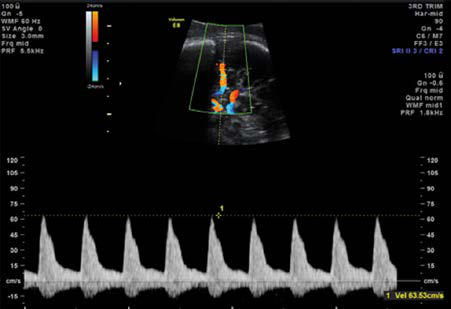

# Chapter 140: Hemolytic Disease of the Fetus and Newborn

*Christopher S. Thom and Michele P. Lambert*

<!-- p.1436 -->
Hemolytic disease of the fetus and newborn (HDFN), also known as **erythroblastosis fetalis**, is a broad diagnosis that applies to any fetus or neonate who develops alloimmune hemolysis caused by the trans placental passage of maternal antibodies directed against paternally derived red blood cell (RBC) antigens. Although more than 60 differ ent RBC antigens can elicit a maternal antibody response, clinically sig nificant disease is most often associated with incompatibility in ABO blood groups or rhesus (Rh) antigen (Table 140.1). HDFN caused by anti-RhD antibodies, occurring in RhD-positive infants born to RhDnegative mothers, is the most severe form because of the highly immu nogenic nature of the RhD antigen. Less frequently, hemolytic disease may be caused by differences in other Rh system antigens, or by other RBC antigens such as CW, CX, DU, K (Kell), M, Duffy, S, P, MNS, Xg, Lutheran, Diego, and Kidd. *Early recognition and diagnosis facilitate timely interventions to prevent adverse sequelae*.

**HDFN CAUSED BY Rh INCOMPATIBILITY Pathogenesis** Rh antigenic determinants are genetically transmitted from each parent and determine Rh blood type by directing the production of Rh C, c, D, E, or e proteins to be expressed on the RBC surface. RhD alloimmunization is responsible for 90% of HDFN cases involving the Rh antigen system, but other Rh antigens, particularly E and c, can be causal. Rh sensitiza tion usually occurs in the first pregnancy when small amounts of blood (usually >1 mL) enter maternal circulation so that most instances of sen sitization occur around the time of delivery. Although sensitization may occur earlier in the first pregnancy resulting in some hemolysis, HDFN rarely occurs during a first pregnancy. After sensitization, smaller doses of antigen can stimulate antibody production, so all subsequent infants

expressing the cognate antigen are at risk for HDFN. For this reason, the severity of HDFN also typically worsens with successive pregnancies. *Rou tine administration of Rh immunoglobulin (RhoGAM) to mothers at risk for Rh alloimmunization, both at 28 and 32 weeks’ gestation and within 72 hours after delivery of Rh-positive infants, has reduced initial sensitization to an estimated <0.1% of at-risk pregnancies in high-income countries*.

**Clinical Manifestations** The severity of HDFN is variable, ranging from mild hemolysis without overt symptoms to severe anemia with compensatory hyperplasia of eryth ropoietic tissues, including massive hepatosplenomegaly. When hemolysis exceeds the compensatory regenerative capacity of the hematopoietic sys tem, profound anemia, thrombocytopenia, coagulopathy, cardiomegaly, respiratory distress, massive anasarca, and circulatory collapse can result. Perinatal hemoglobin concentrations may be as low as 3-4 g/dL.

HDFN can also cause abnormal fluid collection in two or more fetal compartments (skin, pleura, pericardium, placenta, peritoneum, amniotic fluid), a clinical scenario termed **hydrops fetalis,** which frequently results in significant clinical morbidity or death in utero or shortly after birth. Hydrops results from heart failure along with subsequent hepatic conges tion and dysfunction. This leads to reduced serum albumin and loss of intravascular oncotic pressure. Consequent edema can lead to extravascu lar fluid accumulation in the lungs (pleural effusion), abdomen (ascites), and elsewhere, which can compromise ventilation and lead to a range of life-threatening complications (Fig. 140.1). Hydrops is typically present when the fetal hemoglobin level is <5 g/dL but can occur when hemoglo bin levels are between 7 and 9 g/dL. Hydrops does not invariably occur with low hemoglobin concentration, instead depending on the duration of anemia and the gestational age when anemia developed.

Infants affected by HDFN may not be jaundiced at birth because of effective placental clearance of lipid-soluble unconjugated bilirubin. However, in severe cases, bilirubin pigments can stain the amniotic fluid, cord, and vernix. In either case, hyperbilirubinemia is generally evident within 24 hours of birth, as hemolysis overwhelms the infant’s bilirubin clearance system. Extremely high levels of unconjugated bilirubin levels present a risk of bilirubin encephalopathy **(kernicterus)**, which is wors ened in patients with concomitant hypoxia or acidosis.

Hypoglycemia may further complicate clinical management of infants with severe HDFN. This may be related to islet cell hypertro phy and hyperinsulinism due to growth stimulatory effects of anti-RhD antibodies on the pancreas.

*Christopher S. Thom and Michele P. Lambert*

#### **Table 140.1** Etiologies of Hemolytic Disease of the Fetus and Newborn

| Category / Parameter | Clinical Details & Findings |
| --- | --- |
| **BLOOD GROUPS** | Mother; Rh-negative; O (occasionally B); K1-negative; Infant; Rh-positive (D is most common); A (sometimes B); K1-positive |
| **CLINICAL FEATURES** | Occurrence in firstborn; 5%; 40–50%; Rare; Severity in subsequent; pregnancies:; Predictable; Difficult to predict; Somewhat predictable; Stillbirth/hydrops; Frequent (less with Rh-; immunoglobulin use); Rare; 10%; Severe anemia; Frequent; Rare; Frequent; Jaundice; Prominent, severe; Mild-moderate; Mild |
| **LABORATORY TESTS** | Direct antiglobulin test (infant); Positive; Positive or negative; Positive or negative; Reticulocyte count; Elevated; Elevated; Variable; RBC antibodies (mother); Usually detectable; Antibody titers may help predict; severity of fetal disease; May not be detectable; Antibody titers may not correlate; with fetal disease; Usually detectable; Antibody titers may not correlate; with fetal disease; fetus can be; affected at titers lower than for; Rh-mediated hemolysis |

<!-- p.1437 -->
**Diagnosis, Prevention, and Treatment** Definitive diagnosis of HDFN requires demonstration of blood group incompatibility between mother and infant, and corresponding mater nal antibody bound to the infant’s RBCs. However, severe clinical pre sentations strongly suggest the diagnosis. Emergent interventions may be required before definitive test results become available.

During pregnancy, expectant parents should have blood tested for potential blood type incompatibility, including ABO and Rh antigens. If RhD incompatible, maternal anti-RhD IgG titers should be mea sured early in pregnancy. Paternal blood can be tested to determine the fetal risk of inheriting the cognate antigen, typically either 50% or 100% depending on whether the father is heterozygous or homozy gous. However, as paternal serologic testing alone is not fully accurate, molecular genotyping may be recommended for both parents.

Fetal genotyping provides an accurate prediction for the develop ment of HDFN in sensitized mothers. Fetal Rh status is available by isolating fetal cells or cell-free fetal DNA from the maternal circulation. These methods are replacing amniocentesis and chorionic villus sam pling methods and associated risks. Elevated antibody titers, or rising titers, correspond to increased HDFN risk.

Without Rh immunoglobulin prophylaxis, any Rh-negative woman with a previous pregnancy or abortion, prior exposure to transfused blood products, or receipt of an organ transplant is at risk for Rh sen sitization. If a mother has had a previously affected infant or stillbirth, the Rh-positive infant is usually equally or more severely affected than the previous infant. Although there can be poor correlation between the anti-RhD titer level and disease severity, Rh-negative mothers found to have RhD antibody titers of ≥1:16 (15 IU/mL in Europe) at any time dur ing a subsequent pregnancy warrant close monitoring for fetal anemia.

Pregnancies at risk for HDFN should be managed by maternal-fetal specialists. In some cases, monitoring must begin at 16-24 weeks’ gesta tion. This is typically done via noninvasive Doppler ultrasonography of middle cerebral artery (MCA) flow velocity, which can be used to moni tor for increased vascular resistance in fetal arteries indicative of **fetal anemia** (Fig. 140.2). Moderate to severe anemia increases MCA blood flow, so peak MCA flow velocity can be a quantitative correlate for ane mia severity. Real-time ultrasound is used to detect signs of hydrops (skin or scalp edema, pleural or pericardial effusions, and ascites) and fetal heart rate monitoring. Early ultrasonographic signs of hydrops include organomegaly (liver, spleen, heart), the double–bowel wall sign (bowel edema), and placental thickening. Progression to polyhydramnios, asci tes, pleural or pericardial effusions, and skin or scalp edema may then follow. *In the setting of concerning ultrasonographic findings, percutaneous umbilical blood sampling (PUBS) can provide more direct assessment of fetal hemoglobin level and facilitate intrauterine transfusions*.

Although cord blood hemoglobin content typically varies in proportion to disease severity, hemoglobin may be within the normal range due to

compensatory bone marrow and extramedullary hematopoiesis. Reticu locytosis will be present and a peripheral blood smear will show polychro masia with abundant nucleated RBCs. Thrombocytopenia may develop in severe cases. Umbilical cord bilirubin levels are generally between 3 and 5 mg/dL, including elevated direct bilirubin levels from cholestasis. Indirectreacting bilirubin content rises rapidly in the first 6-12 hours of life.

Indications for delivery include fetal distress, complications during in utero interventions, and pulmonary maturity. Many affected infants are delivered preterm due to concerns for fetal well-being, after bal ancing risks of prematurity. The birth should be attended by a skilled neonatal resuscitation team familiar with the infant’s prenatal course. *Because severe hemolytic anemia can cause rapid cardiovascular com promise, a team skilled in evaluation in management of HDFN should be involved when the diagnosis is suspected or confirmed, especially when there is a history of prior infants affected by HDFN*. Small packed RBC (PRBC) transfusions can be used to partially correct anemia, although volume expansion (e.g., large transfusions) risks worsening cardiac failure. Phototherapy may be necessary to treat hyperbilirubinemia in the first 24 hours of life if bilirubin levels exceed safe limits on an agebased nomogram (see Chapter 137). Although it is the indirect biliru bin fraction that crosses the blood-brain barrier to cause kernicterus, clinical decision-making is often based on total serum bilirubin levels.

Despite adequate resuscitation, phototherapy, and/or other empiric treatments, some infants with HDFN require exchange transfusions to treat anemia and/or hyperbilirubinemia. The decision to proceed with exchange transfusion is typically based on clinical status and trajectories in hemoglobin or serum bilirubin values, specifically the likelihood that serum bilirubin, plotted against postnatal hours of life, will reach a danger ous level (see Chapter 137). Signs and symptoms of kernicterus are abso lute indications for exchange transfusion. Previous kernicterus or severe HDFN in a sibling, severe reticulocytosis >15%, or prematurity (with increased kernicterus risk) are additional factors to be considered in the decision to proceed with exchange transfusion (see Chapter 137).

Complications related to HDFN can also present weeks after birth, irrespective of the prenatal or perinatal course. Late anemia can present after 4-6 weeks of life, sometimes clinically manifesting as poor feeding or growth. This can result from ongoing hemolysis caused by persistent circulating maternal alloantibodies, or from hyporegenerative anemia caused by suppression of bone marrow erythropoiesis. These etiolo gies can be distinguished by reticulocyte count and bilirubin level, with ongoing hemolysis driving reticulocytosis and hyperbilirubinemia.

**Fig. 140.1** Hydrops fetalis. Longitudinal sonographic image of the fetus, with ascitic fluid outlining the liver (large arrow). The small arrow shows pleural effusion above the diaphragm. (From Wilkins I: Nonim mune hydrops. In Creasy RK, Resnick R, Iams JD, et al., eds. Creasy & Resnik’s Maternal-Fetal Medicine. 7th ed. Philadelphia: Elsevier; 2014: Fig. 37-2.)

**Fig. 140.2** Middle cerebral artery (MCA) Doppler study of elevated peak systolic velocity (PSV). MCA-PSV can predict fetal anemia with suf ficient accuracy to determine management, including the need for in trauterine transfusion or, in the mid to late third trimester, early delivery. Fetal hemoglobin is typically measured at the start and end of intravas cular transfusion to validate the prediction from MCA-PSV results. The reliability of MCA-PSV can decrease after intrauterine transfusion be cause of the altered rheostatic characteristics of transfused adult blood. This is now the method of choice for detecting fetal anemia. (From Liley HG, Gardener G, Lopriore E, Smits-Wintjens V. Immune hemolytic disease. In Orkin SH, Nathan DG, Ginsburg D, et al., eds. Nathan and Oski’s Hematology and Oncology of Infancy and Childhood. 8th ed. Philadelphia: Elsevier’ 2015: Fig. 3-6.)

<!-- p.1438 -->
Neutropenia may also be observed in association with hyporegen erative anemia. Outpatient blood and reticulocyte counts should be monitored serially under the supervision of an expert hematologist to determine the need for interventions through bone marrow recov ery. Iron supplementation or erythropoietin therapy can be helpful. In some cases, PRBC transfusions can be required for months after birth, until the infant’s own erythropoietic system becomes more robust.

Hemolysis and hyperbilirubinemia can also cause late-onset compli cations. Jaundice typically resolves spontaneously within a few weeks or months with conservative management. Portal vein thrombosis and portal hypertension may occur in children who have been subjected to exchange transfusion as newborn infants. This complication is thought to be seen in infants with prolonged, traumatic, or septic umbilical vein catheterization. Inspissated bile syndrome is another rare complication, associated with persistent icterus and significant elevations in both direct and indirect bili rubin levels.

The outcome for Rh-incompatible fetuses varies greatly, depend ing on the characteristics of both the RBC antigen and the maternal antibodies. Although fetal transfusions and prenatal interventions can ameliorate some complications, those with severe hydrops remain at risk for cerebral palsy, developmental delay, and deafness, requiring medical and procedural interventions for hydrops prenatally or after birth. Infants should be monitored closely for late complications by pediatric hematologists in the outpatient setting.

**HDFN CAUSED BY ABO INCOMPATIBILITY** ABO incompatibility is the most common cause of HDFN, with approx imately 20% of live births at theoretical risk. Of at-risk infants, clinical manifestations develop in 1–10% and are usually less severe than Rh disease, rarely requiring aggressive clinical management or therapeutic intervention aside from phototherapy. This is because naturally occur ring maternal antibodies against ABO blood group antigens are mostly IgM and therefore do not cross the placenta. However, some group O mothers will naturally produce anti-A or anti-B IgG antibodies that can cross the placenta to cause immune-mediated hemolysis. For this reason, ABO incompatibility can cause hemolysis even in a firstborn infant. Another reason for mild disease manifestations is that fetal and neonatal RBCs have relatively low ABO expression, limiting binding sites for maternal antibodies.

**Clinical Manifestations** Affected infants will typically develop jaundice in the first day of life. Severe clinical manifestations, such as hydrops, severe anemia, or hepatosplenomegaly, are rare. Diagnosis requires serologic ABO

incompatibility between the mother and infant, a positive DAT, and hyperbilirubinemia with or without anemia. Affected infants often have mild anemia and reticulocytosis, with peripheral blood smears showing polychromasia, nucleated RBCs, and spherocytes. *Phototherapy may be required based on bilirubin level and postnatal age, and is typically effec tive in lowering serum bilirubin levels* (see Chapter 137). In some cases, hemolysis can persist for weeks until maternal antibodies are cleared. Intravenous immunoglobulin (IVIG) administration can help to limit hemolysis and potentially avoid exchange transfusion and/or PRBC transfusions in cases with dangerous levels of hyperbilirubinemia or anemia, respectively. Rarely, affected infants who also have hyporegen erative anemia can require PRBC transfusions several weeks after birth. For this reason, outpatient monitoring is essential for newborns with ABO hemolytic disease. However, the persistence of hemolytic anemia or spherocytosis beyond 2 weeks of age can indicate an alternative diag nosis, such as hereditary spherocytosis (see Fig. 139.3).

**OTHER ETIOLOGIES OF HDFN** Incompatibility in blood group antigens other than Rh or ABO account for <5% of HDFN. Minor RBC antigen mismatch is emerg ing as a common cause of HDFN in the developed countries in which anti-RhD immune globulin is routinely used. The likeli hood of minor antigen mismatches is a function of population fre quency, antigen surface density on RBCs, and immunogenicity in the mother. In most cases, the infant’s direct antiglobulin test (DAT) will be positive and maternal serum will have alloantibodies against infant (and paternal) erythrocytes. Elution techniques can identify the antigen specificity.

Common RBC antigens that can lead to clinically relevant incom patibility include those in the Kell, Duffy, and MNS blood groups. Kell incompatibility can be the most clinically relevant, as the severity of the hemolytic anemia is difficult to predict based on previous obstetric his tory, amniotic fluid bilirubin determinants, or maternal antibody titer (Table 140.2). Kell-alloimmunized infants often have inappropriately low numbers of circulating reticulocytes caused by erythroid suppres sion, and even low maternal titers of anti-Kell antibodies may cause significant anemia due to loss of precursors expressing the antigen as well as mature erythrocytes. No pharmacologic therapies are available to prevent sensitization with these minor antigens. As with cases of Rh and ABO incompatibility, treatment is supportive, including exchange transfusion for severe presentations.

*Visit Elsevier eBooks+ at eBooks.Health.Elsevier.com** for Bibliography.*

#### **Table 140.2** Red Cell Antigens That Cause Hemolytic Disease of the Fetus and Newborn (HDFN)

| Category / Parameter | Clinical Details & Findings |
| --- | --- |
| **ABO (A, B)** | Rh (EW, hrs, Tar, Rh32, HrBE, Hro); Rh (D, c, f, Ce, Cw, cE); Rh (C, e, Cx, VS, CE, Bea, JAL); Diego (Dia, Dib, Wra, ELO); Kell (K, k, Ku, Jsb); Kell (Kpa, Jsa, Ula); Duffy (Fya); Globoside (PP1Pk); Junior (Jra); Gerbich (Ge3); MNSs (Vw, Mur, MUT); Kidd (Jka, Jkb, Jk3) |
| **H (H)** | Mittenberger (Mia); Duffy (Fyb); Kell (K, k, Ku, Jsb); MNSs (Vw, Mur, MUT); Langereis (Lan); MNSs (U, Ss S, s, Mta, Mv); Gerbich (PP1Pk); MNSs (M, N, Hil, Or); Colton (Coa) |
| **(HJK)** | Colton (Cob, Co3); (Kg); —; Scianna (Rd, SC2); (Sara); —; Xg (Xga); —; —; (Ata); —; —; Mild HDFN, published reports of needing phototherapy for postnatal jaundice; moderate HDFN, published reports of needing postnatal exchange transfusion; severe HDFN,; published reports of hydrops fetalis or intrauterine transfusions.; Note that some antigens have no system as per International Society of Blood Transfusion classification. |

<!-- p.1439 -->
