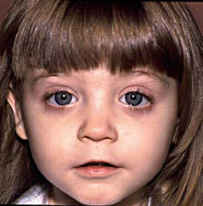
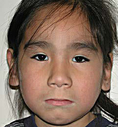

# Chapter 146: Fetal Alcohol Spectrum Disorder

*Susan A. Friedman and Hallam Hurt*

<!-- p.1452 -->

#### **Table 145.2** Medications Used in Pharmacologic Treatment of Neonatal Abstinence Syndrome

| Category / Parameter | Clinical Details & Findings |
| --- | --- |
| **ADD ADJUVANT THERAPY** | Morphine; 0.05 mg/kg/dose q3h; Increase dose 10–20%; 10% of stabilizing dose q24h; >1 mg/kg/day of morphine; Unable to wean for 2 days; Methadone; 0.1 mg/kg/dose q6h for; 4 doses; Increase to q4h if unable to; capture; 0.7 mg/kg/dose q12h × 2 doses,; then 0.05 mg/kg/dose q12h × 2; 0.04 mg/kg/dose q12h × 2; 0.03 mg/kg/dose q12h × 2; 0.02 mg/kg/dose q12h × 2; 0.01 mg/kg/dose q12h × 2; 0.01 mg/kg/dose q24h × 1; Unable to wean for 2 days; Buprenorphine; 4 μg/kg q8h; 2 μg/kg until maximum of; 15 μg/kg; 3 μg/kg/dose q8h × 3 doses; 2 μg/kg/dose q8h × 3; 2 μg/kg/dose q8h × 2; 2 μg/kg/dose q24h × 1; Unable to wean for 2 days; Phenobarbital; 20 mg/kg; —; 5 mg/kg daily |
| **N/A** | Clonidine; 1.5 μg/kg/dose q3h; 25% dose escalation q24h; 10% every day |
| **N/A** | N/A, Not available; q24h, every 24 hours. |

considered, including home visitation programs and Early Head Start. Further, in the discharge process clinicians should also assess other risk, including HIV and HCV exposure, which must be followed in the outpatient setting. Hospitals should standardize the discharge pro cess for opioid-exposed infants to ensure connection to postdischarge services.

*Visit Elsevier eBooks+ at eBooks.Health.Elsevier.com** for Bibliography.*

Alcohol is a known teratogen that can cause irreversible central nervous system (CNS) damage. Injury can include reduced brain volume, particularly for the frontal lobe, and thinning of the cor pus callosum. These injuries can lead to CNS dysfunction that can range from relatively mild to severe. Prenatal alcohol exposure (PAE) affects all stages of brain development from neurogenesis to myelination, through mechanisms that include disrupted cell-cell interactions, altered gene expression, and oxidative stress leading to abnormalities such as reduced brain volume in the frontal lobe, striatum and caudate nucleus, thalamus, and cerebellum; thin ning of the corpus callosum; and abnormal functioning of the amygdala.

PAE can result in a spectrum of outcomes. The term fetal alco hol spectrum disorder (FASD) is the umbrella term that encom passes a group of conditions associated with PAE. The FASD group of disorders includes fetal alcohol syndrome (FAS), partial fetal alcohol syndrome (pFAS), alcohol-related neurodevelopmen tal disorder (ARND), alcohol-related birth defect (ARBD), and neurobehavioral disorder associated with prenatal alcohol expo sure (ND-PAE).

*Susan A. Friedman and Hallam Hurt*

**EPIDEMIOLOGY** According to the CDC, approximately 1 in 7 pregnant women report consuming alcohol within the past 30 days. Approximately 20-30% report drinking at some point during the pregnancy, and more than 5% report binge drinking. consuming alcohol within the last 30 days, with ∼20% reporting binge drinking. Because almost 50% of pregnancies in the United States are unplanned, unintentional PAE can occur before a woman knows she is pregnant.

**PREVALENCE** FASDs are the most common causes of preventable developmen tal delay and intellectual disability. Prevalence rates vary across reports. The US Centers for Disease Control and Prevention (CDC) FAS Surveillance Network reported prevalence rate across several populations of 0.3 out of 1,000 children from 7 to 9 years of age. This prevalence rate is much lower than that obtained by active case ascertainment studies in the United States and Western Europe, which have estimated prevalence rates of 2–5%. Another study reported similar rates, 24-48 cases per 1,000 children (2.4–4.8%) for all FASDs, and 6-9 cases per 1,000 (0.6–0.9%) for FAS specifically. Studies that have examined PAE by anonymous meconium testing demonstrate 4.26 times greater identification of alcohol use dur ing pregnancy compared with maternal self-report. Rates of FASDs have been reported to be higher in children living in poverty, in Indigenous populations, and in children living in foster care. The rate of FASDs for children in foster care has been found to be 10 to 15 times higher than that for children in the general popula tion. FASDs often go undetected in these children, and as many as 86.5% of foster and adopted youth with FASDs go undiagnosed or are diagnosed incorrectly within the FASD spectrum. Children adopted internationally represent another high-risk group, particu larly those adopted from Eastern Europe. Children adopted from orphanages and other children with a history of early trauma, such as those in foster care, may also exhibit symptoms of posttraumatic stress disorder (PTSD) and other neurobehavioral and develop mental issues that can overlap with those of FASD, including those without physical features (ARND or ND-PAE). The impairments seen in children with an FASD may also include the negative impact of additional prenatal and postnatal risk factors.

**DIAGNOSTIC SYSTEMS** The most widely used diagnostic guidelines are the Hoyme FASD diagnostic guidelines (revised 2016), the University of Washington 4-Digit Diagnostic Code (2004), the CDCFAS guidelines (revised

<!-- p.1454 -->
2004, only includes FAS), and the Canadian FASD guidelines (revised 2016).

These FASD diagnostic guidelines overlap but also have impor tant distinctions. The Hoyme system uses more stringent alco hol exposure criteria than the 4-Digit Diagnostic Code. Both the Hoyme system (2016), and the 4-Digit Diagnostic Code system use the three diagnostic criteria of facial findings, growth restric tion, and CNS abnormalities and both include a spectrum of dis orders under the umbrella term of *fetal alcohol spectrum disorder* (FASD). However, they do differ in diagnostic tools, specific crite ria used to define each category, and in diagnostic nomenclature. The result of these differences and others is that there may not be total agreement between the two in the diagnosis of a given patient. The CDC guidelines establish criteria only for FAS and require the three diagnostic criteria of facial findings, growth restriction, and CNS abnormalities, with or without documented PAE. In the updated Canadian guidelines, “fetal alcohol spectrum disorder” is considered a diagnostic term with two categories: FASD with senti nel facial features and FASD without sentinel facial features. These guidelines eliminate growth restriction as a required diagnostic cri terion. They include an at-risk category for children with confirmed PAE who were too young to meet the criteria for neurodevelop mental deficits, or in whom assessment was incomplete. They also include a category for children with cardinal facial features without documentation or evidence of severe impairment in neurodevelop mental domains. There is no universal acceptance of one system. If less stringent criteria are used, the sensitivity increases, which may lead to overdiagnosis. Additional expert evaluation is then needed to confirm a diagnosis. In contrast, using more stringent criteria leads to greater specificity but may underdiagnose FASD.

**Historical and Clinical Features** The historical and clinical features shared by all previously described diagnostic systems (although not required by all of the disorders) include five categories: (1) PAE, (2) three key facial features, (3) pre natal/postnatal growth restriction, (4) deficient brain growth and/or significant structural brain abnormalities, and (5) neurobehavioral impairment.

**Prenatal Alcohol Exposure** A safe threshold or pattern of alcohol consumption during preg nancy has not been identified, and any PAE at any stage of gestation is believed to present a risk to a developing fetus. Significant alcohol exposure has been carefully defined in the 2016 updated Hoyme guide lines as follows.

One or more of the following exposures, beginning 3 months before pregnancy and continuing until delivery, with a standard drink defined as 1.5 oz of hard liquor, 5 oz of wine, or 12 oz of beer or wine cooler: • ≥6 drinks/week for ≥2 weeks during pregnancy • ≥3 drinks per occasion on ≥2 occasions

• Documented alcohol-related social or legal problems before or dur

ing pregnancy or a history of treatment for an alcohol-related condi tion • Documentation of intoxication of blood, breath, or urine alcohol

testing • Positive testing with an established biomarker of alcohol exposure

during pregnancy or at birth • Positive finding on a validated screening tool for drinking during

pregnancy Information can be obtained from a variety of sources in addition to the birth mother, including family members, foster or adoptive par ents, social service agencies who observed maternal alcohol consump tion during pregnancy, or medical records that document PAE, alcohol treatment, or social, legal, or medical problems related to drinking during pregnancy. Binge drinking (4 or more drinks per occasion) has been shown to be the most harmful to fetal development. PAE in the first trimester leads to the classic facial dysmorphia associated with FAS and other structural defects. PAE can have other deleterious effects (e.g., spontaneous abortion, growth defect, CNS effects) on the fetus throughout the pregnancy.

Several well-validated screens are used to identify alcohol use in pregnant and nonpregnant women of childbearing years, including the assessments of Tolerance, Annoyance, Cut Down, Eye-Opener (T- ACE), Cut Back, Annoyed, Guilty, Eye-Opener (CAGE); Car; Relax; Alone; Forget; Friends; Trouble (CRAFFT); Alcohol Use Disorders Identification Test (Audit-C); and Tolerance, Worried, Eye-Opener, Amnesia, Kut Down (TWEAK). There are, however, no well-validated screens designed to ask about past consumption of alcohol. Pediatri cians can ask the following two questions to determine the likelihood of significant PAE: “In the 3 months before you knew you were preg nant, how many times did you have 4 or more alcohol drinks in a day?” and “During your pregnancy, how many times did you have any alco hol?” If a positive response is given to either question, the clinician can follow up to determine the level of PAE by asking the following: (1) “During your pregnancy, on average, how many days per week did you have any alcohol?”; (2) “During your pregnancy, on a typical day when you had an alcoholic beverage, how many drinks did you have?”; and (3) “During your pregnancy, what was the maximum number of drinks that you had in a day?”

**Dysmorphologic Facial Features** The three key, facial dysmorphologic features include short palpe bral fissures, a thin vermilion border of the upper lip, and a smooth philtrum (Fig. 146.1). Measurement of the **palpebral fissure length (PFL)** is shown in Figure 146.2. There are several different PFL charts that can be used to plot this measurement. That of Hall is included here (Fig. 146.3), with additional charts listed under Additional Resources for Healthcare Providers. In addition, differ ent diagnostic systems have different cutoffs to define the criteria. Evaluation of the philtrum and upper lip utilizes the Lip-Philtrum

A B C D

**Fig. 146.1** Examples of facial features of FAS in children of different ethnicities. A, White. B, Native American. C, Black. D, Asian. (Copyright 2021 Susan (Astley) Hemingway PhD, University of Washington.)

<!-- p.1455 -->
en ex

**Fig. 146.2** The palpebral fissure length is defined by the distance between the endocanthion (en) and exocanthion (ex) landmarks. (Copy right 2021 Susan (Astley) Hemingway PhD, University of Washington.)

Age from birth (years) 1 2 3 4 5 6 7 8 9 10 11 12 13 14 15 16 16

18

20

22

24

26

28

30

32

34

Palpebral fissure length (mm)

0.7

0.8

0.9

1.0

1.1

1.2

1.3 +2SD

+1SD

Mean

–1SD

–2SD

+2SD

+1SD

Mean

–1SD

–2SD

Inches

**Fig. 146.3** Palpebral fissure measurements. (From Hall JG, Froster- Iskenius UG, Allanson J, eds. Handbook of Normal Physical Measure ments. Oxford: Oxford University Press; 1989: p. 150.)

Guide developed at the University of Washington (Fig. 146.4), which can be obtained on request in digital format or as a lami nated card from the University of Washington. Although this guide includes norms for White and Black children, additional work is needed on establishing norms for the three facial features across a wider range of racial groups.

Additional minor anomalies may also occur in association with PAE but are not included in the diagnostic criteria: mid-face hypoplasia, epicanthal folds, ptosis, strabismus, altered palmar crease (“hockey stick” and clinodactyly of the fifth finger [Fig. 146.5], “railroad track ears” [Fig. 146.6], hypoplastic nails, limited elbow supination, campto dactyly, hypertrichosis).

**Prenatal/Postnatal Growth Deficiency** This is defined as ≤10th percentile for age (Hoyme and CDC) or ≤3rd percentile (4-Digit Diagnostic Code) for *either* height or weight. The systems also vary in the timing of the growth problems (prenatal/at birth, or at any point in life).

**Deficient Brain Growth and Significant Structural Brain Abnormalities** Deficient brain growth is defined as an occipitofrontal head circumfer ence (OFC) <10% for age, abnormal morphogenesis, or abnormal neu rophysiology. The criteria additionally state that if the child has weight and height <10th percentile, then the OFC should be at or below the 3rd percentile. Structural brain abnormalities seen on brain imaging may include abnormalities of the corpus callosum, the cerebellum, or basal ganglia.

**Neurobehavioral/Neurodevelopmental Impairment** These criteria can include abnormal findings on neurologic exam or seizures, and/or functional neurobehavioral or neurodevelopmen tal abnormalities. There is tremendous variability in the presentation of the neurobehavioral and neurocognitive features of children with FASD due to the timing and amount of PAE and unique characteristics of the birth mother and the child. The assessment of neurobehavioral impairment is also different for children under 3 years of age than for children 3 years or older.

The degree of developmental impairment can range from relatively mild delays to severe intellectual disability, although approximately 75% of individuals with an FASD *do not* have intellectual disability. In *infants*, the symptoms can be nonspecific and may include irritability, poor feeding, sleep difficulties, a tendency to become easily overstimu lated, or difficulty forming attachments with caregivers. *Young children* may demonstrate developmental delays, inattention, impulsivity, inter nalizing and externalizing problems, social impairments and difficulty with peers, and behavioral difficulties such as mood lability, frequent tantrums, or aggression. The neurocognitive profile of children with an FASD that emerges at *elementary or middle school age* includes challenges with processing speed, memory, visual-spatial reasoning, math, auditory comprehension, use of pragmatic language, and execu tive functioning skills. In *adolescents*, difficulties with abstract reason ing, time and money management, and social and adaptive skills may become more pronounced.

The most common comorbid mental health condition seen in chil dren with an FASD is attention-deficit/hyperactivity disorder (ADHD; see Chapter 50), which occurs in >50% of children. Individuals with FASD may also present with problems of self-regulation, impulse con trol, and adaptive functioning. Additional mental health disorders typ ically seen in children and adolescents include oppositional defiant and conduct disorder, anxiety disorder, adjustment disorder, sleep disorder, mood disorders (e.g., depression, bipolar disorder), and disinhibited social engagement disorder. FASD may increase the severity or com plexity of these conditions.

**DIAGNOSTIC CRITERIA** Five diagnoses included under the FASD umbrella include the following: 1.	Fetal alcohol syndrome (FAS) 2.	Partial fetal alcohol syndrome (pFAS) 3.	Alcohol related neurodevelopmental disorder (ARND) 4.	Neurobehavioral disorder associated with prenatal alcohol exposure

(ND-PAE) 5.	Alcohol related birth defects (ARBD)

The previously described clinical features with or without a history PAE are used to define the disorders within the FASD spectrum (Tables 146.1-146.5). As noted earlier, the criteria do vary somewhat depend ing upon which diagnostic system is used.

**DIFFERENTIAL DIAGNOSIS** It is important to consider other causes of the facial features of FAS and pFAS, as each of these can be seen in certain genetic and teratogenic exposure conditions. Genetic conditions can include Williams syndrome, Dubowitz syndrome, Noonan syndrome, 22q11.2 deletion (velocardiofa cial syndrome), Cornelia de Lange syndrome, chromosome 15q duplica tion syndrome, and others. Teratogenic exposure conditions include fetal valproate syndrome, fetal hydantoin syndrome, maternal phenylketonuria

<!-- p.1456 -->
(PKU) effects, toluene embryopathy, and others. Therefore a genetics eval uation may be warranted, especially when there is unconfirmed PAE.

The neurobehavioral issues associated with FASD can be difficult to distinguish from those of other behavioral health disorders, such as autism spectrum disorder, ADHD, intellectual disability, reactive attachment disorder, PTSD, exposure to other maternal substance use during pregnancy, and others. This is particularly the case when the FASD facial features are not present. Children who experience “adverse childhood experiences” (ACEs), such as neglect, abuse, poverty, and parental substance abuse, can have similar findings of hyperactivity, poor impulse control, emotional dysregulation, deficits in executive function, and memory weaknesses as children with FASD. Further more, these disorders are not mutually exclusive and more than one underlying disorder can result in the neurobehavioral issues found.

**OUTCOMES** Children with an FASD are at higher risk for victimization and bul lying, often due to poor social judgment. Children and adolescents

who are not identified early and treated aggressively are significantly more likely to have secondary disabilities, including encounters with juvenile justice and incarceration, substance abuse problems, severe mental health problems, sexual promiscuity and other inap propriate sexual behaviors, high rates of school failure, dropout and under- or unemployment, health problems, and premature death. Children and adolescents with an FASD have a 95% lifetime likeli hood of having a mental health diagnosis and are at higher risk for suicide**.** Although an FASD cannot be cured, the long-term negative effects of the brain injury caused by PAE can be reduced through aggressive, sustained intervention initiated early. Factors associated with a better outcome include early diagnosis (under age 6 years), a stable and nurturing home, lack of exposure to violence, full assessment for disabilities and adequate provision of appropriate education, therapies, and social services. Prevention of FASD and early identification and interventions for children with an FASD is essential and has become an important goal of the CDC and other organizations.

Lip-Philtrum Guide 1

For use as a digital image on a smartphone or tablet.

Printing invalidates Guide. Square ensures length by width ratio of image is correct.

For use as a digital image on a smartphone or tablet.

Printing invalidates Guide. Square ensures length by width ratio of image is correct.

Philtrum Guide Lip-Philtrum Guide 2 Philtrum Guide

FASD 4-Digit Diagnostic Code © 2014 Susan Astley, University of Washington fasdpn.org

5

4

3

2

1 1

1 1

2 2 2

3 3 3

4

4 4

5 5 5

A B

**Fig. 146.4** University of Washington Lip-Philtrum Guides 1 (A) and 2 (B) are used to rank upper lip thinness and philtrum smoothness. The philtrum is the vertical groove between the nose and upper lip. The guides reflect the full range of lip thickness and philtrum depth with Rank 3 representing the population mean. Ranks 4 and 5 reflect the thin lip and smooth philtrum that characterize the FAS facial phenotype. Guide 1 is used for Whites and all other races with lips like Whites. Guide 2 is used for Blacks and all other races with lips like Blacks. Free digital images of these guides for use on smartphones are available from astley@uw.edu. (Copyright 2021 Susan (Astley) Hemingway PhD, University of Washington.)

<!-- p.1457 -->
**INTERVENTIONS AND TREATMENTS** Given the heterogeneity of presenting problems associated with the FASDs, interventions need to be tailored to address each individual child’s or adolescent’s profile of strengths and difficulties. Studies sup port that the most successful interventions begin early and continue across the life span, include a preventive focus, are intensive and indi vidualized, address multiple domains of functioning, include parent education and training, and are coordinated across systems of care.

Behavioral issues seen in children with FASD can be difficult for parents to manage and can cause significant stress within the home. These children often have impaired cause-and-effect understand ing and therefore may not respond to traditional behavior modifica tion strategies. Pediatricians can help support families by providing parenting tips suggested by the CDC, such as providing a structured

and lots of repetition, viewing the difficult behaviors as brain based rather than willful misbehavior, focusing on strengths, and providing an abundance of positive reinforcement. Specific programs include *Families Moving Forward* and *Parents and Children Together* teach ing parents strategies designed to improve self-regulation and execu tive function, and decreasing child behavior problems. Children with FASD often have significant difficulties with social functioning, such as interpreting social cues and communicating in social settings. Pro grams such as *Children’s Friendship Training* provides group-based, parent-assisted intervention that teaches social skills, which have been shown to improve standardized rating of social skills. Programs such as *Good Buddies* provide classes that address issues related to impaired social skills. Children with FASD may have decreased safety awareness, poor judgement, and impulsivity, which can place them at increased risk for unintentional injuries. A video-based intervention, *Fire and Street Safety,* was developed to address this. Children who participated showed significant improvement in safety-related knowledge and appropriate behavioral responses following the training and were also able to apply this training to real-world situations.

Young children with FASD are generally eligible for early interven tion therapies (occupational therapy, physical therapy, speech therapy, and developmental instruction) and should be referred for these ser vices as needed. Older children with an FASD often have difficulties with verbal and spatial learning, executive functioning, adaptive skills, social skills and peer relations, and mental health, which can interfere with academic performance. High rates of school failure and disrup tion are reported for this population. Difficulties with memory often require simplification of instructions, repetition, and patience. A home and school environment that is structured and predictable can also help to address this issue. To enhance generalizability of skills and to ensure they are encoded into memory, children with an FASD require con sistent and predictable interventions, simplified directions, repeated instructions, and reduced distractions in the classroom. Classroom intervention programs such as *Cognitive Control Therapy* have been found to result in significant improvements in classroom behavior and academic achievement. Programs have also been developed that

**Fig. 146.5** Characteristic hand findings that can be seen in a child with an FASD: curved fifth finger (clinodactyly) and upper palmar crease that widens after the bend and ends between the second and third fingers (“hockey stick” crease). (Courtesy Darryl Leja, NHGRI, National Institutes of Health.)

**Fig. 146.6** Ear findings that can be seen in a child with an FASD: “rail road track” appearance of ear creases. (Courtesy Darryl Leja, NHGRI, National Institutes of Health.)

Syndrome

#### **Table 146.1** Diagnostic Criteria for Fetal Alcohol

| Category / Parameter | Clinical Details & Findings |
| --- | --- |
| **General** | ALL of the following, with or without documented prenatal alcohol; exposure:; Facial features (Hoyme system requires two or more, 4-Digit; Diagnostic Code requires all three):; • Palpebral fissures ≤10th percentile (Hoyme system) or ≤3rd percentile; (4-Digit code); • Thin upper lip (ranking of 4 or 5 on racially normed Lip-Philtrum Guide*); • Smooth philtrum (ranking of 4 or 5 on racially normed Lip-Philtrum Guide*); Prenatal and/or postnatal growth deficiency:; • Height and/or weight ≤10% for age and sex at any point of time; (prenatal or postnatal); • Adjust for gestational age if preterm. (4-Digit Diagnostic Code puts; emphasis on short stature); Deficient brain growth, abnormal brain formation or neurophysiology:; one or more of following:; • Head circumference ≤10th % (Hoyme system) or ≤3rd percentile (4-Digit; Diagnostic Code); • Structural brain abnormalities; • Recurrent nonfebrile seizures with other causes excluded (Hoyme system); Neurobehavioral impairment:; • For children <3 y/o: Developmental delay ≥1.5 SD below the mean; • For children 3 y/o or older (either of the following):; • Cognitive impairment: Scores ≥1.5 SD below mean (Hoyme) or ≥2 SD; below mean (4-Digit Diagnostic Code) either for global abilities or; for at least one neurobehavioral domain (executive function, specific; learning impairment, memory impairment, or visual-spatial impairment).; The Hoyme system defines impairment domain as normal or abnormal.; The 4-Digit Diagnostic Code has three domains defined: normal,; moderate, severe.; • Behavioral impairment without cognitive impairment: ≥1.5SD below; mean in self-regulation (mood or behavioral regulation), attention; deficit, or impulse control.; *The Hoyme system and the 4-Digit Diagnostic Code have different Lip-Philtrum; Guides.; SD, Standard deviation. |

<!-- p.1458 -->
address specific areas of learning, such as *Language and Literacy Train ing Math Interactive Learning Experience*. A cognitive-based interven tion, the *Alert Program* has been adapted to address self-regulation and executive function difficulties in children with FAS or ARND living in foster care or adoptive homes. A video game, *GoFar*, was devel oped by to address issues of self-regulation. An intervention that uses rehearsal training interventions has been shown to result in improve ment in working memory. Children with FASD have been found to show deficits in adaptive functioning more significant than expected

based on their cognitive testing. Occupational therapy to address this issue can help to decrease the significant level of supervision and sup port required of parents and caregivers.

There are no medications that are approved specifically for FASDs, but some medications may be used for symptom management. These can include stimulants (for hyperactivity, inattention, and poor impulse con trol), antidepressants, neuroleptics, and antianxiety drugs. Children with an FASD are often treated with a higher number of drugs and at higher doses, likely because of atypical or less favorable responses. Such atypical responses may require an adjustment in medication or discontinuation. Stimulant medication use in patients with FASD is controversial but is often considered, since there is a high prevalence of ADHD-like symptoms in this population. Stimulants can lead to some improvement in hyperac tivity but may be less helpful for impulsivity and attention, and the rate of efficacy in general is not as high as in idiopathic ADHD. A diagnosis in the FASD spectrum should, in fact, be considered in a child with ADHD who has an atypical response to such medications. The efficacy of non stimulant medications used for ADHD, such as alpha-2 agonists is being studied and may be shown to be helpful. Studies are also underway for use of choline supplementation and treatment with atomoxetine (a selective norepinephrine reuptake inhibitor). Data regarding the use of SSRI (selec tive serotonin reuptake inhibitors) medications, antipsychotics, and mood stabilizers are limited in terms of efficacy and safety.

**THE PEDIATRICIAN/PRIMARY CARE PROVIDER’S ROLE** Pediatricians and other primary care providers need to document findings related to PAE and refer the child for a full evaluation. Indications for refer ral for further evaluation for FASD include confirmed history of significant PAE, concern raised by the caregiver about the possibility of FASD, all three facial features present, one or more facial features plus growth deficits, and one or more facial features along with one or more CNS abnormalities ± growth deficits. Evaluation for an FASD is best done by a multidisciplinary team that can provide a medical, genetic, and neuropsychologic assess ment. This team might include a developmental behavioral pediatrician, psychologist/psychiatrist, geneticist, social worker, speech therapist, occu pational therapist, physical therapist, and educational therapist/special education teacher. Evaluations by audiology and ophthalmology should be included if not already completed.

Once a diagnosis of an FASD is made, the pediatrician’s/primary care providers role is important in establishing a medical home for the child that provides coordinated care between medical and mental health professionals, therapists, and educators who can help and sup port the child and family. The American Academy of Pediatrics (AAP) has developed an FASD toolkit (https://www.aap.org/en-us/advocacyand-policy/aap-health-initiatives/fetal-alcohol-spectrum-disorderstoolkit/Pages/default.aspx) that includes a “Flow Diagram for Medical Home Evaluation of Fetal Alcohol Spectrum Disorders” to assist primary care providers in identifying children with an FASD and managing their challenges in an effort to reduce the lifelong adverse consequences.

*Visit Elsevier eBooks+ at eBooks.Health.Elsevier.com** for Bibliography.*

Syndrome

#### **Table 146.2** Diagnostic Criteria for Partial Fetal Alcohol

| Category / Parameter | Clinical Details & Findings |
| --- | --- |
| **General** | • WITH documented prenatal alcohol exposure (requires A and B):; A.	 Facial features (at least two of three); B.	 Neurobehavioral impairment (same as for FAS), i.e., leaves out; brain abnormalities and growth deficiency; • WITHOUT documented prenatal alcohol exposure (requires A, B,; and C):; A.	 Facial features (at least two of three); B.	 Growth deficiency OR deficient brain growth/structural brain; abnormalities/recurrent seizures (at least one of these); C.	 Neurobehavioral impairment (same as for FAS), i.e., same as; FAS except it is EITHER growth deficiency OR brain growth/; structural brain abnormalities/recurrent seizures (does not; require both); Note that the diagnosis of FAS and pFAS are the only FASDs that can be diagnosed in; the absence of a confirmed maternal history of PAE.; FAS, Fetal alcohol syndrome; FASD, fetal alcohol spectrum disorder; pFAS, partial fetal; alcohol syndrome. |

Neurodevelopmental Disorder

#### **Table 146.3** Diagnostic Criteria for Alcohol-Related

| Category / Parameter | Clinical Details & Findings |
| --- | --- |
| **General** | Requires A and B:; Note: Cannot be diagnosed definitively in children <3 yr old; A.	 Documented prenatal alcohol exposure; B.	 Neurobehavioral impairment:; • WITH cognitive impairment: Global delay OR deficit in at least TWO; neurobehavioral domains (executive function, specific learning; impairment, memory impairment, visual-spatial impairment); • WITHOUT cognitive impairment: Behavioral deficit in at least TWO; domains (behavioral regulation, attention, impulse control) |

Disorder Associated with Prenatal Alcohol Exposure

#### **Table 146.4** Diagnostic Criteria for Neurobehavioral

| Category / Parameter | Clinical Details & Findings |
| --- | --- |
| **General** | ND-PAE is a mental health disorder (rather than a medical disorder); included in the DSM-5 (2013) as a “new clarifying term” that; encompasses the range of developmental disabilities associated; with PAE that affect function and are not due to other conditions.; This diagnosis requires:; • ≥1 deficit in neurocognition; • ≥2 deficits in adaptive functioning (at least one in communication or; social communication and interaction); • ≥1 deficit in self-regulation; • History of maternal consumption of more than 13 alcoholic drinks in any; 30-day period of the pregnancy or more than 2 alcoholic drinks in one; sitting; • Onset of the disorder in childhood; • The findings cause clinically significant distress or impairment in; important areas of functioning and are not better explained by; other causes (medication, medical conditions, genetic disorders, or; environmental neglect); Although the diagnosis of ND-PAE overlaps with ARND, ND-PAE aims to describe; the behavioral and mental health effects on an individual with PAE. Unlike ARND, a; diagnosis of ND-PAE can be given with or without the physical characteristics of FAS; (ARND does not include physical characteristics) and the diagnosis of ND-PAE can be; given in addition to FAS or pFAS.; ARND, Alcohol-related neurodevelopmental disorder; DSM, Diagnostic and Statistical; Manual of Mental Disorders, Fifth Edition; FAS, fetal alcohol syndrome; ND-PAE,; neurobehavioral disorder associated with prenatal alcohol exposure; pFAS, partial; fetal alcohol syndrome. |

#### **Table 146.5** Alcohol-Related Birth Defects

| Category / Parameter | Clinical Details & Findings |
| --- | --- |
| **General** | This diagnosis refers to a pattern of structural birth defects and other; congenital abnormalities that can be characteristic of FASD.; Requires both A and B; A.	 Documented prenatal alcohol exposure; B.	 One or more specific major malformations found to be the result; of prenatal alcohol exposure:; • Cardiac: ASD, VSD, aberrant great vessels, conotruncal heart defects; • Skeletal: radioulnar synostosis, vertebral segmentation defects, large; joint contractures, scoliosis; • Renal: kidney/ureteral malformations; • Eyes: strabismus, ptosis, retinal vascular abnormalities, optic nerve; hypoplasia; • Ears: conductive or neurosensory hearing loss; ASD, Atrial septal defect; FASD, fetal alcohol spectrum disorder; VSD, ventricular septal; defect. |

<!-- p.1459 -->

## Additional Resources for Health Care Providers American Academy of Pediatrics Fetal Alcohol Spectrum Disorders Toolkit. Ad

dressing families of children with an FASD. Available at: https://www.aap.org/enus/advocacy-and-policy/aap-health-initiatives/fetal-alcohol-spectrum-disorderstoolkit/Pages/default.aspx. (Accessed Aug 9, 2021). Centers for Disease Control and Prevention FAS Prevention Team: www.cdc.gov/n

cbddd/fas. Lip-Philtrum Guide: Digital format (smartphone, tablet or computer): contact Susan

(Astley) Hemingway PhD at astley@uw.edu; Laminated card can be ordered at: ht tp://depts.washington.edu/fasdpn/pdfs/guideorder.pdf (FASD Diagnostic Tools, Software, Online Course). National Institute on Alcohol Abuse and Alcoholism (NIAAA): https://www.niaaa.nih.gov. National Organization on Fetal Alcohol Syndrome. www.nofas.org/about-fasd/. (Ac

cessed on Aug 21, 2021). Office of Special Education Programs (OSEP): Intervention IDEAS for infants,

toddlers, children and youth impacted by Fetal Alcohol spectrum Disorders (FASDs). https://osepideasthatwork.org/sites/default/files/IDEAsIssBrief-FASDs- 508_0.pdf. SAMHSA FASD Center for Excellence. www.fasdcenter.samhsa.gov. The ARC Fetal Alcohol Syndrome Family Resource Guide. Available at www.fetala

lcoholsyndrome.org. University of Washington. Fetal Alcohol and Drug Unit. http://depts.washington.e

du/fadu.

**Resources for Parents and Teachers:** American Academy of Pediatrics: Fetal Alcohol Spectrum Disorders: FAQs

of Parents & Families. https://www.healthychildren.org/English/heal th-issues/conditions/chronic/Pages/Fetal-Alcohol-Spectrum-Disorders- FAQs-of-Parents-and-Families.aspx. Fetal Alcohol Spectrum Disorders Educational Strategies Handbook: http://www.us

d.edu/∼/media/files/medicine/center-for-disabilities/fasd-educational-strategieshandbook.ashx?la=en. http://web.archive.org/web/20051103134125/http://www.mcf.gov.bc.ca/publications

/ecd/fas_guide1.pdf. 1999. https://archive.education.alberta.ca/teachers/resources/fasd/. http://www.usd.edu/medicine/center-for-disabilities/fetal-alcohol-spectrum-

disorders-educational-strategies-handbook. Hope for Children Living with FASD: 4 Programs That Work!; The Centers for Dis

ease Control and Prevention’s National Center on Birth Defects and Developmen tal Disabilities Brochure link: http://www.nofas.org/wpcontent/uploads/2014/04/ NOFAS_Brochure_4_Programs_Final.pdf. American Academy of Pediatrics Fetal Alcohol Spectrum Disorders Toolkit. Flow

diagram for Evaluation. https://www.aap.org/en-us/advocacy-and-policy/aaphealth-initiatives/fetal-alcohol-spectrum-disorders-toolkit/Pages/Algorithm-for- Evaluation.aspx. (Accessed Aug 9, 2021).
