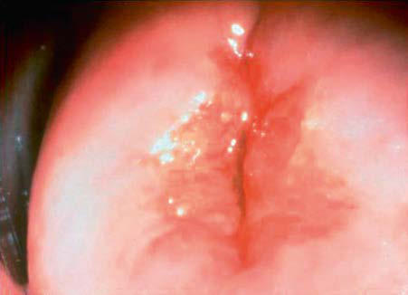
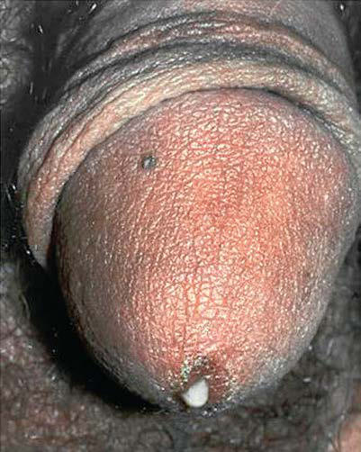

# Chapter 163: Sexually Transmitted Infections

*Tamera Coyne-Beasley, Nefertiti H. Durant, and Samantha V. Hill*

<!-- p.1599 -->
Age-specific rates of many sexually transmitted infections **(STIs)** are highest among sexually experienced adolescents and young adults, after controlling for sexual activity. Although some STI pathogens present as STI syndromes with a specific constellation of symptoms, most are asymptomatic and only detected by a laboratory test. The approach to prevention and control of these infections lies in educa tion, screening, and early diagnosis and treatment.

**ETIOLOGY** Any adolescent who has had oral, vaginal, or anal sexual intercourse is behaviorally vulnerable to acquiring an STI. Not all adolescents are at equal risk; physical, behavioral, and social factors contribute to an ado lescent’s risk. Adolescents who initiate sex at a younger age; youth resid ing in detention facilities; youth attending STI clinics; youth involved in commercial sex exploitation or survival sex and exchange sex for drugs, money, food, or housing; young males having sex with males (YMSM); adolescent women and young adult women having sex with older men; transgender youth; youth with disabilities; and youth who are injection drug users are at higher risk for STIs. Risky behaviors, such as sex with multiple concurrent partners or multiple sequential partners of limited duration, failure to use barrier protection consis tently and correctly, and increased biologic susceptibility to infection also contribute to risk (Table 163.1). Although all 50 states and the District of Columbia explicitly allow minors to consent for their own

sexual health services (at varying ages), many adolescents encounter multiple obstacles to accessing this care, including poverty, insurance coverage, and fears of lack of confidentiality (see Table 163.1). Adoles cents who are survivors of sexual assault need reassurance, protection, and appropriate intervention when these circumstances are uncovered (see Chapter 162).

**EPIDEMIOLOGY** STI prevalence varies by age, gender, race, and ethnicity. In the United States, although adolescents and young adults ages 15-24 represent 25% of the sexually experienced population, this age-group accounts for almost 50% of all incident STIs each year.

**Chlamydia** is the most frequently reported infectious disease in the United States and is the second most common STI in U.S. adolescents and young adults after human papillomavirus (HPV). In 2019, young adult females ages 20-24 (3,797.8 cases per 100,000 females) followed by females ages 15-19 (2,697.0 cases per 100,000 females) had the highest rates of chlamydia in the United States (Fig. 163.1). Notably age-specific rates of reported cases of chlamydia among males, although substantially lower than rates among females, were still highest in young adult males 20-24 years (1,680.0 cases per 100,000 males). Chlamydia remains com mon among all races and ethnic groups. In 2021, a total of 1,644,416 cases of *Chlamydia trachomatis* infection were reported to the CDC, making it the most common notifiable sexually transmitted infection in the United States for that year. This case count corresponds to a rate of 495.5 cases per 100,000 population, an increase of 3.9% compared with the rate in 2020. During 2020 to 2021, rates of reported chlamydia increased among both males and females, in all regions of the United States, among most age groups, and among all race/Hispanic ethnicity groups. Rates of reported chlamydia are highest among adolescents and young adults. In 2021, almost two-thirds (58%) of all reported chlamydia cases were among persons aged 15–24 years.

Reported rates of other bacterial STIs are also high among adoles cents and young adults. In 2021, gonorrhea rates among adolescents were 360.1/100,000 for males ages 15-19 compared to 587.8/100,000 for young women ages 15-19. Gonorrhea rates for young adult males ages 20-24 years old (844.2/100,000) were significantly higher than rates for males at any other age/sex group and slightly lower than for young women ages 20-24 (873.2/100,000).

**Pelvic inflammatory disease** (PID) is a clinical syndrome that results from the ascension of microorganisms from the cervix and vagina to the upper genital tract. PID is a serious complication of chla mydia and gonorrhea, two of the most common reportable infectious diseases and STIs in the United States. PID rates are highest among females ages 15-24 compared with older women.

**Syphilis rates** have increased at an alarming rate, especially among males, since 2000. In 2021, young adult males age 20-24 had the third highest rate of primary and secondary syphilis at 51.2 per 100,000. Rates among adolescent males ages 15-19 were lower at 12.0 per 100,000.

*Tamera Coyne-Beasley, Nefertiti H. Durant, and Samantha V. Hill*

Susceptibility to Sexually Transmitted Infections

823.0 1,680.0 1,087.4 658.0 385.2 231.7 114.9 46.9 7.9

357.4

11.7

3,900 0 Male rate* Female rate* Age group

(Years)

2,697.0 3,797.5 1,672.1 767.9 388.7 167.2 73.7 20.1 2.5

628.8

83.1

3,900 0

10–14 15–19 20–24 25–29 30–34 35–39 40–44 45–54 55–64 65+

Total

#### **Table 163.1** Circumstances Contributing to Adolescents’

| Category / Parameter | Clinical Details & Findings |
| --- | --- |
| **PHYSICAL** | Younger age at puberty; Cervical ectopy; Smaller introitus leading to traumatic sex; Asymptomatic nature of sexually transmitted infection; Uncircumcised penis |
| **BEHAVIOR INFLUENCED BY DEVELOPMENTAL STAGES** | Early adolescence: Lack ability to think abstractly; Middle adolescence: Believe in uniqueness and lack of vulnerability |
| **SOCIAL FACTORS** | Poverty; Limited access to “adolescent-friendly” healthcare services; Adolescent health-seeking behaviors (forgoing care because of; confidentiality concerns or denial of health problem); Sexual abuse, trafficking, and violence; Lower levels of condom use; Mental health issues and substance use/abuse; Decreased access to confidential medical care leading complexity in; seeking care; Homelessness; Young adolescent females with older partners; Young men having sex with men; Data from Wangu, G Burstein. Adolescent sexuality: updates to the Sexually Transmitted; Infection Guidelines. Ped Clin North Am. 2017;64:389–341; and Spear LP. Adolescent; neurodevelopment. J Adolesc Health. 2013;52:S7–S13. |

**Fig. 163.1** Chlamydia: Rates of reported cases by age group and sex, United States, 2021. (Data from the Centers for Disease Control and Prevention: www.cdc.gov/std/statistics/2021/data.zip.)

<!-- p.1600 -->
Rates of female primary and secondary syphilis are much lower than male rates (7.5/100,000 among 15-19 year olds; 19.5/100,000 among 20-24 year olds). Adolescents also carry a large burden of viral STIs. U.S. youth are at persistent risk for **HIV infection**. However, according to the 2021 Youth Risk Behavior Survey, only 6% of high school students have ever been tested for HIV. Adolescents (persons aged 13–19 years) and young adults (persons aged 20–24 years) accounted for 21% of the 36,801 diagnoses of HIV infection in 2019 in the United States and 6 depen dent areas. They are the least likely of any age group to be aware of their HIV infection, retained in care, or have a suppressed viral load. From 2015 through 2019 in the United States and 6 dependent areas, the number of diagnoses of HIV infection among adolescents and young adults for males, females, and transgender MTF decreased. In 2019, diagnoses of HIV infection among adolescent and young adult males (85%) and females (12%) accounted for approximately 97% of HIV diagnoses. Transgender MTF adolescents and young adults accounted for 3% of annual diagnoses. From 2015 through 2019 in the United States, the rate of diagnosis of HIV infection for Asian, Black/African American, and multiracial adolescents decreased. The rates of diagnosis of HIV infection for Hispanic/Latino and White adolescents remained stable. In 2019, the highest rate was 23.5 for Black/African American adolescents, followed by 6.3 for Hispanic/ Latino, and 4.2 for multiracial adolescents. Racial and ethnic dispari ties persist.

**Human papillomavirus (HPV)** is the most frequently acquired STI in the United States. According to the National Health and Nutrition Examination Survey (NHANES), prevalence of HPV vac cine types 6, 11, 16, and 18 **(4vHPV)** declined between the pre vaccine (2003–2006) and vaccine (2009–2012) eras: from 11.5% to 4.3% among females ages 14-19 and from 18.5% to 12.1% among females ages 20-24. Within 6 years of introduction of the HPV vac cine, there was a 64% decrease in 4vHPV-type prevalence among female youth ages 14-19 and a 34% decrease among young adult women ages 20-24. Efforts are ongoing to improve vaccination among all youth.

**Herpes simplex virus type 2 (HSV-2)** is the most prevalent viral STI (see Chapter 299). According to NHANES data, prevalence of both HSV-1 and HSV-2 decreased from 1999–2000 to 2015–2016 (from 59.4% to 48.1% and from 18.0% to 12.1%, respectively). According to Centers for Disease Control and Prevention (CDC) data, seroprevalence for HSV-2 for adolescents ages 14-19 was low, at 0.8. It is important to note that among young adults ages 20-29, HSV-2 prevalence is higher, at 7.6%. Prevalence of HSV-1 among 14- to 19-year-olds was 27% compared to 41% among those ages 20-29. There are notable ethnic, racial, and gender disparities in HSV prevalence. Prevalence of HSV-1 was highest among Mexican American persons and lowest among non-Hispanic White persons. HSV-2 prevalence was highest among Hispanic Black persons

and lowest among non-Hispanic Asian persons. Both HSV-1 and HSV-2 were higher among females than males.

**PATHOGENESIS** During puberty, increasing levels of estrogen cause the vaginal epithelium to thicken and cornify and the cellular glycogen content to rise, with the latter causing the vaginal pH to fall. These changes increase the resistance of the vaginal epithelium to penetration by certain organisms (including *Neisseria gonorrhoeae*) and increase the susceptibility to others (*Candida albicans* and *Trichomonas*; see Chapter 330). The transformation of the vaginal cells leaves columnar cells on the ectocervix, forming a border of the two cell types on the ectocervix known as the *squamocolumnar junc tion*. The appearance is referred to as *ectopy* (Fig. 163.3). With maturation, this tissue involutes. Before involution, it represents a unique vulnerability to infection for adolescent females. The association of early sexual debut and younger gynecologic age with increased risk of STIs supports this explanation of the pathogenesis of infection in young adolescents.

**SCREENING** Early detection and treatment are primary *STI control strategies*. Some of the most common STIs in adolescents, including HPV, HSV, chlamydia, and gonorrhea, are usually asymptomatic and, if undetected, can be spread inadvertently by the infected host. **Screening** initiatives for chlamydial infections have demonstrated reductions in PID cases by up to 40%. Fed eral and professional medical organizations recommend annual chlamydia and gonorrhea screening for sexually active females <25 years old (Table 163.2). The lack of a dialog about STIs or the provision of STI services at annual preventive service visits to sexually experienced adolescents is a missed opportunity for screening and education. Comprehensive, con fidential, reproductive health services, including STI screening, should be offered to all sexually experienced adolescents (see Table 163.2).

**COMMON INFECTIONS AND CLINICAL MANIFESTATIONS STI syndromes** are generally characterized by the location of the manifestation (vaginitis, enteritis) or the type of lesion (genital ulcer). Certain constellations of presenting symptoms suggest the inclusion of a possible STI in the differential diagnosis.

**Urethritis** Urethritis is an STI syndrome characterized by inflammation of the urethra, usually caused by an infectious etiology. Urethritis may pres ent with urethral discharge, dysuria, urethral irritation, or meatal pruritus. Urgency, frequency of urination, erythema of the urethral meatus, and urethral pain or burning are less common clinical pre sentations. Approximately 30–50% of males are asymptomatic but may have signs of discharge on diagnosis. On examination, the classic finding is mucoid or purulent discharge from the urethral meatus (Fig. 163.4). If no discharge is evident on exam, providers may attempt to

12.0 51.2 68.1 67.7 51.3 37.1 24.8 14.8 3.1

25.2

0.0

70 0 Male rate* Female rate* Age group

(Years)

7.5 19.5 22.3 18.9 16.7 12.2 5.8 1.7 0.2

7.3

0.2

70 0

10–14 15–19 20–24 25–29 30–34 35–39 40–44 45–54 55–64 65+

Total

**Fig. 163.2** Primary and secondary syphilis—Rates of reported cases by age group and sex, United States, 2021. (Data from the Centers for Disease and Control and Prevention: www.cdc.gov/std/statistics/2021/data.zip.)

**Fig. 163.3** Cervical ectopy. (From Seattle STD/HIV Prevention Train ing Center, University of Washington, Claire E. Stevens.)

<!-- p.1601 -->
express discharge by applying gentle pressure to the urethra from the base distally to the meatus 3-4 times. *Chlamydia trachomatis* and *N. gonorrhoeae* are the most commonly identified pathogens. *Mycoplasma genitalium* has been associated with urethritis, but data supporting *Ureaplasma urealyticum* have been inconsistent. *Trichomonas vagi nalis* can cause nongonococcal urethritis (NGU), but the prevalence varies. HSV-1, HSV-2, and Epstein-Barr virus (EBV) are also potential urethritis pathogens in some cases. Sensitive diagnostic *C. trachomatis* and *N. gonorrhoeae* tests are available for the evaluation of urethritis. However, other pathogens can be considered when NGU is not respon sive to treatment. Noninfectious causes of urethritis include urethral trauma or foreign body. Unlike in females, urinary tract infections

In the typical sexually active adolescent male, dysuria and urethral dis charge suggest the presence of an STI unless proven otherwise.

**Epididymitis** The inflammation of the epididymis in adolescent males is most often associated with an STI, most frequently *C. trachomatis* or *N. gonor rhoeae*. The presentation of unilateral scrotal swelling and tenderness, often accompanied by a hydrocele and palpable swelling of the epidid ymis, associated with the history of urethral discharge constitute the presumptive diagnosis of epididymitis. Males who practice insertive anal intercourse are also vulnerable to *Escherichia coli* infection. **Tes ticular torsion**, a surgical emergency usually presenting with sudden

Adolescents and Young Adults

#### **Table 163.2** Routine Laboratory Screening Recommendations for Sexually Transmitted Infections in Sexually Active

| Category / Parameter | Clinical Details & Findings |
| --- | --- |
| **CHLAMYDIA TRACHOMATIS AND NEISSERIA GONORRHOEAE** | • Routine screening for C. trachomatis and N. gonorrhoeae of all; sexually active females age <25 yr is recommended annually.; • Extragenital chlamydia and gonorrhea screening (pharyngeal or; rectal) can be considered on the basis of reported sexual behaviors; and exposure, through shared clinical decision-making between; the patient and the provider.; • Routinely screen sexually active adolescent and young adult MSM; at sites of contact for chlamydia (urethra, rectum) and gonorrhea; (urethra, rectum, pharynx) at least annually regardless of condom; use. NAAT is preferred for provider or self-collected specimens.; More frequent screening (i.e., at 3- to 6-mo intervals) is indicated; for MSM, including those taking PrEP and those with HIV infection,; if risk behaviors persist or if they or their sex partners have multiple; partners or anonymous partners or have sex with illicit drug use.; • Consider screening for C. trachomatis of sexually active adolescent; and young adult males annually who have a history of multiple; partners in clinical settings with high prevalence rates, such as jails; or juvenile correction facilities, national job training programs, STD; clinics, high school clinics, or adolescent clinics. |
| **HUMAN IMMUNODEFICIENCY VIRUS (HIV)** | The following recommendations apply to testing for HIV:; • HIV testing is recommended for all adolescents and young adults; seeking STI evaluation and/or treatment who are not already; known to have HIV infection. Testing should be routine at the time; of the STI evaluation, regardless of whether the patient reports any; specific behavioral risks for HIV.; • The CDC and USPSTF recommend HIV screening at least once for; all persons age 13-64 yr or 15-65, respectively.; • Persons at higher risk for HIV acquisition, including sexually; active gay, bisexual, and other MSM, should be screened for HIV; at least annually. Providers can consider the benefits of offering; more frequent screening (e.g., every 3-6 months) among MSM at; increased behavioral risk for acquiring HIV.; • All pregnant adolescents should be tested for HIV during the first; prenatal visit. A second test during the third trimester, preferably at; <36 weeks’ gestation, should be considered and is recommended; for adolescents and young adults who are at high risk for acquiring; infection.; • HIV screening should be voluntary and free from coercion. Patients; should not be tested without their knowledge.; • Providers should use a laboratory-based antigen/antibody (Ag/; Ab) combination assay as the first test for HIV, unless persons are; unlikely to follow up with a provider to receive their HIV test results;; in those cases screening with a rapid POC test can be useful.; • Providers should test for HIV RNA if initial testing according to the; HIV testing algorithm recommended by the CDC is negative or; indeterminate when concerned about acute HIV infection (https://; stacks.cdc.gov/view/cdc/50872).; • HIV screening should be discussed and offered to all adolescents; at least once by age 16-18 yr and throughout young adulthood in; healthcare settings. HIV risk should be assessed annually for >13 yr; and offered if HIV risk factors are identified.; • Routinely screen sexually active adolescent and young adult; MSM at least annually regardless of condom use. More frequent; screening (i.e., at 3- to 6-mo intervals) is indicated for MSM who; have multiple or anonymous partners or who have sex with illicit; drug use. |
| **SYPHILIS** | • Syphilis screening should be offered to sexually active adolescents; reporting risk factors, including MSM.; • Routinely screen sexually active adolescent and young adult; MSM at least annually regardless of condom use. More frequent; screening (i.e., at 3- to 6-mo intervals) is indicated for MSM who; have multiple or anonymous partners or who have sex with illicit; drug use.; • Screen women at 1st prenatal visit, at 28 weeks, at delivery if at; greater behavioral risk.; • Screen asymptomatic women who may have increased behavioral; vulnerability (history of incarceration, transactional sex, higher rate; in community).; • Providers should consult with their local health department; regarding local syphilis prevalence and associated risk factors that; are associated with syphilis acquisition. |
| **HEPATITIS B VIRUS** | • All MSM should be screened with HBsAg, HBV core antibody, and; HBV surface antibody.; • Vaccination against both HAV and HBV is recommended for; all MSM when a previous infection or vaccination cannot be; documented. |
| **HEPATITIS C VIRUS AND UNIVERSAL HEPATITIS C SCREENING** | • The CDC recommends hepatitis C screening at least once in; a lifetime for all adults age 18 yr and older, except in settings; where the prevalence of HCV infection (HCV RNA positivity) is; <0.1%.; • Hepatitis C screening for all pregnant women during each; pregnancy, except in settings where the prevalence of HCV; infection (HCV RNA positivity) is less than 0.1%.; • Screening adolescents younger than 18 yr old for HCV who report; risk factors, that is, injection drug use, receipt of an unregulated; tattoo, received blood products or organ donation before 1992,; received clotting factor concentrates before 1987, or long-term; hemodialysis.; • Given the high HCV prevalence among young injection drug users,; screening should be strongly considered.; • All people living with HIV should be screened during the initial HIV; evaluations and at least annually thereafter.; • Screening should be performed using HCV antibody assays; followed by HCV RNA testing for those with a positive antibody; test.; • Routine screening of adolescents and young adults who are; asymptomatic for certain STIs (i.e., syphilis, trichomoniasis, BBV,; HSV, HAV, and HB) is not typically recommended.; From Centers for Disease Control and Prevention: https://www.cdc.gov/std/treatment-guidelines/screening-recommendations.htm and https://www.cdc.gov/hepatitis/hcv/guideline; sc.htm. |

<!-- p.1602 -->
diagnosis (see Chapter 582). The evaluation for epididymitis should include obtaining evidence of urethral inflammation by physical exam, Gram stain of urethral secretions, urine leukocyte esterase test, or urine microscopy. A *C. trachomatis* and *N. gonorrhoeae* nucleic acid amplification test (NAAT) should be performed.

**Vaginitis** Vaginitis is a superficial infection of the vaginal mucosa frequently presenting as vaginal discharge, with or without vulvar involvement (see Chapter 586). **Bacterial vaginosis**, **vulvovaginal candidiasis**, and **trichomoniasis** are the predominant infections associated with vaginal discharge. Bacterial vaginosis is caused by replacement of the normal hydrogen peroxide (H2O2)–producing *Lactobacillus* spe cies vaginal flora by an overgrowth of anaerobic microorganisms, as well as *Gardnerella vaginalis, Ureaplasma,* and *Mycoplasma*. It is diagnosed based on an individual having at least three out of four of **Amsel’s criteria**: (1) thin, gray, homogenous discharge, (2) vagi nal pH >4.5, (3) fishy odor after the addition of potassium hydroxide (KOH) to discharge, and (4) at least 20% clue cells present on wet prep. It is important to note that research has shown there to be sig nificant variability in providers’ abilities to read wet preps; thus stan dardization of wet prep analysis via laboratories is recommended. BV NAATs are also available but should be used only by symptomatic women because accuracy has not been determined for asymptom atic women. Researchers do not know the cause of bacterial vaginosis or how some women acquire it. We do know the condition typically occurs in sexually active women. We also know that sexual activity is associated with increased frequency of bacterial vaginosis. Addition ally, history of a diagnosis of bacterial vaginosis increases the risk of acquisition of other STIs. Vulvovaginal candidiasis, usually caused by *C. albicans,* can trigger vulvar pruritus, pain, swelling, redness, and dysuria. Findings on vaginal examination include vulvar edema, fis sures, excoriations, or thick curdy vaginal discharge. Trichomoniasis is caused by the protozoan *T. vaginalis*. Infected females may pres ent with symptoms characterized by a diffuse, malodorous, yellowgreen vaginal discharge with vulvar irritation or may be diagnosed by screening an asymptomatic patient. Cervicitis can sometimes cause a vaginal discharge. Laboratory confirmation is recommended because clinical presentations may vary and patients may be infected with more than one pathogen.

**Cervicitis** The inflammatory process in cervicitis involves the deeper structures in the mucous membrane of the cervix uteri. Vaginal discharge can be a manifestation, but cervicitis is frequently asymptomatic. Patients also present with complaints of irregular or postcoital bleeding. Two major diagnostic signs characterize cervicitis: (1) a purulent or mucopurulent endocervical exudate visible in the endocervical canal or on an endo cervical swab specimen (e.g., swab sign; Fig. 163.5), called **mucopu rulent cervicitis** or cervicitis, and (2) sustained endocervical bleeding easily induced by gentle passage of a cotton swab through the cervi cal os, signifying friability. Cervical changes associated with cervicitis must be distinguished from cervical ectopy in the younger adolescent to avoid the overdiagnosis of inflammation (Fig. 163.6 and see Fig. 163.3). The pathogens identified most frequently with cervicitis are *C. trachomatis* and *N. gonorrhoeae,* although no pathogen is identified in most cases. HSV is a less common pathogen associated with ulcerative and necrotic lesions on the cervix.

**Pelvic Inflammatory Disease** PID encompasses a spectrum of inflammatory disorders of the female upper genital tract, including **endometritis**, **salpingitis**, **tuboovarian abscess**, and **pelvic peritonitis**, usually in combination rather than as separate entities. *N. gonorrhoeae* and *C. trachomatis* predominate as the involved pathogenic organisms in younger adolescents (see Chapters 238 and 271), although PID should be approached as having

**Fig. 163.4** Gonococcal urethral discharge. (From Seattle STD/HIV Prevention Training Center, University of Washington, Connie Celum and Walter Stamm.)

**Fig. 163.5** Mucopurulent cervical discharge positive swab test. (From Seattle STD/HIV Prevention Training Center, University of Washington, Claire E. Stevens and Ronald E. Roddy. http://www2a.cdc.gov/stdtraini ng/ready-to-use/pid.htm.)

**Fig. 163.6** Inflamed cervix caused by gonococcal cervicitis. (From Centers for Disease Control and Prevention: STD clinical slides. http:// www.cdc.gov/std/training/clinicalslides/slides-dl.htm.)

<!-- p.1603 -->
a multiorganism etiology, including pathogens such as anaerobes, *G. vaginalis, Haemophilus influenzae*, enteric gram-negative rods, and *Streptococcus agalactiae.* In addition, cytomegalovirus, *Mycoplasma hominis*, *U. urealyticum*, and *M. genitalium* may be associated with PID. PID (tuboovarian abscess) has rarely been reported in virgins and is usually caused by *E. coli* and associated in some patients with obesity and possible pooling of urine in the vagina.

PID is difficult to diagnose because of the wide variation in symp toms and signs. Many females with PID have subtle or mild symptoms, resulting in many unrecognized cases. Healthcare providers should consider the possibility of PID in young, sexually active females pre senting with vaginal discharge or abdominal pain.

The clinical diagnosis of PID is based on the presence of at least one of the minimal criteria, either cervical motion tenderness, uterine ten derness, or adnexal tenderness, to increase the diagnostic sensitivity and reduce the likelihood of missed or delayed diagnosis. Providers should also consider that adolescents are the population in whom PID is typically diagnosed and thus should have a low threshold for ini tiating empirical treatment. In addition, the majority of females with PID have either mucopurulent cervical discharge or evidence of white blood cells (WBCs) on a microscopic evaluation of a vaginal fluid– saline preparation. If the cervical discharge appears normal and no WBCs are observed on the wet prep of vaginal fluid, the diagnosis of PID is unlikely, and alternative causes of pain should be investigated. Specific, but not always practical, criteria for PID include evidence of endometritis on biopsy, transvaginal sonography or MRI evidence of thickened, fluid-filled tubes, or Doppler evidence of tubal hyperemia or laparoscopic evidence of PID.

**Enteritis** Among men who have sex with men (MSM), both *Chlamydia* and the gonococcus can cause enteric (colitis, proctitis) symptoms. In addition, infections with enteric pathogens (*Shigella, Campylobacter, Ameba)* have been noted.

**Sepsis** Although there are rare urogenital tract cases of meningococcal infec tions with heterosexual intercourse (similar to gonococcus), men who have sex (particularly oral sex) with men are at increased risk

for invasive meningococcal infections, which often occur as an out break. Meningococcus may colonize the pharyngeal, anal, or urethral mucosa. Meningococcemia must be distinguished from disseminated gonococcal infection (DGI), which will manifest with a gram-negative diplococci-positive blood culture along with tenosynovitis, septic arthritis, petechial/pustular rash, and less often, endocarditis.

**Genital Ulcer Syndromes** An **ulcerative lesion** in a mucosal area exposed to sexual contact is the unifying characteristic of infections associated with genital ulcer syn dromes. Genital ulcer lesions are most frequently seen on the penis and vulva, but also occur on oral and rectal mucosa, depending on the ado lescent’s sexual practices. HSV and *Treponema pallidum* (syphilis) are the most common organisms associated with genital ulcer syndromes. Table 163.3 presents the clinical characteristics differentiating the lesions of the most common infections associated with genital ulcers, along with the required laboratory diagnosis to identify the causative agent accurately.

**Genital herpes**, the most common ulcerative STI among adoles cents, is a chronic, lifelong viral infection. Two sexually transmitted HSV types have been identified: HSV-1 and HSV-2. The majority of cases of recurrent genital herpes are caused by HSV-2. However, among young women and MSM, an increasing proportion of anogeni tal herpes has been HSV-1. Most HSV-2–infected persons are unaware of their diagnosis because they experience mild or unrecognized infec tions but continue to shed virus intermittently in the genital tract. Therefore most genital herpes infections are transmitted by asymptom atic persons who are unaware of their infection.

Although the initial herpetic lesion is a vesicle, by the time the patient presents clinically, the vesicle often has ruptured spontaneously, leaving a shallow, painful ulcer (Fig. 163.7A). Recurrences are gener ally less intense and painful (see Fig. 163.7B). Up to 50% of first genital herpes episodes are caused by HSV-1. However, recurrences and sub clinical shedding are much more frequent for genital HSV-2 infection.

**Syphilis** is a less common cause of genital ulcers in adolescents than in adults. Syphilis is caused by *T. pallidum*. Primary syphilis presents as a single painless ulcer or chancre at the site of infec tion. However, it can also present with multiple atypical or pain ful lesions. Secondary syphilis manifestations include skin rash,

#### **Table 163.3** Signs, Symptoms, and Presumptive and Definitive Diagnoses of Genital Ulcers

| Category / Parameter | Clinical Details & Findings |
| --- | --- |
| **CHANCROID** | Ulcers; Vesicles rupture to form; shallow ulcers; Ulcer with well-demarcated, indurated borders; and a clean base (chancre); Nonindurated and undermined; borders and a purulent base; Painful; Painful; Painless*; Painful; Number of lesions; Usually multiple; Usually single; Multiple; Inguinal; lymphadenopathy; First-time infections may; cause constitutional; symptoms and; lymphadenopathy; Usually mild and minimally tender; Unilateral or bilateral painful; adenopathy in >50%; Inguinal bubo formation and rupture; may occur; Clinical suspicion; Typical lesions; positive HSV-2; type–specific virologic test; from the lesion by NAAT or; culture; OR Type-specific serologic; testing; A presumptive diagnosis requires two; laboratory serologic tests, a nontreponemal; test (i.e., VDRL or RPR), and a treponemal; test (TP-PA] assay, various EIAs,; chemiluminescence assays [CIA], and; immunoblots or rapid treponemal assay); If all four criteria are met:; 1. ≥1 Painful genital ulcers; 2. Typical ulcers and regional; lymphadenopathy; 3. No evidence of T. pallidum; 4. HSV-1 or HSV-2 NAAT or HSV; culture performed on the ulcer; exudate or fluid are negative; Definitive diagnosis; Detection of HSV by culture; or PCR from ulcer scraping; or aspiration of vesicle fluid; Identification of Treponema pallidum from a; chancre or lymph node aspirate on dark-field; microscopy; Detection of Haemophilus ducreyi by; culture; *Primary syphilitic ulcers may be painful if they become coinfected with bacteria or one of the other organisms responsible for genital ulcers.; EIA, Enzyme immunoassay; HSV, herpes simplex virus; PCR, polymerase chain reaction; RPR, rapid plasma reagin; VDRL, Venereal Disease Research Laboratories.; From https://www.cdc.gov/std/treatment-guidelines/default.htm |

<!-- p.1604 -->
mucocutaneous lesions, and lymphadenopathy in addition to other nonspecific symptoms (e.g., sore throat, malaise), gastrointestinal symptoms (e.g., hepatitis), and renal symptoms. Tertiary syphilis presents with cardiac involvement, gummatous lesions, tabes dorsa lis, and general paresis. Latent syphilis lacks clinical manifestations and is detected by serologic testing. Latent syphilis acquired within the preceding year is referred to as *early latent syphilis*. Latent syphi lis acquired at least 1 year prior is referred to as *late latent syphilis*. Infections of the central nervous system (CNS) (neurosyphilis), of the visual system (ocular syphilis), or auditory system (otosyphilis) can occur at any stage.

**Lymphogranuloma venereum** caused by *C. trachomatis* serovars L1-L3 is uncommon, although outbreaks do occur in MSM. In these circumstances, proctitis or proctocolitis is the usual manifestation. HIV is often present in affected men. Unusual infectious causes of geni tal, anal, or perianal ulcers in the United States and other industrialized countries include chancroid and donovanosis.

**Monkeypox** (see Chapter 767) has been reported after sexual con tact, particularly among MSM.

The differential diagnosis of genital ulcers also includes Behçet dis ease (see Chapter 202), Crohn disease (see Chapter 382.2), aphthous ulceration, and acute genital ulcers caused by cytomegalovirus (see Chapter 302) or EBV (see Chapter 301). Acute genital ulcers often fol low a flu or mononucleosis-like illness in an immunocompetent person and are unrelated to sexual activity. The lesions are 0.5-2.5 cm in size, bilateral, symmetric, multiple, painful, and necrotic and are associated with inguinal lymphadenopathy. This primary infection is also associ ated with fever and malaise. The diagnosis may require EBV titers or polymerase chain reaction (PCR) testing. Treatment is supportive care, including pain management.

**Genital Lesions and Ectoparasites** Lesions that present as outgrowths on the surface of the epithelium and other limited epidermal lesions are included under this catego rization of syndromes. HPV can cause genital warts and genitalcervical abnormalities that can lead to cancer (see Chapter 313). **Genital HPV** types are classified according to their association with cancer. Infections with low-risk types, such as **HPV types 6 and 11**, can cause benign or low-grade changes in cells of the cervix, geni tal warts, and recurrent respiratory papillomatosis. High-risk HPV types can cause cervical, anal, vulvar, vaginal, head, and neck can cers. **High-risk HPV types 16 and 18** are detected in approximately

70% of **cervical cancers**. Persistent infection increases the risk of cervical cancer. **Molluscum contagiosum** and **condyloma latum** associated with secondary syphilis complete the classification of genital lesion syndromes.

As a result of the close physical contact during sexual contact, com mon ectoparasitic infestations of the pubic area occur as **pediculosis pubis** or the papular lesions of **scabies** (see Chapter 709.2).

**HIV, Hepatitis B, and Hepatitis C** HIV and hepatitis B virus (HBV) present as asymptomatic, unex pected occurrences in most infected adolescents. High vaccina tion coverage rates among infants and adolescents have resulted in substantial declines in acute HBV incidence among U.S.-born adolescents. Risk factors identified in the history or routine screen ing during prenatal care are much more likely to result in suspicion of infection, leading to the appropriate laboratory screening, than are clinical manifestations in this age-group (see Chapters 322 and 406). HIV incidence among adolescents has also declined, though disparities based on race, ethnicity, gender, and region persist. Young adults continue to be affected by HIV as well. The US Pre ventive Services Task Force (USPSTF) recommends all individuals between ages 15 and 65 be tested for HIV at least once in their life, and the CDC recommends HIV testing once between 13 and 64 and once a year based on behaviors. Hepatitis C virus (HCV) incidence continues to be on the rise not only among individuals known to be part of the “baby boomer” generation but also among young adults. Because of the rise in injection opioid use and HCV, the American Association for the Study of Liver Disease and Infectious Disease Society of America (AASLD–IDSA), and CDC recommend HCV screening among all individuals 18 years old and older. They also recommend screening based on risk behaviors among individuals younger than age 18 (see Table 163.2).

**DIAGNOSIS** Most often, adolescents infected with bacterial and viral STI patho gens do not report symptoms suggestive of infection. With the use of very sensitive, noninvasive chlamydia and gonorrhea NAAT, pro viders are finding that most genital infections in females and many males are asymptomatic. A thorough sexual history is key to identi fying adolescents who should be screened for STIs and for identify ing those who require a laboratory diagnostic evaluation for an STI syndrome.

**Fig. 163.7** A, Initial herpes infection showing multiple erosions with polycyclic outlines surrounded by an erythematous halo and associated with intense pain. B, Erosions surrounded by an erythematous halo. Clinical signs and symptoms of recurrences are usually less intense than those of initial infection. (From Martín JM, Villalón G, Jordá E. Update on treatment of genital herpes. Actas Dermosifiliogr. 2009;100:22–32, Figs. 1 and 2.)

A B

<!-- p.1605 -->
When eliciting a sexual health history, discussions should be appro priate for the patient’s developmental level. In addition to questions regarding vaginal or urethral discharge, genital lesions, and lower abdominal pain among females, one should ask about prior treatment of any STI symptoms, including self-treatment using nonprescription medications. **Dyspareunia** is a consistent symptom in adolescents with **PID**. Providers must ask about oral or anal sexual activity to determine sites for specimen collection.

**Urethritis** should be objectively documented by evidence of inflam mation or infectious etiology. Patient complaint without objective clinical or laboratory evidence does not fulfill diagnostic criteria. Inflammation can be documented by (1) observing urethral mucopu rulent discharge, (2) ≥2 WBCs per high-power field on microscopic examination of Gram stain urethral secretions, (3) urine microscopic findings of ≥10 WBCs per high-power field of first-void urine speci men, or (4) a positive urine leukocyte esterase test of a first-void specimen. Laboratory evaluation is essential to identify the involved pathogens to determine treatment, partner notification, and disease control. *C. trachomatis* and *N. gonorrhoeae* NAATs of a urine specimen are recommended. The presence of gram-negative intracellular diplo cocci on microscopy obtained from a male urethral specimen confirms the diagnosis of gonococcal urethritis.

An essential component of the diagnostic evaluation of vaginal, cervical, or urethral discharge is a chlamydia and gonorrhea NAAT. NAATs are the most sensitive tests available in such cases and are licensed for use with urine, urethral, vaginal, and cervical specimens. Many of the chlamydia NAATs are approved by the U.S. Food and Drug Administration (FDA) to test patient-collected vaginal swabs in the clinical setting and liquid cytology specimens. Female vaginal swab specimens and male first-void urine are considered the optimal specimen types. Female urine remains an acceptable chlamydia and

gonorrhea NAAT specimen, but it may have slightly reduced perfor mance when compared with cervical or vaginal swab specimens. Urine is the recommended specimen for male urethral infection. Gonor rhea and chlamydia NAATs perform well on rectal and oropharyngeal specimens and can be performed by clinical laboratories that have completed the appropriate verification studies to obtain Clinical Labo ratory Improvement Amendments (CLIA) approval.

Evaluation of adolescent females with **vaginitis** includes laboratory data. Traditionally, the cause of vaginal symptoms was determined by pH and microscopic examination of the discharge. However, CLIAwaived point-of-care vaginitis tests are available. Using pH paper, an elevated pH (i.e., >4.5) is common with bacterial vaginosis and trichomoniasis. Because pH testing is not highly specific, discharge should be further examined. For microscopic exam, a slide can be made with the discharge diluted in 1-2 drops of 0.9% normal saline solution and another slide with discharge diluted in 10% KOH solu tion. Examining the saline specimen slide under a microscope may reveal motile or dead *T. vaginalis* or clue cells (epithelial cells with borders obscured by small bacteria), which are characteristic of **bac terial vaginosis**. WBCs without evidence of trichomonads or yeast are usually suggestive of cervicitis. This evaluation has been consis tently shown to be highly subjective, which is why there are more NAAT tests available for diagnosis. The yeast or pseudohyphae of **Candida** species are more easily identified in the KOH specimen (Fig. 163.8). The sensitivity of microscopy is approximately 50% and requires immediate evaluation of the slide for optimal results. Therefore lack of findings does not eliminate the possibility of infec tion. More sensitive point-of-care vaginitis tests include the OSOM Trichomonas Rapid Test (Sekisui Diagnostics, Lexington, MA), an immunochromatographic capillary flow dipstick technology with reported 83% sensitivity. The OSOM BVBLUE Test (Sekisui) detects

**Saline: 40X objective**

**RBCs**

**RBCs**

**Trichomonas***

**Trichomonas***

**Trichomonas***

**Yeast**

**buds**

**Yeast buds Squamous epithelial cell**

**Squamous epithelial cell**

**Folded squamous epithelial cells**

**NOT a clue cell**

**NOT a clue cell**

**Clue cell**

**PMN**

**PMN**

**PMN PMNs**

**Sperm**

**Artifact**

**Saline: 40X objective Saline: 40X objective Saline: 40X objective**

**Yeast**

**buds**

**Yeast**

**buds**

**PMNs**

**NOT a clue cell**

**Yeast pseudohyphae Yeast pseudohyphae**

**Lactobacilli**

**Lactobacilli**

**Lactobacilli**

**Artifact**

**Lysed squamous epithelial cells**

**Masses of yeast**

**pseudohyphae**

**Lysed squamous epithelial cells**

**Squamous epithelial cells**

**Saline: 40X objective Saline: 40X objective 10% KOH: 10X objective 10% KOH: 40X objective**

**Fig. 163.8** Common normal and abnormal microscopic findings during examination of vaginal fluid. KOH, Potassium hydroxide solution; PMN, polymorphonuclear leukocyte; RBCs, red blood cells. (From Adolescent Medicine: State of the Art Reviews, vol. 14, no. 2. Philadelphia: Hanley & Belfus; 2003:350–351.)

<!-- p.1606 -->
elevated vaginal fluid sialidase activity, an enzyme produced by bac terial pathogens associated with bacterial vaginosis, including *Gard nerella, Bacteroides, Prevotella,* and *Mobiluncus,* and has a reported

90% sensitivity. Both tests are CLIA waived, with results available in 10 minutes. Clinical laboratory–based vaginitis tests are also available. The Affirm VPIII (Becton Dickenson) is a moderate-complexity nucleic acid probe test that evaluates for *T. vaginalis, G. vaginalis,* and *C. albi cans* and has a sensitivity of 63% and specificity of >99.9%, with results available in 45 minutes. Some gonorrhea and chlamydia NAATs also offer an assay for *T. vaginalis* testing of female specimens tested for *N. gonorrhoeae* and *C. trachomatis,* considered the gold standard for *Trichomonas* testing.

Objective signs of vulvar inflammation in the absence of vaginal pathogens, along with a minimal amount of vaginal discharge, suggest the possibility of mechanical, chemical, allergic, or other noninfectious irritation of the vulva (Table 163.4).

The **definitive diagnosis of PID** is difficult based on clinical findings alone. Clinical diagnosis is imprecise, and no single historical, physical, or laboratory finding is both sensitive and specific for the diagnosis of acute PID. Clinical criteria have a positive predictive value of only 65–90% compared with laparoscopy. Although healthcare providers should maintain a low threshold for the diagnosis of PID, additional criteria to enhance the specificity of diagnosis, such as transvaginal ultrasonography, can be considered (Table 163.5).

Cell culture and PCR are the preferred **HSV tests**. Viral culture sensitivity is low, and intermittent viral shedding causes falsenegative results. NAATs, including PCR assays for HSV DNA, are more sensitive and increasingly available for diagnosing genital HSV. The Tzanck test is insensitive and nonspecific and should not be con sidered reliable.

Accurate type-specific **HSV serologic assays** are based on the HSVspecific glycoproteins G2 (HSV-2) and G1 (HSV-1). Both laboratorybased point-of-care tests are available. Because almost all HSV-2 infections are sexually acquired, the presence of type-specific HSV-2 antibody implies anogenital infection. The presence of HSV-1 antibody alone is more difficult to interpret because of the frequency of oral HSV infection acquired during childhood. Type-specific HSV serologic assays might be useful in the following scenarios: (1) recurrent geni tal symptoms or atypical symptoms with negative HSV cultures; (2) a clinical diagnosis of genital herpes without laboratory confirmation; and (3) a patient with a partner with genital herpes, especially if con sidering suppressive antiviral therapy to prevent transmission.

For **syphilis testing**, nontreponemal tests, such as the rapid plasma reagin (RPR) or Venereal Disease Research Laboratories (VDRL), and treponemal testing, such as fluorescent treponemal antibody absorbed tests, the *T. pallidum* passive particle agglutination (TP-PA) assay, and various enzyme and chemiluminescence immunoassays (EIA/CIA), are recommended. However, many clinical laboratories have adopted a *reverse sequence* of screening in which a treponemal EIA/CIA is per formed first, followed by testing of reactive sera with a nontreponemal test (e.g., RPR). Treponemal tests often remain positive for life, with only 15-25% becoming serologically nonreactive, if treated early in primary syphilis. A positive treponemal EIA or CIA test can identify both *previously treated and untreated or incompletely treated syphilis*. False-positive results can occur, particularly among populations with low syphilis prevalence. Persons with a positive treponemal screen ing test should have a standard nontreponemal test with titer (RPR or VDRL) to guide patient management decisions. If EIA/CIA and RPR/ VDRL results are discordant, the laboratory should perform a different treponemal test to confirm the results of the initial test. Patients with discordant serologic results by EIA/CIA and RPR/VDRL testing whose sera are reactive by TP-PA testing are considered to have past or present syphilis; if sera is TP-PA nonreactive, syphilis is unlikely (Fig. 163.9).

**Rapid HIV testing** with third- and fourth-generation test results available in 10-20 minutes can be useful when the likelihood of adoles cents returning for their results is low. Point-of-care CLIA-waived tests for whole blood finger stick (fourth generation) and oral fluid speci men (third generation) testing are available. Clinical studies have dem onstrated that the rapid HIV test performance is comparable to those of EIAs. Because some reactive test results may be false positive, every reactive rapid test must be confirmed.

#### **Table 163.4** Pathologic Vaginal Discharge

| Category / Parameter | Clinical Details & Findings |
| --- | --- |
| **Organisms** | Retained tampon or condom; Chemical irritation; Allergic responses; Ectropion; Endocervical polyp; Intrauterine device; Atrophic changes; Candida albicans; Trichomonas vaginalis; Chlamydia trachomatis; Neisseria gonorrhoeae; Mycoplasma genitalium |
| **Conditions** | Bacterial vaginosis; Acute pelvic inflammatory disease; Postoperative pelvic infection; Postabortal sepsis; Puerperal sepsis |
| **LESS COMMON CAUSES** | Physical trauma; Vault granulation tissue; Vesicovaginal fistula; Rectovaginal fistula; Neoplasia; Cervicitis |
| **LESS COMMON CAUSES** | Ureaplasma urealyticum; Syphilis; Escherichia coli; From Mitchell H. Vaginal discharge—causes, diagnosis, and treatment. BMJ.; 2004;328:1306–1308; and Sexually Transmitted Infections Treatment Guidelines, 2021:; Vulvovaginal Itching, Burning, Irritation, Odor or Discharge: https://www.cdc.gov/std/tr; eatment-guidelines/vaginal-discharge.htm. |

Disease (PID)

#### **Table 163.5** Evaluation for Pelvic Inflammatory

| Category / Parameter | Clinical Details & Findings |
| --- | --- |
| **Minimal Criteria** | • Cervical motion tenderness; or; • Uterine tenderness; or; • Adnexal tenderness |
| **Additional Criteria to Enhance Specificity of the Minimal Criteria** | • Oral temperature >38.3°C (101°F); • Abnormal cervical or vaginal mucopurulent discharge*; • Presence of abundant numbers of WBCs on saline microscopy of; vaginal secretions*; • Elevated ESR or C-reactive protein; • Laboratory documentation of cervical Neisseria gonorrhoeae or; Chlamydia trachomatis infection |
| **Criteria** | • Transvaginal sonography or MRI techniques showing thickened,; fluid-filled tubes, with or without free pelvic fluid or tuboovarian; complex, or Doppler studies suggesting pelvic infection (e.g.,; tubal hyperemia); • Endometrial biopsy with histopathologic evidence of endometritis; • Laparoscopic abnormalities consistent with PID |
| **Differential Diagnosis (Partial List)** | • Gastrointestinal: appendicitis, constipation, diverticulitis,; gastroenteritis, inflammatory bowel disease, irritable bowel; syndrome; • Gynecologic: ovarian cyst (intact, ruptured, or torsed),; endometriosis, dysmenorrhea, ectopic pregnancy, mittelschmerz,; ruptured follicle, septic or threatened abortion, tuboovarian; abscess; • Urinary tract: cystitis, pyelonephritis, urethritis, nephrolithiasis; • ESR, Erythrocyte sedimentation rate; WBCs, white blood cells; *If the cervical discharge appears normal and no WBCs are observed on the wet prep of; vaginal fluid, the diagnosis of PID is unlikely and alternative causes of pain should be; investigated.; Adapted from Centers for Disease Control and Prevention (CDC): https://www.cdc.gov/; std/treatment-guidelines/pid.htm. |

<!-- p.1607 -->
Reactive

Nontreponemal

Nonreactive

Step 1

Step 2

Step 3

Lab interpretation

Reactive Nonreactive

Reactive

Consistent with current or past syphilis

infection

No laboratory evidence of syphilis

infection

Inconclusive for syphilis infection;

potentially early infection or false

positive

Consistent with past

or potential early syphilis infection

Nonreactive

Treponemal (Immunoassay)

Supplemental treponemal*

**Fig. 163.9** Centers for Disease Control and Prevention (CDC)–recommended algorithm for reverse-sequence syphilis screening: Treponemal test screen ing followed by nontreponemal test confirmation. *The supplemental treponemal test should use a unique platform and/or antigen different from the first treponemal test. (From Association of Public Health Laboratories. Suggested Reporting Language for Syphilis Serological Testing. Association of Public Health Laboratories August 2020 https://www.aphl.org/programs/infectious_disease/std/Documents/ID-2020Aug-Syphilis-Reporting-Language.pdf.)

≥150 kg

#### **Table 163.6** Management Guidelines for Uncomplicated Bacterial STIs in Adolescents and Adults

| Category / Parameter | Clinical Details & Findings |
| --- | --- |
| **ALTERNATIVE REGIMENS AND SPECIAL CONSIDERATIONS** | Chlamydia trachomatis; Doxycycline 100 mg orally 2×/day for 7; days |
| **For pregnancy:** | Azithromycin 1 g orally in a single dose; Azithromycin 1 g orally in a single dose |
| **OR** | Levofloxacin 500 mg orally 1×/day for 7 days |
| **For pregnancy:** | Amoxicillin 500 mg orally 3×/day for 7 days; Neisseria gonorrhoeae; (cervix, urethra, and; rectum); Ceftriaxone 500 mg IM in a single dose; for persons weighing <150 kg; If chlamydial infection has not been; excluded, treat for chlamydia with; doxycycline 100 mg orally 2×/day for; 7 days; For person weighing >150 kg, ceftriaxone; 1g should be administered |
| **If cephalosporin allergy or unavailable:** | Gentamicin 240 mg IM in a single dose PLUS Azithromycin 2 g orally in; a single dose |
| **OR** | Cefixime 800 mg orally in a single dose; Neisseria gonorrhoeae; (pharynx); Ceftriaxone 500 mg IM in a single dose for; person weighing <150 kg; Ceftriaxone 1g IM for a person weighing; Treponema pallidum; (primary and secondary; syphilis or early latent; syphilis, i.e., infection; <12 mo); Benzathine penicillin G 2.4 million units IM; in a single dose |
| **Penicillin allergy: Doxycycline 100 mg orally twice daily for 14 days or** | tetracycline 500 mg orally 4 times daily for 14 days; limited data suggest; ceftriaxone 1-2 g daily either IM or IV for 10-14 days |
| **OR** | Azithromycin 2 g orally in a single dose has been effective, but treatment; failures have been documented |

<!-- p.1608 -->
**TREATMENT** See Part XV for chapters on the treatment of specific microorganisms and Tables 163.6-163.8. Treatment regimens using nonprescription products for candidal vaginitis and pediculosis reduce financial and access barriers to rapid treatment for adolescents, but potential risks for inappropriate self-treatment and complications from untreated, more serious infections must be considered before using this approach. Minimizing noncompliance with treatment, notifying and treating the sexual partners, addressing prevention and contraceptive issues, offering available vaccines to prevent STIs, and making every effort to preserve fertility are additional physician responsibilities.

Chlamydia- and gonorrhea-infected males and females should be retested approximately 3 months after treatment, regardless of whether they believe that their sex partners were treated, or whenever persons next present for medical care in the 12 months after initial treatment. Adolescents who are pregnant with chlamydia and gonorrhea infec tions should be retested in approximately 1 month after treatment. Ado lescents with oral gonorrhea should be retested in 7-14 days. Once an infection is diagnosed, partner evaluation, testing, and treatment are rec ommended for sexual contacts within 60 days of symptoms or diagnosis, or the most recent partner if sexual contact was >60 days, even if the partner is asymptomatic. Abstinence is recommended for at least 7 days

and Adults

#### **Table 163.7** Management Guidelines for Uncomplicated Miscellaneous Sexually Transmitted Infections in Adolescents

| Category / Parameter | Clinical Details & Findings |
| --- | --- |
| **CONSIDERATIONS** | Trichomoniasis |
| **Women:** | Metronidazole 500 mg orally 2×/day for 7 days |
| **Men:** | Metronidazole 2 g orally in a single dose; For women and men: Tinidazole 2 g orally in a; single dose; Phthirus pubis (pediculosis; pubis, e.g., pubic lice); Permethrin 1% cream rinse applied to affected areas and; washed off after 10 min |
| **OR** | Pyrethrins with piperonyl butoxide applied to affected; areas and washed off after 10 min; Launder clothing and bedding; Malathion 0.5% lotion applied for 8-12 hr and; washed off |
| **OR** | Ivermectin 250 μg/kg orally, repeat in 7-14 days; Sarcoptes scabiei (scabies); Permethrin 5% cream applied to all areas of the body; (from neck down), wash after 8-14 hr |
| **OR** | Ivermectin 200 μg/kg body weight orally, repeated in 14; days; Launder clothing and bedding; Lindane (1%) 1 oz of lotion or 30 g of cream in thin; layer to all areas of body from neck down; wash; off after 8 hr; Adapted from Centers for Disease Control and Prevention. Sexually transmitted diseases: treatment guidelines. MMWR. 2021;64(RR-3); https://www.cdc.gov/std/treatment-; guidelines/STI-Guidelines-2021.pdf. |
| **ALTERNATIVE REGIMENS AND SPECIAL CONSIDERATIONS** | Treponema pallidum (late; latent syphilis or syphilis; of unknown duration); Benzathine penicillin G 7.2 million units; total, administered as three doses of 2.4; million units IM each at 1-wk intervals |
| **Penicillin allergy: Doxycycline 100 mg orally twice daily for 28 days or** | tetracycline 500 mg orally 4 times daily for 28 days, with close serologic; and clinical follow-up; Treponema pallidum; (neurosyphilis, ocular; syphilis, and otosyphilis); Aqueous crystalline penicillin G 18-24; million units per day, administered; as 3-4 million units by IV every 4 hr or; continuous infusion, for 10-14 days; Procaine penicillin G 2.4 million units IM 1×/day for 10-14 days |
| **PLUS Probenecid 500 mg orally 4×/day for 10-14 days** | Haemophilus; ducreyi (chancroid:; genital ulcers,; lymphadenopathy); Azithromycin 1 g orally in a single dose |
| **OR** | Ceftriaxone 250 mg IM in a single dose |
| **OR** | Ciprofloxacin 500 mg orally 2× daily for 3; days |
| **OR** | Erythromycin base 500 mg orally 3× daily; for 7 days; Chlamydia trachomatis; serovars L1, L2, or L3; (lymphogranuloma; venereum); Doxycycline 100 mg orally 2× daily for 21; days |
| **OR** | Azithromycin 1 g orally once weekly for 3 wk; IM, Intramuscularly; IV, intravenously; NAAT, nucleic acid amplification test.; Adapted from Centers for Disease Control and Prevention. Sexually transmitted diseases: treatment guidelines, 2021. MMWR Recomm Rep. 2021;70:1–187, https://www.cdc.gov/std/; treatment-guidelines/default.htm. |

#### **Table 163.6** Management Guidelines for Uncomplicated Bacterial STIs in Adolescents and Adults—cont’d

<!-- p.1609 -->

#### **Table 163.8** Management Guidelines for Uncomplicated Genital Warts and Genital Herpes in Adolescents and Adults

| Category / Parameter | Clinical Details & Findings |
| --- | --- |
| **HUMAN PAPILLOMAVIRUS (HPV)** | External anogenital; warts (penis, groin,; scrotum, vulva,; perineum, external; anus, and perianus) |
| **Patient applied:** | Imiquimod 3.75–5% cream self-applied to warts at bedtime nightly; for up to 16 wk; wash off after 6-10 hr |
| **OR** | Podofilox 0.5% solution or gel self-applied to warts twice daily for; 3 consecutive days each wk followed by 4 days of no therapy.; May be repeated for up to four cycles. |
| **OR** | Sinecatechins 15% ointment self-applied 3 times daily for up to 16; wk. Do not wash off after use, and avoid genital, anal, and oral; sexual contact while ointment is on skin. |
| **Provider-administered:** | Cryotherapy with liquid nitrogen or cryoprobe. Repeat; applications every 1-2 wk. |
| **OR** | Surgical removal either by tangential scissor excision,; electrocautery, tangential shave excision, curettage, laser or; electrosurgery. |
| **OR** | Trichloroacetic acid (TCA) or bichloracetic acid (BCA) 80–90%;; small amount applied only to warts and allowed to dry, when; white “frosting” develops; can be repeated weekly. |
| **Provider administered:** | Podophyllin resin 10–25% in a compound tincture; of benzoin applied to each wart and then allowed; to air-dry; thoroughly wash off after 1-4 hr; can; be repeated weekly. Systemic toxicity has been; reported when podophyllin resin was applied to; large areas of friable tissue and was not washed; off within 4 hr.; Many persons with external anal warts also have |
| **intraanal warts and might benefit from inspection** | of anal canal by digital examination, standard; anoscopy, or high-resolution anoscopy.; Cervical warts; Cryotherapy with liquid nitrogen |
| **OR** | Surgical removal |
| **OR** | TCA or BCA 80–90% solution; Management should include consultation with a specialist.; Vaginal warts; Cryotherapy with liquid nitrogen; avoid cryoprobe use because of; risk for vaginal perforation and fistula formation. |
| **OR** | Surgical removal |
| **OR** | TCA or BCA 80–90%; small amount applied only to warts and; allowed to dry, when white “frosting” develops; can be repeated; weekly.; Urethral meatal warts; Cryotherapy with liquid nitrogen |
| **OR** | Surgical removal; Intraanal warts; Cryotherapy with liquid nitrogen |
| **OR** | Surgical removal |
| **OR** | TCA or BCA 80–90% applied to warts. A small amount should be; applied only to warts and allowed to dry, at which time a white; “frosting” develops. Can be repeated weekly.; Management of intraanal warts should include; consultation with a specialist. |
| **HERPES SIMPLEX VIRUS (HSV; GENITAL HERPES)** | First clinical episode |
| **Treat for 7-10 days with one of the following:** | Acyclovir 400 mg orally 3× daily; Valacyclovir 1 g orally 2× daily; Famciclovir 250 mg orally 3× daily; Consider extending treatment if healing is; incomplete after 10 days of therapy.; Episodic therapy for; recurrences |
| **Treat with one of the following:** | Acyclovir 800 mg orally 2× daily for 5 days; Acyclovir 800 mg orally 3× daily for 2 days; Valacyclovir 500 mg orally 2× daily for 3 days; Valacyclovir 1,000 mg orally once daily for 5 days; Famciclovir 1,000 mg orally 2× daily for 1 day; Famciclovir 500 mg orally once, then 250 mg 2× daily for 2 days; Famciclovir 125 mg orally twice daily for 5 days; Effective episodic treatment of recurrences requires; initiation of therapy within 1 day of lesion onset; or during the prodrome that precedes some; outbreaks. The patient should be provided with; a supply or a prescription for the medication with; instructions to initiate treatment immediately; when symptoms begin.; Suppressive therapy; to reduce frequency; of recurrences |
| **Treat with one of the following:** | Acyclovir 400 mg orally 2× daily; Valacyclovir 500 mg orally once daily* or 1 g orally once daily; Famciclovir 250 mg orally 2× daily; All patients should be counseled regarding; suppressive therapy availability, regardless of; number of outbreaks per year. Because the; frequency of recurrent outbreaks diminishes; over time in many patients, providers should; periodically discuss the need to continue therapy. |

<!-- p.1610 -->
after both patient and partner have completed treatment. A test for preg nancy should be performed for all females with suspected PID because the test outcome will affect management. Repeat testing 3 months after treatment is also recommended for *Trichomonas* infection.

Diagnosis and therapy are often carried out within the context of a **confidential** relationship between the physician and the patient. There fore the need to report certain STIs to health department authorities should be clarified at the outset. Health departments are Health Insur ance Portability and Affordability Act (HIPAA) exempt and will not violate confidentiality. The health department’s role is to ensure that treatment and case finding have been accomplished and that sexual partners have been notified of their STI exposure. **Expedited partner therapy (EPT)**, the clinical practice of treating sex partners of patients diagnosed with chlamydia or gonorrhea by providing prescriptions or medications to the patient to take to the partner without the health care provider first examining the partner, is a strategy to reduce further transmission of infection. In randomized trials, EPT has reduced the rates of persistent or recurrent gonorrhea and chlamydia infection. Serious adverse reactions are rare with recommended chlamydia and gonorrhea treatment regimens, such as doxycycline, azithromycin, and ceftriaxone. Transient gastrointestinal side effects are more common but rarely result in severe morbidity. Most states expressly permit EPT or may allow its practice. Resources for information regarding EPT and state laws are available at the CDC website.

**PREVENTION** Healthcare providers should integrate comprehensive **sexuality education** into clinical practice with children from early childhood

through adolescence. Providers should counsel adolescents regarding sexual behaviors associated with risk of STI acquisition and should educate using evidence-based prevention strategies, which include a discussion of abstinence and other risk reduction strategies, such as consistent and correct condom use, and distribution of educa tional materials for reinforcement. The USPSTF recommends **high- intensity behavioral counseling** to prevent STIs for all sexually active adolescents.

The following recommendations for the primary prevention of STIs through vaccination are based on published guidelines from the Advi sory Committee on Immunization Practices: • HPV vaccination is recommended through age 26 years for males

and females not vaccinated previously at the routine age of 11 or 12 years. Vaccination can be started at age 9. Two doses of HPV vaccine are recommended for most persons starting the se ries before their 15th birthday; three doses are recommended at ≥ 15 years. • The HBV vaccination series is recommended for all adolescents and

young adults who have not previously received the universal HBV vaccine series during childhood. • Mpox vaccination is recommended for gay, bisexual, transgender

persons and if the patient has had sexual or intimate contact with someone who may have mpox. Mpox vaccination is a two-dose schedule separated by 4 weeks. Preexposure prophylaxis (PrEP) offers another strategy to specifi cally prevent HIV infection (Table 163.9).

The CDC and USPSTF recommend offering HIV PrEP to adoles cents weighing ≥35 kg and young adults who are HIV negative and

Adults—cont’d

#### **Table 163.8** Management Guidelines for Uncomplicated Genital Warts and Genital Herpes in Adolescents and

| Category / Parameter | Clinical Details & Findings |
| --- | --- |
| **CONSIDERATIONS** | Daily suppressive; therapy in persons; with HIV infection; Acyclovir 400-800 mg orally 2-3× daily |
| **OR** | Famciclovir 500 mg orally 2× daily |
| **OR** | Valacyclovir 500 mg orally 2× daily; If lesions persist or recur in a patient receiving; antiviral treatment, acyclovir resistance should; be suspected and a viral culture obtained for; phenotypic sensitivity testing. Consultation with; an infectious disease specialist is recommended.; Episodic infection in; persons with HIV; Acyclovir 400 mg orally 3× daily for 7-10 days |
| **OR** | Famciclovir 250 mg orally 3×/day for 7-10 days |
| **OR** | Valacyclovir 1g orally 2× for 7-10 days; If lesions persist or recur in a patient receiving; antiviral treatment, acyclovir resistance should; be suspected and a viral culture obtained for; phenotypic sensitivity testing. Consultation with; an infectious disease specialist is recommended.; Daily suppressive; therapy of recurrent; genital herpes in; pregnant women |
| **Treatment is recommended to start at 36 wk gestation:** | Acyclovir 400 mg orally 3× daily |
| **OR** | Valacyclovir 500 mg orally 2× per day; *Valacyclovir 500 mg once daily might be less effective than other valacyclovir or acyclovir dosing regimens in patients who have very frequent recurrences (i.e., ≥10 episodes per yr).; Adapted from Centers for Disease Control and Prevention. Sexually transmitted diseases: treatment guidelines, MMWR 2021;64(RR-3): https://www.cdc.gov/std/treatment-; guidelines/STI-Guidelines-2021.pdf. |

#### **Table 163.9** Option for Pre-Exposure Prophylaxis (PrEP) for HIV Prevention

| Category / Parameter | Clinical Details & Findings |
| --- | --- |
| **POPULATION** | Tenofovir disproxil fumarate; + emtricitabine (F/TDF)*; 200 mg/300 mg; Daily pill; Any person weighing at least 35 kg; Tenofovir alafenamide; +emtricitabine (F/TAF); 200 mg/25 mg; Daily pill; Individuals engaging in anal sex; who are cis male, transwomen; weighing at least 35 kg; Cabotegravir; 200 mg/mL; Every 2 month; injection; Any person weighing at least 35 kg; *F/TDF is also available by brand name and generic depending on insurance. It can also be used as intermittent dosing for cis-men and transwomen engaging in anal sex. |

<!-- p.1611 -->
recommends providers talk to all sexually active adolescents and adults about PrEP; see CDC 2021 PrEP Guidelines for additional informa tion. Additionally, the USPSTF has issued PrEP a Grade A health rec ommendation, which now allows for PrEP (and associated laboratory work) to be covered as a preventative care service with no cost sharing under the Affordable Care Act.

Doxycycline postexposure prophylaxis (DoxyPep) is being consid ered for men who have sex with men and transgender women to reduce

the risk of *Chlamydia trachomatis* syphilis and gonorrhea infections. Doxycycline (200 mg orally) is administered 24-72 hours after con domless oral or anal sex.

*Visit Elsevier eBooks+ at eBooks.Health.Elsevier.com** for Bibliography.*

<!-- p.1612 -->
