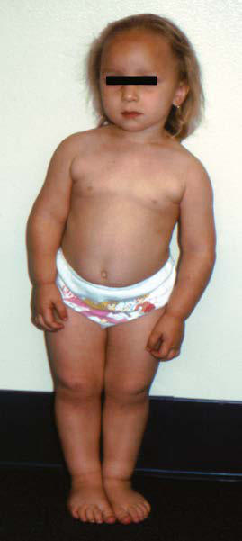

# Chapter 165: T-Cell and Combined Deficiencies

*Ramsay L. Fuleihan*

<!-- p.1624 -->
**T-CELL AND COMBINED DEFICIENCIES** T lymphocytes (T cells) play a central role in the orchestration and regula tion of the adaptive immune response. CD4 T cells help B cells synthesize specific IgG, IgA, and IgE antibodies and develop into memory B cells, help macrophages kill intracellular pathogens, and regulate the immune response. CD8 T cells kill virus-infected or malignant cells. Immune deficiency diseases that disrupt T-cell development or function are usu ally severe, affecting multiple aspects of adaptive immunity, and are thus *combined immune deficiency diseases*. A hallmark of the adaptive immune response is specific recognition of pathogen proteins via antigen receptors, the T-cell receptor (TCR) in T cells and immunoglobulin in B cells. Antigen receptors have a variable region that is formed by random rearrangement of two to three gene segments, V(D)J, allowing a large variety of antigen recognition. TCRs recognize a fragment of a protein that is presented by

the major histocompatibility complex (MHC) molecules; therefore the randomly generated variable region of the TCR needs to be able to inter act with the individual’s MHC molecules. During T-cell development in the thymus, only thymocytes with TCRs that recognize the individual’s MHC molecules are selected to survive (positive selection) and all other thymocytes die (by neglect). Among the thymocytes that survive, those with self-reactive TCRs are eliminated (negative selection) or develop into regulatory T cells to prevent autoimmune disease (Fig. 165.1). There is a symbiotic relationship between the thymus and developing thymocytes, where the absence of a thymus affects T-cell development and the absence of thymocytes leads to disruption of the thymic architecture. Pathogenic gene variants affecting any of the signaling pathways, DNA recombination, and repair enzymes as well as the thymic environment can lead to T-cell and combined immune deficiency diseases.

*Visit Elsevier eBooks+ at eBooks.Health.Elsevier.com** for Bibliography*

## 165.1  Severe Combined Immunodeficiencies Ramsay L. Fuleihan

Severe combined immunodeficiency (SCID) is caused by diverse patho genic gene variants that lead to absence of T- and B-cell function. Patients with this group of disorders have the most severe immunodeficiency.

**GENETICS AND PATHOGENESIS** SCID is caused by pathogenic variants in genes crucial for lymphoid cell development or function (Table 165.1 and Fig. 165.2). All patients with SCID have very small thymuses that contain no thymocytes and lack corticomedullary distinction and lack Hassall’s corpuscles. The thymic epithelium appears histologically normal. Both the follicular and the paracortical areas of the spleen are depleted of lymphocytes. Lymph nodes, tonsils, adenoids, and Peyer patches are absent or extremely underdeveloped.

Section **2 The T-, B-, and NK-Cell Systems**

*Ramsay L. Fuleihan*

**Fig. 165.1** Schematic representation of T- cell development in the thymus. Thymocyte precursors leave the bone marrow and enter the thymus with no expression of CD3, CD4, or CD8 (double negative T cells). Later the thymo cytes express CD3 and both CD4 and CD8. If the newly formed T-cell receptor (TCR) recog nizes major histocompatibility complex (MHC) class I or class II molecules, the thymocytes re ceive a positive selection signal and develop into CD8 or CD4 single positive thymocytes, respectively. Single positive thymocytes with TCR that recognize self-proteins will be killed by apoptosis or develop into regulatory T cells (Treg) to prevent autoimmune disease. Single positive thymocytes that are non–self-reactive leave the thymus as naïve single positive T cells ready to engage in the immune response when needed.

Thymus

**Bone marrow thymic precursors**

Double positive thymocyte

Positive selection MHC class II recognition MHC class I recognition

Self-recognition

Apoptosis

No self-recognition

CD3+ CD4+

CD3+ CD8+

Self-recognition Negative selection

Naïve single positive T cells Recent thymic emigrants

CD3– CD4– CD8–

CD3+ CD4+ CD8+

CD3+ CD4+

CD3+ CD8+

CD3+ CD4+ FoxP3+

Apoptosis Treg

CD3+ CD4+

CD3+ CD8+

<!-- p.1625 -->

<!-- p.1626 -->
The 4 most common types of SCID are the X-linked forms caused by pathogenic variants in *CD132*, autosomal recessive *RAG1* and *RAG2* defi ciencies, and adenosine deaminase (ADA) deficiency. Additional forms are listed in Table 165.1. For X-linked SCID and *ADA* deficiency, gene therapy exists, but genetic counseling is the most compelling reason for genetic sequencing to identify the pathogenic gene variant. Several spe cific pathogenic gene variants are associated with increased sensitivity to radiation and chemotherapy, and their early identification can lead to a better transplant experience by avoiding or reducing dosages of condition ing agents.

**CLINICAL MANIFESTATIONS** SCID is included in the newborn screening program in all states in the United States and in several countries around the world. Thus infants can be identified and treated prior to development of symptoms, which has dramatically improved the survival of infants with SCID. A few genetic types of SCID are not detected by newborn screening, and there are many countries where newborn screening for SCID is not yet

performed. Therefore an awareness of the clinical presentation of SCID remains important in the early diagnosis and treatment of patients.

When infants with SCID are not detected through newborn screen ing, they most often present with **infection** during infancy. Diarrhea, pneumonia, otitis media, sepsis, and cutaneous infections are common presentations. Infections with a variety of opportunistic organisms, either through direct exposure or immunization, can lead to death. Potential infectious threats include *Candida albicans, Pneumocystis jiroveci* (PJP), parainfluenza 3 virus, adenovirus, respiratory syncy tial virus (RSV), cytomegalovirus (CMV), Epstein-Barr virus (EBV), varicella-zoster virus, measles virus, and attenuated organisms from the MMRV (measles, mumps, rubella, varicella), rotavirus, oral polio, nasal influenza, yellow fever, or bacille Calmette-Guérin (BCG) vac cines. Disseminated BCG infection may be the presenting feature of SCID in countries where the vaccine is given at birth. Infants with SCID also lack the ability to reject foreign tissue and are therefore at risk for severe or fatal **graft versus host disease (GVHD)** from T lymphocytes in nonirradiated blood products or maternal immunocompetent T cells

γ/δ T cells absent HSCT

γc, Common gamma chain; AD, Autosomal dominant; AR, Autosomal recessive; GCSF, granulocyte colony-stimulating factor; HSCT, hematopoietic stem cell transplantation; IL,

#### **Table 165.1** Genetic Basis of Severe Combined Immunodeficiency and SCID Variants

| Category / Parameter | Clinical Details & Findings |
| --- | --- |
| **T–B– SCID** | Reticular dysgenesis |
| **AR** | Impaired mitochondrial energy; metabolism and leukocyte; differentiation; Severe neutropenia, deafness; Pathogenic variants in adenylate kinase 2 |
| **GCSF, HSCT** | Reticular dysgenesis |
| **AD** | Impaired hematopoiesis; Severe neutropenia but no deafness, gain-; of-function variant in RAC2 |
| **HSCT** | Adenosine; deaminase; deficiency |
| **AR** | Accumulation of toxic purine; nucleosides; Neurologic, hepatic, renal, lung, skeletal,; bone marrow abnormalities |
| **HSCT, PEG-ADA,** | gene therapy; RAG1 and RAG2; deficiency |
| **AR** | Defective V(D)J recombination; None |
| **HSCT** | Artemis deficiency |
| **AR** | Defective V(D)J recombination,; radiation sensitivity; DCLERE1C pathogenic gene variants |
| **HSCT** | DNA-PK deficiency |
| **AR** | Defective V(D)J recombination; None |
| **HSCT** | DNA ligase IV; deficiency |
| **AR** | Defective V(D)J recombination,; radiation sensitivity; Growth delay, microcephaly, bone marrow; abnormalities, lymphoid malignancies |
| **HSCT** | Cernunnos-XLF |
| **AR** | Defective V(D)J recombination,; radiation sensitivity; Growth delay, microcephaly, birdlike; facies, bone defects |
| **T–B+ SCID** | γc (CD132) deficiency |
| **XL** | Abnormal signaling via γc-ILRs (IL-2, 4,; 7, 9, 15, 21); None; HSCT, gene; therapy; Jak3 deficiency |
| **AR** | Abnormal signaling downstream of γc; None |
| **HSCT** | IL-7Rα deficiency |
| **AR** | Abnormal IL-7R signaling; Thymus absent |
| **HSCT** | CD45 deficiency |
| **AR** | None |
| **HSCT** | CD3δ deficiency |
| **AR** | Arrest of thymocytes differentiation at; CD4−CD8− stage; Thymus size may be normal |
| **HSCT** | CD3ε deficiency |
| **AR** | Arrest of thymocytes differentiation at; CD4−CD8− stage; CD3ζ deficiency |
| **AR** | Abnormal signaling; None |
| **HSCT** | Coronin-1A deficiency |
| **AR** | Abnormal T-cell egress from thymus; and lymph nodes; Normal thymus size; Attention deficit disorder |
| **HSCT** | LAT deficiency |
| **AR** | Defective T-cell development in the; thymus; Autoimmune disease |
| **AR** | Abnormal signaling; Neutrophil defect, skin abscesses, rash,; autoimmunity; HSCT attempted; interleukin; Jak3, Janus kinase 3; PEG-ADA, polyethylene glycol-modified adenosine deaminase; R, receptor; RAG1, RAG2, recombinase-activating genes 1 and 2; SCID, severe; combined immune deficiency; V(D)J, variable, diversity, joining domains; XL, X-linked.; Adapted from Roifman CM, Grunebaum E. Primary T-cell immunodeficiencies. In: Rich RR, Fleisher TA, Shearer WT, et al., eds. Clinical Immunology. 4th ed. Philadelphia: Saunders;; 2013. pp. 440-441. |

<!-- p.1627 -->
that crossed the placenta during pregnancy. The latter is usually not fatal but can be severe. This devastating presentation is characterized by expansion of the allogeneic cells, rash, hepatosplenomegaly, and diar rhea. A third presentation is often called **Omenn syndrome**, caused by hypomorphic pathogenic variants in SCID-causing genes, which allow few T cells to be generated in the infant that then expand, unregulated, and cause a clinical picture similar to GVHD (Fig. 165.3) with a severe dermatitis, lymphadenopathy, and diarrhea. The difference in this case is that the cells are the infant’s own cells. Dermatitis, especially if it is difficult to treat, failure to thrive, and infection in the first 6 months of life, particularly severe infections from commonly mild pathogens or opportunistic organisms, should raise the suspicion of SCID.

All genetic types of SCID are associated with profound immuno deficiency. A small number have other associated features or atypical features that are important to recognize. ADA deficiency can be associ ated with pulmonary alveolar proteinosis and chondroosseous dyspla sia. Adenylate kinase 2 (AK2) deficiency causes a picture referred to

as **reticular dysgenesis** where neutrophils, myeloid cells, and lympho cytes are all low. This condition is also often associated with deafness.

**DIAGNOSIS** A high index of suspicion is very important in the diagnosis of SCID. A key feature of SCID is that almost all patients will have a low lympho cyte count. Some patients may have a normal lymphocyte count from proliferation of B cells and/or natural killer (NK) cells. A combination of infection and a persistently low lymphocyte count is an indication to test for SCID. The diagnostic strategy both for symptomatic infants and those detected by newborn screening or with a family history of SCID is to perform flow cytometry to quantitate the T, B, and NK cells in the infant (Fig. 165.4). The CD45RA (naïve T-cell) and CD45RO (mem ory T-cell) markers can be helpful to identify patients with maternal engraftment or Omenn syndrome with predominantly memory T cells. Identification of a limited TCR repertoire is also helpful in the diagno sis of Omenn syndrome. T-cell function is often assessed by measuring proliferative responses to stimulation with mitogens.

Gene sequencing is often done by requesting a SCID gene panel or a more extensive primary immunodeficiency (PID) gene panel. There are certain laboratory features that predict specific gene defects. When both T and B cells are low with normal numbers of NK cells, often a gene encoding a protein involved in V(D)J recombination is the cause such as *RAG1* and *2*. Similarly, certain cytokine receptor defects are associated with specific SCID lymphocyte phenotypes, such as absent T cells and NK cells, but normal or elevated numbers of B cells in X-SCID caused by pathogenic variants in the common gamma chain (CD132) of cytokine receptors. Pathogenic variants in Janus kinase *(JAK)3*, which signal downstream of CD132, cause an autosomal reces sive form of SCID affecting both females and males, with an identical lymphocyte phenotype as X-SCID.

The diagnosis of SCID can be established by the presence of a known pathogenic gene variant, low T-cell counts with proliferative response to the mitogen phytohemagglutinin (PHA) less than 10% of a normal control, or the identification of maternal T cells in the child. In male infants, this can be determined by fluorescence in situ hybridization (FISH) for the X and Y chromosomes.

**Newborn Screening** Newborn screening for SCID has allowed the early diagnosis and treat ment of SCID, improving the outcome of therapy and changing the natural history of the disease. Newborn screening is based on quan titative polymerase chain reaction (PCR) of T-cell receptor excision circles (TRECs), which are formed during V(D)J rearrangement of the variable region of the TCR chains. These TRECs do not replicate during cell division; they are thus present in most or all recent thy mic emigrants but get diluted out as T cells divide in the periphery. The TREC assay identifies low numbers of recent thymic emigrants, which is not diagnostic of SCID, but raises suspicion to proceed with an evaluation of lymphocyte subsets and function followed by confir mation with genetic testing. Other diseases with low T-cell counts may also be identified by newborn screening and include 22Q11.2 deletion syndrome, Rac2 deficiency, trisomy 21, and idiopathic lymphopenia, which was not well appreciated until newborn screening was imple mented. In many countries, kappa excision circles (KRECs), generated during B-cell development, are assayed simultaneously with TRECs allowing a larger number of types of SCID to be identified as well as allowing identification of infants with agammaglobulinemia.

**TREATMENT* SCID is a true pediatric immunologic emergency.* Unless immunologic reconstitution is achieved through hematopoietic stem cell transplan tation (HSCT) or gene therapy, death usually occurs during the first year of life and almost invariably before 2 years of age. HSCT in the first 100 days of life or in an infant prior to infection is associated with a 95% survival rate. In patients with SCID, 92% have survived after T-cell–depleted parental marrow is given soon after birth when the infant is healthy, without pretransplant chemotherapy or posttrans plant GVHD prophylaxis, although T-cell reconstitution is improved with pretransplant conditioning including reduced-intensity protocols.

216 SCIDs: Genetic types

10 RAG 4.6%

99 γc Def 45.8%

13 Jak3 Def

6%

34 ADA Def

15.7%

1 CD3ε Def

0.5%

26 IL-7Rα Def

12%

2 CD3δ Def

0.9%

1 CD3ζ

Def 0.5%

1 CD45 Def

0.5%

13 AutoRec

6%

9 Unknown

4.2% 7 Artemis

3.2%

**Fig. 165.2** Relative frequencies of the different genetic types of se vere combined immunodeficiency (SCID) among 216 patients seen consecutively. (From Buckley RH, Orange JS. Primary immunodeficien cy diseases. In: Burks AW, Holgate ST, O’Hehir RE, et  al., eds. Mid dleton’s Allergy: Principles and Practice. 9th ed. Philadelphia: Elsevier; 2020. Fig. 69.2, p. 1126.)

**Fig. 165.3** Typical clinical features in an infant with Omenn syndrome. Note generalized erythroderma with scaly skin, alopecia, and edema. (From Notarangelo LD. T cell immunodeficiencies. In: Leung DYM, Ak dis CA, Bacharier LB, et al., eds. Pediatric Allergy Principles and Prac tice. 4th ed. Philadelphia: Elsevier; 2021. Fig 6.1.)

<!-- p.1628 -->
Bone marrow transplantation remains the most important and effec tive therapy for SCID. In ADA-deficient and X-linked SCID, there has been success in correcting the immune defects with ex vivo gene transfer to autologous hematopoietic stem cells. Initial protocols of gene therapy for X-linked SCID resulted in **insertional mutagenesis** with the development of leukemic-like clonal T cells or lymphoma in some patients. Modification of the gene therapy protocol has greatly reduced the risk of insertional mutagenesis. ADA-deficient SCID can also be treated with enzyme replacement by repeated injections of polyethylene glycol-ADA (PEG-ADA), although the immune reconsti tution achieved is not as effective as with HSCT or gene therapy. Until definitive therapy can be achieved, SCID patients should be treated with supportive care for prevention and treatment of infections with immunoglobulin replacement and microbial prophylaxis starting at 4-6 weeks of age including PJP prophylaxis as well as viral and fungal prophylaxis. Breastfeeding should be avoided if the mother is CMV or EBV positive as infection can be transmitted via breast milk.

*Visit Elsevier eBooks+ at eBooks.Health.Elsevier.com** for Bibliography.*

## 165.2  Combined Immunodeficiencies Ramsay L. Fuleihan

Combined immunodeficiency (CID) is distinguished from SCID by the presence of low but not absent T-cell function. CID is a syndrome of diverse genetic causes and, therefore, diverse clinical and laboratory char acteristics. Patients with CID may have recurrent or chronic pulmonary infections, opportunistic infections, failure to thrive, oral or cutaneous candidiasis, chronic diarrhea, recurrent skin infections, gram-negative bacterial sepsis, urinary tract infections, or severe varicella in infancy. Although they usually survive longer than infants with SCID, patients with CID fail to thrive and often die before reaching adulthood. Neutropenia

and eosinophilia are common. Serum immunoglobulins may be normal or elevated for all classes; selective IgA deficiency, marked elevation of IgE, and elevated IgM levels occur in some cases. Although antibody-forming capacity is impaired in most patients, it may not be absent.

Studies of cellular immune function may show lymphopenia, defi ciencies of T cells, specific T-cell subsets, or switched memory B cells, and extremely low but not absent lymphocyte proliferative responses to mitogens, antigens, or allogeneic cells in vitro. Peripheral lymphoid tis sues may demonstrate paracortical lymphocyte depletion. The thymus is usually small, with a paucity of thymocytes and usually no Hassall’s corpuscles.

There is a large number and variety of CIDs caused by pathogenic vari ants in many different genes. A list of known causes of CID with some of their characteristic features can be found in Tables 165.2 to 165.7.

**COMBINED IMMUNODEFICIENCIES THAT ARE GENERALLY LESS PROFOUND THAN SCID** Several types of CID are characterized by a severe immunodeficiency but affected patients tend to survive longer than patients with SCID (see Table 165.2). These patients are susceptible to severe viral, oppor tunistic, and/or fungal infections. Their laboratory features are variable from normal lymphocyte subsets to a severe deficiency of CD4, CD8, or both cell types. Invariably, T-cell function is decreased but prolif erative responses to mitogens and, in some cases, to antigens may be normal, making it difficult to have unifying laboratory characteristics for this group of diseases. The severity of clinical infection and/or the presence of a family history of CID should raise suspicion and initiate a laboratory evaluation for these diseases.

**COMBINED IMMUNODEFICIENCY FROM DEFICIENCY IN CD4 T-CELL HELPER FUNCTION** CD4 T cells play an important role in orchestrating the immune response. Helper function from CD4 T cells is critical for immuno globulin isotype switching, somatic hypermutation, and B-cell memory

MHC II deficiency

ZAP-70 deficiency

Low CD8 Low CD4

T+B+

Normal Low

Absolute lymphocytes

T+B–

Omenn syndrome

Normal CD4/

CD8

Absent Normal

PNP activity

Absent Normal

ADA activity X-linked

IL2RG

T–B+NK+ T–B+NK+ T–B– T–B+NK–

PNP deficiency

IL-7Ra, CD45,

CD3è ADA deficiency

RAG1 or

RAG2

**Fig. 165.4** Using the absolute lymphocytes count as a starting place to suggest the type of severe combined immunodeficiency (SCID) that may be present. ADA, Adenosine deaminase; MHC, major histocompatibility complex; PNP, purine nucleoside phosphorylase. (From Cunningham-Rundles C. Approach to the child with recurrent infections and molecular diagnosis. In: Leung DYM, Akdis CA, Bacharier LB, et al., eds. Pediatric Allergy Principles and Practice. 4th ed. Philadelphia: Elsevier; 2021. Fig. 4.2.)

<!-- p.1629 -->

<!-- p.1630 -->

#### **Table 165.2** Combined Immunodeficiencies Generally Less Profound Than SCID

| Category / Parameter | Clinical Details & Findings |
| --- | --- |
| **TREATMENT** | CD40 Ligand (CD154) |
| **XL** | Defective CD40 ligand:CD40 signaling; Opportunistic infections, neutropenia,; biliary tract and liver disease/cancer,; neuroectodermal cancer |
| **AR** | Defective CD40 ligand:CD40 signaling; Opportunistic infections, neutropenia,; biliary tract and liver disease |
| **AR** | Autoimmunity, gastroenteritis,; granulomas; ICOS Ligand |
| **AR** | Decreased T and B cells; Neutropenia; CD3γ |
| **AR** | Low TCR expression; Autoimmunity of variable severity |
| **AR** | Absent CD8 T cells; May be asymptomatic |
| **AR** | Low CD8 T cells, poor CD4 T-cell; function; May have immune dysregulation,; autoimmunity |
| **AR** | Low CD8 T cells; Severe autoimmunity, bullous; pemphigoid, inflammatory colitis |
| **HSCT** | MHC class I (TAP1,; TAP2, TAPBP, β2-; microglobulin) |
| **AR** | Low CD8 T cells, absent MHC I on; lymphocytes and thymic epithelium; Vasculitis, pyoderma gangrenosum; MHC class II (CIITA, |
| **AR** | Low CD4 T cells absent MHC II on; lymphocytes and thymic epithelium; Failure to thrive, liver biliary tract disease |
| **AD** | No memory T cells or B cells; Opportunistic infections, early CID onset |
| **AR** | Low T cells and poor NK cell function; Invasive herpesvirus infections, poor; interferon responses; Polymerase and |
| **AR** | Low CD4 T cells; Skin infections, warts and molluscum,; short stature, intellectual disability |
| **AR** | Restricted TCR repertoire; HPV infection, lung granulomas,; molluscum, lymphoma |
| **AR** | Low CD4 T cells; Intermittent neutropenia, viral and; Candida infection, lymphoproliferation,; autoimmune cytopenias, lymphoma,; congenital heart disease; TCRα |
| **AR** | Absent TCRαβ; Immune dysregulation, autoimmunity,; diarrhea |
| **AR** | Poor TCR signaling, low CD4 T cells and; low regulatory T cells, restricted TCR; repertoire; Immune dysregulation, autoimmunity |
| **AR** | Decreased T-cell activation, progressive; decline in CD4 T cells; EBV-associated B-cell lymphoproliferation,; immune dysregulation |
| **AR** | Poor T-cell proliferation |
| **AR** | Poor T-cell proliferation; Opportunistic infections |
| **AR** | Poor T-cell antigen or anti-CD3 proliferation,; few memory T cells and Tregs; Candidiasis, gastroenteritis |
| **AR** | Low T-cell function, low memory/; switched B cells; Opportunistic infections, liver disease |
| **AR** | Low cytokine production, low T-cell; antigen proliferation |
| **AR** | Low Ag-specific memory CD4 T cells; Impaired immunity to HHV8, Kaposi’s; sarcoma |
| **AR** | Impaired TCR activation, absent Treg; and γ/δ T cells; Opportunistic infections |
| **AR** | Poor T-cell antigen proliferation, low; switched memory B cells; Cryptosporidium infection; RelB |
| **AR** | Reduced TCR diversity with poor; proliferation to mitogens and absent; to antigens |

<!-- p.1631 -->

#### **Table 165.2** Combined Immunodeficiencies Generally Less Profound Than SCID—cont’d

| Category / Parameter | Clinical Details & Findings |
| --- | --- |
| **TREATMENT** | RelA; haploinsufficiency |
| **AD** | Impaired NFκB activation with decreased; inflammatory cytokines; Chronic mucocutaneous ulceration; Moesin |
| **XL** | Defective T-cell migration and; proliferation; Varicella infections, neutropenia |
| **AR** | Poor T-cell proliferation, low memory B; cells; Neutropenia, thrombocytopenia; c-Rel |
| **AR** | Poor T- and B-cell proliferation, low; memory CD4 and low memory B cells; Mycobacteria and Salmonella infections,; opportunistic infections, defective; innate immunity |
| **AR** | Poor T-cell proliferation; Mycobacterial infections,; lymphoproliferation, failure to thrive; Ag, antigen; AD, Autosomal dominant; AR, autosomal recessive; CID, combined immune deficiency; EBV, Epstein-Barr virus; HHV8, human herpesvirus-8; HPV, human papillomavirus;; HSCT, hematopoietic stem cell transplantation; IL, interleukin; GOF, gain of function; LOF, loss of function; MHC, major histocompatibility complex; NK, natural killer; R, receptor;; TCR, T-cell receptor; Treg, regulatory T cell; XL, X-linked.; Adapted from Tangye SG, Al-Herz W, Bousfiha A, et al. Human inborn errors of immunity: 2022 update on the classification from the International Union of Immunological Societies; Expert Committee. J Clin Immunol 2022;42:1473–1507. |

#### **Table 165.3** DNA Repair Defects Other Than Causing SCID

| Category / Parameter | Clinical Details & Findings |
| --- | --- |
| **TREATMENT** | Ataxia-telangiectasia |
| **AR** | Progressive decrease in T cells,; poor T-cell proliferation; Ataxia, telangiectasia,; elevated IgM,; lymphoreticular; malignancy, increased; radiosensitivity,; chromosomal instability; and translocations; Ig replacement,; supportive care,; avoid ionizing; radiation; Nijmegen breakage; syndrome |
| **AR** | Progressive decrease in T cells; Microcephaly, dysmorphic; features, lymphomas and; solid tumors, hyper-IgM; Ig replacement,; supportive care,; avoid ionizing; radiation; Bloom syndrome |
| **AR** | Marrow failure, low Ig; Short stature, dysmorphic; facies, sun-sensitive; erythema, leukemia,; lymphoma,; chromosomal instability; Ig replacement,; supportive care,; avoid ionizing; radiation; Immunodeficiency; with centromeric; instability and facial; anomalies (ICF; types 1, 2, 3, 4) |
| **AR** | Decreased T cells, decreased; response to PHA,; hypogammaglobulinemia with; variable antibody deficiency; Facial dysmorphism,; developmental; delay, macroglossia,; opportunistic infections,; malabsorption,; cytopenias, malignancies,; multiradial configurations; of; chromosomes 1, 9, 16; Ig replacement,; supportive care,; avoid ionizing; radiation; PMS2 deficiency |
| **AR** | Low B cells, abnormal; antibody responses; Café-au-lait spots,; hyper-IgM, lymphoma,; colorectal; carcinoma, brain tumors; Ig replacement,; supportive care,; avoid ionizing; radiation; Radiosensitivity,; immune deficiency,; dysmorphic; features, learning; difficulties (RIDDLE); syndrome |
| **AR** | Low IgG or IgA; Short stature, mild defects; of motor control to; ataxia, may have learning; difficulties; Ig replacement,; supportive care,; avoid ionizing; radiation; MCM4 deficiency |
| **AR** | Low number and; function of NK cells; Short stature, B-cell; lymphoma, adrenal failure; Supportive care,; avoid ionizing; radiation; Polymerase ε subunit; 1 deficiency (FILS; syndrome) |
| **AR** | Decreased T-cell; proliferation; Short stature, facial; dysmorphism, livedo; Ig replacement,; supportive care,; avoid ionizing; radiation |

<!-- p.1632 -->

#### **Table 165.4** Immunoosseous Dysplasias

| Category / Parameter | Clinical Details & Findings |
| --- | --- |
| **TREATMENT** | Cartilage hair; hypoplasia |
| **AR** | Normal to severely; decreased T-cell counts; Decreased T-cell; proliferation; Short-limbed dwarfism with; metaphyseal dysostosis, sparse; hair, bone marrow failure,; autoimmunity, susceptibility to; lymphoma and other cancers,; impaired spermatogenesis,; neuronal dysplasia of the intestine; HSCT for the; immunodeficiency; Schimke immuno; osseous dysplasia |
| **AR** | Decreased T cells; Short stature, spondyloepiphyseal; dysplasia, intrauterine growth; restriction; nephropathy; bacterial,; viral, fungal infections; may; present as; SCID; bone marrow failure; HSCT for the; immunodeficiency; MYSM1 deficiency |
| **AR** | Decreased T cells,; naïve T cells, and NK cells; B-cell deficiency with; hypogammaglobulinemia; Short stature; recurrent infections;; congenital bone marrow failure,; myelodysplasia; immunodeficiency; affecting B cells and granulocytes;; skeletal anomalies;; cataracts; developmental delay; HSCT for the; immunodeficiency; MOPD1 deficiency; (Roifman; syndrome) |
| **AR** | Decreased NK cell function; Decreased total and; memory B cells; Hypogammaglobulinemia,; variably decreased; specific antibodies; Recurrent bacterial infections;; lymphadenopathy;; spondyloepiphyseal dysplasia,; extreme intrauterine growth; restriction; retinal dystrophy; facial; dysmorphism; may present with; microcephaly; short stature; HSCT for the; immunodeficiency; Immunoskeletal; dysplasia with; neurodevelopmental; abnormalities (EXTL3; deficiency) |
| **AR** | Decreased T cells,; decreased to normal Ig; levels; Short stature; cervical spinal; stenosis, neurodevelopmental; impairment;; eosinophilia; may have early; infant; mortality; HSCT for the; immunodeficiency; AR, Autosomal recessive; HSCT, hematopoietic stem cell transplantation; Ig, immunoglobulin; NK, natural killer; SCID, severe combined immune deficiency.; Adapted from Tangye SG, Al-Herz W, Bousfiha A, et al. Human inborn errors of immunity: 2022 update on the classification from the International Union of Immunological Societies; Expert Committee. J Clin Immunol 2022;42:1473–1507. |

#### **Table 165.3** DNA Repair Defects Other Than Causing SCID—cont’d

| Category / Parameter | Clinical Details & Findings |
| --- | --- |
| **TREATMENT** | Polymerase ε; subunit 2; deficiency |
| **AR** | Lymphopenia, absent; T-cell proliferation to Ags,; hypogammaglobulinemia; Disseminated BCG,; autoimmunity (type 1; diabetes), hypothyroidism,; facial dysmorphism; Ig replacement,; supportive care,; avoid ionizing; radiation; Ligase 1 deficiency |
| **AR** | Lymphopenia, increased γ/δ; T cells, decreased T-cell; proliferation,; hypogammaglobulinemia; antibody deficiency; Growth restriction, sun; sensitivity, radiation; sensitivity, macrocytic RBC; Ig replacement,; supportive care,; avoid ionizing; radiation |
| **NSMCE3** | deficiency |
| **AR** | Decreased T cells and T-cell; response to mitogens and; antigens; Thymic hypoplasia,; severe lung disease,; chromosomal breakage,; radiation sensitivity; Ig replacement,; supportive care,; avoid ionizing; radiation |
| **ERCC6L2** | deficiency |
| **AR** | Lymphopenia; Facial dysmorphism,; microcephaly, bone; marrow failure; Supportive care,; avoid ionizing; radiation; GINS1 deficiency |
| **AR** | Low NK cells, high IgA with; low IgM and IgG; Neutropenia, IUGR; Supportive care,; avoid ionizing; radiation; Ag, Antigen; AR, Autosomal recessive; BCG, bacilli Calmette-Guérin; FILS, facial dysmorphism, immunodeficiency, livedo, and short stature; ICF, instability, centromeric, facial anoma; lies; Ig, immunoglobulin; IUGR, intrauterine growth retardation; NK, natural killer; PHA, phytohemagglutinin; RBC, red blood cell.; Adapted from Tangye SG, Al-Herz W, Bousfiha A, et al. Human inborn errors of immunity: 2022 update on the classification from the International Union of Immunological Societies; Expert Committee. J Clin Immunol 2022;42:1473–1507. |

<!-- p.1633 -->
*Continued*

#### **Table 165.5** Other Combined Immunodeficiencies

| Category / Parameter | Clinical Details & Findings |
| --- | --- |
| **TREATMENT** | PNP deficiency |
| **AR** | Progressive decrease in T cells; Autoimmune hemolytic anemia,; neurologic impairment |
| **HSCT** | Immunodeficiency; with multiple; intestinal atresias |
| **AR** | Variable T-cell counts but may be; as low as SCID with low TRECs; at NBS; Multiple intestinal atresias,; intrauterine polyhydramnios,; early demise, bacterial (sepsis),; viral and fungal infections; HSCT for; severe T-cell; deficiency; Trichohepatoenteric; syndrome (THES) |
| **AR** | Impaired IFNγ production,; variably low switched memory B; cells, hypogammaglobulinemia,; may have low antibody; responses; Respiratory infections; IUGR;; facial dysmorphic features,; wooly hair; early-onset; intractable diarrhea, liver; cirrhosis; platelet abnormalities; Hepatic venoocclusive; disease with; immunodeficiency |
| **AR** | Decreased memory T and B cells;; low IgG, IgA, and IgM; absent; germinal centers and tissue; plasma cells; Hepatic venoocclusive disease; Susceptibility to opportunistic; infections: PJP, CMV, Candida; Thrombocytopenia,; hepatosplenomegaly,; cerebrospinal leukodystrophy; BCL11B deficiency |
| **AD** | Decreased T-cell counts with poor; proliferation; Congenital abnormalities,; neonatal teeth, dysmorphic; facies; absent corpus callosum,; neurocognitive deficits; EPG5 deficiency; (Vici syndrome) |
| **AR** | Very low CD4 T cells, decreased; Ig levels especially IgG2,; defective B cells; Chronic mucocutaneous; candidiasis, recurrent; infections, agenesis of the; corpus callosum, microcephaly,; cataracts; cardiomyopathy,; skin hypopigmentation,; intellectual disability; HOIL1 deficiency |
| **AR** | Decreased memory B cells with; poor antibody response to; polysaccharide antigens; Bacterial infections,; autoinflammation,; amylopectinosis; HOIP deficiency |
| **AR** | Decreased memory B cells with; decreased Ig levels; Bacterial infections,; autoinflammation,; amylopectinosis,; lymphangiectasia; Hennekam; lymphangiectasia-; lymphedema; syndrome |
| **AR** | Variably decreased T- and B-cell; counts, decreased Ig levels; Facial anomalies and other; dysmorphic features,; lymphangiectasia and; lymphedema; Activating de novo; mutations in; nuclear factor,; erythroid 2-like |
| **AD** | Decreased switched memory B; cells, hypogammaglobulinemia; and decreased antibody; responses; Recurrent respiratory and skin; infections; growth restriction,; developmental delay; white; matter cerebral lesions;; increased level of homocysteine;; increased expression of stress; response genes; STAT5b deficiency |
| **AR** | Slightly decreased T cells, decreased; Treg number and function,; hypogammaglobulinemia with; elevated IgE; Growth-hormone insensitive; dwarfism, dysmorphic; features, eczema, lymphocytic; interstitial pneumonitis,; autoimmunity; STAT5b deficiency |
| **STAT5B** | AD (dominant; negative; variants); Increased IgE; Growth failure, eczema, lack; immune defects of AR; STAT5b deficiency; Kabuki syndrome; (type 1 and 2) |
| **AD** | XL (females may; be affected); Low IgA, occasionally low IgG; Typical facial abnormalities,; cleft or high arched palate,; skeletal abnormalities, short; stature; intellectual disability;; congenital heart defects;; recurrent infections (otitis; media, pneumonia);; autoimmunity |

<!-- p.1634 -->

#### **Table 165.6** Thymic Disorders

| Category / Parameter | Clinical Details & Findings |
| --- | --- |
| **TREATMENT** | DiGeorge/Velocardio; facial syndrome/; chromosome; 22Q11.2 deletion; syndrome TBX1; deficiency; 22Q11.2del including |
| **TBX1, TBX1** | Unknown |
| **AD** | (Unknown defects; are sporadic); Variable T-cell counts,; may have low TRECs; at NBS, may have; hypogammaglobulinemia; Conotruncal; cardiac defects,; hypoparathyroidism,; abnormal facies,; velopalatal; insufficiency,; intellectual disability,; autoimmunity; Thymic transplant; for severe T-cell; deficiency; CHARGE syndrome |
| **SEMA3E** | Unknown |
| **AD** | Variable T-cell counts,; may have low TRECs; at NBS, may have; hypogammaglobulinemia; Coloboma of eye;; heart anomaly;; choanal atresia;; intellectual; disability; genital; and ear anomalies |
| **(CHARGE), CNS** | malformation; Thymic transplant; for severe T-cell; deficiency; Winged helix nude; FOXN1 deficiency |
| **AR** | Very low T cells,; decreased Ig levels; Severe infections,; abnormal thymic; epithelium,; congenital alopecia,; nail dystrophy,; neural tube defect; Thymic transplant; attempted |
| **FOXN1** | haploinsufficiency |
| **AD** | Severe T-cell lymphopenia; at birth, normal by; adulthood; Recurrent, viral and; bacterial respiratory; tract infections;; (eczema, dermatitis),; nail dystrophy; Chromosome; 10p13-p14 deletion; syndrome (10p13-; p14DS); 10p13-p14del |
| **AD** | T-cell lymphopenia; rarely with decreased; proliferation to mitogens; and antigens, may have; hypoplastic thymus; Hypoparathyroidism,; renal disease,; deafness, growth; retardation, facial; dysmorphism,; cardiac defects; may be present,; may have recurrent; infections; Chromosome 11q; deletion syndrome; (Jacobsen syndrome); 11q23del |
| **AD** | T-, B-, and NK cell; lymphopenia, low; switched memory B cells,; variable Ig levels and; antibody responses; Recurrent respiratory; infections; multiple; warts; facial; dysmorphism,; growth retardation; Ig replacement; for antibody; deficiency |
| **AR** | Absent thymus; Omenn-like syndrome; HSCT attempted,; thymic; transplantation; attempted; AD, Autosomal dominant; AR, Autosomal recessive; del, deletion; CNS, central nervous system; HSCT, hematopoietic stem cell transplantation; TREC, T-cell receptor excision circle;; NBS, newborn screening; Ig, immunoglobulin.; Adapted from Tangye SG, Al-Herz W, Bousfiha A, et al. Human inborn errors of immunity: 2022 update on the classification from the International Union of Immunological Societies; Expert Committee. J Clin Immunol 2022;42:1473–1507. |

#### **Table 165.5** Other Combined Immunodeficiencies—cont’d

| Category / Parameter | Clinical Details & Findings |
| --- | --- |
| **TREATMENT** | KMT2A deficiency; (Wiedemann-; Steiner syndrome) |
| **AD** | Decreased memory B cells,; hypogammaglobulinemia with; decreased antibody responses; Respiratory infections; short; stature; hypertelorism; hairy; elbows; developmental delay,; intellectual disability; AD, Autosomal dominant; AR, Autosomal recessive; CMV, cytomegalovirus; HSCT, hematopoietic stem cell transplantation; IFN, interferon; Ig, immunoglobulin; IUGR, intrauterine; growth retardation; NBS, newborn screening; PJP, Pneumocystis jiroveci; PNP, purine nucleoside phosphorylase; SCID, severe combined immune deficiency; TREC, T-cell receptor; excision circle; Treg, regulatory T cells; XL, X-linked.; Adapted from Tangye SG, Al-Herz W, Bousfiha A, et al. Human inborn errors of immunity: 2022 update on the classification from the International Union of Immunological Societies; Expert Committee. J Clin Immunol 2022;42:1473–1507. |

<!-- p.1635 -->

#### **Table 165.7** Hyper IgE Syndromes

| Category / Parameter | Clinical Details & Findings |
| --- | --- |
| **TREATMENT** | HIE (Job; syndrome) |
| **AD (DN LOF)** | Decreased response to; STAT3-activating cytokines;; decreased Th17, T follicular; helper, MAIT, NKT cells,; reduced memory B cells,; elevated IgE; Coarse facial features, broad nasal bridge;; staphylococcal abscesses, eczema,; pneumatoceles, pulmonary Aspergillus,; PJP, mucocutaneous candidiasis;; hyperextensible joints, osteoporosis and; bone fractures, scoliosis, retained primary; teeth; coronary and cerebral aneurysms; Bacterial; and fungal; prophylaxis |
| **DOCK8** | deficiency |
| **AR** | T-cell lymphopenia with poor; proliferation, few Tregs with; poor function, reduced MAIT; and NKT cells, very high IgE; Low NK cells with poor function; Eosinophilia, recurrent infections, cutaneous; viral, fungal and staphylococcal infections,; severe atopy/allergic disease, cancer diathesis |
| **HSCT** | IL-6 receptor; deficiency |
| **AR** | Decreased switched memory B; cells, very high IgE; Recurrent pyogenic infections, cold abscesses,; elevated IL-6 levels; Bacterial; prophylaxis; IL-6 signal; transducer |
| **(IL6ST)** | deficiency |
| **AR** | Decreased Th17 cells, reduced; memory B cells, high IgE,; variable antibody responses; Bacterial infections, abscesses, eczema,; pulmonary abscesses, pneumatoceles;; bone fractures; scoliosis; retention of; primary teeth; craniosynostosis; Bacterial; prophylaxis |
| **AD (DN)** | Increased Th2, naïve T cells,; low memory T and B cells,; low to normal NK cell counts,; elevated IgE with normal or; low IgG; Similar to AD HIE syndrome: dermatitis/; eczema, eosinophilia, recurrent skin; infections, pneumonia, bronchiectasis,; pneumatoceles, pulmonary aspergillosis,; connective tissue defects (scoliosis, face,; joints, fractures, palate, tooth retention); Bacterial; and fungal; prophylaxis |
| **AR (LOF)** | Death in utero or in neonatal; period; Fatal Stuve-Wiedemann-like syndrome;; skeletal dysplasia, lung dysfunction,; renal abnormalities, thrombocytopenia,; dermatitis, eczema, defective acute phase; response, complete unresponsiveness to; IL-6 family cytokines; None |
| **ZNF341** | deficiency |
| **AR** | Decreased Th17 and NK cells,; reduced memory B cells,; decreased response to STAT3-; activating cytokines; Similar to AD-HIE: mild facial dysmorphism;; early-onset eczema, mucocutaneous; candidiasis, bacterial skin infections,; Staphylococcus aureus abscesses, recurrent; bacterial respiratory infections, pneumatoceles;; hyperextensible joints; bone fractures and; retention of primary teeth; Bacterial; and fungal; prophylaxis |
| **ERBIN** | deficiency |
| **AD** | Increased Treg, moderate; increased IgE; Susceptibility to S. aureus, eczema, recurrent; respiratory infections, hyperextensible; joints, scoliosis, arterial dilatation in some; patients; Bacterial; prophylaxis; Loeys-Dietz; syndrome |
| **AD** | Elevated IgE; Recurrent respiratory infections; eczema,; food allergies; hyperextensible joints,; scoliosis, retention of primary teeth; aortic; aneurysms; Bacterial; prophylaxis; Comèl-; Netherton; syndrome |
| **AR** | Low memory B cells, elevated; IgE and IgA, variable antibody; responses; Congenital ichthyosis, bamboo hair, atopic; diathesis, bacterial infections, failure to; thrive; Bacterial; prophylaxis; Ig; replacement; for antibody; deficiency |
| **PGM3** | deficiency |
| **AR** | May have low T cells, B cells,; memory B cells, normal or; elevated IgG, IgA, and high; IgE, eosinophilia; Severe atopy; autoimmunity; bacterial and; viral infections; short stature, brachydactyly,; dysmorphic facial features; intellectual; disability and cognitive impairment, delayed; CNS myelination in some patients |
| **CARD11** | deficiency |
| **AD** | Defective T-cell activation; and proliferation, high IgE,; Th2 skewing, poor specific; antibody production,; impaired activation of; the NF-κB and mTORC1; pathways; Variable atopy, eczema, food allergy,; eosinophilia; cutaneous viral infections,; recurrent respiratory infections; lymphoma; |
| **CID** | Ig replacement; for antibody; deficiency; AD, Autosomal dominant; AR, Autosomal recessive; CID, combined immunodeficiency; CNS, central nervous system; DN, dominant negative; HIE, hyper-IgE; Ig, immunoglobulin;; IL, interleukin; IL6ST, gp130 common signal transducer of the IL-6 cytokine family; LOF, loss of function; MAIT, mucosal-associated invariant T cells; NKT, natural killer T cells; PJP,; Pneumocystis jiroveci; Th, T helper; Treg, regulatory T cells.; Adapted from Tangye SG, Al-Herz W, Bousfiha A, et al. Human inborn errors of immunity: 2022 update on the classification from the International Union of Immunological Societies |

<!-- p.1636 -->
formation as well as helping macrophages kill intracellular pathogens. In addition, patients with poor or absent CD4 T-cell helper function are susceptible to opportunistic infection. The consequences of defects in CD40 ligand and CD40 highlight the role CD4 T-cell–dependent helper function plays in immunity.

**CD40 LIGAND AND CD40 DEFICIENCY** CD40 ligand (CD154) deficiency (X-linked) and similarly, CD40 defi ciency (autosomal recessive), cause a severe form of **hyper-IgM syn drome** that is a CID.

**Genetics and Pathogenesis** Pathogenic variants in the CD40 ligand or CD40 genes, disrupt the interaction between CD4 T cells and antigen-presenting cells (APCs): dendritic cells, monocytes/macrophages, and B cells. CD40 ligand is expressed on activated CD4 T cells and delivers signals to APC via CD40 to stimulate expression of co-stimulatory molecules that help T-cell activation and differentiation, immunoglobulin isotype switch ing and somatic hypermutation in B cells as well as memory B-cell development, and signals to macrophages to kill intracellular patho gens. Therefore disruption of the CD40 signaling pathway affects sev eral key elements of the adaptive immune response leading to a CID disease characterized by failure of immunoglobulin isotype switch ing, a process important for synthesis of IgG, IgA, and IgE antibodies; failure of somatic hypermutation, a process by which B cells generate antibodies of higher affinity; and absent B-cell memory, susceptibil ity to opportunistic infections including PJP, and *Cryptosporidium* and enhanced susceptibility to some cancers especially of the liver or of neuroectodermal origin.

**Clinical Manifestations** Recurrent and opportunistic infections usually develop in the first year of life. About half the patients present with PJP pneumonia. Recurrent bacterial sinopulmonary infections are also common as well as *Cryp tosporidium* infection and sclerosing cholangitis. Chronic or recurrent neutropenia is also a feature of this disease, although the pathogenesis of neutropenia is not well known. Patients have a higher susceptibility to cancer of the liver or biliary tree as well as primitive neuroectodermal car cinoma, which usually develop after the first 10 years of life. Few patients survive beyond 30 years of age. Some patients with milder genetic varia tions present in adolescence with parvovirus-induced aplastic anemia.

**Diagnosis** Serum immunoglobulin levels show very low or absent IgG, IgA, and IgE, with normal or elevated IgM. Some patients have normal serum IgA levels, likely the result of a non–CD40-dependent isotype switch ing mechanism. The term hyper-IgM is a misnomer because most patients are identified before they have elevation of serum IgM levels. Lymphocyte subsets as well as lymphocyte proliferation to mitogens are usually normal. Characteristically, there is an absence or paucity of switched memory B cells. Patients may or may not have neutropenia, which can be severe. Flow cytometry for expression of CD40 on resting B cells or CD40 ligand on activated T cells can identify patients with these defects. Staining for CD40 ligand expression with soluble CD40 will identify all CD40 ligand variants that prevent binding to CD40. Gene sequencing of CD40 and CD40 ligand can be done separately or within a larger PID gene panel with known pathogenic variants con firming the disease.

**Treatment** Patients should be treated with immunoglobulin replacement therapy and PJP prophylaxis as soon as the diagnosis is suspected. Attention to hygiene and clean drinking water as well as avoiding swimming in lakes will help prevent exposure to opportunistic organisms such as *Cryptosporidium*. HSCT can be curative and is recommended if the patient has a matched related or unrelated donor. Outcomes after stem cell transplantation have a trend toward improved survival and a reduced risk for cancer and improved quality of life.

**MHC CLASS II DEFICIENCY AND OTHER CAUSES OF CD4 T-CELL DEFICIENCY** MHC class I and II molecules play an important role in T-cell develop ment and function by presenting a peptide fragment from a pathogenderived protein to the TCR of CD8 or CD4 T cells, respectively. MHC class II molecules are required for processing and presentation of pep tides derived from exogenous antigens to CD4 T cells and for posi tive selection of CD4 T cells in the thymus. Therefore MHC class II deficiency is a severe form of **bare lymphocyte syndrome** resulting in decreased CD4 T cells and impairment in their function.

**Clinical Manifestations** Patients with low, or occasionally normal, CD4 T-cell numbers from MHC class II deficiency are susceptible to bacterial, viral, fungal, and opportunistic infections. Patients usually present in the first year of life with respiratory infections, chronic diarrhea, and failure to thrive. *Cryptosporidium* infections may be associated with sclerosing cholan gitis and liver failure.

**Genetics and Pathogenesis** MHC class II deficiency results from defects in genes encoding for transcription factors necessary for expression of MHC class II mole cules from the HLA-DR, HLA-DP, and HLA-DQ loci including CIITA, RFXANK, RFX5, and RFXAP, which explains the concomitant loss of expression from all three loci.

**Diagnosis** Immunodeficiencies with MHC class II deficiency can be identified by absent or low CD4 T cells on lymphocyte phenotyping by flow cytom etry and absent MHC class II molecules. In some cases, CD8 T-cell numbers are also decreased. Lymphocyte proliferation to mitogens is normal but absent in response to antigens.

**Treatment** The prognosis for MHC class II deficiency is poor with most patients dying in the first decade of life. HSCT has been performed and improves CD4 T-cell proliferation but not numbers because it does not correct the expression of MHC class II molecules on thymic epithelial cells. The outcome of HSCT in MHC class II deficiency is not as good as in SCID and other severe immunodeficiency diseases.

**MHC CLASS I DEFICIENCY AND OTHER CAUSES OF CD8 T-CELL DEFICIENCY** MHC class I molecules play an important role in T-cell development and function by presenting a peptide fragment from an intracellular patho gen, such as viruses, or cancer-derived proteins to the TCR of CD8 T cells. In the thymus, MHC class I molecules provide the positive selec tion signal for thymocytes to develop into CD8 T cells. Therefore the absence of MHC class I molecules in the thymus (and on all nucleated cells) is associated with very low or absent CD8 T cells. There are several other pathogenic gene variants that cause a deficiency in CD8 T cells.

**Genetics and Pathogenesis** MHC class I deficiency results from pathogenic variants in the trans porter associated with antigen processing (TAP) 1 or 2, TAP binding protein, or β2-microglobulin genes. The TAP proteins play an impor tant role in allowing the expression of MHC class I molecules on the surface of all nucleated cells and β2-microglobulin associates with MHC class I molecules on the surface of cells.

**Clinical Manifestations** Patients with low CD8 T cells from MHC class I deficiency may be asymptomatic in some cases but may present with chronic respiratory infections including bronchiectasis and granulomatous skin ulcers.

**Diagnosis** Immunodeficiency patients with MHC class I deficiency can be identi fied by absent or low CD8 T cells on lymphocyte phenotyping by flow

<!-- p.1637 -->
cytometry and absent MHC class I molecules. Lymphocyte prolifera tion is normal.

**Treatment** MHC class I deficiency is treated with supportive therapy and avoid ance of immunosuppression if possible.

**OTHER FORMS OF CD8 DEFICIENCY CD8 α**** Gene Defects** CD8 deficiency also results from pathogenic variants in the CD8 α gene. Patients are susceptible to bacterial and viral respiratory infec tions. CD8 T-cell numbers are low and there is an increase in CD4- CD8- T cells. Lymphocyte proliferation is normal. CD8 α deficiency is also treated with supportive therapy and avoidance of immunosup pression if possible.

**Defects in the Zeta-Associated Protein 70** The zeta-associated protein (ZAP-70) is a severe immunodeficiency similar to SCID with absent or very low numbers of CD8 T cells. Although CD4 T cells develop in adequate numbers, they are defec tive in proliferation and function. Patients with ZAP-70 deficiency are susceptible to all types of infection including opportunistic infections, disseminated varicella, and mucocutaneous candidiasis with failure to thrive and diarrhea. The diagnosis of ZAP-70 deficiency can be made by low CD8 T-cell counts and deficient T-cell proliferation to mitogens that can be rescued by bypassing ZAP-70 signaling with phorbol ester and ionomycin, helping confirm that the defect is in the proximal sig naling pathway in T cells. The diagnosis is confirmed by identification of a homozygous or combined heterozygous pathogenic variant in the ZAP-70 gene. Treatment of ZAP-70 deficiency requires HSCT. Immu noglobulin replacement and microbial prophylaxis should be initiated until immune reconstitution after HSCT is achieved.

**COMBINED IMMUNODEFICIENCIES WITH 
 CONGENITAL THROMBOCYTOPENIA Wiskott-Aldrich Syndrome** Wiskott-Aldrich syndrome (WAS) is an X-linked recessive disorder characterized by atopic dermatitis, thrombocytopenic purpura with normal-appearing megakaryocytes but small defective platelets, and susceptibility to infection.

**Genetics and Pathogenesis** The Wiskott-Aldrich syndrome protein (WASP) controls the assembly of actin filaments required for cell migration and cell-cell interactions. Specific pathogenic variants in the WASP gene cause X-linked throm bocytopenia (XLT) without immunodeficiency and gain-of-function variants cause X-linked severe congenital neutropenia. A similar phe notype to WAS occurs with pathogenic variants in the WASP interac tive Protein (WIP) that is an autosomal recessive disease affecting both females and males.

**Clinical Manifestations** Patients often have prolonged bleeding from the circumcision site or bloody diarrhea during infancy. The thrombocytopenia is not caused initially by antiplatelet antibodies, although autoimmunity may develop later in life. **Atopic dermatitis** and **recurrent infections** usually develop during the first year of life. *Streptococcus pneumoniae* and other bacteria having polysaccharide capsules cause otitis media, pneumonia, meningitis, and sepsis. Later, infections with agents such as *P. jiroveci* and the herpesviruses become more frequent. Infections, bleeding, and EBV-associated malignancies are major causes of death.

**Diagnosis** The predominant immunoglobulin pattern is a low serum level of IgM, elevated IgA and IgE, and a normal or slightly low IgG. Percent ages of T cells are moderately reduced, and lymphocyte responses to mitogens are variably depressed. The presence of low numbers of platelets that are small in size is typical. Immunologically, patients with this defect uniformly have an impaired humoral immune response to

polysaccharide antigens, as evidenced by absent or greatly diminished isohemagglutinins, and poor or absent antibody responses after immu nization with polysaccharide vaccines. In addition, antibody responses to protein and conjugate vaccines may also be diminished.

**Treatment** Good supportive care includes appropriate nutrition, immunoglobu lin replacement, use of killed vaccines, and aggressive management of eczema and associated cutaneous infections. Because of their profound antibody deficiency, these patients should be given immunoglobulin replacement regardless of their serum levels of the different immuno globulin isotypes. HSCT is the treatment of choice when a high-quality matched donor is available and is usually curative. Gene therapy has resulted in sustained benefits in several patients. As in X-SCID, early tri als of gene therapy were associated with the development of malignancy.

In addition to WAS and WIP deficiency, there is a third cause of immunodeficiency with thrombocytopenia from pathogenic variants in the *ARPC1B* gene affecting Arp2/3-mediated filament branching presenting with mild thrombocytopenia but normal-sized platelets and recurrent infections. Patients have high IgA and IgE as in WAS.

**DNA REPAIR DEFECTS OTHER THAN THOSE CAUSING SCID** DNA repair plays an important role during lymphocyte development and differentiation including V(D)J recombination and immunoglob ulin isotype switching. Therefore defects in DNA repair enzyme are frequently associated with CID and many have other characteristic fea tures to identify them (see Table 165.3).

**ATAXIA-TELANGIECTASIA** Ataxia-telangiectasia is a complex syndrome with immunologic, neu rologic, endocrinologic, hepatic, and cutaneous abnormalities.

**Genetics and Pathogenesis** The ataxia-telangiectasia pathogenic variant *(ATM)* gene encodes a protein critical for responses to DNA damage. Cells from patients, as well as from heterozygous carriers, have increased sensitivity to ion izing radiation, defective DNA repair, and frequent chromosomal abnormalities.

In vitro tests of lymphocyte function have generally shown moder ately depressed proliferative responses to T- and B-cell mitogens. Per centages of CD3 and CD4 T cells are moderately reduced, with normal or increased percentages of CD8 T cells and elevated numbers of γ/δ T cells. The thymus is very hypoplastic, exhibits poor organization, and lacks Hassall’s corpuscles.

**Clinical Manifestations** The most prominent clinical features are progressive cerebellar ataxia, oculocutaneous telangiectasias, chronic sinopulmonary disease, a high incidence of malignancy, and variable humoral and cellular immuno deficiency. Ataxia typically becomes evident soon after these children begin to walk and progresses until they are confined to a wheelchair, usually by age 10-12 years. The telangiectasias begin to develop at 3-6 years of age, contributing to a delay in diagnosis. Recurrent sinopulmo nary infections occur in approximately 80% of patients. Although com mon viral infections have not usually resulted in untoward sequelae, fatal varicella has occurred. The malignancies associated with ataxiatelangiectasia are usually of the lymphoreticular type, but adenocar cinomas also occur. Carriers of pathogenic variants have an increased incidence of malignancy.

**Diagnosis** Patients have elevated serum α-fetoprotein levels. The most frequent humoral immunologic abnormality is the selective absence of IgA, which occurs in 50–80% of these patients. IgG2 or total IgG levels may be decreased, and specific antibody levels may be decreased or nor mal. Some patients have an elevated serum IgM level. Identification of homozygous or compound heterozygous pathogenic variants in the *ATM* gene confirms the diagnosis.

<!-- p.1638 -->
**Treatment** Therapy in ataxia-telangiectasia is supportive but includes immunoglobu lin replacement and avoidance of ionizing radiation unless absolutely nec essary to establish a clinical diagnosis and initiate appropriate treatment.

**Immunoosseous Dysplasias** Immunoosseous dysplasias are a group of combined immune defi ciency diseases affecting bone development as well as T-cell develop ment or function. They are characterized by skeletal abnormalities and recurrent infections (see Table 165.4).

**CARTILAGE-HAIR HYPOPLASIA** Cartilage-hair hypoplasia (CHH) is an unusual form of **metaphyseal dysplasia** with frequent and severe infections. It occurs with a high frequency among the Amish and Finnish people (Chapter 741).

**Genetics and Pathogenesis** CHH is an autosomal recessive condition. Numerous pathogenic vari ants that cosegregate with the CHH phenotype have been identified in the untranslated RNase MRP *(RMRP)* gene. The RMRP endoribonu clease consists of an RNA molecule bound to several proteins and has at least two functions: cleavage of RNA in mitochondrial DNA synthesis and nucleolar cleaving of pre-RNA. Defects in *RMRP* cause CHH by disrupting a function of *RMRP* RNA that affects multiple organ sys tems. In vitro studies show decreased numbers of T cells and defec tive T-cell proliferation because of an intrinsic defect related to the G1 phase, resulting in a longer cell cycle for individual cells. NK cells are increased in number and function.

**Clinical Manifestations** Clinical features include short, pudgy hands; redundant skin; hyperex tensible joints of hands and feet but an inability to extend the elbows completely; and fine, sparse, light hair and eyebrows. Infections range from mild to severe (Fig. 165.5). Associated conditions include defi cient erythrogenesis, Hirschsprung disease, and an increased risk of malignancies. The bones radiographically show scalloping and scle rotic or cystic changes in the metaphysis and flaring of the costochon dral junctions of the ribs.

**Diagnosis** The diagnosis of CHH is suspected by the clinical constellation of skel etal dysplasia and immune deficiency and supporting laboratory find ings. Homozygous or compound heterozygous pathogenic variants in the *RMRP* gene confirms the diagnosis.

**Treatment** Treatment of CHH is supportive. Some patients have been treated with HSCT, which will correct the T-cell immunodeficiency and erythro genesis but will not affect other organ systems.

**ANHIDROTIC ECTODERMAL DYSPLASIA WITH IMMUNODEFICIENCY** Anhidrotic ectodermal dysplasia with immunodeficiency (EDA-ID) is a CID characterized by susceptibility to infection, thin sparse hair, abnormal dentition (conical teeth), and absence of salivary gland (Chapter 690).

**Genetics and Pathogenesis** X-linked EDA-ID results from hypomorphic gene variants in the *IKK**γ* gene that encodes the NF-κB essential modulator **(NEMO)**. Complete loss-of-function (LOF) variants are deleterious early in embryogen esis. Carriers of LOF variants have features of incontinentia pigmenti. NEMO is a member of the IKK complex that phosphorylates the inhibitor of NF-κB (IκB), which then allows NF-κB to translocate to the nucleus and turn on gene expression. In lymphocytes, NF-κB is involved in signaling via the antigen receptors, the tumor necrosis fac tor (TNF) receptor family, and toll-like receptors as well as the inter leukin (IL)-1 receptor. Defects in NEMO affect both the innate and adaptive immune systems and can be severe. Autosomal dominant gain-of-function variants in IκBα also result in a similar phenotype

that affects both females and males as well as gain-of-function variants in IKBKB. The latter is also associated with recurrent bacterial, viral, and fungal infections, but the ectodermal defects are variable.

**Clinical Manifestations** Patients with EDA-ID suffer from recurrent and severe infections from gram-positive and gram-negative bacteria, mycobacteria, viruses, and fungi. Patients have thin sparse hair and conical teeth and may have coli tis. More severe variants may be associated with osteopetrosis and lymph edema; their disease is termed OL-EDA-ID (osteopetrosis, lymphedema, EDA-ID).

**Diagnosis** The diagnosis can be suspected from the clinical features of anhidro sis, ectodermal dysplasia, and recurrent infections. Patients frequently present with hypogammaglobulinemia as in the hyper-IgM syndrome because CD40 signaling involves NF-κB, with elevated IgM in some patients. Most if not all patients have poor NK cell function. The diag nosis can be confirmed by identification of hypomorphic variants in the *IKK**γ* gene or gain-of-function variants in the *I**κ**B**α* gene.

**Treatment** Patients are usually treated with immunoglobulin replacement and close monitoring. The outcome is dependent on the severity of the phenotype. HSCT has been successful in some patients, but it may not correct the colitis or other features of the disease.

**Calcium Channel Defects** Calcium signaling plays an important role in T-cell activation, where ini tially calcium is released from the endoplasmic reticulum into the cyto plasm, which is sensed by STIM1 that in turn activates calcium release activated channels (CRACs), which are made up of the pore-forming sub unit ORAI-1, to bring in additional calcium from outside the cell. Intracel lular calcium activates calcium-dependent enzymes including calcineurin, which activates the nuclear factor of activated T cells (NFAT), which

**Fig. 165.5** Metaphyseal dysplasia, McKusick type. Note the fine, sparse hair and short limbs. (From Jones KL, Jones MC, Del Campo M. Smith’s Recognizable Patterns of Human Malformation. 8th ed. Phila delphia: Elsevier; 2022. Fig.1, p. 529.)

<!-- p.1639 -->
translocates to the nucleus and activates gene transcription including IL-2 and the CD40 ligand. Pathogenic variants in *ORAI-1* or *STIM1* result in a CID associated with hypotonia because calcium is also important for muscle function.

**Clinical Manifestations** Patients with calcium channel defects have recurrent and severe infections with bacteria, viruses, and fungi. They typically have pneumonia but may present with a variety of infections including BCG lymphadenitis, chronic rotavirus diarrhea, and mucocutaneous candidiasis. They may also present with failure to thrive, ectodermal dysplasia defective dental enamel, and mydriasis. Patients also have a nonprogressive hypotonia.

**Diagnosis** Patients have normal numbers of T cells, but the T cells have decreased or have absent proliferation to mitogens, antigens, or anti-CD3. Although serum immunoglobulins are normal or increased, specific antibody levels are diminished and NK cell function may also be decreased as B cells and NK cells also depend on calcium signaling for their activation. The clinical features and laboratory test results are similar for both *ORA-1* and *STIM1* deficiency. Therefore genetic test ing is required to identify the specific pathogenic variants, which will aid in genetic counseling and prenatal diagnosis.

**Treatment** HSCT is the optimal treatment for the immunodeficiency; however, it does not correct the hypotonia, which may contribute to recurrent pneumonia.

*Visit Elsevier eBooks+ at eBooks.Health.Elsevier.com** for Bibliography.*

## 165.3  Thymic Disorders Ramsay L. Fuleihan

The thymus is the organ where T-cell development occurs and cen tral T-cell tolerance to self-proteins develops by negative selection of self-reactive thymocytes or development of regulatory T cells. Defects in thymic development affect T-cell development causing a variable degree of T-cell immunodeficiency and are associated with higher risk for the development of autoimmunity.

**DIGEORGE/VELOCARDIOFACIAL SYNDROME/ CHROMOSOME 22Q11.2 DELETION SYNDROME (22Q11.2DS)** Chromosome 22q11.2 deletion syndrome is the most common of the T-cell disorders, occurring in about 1 in 3,000 births in the United States. Chromosome 22q11.2 deletions disrupt development of the third and fourth pharyngeal pouches during early embryogen esis, leading to hypoplasia or aplasia of the thymus and parathyroid glands. Other structures forming at the same age are also frequently affected, resulting in anomalies of the great vessels (right-sided aor tic arch), esophageal atresia, bifid uvula, congenital heart disease (conotruncal, atrial, and ventricular septal defects), a short philtrum of the upper lip, hypertelorism, an antimongoloid slant to the eyes, mandibular hypoplasia, and posteriorly rotated ears (see Chapter 99) (Fig. 165.6). With advanced fetal ultrasound and fetal echocardiog raphy, the diagnosis is often identified prenatally. Other patients may be identified by low TREC counts on newborn screening for SCID or sometimes by the development of hypocalcemic seizures during the neonatal period.

**Genetics and Pathogenesis** Chromosome 22q11.2 deletions occur with high frequency because complex repeat sequences that flank the region represent a challenge for DNA polymerase. This condition is inherited in an autosomal dom inant fashion and occurs with comparable frequency in all populations. Within the deleted region, haplosufficiency for the TBX1 transcription factor appears to underlie the majority of the phenotype. The pheno type is highly variable; a subset of patients has a phenotype that has

also been called **DiGeorge syndrome**, **velocardiofacial syndrome**, or **conotruncal anomaly face syndrome**.

Variable hypoplasia of the thymus occurs in 75% of the patients with the deletion, which is more frequent than total aplasia; aplasia is present in <1% of patients with 22q11.2 deletion syndrome. Slightly less than half of patients with complete thymic aplasia are hemizygous at chromosome 22q11.2. Approximately 15% are born to diabetic mothers. Another 15% of infants have no identified risk factors. Approximately 30% of infants with complete DiGeorge syndrome have **CHARGE association** (*c*oloboma, *h*eart defect, choanal *a*tresia, growth or developmental *r*etardation, *g*eni tal hypoplasia, and *e*ar anomalies including deafness). Pathogenic variants in the chromodomain helicase DNA-binding protein 7 *(CHD7)* gene on chromosome 8q12.2 are found in approximately 60–65% of individuals with CHARGE syndrome; some have pathogenic variants in *SEMA3E*.

**Clinical Manifestations** Children with partial thymic *hypoplasia* may have little trouble with infec tions and grow normally. Patients with thymic *aplasia* (complete DiGeorge syndrome) resemble patients with SCID in their susceptibility to infections with low-grade or opportunistic pathogens, including fungi, viruses, and *P. jiroveci*, and to GVHD from nonirradiated blood transfusions. Patients with thymic aplasia can develop an atypical phenotype in which oligo clonal T-cell populations appear in the blood associated with rash and lymphadenopathy. These atypical patients appear phenotypically similar to patients with **Omenn syndrome** or maternal T-lymphocyte engraftment.

It is critical to ascertain in a timely manner whether an infant has thy mic aplasia, because this disease is fatal without treatment. A T-cell count should be obtained on all infants born with primary hypoparathyroidism, CHARGE syndrome, and conotruncal cardiac anomalies with syndromic features. Some but not all infants are identified by newborn screening for SCID and when 22q11.2 deletion is suspected, a calcium level should be obtained at the time of T-cell evaluation. The three manifestations with the highest morbidity in early infancy are profound immunodeficiency, severe cardiac anomaly, and seizures from hypocalcemia. Thus an early focus on these concerns is warranted even before the diagnosis is confirmed. Affected patients may also develop autoimmune cytopenias, juvenile idio

**Fig. 165.6** Typical facial appearance of a child with DiGeorge syn drome. Notice the microstomia, hypertelorism, upturned nose, and pos teriorly rotated and small, low-set ears. (From Chinn IK, Chinen J, Shearer WT. Primary immunodeficiency diseases. In: Cherry JD, Harrison GJ, Ka plan SL, et al., eds. Feigin and Cherry’s Textbook of Pediatric Infectious Diseases. 8th ed. Philadelphia: Elsevier; 2019. Fig. 67.1, p. 641.)

<!-- p.1640 -->

<!-- p.1641 -->
**Diagnosis** The clinical features of DiGeorge/CHARGE/22Q11.2DS will help in establishing the diagnosis, but there is a wide variety of clinical phe notypes. In most patients, absolute lymphocyte counts are usually only moderately low for age. The CD3 T-cell counts are variably decreased in number, corresponding to the degree of thymic hypoplasia. Lympho cyte responses to mitogen stimulation are absent, reduced, or normal, depending on the degree of thymic deficiency. Immunoglobulin levels are often normal, but there is an increased frequency of IgA deficiency, low IgM levels, and some patients develop progressive hypogamma globulinemia. FISH for 22Q11.2 may identify patients with 22Q11.2DS as well as the more sensitive DNA microarray. Pathogenic variants in *TBX1* may be found in DiGeorge syndrome, and pathogenic variants in *CHD7* or *SEMA3E* in CHARGE syndrome.

**Treatment** The immunodeficiency in thymic aplasia is correctable by cultured allogenic (donor derived) thymic tissue transplants. Following thymic tissue transplantation, a cytokine release syndrome may develop. Some infants with thymic aplasia have been given nonirradiated unfraction ated bone marrow or peripheral blood transplants from a human leu kocyte antigen–identical sibling, with subsequent improved immune function because of adoptively transferred T cells. Infants and children with low T-cell counts but not low enough to consider transplantation should be monitored for evolution of immunoglobulin defects as well as autoimmunity. Infections in these patients are multifactorial. Their anatomy may not favor drainage of secretions; they have a higher rate of atopy, which may complicate infections; and their host defense may allow persistence of infections. Interventions range from hand hygiene, probiotics, prophylactic antibiotics, and risk management to immu noglobulin replacement for those who have demonstrated defective humoral immunity. Live-viral vaccines should be avoided until ade quate CD4 and CD8 T-cell counts are confirmed and normal response to antigens is documented with T-cell proliferation to antigens or a protective antibody response to a protein vaccine such as tetanus.

*Visit Elsevier eBooks+ at eBooks.Health.Elsevier.com** for Bibliography.*

## 165.4  Inborn Errors of Immunity with a Strong Atopic Diathesis Ramsay L. Fuleihan

**AUTOSOMAL DOMINANT HYPER-IgE SYNDROME STAT3**** DEFICIENCY (JOB SYNDROME)** This syndrome is associated with early-onset atopy and recurrent skin and lung infections.

**Genetics and Pathogenesis** The autosomal dominant hyper-IgE syndrome is caused by heterozy gous pathogenic variants in the gene encoding signal transducer and activator of transcription 3 *(STAT3).* These pathogenic variants result in a dominant negative effect. The many clinical features are caused by compromised signaling downstream of the IL-6, type I interferon, IL- 22, IL-10, and epidermal growth factor (EGF) receptors.

**Clinical Manifestations** The characteristic clinical features are staphylococcal abscesses, pneuma toceles, osteopenia, and unusual facial features. There is a history from infancy of recurrent staphylococcal abscesses involving the skin, lungs, joints, viscera, and other sites. Persistent pneumatoceles develop as a result of recurrent pneumonia. Patients often have a history of sinusitis and mas toiditis. *C. albicans* is the second most common pathogen. Allergic respi ratory symptoms are usually absent. The pruritic dermatitis that occurs is not typical of atopic eczema and does not always persist. There can be a prominent forehead, deep-set wide-spaced eyes, a broad nasal bridge, a

wide fleshy nasal tip, mild prognathism, facial asymmetry, and hemihyper trophy, although these are most evident in adulthood. In older children, delay in shedding primary teeth, recurrent fractures, and scoliosis occur.

These patients demonstrate an *exceptionally high serum IgE concentra tion*; usually normal concentrations of IgG, IgA, and IgM; pronounced blood and sputum eosinophilia; and poor antibody and cell-mediated responses to neoantigens. Although IgE levels >2,000 IU/mL are charac teristic, IgE levels may fluctuate and even decrease in adulthood. In neo nates and infants with the pruritic pustular dermatosis, IgE levels will be elevated *for age* and are usually in the 100s. In vitro studies show normal percentages of blood T, B, and NK lymphocytes, except for a decreased percentage of T cells with the memory (CD45RO) phenotype and an absence or deficiency of T-helper type 17 (Th17) cells. Most patients have normal T-lymphocyte proliferative responses to mitogens but very low or absent responses to antigens or allogeneic cells from family members. Blood, sputum, and histologic sections of lymph nodes, spleen, and lung cysts show striking eosinophilia. Hassall’s corpuscles and thymic architec ture are normal.

**Treatment** Therapy is generally directed at prevention of infection using antimi crobials including antibiotics and antifungals as well as immunoglobu lin replacement.

**DOCK8 DEFICIENCY** Deficiency of DOCK8 (dedicator of cytokinesis 8) is an autosomal recessive severe immunodeficiency that most often presents with impressively severe eczema in infancy and toddlerhood, food allergy, and eosinophilic esophagitis. Patients commonly have cutaneous viral infections with herpes simplex virus (HSV), varicella, or molluscum contagiosum; susceptibility to infection by CMV and EBV; recurrent pneumonia leading to bronchiectasis; and opportunistic infections with PJP. In some patients, cryptosporidia causes sclerosing cholangitis (Fig. 165.7). The infectious susceptibility tends to worsen over time, as do the laboratory features of immune dysfunction, most often low T-cell counts and poor proliferative function. Serum IgE levels tend to be elevated with eosinophilia, whereas other immunoglobulin levels may be decreased, especially IgM. Specific antibody levels are variably decreased. Patients are also susceptible to autoimmune disease as well as cancer. Although these patients can survive to adulthood without transplantation, they suffer many complications and their quality of life is often poor. For this reason, most patients are now transplanted early in life to avoid the later complications.

*Visit Elsevier eBooks+ at eBooks.Health.Elsevier.com** for Bibliography.*

**Fig. 165.7** Mucocutaneous inflammation and infections in DOCK8- HIES. Severe eczema, molluscum contagiosum and fungal skin infec tions, and benign tumorous mucosa proliferations progressing from the inner eyelid and from oral mucosa are clinical signs of DOCK8-HIES. (From Hagl B, Heinz V, Schlesinger A, et al. Key findings to expedite the diagnosis of hyper-IgE syndromes in infants and young children. Pediatr Allergy Immunol. 2016;27[2]:177-184. Fig. 1)

<!-- p.1642 -->

<!-- p.1643 -->
