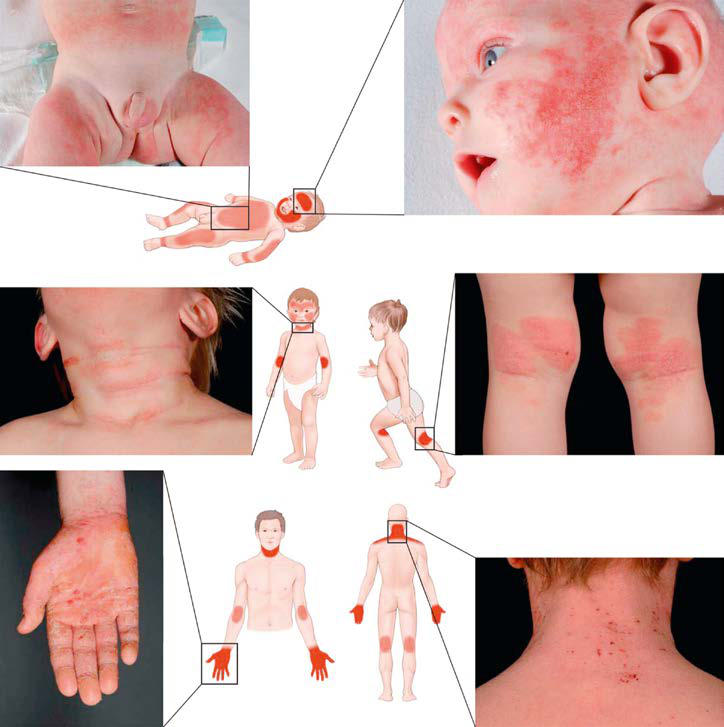
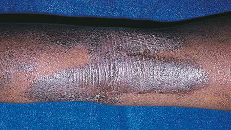

# Chapter 186: Atopic Dermatitis (Atopic Eczema)

*Donald Y.M. Leung and Scott H. Sicherer*

<!-- p.1809 -->
**PROGNOSIS** Recurrent coughing and wheezing occur in 35% of preschool-age children. Of these, approximately one third continue to have per sistent asthma into later childhood, and approximately two thirds improve on their own through their teen years. Concomitant atopic disorders (such as allergen sensitization or atopic dermatitis) are asso ciated with greater likelihood of disease persistence. Asthma severity by ages 7-10 years is predictive of asthma persistence in adulthood. Children with moderate to severe asthma and with lower lung func tion measures are likely to have persistent asthma as adults. Children with milder asthma and normal lung function are likely to improve over time, with some becoming periodically asthmatic (disease-free for months to years).

**PREVENTION** Although chronic airways inflammation may result in pathologic remodeling of lung airways, conventional antiinflammatory interven tions—the cornerstone of asthma control—do not help children out grow their asthma. Although controller medications reduce asthma morbidities, most children with moderate to severe asthma continue to have symptoms into young adulthood. Investigations into the envi ronmental and lifestyle factors responsible for the lower prevalence of childhood asthma in rural areas and farming communities suggest that early immunomodulatory intervention might prevent asthma develop ment. A *hygiene hypothesis* purports that naturally occurring micro bial exposures in early life might drive early immune development away from allergic sensitization, persistent airways inflammation, and remodeling through early microbiome and innate immune develop ment. If these natural microbial exposures truly have an asthmaprotective effect, without significant adverse health consequences, these findings may foster new strategies for asthma prevention.

Several nonpharmacologic measures with numerous positive health attributes—avoidance of environmental tobacco smoke (beginning prenatally), prolonged breastfeeding (>4 months), an active lifestyle, and a healthy diet—might reduce the likelihood of asthma develop ment. Care providers can be strong influencers of smoking cessation by parents, caregivers, and adolescent patients (see Chapters 157.2 and 759.1). Immunizations are not considered to increase the likelihood of development of asthma; therefore all standard childhood immuniza tions are recommended for children with asthma, including varicella, SARS-CoV-2, and annual influenza vaccines.

*Visit Elsevier eBooks+ at eBooks.Health.Elsevier.com** for Bibliography.*

**Atopic dermatitis (AD)**, or eczema, is the most common chronic relapsing skin disease seen in infancy and childhood. It affects 10–30% of children worldwide and frequently occurs in families with other atopic diseases. Infants with AD are predisposed to the development of food allergy, allergic rhinitis, and asthma later in childhood, a process called *the atopic march*.

*Donald Y.M. Leung and Scott H. Sicherer*

**ETIOLOGY** AD is a complex genetic disorder that results in a defective skin barrier, reduced skin innate immune responses, and primarily type 2 adaptive immune responses to environmental allergens and microbes that lead to chronic skin inflammation.

**PATHOLOGY** Acute AD skin lesions are characterized by **spongiosis**, or marked intercellular edema, of the epidermis. In AD, dendritic antigenpresenting cells (APCs) in the epidermis, such as Langerhans cells, exhibit surface-bound IgE molecules with cell processes that reach into the upper epidermis to sense allergens and pathogens. These APCs play an important role in cutaneous responses to type 2 immune responses (see Chapter 182). There is marked perivascular T-cell and inflammatory monocyte-macrophage infiltration in acute AD lesions. Chronic, lichenified AD is characterized by a hyperplastic epidermis with hyperkeratosis and minimal spongiosis. There are predominantly IgE-bearing Langerhans cells in the epidermis, and macrophages in the dermal mononuclear cell infiltrate. Mast cell and eosinophil numbers are increased, contributing to skin inflammation.

**PATHOGENESIS** AD is associated with multiple phenotypes and endotypes that have overlapping clinical presentations. **Atopic eczema** is associated with IgE-mediated sensitization (at onset or during the course of eczema) and occurs in 70–80% of patients with AD. **Nonatopic eczema** is not associated with IgE-mediated sensitization and is seen in 20–30% of patients with AD. Both forms of AD are associated with eosinophilia. In atopic eczema, circulating T cells expressing the skin homing recep tor **cutaneous lymphocyte-associated antigen** produce increased lev els of T-helper type 2 (Th2) cytokines, including interleukin (IL)-4 and IL-13, which induce isotype switching to IgE synthesis. Another type 2 cytokine, IL-5, plays an important role in eosinophil development and IL-31 is a key itch cytokine (Fig. 186.1). Nonatopic eczema is associated with lower IL-4 and IL-13 but increased IL-17 and IL-23 production than in atopic eczema. Age has also been found to affect the immune profile in AD.

Compared with the skin of healthy individuals, both unaffected skin and acute skin lesions of patients with AD have an increased number of cells expressing IL-4, IL-13, and IL-31. Chronic AD skin lesions, by contrast, have fewer cells that express IL-4 and IL-13, but they have more cells that express IL-5, granulocyte-macrophage colony-stimulating factor, IL-12, and interferon (IFN)-γ than acute AD lesions. Despite increased type 1 and type 17 immune responses in chronic AD, IL-4 and IL-13 as well as other type 2 cytokines (e.g., thymic stromal lymphopoietin [TSLP], IL-31, IL-33) predominate and reflect increased numbers of type 2 innate lymphoid cells and Th2 cells. The infiltration of IL-22–expressing T cells correlates with severity of AD, blocks keratinocyte differentiation, and induces epidermal hyper plasia. The importance of IL-4 and IL-13 in driving severe persistent AD has been validated by multiple clinical trials now demonstrating that biologics blocking IL-4 and IL-13 action lead to clinical improve ment in moderate to severe AD.

In healthy people, the skin acts as a protective barrier against exter nal irritants, moisture loss, and infection. Proper function of the skin depends on adequate moisture and lipid content, functional immune responses, and structural integrity. *Severely dry skin is a hallmark of AD.* This results from compromise of the epidermal barrier, which leads to excess transepidermal water loss, allergen penetration, and microbial colonization. **Filaggrin**, a structural protein in the epidermis, and its breakdown products are critical to skin barrier function, including moisturization of the skin. Genetic pathogenic variants in the filaggrin gene *(FLG)* family have been identified in patients with ichthyosis vul garis (dry skin, palmar hyperlinearity) and in up to 50% of patients with severe AD. *FLG* pathogenic variant is strongly associated with the development of food allergy and eczema herpeticum. Nonetheless, up to 60% of carriers of an *FLG* pathogenic variant do not develop atopic diseases. Cytokines found in allergic inflammation, such as IL-4, IL-13, IL-22, and IL-25, and tumor necrosis factor, can also reduce filaggrin

<!-- p.1811 -->
and other epidermal proteins and lipids. AD patients are at increased risk of bacterial, viral, and fungal infection related to impairment of innate immunity, disturbances in the microbiome, skin epithelial dys function, and overexpression of polarized immune pathways, which dampen host antimicrobial responses. Patients with the combination of AD and food allergy have significantly lower levels of filaggrin and increased type 2 immune activation than patients with AD only.

**CLINICAL MANIFESTATIONS** AD typically begins in infancy. Approximately 50% of patients experi ence symptoms in the first year of life, and an additional 30% are diag nosed between 1 and 5 years of age. Intense **pruritus**, especially at night, and **cutaneous reactivity** are the cardinal features of AD. Scratching and excoriation cause increased skin inflammation that contributes to the development of more pronounced eczematous skin lesions. Foods (cow’s milk, egg, peanut, tree nuts, soy, wheat, fish, shellfish), aeroal lergens (pollen, grass, animal dander, dust mites), infection (*Staphy lococcus aureus*, herpes simplex, coxsackievirus, molluscum), reduced humidity, excessive sweating, and irritants (wool, acrylic, soaps, toilet ries, fragrances, detergents) can trigger pruritus and scratching.

Acute AD skin lesions are intensely pruritic with erythematous papules (Figs. 186.2 and 186.3). Subacute dermatitis manifests as ery thematous, excoriated, scaling papules. In contrast, chronic AD is char acterized by **lichenification** (Fig. 186.4), or thickening of the skin with accentuated surface markings, and **fibrotic papules**. In chronic AD, all

three types of skin reactions may coexist in the same individual. Most patients with AD have dry, lackluster skin regardless of their stage of illness. Skin reaction pattern and distribution vary with the patient’s age and disease activity. AD is generally more acute in infancy and involves the face, scalp, and extensor surfaces of the extremities. The diaper area is usually spared. Older children and children with chronic AD have lichenification and localization of the rash to the flexural folds of the extremities. AD can go into remission as the patient grows older; however, many children with AD have persistent eczema as an adult (see Fig. 186.2*C*).

**LABORATORY FINDINGS** There are no specific laboratory tests to diagnose AD. Many patients have peripheral blood eosinophilia, increased serum IgE levels, and T cells expressing type 2 cytokines. Serum IgE measurement or skinprick testing can identify the allergens (foods, inhalant/microbial aller gens) to which patients are sensitized. The diagnosis of clinical allergy to these allergens requires confirmation by history and environmental challenges.

**DIAGNOSIS AND DIFFERENTIAL DIAGNOSIS** AD is diagnosed on the basis of three major features: pruritus, an eczematous dermatitis that fits into a typical pattern of skin inflam mation, and a chronic or chronically relapsing course (Table 186.1). Associated features, such as a family history of asthma, hay fever, food

Allergens

**Epidermis**

**Dermis**

Sensory neuron

**↑**Epidermal

hyperplasia

**↑**PDE4 activity in T cells leads to **↑** in cytokine mediators

Barrier disruption **↓**Differentiation **↓**Filaggrin **↓**Loricrin **↓**Involucrin

Barrier inhibition **↑**Cytokines **↑**Chemokines

Itch

** **

*****

LC

DC

IL-4

IL-4

IL-4

IL-4

Basophil

**Mast cell Eosinophil**

IL-13

AD-DC

**B cell**

**IgE**

Lymph node

AD-DC

Th0

**ThO**

Th2

**↑**Th1 products

**Th2**

Th22

Th0 Th1

Scratch Lichenification Microbiome

(S aureus)

**Non-lesional**

**Blood vessel**

**Acute Chronic**

*****

Disrupted

barrier

Keratinocyte

**Fig. 186.1** Pathogenic pathways and immunologic targets in atopic dermatitis (AD). Skin barrier defects in nonlesional atopic dermatitis leads to penetration by allergens, which encounter antigen-presenting Langerhans cells (LCs) in the epidermis and dendritic cells (DCs) in the dermis, resulting in immune activation and inflammatory cell recruitment. Elevated T-helper type 2 (Th2) cell counts in the acute state leads to increased secretion of cytokines, especially interleukin (IL)-4 and IL-13, which disrupt the skin barrier by decreasing expression of barrier proteins (i.e., filaggrin, loricrin, and involucrin). In addition, Th2 cytokines recruit eosinophils and basophils to lesional sites, and increase B-cell IgE production. Eosinophils, basophils, and activated IgE-bound mast cells release proinflammatory mediators, further potentiating pathogenesis. Th2 cytokines also impair anti microbial peptide responses to pathogens which, in combination with barrier disruption, increases the risk of colonization and barrier penetration by allergens and pathogens (i.e., Staphylococcus aureus). Chronic atopic dermatitis results in a skewed Th1 response, leading to further inflammation and immune activation. Processes mediated by Janus kinase (JAK) receptors are marked with a green asterisk. PDE4, phosphodiesterase-4. (From Vahharia PP, Silverberg JI. New and emerging therapies for paediatric atopic dermatitis. Lancet Child Adolesc. 2019;3:343–352.)

<!-- p.1812 -->
allergy, elevated IgE, and immediate skin test reactivity, reinforce the diagnosis of AD.

Many inflammatory skin diseases, immunodeficiencies, skin malignancies, genetic disorders, infectious diseases, and infes tations share symptoms with AD and should be considered and excluded before a diagnosis of AD is established (Tables 186.2 and 186.3). Severe combined immunodeficiency (see Chapter 165.1) should be considered for infants presenting in the first year of life with diarrhea, failure to thrive, generalized scaling rash, and recur rent cutaneous and/or systemic infection. Histiocytosis should be excluded in any infant with AD and failure to thrive (see Chapter 556). Wiskott-Aldrich syndrome, an X-linked recessive disorder associated with thrombocytopenia, immune defects, and recurrent severe bacterial infections, is characterized by a rash almost indis tinguishable from that in AD (see Chapter 165.4). One of the hyper- IgE syndromes is characterized by markedly elevated serum IgE values, recurrent deep-seated bacterial infections, chronic derma titis, and refractory dermatophytosis. Many of these patients have disease as a result of autosomal dominant *STAT3* pathogenic vari ants. In contrast, some patients with hyper-IgE syndrome present with increased susceptibility to viral infections and an autosomal recessive pattern of disease inheritance. These patients may have a dedicator of cytokinesis 8 gene *(DOCK8)* pathogenic variants. This diagnosis should be considered in young children with severe eczema, food allergy, and disseminated skin viral infections.

Adolescents who present with an eczematous dermatitis but no his tory of childhood eczema, respiratory allergy, or atopic family history may have allergic **contact dermatitis**. A contact allergen may be the problem in any patient whose AD does not respond to appropriate therapy. Sensitizing chemicals, such as parabens and lanolin, can be irritants for patients with AD and are commonly found as vehicles in therapeutic topical agents. Topical glucocorticoid contact allergy has been reported in patients with chronic dermatitis receiving topical cor ticosteroid therapy. Eczematous dermatitis has also been reported with HIV infection as well as with a variety of infestations such as scabies. Other conditions that can be confused with AD include psoriasis, ich thyosis, and seborrheic dermatitis.

**TREATMENT** The treatment of AD requires a systematic, multifaceted approach that incorporates skin moisturization, topical antiinflammatory therapy, identification and elimination of flare factors (Table 186.4), and, if nec essary, systemic therapy (Fig. 186.5). Assessment of the severity also helps direct therapy (Table 186.5; see Fig. 186.5).

**Cutaneous Hydration** Because patients with AD have impaired skin barrier function from reduced filaggrin and skin lipid levels, they present with diffuse, abnor mally dry skin, or **xerosis**. **Moisturizers are first-line therapy***.* Luke warm soaking baths or showers for 15-20 minutes followed by the

**Fig. 186.2** Typical clinical appearance and locations of atopic dermatitis at different ages. A, In infants, atopic dermatitis is generally acute, with lesions mainly on the face and the extensor surfaces of the limbs. The trunk might be affected, but the napkin area is typically spared. B, From age 1-2 years onward, polymorphous manifestations with different types of skin lesions are seen, particularly in flexural folds. C, Adolescents and adults often present lichenified and excoriated plaques at flexures, wrists, ankles, and eyelids; in the head and neck type, the upper trunk, shoulders, and scalp are involved. Adults might have only chronic hand eczema or present with prurigo-like lesions. (From Weidinger S, Novak N. Atopic dermatitis. Lancet. 2016;387:1111.)

A

B

C

<!-- p.1813 -->
application of an occlusive emollient to retain moisture provide symp tomatic relief. Hydrophilic ointments of varying degrees of viscosity can be used according to the patient’s preference. Occlusive ointments are sometimes not well tolerated because of interference with the func tion of the eccrine sweat ducts and may induce the development of folliculitis. In these patients, less occlusive agents should be used. Sev eral prescription (classified as a medical device) “therapeutic moistur izers” or “barrier creams” are available, containing components such as ceramides and filaggrin acid metabolites intended to improve skin barrier function. There are minimal data demonstrating their efficacy over standard emollients.

Hydration by baths or wet dressings promotes transepidermal pen etration of topical glucocorticoids. Dressings may also serve as effec tive barriers against persistent scratching, in turn promoting healing of excoriated lesions. Wet dressings are recommended for use on severely affected or chronically involved areas of dermatitis refractory to skin care. It is critical that wet dressing therapy be followed by topical emollient application to avoid potential drying and fissuring from the

therapy. Wet dressing therapy can be complicated by maceration and secondary infection and should be closely monitored by a physician.

**Topical Corticosteroids** Topical corticosteroids are the cornerstone of antiinflammatory treat ment for acute exacerbations of AD. Patients should be carefully instructed on their use of topical glucocorticoids to avoid potential adverse effects. There are seven classes of topical glucocorticoids, ranked according to their potency, as determined by vasoconstric tor assays (Table 186.6). Because of their potential adverse effects, the ultra-high-potency glucocorticoids should not be used on the face or intertriginous areas and should be used only for very short periods on the trunk and extremities. Mid-potency glucocorticoids can be used for longer periods to treat chronic AD involving the trunk and extrem ities. Long-term control can be maintained with twice-weekly applica tions of topical fluticasone or mometasone to areas that have healed but are prone to relapse, once control of AD is achieved after a daily regimen of topical corticosteroids. Compared with creams, ointments have a greater potential to occlude the epidermis, resulting in enhanced systemic absorption.

Adverse effects of topical glucocorticoids can be divided into local adverse effects and systemic adverse effects, the latter resulting from suppression of the hypothalamic-pituitary-adrenal axis. *Local* adverse effects include the development of striae and skin atrophy. *Systemic* adverse effects are related to the potency of the topical corticosteroid, site of application, occlusiveness of the preparation, percentage of the body surface area covered, and length of use. The potential for adrenal suppression from potent topical corticosteroids is greatest in infants and young children with severe AD requiring intensive therapy.

**Topical Calcineurin Inhibitors** The nonsteroidal topical calcineurin inhibitors are effective in reducing AD skin inflammation. Pimecrolimus cream 1% (Elidel) is indicated for mild to moderate AD. Tacrolimus ointment 0.1% and 0.03% (Pro topic) is indicated for moderate to severe AD. Both are approved for short-term or intermittent long-term treatment of AD in patients ≥2 years whose disease is unresponsive to or who are intolerant of other conventional therapies or for whom these therapies are inadvisable

**Fig. 186.4** Lichenification of the popliteal fossa from chronic rubbing of the skin in atopic dermatitis. (From Weston WL, Lane AT, Morelli JG. Color Textbook of Pediatric Dermatology. 2nd ed. St Louis: Mosby; 1996. p 33.)

#### **Table 186.1** Clinical Features of Atopic Dermatitis

| Category / Parameter | Clinical Details & Findings |
| --- | --- |
| **MAJOR FEATURES** | Pruritus; Facial and extensor eczema in infants and children; Flexural eczema in adolescents; Chronic or relapsing dermatitis; Personal or family history of atopic disease |
| **ASSOCIATED FEATURES** | Xerosis; Cutaneous infections (Staphylococcus aureus, group A streptococcus,; herpes simplex, coxsackievirus, vaccinia, molluscum, warts); Nonspecific dermatitis of the hands or feet; Ichthyosis, palmar hyperlinearity, keratosis pilaris; Nipple eczema; White dermatographism and delayed blanch response; Anterior subcapsular cataracts, keratoconus; Elevated serum IgE levels; Positive results of immediate-type allergy skin tests; Early age at onset; Dennie lines (Dennie-Morgan infraorbital folds); Facial erythema or pallor; Course influenced by environmental and/or emotional factors; Lichenification; Perioral, periauricular sites; Prurigo |

**Fig. 186.3** Crusted lesions of atopic dermatitis on the face. (From Eichenfield LF, Friedan IJ, Esterly NB. Textbook of Neonatal Dermatol ogy. Philadelphia: Saunders; 2001. p 242.)

<!-- p.1814 -->
because of potential risks. Topical calcineurin inhibitors may be better than topical corticosteroids in the treatment of patients whose AD is poorly responsive to topical steroids, patients with steroid phobia, and those with face and neck dermatitis, in whom ineffective, low-potency topical corticosteroids are typically used because of fears of steroidinduced skin atrophy.

**Phosphodiesterase Inhibitor** Crisaborole (Eucrisa) is an approved nonsteroidal topical antiinflam matory phosphodiesterase-4 (PDE-4) inhibitor indicated for the treatment of mild to moderate AD of children 3 months or older. It may be used as an alternative to topical corticosteroids or calcineurin inhibitors.

#### **Table 186.2** Differential Diagnosis of Atopic Dermatitis

| Category / Parameter | Clinical Details & Findings |
| --- | --- |
| **OTHER TYPES OF DERMATITIS** | Seborrheic dermatitis; Infants; Common; Salmon-red greasy scaly lesions, often on the scalp; (cradle cap) and napkin area; generally presents in; the first 6 wk of life; typically clears within weeks; Seborrheic dermatitis; Adults; Common; Erythematous patches with yellow, white, or grayish; scales in seborrheic areas, particularly the scalp,; central face, and anterior chest; Nummular dermatitis; Children and adults; Common; Coin-shaped scaly patches, mostly on legs and; buttocks; usually no itch; Irritant contact dermatitis; Children and adults; Common; Acute to chronic eczematous lesions, mostly confined; to the site of exposure; history of locally applied; irritants is a risk factor; might coexist with AD; Allergic contact dermatitis; Children and adults; Common; Eczematous rash with maximum expression at sites of; direct exposure but might spread; history of locally; applied irritants is a risk factor; might coexist with AD; Lichen simplex chronicus; Adults; Uncommon; One or more localized, circumscribed, lichenified; plaques that result from repetitive scratching or; rubbing because of intense itch; Asteatotic eczema; Adults; Common; Scaly, fissured patches of dermatitis overlying dry; skin, most often on lower legs |
| **INFECTIOUS SKIN DISEASES** | Dermatophyte infection; Children and adults; Common; One or more demarcated scaly plaques with central; clearing and slightly raised reddened edge;; variable itch; Impetigo; Children; Common; Demarcated erythematous patches with blisters or; honey-yellow crusting; Scabies; Children; Common†; Itchy superficial burrows and pustules on palms and; soles, between fingers, and on genitalia; might; produce secondary eczematous changes |
| **HIV** | Children and adults; Uncommon; Seborrhea-like rash |
| **KERATINIZATION DISORDERS** | Ichthyosis vulgaris; Infants and adults; Uncommon; Dry skin with fine scaling, particularly on the lower; abdomen and extensor areas; perifollicular skin; roughening; palmar hyperlinearity; full form; (i.e., 2 FLG pathogenic variants) is uncommon;; often coexists with AD |
| **NUTRITIONAL DEFICIENCY–METABOLIC DISORDERS** | Zinc deficiency (acrodermatitis; enteropathica); Children; Uncommon; Erythematous scaly patches and plaques, most often; around the mouth and anus; rare congenital form; accompanied by diarrhea and alopecia; Biotin deficiency (nutritional or; biotinidase deficiency); Infants; Uncommon; Scaly periorofacial dermatitis, alopecia, conjunctivitis,; lethargy, hypotonia; Pellagra (niacin deficiency); All ages; Uncommon; Scaly crusted epidermis, desquamation, sun-exposed; areas, diarrhea; Kwashiorkor; Infants and children; Geographic; dependent; Flaky scaly dermatitis, swollen limbs with cracked; peeling patches; Phenylketonuria; Infants; Uncommon; Eczematous rash, hypopigmentation, blonde hair,; developmental delay |
| **NEOPLASTIC DISEASE** | Cutaneous T-cell lymphoma; Adults; Uncommon; Erythematous pink-brown macules and plaques; with a fine scale; poorly responsive to topical; corticosteroids; variable itch (in early stages); Langerhans cell histiocytosis; Infants; Uncommon; Scaly and purpuric dermatosis, hepatosplenomegaly,; cytopenias; *Common = approximately 1 in 10 to 1 in 100; uncommon = 1 in 100 to 1 in 1,000; rare = 1 in 1,000 to 1 in 10,000; very rare = <1 in 10,000.; †Especially in developing countries.; AD, Atopic dermatitis; FLG, filaggrin gene. |

<!-- p.1815 -->
**Tar Preparations** Coal tar preparations have antipruritic and antiinflammatory effects on the skin; however, their antiinflammatory effects are usually not as pronounced as those of topical glucocorticoids or calcineurin inhibi tors. Therefore topical tar preparations are not a preferred approach for management of AD. Tar shampoos can be particularly beneficial for scalp dermatitis. Adverse effects associated with tar preparations include skin irritation, folliculitis, and photosensitivity.

**Antihistamines** Systemic antihistamines act primarily by blocking the histamine H1 receptors in the dermis, thereby reducing histamine-induced pruritus. Histamine is only one of many mediators that induce pruritus of the skin, so patients may derive minimal benefit from antihistaminic ther apy. Because pruritus is usually worse at night, sedating antihistamines (hydroxyzine, diphenhydramine) may offer an advantage with their soporific side effects when used at bedtime. Doxepin hydrochloride has both tricyclic antidepressant and H1- and H2-receptor blocking effects.

Short-term use of a sedative to allow adequate rest may be appropriate in cases of severe nocturnal pruritus. Studies of nonsedating antihista mines have shown variable effectiveness in controlling pruritus in AD, although they may be useful in the small subset of patients with AD and concomitant urticaria. For children, melatonin may be effective in promoting sleep because production is deficient in AD.

**Systemic Corticosteroids** Systemic corticosteroids are rarely indicated in the treatment of chronic AD. The dramatic clinical improvement that may occur with systemic corticosteroids is frequently associated with a severe rebound flare of AD after therapy discontinuation. Short courses of oral corticosteroids may be appropriate for an acute exacerbation of AD while other treatment mea sures are being instituted in parallel. If a short course of oral corticoste roids is given, as during an asthma exacerbation, it is important to taper the dosage and begin intensified skin care, particularly with topical corti costeroids, and frequent bathing, followed by application of emollients or proactive topical corticosteroids, to prevent rebound flaring of AD.

#### **Table 186.3** Features of Primary Immunodeficiencies Associated with Eczematous Dermatitis

| Category / Parameter | Clinical Details & Findings |
| --- | --- |
| **STAT3** | AD, less commonly; sporadic; Cold abscesses; Recurrent sinopulmonary infections; Mucocutaneous candidiasis; Coarse facies; Minimal trauma fractures; Scoliosis; Joint hyperextensibility; Retained primary teeth; Coronary artery tortuosity or dilation; Lymphoma; High IgE (>2,000 IU/μL); Eosinophilia |
| **DOCK8** | deficiency |
| **AR** | Severe mucocutaneous viral infections; Mucocutaneous candidiasis; Atopic features (asthma, allergies); Squamous cell carcinoma; Lymphoma; High IgE; Eosinophilia; With or without decreased IgM |
| **PGM3** | deficiency |
| **AR** | Neurologic abnormalities; Leukocytoclastic vasculitis; Atopic features (asthma, allergies); Sinopulmonary infections; Mucocutaneous viral infections; High IgE; Eosinophilia |
| **XLR** | Hepatosplenomegaly; Lymphadenopathy; Atopic diathesis; Autoimmune conditions (especially hemolytic; anemia); Lymphoreticular malignancies; Thrombocytopenia (<80,000/μL); Low mean platelet volume; Eosinophilia is common; Lymphopenia; Low IgM, variable IgG |
| **SCID** | Variable,; depends on; type; XLR and AR most; common; Recurrent, severe infections; Failure to thrive; Persistent diarrhea; Recalcitrant oral candidiasis; Omenn syndrome: lymphadenopathy,; hepatosplenomegaly, erythroderma; Lymphopenia common; Variable patterns of reduced; lymphocyte subsets (T, B, natural; killer cells); Omenn syndrome: high; lymphocytes, eosinophilia, high IgE |
| **XLR** | Severe diarrhea (autoimmune enteropathy); Various autoimmune endocrinopathies; (especially diabetes mellitus, thyroiditis); Food allergies; High IgE; Eosinophilia; Various autoantibodies; Netherton; syndrome |
| **AR** | Hair shaft abnormalities; Erythroderma; Ichthyosis linearis circumflexa; Food allergies; Recurrent gastroenteritis; Neonatal hypernatremic dehydration; Upper and lower respiratory infections; High IgE; Eosinophilia; AD, Autosomal dominant; AD-HIES, autosomal-dominant hyper-IgE syndrome; AR, autosomal recessive; DOCK8, dedicator of cytokinesis 8 gene; IPEX, immune dysregulation,; polyendocrinopathy, enteropathy, X-linked syndrome; PGM3, phosphoglucomutase 3; SCID, severe combined immunodeficiency; WAS, Wiskott-Aldrich syndrome; XLR, X-linked recessive.; From Kliegman RM, Bordini BJ, eds. Undiagnosed and rare diseases in children. Pediatr Clin N Amer. 2017;64(1):41–42. |

<!-- p.1816 -->
**Dupilumab** A monoclonal antibody that binds to the IL-4 receptor α subunit, dupi lumab (Dupixent) inhibits the signaling of IL-4 and IL-13, cytokines associated with AD. In children with moderate to severe AD not con trolled by standard topical therapy, dupilumab reduces pruritus and improves skin clearing. Dupilumab is approved for children 6 years or older. Lebrikizumab, an IgG4 monoclonal antibody that targets IL-13, has shown efficacy in adolescents and adults with moderate to severe atopic dermatitis.

**Phototherapy** Natural sunlight is often beneficial to patients with AD as long as sunburn and excessive sweating are avoided. Many phototherapy modalities are effective for AD, including ultraviolet A-1, ultra violet B, narrow-band ultraviolet B, and psoralen plus ultraviolet A.

Phototherapy is generally reserved for patients in whom standard treatments fail. Maintenance treatments are usually required for pho totherapy to be effective. Short-term adverse effects with phototherapy include erythema, skin pain, pruritus, and pigmentation. Long-term adverse effects include predisposition to cutaneous malignancies.

**Cyclosporine** Cyclosporine is a potent immunosuppressive drug that acts primarily on T cells by suppressing cytokine gene transcription and has been shown to be effective in the control of severe AD. Cyclosporine forms a complex with an intracellular protein, cyclophilin, and this complex in turn inhib its calcineurin, a phosphatase required for activation of nuclear factor of activated T cells (NFAT), a transcription factor necessary for cytokine

Patients with Atopic Dermatitis

Yes

Yes

No

No

Yes

Yes

No

No

Is AD severe?

Management

successful?

Patient presents with

an eczematous pruritic dermatitis

Patient meets diagnostic

criteria for AD?

• Identification and elimination of exacerbating factors (irritants, *proven* allergens) • Addressing psychosocial aspects/quality-of-life issues • Education • Hydration • Moisturizers • Topical corticosteroids (low to mid potency) • Topical calcineurin inhibitors* • Topical PDE4 inhibitor • Anti-infective therapy • Anti-pruritic therapy • Written care plan

Consider other conditions as per

differential diagnosis?

Periodic follow-up • Review treatment plan • Consider maintenance therapy with topical immunomodulators

Reassess: Is

diagnosis of AD correct?

Consultation with AD specialist • Intensification of treatment measures discussed above • Consider Culture and sensitivity of skin lesion (R/o MRSA)

Wet wrap therapy Dupilumab** Hospitalization

UV light therapy Systemic immunosuppressives Possibly oral or topical JAK inhibitors

#### **Table 186.4** Counseling and Aggravating Factors for

| Category / Parameter | Clinical Details & Findings |
| --- | --- |
| **General** | Maintain cool temperature in bedroom, and avoid too many bed; covers.; Increase emollient use with cold weather.; Avoid exposure to herpes sores; urgent visit if flare of unusual; aspect.; Clothing: Avoid skin contact with irritating fibers (wool, large-fiber; textiles).; Do not use tight and too-warm clothing to avoid excessive; sweating.; New, nonirritating clothing designed for AD children is being; evaluated.; Tobacco: Avoid exposure.; Vaccines: Normal schedule in noninvolved skin, including; egg-allergic patients (see text).; Sun exposure: No specific restriction.; Usually helpful because of improvement of epidermal barrier.; Encourage summer holidays in altitude or at beach resorts.; Physical exercise, sports: No restriction.; If sweating induces flares of AD, progressive adaptation to; exercise.; Shower and emollients after swimming pool.; Food allergens:; Maintain breastfeeding exclusively to 4-6 mo if possible.; Consider evaluation for early introduction of allergens (see; Chapter 192).; Otherwise normal diet, unless an allergy workup has proved the; need to exclude a specific food.; Indoor aeroallergens: House dust mites.; Use adequate ventilation of housing; keep the rooms well aerated; even in winter.; Avoid wall-to-wall carpeting.; Remove dust with a wet sponge.; Vacuum floors and upholstery with an adequately filtered cleaner; once a week.; Avoid soft toys in bed (cradle), except washable ones.; Wash bedsheets at a temperature higher than 55°C (131°F) every; 10 days.; Use bed and pillow encasings made of Gore-Tex or similar material.; Furred pets: Advise to avoid. If allergy is demonstrated, be firm on; avoidance measures, such as pet removal.; Pollen: Close windows during peak pollen season on warm and dry; weather days and restrict, if possible, time outdoors.; Windows may be open at night and early in the morning or during; rainy weather.; Avoid exposure to risk situations (lawn mowing).; Use pollen filters in motor vehicles.; Clothes and pets can vectorize aeroallergens, including pollen.; Adapted from Darsow U, Wollenberg A, Simon D, et al. ETFAD/EADV Eczema Task; Force 2009 position paper on diagnosis and treatment of atopic dermatitis. J Eur Acad; Dermatol Venereol. 2010;24:321. |

**Fig. 186.5** Approach to the patient with atopic dermatitis (AD). *Per boxed warning: second-line, intermittent therapy for patients ≥2 years of age. **Approved for patients ≥12 years of age with moderate to severe AD. JAK, Janus kinase; MRSA; methicillin-resistant Staphylococ cus aureus; PDE, phosphodiesterase; UV, ultraviolet. (Modified from Boguniewicz M, Fonacier L, Leung DYM. Atopic dermatitis and allergic contact dermatitis. In Hershey GKK, Sheikh A, O’Hehir RE, Holgate ST, eds. Allergy Essentials. 2nd ed. Philadelphia: Elsevier; 2022. Fig 11.5.)

<!-- p.1817 -->
gene transcription. Cyclosporine (5 mg/kg/day) for short-term and longterm (1 year) use has been beneficial for children with severe, refractory AD. Possible adverse effects include renal impairment and hypertension.

**Janus Kinase Inhibitors** Oral and topical Janus kinase (JAK) inhibitors have demonstrated rapid improvement in adults and older children with severe AD. These inhibitors also have potential side effects including infec tions (tuberculosis), malignancy (cutaneous lymphoma), and headaches. Topical therapy is effective and has fewer side effects. Clinical trials are in progress to address the efficacy and safely of JAK inhibitors.

**Antimetabolites Mycophenolate mofetil** is a purine biosynthesis inhibitor used as an immunosuppressant in organ transplantation that has been used for treatment of refractory AD. Aside from immunosuppression, herpes simplex retinitis and dose-related bone marrow suppression have been reported with its use. Of note, not all patients benefit from treatment. Therefore mycophenolate mofetil should be discontinued if the disease does not respond within 4-8 weeks.

**Methotrexate** is an antimetabolite with potent inhibitory effects on inflammatory cytokine synthesis and cell chemotaxis. Methotrexate has been used for patients with recalcitrant AD. In AD, dosing is more frequent than the weekly dosing used for psoriasis.

**Azathioprine** is a purine analog with antiinflammatory and antip roliferative effects that has been used for severe AD. Myelosuppression is a significant adverse effect, and thiopurine methyltransferase levels may identify individuals at risk.

Before any of these drugs are used, patients should be referred to an AD specialist who is familiar with treatment of severe AD to weigh relative benefits of alternative therapies.

**Unproven Therapies** Other therapies may be considered in patients with refractory AD.

**Interferon-****γ** IFN-γ is known to suppress Th2-cell function. Several studies, includ ing a multicenter, double-blind, placebo-controlled trial and sev eral open trials, have demonstrated that treatment with recombinant human IFN-γ results in clinical improvement of AD. Reduction in clinical severity of AD correlated with the ability of IFN-γ to decrease total circulating eosinophil counts. Influenza-like symptoms are com mon side effects during the treatment course.

**Omalizumab** Treatment of patients who have severe AD and elevated serum IgE values with monoclonal anti-IgE may be considered in those with allergen-induced flares of AD. However, there have been no published double-blind, placebo-controlled trials supporting omalizumab as a preferred therapy for moderate to severe AD. Most reports show incon sistent responses to anti-IgE.

**Allergen Immunotherapy** In contrast to its acceptance for treatment of allergic rhinitis and extrinsic asthma, immunotherapy with aeroallergens in the treatment of AD is controversial. There are reports of both disease exacerbation and improvement. Studies suggest that specific immunotherapy in patients with AD sensitized to dust mite allergen showed improve ment in severity of skin disease, as well as reduction in topical corti costeroid use.

**Probiotics** Perinatal administration of the probiotic *Lactobacillus rhamnosus* strain GG has been shown to reduce the incidence of AD in at-risk children during the first 2 years of life. The treatment response has been found to be more pronounced in patients with positive skin-prick test results and elevated IgE values. Other studies have not demonstrated a benefit.

**Chinese Herbal Medications** Several placebo-controlled clinical trials have suggested that patients with severe AD may benefit from treatment with traditional Chinese herbal therapy. The patients had significantly reduced skin disease and decreased pruritus. The beneficial response of Chinese herbal therapy is often temporary, and effectiveness may wear off despite continued treatment. The possibility of hepatic toxicity, car diac side effects, or idiosyncratic reactions remains a concern. The specific ingredients of the herbs also remain to be elucidated, and some preparations have been found to be contaminated with corti costeroids. At present, Chinese herbal therapy for AD is considered investigational.

Eczema

#### **Table 186.5** Categorization of Physical Severity of Atopic

| Category / Parameter | Clinical Details & Findings |
| --- | --- |
| **General** | Clear: Normal skin, with no evidence of atopic eczema; Mild: Areas of dry skin, infrequent itching (with or without small areas; of redness); Moderate: Areas of dry skin, frequent itching, redness (with or without; excoriation and localized skin thickening); Severe: Widespread areas of dry skin, incessant itching, redness (with; or without excoriation, extensive skin thickening, bleeding, oozing,; cracking, and alteration of pigmentation); From Lewis-Jones S, Mugglestone MA, Guideline Development Group. Management; of atopic eczema in children aged up to 12 years: summary of NICE guidance. BMJ.; 2007;335:1263–1264. |

#### **Table 186.6** Selected Topical Corticosteroid Preparations*

| Category / Parameter | Clinical Details & Findings |
| --- | --- |
| **GROUP 1** | Clobetasol propionate (Temovate) 0.05% ointment/cream; Betamethasone dipropionate (Diprolene) 0.05% ointment/lotion/gel; Fluocinonide (Vanos) 0.1% cream |
| **GROUP 2** | Mometasone furoate (Elocon) 0.1% ointment; Halcinonide (Halog) 0.1% cream; Fluocinonide (Lidex) 0.05% ointment/cream; Desoximetasone (Topicort) 0.25% ointment/cream; Betamethasone dipropionate (Diprolene) 0.05% cream |
| **GROUP 3** | Fluticasone propionate (Cutivate) 0.005% ointment; Halcinonide (Halog) 0.1% ointment; Betamethasone valerate (Valisone) 0.1% ointment |
| **GROUP 4** | Mometasone furoate (Elocon) 0.1% cream; Triamcinolone acetonide (Kenalog) 0.1% ointment/cream; Fluocinolone acetonide (Synalar) 0.025% ointment |
| **GROUP 5** | Fluocinolone acetonide (Synalar) 0.025% cream; Hydrocortisone valerate (Westcort) 0.2% ointment |
| **GROUP 6** | Desonide (DesOwen) 05% ointment/cream/lotion; Alclometasone dipropionate (Aclovate) 0.05% ointment/cream |
| **GROUP 7** | Hydrocortisone (Hytone) 2.5%, 1%, 0.5% ointment/cream/lotion; *Representative corticosteroids are listed by group from 1 (superpotent) through 7; (least potent).; Adapted from Stoughton RB. Vasoconstrictor assay-specific applications. In: Malbach; HI, Surber C, eds. Topical Corticosteroids. Basel, Switzerland: Karger; 1992. p 42–53. |

<!-- p.1818 -->
**Vitamin D** Vitamin D deficiency often accompanies severe AD. Vitamin D enhances skin barrier function, reduces corticosteroid requirements to control inflammation, and augments skin antimicrobial function. Sev eral small clinical studies suggest vitamin D can enhance antimicro bial peptide expression in the skin and reduce severity of skin disease, especially in patients with low baseline vitamin D, as during winter, when exacerbation of AD often occurs. Patients with AD might benefit from supplementation with vitamin D, particularly if they have a docu mented low level or low vitamin D intake.

**AVOIDING TRIGGERS** It is essential to identify and eliminate triggering factors for AD, both during the period of acute symptoms and on a long-term basis to pre vent recurrences (see Table 186.4).

**Irritants** Patients with AD have a low threshold response to irritants that trigger their itch-scratch cycle. Soaps or detergents, chemicals, smoke, abra sive clothing, and exposure to extremes of temperature and humidity are common triggers. *Patients with AD should use soaps with minimal defatting properties and a neutral pH.* New clothing should be laun dered before wearing to decrease levels of formaldehyde and other chemicals. Residual laundry detergent in clothing may trigger the itchscratch cycle; using a liquid rather than powder detergent and adding a second rinse cycle facilitates removal of the detergent.

Every attempt should be made to allow children with AD to be as normally active as possible. A sport such as swimming may be better tolerated than others that involve intense perspiration, physi cal contact, or heavy clothing and equipment. Rinsing off chlorine immediately and lubricating the skin after swimming are impor tant. Although ultraviolet light may be beneficial to some patients with AD, high sun protection factor (SPF) sunscreens should be used to avoid sunburn.

**Foods** Food allergy is comorbid in approximately 40% of infants and young children with moderate to severe AD (see Chapter 192). Undiagnosed food allergies in patients with AD may induce eczematous dermatitis in some patients and urticarial reactions, wheezing, or nasal conges tion in others. Increased severity of AD symptoms and younger age correlate directly with the presence of food allergy. Removal of food allergens from the diet may lead to clinical improvement but also car ries a risk of the patient developing immediate type allergic reactions to the food allergen removed.

Potential allergens can be identified by a careful history and per forming selective skin-prick tests or in  vitro blood testing for

allergen-specific IgE. Negative skin and blood test results for allergenspecific IgE have a high predictive value for excluding suspected aller gens. Positive results of skin or blood tests using foods often do not correlate with clinical symptoms and should be confirmed with con trolled food challenges and elimination diets. Extensive elimination diets, which can be nutritionally deficient, are rarely required. Even with multiple positive skin test results, the majority of patients react to fewer than three foods under controlled challenge conditions.

**Aeroallergens** In older children, AD flares can occur after intranasal or epicutaneous exposure to aeroallergens such as fungi, animal dander, grass, and rag weed pollen. Avoiding aeroallergens, particularly dust mites, can result in clinical improvement of AD. Avoidance measures for dust mite– allergic patients include using dust mite–proof encasings on pillows, mattresses, and box springs; washing bedding in hot water weekly; removing bedroom carpeting; and decreasing indoor humidity levels with air conditioning.

**Infections** Patients with AD have increased susceptibility to bacterial, viral, and fungal skin infections. Antistaphylococcal antibiotics are very help ful for treating patients who are heavily colonized or infected with *S. aureus.* Erythromycin and azithromycin are usually beneficial for patients who are not colonized with a resistant *S. aureus* strain; a first-generation cephalosporin (cephalexin) is recommended for macrolide-resistant *S. aureus*. Topical mupirocin is useful in the treat ment of localized impetiginous lesions, with systemic clindamycin or trimethoprim/sulfamethoxazole needed for methicillin-resistant *S. aureus* (MRSA). Cytokine-mediated skin inflammation contributes to skin colonization with *S. aureus*. This finding supports the importance of combining effective antiinflammatory therapy with antibiotics for treating moderate to severe AD to avoid the need for repeated courses of antibiotics, which can lead to the emergence of antibiotic-resistant strains of *S. aureus.* Dilute bleach baths (½ cup of bleach in 40 gallons of water) twice weekly may be also considered to reduce *S. aureus* colo nization. In one randomized trial, the group who received the bleach baths plus intranasal mupirocin (5 days/month) had significantly decreased severity of AD at 1 and 3 months compared with placebo. Patients rinse off after the soaking. Bleach baths may not only reduce *S. aureus* abundance on the skin but also have antiinflammatory effects.

Herpes simplex virus (HSV) can provoke recurrent dermatitis and may be misdiagnosed as *S. aureus* infection (Fig. 186.6). The presence of punched-out erosions, vesicles, and infected skin lesions that fail to respond to oral antibiotics suggests HSV infection, which can be diagnosed by a Giemsa-stained Tzanck smear of cells scraped from the vesicle base or by viral polymerase chain reaction or culture. Topical

**Fig. 186.6** Eczema herpeticum infection in a patient with atopic dermatitis. Numerous punched-out vesicles and erosions involving the face (A) and extremities (B). (From Papulosquamous eruptions. In Cohen BA, ed. Pediatric Dermatology. Philadelphia: Saunders; 2013. pp 68–103.)

B A

<!-- p.1820 -->
