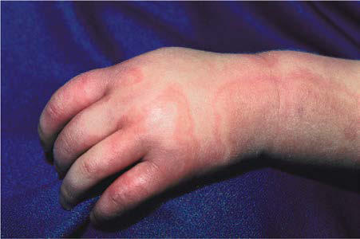

# Chapter 191: Serum Sickness

*Anna H. Nowak-Wegrzyn and Scott H. Sicherer*

<!-- p.1847 -->
**Serum sickness** is a systemic, immune complex–mediated hypersensi tivity vasculitis classically attributed to the therapeutic administration of foreign serum proteins or other medications (Table 191.1).

**ETIOLOGY** Immune complexes involving heterologous (animal) serum proteins and complement activation are important pathogenic mechanisms in serum sickness. Antibody therapies derived from the horse, sheep, or rabbit are available for treatment of envenomation by the black widow spider and a variety of snakes, for treatment of botulism, and for immunosuppression (antithymocyte globulin [ATG]). The availability of alternative medical therapies, modified or bioengineered antibodies, and biologics of human origin have supplanted the use of nonhuman antisera, reducing the risk of serum sickness. However, rabbit-generated ATGs, which target human T cells, continue to be widely used as immunosuppressive agents during treatment of kidney allograft recipients; serum sickness is associated with a late graft loss in kidney transplant recipients. A **serum sickness–like reac tion** may be attributed to drug allergy, triggered by antibiotics (particu larly cefaclor, trimethoprim-sulfamethoxazole, anticonvulsants, prolonged high-dose intravenous penicillin G), infections (streptococcal infections, hepatitis B), or rabies vaccine. In contrast to a true serum sickness, serum

sickness–like reactions do not exhibit the immune complexes, hypocom plementemia, vasculitis, and renal lesions that are seen in serum sickness reactions.

**PATHOGENESIS** Serum sickness is a classic example of a type III hypersensitivity reaction caused by antigen-antibody complexes. In the rabbit model using bovine serum albumin as the antigen, symptoms develop with the appearance of antibody against the injected antigen. As free antigen concentration falls and antibody production increases over days, antigen-antibody complexes of various sizes develop in a manner analogous to a precipitin curve. Whereas small complexes usually circulate harmlessly and large com plexes are cleared by the reticuloendothelial system, intermediate-sized complexes that develop at the point of slight antigen excess may deposit in blood vessel walls and tissues. There the immune microprecipitates induce vascular (leukocytoclastic vasculitis with immune complex deposition) and tissue damage through activation of complement and granulocytes.

Complement activation (C3a, C5a) promotes chemotaxis and adher ence of neutrophils to the site of immune complex deposition. The pro cesses of immune complex deposition and of neutrophil accumulation may be facilitated by increased vascular permeability, because of the release of vasoactive amines from tissue mast cells. Mast cells may be activated by binding of antigen to IgE or through contact with anaphylatoxins (C3a). Tissue injury results from the liberation of proteolytic enzymes and oxygen radicals from the neutrophils.

**CLINICAL MANIFESTATIONS** The symptoms of serum sickness generally begin 7-12 days after injection of the foreign material, but may appear as late as 3 weeks afterward. The onset of symptoms may be accelerated if there has been earlier exposure or previous allergic reaction to the same antigen. A few days before the onset of generalized symptoms, the site of injection may become edematous and erythematous. Symptoms usually include fever, malaise, and rashes. Urticaria and morbilliform rashes are the predominant types of skin erup tions (Fig. 191.1). In a prospective study of serum sickness induced by administration of equine ATG, an initial rash was noted in most patients. It began as a thin, serpiginous band of erythema along the sides of the hands, fingers, feet, and toes at the junction of the palmar or plantar skin with the skin of the dorsolateral surface. In most patients the band of ery thema was replaced by petechiae or purpura, presumably because of low platelet counts or local damage to small blood vessels. Additional symp toms include edema, myalgia, lymphadenopathy, symmetric arthralgia or arthritis involving multiple joints, and gastrointestinal complaints, includ ing pain, nausea, diarrhea, and melena. Symptoms typically resolve within 2 weeks of removal of the offending agent, although in unusual cases, symptoms can persist for as long as 2-3 months. Carditis, glomerulone phritis, Guillain-Barré syndrome, and peripheral neuritis are rare com plications. **Serum sickness–like reactions** from drugs are characterized by fever, pruritus, urticaria, and arthralgias that usually begin 1-3 weeks after drug exposure. The urticarial skin eruption becomes increasingly

*Anna H. Nowak-Wegrzyn and 
 Scott H. Sicherer*

Sickness*

#### **Table 191.1** Proteins and Medications That Cause Serum

| Category / Parameter | Clinical Details & Findings |
| --- | --- |
| **PROTEINS FROM OTHER SPECIES** | Antibotulinum globulin; Antithymocyte globulin; Antitetanus toxoid; Antivenin (Crotalidae) polyvalent (horse serum based); Crotalidae polyvalent immune Fab (ovine serum based); Antirabies globulin; Infliximab; Rituximab; Etanercept; Omalizumab; Adalimumab; Natalizumab; Anti-HIV antibodies ([PE]HRG214); Hymenoptera stings; Streptokinase; H1N1 influenza vaccine; Rabies vaccine |
| **Antibiotics** | Cefaclor; Penicillins; Trimethoprim sulfamethoxazole; Minocycline; Meropenem |
| **Neurologic** | Bupropion; Carbamazepine; Phenytoin; Sulfonamides; Barbiturates; *Based on review of the most current literature. Other medications that are not listed; might also cause serum sickness.; Adapted from Aceves SS. Serum sickness. In: Burg FD, Ingelfinger JR, Polin RA, Gershon |

**Fig. 191.1** Serum sickness–like reaction (SSLR). Note the swollen hand and large urticarial wheals in this girl with SSLR and arthralgias. (From Paller AS, Mancini AJ, eds. Hurwitz Clinical Pediatric Dermatol

<!-- p.1849 -->
