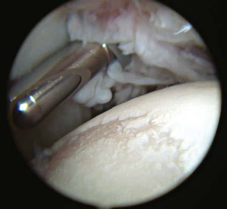

# Chapter 196: Juvenile Idiopathic Arthritis

*Eveline Y. Wu and C. Egla Rabinovich*

<!-- p.1883 -->
Juvenile idiopathic arthritis (JIA) is the most common rheumatic disease in children and one of the more common chronic illnesses of childhood. JIA represents a heterogeneous group of disorders sharing the clinical manifestation of arthritis. The etiology and pathogenesis of JIA are largely unknown, and the genetic component is complex, making clear distinction among various subtypes difficult. As a result, several classification schemes exist, each with its own limitations. The former classification of the **American College of Rheumatology (ACR)** uses the term *juvenile rheumatoid arthritis* and categorizes the disease into three onset types (Table 196.1). Attempting to standardize nomenclature, the **International League of Associations for Rheu matology (ILAR)** proposed a different classification using the term *juvenile idiopathic arthritis* (Table 196.2), inclusive of all subtypes of chronic juvenile arthritis. We refer to the ILAR classification criteria; see Chapter 197 for enthesitis-related arthritis (ERA) and psoriatic JIA (Tables 196.3 and 196.4).

**EPIDEMIOLOGY** The worldwide incidence of JIA ranges from 0.8 to 22.6 per 100,000 children per year, with prevalence ranges from 7 to 401 per 100,000. These wide-ranging numbers reflect population differences, particu larly environmental exposure and immunogenetic susceptibility, along with variations in diagnostic criteria, difficulty in case ascer tainment, and lack of population-based data. An estimated 300,000 U.S. children have arthritis, including 100,000 with a form of JIA. **Oligoarthritis** is the most common subtype (40–50%), followed by **polyarthritis** (25–30%) and **systemic JIA** (5–15%) (see Table 196.4). More females than males are affected in both oligoarticular (3:1) and polyarticular (5:1) JIA but are equally affected in systemic JIA (sJIA). The peak age at onset is 2-4 years for oligoarticular disease. Age of onset has a bimodal distribution in polyarthritis, with peaks at 2-4 years and 10-14 years. sJIA occurs throughout childhood, with a peak at 1-5 years.

**ETIOLOGY** The etiology and pathogenesis of JIA are not completely understood, although both immunogenetic susceptibility and an external trigger are considered necessary. Twin and family studies suggest a substantial

role for genetic factors. JIA is a complex genetic trait in which multiple genes may affect disease susceptibility. Variants in major histocompat ibility complex (MHC) class I and class II regions have indisputably been associated with different JIA subtypes. Non-HLA candidate loci are also associated with JIA, including polymorphisms in the genes encoding protein tyrosine phosphatase nonreceptor 22 (PTPN22), tumor necrosis factor (TNF)-α, macrophage inhibitory factor, inter leukin (IL)-6 and its receptor, and IL-1α. Possible nongenetic triggers include bacterial and viral infections, enhanced immune responses to bacterial or mycobacterial heat shock proteins, abnormal reproductive hormone levels, and joint trauma.

**PATHOGENESIS** JIA is an autoimmune disease associated with alterations in both humoral and cell-mediated immunity. T lymphocytes have a central role, releasing proinflammatory cytokines favoring a type 1 helper T-lymphocyte response. Studies of T-cell receptor expression confirm recruitment of T lymphocytes specific for synovial non–self-antigens. B-cell activation, immune complex formation, and complement activa tion also promote inflammation. Inheritance of specific cytokine alleles may predispose to upregulation of inflammatory networks, resulting in systemic disease or more severe articular disease.

sJIA is characterized by dysregulation of the innate immune system with a lack of autoreactive T cells and autoantibodies. It therefore may be more accurately classified as an **autoinflammatory disorder**, which may transition to an autoimmune process once actual arthritis devel ops (Fig. 196.1). The IL-1 family of cytokines is key to disease patho genesis, which is strongly supported by the marked responsiveness to IL-1 inhibitors. IL-18 in particular is a central driver, and serum IL-18 levels are markedly elevated in children with sJIA.

All these immunologic abnormalities cause inflammatory synovitis, characterized pathologically by villous hypertrophy and hyperplasia with hyperemia and edema of the synovial tissue. Vascular endothelial hyperplasia is prominent and is characterized by infiltration of mono nuclear and plasma cells with a predominance of T lymphocytes (Fig. 196.2). Advanced and uncontrolled disease leads to pannus formation and progressive erosion of articular cartilage and contiguous bone (Figs. 196.3 and 196.4).

**CLINICAL MANIFESTATIONS** Arthritis must be present ≥6 weeks to make a diagnosis of any JIA subtype. Arthritis is defined by intraarticular swelling or the presence of two or more of the following signs: limitation in range of motion (ROM), tenderness or pain on motion, and warmth. Initial symptoms may be subtle or acute and often include morning stiffness with a limp or gelling after inactivity. Easy fatigability and poor sleep quality may be present. Involved joints are often swollen, warm to the touch, and uncomfortable on movement or palpation with reduced ROM, but usually are not erythematous. Arthritis in large joints, especially knees, initially accelerates linear growth and causes the affected limb to be longer, resulting in a discrepancy in limb lengths. Continued inflam mation stimulates rapid and premature closure of the growth plate, resulting in shortened bones.

**Oligoarthritis** is defined as involving four or fewer joints within the first 6 months of disease onset, and often only a single joint is involved (see Table 196.4). It predominantly affects the large joints of the lower extremities, such as the knees and ankles (Fig. 196.5). Isolated involve ment of upper-extremity large joints is less common. Those in whom disease never develops in four or more joints are regarded as having **persistent oligoarticular JIA**, whereas evolution of disease in five or more joints after 6 months changes the classification to **extended oligoarticular JIA** and is associated with a worse prognosis. Isolated involvement of the hip is *almost never* a presenting sign and suggests ERA (see Chapter 197) or a nonrheumatic cause. The presence of a positive antinuclear antibody (ANA) test confers increased risk for asymptomatic anterior uveitis, requiring periodic slit-lamp examina tion (Table 196.5). ANA positivity may also be correlated with younger age at disease onset, females, asymmetric arthritis, and fewer involved joints over time.

*Eveline Y. Wu and C. Egla Rabinovich*

Rheumatoid Arthritis

#### **Table 196.1** Criteria for the Classification of Juvenile

| Category / Parameter | Clinical Details & Findings |
| --- | --- |
| **General** | Age at onset: <16 yr; Arthritis (swelling or effusion, or the presence of two or more of the; following signs: limitation of range of motion, tenderness or pain; on motion, increased heat) in one or more joints; Duration of disease: ≥6 wk; Onset type defined by type of articular involvement in the first 6 mo; after onset:; Polyarthritis: five or more inflamed joints; Oligoarthritis: four or fewer inflamed joints; Systemic-onset disease: arthritis with rash and a characteristic; quotidian fever; Exclusion of other forms of juvenile arthritis; Adapted from Cassidy JT, Levison JE, Bass JC, et al. A study of classification criteria for; a diagnosis of juvenile rheumatoid arthritis. Arthritis Rheum. 1986;29:274–281. |

<!-- p.1884 -->
**CATEGORY DEFINITION EXCLUSIONS**

Systemic JIA Arthritis in one or more joints with, or preceded by, fever of ≥2 wk

in duration that is documented to be daily (quotidian*) for at least 3 days and accompanied by one or more of the following: 1.	 Evanescent (nonfixed) erythematous rash 2.	 Generalized lymph node enlargement 3.	 Hepatomegaly or splenomegaly or both 4.	 Serositis†

a.	 Psoriasis or a history of psoriasis in patient or first-

degree relative b.	Arthritis in an HLA-B27–positive male beginning

after the sixth birthday c.	 Ankylosing spondylitis, enthesitis-related arthritis,

sacroiliitis with IBD, Reiter syndrome, or acute anterior uveitis, or history of one of these disorders in a first-degree relative d.	Presence of IgM RF on at least two occasions at

least 3 mo apart

Oligoarthritis Arthritis affecting one to four joints during the first 6 mo of

disease; two subcategories are recognized: 1.	 Persistent oligoarthritis—affecting four or fewer joints

throughout the disease course 2.	 Extended oligoarthritis—affecting five or more joints after the

first 6 mo of disease

a, b, c, d (above) *plus* e. Presence of systemic JIA in the patient

Polyarthritis

(RF negative)

Arthritis affecting five or more joints during the first 6 mo of

disease; a test for RF is negative

a, b, c, d, e

Polyarthritis

(RF positive)

Arthritis affecting five or more joints during the first 6 mo of

disease; two or more tests for RF at least 3 mo apart during the first 6 mo of disease are positive

a, b, c, e

Psoriatic arthritis Arthritis and psoriasis or arthritis and at least two of the following: b, c, d, e

1.	 Dactylitis‡ 2.	 Nail pitting§ and onycholysis 3.	 Psoriasis in first-degree relative

Enthesitis-related

arthritis

Arthritis and enthesitis¶ or arthritis or enthesitis with at least two of

the following:

a, d, e

1.	 Presence of or history of sacroiliac joint tenderness or

inflammatory lumbosacral pain, or both** 2.	 Presence of HLA-B27 antigen 3.	 Onset of arthritis in a male >6 yr old 4.	 Acute (symptomatic) anterior uveitis 5.	 History of ankylosing spondylitis, enthesitis-related arthritis,

sacroiliitis with IBD, Reiter syndrome, or acute anterior uveitis in first-degree relative

Undifferentiated

arthritis

Arthritis that fulfills criteria in no category or two or more of the

above categories

*Quotidian fever is defined as a fever that rises to 39°C (102.2°F) once daily and returns to 37°C (98.6°F) between fever peaks. †Serositis refers to pericarditis, pleuritis, or peritonitis or some combination of the three. ‡Dactylitis is swelling of one or more digit(s), usually in an asymmetric distribution, that extends beyond the joint margin. §A minimum of two pits on any one or more nails at any time. ¶Enthesitis is defined as tenderness at the insertion of a tendon, ligament, joint capsule, or fascia to bone. **Inflammatory lumbosacral pain refers to lumbosacral pain at rest with morning stiffness that improves on movement. IBD, Inflammatory bowel disease; RF, rheumatoid factor. From Firestein GS, Budd RC, Harris ED Jr, et al., eds. Kelley’s Textbook of Rheumatology, 8th ed. Philadelphia: Saunders; 2009.

#### **Table 196.3** Characteristics of ACR and ILAR Classifications of Childhood Chronic Arthritis

| Category / Parameter | Clinical Details & Findings |
| --- | --- |
| **ILAR (1997)** | Term; Juvenile rheumatoid arthritis (JRA); Juvenile idiopathic arthritis (JIA); Minimum duration; ≥6 wk; ≥6 wk; Age at onset; <16 yr; <16 yr; Four or fewer joints in first 6 mo after presentation; Pauciarticular; Oligoarthritis:; Persistent: four or fewer joints for course of disease; Extended: four or more joints after 6 mo; Four or more joints in first 6 mo after presentation; Polyarticular; Polyarthritis, RF negative; Polyarthritis, RF positive; Fever, rash, arthritis; Systemic onset; Systemic; Other categories included; Exclusion of other forms; Psoriatic arthritis; Enthesitis-related arthritis; Undifferentiated:; Fits no other category; Fits more than one category; Inclusion of psoriatic arthritis, inflammatory bowel; disease, ankylosing spondylitis; No (see Chapter 197); Yes |

<!-- p.1885 -->
↑↑; ferritin ↑; platelets ↑↑

↑; CRP ↑ or normal; mild

#### **Table 196.4** Overview of Main Features of Subtypes of Juvenile Idiopathic Arthritis (JIA)

| Category / Parameter | Clinical Details & Findings |
| --- | --- |
| **NOTES ON THERAPY** | Systemic; arthritis; 1-5; 1:1; 5-15; Polyarticular, often; affecting knees,; wrists, and ankles;; also fingers, neck,; and hips; Daily fever;; evanescent rash;; pericarditis;; pleuritis; Anemia; WBC ↑↑; ESR ↑↑; CRP; (normal or ↓ in MAS); Less responsive to standard treatment; with MTX and anti-TNF agents;; consider IL-1 or IL-6 inhibitors in; resistant cases or as first-line therapy; Oligoarthritis; 2-4; 3:1; 40-50 (but ethnic; variation); Knees ++; ankles,; fingers +; Uveitis in 30% of; cases; ANA positive in 60%; other; test results usually normal;; may have mildly ↑ ESR/CRP; NSAIDs and intraarticular; corticosteroids; MTX occasionally; required; Polyarthritis:; RF negative; 2-4 and 10-14; 3:1 and 10:1; 20-35; Symmetric or; asymmetric; small; and large joints;; cervical spine;; temporomandibular; joint; Uveitis in 10%; ANA positive in 40%; RF; negative; ESR ↑ or ↑↑; CRP ↑; or normal; mild anemia; Standard therapy with MTX and; NSAIDs; then, if nonresponsive,; anti-TNF agents or other biologics,; including abatacept, indicated as; first-line therapy; RF positive; 9-12; 9:1; <10; Aggressive symmetric; polyarthritis; Rheumatoid nodules; in 10%; low-grade; fever; RF positive; ESR ↑↑; CRP ↑/; normal; mild anemia; Long-term remission unlikely; early; aggressive therapy is warranted; Psoriatic; arthritis; 2-4 and 9-11; 2:1; 5-10; Asymmetric arthritis; of small or medium-; sized joints; Uveitis in 10%;; psoriasis in 50%; ANA positive in 50%; ESR; anemia; NSAIDs and intraarticular; corticosteroids; MTX, anti-TNF; agents; Enthesitis-; related; arthritis; 9-12; 1:7; 5-10; Predominantly; lower limb joints; affected; sometimes; axial skeleton; (but less than in; adult, ankylosing; spondylitis); Acute anterior; uveitis; association; with reactive; arthritis and; inflammatory; bowel disease; 80% of patients positive for |
| **HLA-B27** | NSAIDs and intraarticular; corticosteroids; consider; sulfasalazine as alternative to MTX;; anti-TNF agents; ILAR, International League of Associations for Rheumatology; ANA, antinuclear antibody; CRP, C-reactive protein; ESR, erythrocyte sedimentation rate; MAS, macrophage activation syndrome; MTX, methotrexate; NSAIDs, nonsteroidal; antiinflammatory drugs; RF, rheumatoid factor; TNF, tumor necrosis factor; WBC, white blood cell count.; From Firestein GS, Budd RC, Harris ED Jr, et al., eds. Kelley’s Textbook of Rheumatology, 8th ed. Philadelphia: Saunders; 2009. |

<!-- p.1886 -->
Innate

Febrile sJIA Arthritic sJIA

Innately adaptive Adaptive

CD4+ T cell fate?

IFNγlow environment?

IFNγlow environment?

IFNγlow

γδTCR

γδT cells

Ag

Presentation? αβTCR

Th1 fate/role?

Th17 fate/role?

(i)NKT cells

IL-18R

i.e. IPP

IL-18R

IL-6 others

IL-1R

*

* DAMPs (S100A8/A9)

DAMPs (S100A8/A9/A12)

DAMPs (S100A8/A9/A12)

NK cell

Necrotic granulocyte

PAMPs

Granulocyte

Monocyte

IL-17 IL-18

IL-18

IL-1β

*

5

2

5

6

4

4

7

7

7

2

3

1

1

1

*HLA-DRB1*11*

Intracellular

role?

Proliferation IL-17 expression

2

IFNγlow

3

Disease progression

**Fig. 196.1** Innately adaptive or truly autoimmune: a pathophysiologic model for disease progression in systemic juvenile idiopathic arthritis (sJIA). Innate immune cells, such as myeloid cells (granulocytes, monocytes) and natural killer (NK) cells, are relevant during the acute febrile phase of systemic JIA. (1) Myeloid cells release interleukin-1 (IL-1) family cytokines (IL-1β, IL-18) and other proinflammatory cytokines, which can either be trig gered by infection (pathogen- associated molecular patterns [PAMPs]) or result from pattern-recognition receptor activation by damage-associated molecular patterns (DAMPs) released from stressed or necrotic cells. (2) Together with γδ T-cell receptor (γδ TCR) activation by endogenous ligands (i.e., isopentenyl pyrophosphate [IPP]) or bacterial ligands, IL-1 and IL-18 can trigger IL-17 expression from γδ T cells, while (3) IL-18 fails to trigger interferon-γ (IFNγ) expression from NK cells because of a defective IL-18 receptor (IL-18R). (4) Similarly, systemic JIA Th1 cells express only low levels of IFNγ. Both cell types may contribute to hypophysiologic IFNγ levels, potentially promoting IL-17 expression in disease. Although a genetic as sociation or alterations in frequencies have been reported, the pathomechanistic roles of (5) HLA- DRB1*11 (whether antigen [Ag] presentation or intracellular function) or (6) invariant NKT (iNKT) and (7) CD4+ T cells in disease progression are yet largely unclear. Thus current data imply that in nately adaptive immune cells bridging innate and adaptive immunity, rather than classic B or T lymphocytes, play a central role in promoting disease progression in systemic JIA. (From Kessel C, Hedrich CM, Foeil D. Innately adaptive or truly autoimmune: is there something unique about systemic juvenile idiopathic arthritis? Arth Rheumatol. 2020;72:210–219, Fig. 2, p. 214)

**Polyarthritis** is characterized by inflammation of five or more joints in both upper and lower extremities (Figs. 196.6 and 196.7). Rheu matoid factor (RF)–positive polyarthritis resembles the characteristic symmetric presentation of adult rheumatoid arthritis. **Rheumatoid**

**nodules** on the extensor surfaces of the elbows, spine, and over the Achilles tendons, although unusual, are associated with a more severe course and almost exclusively occur in RF-positive individuals (Fig. 196.8). **Micrognathia** reflects chronic temporomandibular joint

<!-- p.1887 -->
disease (Fig. 196.9). Cervical spine involvement (Fig. 196.10), mani festing as decreased neck extension, occurs with a risk of atlantoaxial subluxation and neurologic sequelae. Hip disease may be subtle, with findings of decreased or painful ROM on examination (Fig. 196.11).

**Systemic JIA** is characterized by arthritis (may not be evident on initial presentation), fever, rash, and prominent visceral involvement, including hepatosplenomegaly, lymphadenopathy, and serositis (peri carditis). The characteristic fever, defined as spiking temperatures to ≥39°C (102.2°F), occurs on a daily or twice-daily basis for at least 2 weeks, with a rapid return to normal or subnormal temperatures (Fig. 196.12). The fever is often present in the evening and is frequently accompanied by a characteristic faint, erythematous, macular rash. The evanescent **salmon-colored lesions**, classic for sJIA, are linear or circu lar and are usually distributed over the trunk and proximal extremities (Fig. 196.13). The classic rash is nonpruritic and migratory with lesions lasting <1 hour. **Koebner phenomenon**, a cutaneous hypersensitivity in which classic lesions are brought on by superficial trauma, is often present. Heat can also evoke rash. Fever, rash, hepatosplenomegaly, and lymphadenopathy are present in >70% of affected children. Without arthritis, the **differential diagnosis** includes the episodic fever (auto inflammatory) syndromes (see Chapter 204), infection (endocarditis, rheumatic fever, brucellosis, multisystem inflammatory syndrome in children [MIS-C]), other rheumatic disorders (systemic lupus ery thematosus [SLE], vasculitis syndromes, serum sickness, Kawasaki

disease, sarcoidosis, Castleman disease), inflammatory bowel disease, hemophagocytic lymphohistiocytosis syndromes, and malignancy (leukemia, neuroblastoma, lymphoma). Some children initially pres ent with only systemic features and evolve over time, but definitive

**Fig. 196.2** Synovial biopsy specimen from a 10-yr-old child with oli goarticular juvenile idiopathic arthritis. There is a dense infiltration of lymphocytes and plasma cells in the synovium.

**Fig. 196.3** Arthroscopy in the shoulder of a child with juvenile idi opathic arthritis showing pannus formation and cartilage erosions. (Courtesy Dr. Alison Toth.)

**Fig. 196.4** MRI with gadolinium of a 10-yr-old child with juvenile idi opathic arthritis (same patient as in Fig. 196.2). The dense white signal in the synovium near the distal femur, proximal tibia, and patella reflects inflammation. MRI of the knee is useful to exclude ligamentous injury, chondromalacia of the patella, and tumor.

**Fig. 196.5** Oligoarticular juvenile idiopathic arthritis with swelling and flexion contracture of the right knee.

<!-- p.1888 -->
diagnosis requires the presence of arthritis. Arthritis may affect any number of joints, but the course is classically polyarticular; may be very destructive; and can include hip, cervical spine, and temporomandibu lar joint involvement.

**Macrophage activation syndrome** (MAS; see Chapter 207**)** is a rare but potentially fatal complication of sJIA that can occur at any time (onset, medication change, active or remission) during the disease course. It is also referred to as *secondary hemophagocytic syndrome* or *hemophagocytic lymphohistiocytosis* (HLH) (see Chapter 556.2). There is increasing evidence that sJIA/MAS and HLH share similar func tional defects in granule-dependent cytotoxic lymphocyte activity. In addition, sJIA-associated MAS and HLH share genetic variants in approximately 35% of patients with sJIA/MAS. MAS classically mani fests as acute onset of high-spiking fevers, lymphadenopathy, hepa tosplenomegaly, and encephalopathy. Laboratory evaluation shows

thrombocytopenia and leukopenia with elevated liver enzymes, lactate dehydrogenase, ferritin, and triglycerides. Patients may have purpura and mucosal bleeding, as well as elevated fibrin split product values and prolonged prothrombin and partial thromboplastin times. The ESR falls because of hypofibrinogenemia and hepatic dysfunction, a feature use ful in distinguishing MAS from a flare of systemic disease (Table 196.6). An international consensus panel developed a set of classification cri teria for sJIA-associated MAS, including hyperferritinemia (>684 ng/ mL) and any two of the following: thrombocytopenia (≤181 × 109/L), elevated liver enzymes (aspartate transaminase >48 U/L), hypertriglyc eridemia (>156 mg/dL), and hypofibrinogenemia (≤360 mg/dL) (see Table 196.6). These criteria apply to a febrile patient suspected of sJIA *and* in the absence of disorders such as immune-mediated thrombocy topenia, infectious hepatitis, familial hypertriglyceridemia, or visceral leishmaniasis. *A relative change in laboratory values is likely more rel evant in making an early diagnosis than are absolute normal values*. A bone marrow aspiration and biopsy may be helpful in diagnosis, but

Patients with Juvenile Idiopathic Arthritis

#### **Table 196.5** Frequency of Ophthalmologic Examination in

| Category / Parameter | Clinical Details & Findings |
| --- | --- |
| **REFERRAL** | • Patients should be referred at the time of diagnosis, or suspicion,; of JIA |
| **INITIAL SCREENING EXAMINATION** | • Should occur as soon as possible and no later than 6 wk from; referral; • Symptomatic ocular patients should be seen within a week of; referral |
| **ONGOING SCREENING** | • Screening at 2-monthly intervals from onset of arthritis for 6 mo; • Followed by 3-4 monthly screening for time outlined below |
| **LENGTH OF SCREENING (YR)** | <3; 8; 3-4; 6; 5-8; 3; 9-10; 1 |
| **LENGTH OF SCREENING (YR)** | <6; 5; 6-9; 2; Polyarticular, ANA-negative JIA, onset <7 yr; 5-yr screening for all children; Systemic JIA and rheumatoid factor–positive polyarticular JIA; • Uveitis risk very low; however, diagnostic uncertainty in the early; stages and overlap of symptoms may mean initial screening is; indicated; All categories, onset >11 yr; • 1-yr screening for all children; After stopping immunosuppression (e.g., methotrexate); • Two-monthly screening for 6 mo, then revert to previous; screening frequency as above; After discharge from screening; • Patients should receive advice about regular self-monitoring; by checking vision uniocularly once weekly and when to seek; medical advice; • Screening may need to continue indefinitely in situations where; a young person may be unable to detect a change in vision or; be unwilling to seek re-referral; • Annual check by optometrist as a useful adjunct; Data from Clarke SLN, Sen ES, Ramanan AV. Juvenile idiopathic arthritis-associated; uveitis. Pediatr Rheumatol. 2016;14:27. |

**Fig. 196.6** Hands and wrists of a child with polyarticular juvenile idi opathic arthritis, rheumatoid factor negative. Notice the symmetric in volvement of the wrists, metacarpophalangeal joints, and proximal and distal interphalangeal joints. In this photograph, there is cream with occlusive dressing on the patient’s right hand in preparation for place ment of an intravenous line for administration of a biologic agent.

A B

**Fig. 196.7** Progression of joint destruction in a child with polyarticular juvenile idiopathic arthritis, rheumatoid factor positive, despite doses of corticosteroids sufficient to suppress symptoms in the interval be tween radiographs. A, Radiograph of the hand at onset. B, Radiograph taken 4 years later, showing a loss of articular cartilage and destruc tive changes in the distal and proximal interphalangeal and metacar pophalangeal joints as well as destruction and fusion of wrist bones.

<!-- p.1889 -->
evidence of hemophagocytosis is not always evident. Emergency treat ment with high-dose intravenous methylprednisolone, cyclosporine, or anakinra may be effective. Severe cases may require therapy similar to that for primary HLH (see Chapter 556.2).

An inflammatory lung disease has also recently been recognized as a rare but life-threatening complication in children with sJIA. Chil dren can present with little to no respiratory symptoms; acute clubbing can be an early indicator. The predominant pathology is pulmonary alveolar proteinosis and/or endogenous lipoid pneumonia. Compared with children without lung disease, children with sJIA and lung disease are younger at diagnosis, have a history of MAS, have higher serum IL-18 levels, and have higher exposure and adverse reaction rates to cytokine inhibitors. Given the more severe disease course, lung disease in children with sJIA requires a high index of suspicion and prompt evaluation.

Bone mineral metabolism and skeletal maturation are adversely affected in children with JIA, regardless of subtype. Children with JIA have decreased bone mass (osteopenia), which appears to be associated with increased disease activity. Increased levels of cytokines such as TNF-α and IL-6, both key regulators in bone metabolism, have delete rious effects on bone both within the joint and systemically in the axial

and appendicular bones. Abnormalities of skeletal maturation become most prominent during the pubertal growth spurt.

**DIAGNOSIS* JIA is a clinical diagnosis without any diagnostic laboratory tests.* The meticulous clinical exclusion of other diseases and many mimics is therefore essential. Laboratory studies, including tests for ANA and RF,

**Fig. 196.8** Rheumatoid nodules overlying bony prominences in an adolescent with rheumatoid factor–positive polyarthritis. (From Rosen berg AM, Oen KG. Polyarthritis. In: Cassiday JT, Petty RE, Laxer RM, et al., eds. Textbook of Pediatric Rheumatology, 6th ed. Philadelphia: Saunders; 2011: Fig 15-5, p. 257.)

**Fig. 196.9** CT scan of the temporomandibular joint of a child with juvenile idiopathic arthritis exhibiting destruction on the right.

**Fig. 196.10** Radiograph of the cervical spine of a child with active juvenile idiopathic arthritis showing fusion of the neural arch between joints C2 and C3, narrowing and erosion of the remaining neural arch joints, obliteration of the apophyseal space, and loss of the normal lor dosis.

**Fig. 196.11** Severe hip disease in 13-yr-old male with active systemic juvenile idiopathic arthritis. Radiograph shows destruction of the femo ral head and acetabula, joint space narrowing, and subluxation of left hip. The child had received corticosteroids systemically for 9 years.

41

Temperature (°C)

40

39

38

37

36

0 2 4 6 8 10 12 Days

14 16 18 20 22 24 35

**Fig. 196.12** High-spiking intermittent fever in a 3-yr-old child with systemic juvenile idiopathic arthritis. (From Ravelli A, Martini A. Juvenile idiopathic arthritis. Lancet 2007;369:767–778.)

<!-- p.1890 -->
are only supportive or prognostic, and their results may be normal in patients with JIA (see Tables 196.1, 196.3, and 196.4).

**DIFFERENTIAL DIAGNOSIS** The differential diagnosis for arthritis is broad, and a careful, thorough investigation for other underlying etiology is imperative (Table 196.7). History, physical examination, laboratory tests, and

radiography may help exclude other possible causes. Arthritis can be a presenting manifestation for any of the multisystem rheumatic diseases of childhood, including SLE (see Chapter 199), juvenile dermatomyositis (see Chapter 200), sarcoidosis (see Chapter 209), and the vasculitic syndromes (see Chapter 210). In scleroderma (see Chapter 201), limited ROM caused by sclerotic skin overly ing a joint may be confused with sequelae from chronic inflamma tory arthritis. **Acute rheumatic fever** is characterized by exquisite joint pain and tenderness, remittent fever, and migratory polyar thritis. **Autoimmune hepatitis** can also be associated with an acute arthritis.

Many infections are associated with arthritis, and a recent history of infectious symptoms may help make a distinction. Viruses, includ ing parvovirus B19, rubella, Epstein-Barr virus, hepatitis B virus, and HIV, can induce a transient arthritis. Arthritis may follow enteric infec tions (see Chapter 198). **Lyme disease** should be considered in chil dren with oligoarthritis living in or visiting endemic areas (see Chapter 268). Although a history of tick exposure, preceding flulike illness, and subsequent rash should be sought, these are not always present. Mono articular arthritis unresponsive to antiinflammatory treatment may be the result of chronic mycobacterial or other infection, such as *Kingella kingae,* and the diagnosis is established by synovial fluid analysis (poly merase chain reaction [PCR]) or biopsy. Acute onset of fever and a painful, erythematous, hot joint suggests septic arthritis (see Chapter 726). Isolated hip pain with limited ROM suggests suppurative arthri tis, osteomyelitis (see Chapter 725), toxic synovitis, Legg-Calvé-Perthes disease, slipped capital femoral epiphysis, and chondrolysis of the hip (see Chapter 719).

Lower-extremity arthritis and tenderness over insertion of liga ments and tendons, especially in a male child, suggest ERA (see Chap ter 197). **Psoriatic arthritis** can manifest as limited joint involvement in an unusual distribution (e.g., small joints of the hand and ankle) years before the onset of cutaneous disease. **Inflammatory bowel dis ease** may manifest as oligoarthritis, usually affecting joints in the lower extremities, as well as gastrointestinal symptoms, elevations in ESR, and microcytic anemia.

Many conditions present solely with arthralgia (i.e., joint pain). Hypermobility may cause joint pain, especially in the lower extrem ities. Growing pains should be suspected in a child age 4-12 years complaining of leg pain in the evening with normal investigative studies and no morning symptoms. Nocturnal pain that awakens the child also alerts to the possibility of a malignancy. An adoles cent with missed school days may suggest a diagnosis of fibromyal gia (see Chapter 211.3).

Children with **leukemia** or **neuroblastoma** may have joint or bone pain resulting from malignant infiltration of the bone, synovium, or more often the bone marrow, sometimes months before demonstrating lymphoblasts on peripheral blood smear. Physical examination may reveal no tenderness, a deeper pain with palpation of the bone, or pain out of proportion to exam findings. Malignant pain often awakens the child from sleep and may cause cytopenias. Because platelets are an acute-phase reactant, a high ESR with leukopenia and a low-normal platelet count may also be a clue to underlying leukemia. In addition, the characteristic quotidian fever of sJIA is absent in malignancy. Bone marrow examination is necessary for diagnosis. Some diseases, such as cystic fibrosis, diabetes mellitus, and the glycogen storage diseases, have associated arthropathies. Swelling that extends beyond the joint can be a sign of lymphedema or IgA vasculitis (formerly Henoch- Schönlein purpura; see Chapter 210.1). A peripheral arthritis indis tinguishable from JIA occurs in the humoral immunodeficiencies (see Chapter 165), such as common variable immunodeficiency and X-linked agammaglobulinemia. Skeletal dysplasias associated with a degenerative arthropathy are diagnosed from their characteristic radiologic abnormalities.

Systemic onset of JIA often presents as a fever of unknown origin (see Chapter 222). Important considerations in the differential diag nosis include infections (endocarditis, brucellosis, cat-scratch disease, Q fever, mononucleosis), autoinflammatory disease (see Chapter 204), malignancy (leukemia, lymphoma, neuroblastoma), and HLH.

**Fig. 196.13** The rash of systemic juvenile idiopathic arthritis is salmon-colored, macular, and nonpruritic. Individual lesions are tran sient and occur in crops over the trunk and extremities. (From American College of Rheumatology. Clinical Slide Collection on the Rheumatic Diseases. Atlanta, GA: ACR. Copyright 1991, 1995, 1997.)

#### **Table 196.6** Macrophage Activation Syndrome (MAS)

| Category / Parameter | Clinical Details & Findings |
| --- | --- |
| **LABORATORY FEATURES*** | 1.	 Cytopenias; 2.	 Abnormal liver function tests; 3.	 Coagulopathy (hypofibrinogenemia); 4.	 Decreased erythrocyte sedimentation rate; 5.	 Hypertriglyceridemia; 6.	 Hyponatremia; 7.	 Hypoalbuminemia; 8.	 Hyperferritinemia; 9.	 Elevated sCD25 and sCD163 |
| **CLINICAL FEATURES*** | 1.	 Nonremitting fever; 2.	 Hepatomegaly; 3.	 Splenomegaly; 4.	 Lymphadenopathy; 5.	 Hemorrhages; 6.	 Central nervous system dysfunction (headache, seizures, lethargy,; coma, disorientation) |
| **HISTOPATHOLOGIC FEATURES*** | 1.	 Macrophage hemophagocytosis in the bone marrow aspirate; 2.	 Increased CD163 staining of the bone marrow |
| **PROPOSED CRITERIA FOR MAS IN SJIA†** | 1.	 Serum ferritin >684 ng/mL and; 2.	 Any two of the following:; • Thrombocytopenia (≤181 × 109/L); • Elevated liver enzymes (aspartate transaminase >48 U/L); • Hypertriglyceridemia (>156 mg/dL); • Hypofibrinogenemia (≤360 mg/dL); *From Ravelli A, Grom A, Behrens E, Cron R. Macrophage activation syndrome as part; of systemic juvenile idiopathic arthritis: Diagnosis, genetics, pathophysiology and; treatment. Genes Immun. 2012;13:289–298.; †From Ravelli A, Minoia F, Davì S, et al. 2016 Classification criteria for macrophage; activation syndrome complicating systemic juvenile idiopathic arthritis: a European; League Against Rheumatism/American College of Rheumatology/Paediatric; Rheumatology International Trials Organisation collaborative initiative. Arthritis; Rheumatol. 2016;68:566–576. |

<!-- p.1891 -->
**LABORATORY FINDINGS** Hematologic abnormalities often reflect the degree of systemic or artic ular inflammation, with elevated white blood cell (WBC) and platelet counts and a microcytic anemia. Inflammation may also cause eleva tions in ESR and CRP, although it is not unusual for both to be normal in children with JIA.

Elevated ANA titers are present in 40–85% of children with oligoar ticular or polyarticular JIA but are rare with sJIA. ANA seropositivity is associated with increased risk of **chronic uveitis** in JIA. Approxi mately 5–15% of patients with polyarticular JIA are seropositive for RF. Anti–cyclic citrullinated peptide antibody, as with RF, is a marker of more aggressive disease. Both ANA and RF seropositivity can occur in association with transient events, such as viral infection.

#### **Table 196.7** Conditions Causing Arthritis or Extremity Pain

| Category / Parameter | Clinical Details & Findings |
| --- | --- |
| **RHEUMATIC AND INFLAMMATORY DISEASES** | Juvenile idiopathic arthritis; Systemic lupus erythematosus; Juvenile dermatomyositis; Polyarteritis nodosa; Scleroderma; Sjögren syndrome; Behçet disease; Overlap syndromes; Antineutrophilic cytoplasmic antibody (ANCA)–associated vasculitis; Sarcoidosis; Kawasaki syndrome; IgA vasculitis (formerly Henoch-Schönlein purpura); Chronic recurrent multifocal osteomyelitis |
| **SERONEGATIVE SPONDYLOARTHROPATHIES** | Juvenile ankylosing spondylitis; Inflammatory bowel disease; Psoriatic arthritis; Reactive arthritis associated with urethritis, iridocyclitis, and; mucocutaneous lesions |
| **INFECTIOUS ILLNESSES** | Bacterial arthritis (septic arthritis, Staphylococcus aureus, Kingella; kingae, pneumococcal, gonococcal, Haemophilus influenzae); Lyme disease; Viral illness (parvovirus, rubella, mumps, Epstein-Barr, hepatitis B,; chikungunya); Fungal arthritis; Mycobacterial infection; Spirochetal infection; Endocarditis |
| **REACTIVE ARTHRITIS** | Acute rheumatic fever; Reactive arthritis (postinfectious caused by Shigella, Salmonella,; Yersinia, Chlamydia, post-streptococcal, or meningococcus); Serum sickness; Toxic synovitis of the hip; Postimmunization |
| **IMMUNODEFICIENCIES** | Hypogammaglobulinemia; Immunoglobulin A deficiency; Common variable immunodeficiency disease (CVID); Human immunodeficiency virus (HIV) |
| **CONGENITAL AND METABOLIC DISORDERS** | Gout; Pseudogout; Mucopolysaccharidoses; Thyroid disease (hypothyroidism, hyperthyroidism); Hyperparathyroidism; Vitamin C deficiency (scurvy); Hereditary connective tissue disease (Marfan syndrome,; Ehlers-Danlos syndrome); Fabry disease; Farber disease; Fucosidosis; Amyloidosis (familial Mediterranean fever) |
| **BONE AND CARTILAGE DISORDERS** | Trauma; Patellofemoral syndrome; Hypermobility syndromes; Osteochondritis dissecans; Avascular necrosis (including Legg-Calvé-Perthes disease); Hypertrophic osteoarthropathy; Slipped capital femoral epiphysis; Osteolysis; Benign bone tumors (including osteoid osteoma); Langerhans cell histiocytosis; Rickets; Idiopathic multicentric osteolysis; Camptodactyly-arthropathy-coxa vara-pericarditis syndrome; Progressive pseudorheumatoid dysplasia; Pachydermodactyly |
| **NEUROPATHIC DISORDERS** | Peripheral neuropathies; Carpal tunnel syndrome; Charcot joints |
| **NEOPLASTIC DISORDERS** | Leukemia; Neuroblastoma; Lymphoma; Bone tumors (osteosarcoma, Ewing sarcoma); Histiocytic syndromes; Synovial tumors |
| **HEMATOLOGIC DISORDERS** | Hemophilia; Hemoglobinopathies (including sickle cell disease) |
| **MISCELLANEOUS DISORDERS** | Autoinflammatory diseases; Recurrent multifocal osteomyelitis; Pigmented villonodular synovitis; Plant-thorn synovitis (foreign body arthritis); Myositis ossificans; Eosinophilic fasciitis; Tendinitis (overuse injury); Raynaud phenomenon; Hemophagocytic syndromes |
| **PAIN SYNDROMES** | Fibromyalgia; Growing pains; Depression (with somatization); Complex regional pain syndrome |

<!-- p.1892 -->
Children with sJIA usually have striking elevations in inflamma tory markers and WBC and platelet counts. Hemoglobin levels are low, typically 7-10 g/dL, with indices consistent with anemia of chronic disease. The ESR is usually high, except in MAS. Although immuno globulin levels tend to be high, ANA and RF are uncommon. Ferritin values are typically elevated and can be markedly increased in MAS (>10,000 ng/mL). In the setting of MAS, all cell lines have the potential to decline precipitously because of the consumptive process. A low or normal WBC count and/or platelet count in a child with active sJIA should raise concerns for MAS.

Early radiographic changes of arthritis include soft tissue swelling, periarticular osteopenia, and periosteal new-bone apposition around affected joints (Fig. 196.14). Continued active disease may lead to subchondral erosions, loss of cartilage with varying degrees of bony destruction, and fusion. Characteristic radiographic changes in the cervical spine, most frequently in the neural arch joints at C2-C3 (see Fig. 196.10), may progress to atlantoaxial subluxation. MRI is more sensitive than radiography to detect early changes (Fig. 196.15).

**TREATMENT** The goals of treatment are to achieve disease remission, prevent or halt joint damage, and foster normal growth and development. All chil dren with JIA need individualized treatment plans, and management is tailored according to disease subtype and severity, presence of poor prognostic indicators, and response to medications. Disease manage ment also requires monitoring for potential medication toxicities (see Chapter 195).

Children with oligoarthritis often show partial response to non steroidal antiinflammatory drugs (NSAIDs), with improvement in inflammation and pain (Table 196.8). Those who have no or partial response after 4-6 weeks of treatment with NSAIDs or who have func tional limitations such as joint contracture or leg-length discrepancy benefit from injection of intraarticular corticosteroids. *Triamcinolone hexacetonide* is a long-lasting preparation that provides a prolonged response. A substantial fraction of patients with oligoarthritis show no response to NSAIDs and injections and therefore require treatment with *disease-modifying antirheumatic drugs (DMARDs),* including con ventional synthetic DMARDs (csDMARDs) like methotrexate, and, if no response, biologic DMARDs (bDMARDs) like TNF inhibitors.

NSAIDs alone rarely induce remission in children with polyarthritis or sJIA. *Methotrexate* is the oldest and least toxic of the csDMARDs available for adjunctive therapy. It may take 6-12 weeks to see the effects of methotrexate. Failure of methotrexate monotherapy warrants the addition of a bDMARD. bDMARDs that inhibit proinflammatory cytokines, such as TNF-α, IL-1, and IL-6, demonstrate excellent disease control. TNF-α antagonists (e.g., *etanercept, adalimumab, golimumab*) are used to treat children with an inadequate response to methotrex ate, poor prognostic factors, or severe disease onset. Early aggressive therapy with a combination of methotrexate and a TNF-α antagonist may result in earlier achievement of clinically inactive disease. *Abata cept,* a selective inhibitor of T-cell activation, and *tocilizumab,* an IL-6

**Fig. 196.14** Early (6 month duration) radiographic changes of juve nile idiopathic arthritis. Soft tissue swelling and periosteal new bone formation appear adjacent to the second and fourth proximal inter phalangeal joints.

**Fig. 196.15** MRI of the wrist in a child with wrist arthritis. A, Multiple erosions of carpal bones. B, After administration of gadolinium contrast agent, uptake is consistent with active synovitis.

A B

<!-- p.1893 -->

#### **Table 196.8** Pharmacologic Treatment of Juvenile Idiopathic Arthritis (JIA)

| Category / Parameter | Clinical Details & Findings |
| --- | --- |
| **NONSTEROIDAL ANTIINFLAMMATORY DRUGS** | Naproxen; 15 mg/kg/day PO divided bid (maximum; dose 500 mg bid); Polyarthritis; Systemic; Oligoarthritis; Gastritis, renal and hepatic toxicity,; pseudoporphyria; Ibuprofen; 40 mg/kg/day PO divided tid (maximum; dose 800 mg tid); Same as above; Same as above; Meloxicam; 0.125 mg/kg PO once daily (maximum dose; 15 mg daily); Same as above; Same as above |
| **DISEASE-MODIFYING ANTIRHEUMATIC DRUGS** | Methotrexate; 0.5-1 mg/kg PO or SC weekly (maximum; dose 25 mg/wk); Polyarthritis; Systemic; Persistent or extended oligoarthritis; Nausea, vomiting, oral ulcerations, hepatic; toxicity, blood count dyscrasias,; immunosuppression, teratogenicity; Sulfasalazine; Initial 12.5 mg/kg PO daily; increase by; 10 mg/kg/day; Maintenance: 40-50 mg/kg divided bid; (maximum dose 2 g/day); Polyarthritis; GI upset, allergic reaction, pancytopenia,; renal and hepatic toxicity,; Stevens-Johnson syndrome; Leflunomide*; 10-20 mg PO daily; Polyarthritis; GI upset, hepatic toxicity, allergic rash,; alopecia (reversible), teratogenicity; (needs washout with cholestyramine) |
| **Anti–Tumor Necrosis Factor-α** | Etanercept; 0.8 mg/kg SC weekly or 0.4 mg/kg SC twice; weekly (maximum dose 50 mg/wk); Polyarthritis; Systemic; Persistent or extended oligoarthritis; Immunosuppressant, concern for; malignancy, demyelinating disease, lupus-; like reaction, injection site reaction; Infliximab*; 3-10 mg/kg IV q4-8wk; Same as above; Same as above, infusion reaction; Adalimumab; 10 to <15 kg: 10 mg SC every other week; 15 to <30 kg: 20 mg SC every other week; >30 kg: 40 mg SC every other week; Same as above; Same as above; Golimumab; 80 mg/m2 IV wk 0 and 4 and then q8 wk; Same as above; Same as above |
| **Anticytotoxic T-Lymphocyte–Associated Antigen-4 Immunoglobulin** | Abatacept; <75 kg: 10 mg/kg/dose IV q4wk; 75-100 kg: 750 mg/dose IV q4wk; >100 kg: 1,000 mg/dose IV q4wk; SC once weekly:; 10 to <25 kg: 50 mg; ≥25 to <50 kg: 87.5 mg; ≥50 kg: 125 mg; Polyarthritis; Immunosuppressant, concern for; malignancy, infusion reaction |
| **Anti-CD20** | Rituximab*; 750 mg/m2 IV 2 wk × 2 (maximum dose; 1,000 mg); Polyarthritis; Immunosuppressant, infusion reaction,; progressive multifocal encephalopathy |
| **Interleukin-1 Inhibitors** | Anakinra*; 1-2 mg/kg SC daily; Systemic; Immunosuppressant, GI upset, injection; site reaction; Canakinumab; 4 mg/kg/dose SC q4wk (maximum dose; 300 mg); Systemic; Immunosuppressant, headache, GI upset,; injection site reaction; Rilonacept*; 2.2 mg/kg/dose SC weekly (maximum dose; 160 mg); Systemic; Immunosuppressant, allergic reaction,; dyslipidemia, injection site reaction |
| **Interleukin-6 Receptor Antagonist** | Tocilizumab; <30 kg:; 12 mg/kg/dose IV q2wk (maximum dose; 800 mg); 162 mg SC q2wk; ≥30 kg:; 8 mg/kg/dose IV q2wk (maximum dose 800 mg); 162 mg SC weekly; Systemic; Immunosuppressant, hepatic toxicity,; dyslipidemia, cytopenias, GI upset,; infusion reaction; <30 kg:; 10 mg/kg/dose IV q4wk (maximum dose; 800 mg); 162 mg SC q3wk; ≥30 kg:; 8 mg/kg/dose IV q4wk; 162 mg SC q2wk; Polyarthritis |
| **Janus Kinase Inhibitors** | Tofacitinib; 10 to <20 kg: 3.2 mg PO bid; 20 to <40 kg: 4 mg PO bid; ≥ 40 kg = 5 mg PO bid; Polyarthritis; Immunosuppressant, GI perforation,; thrombosis |

<!-- p.1894 -->
receptor antagonist, have demonstrated efficacy in and are approved for treatment of polyarticular JIA (see Table 196.8).

TNF inhibition is not as effective for the systemic symptoms found in sJIA. When systemic symptoms dominate, systemic corticosteroids are started, followed by the initiation of IL-1 or IL-6 antagonist therapy, which often induces a dramatic and rapid response. Patients with severe disease activity may go directly to anakinra. *Canakinumab,* an IL-1β inhibitor, and tocilizumab are Food and Drug Administration (FDA)–approved treatments for sJIA in children older than 2 years (see Table 196.8). Stan dardized consensus guiding therapy for sJIA provide four treatment plans based on glucocorticoids, methotrexate, anakinra, or tocilizumab, with optional glucocorticoid use in the latter three plans as clinically indicated.

With the use of DMARDs, the use of systemic corticosteroids can often be avoided or minimized. Systemic corticosteroids are recom mended only for management of severe systemic illness, for *bridge therapy* during the wait for therapeutic response to a DMARD, and for control of uveitis. Steroids impose risks of severe toxicities, including Cushing syndrome, growth retardation, and osteopenia, and they do not prevent joint destruction.

Small molecule drugs, including Janus kinase (JAK) inhibitors, are an alternative to csDMARDs and bDMARDs. Oral JAK inhibitors (tofacitinib, ruxolitinib) inhibit JAK signaling pathways involved in immune activation and inflammation. *Tofacitinib* is FDA approved for children older than 2 years with polyarticular JIA.

Management of JIA must include periodic slit-lamp ophthalmologic examinations to monitor for asymptomatic uveitis (Figs. 196.16 and 196.17; see Table 196.4). Optimal treatment of uveitis requires collabo ration between the ophthalmologist and rheumatologist; initial man agement may include mydriatics and corticosteroids used topically, systemically, or through periocular injection. DMARDs allow for a decrease in exposure to steroids, and methotrexate and TNF-α inhibi tors (adalimumab and infliximab) are effective in treating severe uveitis.

Dietary evaluation and counseling to ensure appropriate calcium, vitamin D, protein, and caloric intake are important for children with JIA. Physical therapy and occupational therapy are invaluable adjuncts to any treatment program. A social worker and nurse clinician can be important resources for families to recognize stresses imposed by a chronic illness, to identify appropriate community resources, and to aid compliance with the treatment protocol.

**PROGNOSIS** Although the course of JIA in an individual child is unpredictable, some prognostic generalizations can be made on the basis of disease type and course. Studies analyzing management of JIA in the pre–TNF-α era indicate that up to 50% of JIA patients had active disease persisting into early adulthood, often with severe limitations of physical function.

Children with persistent oligoarticular disease fare well, with a majority achieving disease remission. Those with extended oligoarticular disease have a poorer prognosis. Children with oligoarthritis, particularly females who are ANA positive and with onset of arthritis before 6 years of age, are at greatest risk for development of chronic uveitis. There is no association between the activity or severity of arthritis and uveitis. Persistent, uncontrolled anterior uveitis (see Fig. 196.16) can cause posterior synechiae, cataracts, glaucoma, and band keratopathy, with resultant blindness. Morbidity can be averted with early diagnosis and implementation of systemic therapy.

The child with polyarticular JIA often has a more prolonged course of active joint inflammation and requires early and aggressive therapy. Predictors of severe and persistent disease include young age at onset, RF seropositivity or rheumatoid nodules, presence of anti–cyclic citrul linated peptide antibodies, and many affected joints. Disease involving the hip and hand/wrist is also associated with a poorer prognosis and may lead to significant functional impairment.

sJIA is often the most difficult to control in terms of both articular inflam mation and systemic manifestations. Poorer prognosis is related to poly articular distribution of arthritis, fever lasting >3 months, and increased inflammatory markers, such as platelet count and ESR, for >6 months. IL-1 and IL-6 inhibitors have changed the management and improved the out comes for children with severe and prolonged systemic disease.

Orthopedic complications include leg-length discrepancy and flexion contractures, particularly of the knees, hips, and wrists. Discrepancies

in leg length can be managed with a shoe lift on the shorter side to pre vent secondary scoliosis. Joint contractures require aggressive medical control of arthritis, often in conjunction with intraarticular cortico steroid injections, appropriate splinting, and stretching of the affected tendons. Popliteal cysts may require no treatment if they are small or respond to intraarticular corticosteroids in the anterior knee.

Psychosocial adaptation may be affected by JIA. Studies indicate that, compared with controls, a significant number of children with JIA have problems with lifetime adjustment and employment. Disability not directly associated with arthritis may continue into young adult hood in as many as 20% of patients, together with continuing chronic pain syndromes at a similar frequency. Psychological complications, including problems with school attendance and socialization, may respond to counseling by mental health professionals.

**Fig. 196.16** Chronic anterior uveitis demonstrating posterior synechi ae and absence of significant scleral inflammation. (From Firestein GS, Budd RC, Gabriel SE, et al., eds. Kelley & Firestein’s Textbook of Rheu matology, 10th ed. Philadelphia: Elsevier; 2017: Fig. 107-5, p. 1838.)

**Fig. 196.17** Slit-lamp examination shows “flare” in the fluid of the anterior chamber (caused by increased protein content) and keratic precipitates on the posterior surface of the cornea, representing small collections of inflammatory cells. (Courtesy Dr. H.J. Kaplan. From Petty RE, Rosenbaum JT. Uveitis in juvenile idiopathic arthritis. In Cassidy JT, Petty RE, Laxer RM, et al., eds. Textbook of Pediatric Rheumatology, 6th ed. Philadelphia: Saunders; 2011: Fig. 20-3, p. 309.)

<!-- p.1895 -->
