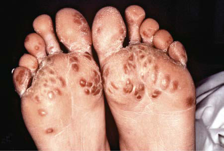

# Chapter 198: Reactive and Postinfectious Arthritis

*Pamela F. Weiss*

<!-- p.1902 -->
In addition to causing arthritis by means of direct microbial infec tion (i.e., septic arthritis; see Chapter 726), microbes activate innate and adaptive immune responses, which can lead to the generation and deposition of immune complexes and antibody or T-cell–medi ated cross-reactivity with self. Furthermore, microbes may influence the immune system in ways that promote immune-mediated inflam matory diseases such as systemic lupus erythematosus (SLE), inflam matory bowel disease (IBD), juvenile idiopathic arthritis (JIA), and spondyloarthritis. **Reactive arthritis** and **postinfectious arthritis** are defined as joint inflammation caused by a sterile inflammatory reac tion after a recent infection. The term *reactive arthritis* is used to refer to arthritis that occurs after enteropathic or urogenital infections and *postinfectious arthritis* to describe arthritis that occurs after infectious illnesses not classically considered in the reactive arthritis group, such as infection with group A streptococcus or viruses. In some patients, nonviable components of the initiating organism have been demon strated in affected joints, and the presence of viable, yet nonculturable, bacteria within the joint remains an area of investigation.

The course of reactive arthritis is variable and may remit or progress to a chronic spondyloarthritis, including ankylosing spondylitis (see Chapter 197). In postinfectious arthritis, the pain or joint swelling is usually transient, lasting <6 weeks, and does not necessarily share the typical spondyloarthritis pattern of joint involvement. The distinction between postinfectious arthritis and reactive arthritis is not always clear, either clinically or pathophysiologically.

**PATHOGENESIS** Reactive arthritis typically follows enteric infection with Salmonella species, *Shigella flexneri, Yersinia enterocolitica, Campylobacter jejuni,* or genitourinary (GU) tract infection with *Chlamydia trachoma tis*. *Escherichia coli* and *Clostridium difficile* are also causative enteric agents, although less common (see Table 197.2). Acute **rheumatic fever** caused by group A streptococcus (see Chapters 229 and 229.1), arthritis associated with infective endocarditis (see Chapter 486), and the tenosynovitis associated with *Neisseria gonorrhoeae* are similar in some respects to reactive arthritis.

Approximately 75% of patients with reactive arthritis are HLA-B27 positive. Incomplete elimination of bacteria and bacterial products, such as DNA, has been proposed as a factor in reactive arthritis. A relation ship with clinical characteristics of specific infectious disorders is not present. In postinfectious arthritis, several viruses (rubella, varicellazoster, herpes simplex, cytomegalovirus) have been isolated from the joints of patients. Antigens from other viruses (e.g., hepatitis B, adeno virus) have been identified in immune complexes from joint tissue.

Patients with reactive arthritis who are HLA-B27 positive have an increased frequency of acute and symptomatic uveitis and other extraarticular features. In addition, HLA-B27 is a risk factor for per sistent gastrointestinal (GI) inflammation after enteric infections, even after resolution of the initial infection, and significantly increases the risk that the individual will develop chronic spondyloarthritis. Nev ertheless, reactive arthritis also occurs in HLA-B27–negative patients, emphasizing the importance of other genes in disease susceptibility.

**CLINICAL MANIFESTATIONS AND DIFFERENTIAL DIAGNOSIS** Symptoms of reactive arthritis begin approximately 3 days to 6 weeks after infection. The classic triad of arthritis, urethritis, and conjunctivitis

is relatively uncommon in children. The arthritis is typically asymmet ric and oligoarticular, with a predilection for the lower extremities. Dactylitis may occur, and enthesitis is common, affecting as many as 90% of patients (Fig. 198.1). Cutaneous manifestations can occur and may include circinate balanitis, ulcerative vulvitis, erythematous oral macules or plaques or erosions, erythema nodosum, paronychia, pain ful erosions or pustules on fingertips, and keratoderma blennorrhag ica, which is similar in appearance to pustular psoriasis (Fig. 198.2). Systemic symptoms may include fever, malaise, and fatigue. Less com mon features may include conjunctivitis, optic neuritis, aortic valve involvement, sterile pyuria, and polyneuropathy. Early in the disease course, markers of inflammation—erythrocyte sedimentation rate (ESR), C-reactive protein, and platelets—may be greatly elevated. The clinical manifestations may last for weeks to months.

Familiarity with other causes of postinfectious arthritis is vital when a diagnosis of reactive arthritis is being considered. Numerous viruses are associated with postinfectious arthritis and may result in particu lar patterns of joint involvement (Table 198.1). Rubella and hepatitis B virus typically affect the small joints, whereas mumps and varicella often involve large joints, especially the knees. **Hepatitis B arthritis– dermatitis syndrome** is characterized by urticarial rash and a sym metric migratory polyarthritis resembling that of serum sickness. Rubella-associated arthropathy may follow natural rubella infection and, infrequently, rubella immunization. It typically occurs in young women, with an increased frequency with advancing age, and is uncommon in preadolescent children and in males. Arthralgia of the knees and hands usually begins within 7 days of onset of the rash or 10- 28 days after immunization. Parvovirus B19, which is responsible for erythema infectiosum (fifth disease), can cause arthralgia, symmetric

*Pamela F. Weiss*

**Fig. 198.1** Enthesitis—swelling of the posterior aspect of the left heel and lateral aspect of the ankle. (Courtesy Dr. Nora Singer, Case Western Reserve University and Rainbow Babies’ Hospital.)

**Fig. 198.2** Keratoderma blennorrhagica. (Courtesy Dr. MF Rein and the Centers for Disease Control and Prevention Public Health Image Library, 1976. Image #6950.)

<!-- p.1903 -->
joint swelling, and morning stiffness, particularly in adult women and less frequently in children. Arthritis occurs occasionally during cyto megalovirus infection and may occur during varicella infections but is rare after Epstein-Barr virus infection. Varicella may also be com plicated by suppurative arthritis, usually secondary to group A strep tococcus infection. HIV is associated with an arthritis that resembles psoriatic arthritis more than JIA (see Chapter 196).

**Poststreptococcal arthritis** may follow infection with either group A or group G streptococcus. It is typically oligoarticular, affecting lower-extremity joints, and mild symptoms can persist for months. Poststreptococcal arthritis differs from rheumatic fever, which typi cally manifests with painful migratory polyarthritis of brief duration. Because valvular lesions have occasionally been documented by echo cardiography after the acute illness, some clinicians consider post streptococcal arthritis to be an incomplete form of acute rheumatic fever (see Chapter 229.1). Certain HLA-DRB1 types may predispose children to development of either poststreptococcal arthritis (HLA- DRB1*01) or acute rheumatic fever (HLA-DRB1*16).

**Transient synovitis (toxic synovitis)**, another form of postinfec tious arthritis, typically affects the hip, often after an upper respiratory tract infection (see Chapter 719.2). Males 3-10 years of age are most often affected and have acute onset of severe pain in the hip (groin), with referred pain to the thigh or knee, lasting approximately 1 week. ESR and white blood cell count are usually normal. Radiologic or ultra sound examination may confirm widening of the joint space secondary to an effusion. Aspiration of joint fluid is often necessary to exclude septic arthritis and typically results in dramatic clinical improvement. The trigger is presumed to be viral, although responsible microbes have not been identified.

**Nonsuppurative arthritis** has been reported in children, usually adolescent males, in association with severe truncal acne. Patients often have fever and persistent infection of the pustular lesions. **Pyo genic (sterile) arthritis, pyoderma gangrenosum, and acne (cystic) syndrome**, an autosomal dominant disorder caused by a pathogenic variant in the *PSTPIP1* gene, is a difficult-to-treat but rare autoin flammatory disorder that has responded to anakinra or anti–tumor necrosis factor antibody therapy in a few patients (see Chapter 710). Recurrent episodes of erosive arthritis begin in childhood; cystic acne and the painful ulcerating lesions of pyoderma gangrenosum begin during adolescence. Recurrent episodes may also be associated with a sterile myopathy and may last for several months.

**Infective endocarditis** can be associated with arthralgia, arthritis, or signs suggestive of vasculitis, such as Osler nodes, Janeway lesions,

and Roth spots. Postinfectious arthritis, perhaps because of immune complexes, also occurs in children with *N. gonorrhoeae, Neisseria men ingitidis, Haemophilus influenzae* type b, and *Mycoplasma pneumoniae* infections.

**DIAGNOSIS** A recent GU or GI infection may suggest the diagnosis of reactive arthritis, but there is no diagnostic test. A complete blood count, acute-phase reactants, complete metabolic panel, and urinalysis may be helpful to exclude other etiologies. Although stool or urogenital tract cultures can be performed in an attempt to isolate it, the trig gering organism is not typically found at the time arthritis presents. Imaging findings are nonspecific or normal. Documenting previous streptococcal infection with antibody testing (anti-streptolysin O and anti-DNAse B) may help to diagnose postinfectious arthritis. Serum sickness associated with the antibiotic treatment of preceding infection must be excluded.

Because the preceding infection can be remote or mild and often not recalled by the patient, it is also important to rule out other causes of arthritis. Acute and painful arthritis affecting a single joint suggests septic arthritis, mandating joint aspiration. Osteomyelitis may cause pain and an effusion in an adjacent joint but is more often associated with focal bone pain and tenderness at the site of infection. Arthritis affecting a single joint, particularly the knee, may also be secondary to Lyme disease in endemic areas. The diagnosis of postinfectious arthri tis is often established by exclusion and after the arthritis has resolved. Arthritis associated with GI symptoms or abnormal liver function test results may be triggered by infectious or autoimmune hepatitis. Arthritis or spondyloarthritis may occur in children with IBD, such as Crohn disease or ulcerative colitis (see Chapters 382.1 and 382.2). Parvovirus infection, macrophage activation (hemophagocytic) syn drome, and leukemia should be strongly considered when two or more blood cell lines are low or progressively decrease in a child with arthritis. Persistent arthritis (>6 weeks) suggests the possibility of a chronic rheumatic disease, including JIA (see Chapter 196) and SLE (see Chapter 199).

**TREATMENT** Specific treatment is unnecessary for most cases of reactive or postin fectious arthritis. Nonsteroidal antiinflammatory drugs (NSAIDs) are often needed for management of pain and functional limitation. Unless ongoing *Chlamydia* infection is suspected, attempts to treat the offending organism are not warranted. If swelling or arthralgia recurs, further evaluation may be necessary to exclude active infection or evolving rheumatic disease. Intraarticular corticosteroid injections may be given for refractory or severely involved joints once acute infec tion has been ruled out. Systemic corticosteroids or disease-modifying antirheumatic drugs (DMARDs) are rarely indicated but may be con sidered for chronic disease. Participation in physical activity should be encouraged, and physical therapy may be needed to maintain nor mal function and prevent muscle atrophy. For postinfectious arthri tis caused by streptococcal disease, current recommendations include penicillin prophylaxis for at least 1 year. Long-term prophylaxis is often recommended, but the duration is controversial and may need to be individualized.

**COMPLICATIONS AND PROGNOSIS** Postinfectious arthritis after viral infections usually resolves without complications unless it is associated with involvement of other organs, such as **encephalomyelitis**. Children with reactive arthritis after enteric infections occasionally experience IBD months to years after onset. Both **uveitis** and **carditis** have been reported in children diag nosed with reactive arthritis. Reactive arthritis, especially after bacte rial enteric infection or GU tract infection with *C. trachomatis,* has the potential for evolving to chronic arthritis, particularly spondyloarthri tis (see Chapter 197). The presence of HLA-B27 or significant systemic features increases the risk of chronic disease.

*Visit Elsevier eBooks+ at eBooks.Health.Elsevier.com** for Bibliography.*

#### **Table 198.1** Viruses Associated with Arthritis

| Category / Parameter | Clinical Details & Findings |
| --- | --- |
| **RUBIVIRUS** | Rubella |
| **ALPHAVIRUSES** | Ross River; Chikungunya; O’nyong-nyong; Mayaro; Sindbis; Ockelbo; Pogosta |
| **ORTHOPOXVIRUSES** | Variola virus (smallpox); Vaccinia virus; Parvoviruses |
| **ADENOVIRUSES** | Adenovirus 7 |
| **HERPESVIRUSES** | Epstein-Barr; Cytomegalovirus; Varicella-zoster; Herpes simplex |
| **PARAMYXOVIRUSES** | Mumps |
| **FLAVIVIRUS** | Zika virus |
| **HEPADNAVIRUS** | Hepatitis B |
| **ENTEROVIRUSES** | Echovirus; Coxsackievirus B |
| **CORONAVIRUSES** | SARS-CoV-2; Adapted from Infectious arthritis and osteomyelitis. In: Petty RE, Laxer RM, Lindsley CB,; et al., eds. Textbook of Pediatric Rheumatology, 8th ed. Philadelphia: Elsevier; 2021. |

<!-- p.1904 -->
