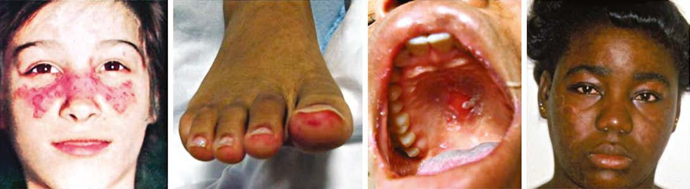
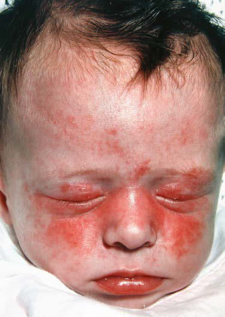

# Chapter 199: Systemic Lupus Erythematosus

*Rebecca E. Sadun and Stacy P. Ardoin*

<!-- p.1905 -->
Systemic lupus erythematosus (SLE) is a chronic autoimmune disease characterized by multisystem inflammation and the pres ence of circulating autoantibodies directed against self-antigens. SLE occurs in both children and adults, disproportionately affect ing females of reproductive age. Although nearly every organ may be affected, most commonly involved are the skin, joints, kidneys, blood-forming cells, blood vessels, and the central nervous system. Systemic signs of inflammation such as fever and lymphadenopathy can also be seen. Compared with adults, children and adolescents with SLE have more severe disease and more widespread organ involvement.

**ETIOLOGY** The pathogenesis of SLE remains largely unknown, but several factors likely influence risk and severity of disease, including genetics, hor monal milieu, and environmental exposures.

A genetic predisposition to SLE is suggested by the association with specific genetic variants, including congenital deficiencies of C1q, C2, and C4, as well as several polymorphisms (e.g., interferon regulatory factor 5 and protein tyrosine phosphatase N22) and familial clustering of SLE or other autoimmune disease (Table 199.1). In addition, cer tain human leukocyte antigen (HLA) types (including HLA-B8, HLA- DR2, and HLA-DR3) occur with increased frequency in patients with SLE. Although SLE clearly has a genetic component, its occurrence is sporadic in families and its concordance is incomplete (estimated at 2–5% among dizygotic twins and 25–60% among monozygotic twins), suggesting nonmendelian genetics and involvement of epigenetic and environmental factors. Patients with SLE often have family members— especially mothers and sisters—with SLE or various other autoimmune diseases.

Because SLE preferentially affects females, especially during their reproductive years, it is suspected that hormonal factors are impor tant in pathogenesis. Of individuals with SLE, 90% are female, making female sex the strongest risk factor for SLE. Estrogens are likely to play a role in SLE, and both in vitro and animal model studies suggest that estrogen exposure promotes B-cell autoreactivity. Estrogen-containing oral contraceptives do not appear to induce flares in quiescent SLE, though the risk of flares may be increased in postmenopausal women receiving hormone replacement.

**Environmental exposures** that may trigger the development of SLE remain largely unknown; certain viral infections (including Epstein-Barr virus) may play a role in susceptible individuals, and ultraviolet light exposure is known to trigger SLE disease activity. Environmental influences also may induce epigenetic modifica tions to DNA, increasing the risk of SLE and drug-induced lupus; in mouse models, drugs such as procainamide and hydralazine can promote lymphocyte hypomethylation, causing a lupus-like syndrome.

**EPIDEMIOLOGY** The reported prevalence of SLE in children and adolescents (1- 6/100,000) is lower than that in adults (20-70/100,000). Prevalence of SLE is highest among patients of African, Asian, Hispanic, Native American, and Pacific Island ancestry for both adult and pediatric populations. SLE predominantly affects females, with a reported 2-5:1 ratio before puberty, 9:1 ratio during reproductive years, and

return to near-prepubertal ratios in the postmenopausal period. Childhood SLE is rare before 5 years of age and is usually diagnosed in adolescence, with a median age at diagnosis of 11-12 years. Up to 20% of all individuals with SLE are diagnosed before age 16 years. Pediatric-onset SLE (pSLE) is defined as onset of symptoms before age 16 or 18 years.

**PATHOLOGY** Histologic features most suggestive of SLE include findings in the kidney and skin. Renal manifestations of SLE are classified histo logically according to the criteria of the International Society of Nephrology (see Chapter 560.2). The finding of diffuse prolifera tive glomerulonephritis (class IV) significantly increases the risk for renal morbidity. Renal biopsies are helpful to establish the diag nosis of SLE and to stage disease. Immune complexes are commonly found with “full house” deposition of immunoglobulin and comple ment. The characteristic **discoid rash** depicted in Figure 199.1D is characterized on biopsy by hyperkeratosis, follicular plugging, and infiltration of mononuclear cells into the dermal-epidermal junc tion. The histopathology of photosensitive rashes can be nonspe cific, but immunofluorescence examination of both affected and nonaffected skin may reveal deposition of immune complexes within the dermal-epidermal junction. This finding is called the *lupus band test,* which is specific for SLE.

**PATHOGENESIS** A hallmark of SLE is the generation of *autoantibodies* directed against self-antigens, particularly nucleic acids. These intracellular antigens are ubiquitously expressed but are usually inaccessible and cloistered within the cell. During cell necrosis or *apoptosis,* the anti gens are released. SLE skin cells are highly susceptible to damage from ultraviolet light, and the resulting cell death leads to release of cell contents, including nucleic antigens. Individuals with SLE may have impaired apoptosis or impaired ability to clear cell debris, causing prolonged exposure to nucleic antigens in the bloodstream and increased opportunity for recognition by immune cells, lead ing to B-cell stimulation and autoantibody production. Circulating autoantibodies form *immune complexes* and deposit in tissues, lead ing to local complement activation, initiation of a proinflammatory cascade, and, ultimately, tissue damage. Antibodies to **double- stranded DNA** (dsDNA) can form immune complexes, deposit in glomeruli, and initiate inflammation leading to glomerulonephritis. However, many individuals with SLE have circulating antibodies to dsDNA yet do not have nephritis, suggesting that autoantibodies are not the only pathway leading to end-organ damage in SLE.

Both the innate and adaptive arms of the immune system have been implicated in the dysregulation of the immune system seen in SLE. High levels of interferon-α production by plasmacytoid dendritic cells promote expression of other proinflammatory cytokines and chemokines, maturation of monocytes into myeloid dendritic cells, promotion of autoreactive B and T cells, and loss of self-tolerance. Nearly 85% of patients with SLE exhibit this cytokine profile, known as the *type I interferon signature*. Other cytokines with increased expression in SLE include interleukin (IL)-1, IL-2, IL-6, IL-10, IL- 12, IL-17, and IL-21; anti–tumor necrosis factor-α; interferon-γ; and *B-lymphocyte stimulator (BLyS)*, also known as *B-cell–activating fac tor (BAFF)*. Both B and T cells demonstrate functional impairments in SLE. In active SLE, B-cell populations have impaired tolerance and increased autoreactivity, enhancing B cells’ ability to produce auto antibodies after exposure to self-antigen. In addition, cytokines such as BLyS/BAFF may promote abnormal B-cell number and function. T-cell abnormalities in SLE include increased numbers of memory T cells and decreased number and function of T-regulatory cells. SLE T cells display aberrant signaling and increased autoreactivity. As a result, they are resistant to attrition by normal apoptosis pathways. In addition, a neutrophil signature can be identified in 65% of adult SLE patients and has recently been recognized as a potential biomarker for active lupus nephritis.

*Rebecca E. Sadun and Stacy P. Ardoin*

<!-- p.1906 -->
Lupus-Like Phenotypes

#### **Table 199.1** Reviewed Proteins and Genes Associated with Monogenic Forms of Systemic Lupus Erythematosus and

| Category / Parameter | Clinical Details & Findings |
| --- | --- |
| **ASSOCIATED SYMPTOMS** | C1q |
| **C1QC** | Autosomal recessive; Complement; deficiency; 1:1; SLE (cutaneous, renal, CNS,; arthritis, ANA), young age; onset, recurrent bacterial; infections; C1r/s |
| **C1R, C1S** | Autosomal recessive; Complement; deficiency; 1:1; SLE (fever, cutaneous,; arthritis, renal, ANA, ENA),; recurrent infections,; encapsulated bacteria,; Hashimoto thyroiditis |
| **C2** | Autosomal recessive; Complement; deficiency; 7:1; SLE (cutaneous, arthritis),; young age onset, type 1; diabetes |
| **C3** | Autosomal recessive; Complement; deficiency; 1:1; Recurrent sinopulmonary; infections, lupus-like; syndrome,; glomerulonephritis |
| **C4A, C4B** | Autosomal recessive; Complement; deficiency; 1:1; SLE (severe photosensitive; rash, renal, ANA, Ro), young; age onset |
| **TREX1** | Autosomal dominant; (FCL), autosomal; recessive and; dominant (AGS); Abnormal DNA; clearance leading to; IFN activation; Likely 1:1 |
| **IFIH1** | Autosomal dominant; Activation of IFN; production; Likely 1:1; AGS, SLE, FCL, IgA; deficiency |
| **SAMHD1** | Autosomal recessive; and dominant; Abnormal DNA or RNA; clearance leading to; IFN production; Likely 1:1 |
| **AGS, SLE, FCL,** | photosensitivity; RNaseH2 |
| **RNASH2** | Autosomal dominant; and recessive; Abnormal RNA; clearance leading to; IFN production; Likely 1:1 |
| **ADAR1** | Mainly autosomal; dominant; Abnormal RNA; clearance leading to; IFN production; Likely 1:1 |
| **TMEM173** | Autosomal dominant; Activation of IFN; production; 1:1 |
| **SAVI, FCL, SLE** | DNase I |
| **DNASE1** | Autosomal dominant; Abnormal DNA; clearance-break; intolerance; Likely 1:1; SLE (dsDNA), adolescent; onset, Sjögren syndrome; DNase 1-like-3 |
| **DNASE1L3** | Autosomal recessive; Abnormal DNA; clearance-break; intolerance; 1:2; SLE (hypocomplementemia,; dsDNA, cANCA, renal), |
| **DNASE2** | Possible autosomal; recessive; Abnormal DNA; clearance; 1:1; Neonatal-onset cytopenias,; hepatosplenomegaly,; arthritis, nephritis; Protein kinase; C-delta |
| **PRKCD** | Autosomal recessive;; dominant; Disrupts B-cell; proliferation and; apoptosis, NK-cell; activity; 1:1; Early onset SLE nephritis,; lymphoproliferation; autoimmunity; Ras/MAPK Pathway; KRAS GoF; Somatic mutation; Altered cell proliferation,; differentiation,; apoptosis; Likely 1:1; Pancytopenia, autoantibodies,; arthritis, hepatosplenomegaly,; pericarditis; Noonan syndrome; NRAS GoF; Somatic mutation; Altered cell proliferation,; differentiation apoptosis; Likely 1:1; Chilblain lupus, pancytopenia,; autoantibodies; AGS, Aicardi-Goutières syndrome; ANA, antinuclear antibody; ANCA, antineutrophil cytoplasmic antibody; CNS, central nervous system; dsDNA, double-stranded DNA; ENA,; extractable nuclear antigen antibody; FCL, familial chilblain lupus; GOF, gain of function; HUVS, hypocomplementemic urticarial vasculitis syndrome; IFN, interferon; IgA,; immunoglobulin A; SAVI, STING-associated vasculopathy with onset in infancy; SLE, systemic lupus erythematosus.; Modified from Hiraki LT, Silverman ED. Genomics of systemic lupus erythematosus: insights gained by studying monogenic young-onset systemic lupus erythematosus. Rheum Dis; Clin N Am. 2017;43:415–434, Table 1, p. 417. |

<!-- p.1907 -->
**CLINICAL MANIFESTATIONS** Any organ system can be involved in SLE, so the potential clinical mani festations are myriad (Table 199.2). The presentation of SLE in childhood or adolescence differs somewhat from that seen in adults. The most com mon presenting complaints of children with SLE include fever, fatigue,

hematologic abnormalities, arthralgia, and arthritis. Arthritis is usually present in the first year of diagnosis; arthritis may be painful or painless swelling, often with stiffness in the morning, and is usually a **symmetric polyarthritis** affecting large and small joints. Tenosynovitis is often pres ent, but joint erosions or other radiographic changes are rare.

Renal disease in SLE is often asymptomatic, underscoring the need for careful monitoring of blood pressure and urinalyses; in adolescents, SLE can present with **nephrotic syndrome** and/or **renal failure**, with the predominant symptoms being edema, fatigue, changes in urine color, and nausea/vomiting. Because SLE symptoms and findings may develop seri ally over several years and not all be present simultaneously, the diagnosis may require longitudinal follow-up. SLE is often characterized by periods of flare and disease quiescence but may follow a more smoldering disease course. The **neuropsychiatric complications** of SLE may occur with or without apparently active SLE, posing a particularly difficult diagnostic challenge in adolescents, who are already at high risk for mood disorders (Fig. 199.2). Long-term complications of SLE and its therapy, including accelerated atherosclerosis and osteoporosis, become clinically evident in early to middle adulthood. SLE is a disease that evolves over time in each affected individual, and new manifestations arise even many years after diagnosis.

A B C D

**Fig. 199.1** Mucocutaneous manifestations of SLE. A, Malar rash. B, Vasculitic rash on toes. C, Oral mucosal ulcers. D, Discoid rash in malar distribution.

Lupus Erythematosus

**PSYCHOSIS**

**HEADACHE CHOREA**

**COGNITIVE DYSFUNCTION**

**SEIZURES**

**MOOD DISORDER**

**CEREBRO- VASCULAR**

**DISEASE**

**PSYCHOSIS**

**HEADACHE CHOREA**

**COGNITIVE DYSFUNCTION**

**SEIZURES**

**MOOD DISORDER**

**CEREBRO- VASCULAR**

**DISEASE**

#### **Table 199.2** Potential Clinical Manifestations of Systemic

| Category / Parameter | Clinical Details & Findings |
| --- | --- |
| **MANIFESTATIONS** | Constitutional; Fatigue, anorexia, weight loss, fever,; lymphadenopathy; Musculoskeletal; Arthritis, myositis, tendonitis, arthralgias,; myalgias, avascular necrosis, osteoporosis; Skin; Malar rash, discoid (annular) rash,; photosensitive rash, cutaneous vasculitis; (petechiae, palpable purpura, digit ulcers,; gangrene, urticaria), livedo reticularis,; periungual capillary abnormalities, Raynaud; phenomenon, alopecia, oral and nasal; ulcers, panniculitis, chilblains, alopecia; Renal; Hypertension, proteinuria, hematuria,; edema, nephrotic syndrome, renal failure; Cardiovascular; Pericarditis, myocarditis, conduction system; abnormalities, Libman-Sacks endocarditis; Neurologic; Seizures, psychosis, cerebritis, stroke,; transverse myelitis, depression, cognitive; impairment, headaches, migraines,; pseudotumor, peripheral neuropathy; (mononeuritis multiplex), chorea, optic; neuritis, cranial nerve palsies, acute; confusional states, dural and cerebral; venous sinus thrombosis; Pulmonary; Pleuritis, interstitial lung disease, pulmonary; hemorrhage, pulmonary hypertension,; pulmonary embolism; Hematologic; Immune-mediated cytopenias (hemolytic; anemia, thrombocytopenia or leukopenia),; anemia of chronic inflammation,; hypercoagulability, thrombocytopenic; thrombotic microangiopathy, macrophage; activation syndrome; Gastroenterology; Hepatosplenomegaly, pancreatitis,; vasculitis affecting bowel, protein-losing; enteropathy, peritonitis; Ocular; Retinal vasculitis, scleritis, episcleritis,; papilledema, dry eyes, optic neuritis |

**Fig. 199.2** Overlapping neuropsychiatric symptoms in pediatric SLE. Patients with pediatric SLE most commonly have more than one neu ropsychiatric symptom—in particular for seizures. (From Silverman E, Eddy A. Systemic lupus erythematosus. In Cassidy JT, Petty RE, Laxer RM, et al., eds. Textbook of Pediatric Rheumatology, 6th ed. Philadel phia: Saunders; 2011: Fig. 21-17, p. 329.)

<!-- p.1908 -->
**DIAGNOSIS** The diagnosis of SLE requires a comprehensive clinical and laboratory assessment revealing characteristic multisystem disease and excluding other etiologies, including infection and malignancy. Classification criteria

for SLE were developed to identify appropriate subjects for clinical trials but are often used as guideposts for SLE diagnosis. Over the past several decades, SLE classification criteria have undergone serial updates. Both the **American College of Rheumatology (ACR) 1997 Revised Classification**

Clinics (SLICC) Classification Criteria for Systemic Lupus Erythematosus*

#### **Table 199.3** Comparison of 1997 American College of Rheumatology and 2012 Systemic Lupus International Collaborating

| Category / Parameter | Clinical Details & Findings |
| --- | --- |
| **CLINICAL CRITERIA** | Acute cutaneous lupus; • Malar rash†; • Malar rash, bullous lupus, toxic epidermal; necrolysis variant of SLE, maculopapular; lupus rash, photosensitive lupus rash, or; subacute cutaneous lupus†; Chronic cutaneous lupus; • Discoid rash; • Classic discoid rash, hypertrophic; (verrucous) lupus, lupus panniculitis; (profundus), mucosal lupus, lupus; erythematous tumidus, chilblains lupus, or; discoid lupus/lichen planus overlap; Mucosal ulcers; • Oral or nasal ulcers; • Oral (palate, buccal, tongue) or nasal ulcers; Other cutaneous; • Photosensitivity; • Nonscarring alopecia; Arthritis; • Nonerosive arthritis in ≥ two peripheral; joints; • Synovitis in ≥ two peripheral joints; Serositis; • Pleuritis or pericarditis; • Pleurisy or pericardial pain ≥1 day, pleural; effusion or rub, pericardial effusion or rub,; or ECG evidence of pericarditis; Renal; • Persistent proteinuria representing > 500; mg/24 hr or cellular casts; • Urine protein/creatinine ratio representing; >500 mg protein/24 hr or red blood cell; casts; Neurologic; • Seizure or psychosis; • Seizures, psychosis, mononeuritis multiplex,; myelitis, peripheral or cranial neuropathy, or; acute confusional state; Hematologic; • Hemolytic anemia, leukopenia (<4,000/; mm3, lymphopenia (<1,500/mm3), or; thrombocytopenia (<100,000/mm3); • Hemolytic anemia; • Leukopenia (<4,000/mm3) or lymphopenia; (<1,000/mm3); • Thrombocytopenia (<100,000/mm3) |
| **IMMUNOLOGIC** | • Positive anti-double-stranded antibody or; positive anti-Smith antibody; • Positive antiphospholipid antibody (false-; positive rapid plasma reagin test, positive; lupus anticoagulant test result, or elevated; anticardiolipin antibody level [IgG or IgM]); • Positive ANA; • Positive anti-double-stranded DNA; antibody; • Positive anti-Smith antibody; • Positive antiphospholipid antibody (false-; positive rapid plasma regain test, positive; lupus anticoagulant test, medium to high; titer anticardiolipin antibody level [IgA,; IgG, IgM], or positive anti-B2-glycoprotein I; antibody [IgA, IgG, IgM]); • Low C3, C4, or Ch50 level; • Positive direct Coombs test (in the absence; of hemolytic anemia); • Positive ANA; *For the 1997 ACR Criteria, the presence of 4 of 11 cumulative criteria establishes the classification of SLE. For the 2012 SLICC criteria, the presence of 4 cumulative criteria also; establishes the classification of SLE; however, at least 1 clinical criterion and at least 1 immunologic criterion are required. In addition, the presence of biopsy-proven lupus nephritis; with positive ANA or anti–double-stranded DNA satisfies the 2012 SLICC criteria. For both sets of classification criteria, all items must be attributable to lupus and not an alternate; cause (e.g., medication side effect).; †Each bullet point counts as a single criterion whether 1 or more definitions are satisfied.; Adapted from Hochberg MC: Updating the American College of Rheumatology revised criteria for the classification of systemic lupus erythematosus, Arthritis Rheum 1997;40:1725;; and from Petri M, et al: Derivation and validation of the Systemic Lupus International Collaborating Clinics classification criteria for systemic lupus erythematosus, Arthritis Rheum; 2012;64:2677-2686. |

<!-- p.1909 -->
**Criteria for SLE** and the **2012 Systemic Lupus International Collaborat ing Clinics (SLICC) Classification Criteria** (Table 199.3) are validated in childhood onset SLE populations, with the SLICC Criteria achieving higher sensitivity and the 1997 ACR Criteria achieving better specificity. In both the 1997 ACR and 2012 SLICC Criteria, a positive antinuclear antibody (ANA) test result is not required for the diagnosis of SLE; however, ANAnegative lupus is extremely rare. The ANA test is very sensitive for SLE (95-99%) but is not very specific (∼50%). The ANA may become positive many years before a diagnosis of SLE is established; however, most asymp tomatic ANA-positive patients will never develop SLE. More recently, the **2019 European League Against Rheumatism/American College of**

**Rheumatology (EULAR/ACR) SLE Classification Criteria** (Fig. 199.3) provided a different approach by requiring a positive antinuclear antibody (ANA) test result at a titer ≥1:80. Allthough the 2019 EULAR/ACR criteria have excellent sensitivity and specificity in the adult SLE population, they are still being validated in pediatric populations.

Anti-dsDNA and anti-Smith antibodies are specific for SLE (∼98%) but not as sensitive (40–65%) as the ANA. **Hypocomplementemia** was not included in earlier classification criteria, but has been added to the two most recent classification criteria. The 2012 SLICC Criteria also added as criteria nonscarring alopecia, additional cutaneous and neurologic manifestations, and a positive direct Coombs test in the absence of hemolytic anemia.

If absent, do not classify as SLE If present, apply additive criteria

**Entry criterion** Antinuclear antibodies (ANA) at a titer of ≥1:80 on HEp-2 cells or an equivalent positive test (ever)

.**Do not count a criterion if there is a more likely explanation than SLE.** .**Occurrence of a criterion on at least one occasion is sufficient.** .**SLE classification requires at least one clinical criterion and** ≥**10 points.** .**Criteria need not occur simultaneously.** .**Within each domain, only the highest weighted criterion is counted toward the total score.*******

**Additive criteria**

**Total score:**

**Classify as systemic lupus erythematosus with a score of 10 or more if entry criterion fulfilled.**

**Clinical domains and criteria**

**Constitutional**

Fever

**Antiphospholipid antibodies**

Anti-cardiolipin antibodies OR Anti-β2GP1 antibodies OR Lupus anticoagulant

**Complement proteins**

Low C3 OR low C4 Low C3 AND low C4

**SLE-specific antibodies**

Anti-dsDNA antibody† OR Anti-Smith antibody

**Hematologic**

Leukopenia Thrombocytopenia Autoimmune hemolysis

**Neuropsychiatric**

Delirium Psychosis Seizure

**Mucocutaneous**

Non-scarring alopecia Oral ulcers Subacute cutaneous OR discoid lupus Acute cutaneous lupus

**Serosal**

Pleural or pericardial effusion Acute pericarditis

**Musculoskeletal**

Joint involvement

**Renal**

Proteinuria >0.5 g/24hr Renal biopsy class II or V lupus nephritis Renal biopsy class Ill or IV lupus nephritis

2

2

6

5 6

4 8 10

6

2 2 4 6

3 4 4 3 4

2 3 5

**Weight Immunology domains and criteria Weight**

**Fig. 199.3** Classification criteria for systemic lupus erythematosus (SLE). *Additional criteria items within the same domain will not be counted. †In an assay with ≥90% specificity against relevant disease controls. (From Aringer M, Costenbader K, Daikh D, et al. 2019 European League Against Rheumatism/American College of Rheumatology classification criteria for systemic lupus erythematosus. Arthritis Rheum. 2019;71[9]:1400–1412.)

<!-- p.1910 -->
**DIFFERENTIAL DIAGNOSIS** Multiorgan disease is the hallmark of SLE, and given its wide array of potential clinical manifestations, SLE is in the differential diagnosis of many clinical scenarios, including unexplained fevers, joint pain or arthritis, rash, cytopenias, nephritis, nephrotic syndrome, pleural or pericardial effusions or other cardiopulmonary abnormalities, and new-onset psychosis or seizures. For patients ultimately diagnosed with pediatric SLE, the initial differential diagnosis often includes infections (sepsis, Epstein-Barr virus, parvovirus B19, endocarditis), malignan cies (leukemia and lymphoma), poststreptococcal glomerulonephritis, other rheumatologic conditions (juvenile idiopathic arthritis, vasculi tides), and drug-induced lupus (Table 199.4).

**Drug-induced lupus** refers to the presence of SLE manifestations triggered by exposure to specific medications, including hydrala zine, minocycline, many anticonvulsants, sulfonamides, antiar rhythmic agents, and other drugs (Table 199.5). In individuals prone to SLE, these agents may act as a trigger for true SLE, but more commonly these agents provoke a reversible lupus-like syndrome. Unlike SLE, drug-induced lupus affects males and females equally. A genetic predisposition toward slow drug acetylation may increase the risk of drug-induced lupus. Circulating **antihistone antibodies** are often present in drug-induced SLE; these antibodies are only detected in up to 20% of individuals with SLE. Hepatitis, which is rare in SLE, is more common in drug-induced lupus. Individuals with drug-induced lupus are less likely to demonstrate antibodies to dsDNA, hypocomplementemia, and significant renal or neuro logic disease. In contrast to SLE, manifestations of drug-induced

lupus typically resolve after withdrawal of the offending medica tion; however, complete recovery may take several months to years, requiring treatment, often with hydroxychloroquine, NSAIDs, and/ or corticosteroids.

**LABORATORY FINDINGS** A positive ANA test is present in 95–99% of individuals with SLE. The ANA has poor specificity for SLE, as up to 20% of healthy indi viduals also have a positive ANA test result, making the ANA a poor screen for SLE when used in isolation. After diagnosis, ANA titers are not reflective of disease activity; therefore repeat ANA testing in SLE patients is not helpful. Antibodies to dsDNA are specific for SLE, and in many individuals, anti-dsDNA levels correlate with disease activity, particularly in those with significant nephritis. Anti-Smith antibody, although found specifically in patients with SLE, does not correlate with disease activity. Serum levels of total hemolytic com plement (CH50), C3, and C4 are typically decreased in active disease and often improve with treatment. Table 199.6 lists autoantibodies

(SLE Mimickers)

#### **Table 199.4** Main Differential Diagnoses of SLE

| Category / Parameter | Clinical Details & Findings |
| --- | --- |
| **OTHER CONNECTIVE TISSUE DISEASES** | Sjögren (SSA+), dermatomyositis (rash), mixed connective tissue; disease |
| **INFECTIOUS DISEASES** | Endocarditis; hepatitis A, B, C, E; parvovirus B19; HIV; EBV; CMV;; Lyme; disseminated gonococcal arthritis; toxoplasmosis;; histoplasmosis; mycobacterial diseases; tinea faciei; visceral; leishmaniasis; Whipple disease |
| **HEMATOLOGIC MALIGNANCIES** | Hodgkin lymphoma, myelodysplastic syndromes,; angioimmunoblastic T-cell lymphoma |
| **SOLID TUMORS AND PARANEOPLASTIC SYNDROMES** | Thymoma, carcinoma of the lung, breast, and ovary with; paraneoplastic syndromes |
| **OTHER DISEASES** | Meigs and Pseudo-Meigs syndrome; Multiple sclerosis; Castleman disease; Interferonopathies (monogenic SLE); Still disease (and other autoinflammatory diseases); Evans syndrome (with primary immune deficiency); Complement deficiency; Hypocomplementemic urticarial vasculitis; Schizophrenia and other psychoses; Kikuchi disease; IgG4-related disease; Chilblains (cold-induced); Ackerman syndrome and erythema elevatum diutinum with; polyarthritis; Drug-induced lupus and drug-induced polyarthritis; Graft-versus-host disease; Systemic manifestations of atrial myxoma; Prolidase deficiency; From Chasset F, Richez C, Martin T, et al. Rare diseases that mimic systemic lupus; erythematosus (lupus mimickers). Joint Bone Spine. 2019;86:165–171, Table 1, p. 166; Copyright Elsevier Masson SAS. |

Lupus

#### **Table 199.5** Medications Associated with Drug-Induced

| Category / Parameter | Clinical Details & Findings |
| --- | --- |
| **DEFINITE ASSOCIATION** | Minocycline, procainamide, hydralazine, isoniazid, penicillamine,; diltiazem, interferon-α, methyldopa, chlorpromazine, etanercept,; infliximab, adalimumab |
| **PROBABLE ASSOCIATION** | Phenytoin, ethosuximide, carbamazepine, sulfasalazine, amiodarone,; quinidine, rifampin, nitrofurantoin, β blockers, lithium, captopril,; interferon-γ, hydrochlorothiazide, glyburide, docetaxel, penicillin,; tetracycline, statins, gold, valproate, griseofulvin, gemfibrozil,; propylthiouracil |

Systemic Lupus Erythematosus (SLE)

#### **Table 199.6** Autoantibodies Commonly Associated with

| Category / Parameter | Clinical Details & Findings |
| --- | --- |
| **CLINICAL ASSOCIATION** | Anti–double-stranded DNA; (anti-dsDNA); Correlates with disease activity,; especially nephritis, in some with SLE; Anti-Smith antibody; (anti-Sm); Specific for the diagnosis of SLE; Anti-ribonucleoprotein; antibody (anti-RNP); Increased risk for Raynaud; phenomenon, interstitial lung disease,; and pulmonary hypertension; Anti-Ro antibody (anti-SSA); Anti-La antibody (anti-SSB); Associated with sicca syndrome; May suggest diagnosis of Sjögren; syndrome; Increased risk of neonatal lupus in; offspring (congenital heart block); May be associated with cutaneous; and pulmonary manifestations of |
| **SLE** | May be associated with isolated; discoid lupus; Antiphospholipid antibodies; (including lupus; anticoagulant and anti-; cardiolipin or anti-beta-2; glycoprotein antibodies); Increased risk for venous and arterial; thrombotic events; Antihistone antibodies; Present in a majority of patients with; drug-induced lupus; May be present in SLE |

<!-- p.1911 -->
found in SLE along with their clinical associations. Hypergamma globulinemia is a common but nonspecific finding. Inflammatory markers, particularly the erythrocyte sedimentation rate, are often elevated in active disease. C-reactive protein (CRP) correlates less well with disease activity; significantly elevated CRP values often reflect infection, whereas chronic mild elevation of CRP may indicate increased cardiovascular risk.

**Antiphospholipid antibodies**, which increase clotting risk, can be found in up to 66% of children and adolescents with SLE. The primary antiphospholipid antibodies are lupus anticoagulant, anticardiolipin, and anti–beta-2 glycoprotein antibodies. When an arterial or venous clotting event occurs in the presence of an antiphospholipid antibody, **antiphospholipid antibody syndrome** is diagnosed. Antiphospho lipid antibody syndrome can occur in the context of SLE (secondary) or independent of SLE (primary) (see Chapter 528). Rarely, antiphos pholipid antibodies can result in catastrophic antiphospholipid syn drome, a condition in which clots affect three or more organs/tissues simultaneously; this condition has a very high mortality rate.

**TREATMENT** Treatment of SLE is tailored to the individual and is based on specific disease manifestations and medication tolerability. For all patients, sunscreen and avoidance of prolonged direct sun exposure and other ultraviolet light may help control disease and should be reinforced at every visit with the patient. **Hydroxychloroquine is recommended for all individuals with SLE when tolerated.** In addition to treating mild SLE manifestations such as rash and mild arthritis, hydroxychloroquine prevents SLE flares, improves lipid profiles, and may have a beneficial impact on mortality and renal outcomes. Potential toxicities include retinal pigmentation that leads to vision impairment; therefore *annual ophthalmology exams are recommended for patients taking hydroxychlo roquine, including automated visual field testing and spectral-domain optical coherence tomography (SD-OCT)*. Given that risk factors for ocular toxicity include duration of use and dose, hydroxychloroquine in SLE should not be prescribed at doses greater than 5 mg/kg to a maximum of 400 mg daily.

Corticosteroids are a treatment mainstay for significant manifes tations of SLE and work quickly to improve acute deterioration; side effects often limit patient adherence, especially in adolescence, and potential toxicities are worrisome. It is important to limit the dose and length of exposure to corticosteroids whenever possible. Potential consequences of corticosteroid therapy include growth disturbance, weight gain, striae, acne, hyperglycemia, hypertension, cataracts, avas cular necrosis, and osteoporosis. The optimal dosing of corticosteroids in children and adolescents with SLE remains unknown; **severe dis ease is often treated with high doses of intravenous methylpredniso lone (e.g., 30 mg/kg/day to a maximum of 1,000 mg for each of 3 days, sometimes followed by a period of weekly pulses) and/or high doses of oral prednisone (**often starting at **1 mg/kg/day).** As disease manifestations improve, corticosteroid dosages are gradually tapered over months. For most patients it is necessary to introduce a steroidsparing immunosuppressive medication in order to limit cumulative steroid exposure.

**Steroid-sparing immunosuppressive agents** for the treatment of pediatric SLE include methotrexate, leflunomide, azathioprine, myco phenolate mofetil, tacrolimus, cyclophosphamide, rituximab, and beli mumab. Methotrexate, leflunomide, and azathioprine are often used to treat persistent moderate disease, including arthritis, significant cuta neous or hematologic involvement, and pleural disease. Cyclophos phamide, mycophenolate mofetil, and azathioprine are appropriate for the treatment of lupus nephritis, whereas mycophenolate mofetil and rituximab are often used for the treatment of significant hematologic manifestations, including severe leukopenia, hemolytic anemia, or thrombocytopenia.

Cyclophosphamide, usually administered intravenously, is reserved for the most severe, potentially life-threatening SLE manifestations, such as renal, neurologic, and cardiopulmonary disease. Although

cyclophosphamide is highly effective in controlling disease, the poten tial toxicities are significant, including cytopenias, infection, hemor rhagic cystitis, premature gonadal failure, and increased risk of future malignancy. Attention to adequate hydration can attenuate the risk of hemorrhagic cystitis. Fortunately, young females are at much lower risk of gonadal failure than older women, and the use of gonadotropinreleasing hormone agonists, such as leuprolide acetate, may help pre vent gonadal failure.

The Childhood Arthritis Rheumatology Research Alliance (CARRA) has developed a consensus treatment plan for induction therapy of newly diagnosed proliferative lupus nephritis (class III and IV) that is specific to the pSLE population; the treatment plan is considered necessary for class III and IV lupus nephritis but also appropriate for certain patients with other classes of lupus nephritis. The CARRA treatment plan advises 6 months of induction therapy with either cyclophosphamide (given per the National Institutes of Health [NIH] protocol as 500-1,000 mg/m2 IV monthly) or myco phenolate mofetil (dosed as 600 mg/m2 bid up to 1,500 mg bid), used in combination with one of three standardized glucocorticoid regi mens. For patients who fail to achieve a partial response in 6 months, it is appropriate to switch agents. For adult-weight adolescents, the cyclophosphamide dosing regimen used in the Euro-Lupus Nephritis Trial can be considered in lieu of the previous 6-month therapy in an effort to reduce toxicity from cyclophosphamide exposure. Per this protocol, a fixed dose of 500 mg is given every 2 weeks for 3 months; in adults, this regimen is althought to reduce adverse effects while maintaining comparable efficacy for lupus nephritis, though this reg imen has not been studied specifically in pediatric lupus. It should be noted that oral medication adherence is very poor in pSLE, and this must be taken into consideration when weighing the benefits of an IV infusion versus a twice daily oral medication such as mycophenolate mofetil. After the 6-month induction therapy, maintenance therapy for lupus nephritis consists of quarterly IV cyclophosphamide (dosed 500-1,000 mg/m2 once every 3 months), mycophenolate, or azathio prine, with mycophenolate generally being the preferred agent. Main tenance therapy is typically continued for a minimum of 30 months after the completion of induction therapy, but in many circumstances, it is continued longer.

Calcineurin inhibitors such as tacrolimus are often adjunct therapy in the treatment of refractory lupus nephritis. Voclosporin, Food and Drug Administration (FDA)–approved for adults with lupus nephri tis, awaits pediatric study. Clinical trial data on the use of rituximab in SLE with treatment-resistant glomerulonephritis has been largely disappointing, but post hoc analysis from the LUNAR study suggests there may be benefit for subpopulations of SLE patients. The FDA has approved the use of belimumab, a monoclonal antibody against BLyS/ BAFF, for the treatment of lupus in adults and children; when added to standard SLE therapy, belimumab improves markers of disease activity in renal and nonrenal lupus. Belimumab has been shown to improve renal outcomes in adults, and while it is not used as monotherapy to treat lupus nephritis, it can be used in addition to standard therapy to help achieve renal remission without substantial increase in risk of infectious complications. Anifrolumab (a monoclonal antibody to the interferon-α receptor), achieved 2021 FDA approval for treatment of adult nonrenal SLE, and studies in lupus nephritis and pediatric lupus are forthcoming. Several novel therapies are in the pipeline for the treatment of SLE and lupus nephritis, including Janus kinase inhibitors.

Given the lifelong nature of SLE, optimal care of children and adoles cents with this disease also involves preventive practices. Owing to the enhanced risk of atherosclerosis in SLE, attention to cholesterol levels, smoking status, body mass index, blood pressure, and other traditional cardiovascular risk factors is warranted. Even though the Atheroscle rosis Prevention in Pediatric Lupus Erythematosus (APPLE) study failed to support placing all children with SLE on a statin, post hoc analyses suggest that statins can be considered for primary prevention of atherosclerotic disease in certain clinical circumstances, particularly pubertal patients with an elevated CRP.

<!-- p.1912 -->
SLE patients with antiphospholipid antibody syndrome (antiphos pholipid antibodies and a history of arterial or venous clot or preg nancy morbidity) are treated with long-term anticoagulation to prevent thrombotic events; for SLE patients who are antiphospholipid antibody positive without a history of clots, many pediatric rheumatologists pre scribe aspirin 81 mg daily.

*For all SLE patients, adequate intake of calcium and vitamin D is nec essary to prevent future osteoporosis,* particularly as vitamin D levels are lower in pSLE patients compared with age-matched healthy controls. It is worth noting recent studies suggest a link between hypovitaminosis D and SLE susceptibility and also offer an emerging role for vitamin D in immunomodulation.

Infections, particularly pneumococcal disease, commonly com plicate SLE, so routine immunization is recommended, including the annual influenza vaccination, SARS-CoV-2 vaccination, and vaccination against human papilloma virus (HPV). In addition, pSLE patients age 6 or older should receive a dose of PPSV23 at least 8 weeks after completing all recommended pneumococcal vac cine series with PCV13 or PCV15. Many of the immunosuppressant medications used in SLE contraindicate administration of live vac cines. Prompt attention to febrile episodes should include an evalu ation for serious infections. Because pSLE patients are at high risk for developing anxiety and depression, screening for depression is important. Peer support and cognitive-behavioral therapy interven tions reduce pain and enhance resilience in pSLE.

Pregnancy can worsen SLE, and obstetric complications are com mon. In addition, many medications used to treat SLE are terato genic. As a consequence, it is important to counsel adolescent girls about these risks and facilitate access to appropriate contraceptive options. Hydroxychloroquine is recommended throughout preg nancy for all SLE patients, whereas other medications may need to be adjusted.

**COMPLICATIONS** Within the first several years of diagnosis, the most common causes of death in individuals with SLE include infection and complications of glomerulonephritis and neuropsychiatric disease (Table 199.7). Over the long term, the most common causes of mortality are atherosclerosis and malignancy. The increased risk of premature atherosclerosis in SLE is not explained by traditional risk factors and is partly a result of the chronic immune dysregula tion and inflammation associated with SLE. Increased malignancy rates may be caused by immune dysregulation and exposure to

medications with carcinogenic potential. Potential lupus emergen cies are noted in Table 199.8.

**PROGNOSIS** SLE disease severity is higher in childhood-onset SLE compared with adult-onset SLE. Fortunately, advances in the diagnosis and treat ment of SLE have led to dramatically improved survival over the past 50 years. The 5-year and 10-year survival rates for pSLE are 99% and 97%, respectively, in high-income countries, although these survival rates are 85% and 79%, respectively, in low- and middle-income coun tries. Infection contributes significantly to mortality in pediatric lupus. In addition, early in the disease course, lupus nephritis, lupus cereb ritis, and complications such as macrophage activation syndrome are primary causes of mortality, whereas later in the disease course, ath erosclerosis and malignancy become larger contributors to mortality. Given their long burden of disease, children and adolescents with SLE face high risks of future morbidity and mortality from the disease and its complications, as well as medication side effects. Because pSLE is a complex, chronic disease with a high risk for morbidity and mortality, optimal care for children and adolescents with SLE includes treatment by pediatric rheumatologists in a multidisciplinary clinic with access to a full complement of pediatric subspecialists. Furthermore, because SLE is a lifelong disease, it is critically important to ensure an appropri ate transition to an adult model of care, which helps avoid interrup tions in rheumatology care.

*Visit Elsevier eBooks+ at eBooks.Health.Elsevier.com** for Bibliography.*

#### **Table 199.7** Morbidity in Childhood Lupus

| Category / Parameter | Clinical Details & Findings |
| --- | --- |
| **General** | Renal; Hypertension, dialysis, transplantation; Central nervous system; Organic brain syndrome, seizures,; psychosis, neurocognitive dysfunction; Cardiovascular; Atherosclerosis, myocardial infarction,; cardiomyopathy, valvular disease; Immune; Recurrent or severe infection, functional; asplenia, malignancy; Musculoskeletal; Osteopenia, compression fractures,; avascular necrosis; Ocular; Cataracts, glaucoma, retinal detachment,; blindness; Endocrine; Diabetes, obesity, growth failure,; infertility, fetal wastage; From Cassidy JT, Petty RE, Laxer RM, et al., eds. Textbook of Pediatric Rheumatology,; 6th ed. Philadelphia: Saunders; 2011. |

of Lupus Emergencies

#### **Table 199.8** A Summary of Signs and Symptoms Indicative

| Category / Parameter | Clinical Details & Findings |
| --- | --- |
| **DIFFERENTIAL CONSIDERATIONS** | Fever; Evaluate for infection; Consider disease flare; Consider macrophage activation; syndrome; Thrombosis/hemoptysis; May be arterial or venous; Evaluate for antiphospholipid; syndrome; Chest pain; Pleurisy, pericarditis, pulmonary; infarction/embolus; Dyspnea; Pneumonitis, alveolar hemorrhage,; pleural effusions, congestive heart; failure; Headache; Vascular headaches, meningitis,; thrombus, cerebrovascular accident,; hypertensive crisis; Altered mental status; Cerebritis, hypertensive crisis, macro-; phage activation syndrome, stroke,; thrombotic thrombocytopenic purpura,; and atypical hemolytic uremic syndrome; Rash; Vasculitis lesions, palpable purpura,; infarction; Icterus; Autoimmune hemolysis; Autoimmune hepatitis; Petechiae; Thrombotic thrombocytopenia purpura; Seizure; Cerebritis, infection, metabolic causes,; hypertensive crisis; From Harry O, Yasin S, Brunner H. Childhood-onset systemic lupus erythematosus: a; review and update. J Pediatr. 2018;196:22–30, Table IV. |

<!-- p.1913 -->

<!-- p.1914 -->

## 199.1  Neonatal Lupus Deborah M. Friedman, Jill P. Buyon, Rebecca E. Sadun, and Stacy P. Ardoin

Neonatal lupus erythematosus (NLE), an entity distinct from SLE, is one of the few rheumatic disorders manifesting in the neonate. NLE is not an autoimmune disease of the fetus, but instead results from passively acquired autoimmunity, when maternal immunoglobulin G autoanti bodies cross the placenta and enter the fetal circulation. In contrast to SLE, neonatal lupus is not characterized by ongoing immune dysregula tion, although infants with neonatal lupus may be at some increased risk for development of future autoimmune disease. The vast majority of NLE cases are associated with maternal anti-Ro (also known as SSA), anti-La antibodies (also known as SSB), or anti-RNP autoantibodies.

Despite the clear association with maternal autoantibodies, their presence alone is not sufficient to cause disease, as only ∼2% of offspring born to mothers with anti-Ro and anti-La antibodies develop neona tal lupus. Increasing evidence supports the observation that generally high maternal anti-Ro titers are necessary for fetal clinical disease. In the prospective evaluation of fetuses with autoimmune-associated congenital heart block followed in the PR Interval and Dexamethasone Evaluation (PRIDE) study, the median anti-Ro titer for pregnancies resulting in heart block was 5 times as high as the median anti-Ro titer in unaffected pregnancies. Another group identified heart block in 8% of cases with very high anti-Ro antibody titers, with no cases among women with low or moderate titers.

Siblings of infants with NLE have a 15–20% chance of develop ing NLE. Neonatal lupus seems to be independent of the maternal health because many mothers are asymptomatic and only identified to have anti-Ro/anti-La antibodies subsequent to the diagnosis of NLE. Roughly half of the infants with NLE are born to the mothers with a defined rheumatic disease such as Sjogren syndrome or SLE.

Clinical manifestations of neonatal lupus include a characteristic annular or macular rash typically affecting the face (especially the periorbital area), trunk, and scalp (Fig. 199.4). The rash can be pres ent at birth but more often appears within the first 6-8 weeks of life, after exposure to ultraviolet light, and typically lasts 3-4 months. Infants may also have cytopenias and hepatitis, each occurring in ∼25% of cases, but the most concerning complication is congenital heart block.

Conduction system abnormalities range from prolongation of the PR interval to complete heart block, with development of progressive cardiomyopathy in the most severe cases. The noncardiac manifesta tions of neonatal lupus are usually reversible, whereas third-degree congenital heart block is permanent. Conduction system abnormalities can be detected in utero by fetal echocardiogram beginning at 16 weeks of gestational age. Neonatal lupus cardiac disease has a mortality rate of ∼20%. Cardiac NLE can manifest as heart block, cardiomyopathy, valvular dysfunction, and endocardial fibroelastosis. Fetal bradycardia from heart block can lead to hydrops fetalis.

In vitro studies suggest that during cardiac development via apop tosis, Ro and La antigens may be exposed on the surface of cardiac cells in the proximity of the atrioventricular node, making the antigens accessible to maternal autoantibodies. Binding incites a local immune response, resulting in fibrosis within the conduction system and more extensive disease in fatal cases. In the skin, exposure to ultraviolet light results in cell damage and the subsequent exposure of Ro and La anti gens, inducing a similar local inflammatory response that produces the characteristic rash.

Although the scant clinical trial data have been mixed, fluori nated corticosteroids (dexamethasone or betamethasone), intra venous immunoglobulin (IVIG) at 1-2 g/kg maternal weight, plasmapheresis, hydroxychloroquine, and terbutaline (combined with steroids) have been used in pregnant women with anti-Ro or anti-La antibodies to prevent occurrence or progression of fetal car diac abnormalities.

Most encouraging are retrospective cohort studies suggesting mater nal treatment with hydroxychloroquine may reduce the frequency and recurrence of congenital heart block. In a multicenter, single-arm, open-label clinical trial assessing the efficacy of hydroxychloroquine to prevent recurrent autoantibody-associated congenital heart block, hydroxychloroquine treatment reduced the risk of recurrent heart block compared to historical controls by over 50%, from 17.5% to less than 8% of pregnancies.

Significant conduction system abnormalities after birth are treated with cardiac pacing and occasionally IVIG and steroids, whereas severe cardiomyopathy may require cardiac transplantation. If the conduction defect is not addressed, affected children are at risk for exercise intoler ance, arrhythmias, and death. With cardiac pacing, however, children with conduction system disease in the absence of cardiomyopathy have an excellent prognosis. In a long-term follow-up study of 239 subjects enrolled in the Research Registry for Neonatal Lupus, 22% of subjects had cardiac dysfunction in the first year of life. Cardiac dysfunction often regressed; nevertheless, some dysfunction did appear later in childhood. Risk factors for cardiac dysfunction were being male or of low socioeconomic status and having low fetal heart rates, a longer period of pacing, or extranodal cardiac disease. In a Swedish cohort of 119 children with congenital heart block, 16.8% developed cardiomy opathy ± congestive heart failure. Congenital heart block increased the risk of cerebral infarctions and infections. Pacemaker treatment was associated with decreased risk of developing cerebral infarction but increased risk of infection and cardiomyopathy.

Noncardiac manifestations are typically transient and are con servatively managed, often with supportive care alone. Topical ste roids can be used to treat moderate to severe NLE rash. Cytopenias may improve over time but severe cases occasionally require IVIG. Supportive care is usually appropriate for hepatic and neurologic manifestation. When the neonate clears maternal autoantibodies over the first 6 months of life, these inflammatory manifestations gradually resolve.

**Fig. 199.4** Neonatal lupus syndrome. Typical rash, often photosensi tive with a malar distribution, appearing as annular plaques with ery thema and scaling. (From Pain C, Beresford MW. Neonatal lupus syn drome. Paediatr Child Health. 2007;17:223–227.)

<!-- p.1915 -->

**Fig. 199.5** Suggested algorithm for the management of anti-Ro ± anti-La pregnancy. All such preg nancies should include counseling and serial fetal echocardiograms.

**One Approach to the Management of Anti-Ro ± Anti-La Pregnancy**

Counseling by rheumatologist and cardiologist for high-titer antibodies;

consider maternal hydroxychloroquine (especially if prior AV block)

Home fetal Doppler monitor + fetal echocardiography weekly/biweekly from

pregnancy week 17 – week 26

Postnatal EKG and echocardiogram:

1st month of life (all) and 1 year of age (optional)

Normal fetal

echocardiograms

PR interval ≥140 msec (2SD),

and/or moderate tricuspid

regurgitation

2° or alternating 2°/3° AV block

3° (complete) AV block, no hydrops fetalis

3° (complete) AV block, severe hydrops fetalis

PR interval >150 msec

(3SD)

In 24–48 hr, repeat fetal

echocardiogram

Dexamethasone 4–8 mg daily plus IVIG

Consider dexamethasone

4–8 mg daily for 1 week

Dexamethasone 4–8 mg

daily plus IVIG;

? apheresis; consider termination

AV block with signs of EFE, myocarditis, CHF, and/or hydrops

Because maternal autoantibodies begin to gain access to the fetus through the placenta via FcRn at about 12 weeks gestation, all preg nant women with circulating anti-Ro and/or anti-La antibodies, or those with a history of offspring with neonatal lupus or congenital heart block, are generally advised to be monitored by a pediatric car diologist, with screening fetal echocardiography performed weekly or biweekly from 17-26 weeks of gestation. The period of greatest vulnerability is usually 18-24 weeks. If fetal bradycardia is found dur ing routine in utero monitoring in a mother never evaluated for the putative antibodies and if fetal echocardiography confirms a conduc tion defect, screening for maternal anti-Ro and anti-La antibodies is warranted. In pregnancies at risk for congenital heart block, maternal home monitoring of fetal heart rate using a handheld fetal heart rate monitor 2-3 times daily allows for accurate and early detection of heart rate abnormalities.

A proposed management algorithm is presented in Figure 199.5. A multicenter retrospective study concluded that *maternal treat ment* with dexamethasone and/or intravenous gamma globulin should be initiated in all cases of anti-SSA/Ro antibody cardiac manifestations, including significant first-degree or any higher atrioventricular block, isolated endocardial fibroelastosis, or sinus bradycardia. However, other studies suggest that treatment should be individualized to fetuses at high risk and not universally instituted for isolated complete thirddegree block, which is generally considered immutable.

The negative predictive value of antibody titers to identify pregnan cies at low risk of fetal atrioventricular block has also been studied.

Excluding women with previously affected children, leveraging sam ples obtained from anti-SSA/Ro exposed pregnancies with and without fetal atrioventricular block, no case of heart block developed among subjects with anti-Ro52 and anti-Ro60 titers of <110 arbitrary units per milliliter using the multiplex bead assay of the Associated Regional and University Pathologists Laboratories (n=141). Applying these 100% negative predictive value thresholds, approximately 50% of the anti-Ro/SSA antibody pregnancies that ultimately had no fetal atrio ventricular block could be excluded from surveillance.

Emerging data suggest that not all mothers with anti-SSA/Ro anti bodies require surveillance. Based on review of the literature, the Society for Maternal-Fetal Medicine published guidelines that rec ommended “…that serial fetal echocardiograms for assessment of the PR interval not be routinely performed in patients with anti-SSA/SSB antibodies outside of a clinical trial setting” but rather that, “Doppler assessment of fetal heart rate during routine prenatal visits can be used to screen for fetal complete heart block. Once complete heart block develops, management is expectant, with weekly ultrasound examina tions recommended to assess for hydrops.”

Guidelines in this domain continue to evolve as new data advances our approach to risk stratification

*Visit Elsevier eBooks+ at eBooks.Health.Elsevier.com** for Bibliography.*

<!-- p.1916 -->
