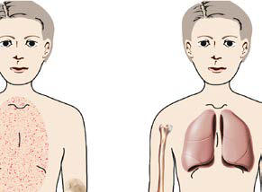

# Chapter 200: Juvenile Dermatomyositis

*Jeffrey A. Dvergsten and Ann M. Reed*

<!-- p.1917 -->
Juvenile dermatomyositis (JDM) is the most common of the *juvenile idiopathic inflammatory myopathies (JIIMs),* representing up to 85% of all patients with these rare vasculopathic diseases. It is characterized by proximal muscle weakness and distinctive rashes of the face and extensor joint surfaces.

**EPIDEMIOLOGY** The incidence of JDM is approximately 3 cases/1 million children/yr, with an incidence similar in White and Black non-Hispanics and an apparent lower incidence in Hispanics. The peak age of onset is 7 years with a second peak of onset in late adulthood (45-64 years); however, adult-onset dermatomyositis appears to be a distinctly separate entity, both in prognosis and etiology. In the United States the ratio of females to males with JDM is 2:1. Multiple cases of myositis in a single family are rare, but familial autoimmune disease may be increased in families with children who have JDM when compared to families of children without autoimmune disease. Reports of seasonal association have not been confirmed, although clusters of cases may occur.

**ETIOLOGY** A precise understanding of the etiology and pathogenesis of JDM remains elusive; many factors that affect elements of innate and adap tive immunity have been identified as contributing to onset and per petuation of disease. Evidence suggests that the etiology of JDM is multifaceted, with a genetic predisposition influenced by an environ mental factor triggering events leading to disease pathogenesis.

Genetic factors that are associated with increased susceptibility to JDM include human leukocyte antigen (HLA) alleles DRB1*0301, DQA1*0501, and DQA1*0301. Additionally, HLA-DQA1*0501 is found on maternal cells present in blood and tissue samples of chil dren with JDM, an example of maternal microchimerism, which has been proposed to play an etiologic role in JDM by creating an immune response comparable to graft-versus-host disease (GVHD). Other polymorphisms implicated in JDM include those affecting cytokine genes such as the tumor necrosis factor (TNF)-α promoter and the variable-number tandem repeats of the interleukin (IL)-1 receptor antagonist A1 gene. An increase in TNF-α may be associated with persistent immune activation leading to a longer disease course. The IL-1 receptor antagonist A1 allele is associated with the development of JIIM in White but not in Black persons, in whom the A3 allele, instead, is a possible risk factor. Environmental factors may also play a contributing role, with geographic and seasonal clustering reported. Short-term increases in ultraviolet (UV) index before the onset of disease have been reported; however, no clear theory of etiology has emerged. A history of infection in the 3 months before disease onset is usually reported; multiple studies have failed to produce a causative organism. Constitutional signs and upper respiratory symptoms pre dominate, but one third of patients report preceding gastrointestinal (GI) symptoms. Group A streptococcus, upper respiratory infections, GI infections, coxsackievirus B, toxoplasma, enteroviruses, parvovirus B19, and multiple other organisms have been postulated as possible pathogens in the etiology of JDM. Despite these concerns, results of serum antibody testing and polymerase chain reaction amplification of the blood and muscle tissue for multiple infectious diseases have not been revealing.

**PATHOGENESIS** JDM and related immune myositis syndromes are believed to be an autoimmune vasculopathic inflammatory disease affecting capillaries of multiple organs, but most notably, the skin, muscles, and GI tract

(Table 200.1). Pathogenic mechanisms are both immune and nonim mune with cellular and soluble constituents of the innate and adap tive immune systems and pathways of cellular injury involved. Type I interferons (IFNs), principally α and β, are cytokines of the innate immune system that play a significant role in the pathogenesis of JDM by modulating several immune mechanisms, including upregu lation of major histocompatibility complex (MHC) class I molecules on muscle cells; induction of proinflammatory cytokine, chemokine, and adhesion molecule production; and supporting cytotoxic effects of innate and adaptive immune cells. Plasmacytoid dendritic cells (pDCs) play an important role in JDM and are principal producers of type I IFN upon activation of Toll-like receptor (TLR) 9 on their surface by viruses. Cells involved in the inflammatory cascade include mono cytes/macrophages (CD14), T-cell subsets (CD4, CD8, Th17), natural killer (NK) cells (CD56), and dendritic cells (DCs). MHC class I upreg ulation induces endoplasmic reticulum (ER) stress, which results in the degradation of contractile proteins; additional downstream effects of type I IFN include autoantibody production and B-cell proliferation. Galectin-9 and CXCL10 (IP-10) are two IFN-related proteins that have been validated as sensitive and specific peripheral biomarkers of dis ease activity in JDM.

**CLINICAL MANIFESTATIONS** Children with JDM present with either rash, insidious onset of weak ness, or both. Fevers, dysphagia or dysphonia, arthritis, muscle ten derness, and fatigue are also commonly reported at diagnosis (Tables 200.2 and 200.3). Certain myositis-specific antibodies are associated with different phenotypic patterns of disease (Fig. 200.1).

Rash develops as the first symptom in 50% of patients and appears concomitant with weakness only 25% of the time. Children often exhibit extreme photosensitivity to UV light exposure with general ized erythema in sun-exposed areas. If seen over the chest and neck, this erythema is known as the **shawl sign**. Erythema is also commonly seen over the knees and elbows. The characteristic **heliotrope rash** is a blue-violet discoloration of the eyelids that may be associated with periorbital edema (Fig. 200.2). Facial erythema crossing the nasolabial folds is also common, in contrast to the malar rash without nasolabial involvement typical of systemic lupus erythematosus (SLE). Classic **Gottron papules** are bright-pink or pale, shiny, thickened, or atrophic plaques over the metacarpal phalangeal joints, proximal interphalan geal joints, and distal interphalangeal joints and occasionally on the knees, elbows, small joints of the toes, and ankle malleoli (Fig. 200.3). The rash of JDM is sometimes mistaken for eczema or psoriasis. Rarely, a thickened erythematous and scaly rash develops in children over the palms (known as **mechanic’s hands**) and soles along the flexor ten dons, which is associated with anti–Jo-1 antibodies.

Evidence of small vessel inflammation is often visible in the nail folds and gums as individual capillaries display changes including loops, thickening, tortuosity, or loss (Fig. 200.4C). Telangiectasias may be visible to the naked eye but are more easily visualized under cap illaroscopy or with another magnifier (e.g., ophthalmoscope). Severe vascular inflammation causes cutaneous ulcers on toes, fingers, axillae, or epicanthal folds.

Early in disease, weakness associated with JDM is often insidious and difficult to differentiate from fatigue. It is typically symmetric, affecting proximal muscles such as the neck flexors, shoulder girdle, and hip flexors. Parents may report difficulty climbing stairs, combing hair, and getting out of bed. Examination reveals inability to perform a sit-up, head lag in a child after infancy, and **Gower sign** (use of hands climbing on thighs to help stand from a sitting position). Patients with JDM may roll to the side rather than sit straight up from lying to com pensate for truncal weakness. Approximately half of children exhibit muscle tenderness because of muscle inflammation.

Esophageal and respiratory muscles are also affected, resulting in aspiration or respiratory failure. It is essential to assess for dysphonia or nasal speech, palatal elevation with gag, dysphagia, and gastroesopha geal reflux by means of history and physical examination. If any of these are abnormal, a swallow study should be pursued. Respiratory muscle weakness can be a medical emergency and lead to respiratory failure.

*Jeffrey A. Dvergsten and Ann M. Reed*

<!-- p.1918 -->
Juvenile-Onset Myositis (JOM)

#### **Table 200.1** Clinical Associations: Myositis-Specific Antibodies (MSA) and Myositis-Associated Antibodies (MAA) in

| Category / Parameter | Clinical Details & Findings |
| --- | --- |
| **CLINICAL ASSOCIATIONS** | Common myositis-specific autoantibodies are found in 45–55% of patients with juvenile-onset myositis; Anti-Mi2; Nucleosome remodeling; deacetylase complex (NuRD); 3–4; • “Classic” dermatomyositis; • Responds well to standard therapies; • Favorable prognosis; Anti-TIF1g (p155/140, |
| **TRIM33)** | Transcriptional intermediary; factor 1 gamma (TIF1-γ); 18–35; • Severe cutaneous disease; • Rashes in photoexposed pattern; • Chronic disease course; • Lipodystrophy; Anti-NXP2 (p140, MJ); Nuclear matrix protein 2 (NXP2); 15–22; • Calcinosis; • More severe muscle disease; • Gastrointestinal bleeding, ulcers, and dysphagia; • Worse disease outcome and functional status; Anti-MDA5 (CADM-140); Melanoma differentiation–; associated gene 5 (MDA5); 6; • More common in East Asia, where associated with; clinically amyopathic myositis, rapidly progressive; interstitial lung disease, and a high mortality rate; • In White populations associated with mild muscle disease,; interstitial lung disease, arthritis, and ulceration; Rare but clinically important myositis-specific autoantibodies are found in 5–8% of patients with juvenile-onset myositis antisynthetases |
| **ANTISYNTHETASES** | • Antisynthetase syndrome: myositis, interstitial; lung disease, fever, mechanic’s hands, Raynaud; phenomenon, and arthritis; • Occurs in older children; • Increased mortality; - Jo-1; - Histidyl; 2–3 |
| **- PL12** | - Alanyl; 2–3 |
| **- PL7** | - Threonyl; 2–3 |
| **- OJ** | - Isoleucyl; 2–3 |
| **- EJ** | - Glycyl; 2–3 |
| **- KS** | - Asparaginyl; 2–3; - Zo; - Phenylalanyl; 2–3; - Ha; - Tyrosyl; 2–3; Anti-SRP; Signal recognition particle (SRP); 2; • Necrotizing autoimmune myositis; • Severe weakness, muscle necrosis, high CK; • Cardiac involvement; • Occurs in older children; • No rash; • May be refractory to standard treatment; Anti-HMGCR |
| **HMGCR** | 1; • Necrotizing autoimmune myositis, muscle necrosis,; high CK, dysphagia, no statin exposure; Anti-SAE; Small ubiquitin-like modifier–; activating enzyme (SAE); 1; • Initially amyopathic disease with muscle involvement; occurring later; Myositis-associated autoantibodies are found in 16–20% of patients with juvenile-onset myositis. Some may occur in conjunction with a |
| **myositis-specific autoantibody.** | Anti-PmScl; Exosome-associated PM- Scl-75;; PM-Scl-100; C1D; 5; • Overlap syndromes; Anti-U1RNP |
| **U1RNP** | 2; • Overlap syndromes; Anti-Ro52; Ro52; 5; • Overlap syndromes; • May be found in conjunction with other MSA,; particularly antisynthetases; Common MSAs are present in 45–55% of the U.S. pediatric population with juvenile-onset myositis. Rare MSAs are present in 5–8%. Myositis-associated autoantibodies (MAAs) are; found in 16–20% of juvenile-onset myositis, with or without an accompanying MSA.; CK, Creatine kinase; HMGCR, 3-hydroxy-3-methylglutaryl-coenzyme reductase; MDA, melanoma differentiation-associated; NuRD, nucleosome remodeling deacetylase; SAE, small; ubiquitin-like modifier–activating enzyme; SRP, signal recognition particle; TIF, transcriptional intermediary factor.; Modified from Pachman LM, Khojah AM. Advances in juvenile dermatomyositis: myositis specific antibodies aid in understanding disease heterogeneity. J Pediatr. 2018;195:16–27. |

<!-- p.1919 -->
Children with respiratory muscle weakness do *not* manifest typical symptoms of impending respiratory failure with increased work of breathing, instead demonstrating hypercarbia rather than hypoxemia. Evaluation of respiratory muscle function by negative inspiratory force (NIF) measurement can be performed in the clinic or at the bedside.

**DIAGNOSIS** Diagnosis of dermatomyositis requires the presence of a characteris tic rash and at least three signs of muscle inflammation and weakness (see Table 200.2). Diagnostic criteria developed in 1975 predate the use of MRI and have not been validated in children. Diagnosis is often delayed because of the insidious nature of disease onset.

Electromyography (EMG) shows signs of myopathy (increased insertional activity, fibrillations, sharp waves) and muscle fiber necro sis (decreased action potential amplitude and duration). Nerve con duction studies are typically normal unless severe muscle necrosis and atrophy are present. It is important that EMG be performed in a cen ter with experience in pediatric EMG and its interpretation. **Muscle biopsy** is typically indicated when the diagnosis is in doubt or for grad ing disease severity (see Fig. 200.4A). Biopsy of involved muscle reveals focal necrosis and phagocytosis of muscle fibers, fiber regeneration, endomysial proliferation, inflammatory cell infiltrates and vasculitis, and tubuloreticular inclusion bodies within endothelial cells. Findings of lymphoid structures and vasculopathy may portend more severe disease.

Some children present with classic rash but no apparent muscle weakness or inflammation; this variation is called **amyopathic JDM** or **dermatomyositis sine myositis**. It is unclear whether these children have isolated skin disease or mild undetected muscle inflammation, risking progression to more severe muscle involvement with long-term sequelae such as calcinosis and lipodystrophy if untreated.

**DIFFERENTIAL DIAGNOSIS** The differential diagnosis depends on the presenting symptoms. If the presenting complaint is solely weakness without rash or atypi cal disease, other causes of myositis or myopathy should be consid ered, including polymyositis, infection-related myositis (influenza A and B, coxsackievirus B, and other viral illnesses), muscular dys trophies (e.g., Duchenne, Becker), myasthenia gravis, Guillain-Barré syndrome, endocrinopathies (hyperthyroidism, hypothyroidism, Cushing syndrome, Addison disease, parathyroid disorders), mito chondrial myopathies, TNF receptor–associated periodic syndrome (TRAPS), and metabolic disorders (glycogen and lipid storage dis eases). Infections associated with prominent muscular symptoms include trichinosis, *Bartonella* infection, toxoplasmosis, staphylococ cal pyomyositis, and SARS-CoV-2. Blunt trauma and crush injuries may lead to transient rhabdomyolysis with myoglobinuria. Myositis in children may also be associated with vaccinations, drugs, growth hormone, and GVHD. The rash of JDM may be confused with dys hidrotic eczema, psoriasis, erythema nodosa, malar rash from SLE, capillary telangiectasias from Raynaud phenomenon, and other rheu matic diseases. Muscle inflammation is also seen in children with SLE, juvenile idiopathic arthritis, mixed connective tissue disease, inflammatory bowel disease, and antineutrophil cytoplasmic anti body–positive vasculitides. Necrotizing immune-mediated myopa thies are characterized by muscle necrosis without lymphocytic infiltration. Antibodies to signal recognition particle (SRP) or 3-hydr oxy-3-methylglutaryl-coenzyme A (HMG-CoA) distinguish the two types from each other and from JDM. Table 200.4 compares other juvenile idiopathic inflammatory myositis disorders: JDM, juvenile polymyositis, and juvenile connective tissue myositis.

**LABORATORY FINDINGS** Elevated serum levels of muscle-derived enzymes (creatine kinase [CK], aldolase, aspartate transaminase, alanine transaminase [ALT], lactate dehydrogenase) reflect muscle inflammation. Not all enzyme levels rise with inflammation in a specific individual; ALT is usually elevated on initial presentation, whereas CK level may be normal.

Dermatomyositis

#### **Table 200.2** Diagnostic Criteria for Juvenile

| Category / Parameter | Clinical Details & Findings |
| --- | --- |
| **General** | Classic rash; Heliotrope rash of the eyelids; Gottron papules; Plus three of the following:; Weakness; Symmetric; Proximal; Muscle enzyme; elevation (≥1); Creatine kinase; Aspartate transaminase; Lactate dehydrogenase; Aldolase; Electromyographic; changes; Short, small polyphasic motor unit; potentials; Fibrillations; Positive sharp waves; Insertional irritability; Bizarre, high-frequency repetitive; discharges; Muscle biopsy; Necrosis; Inflammation; Data from Bohan A, Peter JB. Polymyositis and dermatomyositis (second of two parts).; N Engl J Med. 1975;292:403–407. |

During Disease Course

#### **Table 200.3** Clinical Features of Juvenile Dermatomyositis

| Category / Parameter | Clinical Details & Findings |
| --- | --- |
| **%** | Muscle weakness; 90-100; Dysphagia or dysphonia; 13-40; Muscle atrophy; 10; Muscle pain and tenderness; 30-75; Skin lesions; 85-100; Heliotrope rash of eyelids; 66-95; Gottron papules; 57-95; Erythematous rash of malar/facial area; 42-100; Periungual (nail fold) capillary changes; 80-90; Photosensitive rash; 5-42; Ulcerations; 22-30; Calcinosis; 12-30; Lipodystrophy; 11-14; Raynaud phenomenon; 2-15; Arthritis and arthralgia; 22-58; Joint contractures; 26-27; Fever; 16-65; Gastrointestinal signs and symptoms; 8-37; Restrictive pulmonary disease; 4-32; Interstitial lung disease; 1-7; Cardiac involvement; 0-3; From Rider LG, Lindsley CB, Cassidy JT. Juvenile dermatomyositis. In: Cassidy JT, Petty; RE, Laxer RM, et al., eds. Textbook of Pediatric Rheumatology, 6th ed. Philadelphia:; Saunders; 2011: Table 24.20, p. 410. |

<!-- p.1920 -->
The erythrocyte sedimentation rate (ESR) is often normal, and the rheumatoid factor (RF) test result is typically negative. There may be anemia consistent with chronic disease. Antinuclear antibody (ANA) is present in >80% of children with JDM. Serologic testing results are divided into two groups: **myositis-associated antibodies**

**(MAAs)** and **myositis-specific antibodies (MSAs)** (see Table 200.1). MAAs are associated with JDM but are not specific and can be seen in both overlap conditions and other rheumatic diseases. The pres ence of MAAs such as SSA, SSB, Sm, ribonucleoprotein (RNP), and double-stranded (ds) DNA may increase the likelihood of overlap disease or connective tissue myositis. Antibodies to Pm/Scl identify a small, distinct subgroup of myopathies with a protracted disease course, often complicated by pulmonary interstitial fibrosis and car diac involvement. MSAs are specific for myositis and are identified in

photosensitive rash

ulceration

A B C

ulceration

generalized lipodystrophy

proximal myopathy

rash

Anti-p155/140 Anti-MJ-(NXP-2) Anti-MDA-5

calcinosis

rash

interstitial lung disease

myopathy

arthritis

GI bleed, ulcers, dysphagia

severe cutaneous involvement

**Fig. 200.1** Phenotypes associated with the three most common myositis specific antibodies in children with myositis: anti-p155/140, anti-MJ, and antiMDA-5. A, Anti-p155/140, present in 18–30% of idiopathic juvenile inflammatory myopathies, displays an extensive photosensitive rash that ulcerates, a chronic disease course, and generalized lipodystrophy. B, Fifteen to twenty-three percent of children positive for anti-MJ (nuclear matrix protein 2 in the United Kingdom) may have disease onset at a younger age and have dysphonia, muscle cramps, atrophy, and contractures, with increased weakness, and they are more likely to develop calcifications and gastrointestinal symptoms; their rash often spares the truncal area. C, Anti–MDA-5 is increased in the Japanese population (33%) vs the United Kingdom (6%) and is associated with inflammatory lung disease, oral and cutaneous ulcers, arthritis, and a milder form of muscle involvement. GI, gastrointestinal. (Modified from Rider LG, Nistala K. The juvenile idiopathic inflammatory myopathies: Pathogenesis, clinical and autoantibody phenotypes, and outcomes. J Intern Med. 2016;280:24–38, Fig 3.)

**Fig. 200.2** The facial rash of juvenile dermatomyositis. There is ery thema over the bridge of the nose and malar areas with violaceous (heliotropic) discolorations of the upper eyelids.

**Fig. 200.3** The rash of juvenile dermatomyositis. The skin over the metacarpal and proximal interphalangeal joints may be hypertrophic and pale red (Gottron papules).

<!-- p.1921 -->
approximately 40–60% of children with JIM. These antibodies sug gest a diagnosis of myositis, and their presence may define distinct clinical subsets and may predict prognosis. Anti-TIF-1-γ antibod ies are reported in 23–30% of children with JDM and are associated with photosensitive rashes, ulceration, and lipodystrophy. Unlike in adults, this antibody is not associated with malignancy in children with JDM. Anti-NXP2 antibodies are reported in 12–23% of children with JDM and are associated with cramps, muscle atrophy, contrac tures, and dysphonia. Anti-**MDA5** antibodies are found in approxi mately 7% of children with JDM and may predict the development of interstitial lung disease (ILD). Because certain MSAs have defined clinical phenotypes in JDM and IFN-related biomarkers that may correlate with disease activity, there is interest in assessing IFN sig nature by MSA type.

Radiographic studies aid both diagnosis and medical management. MRI using T2-weighted images and fat suppression (see Fig. 200.4B) identifies active sites of disease, reducing sampling error and increas ing the sensitivity of muscle biopsy and EMG, results of which are nondiagnostic in 20% of cases if the procedures are not directed by MRI. Extensive rash and abnormal MRI findings may be found despite normal serum levels of muscle-derived enzymes. Muscle biopsy often demonstrates evidence of disease activity and chronicity that is not sus pected from the levels of the serum enzymes alone.

A contrast swallow study may document palatal dysfunction and risk of aspiration. Pulmonary function testing detects a restrictive defect consistent with respiratory weakness and reduced diffusion capacity of carbon monoxide from alveolar fibrosis associated with other con nective tissue diseases. Serial measurement of vital capacity or negative inspiratory force can document changes in respiratory weakness, espe cially in an inpatient setting. **Calcinosis** is seen easily on radiographs, along the fascial planes, and within muscles (see Figs. 200.4D and E and Fig. 200.5).

**TREATMENT** The aid of an experienced pediatric rheumatologist is invaluable in outlining an appropriate course of treatment for a child with JDM. Before the advent of corticosteroids, one third of patients spontane ously improved; a third had a chronic, lingering course; and a third died from the disease. Corticosteroids have altered the course of the

disease, lowering morbidity and mortality. Methotrexate decreases the length of treatment with corticosteroids, thereby reducing morbidity from steroid toxicity. Intravenous (IV) gamma globulin is frequently used as an adjunct for the treatment of severe disease and can be given at 2 g/kg (maximum 70 g) every 2 weeks for three doses, then every 4 weeks as needed. The efficacy and safety have been reported in openlabel studies. In the 2010 **Childhood Arthritis and Rheumatology Research Alliance (CARRA)** treatment utilization report, IVIG was used most frequently for initial treatment of severe disease and treat ment of refractory disease. It is also a steroid-sparing agent. Consensus treatment plans for guiding treatment of children with JDM are avail able from CARRA online through PubMed and Figure 200.6.

Corticosteroids remain the mainstay of treatment. In a clinically stable child without debilitating weakness, oral prednisone at 2 mg/ kg/day (maximum 60 mg daily) is recommended. Children with GI involvement may have decreased absorption of oral corticosteroids and require IV administration. In more severe cases with respiratory or oropharyngeal weakness, high-dose pulse methylprednisolone is used (30 mg/kg/day for 3 days, maximum dose 1 g/day) with ongoing weekly or monthly IV dosing along with daily oral corticosteroids as needed. Corticosteroid dosage is slowly tapered over 12 months, after indicators of inflammation (muscle enzymes) normalize and strength improves.

Weekly oral, IV, or subcutaneous methotrexate (the lesser of 1 mg/kg or 15 mg/m2) is often used as a steroid-sparing agent in JDM. The con comitant use of methotrexate halves the cumulative dosage of steroids needed for disease control. Risks of methotrexate include immunosup pression, blood count dyscrasias, chemical hepatitis, pulmonary tox icity, nausea/vomiting, and teratogenicity. *Folic acid is typically given with methotrexate starting at a dose of 1 mg daily to reduce toxicity and side effects of folate inhibition (oral ulcers, nausea, anemia).* Children who are taking immunosuppressive medications such as methotrex ate should avoid live-virus vaccination, although inactivated influenza vaccination is recommended yearly. An international trial found the combination of methotrexate plus corticosteroids to perform better than corticosteroids alone and with fewer side effects than corticoste roids plus cyclosporine A.

**Hydroxychloroquine** has little toxicity risk and is used as a second ary disease-modifying agent to reduce rash and maintain remission.

A B C

D E F

**Fig. 200.4** Features of juvenile dermatomyositis. A, Perivascular and perifascicular inflammatory infiltrates with necrotic fibers, perifascicular atro phy, and regeneration in a muscle biopsy. B, MRI is a sensitive indicator of myositis. Inflamed areas appear bright on short-tau inversion recovery– weighted images (arrows). C, Capillaries are most often abnormal when viewed at the nail fold. Typical changes of dilation with adjacent dropout (arrow) are seen. D, About 30% of juvenile dermatomyositis (JDM) patients have dystrophic calcinosis. E, Cutaneous ulceration with central necrosis, crust, and surrounding erythema at the elbow of 10-year-old boy with severe JDM. F, Lipoatrophy of the forearm (arrow) in a boy with JDM. (From Feldman BM, Rider LG, Reed AM, Pachman LM. Juvenile dermatomyositis and other idiopathic inflammatory myopathies of childhood. Lancet. 2008;371:2201–2212, Fig. 3, p. 2205.)

<!-- p.1922 -->
Typically, it is administered at doses of 4-6 mg/kg/day orally in either tablet or liquid form. Ophthalmologic follow-up one time per year to monitor for rare retinal toxicity is recommended. Other side effects include hemolysis in patients with glucose-6-phosphate deficiency, GI intolerance, and skin/hair discoloration.

The use of **rituximab** in a trial of steroid-dependent patients with resistant inflammatory myopathies, including JDM, did not meet the primary study end-point showing a difference in time to improvement between individuals given rituximab at baseline or at 8 weeks, but over all, 83% of all patients met the definition of improvement in the trial. Additionally, rituximab was noted to have a significant steroid-sparing effect.

Other medications used to treat severe refractory disease include mycophenolate mofetil, cyclosporine, and cyclophosphamide. Given the strong type I IFN signal in JDM and that these cytokines activate intracellular signaling through the Janus kinase (JAK)/signal transduc ers and activators of transcription (STAT) pathway, consideration of JAK inhibitors, including *tofacitinib,* baricitinib, and ruxolitinib, as potential therapeutic candidates has been bolstered by case reports and

case series that report generally promising results with these drugs in off-label treatment of JDM.

Children with pharyngeal weakness may need nasogastric or gas trostomy feedings to avoid aspiration, whereas those with GI vasculitis require full bowel rest. Rarely, children with severe respiratory weak ness require ventilator therapy and even tracheostomy until the respi ratory weakness improves.

**Physical therapy** and **occupational therapy** are integral parts of the treatment program, initially for passive stretching early in the disease course and then for direct reconditioning of muscles to regain strength and range of motion. Therapy may improve muscle strength measures and cardiovascular fitness. Bed rest is not indicated, because weight bearing improves bone density and prevents contractures. Social work and psychology services may facilitate adjustment to the frustration of physical impairment in a previously active child and aid with sleep disturbances associated with rheumatic disease.

All children with JDM should avoid sun exposure and apply high– sun protection factor (SPF) sunscreen daily, even in winter and on cloudy days. Vitamin D and calcium supplements are indicated for all

Myositis

#### **Table 200.4** Frequency of Manifestations of Juvenile Dermatomyositis (JDM), Juvenile Polymyositis (JPM), and Overlap

| Category / Parameter | Clinical Details & Findings |
| --- | --- |
| **OVERLAP MYOSITIS** | Progressive proximal muscle weakness; 82-100; 100; 100; Easy fatigue; 80-100; 85; 84; Gottron papules; 57-91; 0; 74-80; Heliotrope rash; 66-87; 0; 40-59; Erythematous rash of malar/facial area; 42-100; 0-6; 20-51; Periungual nailfold capillary changes; 35-91; 33; 67-80; Muscle pain or tenderness; 25-83; 61-66; 55; Weight loss; 33-36; 52; 53; Falling episodes; 40; 59; 29; Arthritis; 10-65; 0-45; 69-80; Fever; 16-65; 0-41; 0-49; Lymphadenopathy; 8-75; 0-12; 20-22; Dysphagia or dysphonia; 15-44; 39; 40; Joint contractures; 9-55; 17-42; 57-60; V- or shawl-sign rashes; 19-29; 3-6; 8-14; Dyspnea on exertion; 5-43; 17-42; 40; Gastrointestinal symptoms; 5-37; 9-33; 6-53; Photosensitive rashes; 5-51; 0-6; 22-40; Raynaud phenomenon; 9-28; 0-24; 41-60; Edema; 11-34; 15; 20; Gingivitis; 6-30; 9; 0-37; Cutaneous ulceration; 5-30; 3; 20-22; Calcinosis; 3-34; 6; 24; Cardiac involvement; 2-13; 36; 19; Interstitial lung disease; 5; 15; 26; Lipodystrophy; 4-14; 3; 0-6; Gastrointestinal bleeding or ulceration; 3-4; 3; 4-10; From Rider LG, Lindsley CB, Miller FW. Juvenile Dermatomyositis. In: Petty RE, Laxer RM, Lindsley CB, Wedderburn L, eds. Textbook of Pediatric Rheumatology, 7th ed. Philadelphia:; Elsevier; 2016: Table 26.4. |

<!-- p.1923 -->
children undergoing long-term corticosteroid therapy to reduce druginduced osteopenia and osteoporosis.

**COMPLICATIONS** Most complications from JDM are related to prolonged and severe weakness from muscle atrophy to cutaneous calcifications and scarring

or atrophy to lipodystrophy. Secondary complications from medical treatments are also common. Children with acute and severe weak ness are at risk for aspiration pneumonia and respiratory failure and occasionally require nasogastric feeding and mechanical ventilation until weakness improves. Rarely, **vasculitis** of the GI tract develops in children with severe JDM. Crampy abdominal pain and occult GI bleeding may indicate bowel wall vasculitis and lead to ischemia, GI bleeding, and perforation if not treated with complete bowel rest and aggressive treatment for the underlying inflammation. Surgery should be avoided, if possible, because the GI vasculitis is diffuse and not easily amenable to surgical intervention. Contrast-enhanced CT may show dilation or thickening of the bowel wall, intraluminal air, or evidence of bowel necrosis.

Involvement of the cardiac muscle with pericarditis, myocarditis, and conduction defects with arrhythmias has been reported, as has reduced diastolic and systolic function related to ongoing disease activity.

**Lipodystrophy** and **calcinosis** are thought to be associated with long-standing or undertreated disease (see Fig. 200.4D-F). Dystrophic deposition of calcium phosphate, hydroxyapatite, or fluoroapatite crys tals occurs in subcutaneous plaques or nodules, resulting in painful ulceration of the skin with extrusion of crystals or calcific liquid. Cal cification is found in up to 40% of large cohorts of children with JDM. Pathologic calcifications may be related to severity of disease and pro longed delay to treatment and potentially to genetic polymorphisms of TNF-α-308. Calcium deposits tend to form in subcutaneous tissue and along muscle. Some ulcerate through the skin and drain a soft calcific liquid, and others manifest as hard nodules along extensor surfaces or embedded along muscle. Draining lesions serve as a nidus for celluli tis or osteomyelitis. Nodules cause skin inflammation that may mimic cellulitis. Spontaneous regression of calcium deposits may occur, but there is no evidence-based recommendation for treatment of calcino sis. Some experts recommend aggressive treatment of underlying myo sitis. Others have recommended bisphosphonates, TNF inhibitors, and sodium thiosulfate, but no evidence-based trials have been conducted for this condition.

Lipodystrophy manifests in 10–40% of patients with JDM and can be difficult to recognize. Lipodystrophy results in progressive loss of subcutaneous and visceral fat, typically over the face and upper body, and may be associated with a metabolic syndrome similar to polycys tic ovarian syndrome with insulin resistance, hirsutism, acanthosis, hypertriglyceridemia, and abnormal glucose tolerance. Lipodystrophy may be generalized or localized.

Children receiving prolonged corticosteroid therapy are prone to complications such as cessation of linear growth, weight gain, hirsut ism, adrenal suppression, immunosuppression, striae, cushingoid fat deposition, mood changes, osteoporosis, cataracts, avascular necrosis, and steroid myopathy. Families should be counseled on the effects of corticosteroids and advised to use medical alert identification and to consult a nutritionist regarding a low-salt, low-fat diet with adequate vitamin D and calcium supplementation.

An association with malignancy at disease onset is observed in adults with dermatomyositis but very rarely in children.

**PROGNOSIS** The mortality rate in JDM has decreased since the advent of corti costeroids, from 33% to currently approximately 1%; little is known about the long-term consequences of persistent vascular inflamma tion. The period of active symptoms has decreased from about 3.5 years to <1.5 years with more aggressive immunosuppressive ther apy; the vascular, skin, and muscle symptoms of children with JDM generally respond well to therapy. At 7 years of follow-up, 75% of patients have little to no residual disability, but 25% continue to have chronic weakness and 40% have chronic rash. Up to one-third may need long-term medications to control their disease. Children with JDM appear able to repair inflammatory damage to vasculature and muscle, but there is some emerging concern about long-term effects on cardiovascular risk.

*Visit Elsevier eBooks+ at eBooks.Health.Elsevier.com** for Bibliography.*

A B

**Fig. 200.5** Calcifications in dermatomyositis. A, Skin effects of calcifi cation. B, Radiographic evidence of calcification.

**MODERATE JDM**

**Plan 2* Plan 1* AND IV methylprednisolone 30 mg/kg for 3 d, then weeklyc

**Plan 3* Plan 2* AND IVIG 2 g/kgd q2wk × 3 doses then monthIy

**Plan 1** Methotrexatea 15 mg/m2 or 1 mg/kg weekly

AND Prednisoneb 2 mg/kg/d for 4 wk then decrease by 20%

**SKIN PREDOMINANT JDM**

**Plan 2* Plan 1* AND Methotrexatea 15 mg/m2 or 1 mg/kg weekly

**Plan 3* Plan 2* AND Prednisoneb 2 mg/kg/d for 4 wk then decrease by 20%

**Plan 1** Hydroxychloroquine 5 mg/kg/de

**SKIN RESISTANT JDM**

**Plan 2* Plan 1* AND Mycophenolate mofetilf BID 10 mg/kg/dose OR 600 mg/m2

**Plan 3** Cyclosporine 3 mg/kgg

**Plan 1** IVIG 2 g/kgd q2wks × 3 doses then monthly

**Fig. 200.6** Recommended consensus treatment plans from CARRA for JDM patients with moderate, skin-predominant, and skin-resistant disease. IV, intravenous; IG, immunoglobulin. aLesser of 15 mg/m2 or 1 mg/kg (max 40 mg), bmax 60 mg, coptional, dmax 70 g, emax 400 mg, fmax 1,500 mg bid, ghigher doses based on toxicity, efficacy. (From Kim H, Huber AM, Kim S. Updates on juvenile dermatomyositis from the last decade: classification to outcomes. Rheum Dis Clin N Am. 2021;47:669–690, Fig. 1, p. 679.)

<!-- p.1924 -->
