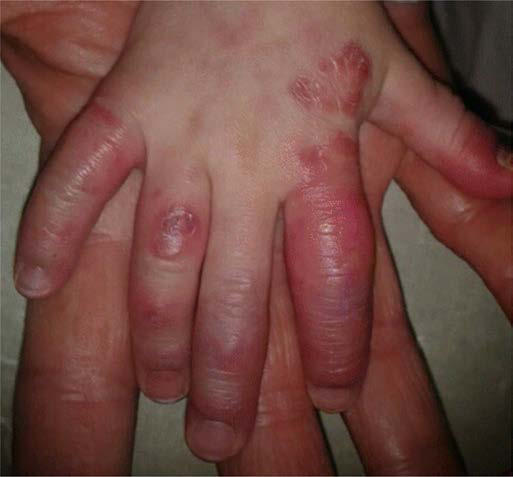
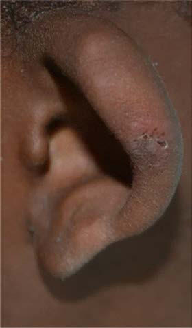

# Chapter 205: Interferonopathies

*Sara E. Sabbagh and James W. Verbsky*

<!-- p.1952 -->
Type I interferonopathies refer to a group of inherited autoinflam matory disorders that are characterized by dysregulation of the type I interferon (IFN) pathway (Table 205.1). Type I interferonopathies were recognized when a report described the phenotypic overlap between Aicardi-Goutières syndrome (AGS) encephalopathy, congenital viral infections, and monogenic systemic lupus erythematosus (SLE). The clinical similarities of these diseases stimulated the theory of a shared pathologic mechanism. Pathogenic variants involved in type I IFN sig naling were identified to be causative for AGS and monogenic forms of SLE. Several other novel monogenic disorders with aberrant IFN signaling have been identified.

Type I IFNs are ubiquitously expressed inflammatory polypep tides that are induced by microbial and viral nucleic acids. During viral replication, accumulation of viral nucleic acids is sensed by several different cellular mechanisms, which leads to downstream IFN production (Fig. 205.1). Type I IFNs are released from the cell and bind to IFN receptors (IFNRs) through autocrine and paracrine action. The IFNR then activates signal translation through Janus kinase/signal transducers and activators of transcription (JAK- STAT) pathways, which promotes the expression of IFN-simulated genes (ISGs), which stops cell replication and protein translation of the infected cell. There are several molecular mechanisms that lead to altered regulation of IFN signaling: (1) loss-of-function variants of genes that encode enzymes responsible for DNA or DNA-RNA hybrid molecule degradation; (2) variants that lead to constitutive activation or reduction of the activation threshold of intracytosolic nucleic acid sensors; (3) gain-of-function variants of positive IFN signaling regulators; (4) loss-of-function variants of negative IFN signaling regulators; and (5) proteasomal dysfunction leading to the unfolded protein response and downstream IFN pathway activation. Examples of these altered molecular mechanisms and the associated

*Sara E. Sabbagh and James W. Verbsky*

Interferonopathies

#### **Table 205.1** Mutated Gene, Protein Function, Pattern of Inheritance, and Main Symptoms of Known Type 1

| Category / Parameter | Clinical Details & Findings |
| --- | --- |
| **SYMPTOMS** | Aicardi-Goutières syndrome; (AGS) type 1 |
| **TREX-1** | 3′-5′ DNA exonuclease; AR and AD; Classical AGS |
| **RNASEH2B** | Components of RNase; H2 complex. Removes; ribonucleotides from RNA-; DNA hybrids |
| **AR** | Classical AGS |
| **RNASEH2C** | Classical AGS |
| **RNASEH2A** | Classical AGS with dysmorphic features |
| **SAMHD1** | Restricts the availability of; cytosolic deoxynucleotides |
| **AR** | Mild AGS, mouth ulcer, deforming; arthropathy, cerebral vasculopathy with; early-onset stroke |
| **ADAR** | Deaminates adenosine to; inosine in endogenous dsRNA,; preventing recognition by; MDA5 receptor; AR and AD; Classical AGS, bilateral striatal necrosis |
| **IFIH1** | Cytosolic receptor for dsRNA |
| **AD** | Classic or mild AGS, asymptomatic; Retinal vasculopathy with; cerebral leukodystrophy |
| **TREX-1** | 3′-5′ DNA exonuclease |
| **AD** | Adult-onset loss of vision, stroke, motor; impairment, cognitive decline, Raynaud,; and liver involvement; Spondyloenchondrodysplasia |
| **ACP5** | Lysosomal phosphatase activity |
| **AR** | Spondyloenchondrodysplasia, immune; disregulation, and in some cases; combined immunodeficiency; STING-associated; vasculopathy with onset in; infancy (SAVI) |
| **TMEM173** | Transduction of cytoplasmic; DNA-induced signal |
| **AD** | Systemic inflammation, cutaneous; vasculopathy, pulmonary inflammation; Proteasome-associated; autoinflammatory syndrome |
| **PSMB8** | Part of the proteasome complex |
| **AR** | Autoinflammation, lipodystrophy,; dermatosis, hyperimmunoglobulinemia,; joint contractures, short stature; ISG15 deficiency |
| **ISG15** | Stabilizes USP18, a negative; regulator of type 1 interferon |
| **AR** | Brain calcifications, seizures, mycobacterial; susceptibility; Singleton-Merten; syndrome (SMS) |
| **IFIH1** | Cytosolic receptor for dsRNA |
| **AD** | Dental dysplasia, aortic calcifications, skeletal; abnormalities, glaucoma, psoriasis; Atypical SMS |
| **DDX58** | Cytosolic receptor for dsRNA |
| **AD** | Aortic calcifications, skeletal abnormalities,; glaucoma, psoriasis; Trichohepatoenteric; syndrome (THES) |
| **SKIV2L** | RNA helicase |
| **AR** | Severe intractable diarrhea, hair abnormalities; (trichorrhexis nodosa), facial dysmorphism,; immunodeficiency in most cases; From Volpi S, Picco P, Caorsi R, Candotti F, Gattorno M. Type I interferonopathies in pediatric rheumatology. Pediatr Rheumatol Online J. 2016;14(1):35. |

<!-- p.1953 -->
genetic variants are depicted in Figure 205.1. Each genetic variant that leads to dysregulation of IFN signaling is causative of a unique clinical syndrome or subtype of a clinical syndrome that has been classified as a type I interferonopathy. Despite some disease hetero geneity, interferonopathies have a characteristic clinical phenotype, which may include recurrent fevers, early onset of skin vasculopa thy with chilblains, livedo reticularis, panniculitis, lipodystrophy, interstitial lung disease with fibrosis, and encephalopathic CNS involvement (Fig. 205.2 and Table 205.2).

**AUTOINFLAMMATORY INTERFERONOPATHIES Aicardi-Goutières Syndrome** AGS is a clinically heterogeneous disease with a spectrum of associ ated phenotypes. AGS is characterized by an early-onset progressive encephalopathy with basal ganglia calcifications, leukoencepha lopathy, and cerebral atrophy with elevated type I IFN cerebro spinal fluid (CSF) levels and CSF pleocytosis. Cutaneous features, seen in about 30% of patients, include chilblains, or cold-induced acral dermatosis of the digits and auricles secondary to peripheral inflammatory vasculopathy. Other common manifestations include thrombocytopenia, hepatosplenomegaly, transaminitis, psoriasis, interstitial lung disease, and intermittent fever. Most frequently, AGS has an infantile onset in which patients develop abrupt irri tability, sterile pyrexias, and developmental regression within the

first few months of life. Neurologic symptoms may include limb hypertonia with truncal hypotonia, dystonia, excessive startle, abnormal eye movements, epileptic seizures, and slowing of head growth. *RNASEH2B* variants are commonly seen in this context; however, variants of any associated AGS-related genes may present with this clinical scenario. AGS may also present prenatally with a striking similarity to transplacentally acquired infections (pseudo- TORCH), with onset of disease in utero. At birth, patients may have irritability, feeding difficulties, jitteriness, microcephaly, abnormal movements, epileptic seizures, thrombocytopenia, anemia, and liver dysfunction. This presentation is most frequently associated with *TREX1* pathogenic variants and leads to profound develop mental sequelae and increased risk of death in infancy. In both clinical presentations, neuroimaging shows a highly characteristic pattern of diffuse abnormal white matter, intracranial calcifica tions, swelling of temporal or frontal lobes, and cerebral atrophy, similar to radiologic findings seen in congenital infections. Patients may also develop autoimmunity, including type 1 diabetes mellitus, hypothyroidism, hypergammaglobulinemia, and hemolytic anemia. Rarely, AGS can have a later onset with abrupt profound neurologic regression after an extended period of normal development.

There are seven recognized genetic variants and correspond ing disease subtypes of AGS (AGS 1-7), all of which are respon sible for RNA/DNA degradation or detection, resulting in type I

dsDNA

dsRNA

DNA-RNA

hybrids TREX 1

RNASEH2

SAMHD1

STING

RIG-1

ADAR

IFIH1

NTPs

IRF3 IRF7 TBK1

MAVS

Nucleus

IFN

ER-GIC

USP18

ISG15

STAT1

STAT2

STAT1

STAT1

STAT3

STAT3

IRF9

P

P P

P

P

P

ISRE

1

1 1

2

3

4

2

Proteasome

?

5

IFNAR2

IFNAR1

IFNAR2 IFNAR1

JAK1

TYK2

**Fig. 205.1** Schematic representation of various pathways affected in genetic interferonopathies. Purple rectangles indicate variant proteins in type I interferonopathies. Numbered yellow circles indicate the common mechanistic defect. 1. Loss-of-function pathogenic variants of genes that encode enzymes responsible for DNA or DNA-RNA hybrid molecule degradation. 2. Pathogenic variants that lead to constitutive activation or reduction of activation threshold of intracytosolic nucleic acid sensors. 3. Gain-of-function pathogenic variants of positive IFN signaling regulators; 4. Loss-of-function pathogenic variants of negative IFN signaling regulators; and 5. Proteasomal dysfunctional leading to the unfolded protein re sponse and downstream IFN pathway activation. STING: stimulator of interferon genes; SAMHD1: SAM domain and HD domain deoxynucleoside triphosphate triphosphohydrolase 1; NTPs: nucleoside triphosphates; TREX1: DNA 3′ repair exonuclease 1; ISG15: interferon-stimulated gene 15; MAVS: mitochondrial antiviral-signaling protein; RIG-I: retinoic acid-inducible gene I; TBK1: TANK-binding kinase 1; USP18: ubiquitin-specific pepti dase 18; RNASEH2, ribonuclease H domain 2; IFIH1: IFN-induced helicase C domain-containing protein 1; ADAR: RNA adenosine deaminase; IRF3: interferon regulatory factor 3; IRF7: interferon regulatory factor 7; IRF9: interferon regulatory factor 9; ERGIC: endothelial reticulum–Golgi interme diate compartment; IFNAR: interferon-α receptor; ISGF3: the transcriptional activator induced by interferon-α; ISRE: interferon-sensitive response element; JAK1: Janus kinase 1; TYK2: tyrosine kinase 2; STAT: signal transducer and activator of transcription. P indicates phosphorylation.

<!-- p.1954 -->
IFN production and upregulation of ISGs. These include variants of *3**′**-5**′** DNA exonuclease-TREX1 *(AGS1)**; ribonucleases including *RNASEH2B *(AGS2)**, *RNASEH2C *(AGS3)**, and *RNASEH2A *(AGS4)**; SAM and HD domain-containing deoxynucleoside *triphosphate tri phosphohydrolase 1-SAMHD1 *(AGS5)**; adenosine deaminase acting on *RNA 1-ADAR1 *(AGS6)**; and IFN-induced helicase C domain– containing protein-*IFIH1 *(AGS7)**. The majority of AGS subtypes are autosomal recessive; however, heterozygous gain-of-function variants can also occur in AGS1 and AGS6, and variants causing AGS7 are autosomal dominant.

There are several manifestations that are strongly associated with distinct AGS subtypes. Bilateral striatal necrosis with severe dysto nia is associated with variants in *ADAR1* (AGS6), and spastic para paresis has been associated with variants in *ADAR1* (AGS6), *IFIH1* (AGS7), and *RNASEH2B* (AGS2). Variants involving *SAMHD1* (AGS5) have the most variable phenotype with cutaneous involve ment, glaucoma, progressive contractures, stroke, and cerebral aneurysms. Beyond the phenotype diversity between different AGS variants, there are descriptions of marked intrafamilial variation in siblings harboring identical homozygous variants, which raises questions regarding how environmental factors influence disease expression and penetrance.

**Spondyloenchondrodysplasia** Spondyloenchondrodysplasia (SPENCD) is a rare autosomal reces sive disorder best characterized as a skeletal dysplasia with sclerosis, enchondromas, short stature, platyspondyly, and irregularity of verte bral end plates. Patients may also develop intracranial calcifications, spasticity, and a spectrum of autoimmunity that bears resemblance to SLE, including hemolytic anemia, thrombocytopenia, glomerulone phritis, malar rash, myositis, antiphospholipid syndrome, and auto antibody positivity. Patients have also developed hypothyroidism, Raynaud phenomenon, Sjögren syndrome, and vitiligo. SPENCD is caused by variants of the *ACP5* gene on chromosome 19p13, which encodes tartrate-resistant acid phosphatase (TRAP). Loss of TRAP expression impairs inactivation of osteopontin (Opn), a protein involved in bone metabolism and Th1 differentiation, via signaling through TLR9 in plasmacytoid dendritic cells (pDCs). Increased lev els of Opn thus leads to increased IFN-α production.

**STING-Associated Vasculopathy with Onset in Infancy** STING-associated vasculopathy with onset in infancy (SAVI) is a rare disorder that presents with systemic inflammation, fevers, and elevated inflammatory markers in the first months of life.

**Fig. 205.2** Characteristic clinical phenotypes of interferonopathies. Chilblain lesions typical of mono genic type I interferonopathies, seen most frequently on the toes, fingers (A), ears (B), and nose. The lesions are generally worse in the cold months. C, Representative brain CT scan of intracranial cal cifications seen in a patient with Aicardi-Goutières syndrome due to TREX1 homozygous pathogenic variants. D, Chest CT scan of a SAVI patient (performed at the age of 12.5 years) showing evidence of interstitial lung disease (interlobular septal thickening, intralobular lines, cystic lesions, and some ground- glass lesions) and fibrosis (honey combing). (Modified from Melki I, Fremond ML. Type I interferonopa thies: from a novel concept to tar geted therapeutics. Curr Rheum Reports. 2020;22:32, Fig. 1.)

A B

C D

<!-- p.1955 -->

#### **Table 205.2** Suggestive Features of Type I Interferonopathies

| Category / Parameter | Clinical Details & Findings |
| --- | --- |
| **General** | Familial history; Several affected individuals, even if phenotypic spectrum might be variable within the same family; Age of onset; • Young age at onset, in favor of monogenic disease; • Later onset also reported; Neurologic phenotypes |
| **Clinical signs:** | • Spasticity, spastic paraparesis; • Acute or subacute dystonia; • Encephalopathy with seizures and progressive microcephaly; • Cortical blindness; • Variable developmental delay; • Ataxia; • Psychosis; • Vascular neurologic disease (Moyamoya)/strokes; • Rare demyelinating or multifocal neuropathies |
| **Lumbar puncture:** | • Meningitis (inconstant); • Elevated pterins/neopterins in the CSF; • Elevated IFN-α activity or protein in the CSF |
| **Morphologic imaging features:** | • CT scans: ICC, basal ganglia calcifications or progressive cerebral atrophy; • Cerebral MRI: leukoencephalopathy, white matter rarefaction, delayed myelination, bilateral; striatal necrosis, deep white matter cysts, or intracranial aneurysms; Cutaneous features; • Chilblains/FCL; necrotizing vasculitis of fingers, toes, helix, cheeks, and nose, telangiectasia,; cutaneous ulcerations; • Livedo reticularis; • Panniculitis, violaceous periorbital rash; • Lentigines; • Psoriasis; • Nail dystrophy, sparse hair; Failure to thrive/short stature; • Secondary to osseous dysplasia (ACP5); • Secondary to the inflammatory status (TMEM173); Systemic inflammation and immune; features; • Recurrent fevers; • Autoimmune features/SLE/autoantibodies (not necessarily specific); • Inconstant immune deficiency; • Elevated IFN I pathway in whole blood/serum/plasma; Hematologic; • AI anemia, dyserythropoiesis; • Thrombocytopenia or thrombocytosis; • Malignancies (chronic lymphocytic leukemia, cutaneous T cell lymphoma, SAMHD1); Lung features; • Interstitial lung disease (isolated or not); • Lung fibrosis; • Intraalveolar hemorrhage; • Macrophagic alveolitis; Vascular features; • Calcification of the aorta or blood vessels; Musculoskeletal features; • Joint pain, arthritis; • Contractures and joint retractions; • Jaccoud arthropathy, tendon rupture; • Muscle weakness and pain/myositis; • Calcinosis; • X-rays: acro-osteolysis, wide medullar cavities phalange, deforming arthropathies/joint; subluxation with conserved interarticular space, calcinosis; Ophthalmologic features; • Glaucoma; • Papillary edemaa; Kidney features; • Lupus nephritis; Gastrointestinal features; • VEO-IBD (very severe protein-losing enteropathy); Dental anomalies; • Retained primary teethb; • Early loss of permanent teeth; aReported in one SAVI patient treated with JAK1/2 inhibitor.; bData not published.; Ab, Autoantibodies; AI, autoimmune; CSF, cerebrospinal fluid; CT, computerized tomography; FCL, familial chilblain lupus; ICC, intracranial calcifications; IFN, interferon; IFN I, type I; interferon; MRI, magnetic resonance imaging; SLE, systemic lupus erythematosus; VEO-IBD, very-early-onset inflammatory bowel disease.; From Melki I, Fremond ML. Type I interferonopathies: From a novel concept to targeted therapeutics. Curr Rheum Reports. 2020;22:3, Table 2. |

<!-- p.1956 -->
Cutaneous involvement is characterized by vasculopathic rashes in acral areas (Fig. 205.3). These lesions present as violaceous plaques or nodules on the face, ears, or nose or as distal ulceration and may become necrotic. Lesional skin biopsy reveals leukocyto clastic vasculitis, microthrombotic angiopathy, neutrophilia, and occasional immune complex deposition. As STING is expressed in alveolar macrophages, type 2 pneumocytes, and bronchial epi thelium, patients with SAVI also develop pulmonary complica tions. Paratracheal adenopathy, interstitial lung disease, and lung fibrosis have been described to a variable extent. Patients may also develop myositis, arthritis, arthralgia, oral ulcers, aphthosis, and nasal septum perforation. Low-titer autoantibodies (e.g., antinu clear antibody, anticardiolipin antibodies, and antibodies against β2 glycoprotein I) may be seen. Notably, the presence of antineu trophil cytoplasmic antibodies (cANCA) may lead to misdiagnosis of childhood granulomatosis with polyangiitis. SAVI is caused by a dominant gain-of-function variant in *TMEM173,* which encodes the stimulator of interferon genes (STING). Working as both a direct cytosolic DNA sensor and as an adaptor protein in type I IFN signaling, STING mediates the production of IFN-α/β.

**Chronic Atypical Neutrophilic Dermatosis with Lipodystrophy and Elevated Temperature/ Proteasome-Associated Autoinflammatory Syndromes** Chronic atypical neutrophilic dermatosis with lipodystrophy and elevated temperature (CANDLE) syndrome is a rare autoinflamma tory disease caused by abnormal functioning of the proteasomeimmunoproteasome. CANDLE presents in early infancy with fevers, systemic inflammation, and cutaneous involvement including

neutrophilic dermatosis, annular erythema, violaceous eyelid swell ing, and erythema nodosum–like panniculitis. Histology reveals a characteristic mononuclear interstitial infiltrate, which includes “immature” neutrophils in the dermis. Lipodystrophy, usually of the face, trunk, and upper limbs, begins in early childhood. Arthralgias, without radiographic evidence of arthritis, are common in children, and severe joint contractures may develop into adulthood. Acute attacks of inflammatory myositis, aseptic meningitis, sterile epidid ymitis, conjunctivitis, nodular episcleritis, parotitis, pneumonitis, nephritis, carditis, and otitis have been reported. Autoimmunity can occur, including Coombs-positive hemolytic anemia and hypothy roidism. Most commonly, CANDLE is due to loss-of-function vari ants in the *PSMB8* gene, which encodes the proteasome β5i subunit. More recently, variants in other genes encoding other proteasomeimmunoproteasome subunits or the regulatory protein POMP have been discovered in patients with CANDLE syndrome. The defective proteasome function may lead to an accumulation of damaged pro teins, resulting in cellular stress and type 1 IFN upregulation.

**ISG15 Deficiency/USP18 Deficiency** Ubiquitin-like protein IFN stimulated gene-15 *(ISG15)* deficiency has only been reported in a few individuals and leads to a pheno type similar to AGS, with intracranial calcifications and seizures. ISG15 is an IFN-induced protein that that plays a central role in the host antiviral response, although, in humans, ISG15 deficiency does not cause an increased susceptibility to viral infection. Rather, the absence of intracellular ISG15 prevents the accumulation of ubiquitin-specific peptidase 18 (USP18), a potent negative regula tor of IFN-α/β signaling, which results in an unchecked IFN-α/β

**Fig. 205.3** Clinical manifestations of stimulator of interferon genes (STING)–associated vasculopa thy with onset in infancy (SAVI). A, Typical facial distribution of telan giectatic lesions on the nose and cheeks with atrophy and scarring of the skin with loss of deep tissue of the nose. B, Violaceous, scaling, atrophic plaques on both hands and progressive autoamputations of several fingers. C, Hilar lymphad enopathy and bilateral interstitial infiltrates on high-resolution com puted tomography (CT) image. D, Ulcerated lesions on the pinna of the ear with scales and crusts. (Courtesy Dr. Raphaela Goldbach- Mansky. From Petty RE, Laxer RM, Lindsley CB, et  al., eds. Textbook of Pediatric Rheumatology, 8th ed. Philadelphia: Elsevier; 2021: Fig. 39.11, p. 541.)

A

C

B

D

<!-- p.1957 -->
response. Notably, loss-of-function recessive variants of USP18 have been reported in five patients, all of whom had neonatal demise soon after birth owing to the dysregulation of type 1 IFN responses.

**Singleton-Merten Syndrome** Singleton-Merten syndrome (SMS) is an autosomal dominant disor der characterized by early-onset severe aortic and valvular calcifica tion, dental anomalies, acro-osteolysis, osteoporosis, and glaucoma. There is a broad spectrum of disease with variable expressivity, and patients have been reported to have an SLE or AGS phenotype. SMS is caused by gain-of-function variants in *IFIH1* and *DDX58,* which encode retinoic acid–inducible gene-I (RIG-I)–like receptor family members melanoma differentiation-associated gene 5 *(MDA5)* and *RIG-I,* respectively. MDA5 and RIG-I are cytosolic pattern recogni tion receptors that detect viral RNA and promote type I and III IFN expression. The phenotype variability of SMS suggests that other genetic and/or environmental factors may influence the clinical presentation.

**X-Linked Reticulate Pigmentary Disorder** X-linked reticulate pigmentary disorder (XLPDR) is an X-linked dominant disorder that manifests in the first few months of life in affected males with recurrent pneumonia, bronchiectasis, diar rhea, and failure to thrive. Diffuse skin hyperpigmentation occurs in early childhood, and distinct facial features develop. Female car riers typically exhibit only pigmentary changes along the lines of Blaschko. Hypohidrosis, corneal scarring, enterocolitis, and ure thral strictures can develop. The defect in XLPDR is in an intron of the *POLA1* gene, which encodes the catalytic subunit of DNA polymerase-a. Although this defect does not affect DNA replica tion, it does appear to increase IFN production and IFN-induced genes as well as NF-κB–induced genes in response to dsDNA, cyto solic dsRNA, and TNF-α.

**DNAse II Deficiency** Deoxyribonucleases (DNAses) degrade double-stranded DNA molecules and exist in several forms. DNAse II degrades DNA contained in lysosomes, and recently deficiency of DNAse II was shown to cause a form of monogenic SLE. This autosomal reces sive disease presents with severe anemia, thrombocytopenia, and hepatosplenomegaly at birth that may resolve over time. In child hood patients may then develop membranoproliferative glomeru lonephritis, arthropathy, lipodystrophy, chilblain-like vasculitis, and hypogammaglobulinemia. Laboratory testing shows high titer ANA and dsDNA antibodies and high levels of serum IFNs and IFN-stimulated gene expression. In addition to DNAse II, there are two extracellular DNAses (DNAse1 and DNAse1L3) that do cause a monogenic form of SLE. Although these are likely to exhibit high IFN signatures, no data are available on these two diseases, and thus they are not classically considered interferonopathies.

**AUTOIMMUNE INTERFERONOPATHIES Systemic Lupus Erythematosus** There were descriptions of increased levels of IFN in the serum of patients with SLE. Further rationale for IFN contributing to SLE pathogenesis was supported by observational studies of patients

who developed a lupuslike disease with autoantibody formation after treatment with IFN-α. Several groups showed that the major ity of patients with SLE have an increased expression of type I IFN– regulated genes and that active SLE could be distinguished by an IFN-induced gene expression pattern. Many clinical features of SLE are associated with increased production of IFN, and a high IFN signature has been correlated with cytopenia, autoantibody forma tion, and cutaneous disease activity. There are a large number of possible inducers of IFN production in SLE. Neutrophil extracel lular TRAP formation, transposable elements, and immune com plexes have all been associated with IFN production in SLE patients. From a genetic standpoint, over 100 risk loci have been associated with SLE, many of which encode proteins with functions linked to type I IFN production or response. There are also several *rare* forms of monogenic SLE that are due to pathogenic variants involv ing type I IFN signaling. Monogenic forms of SLE, including lossof-function variants in *DNAse II, DNASE1L3,* and *DNASE1,* are classically grouped under the umbrella of interferonopathies and are characterized by typical SLE clinical manifestations with auto antibody formation and immune complex deposition (see Chapter 199). Success of targeting the IFN pathway has been documented in SLE, and multicenter phase 3 randomized placebo-controlled trials are currently underway in extrarenal disease.

**Juvenile Dermatomyositis** Dermatomyositis has become recognized as a disease partly driven by aberrant IFN signaling. An elevated IFN signature was first discovered in muscle tissue and later identified in peripheral blood cells of patients with adult and juvenile-onset dermatomyositis (DM, JDM). Subse quently, multiple studies have shown an association between type I IFN in the circulation and disease activity in myositis. Targeting the IFN pathway has shown success in treatment of DM and JDM, and there are several ongoing clinical trials evaluating small-molecule Janus kinase (JAK) inhibitors for the treatment of dermatomyositis.

**Therapeutics Targeting the Interferon Pathway** Treatments for interferonopathies has been historically empiric. Numerous immunosuppressive medications, including corticoste roids and a variety of biologics, have been tried in case reports with variable results. However, because interferonopathies have a com mon pathway involving IFN signaling, the use of small-molecule JAK inhibitors (JAKinibs) has gained interest as a targeted therapy for these disorders. Signaling through the IFN pathway involves JAKs that phosphorylate signal transducers and activators of tran scription (STAT) proteins that then dimerize and enter the nucleus to drive transcription of IFN-stimulated genes. JAKinibs block acti vation of JAK proteins and have been used to treat various auto immune diseases. There is Food and Drug Administration (FDA) approval of several JAKinibs, including tofacitinib, baricitinib, and upadacitinib, for the treatment of rheumatoid arthritis; tofacitinib is also approved for the treatment of psoriatic arthritis, ulcerative colitis, and polyarticular juvenile idiopathic arthritis. Clinical trials are underway to test the utility of JAKinibs in interferonopathies.

*Visit Elsevier eBooks+ at eBooks.Health.Elsevier.com** for Bibliography.*

<!-- p.1958 -->
