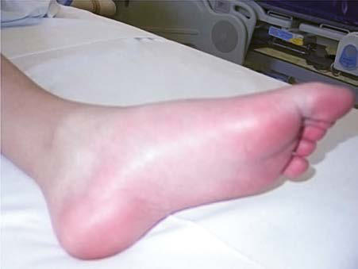

# Chapter 211: Musculoskeletal Pain Syndromes

*James J. Nocton*

<!-- p.2000 -->
Musculoskeletal pain is a frequent reason for children to visit a health care provider and is the most common problem referred to pediatric rheumatology clinics. Prevalence estimates of persistent musculoskel etal pain in community samples range from 10% to 40%. Although inflammatory diseases such as juvenile idiopathic arthritis (JIA) and systemic lupus erythematosus (SLE) are associated with musculoskel etal pain, noninflammatory conditions such as trauma, hypermobil ity, overuse, and **idiopathic pain syndromes** are much more common causes of musculoskeletal pain in children.

**CLINICAL MANIFESTATIONS** Acute and subacute musculoskeletal pain in children is most com monly the result of trauma, overuse, hypermobility, or some combi nation of these. The history and physical findings of trauma are most often readily apparent, and the pain associated with overuse or hyper mobility is most often described as related to activities and improving with rest. The physical examination of children with pain related to overuse, hypermobility, and other mechanical causes of pain does not reveal signs of inflammation such as warmth, swelling, or limited range of motion and most often reveals hypermobility with perhaps mild ten derness over tendons and their insertion points.

**Chronic idiopathic musculoskeletal pain syndromes** are defined by pain of at least 3 months duration in the absence of objective abnor malities on physical examination or laboratory screening (see Chapter 212). The prevalence of chronic idiopathic musculoskeletal pain syn dromes increases with age and is higher in females. These syndromes often persist despite treatment with nonsteroidal antiinflammatory drugs (NSAIDs) and other analgesics. Chronic pain may occur any where and is most often diffuse and poorly localized, but may some times involve only a single extremity or part of an extremity. Pain may start in one location before potentially developing in other areas over time.

Psychologic and emotional distress, including anxiety, depres sion, stress, or a combination of these, is quite common in those with chronic idiopathic musculoskeletal pain syndromes. Frequent cry ing, school and social stress, poor concentration, and excessive worry are often described. Sleep disturbance in children with chronic pain syndromes may include difficulty falling asleep, multiple night awak enings, disrupted sleep-wake cycles with increased daytime sleeping, nonrestorative sleep, and fatigue.

Children who are high achievers, excellent students, mature, and responsible, with high expectations of themselves have a predisposition to the development of pain syndromes in general, including chronic musculoskeletal pain. As a result, headaches and abdominal pain or other gastrointestinal symptoms are also frequently present in those with chronic idiopathic musculoskeletal pain syndromes.

The constellation of chronic pain, psychologic distress, and sleep dis turbance often leads to a high degree of functional impairment. Poor school attendance is common, and children may struggle to complete other daily activities relating to self-care and participation in household chores. Decreased physical fitness can also occur, along with changes in gait and posture, as children avoid the use of the area affected by pain. Peer relationships may also be disrupted by decreased opportunities for social interaction because of pain. Loneliness and social isolation characterized by few friends and lack of participation in extracurricu lar activities are common.

**DIAGNOSIS AND DIFFERENTIAL DIAGNOSIS** The diagnosis of a musculoskeletal pain syndrome is based primar ily on history and physical examination. Children with pain require a thorough clinical history, including a complete social history and review of systems, and a careful, comprehensive physical examination. The specific characteristics of the pain should be defined, evidence of potential systemic disease should be sought, and any additional associ ated symptoms and signs should be elicited.

The need for laboratory testing and imaging studies should be indi vidualized, depending on the information elicited in the history and discovered with the physical examination. Possible indicators of an inflammatory cause for musculoskeletal pain include objective joint warmth, swelling, limited range of joint motion on physical examina tion, localized bone tenderness, and muscle weakness; potential indica tors of a systemic disease include poor linear growth, weight loss, and constitutional symptoms. The lack of these symptoms and objective abnormalities on physical examination is more suggestive of a non inflammatory cause for pain (Table 211.1). The complete blood count (CBC) and erythrocyte sedimentation rate (ESR) are often abnormal in children whose pain is secondary to a bone or joint infection, rheu matic disease, or a malignancy. Bone tumors, fractures, and other focal pathology resulting from infection, malignancy, or trauma can often be identified through imaging studies, including plain radiographs or MRI.

The presence of chronic, persistent pain, accompanied by psycho logic distress, sleep disturbance, and/or functional impairment, in the absence of objective laboratory or physical examination abnormali ties, suggests the diagnosis of an **idiopathic musculoskeletal pain syndrome**. Table 211.2 outlines common causes of pediatric muscu loskeletal pain according to anatomic location, including **growing pains** (see Chapter 211.1), diffuse **amplified pain syndromes** and chronic widespread pain (see Chapter 211.3), **complex regional pain syndrome** (see Chapter 211.4), localized pain syndromes, low back pain, and chronic overuse-related pain (e.g., Osgood-Schlatter dis ease). A differential diagnosis of more serious conditions is noted in Table 211.3.

**TREATMENT** The primary goal of treatment for acute and subacute musculoskele tal pain related to trauma, hypermobility, overuse, or other mechan ical factors is to minimize the discomfort as much as possible and to promote normal activities. Rest, topical analgesics, mechanical joint support to be worn with activities, ice, oral analgesics, and physical therapy may all be used. Education of children and families regard ing pain related to these mechanical factors is critical in helping them to understand what to expect. Although it is common for the discomfort related to hypermobility and overuse to be recurrent, the prognosis for these mechanical pains is excellent, and most children learn to manage their discomfort with few, if any, restrictions on activities.

The primary goal of treatment of chronic idiopathic musculoskel etal pain syndromes is to improve function and relieve pain; these outcomes may not occur simultaneously or quickly. Pain may persist even as children resume normal function (e.g., increased school atten dance and participation in extracurricular activities). For all children and adolescents with pediatric musculoskeletal pain syndromes whose school attendance has been affected by their symptoms, regular school attendance is a primary initial goal. The dual nature of treatment, tar geting both *function* and *pain,* needs to be clearly explained. Children and families need to be supported in disengaging from the sole pursuit of pain relief and embracing the equally imperative goal of improved functioning.

Recommended treatment modalities include physical and/or occupa tional therapy, pharmacologic interventions, and cognitive-behavioral and/or other psychotherapeutic interventions. The overarching goal of **physical therapy** is to improve children’s physical function and should emphasize participation in aggressive but graduated aerobic exercise. **Pharmacologic** interventions should be used judiciously. Low-dose

*James J. Nocton*

<!-- p.2001 -->
tricyclic antidepressants (amitriptyline 0.1 mg/kg at bedtime; can increase to 0.5 to 2 mg/kg as tolerated) may improve sleep; selective serotonin reuptake inhibitors (sertraline 25-100 mg daily) may help to alleviate symptoms of depression and anxiety if present. **Cognitive- behavioral therapy (CBT)** and/or other psychotherapeutic interven tions are designed to teach children and adolescents coping skills for controlling the behavioral, cognitive, and physiologic responses to pain. Specific components often include cognitive restructuring, relax ation, distraction, and problem-solving skills. Parent education and involvement in the psychologic intervention are important to ensure maintenance of progress. More intensive family-based approaches are warranted if barriers to treatment success are identified at the family level. These could include parenting strategies or family dynamics that serve to maintain children’s pain complaints, such as overly solicitous responses to the child’s pain and maladaptive models for coping with pain.

**COMPLICATIONS AND PROGNOSIS** Musculoskeletal pain related to hypermobility and/or overuse may be recurrent and related to specific activities, but is typically mild, does not usually significantly limit activities, and is most often managed symptomatically. Conversely, chronic idiopathic musculoskeletal pain syndromes have a much greater potential to negatively affect develop ment and future role functioning. Worsening pain and the symptoms of depression and anxiety associated with chronic pain can lead to substantial school absences, peer isolation, and developmental delays later in adolescence and early adulthood. Specifically, adolescents with chronic idiopathic musculoskeletal pain syndromes may fail to achieve the level of autonomy and independence necessary for age-appropriate activities, such as attending college, living away from home, and main taining a job. Fortunately, not all children and adolescents with these syndromes experience this degree of impairment. Factors that contrib ute to the persistence of pain are increasingly understood and include female gender, pubertal stage at pain onset, older age of pain onset, increased psychologic distress associated with the pain, and greater functional impairment. The likelihood of positive health outcomes is increased with multidisciplinary treatment addressing the pain, the functional disabilities, and the psychologic comorbidities associated with pain.

*Visit Elsevier eBooks+ at eBooks.Health.Elsevier.com** for Bibliography.*

Children by Anatomic Region

#### **Table 211.2** Common Musculoskeletal Pain Syndromes in

| Category / Parameter | Clinical Details & Findings |
| --- | --- |
| **PAIN SYNDROMES** | Shoulder; Impingement syndrome; Elbow; “Little League elbow”; Avulsion fractures; Osteochondritis dissecans; Tennis elbow; Panner disease; Arm; Localized hypermobility syndrome; Complex regional pain syndrome; Pelvis and hip; Avulsion injuries; Legg-Calvé-Perthes syndrome; Slipped capital femoral epiphysis; Congenital hip dysplasia; Knee; Osteochondritis dissecans; Osgood-Schlatter disease; Sinding-Larsen syndrome; Patellofemoral syndrome; Malalignment syndromes; Leg; Growing pains; Complex regional pain syndrome; Localized hypermobility syndrome; Shin splints; Stress fractures; Compartment syndromes; Foot; Plantar fasciitis; Tarsal coalition; Stress fractures; Achilles tendonitis; Juvenile bunion; Spine; Musculoskeletal strain; Spondylolisthesis; Spondylolysis; Scoliosis; Scheuermann disease (kyphosis); Low back pain; Generalized; Hypermobility syndrome; Diffuse amplified pain syndrome; Chronic widespread pain; Adapted from Anthony KK, Schanberg LE. Assessment and management of pain syndromes and; arthritis pain in children and adolescents. Rheum Dis Clin North Am. 2007;33:625–660, Box 1. |

#### **Table 211.1** Potential Indicators of Inflammatory vs Noninflammatory Causes of Musculoskeletal Pain

| Category / Parameter | Clinical Details & Findings |
| --- | --- |
| **INFLAMMATORY** | Effects of rest vs activity on pain; Relieved by rest and worsened by activity; Present at rest and may be relieved by activity; Time of day pain and/or stiffness occurs; End of the day and nights; Morning*; Objective joint swelling; No; Yes; Joint characteristics; Hypermobile/normal; Stiffness, limited range of motion; Bone tenderness; No; Possible; Muscle strength; Normal; Possible weakness; Gait; Normal; Limp; Growth; Normal growth pattern or weight gain; Poor growth and/or weight loss; Constitutional symptoms; Fatigue without other constitutional symptoms; Possible; Laboratory findings; Normal CBC, ESR, CRP; Abnormal CBC, raised ESR and CRP; Imaging findings; Normal; Effusion, osteopenia, radiolucent metaphyseal; lines, joint space loss, bone destruction; *Cancer pain is often severe and worst at night.; CBC, Complete blood count; CRP, C-reactive protein level; ESR, erythrocyte sedimentation rate.; Data from Malleson PN, Beauchamp RD. Diagnosing musculoskeletal pain in children. CMAJ 2001;165:183–188. |

<!-- p.2002 -->

## 211.1  Growing Pains (Benign Limb Pain of Childhood) James J. Nocton

The cause of benign limb pain of childhood, historically referred to as **growing pains**, is unknown. Low pain threshold, overuse, and behavioral causes have been postulated, and it is possible that there are multiple causes for these pains. This pain affects 10–20% of children, with peak incidence between age 4 and 12 years. Benign limb pains of childhood are intermittent and usually bilateral, poorly localized, and predominantly affecting the anterior thigh, shin, and calf. Occasionally, bilateral upper extremity pain may be associated with leg pain. Chil dren typically describe cramping or aching that occurs most often in the late afternoon or evening. Pain may wake the child from sleep, may be severe, and may last a few minutes to hours, but typically resolves quickly with massage or analgesics; pain is nearly always resolved by the following morning (Table 211.4). Pain may often follow a day with increased or excessive physical activity. Physical examination is nor mal, and gait is not impaired.

**Treatment** should focus on reassurance, education, and healthy sleep hygiene while preparing parents and children for the possibility that the pain may occur intermittently for years, with eventual reso lution. Massage, acetaminophen, or NSAIDs during the episode are nearly always effective.

**Restless legs syndrome (RLS)**, seen more frequently among ado lescents and adults, is a sensorimotor disturbance that may be con fused with growing pains (see Chapter 31). Often familial, RLS is a difficult-to-control *urge* to move the leg that is exacerbated during rest and at night and is relieved by movement (see Table 211.4). There is significant overlap in the diagnostic features of growing pains and RLS. Moreover, these conditions can be comorbid, and there is a high incidence of RLS in the parents of children with growing pains. RLS appears to be best distinguished from growing pains by the *urge* to move the legs, associated uncomfortable leg sensations that may not be described as painful; worsening with periods of rest; and relief through movement. Iron supplementation may benefit pediatric patients with RLS.

*Visit Elsevier eBooks+ at eBooks.Health.Elsevier.com** for Bibliography.*

## 211.2  Small Fiber Polyneuropathy James J. Nocton

Some patients with juvenile-onset widespread pain syndromes have evidence of a small fiber polyneuropathy causing dysfunctional or degeneration of small-diameter unmyelinated C fibers and thinly myelinated A delta fibers that mediate nociception and the autonomic nervous system. In addition to pain, these children may have dizziness, postural orthostatic tachycardia syndrome (POTS), constipation and/ or gastrointestinal dysmotility, and other symptoms suggestive of dys autonomia (Fig. 211.1).

The diagnosis of small fiber polyneuropathy requires distal leg immunolabeled skin biopsy to identify epidermal nociceptive fibers and autonomic function testing to examine cardiovagal, adrenergic, and sudomotor small fiber function. Genetic testing for pathogenic variants in genes coding for sodium channels may reveal *SCN9A, SCN10A,* or *SCN11A* variants. Some small studies have reported the presence of autoantibodies to trisulfated disaccharide and fibroblast growth factor receptor 3, suggestive of immune-mediated pathogen esis. Other potential etiologies for small fiber neuropathy are noted in Table 211.5; most cases are idiopathic. In addition, other genetic pain ful neuropathies should be considered (Table 211.6).

**Optimal treatment** of patients with small fiber polyneuropathy is unknown. Corticosteroids and intravenous immune globulin have been effective in very small numbers of patients.

*Visit Elsevier eBooks+ at eBooks.Health.Elsevier.com** for Bibliography.*

## 211.3  Diffuse Amplified Pain Syndromes James J. Nocton

Diffuse amplified pain syndrome is more common in children than localized amplified pain. In addition to widespread pain, children fre quently have associated chronic fatigue, sleep disturbance, headaches, chronic abdominal pain and gastrointestinal symptoms, stress, anxi ety, and/or symptoms of depression (see also Chapter 212). The terms *diffuse amplified pain syndrome, chronic widespread pain syndrome, chronic myofascial pain syndrome,* and *juvenile primary fibromyalgia syndrome* are often used to describe the same constellation of symp toms. Some of these children have findings that fulfill the criteria that have been developed for adult patients with fibromyalgia by either the American College of Rheumatology (Table 211.7) or the Analge sic, Anesthetic, and Addiction Clinical Trial Translations Innovations Opportunities and Networks-American Pain Society (Table 211.8 and

Musculoskeletal Pain Syndrome

#### **Table 211.3** Differential Diagnosis of Idiopathic

| Category / Parameter | Clinical Details & Findings |
| --- | --- |
| **CHANNELOPATHIES** | Erythromelalgia: primary (associated with the SCN9A gene) or; secondary; Paroxysmal extreme pain disorder (SCN9A gene); Small fiber neuropathy (SCN9A, SCN1OA genes); Familial episodic pain syndrome (SCN11A, TRPA1 genes) |
| **CONNECTIVE TISSUE DISORDERS** | Ehlers-Danlos syndrome; Marfan syndrome |
| **IMMUNE/AUTOIMMUNE** | Systemic lupus erythematosus; Sarcoidosis; Juvenile idiopathic arthritis; Sjögren syndrome; Familial Mediterranean fever and other autoinflammatory recurrent; fever syndromes; Hereditary angioedema; Chronic nonbacterial osteomyelitis; Mononeuritis multiplex associated with vasculitis |
| **METABOLIC/NUTRITION** | Fabry disease; Gaucher disease; Porphyria; Mitochondrial neuropathies; Vitamin deficiency (thiamine, B12, C, D); X-linked adrenoleukodystrophy |
| **OTHER** | Guillain-Barré syndrome; Multiple sclerosis; Toxic: lead, arsenic, chemotherapy |
| **HIV** | Familial amyloid neuropathy; Complex regional pain syndrome types 1 and 2; Sickle cell anemia; Thalamic stroke; Primary, metastatic, or recurrent malignancy (acute lymphocytic; leukemia, neuroblastoma); Neurofibromatosis; Radiculopathy; Nerve entrapment syndromes; 1.	 Peroneal; 2.	 Suprascapular; 3.	 Anterior, posterior hip; 4.	 Anterior cutaneous nerve (abdominal); From Kliegman RM, Toth H, Bordini BJ, Basel D, eds. Nelson Pediatric Symptom-Based; Diagnosis, 2nd ed. Philadelphia: Elsevier; 2023: Table 33.2, p. 547. |

<!-- p.2003 -->

<!-- p.2004 -->

<!-- p.2005 -->

<!-- p.2006 -->

**Fig. 211.2** ). Separate criteria for the diagnosis of juvenile primary fibro myalgia syndrome in children have been proposed, but these have not been validated (Table 211.9). The evaluation of fibromyalgia tender points has not been useful or diagnostic.

Although the precise cause of diffuse amplified pain is unknown, there is an emerging understanding that the development and main tenance of chronic pain are related both to biologic and psychologic factors. Diffuse amplified pain likely has multifactorial causes and is hypothesized to be an abnormality of central pain processing associated

with disordered sleep physiology, enhanced pain perception, disor dered mood, and dysregulation of hypothalamic-pituitary-adrenal and other neuroendocrine axes, resulting in lower pain thresholds and increased pain sensitivity. Children and adolescents with diffuse amplified pain often find themselves in a vicious cycle of pain, where symptoms build on one another and contribute to the onset and main tenance of new symptoms.

Diffuse amplified pain has a chronic course that can detrimen tally affect child health and development. Adolescents who do not

Small fiber neuropathy

*Autonomic symptoms* Pain

*Small fiber sodium channel dysfunction*

• Cramps

• Muscle pain

• Cognitive dysfunction • Sleep disturbances

• Fatigue • Irritable bowel syndrome • Widespread pain

• Burning • Tingling • Stabbing • Numbness

• Gl symptoms • Heart rate dysregulation • Temperature sensitivities

*Small fiber mediated*

*widespread pain Small fiber mediated*

*painful neuropathy*

*Muscle cramps Fibromyalgia*

Small fiber mediated autonomic dysfunction

*Erythromelalgia*

*and paroxysmal extreme*

*pain syndrome*

#### **Table 211.4** Inclusion and Exclusion Criteria for Growing Pains Including Features of Restless Legs Syndromes (RLS)

| Category / Parameter | Clinical Details & Findings |
| --- | --- |
| **RLS FEATURES** | Nature of pain; Intermittent; some pain-free; days and nights, deep aching,; cramping; Persistent; increasing intensity, pain; during the day; Urge to move legs often accompanied; by unpleasant sensations in legs, but; may not be painful; Unilateral or bilateral; Bilateral; Unilateral; Location of pain; Anterior thigh, calf, posterior; knee—in muscles not the joints; Articular, back, or groin pain; Urge to move and discomfort; throughout leg; Onset of pain; Late afternoon or evening; Pain still present next morning; Worse later in day or night but also; present at periods of rest or inactivity; throughout the day; Physical findings; Normal; Swelling, erythema, tenderness; local; trauma or infection; reduced joint range; of motion; limping, fever, weight loss,; mass; Laboratory findings; Normal; Objective evidence of abnormalities;; increased erythrocyte sedimentation; rate or C-reactive protein; abnormal; complete blood count, radiography,; bone scan, or MRI; Adapted from Evans AM, Scutter SD. Prevalence of “growing pains” in young children. J Pediatr. 2004;145:255–258; and Walters AS, Gabelia D, Frauscher B. Restless legs syndrome; (Willis-Ekbom disease) and growing pains: are they the same thing? A side-by-side comparison of the diagnostic criteria for both and recommendations for future research. Sleep; Med. 2013;14:1247–1252. |

**Fig. 211.1** Small fiber neuropathy symptom clusters and neuropathy classifications. (From Levine TD. Small fiber neuropathy: disease classification beyond pain and burning. J Central Nervous Sys Dis. 2018;10:1–6, Fig. 1, p. 3).

<!-- p.2007 -->
receive treatment or who are inadequately treated may withdraw from school and the social milieu, complicating their transition to adulthood. **Treatment** of diffuse amplified pain is ideally multidis ciplinary. The major goals are to restore function and alleviate pain and to improve comorbid mood and sleep disorders. Treatment strat egies include parent/child education, pharmacologic interventions, exercise-based interventions, and psychologic interventions. Gradu ated **aerobic exercise** is the recommended exercise-based interven tion, whereas psychologic interventions should include training in pain coping skills, stress management skills, emotional support, and sleep hygiene. CBT is particularly effective in reducing symptoms of depression in children and adolescents with chronic pain and helps to reduce functional disability.

Drug therapies, although largely unsuccessful in isolation, may include tricyclic antidepressants (amitriptyline 0.1 mg/kg at bedtime; can increase to 0.5 to 2 mg/kg as tolerated), selective serotonin reup take inhibitors (sertraline 25-100 mg daily), and anticonvulsants. Pre gabalin and duloxetine hydrochloride are approved by the U.S. Food and Drug Administration (FDA) for treatment of fibromyalgia in adults (≥18 years of age); however, data regarding the efficacy of these medications in children are limited.

*Visit Elsevier eBooks+ at eBooks.Health.Elsevier.com** for Bibliography.*

## 211.4  Complex Regional Pain Syndrome James J. Nocton

Complex regional pain syndrome (CRPS) is characterized by chronic, persistent limb pain, often burning in character. **CRPS type 1**, also termed *reflex sympathetic dystrophy*, has no evidence of nerve injury, whereas the less common **CRPS type 2** is associated with a known mechanism of nerve injury. The pain of CRPS is typically extreme and disproportionate to the inciting event. Associated features include **allo dynia** (a heightened pain response to normally non-noxious stimuli), **hyperalgesia** (exaggerated pain reactivity to noxious stimuli), swell ing of the affected extremity, and indicators of **autonomic dysfunction** (cyanosis, mottling, hyperhidrosis).

There are no diagnostic criteria specifically for pediatric CRPS; in adults, several sets of criteria have been developed (Table 211.10); the clinical utility of these criteria is controversial. The diagnosis of CRPS is clinical and can be made when continuous pain is present that is dis proportionate to any potential inciting event with associated allodynia, or hyperalgesia, evidence of edema, skin blood flow abnormalities, or excessive sweating activity, and exclusion of other disorders. Other fea tures that may be present include atrophy of hair or nails, loss of joint mobility, weakness, tremor, and dystonia.

Although many pediatric patients with CRPS present with a history of minor trauma or repeated stress injury (e.g., caused by competitive sports), a significant proportion are unable to identify a precipitating event. Usual age of onset is between 8 and 16 years, and females out number males with the disease by as much as 6:1. Childhood CRPS differs from the adult form in that lower extremities, rather than upper extremities, are most often affected. The incidence of CRPS in children is unknown, largely because it is often undiagnosed or diag nosed late. Left untreated, CRPS can have severe consequences for children, including bone demineralization, muscle wasting, and joint contractures.

The **treatment** of CRPS, like that of more diffuse pain syndromes, is ideally multidisciplinary. Aggressive physical therapy (PT) should be initiated as soon as the diagnosis is made, and CBT added as needed. **PT** is recommended three to four times a week, and children may need analgesic premedication at the onset, particularly before PT sessions. PT is initially limited to desensitization and then moves to weight bear ing, range of motion, and other functional activities. CBT used as an adjunctive therapy targets psychosocial obstacles to fully participating in PT and provides pain-coping skills training. The goal of both phar macologic and adjunctive treatments for CRPS is to provide sufficient pain relief to allow the child to participate in aggressive physical reha bilitation. Multiple studies have shown that noninvasive treatments, particularly PT and CBT, are at least as efficacious as nerve blocks in helping children with CRPS achieve resolution of their symptoms.

*Visit Elsevier eBooks+ at eBooks.Health.Elsevier.com** for Bibliography.*

## 211.5  Erythromelalgia James J. Nocton

Children with erythromelalgia experience episodes of intense burning pain, erythema, edema, and heat, most often in the hands and feet (Fig. 211.3) and less frequently in other locations. Symptoms are most often triggered by exposure to heat or exercise and typically last for hours to days. Erythromelalgia is more common in females during adolescence, and the diagnosis is often delayed for many years. Although many cases are sporadic, an autosomal dominant hereditary form results most often from gain-of-function pathogenic variants of the *SCN9A* gene, which encodes the alpha subunit of the sodium channel NaV1.7 found in nociceptive neurons that transmit pain signals. Age of onset for the

#### **Table 211.5** Causes of Small Fiber Neuropathy

| Category / Parameter | Clinical Details & Findings |
| --- | --- |
| **IDIOPATHIC** | Idiopathic small fiber neuropathy; Burning mouth syndrome |
| **METABOLIC** | Impaired glucose tolerance; Diabetes mellitus; Rapid glycemic control; Vitamin B12 deficiency; Dyslipidemia; Hypothyroidism; Chronic kidney disease |
| **HEREDITARY/GENETIC** | Familial amyloid polyneuropathy; Fabry disease; Tangier disease; Sodium channelopathies (see; text) |
| **HIV** | Hepatitis C; Influenza |
| **TOXINS AND DRUGS** | Antiretrovirals; Antibiotics—metronidazole,; nitrofurantoin, linezolid; Chemotherapy—bortezomib; Flecainide; Statin; Alcohol; Vitamin B6 toxicity |
| **IMMUNE MEDIATED** | Celiac disease; Sarcoidosis; Sjögren syndrome; Rheumatoid arthritis; Systemic lupus erythematosus; Vasculitis; Inflammatory bowel disease; Paraneoplastic; Monoclonal gammopathy/; amyloid; Note that a number of these conditions may present as a small fiber neuropathy and; then evolve to include large fibers.; Modified from Themistocleous AC, Ramirez JD, Serra J, Bennett DLH. The clinical approach; to small fibre neuropathy and painful channelopathy. Pract Neurol. 2014;14:368–379, Table 1. |

<!-- p.2008 -->

<!-- p.2009 -->

<!-- p.2010 -->
familial form ranges from 1 to 16 years. **Secondary** erythromelalgia is associated with many disorders, including myeloproliferative dis eases, peripheral neuropathies, frostbite, and rheumatic diseases. The differential diagnosis includes Fabry disease, Raynaud phenomenon or disease, reflex sympathetic dystrophy, and peripheral neuropathies. In contrast to Raynaud phenomenon, the pain in erythromelalgia is relieved by cooling the affected area. Treatment includes avoidance of heat exposure and other precipitating situations and the use of cool ing techniques that do not cause tissue damage during attacks. There is no proven reliably efficacious treatment, and NSAIDs, narcotics, anesthetic agents (lidocaine patch), anticonvulsants (oxcarbazepine, carbamazepine, gabapentin), antidepressants, sodium nitroprusside, magnesium, mexiletine, and misoprostol, as well as biofeedback, medi cal and surgical nerve blocks, and hypnosis have had variable efficacy.

*Visit Elsevier eBooks+ at eBooks.Health.Elsevier.com** for Bibliography.*

Altered Pain Perception and Are Inherited in a Mendelian Manner

#### **Table 211.6** Clinical Features of Human Disorders Caused by Pathogenic Gene Variants in Ion-Channel Genes that Lead to

| Category / Parameter | Clinical Details & Findings |
| --- | --- |
| **ADDITIONAL FEATURES** | Inherited; erythromelalgia; SCN9A (Nav1.7); Heterozygous,; activating; Onset by age 20 yr; episodic pain triggered; by warmth; feet affected more frequently; than hands; Erythema of feet; Paroxysmal extreme; pain disorder; SCN9A (Nav1.7); Heterozygous,; activating; Onset at birth; episodic pain; sacral region; is affected most frequently; face is affected; more often than the limbs; physical triggers; include defecation; Erythema of the sacrum;; tonic attacks; Small-fiber; neuropathy; SCN9A (Nav1.7); Heterozygous,; activating; Onset at any age but more common in early; adulthood; persistent burning pain; feet; affected more frequently than hands; Could be autonomic; features; Small-fiber; neuropathy; SCN10A (Nav1.8); Heterozygous,; activating; Persistent burning pain; Could be autonomic; features; Familial episodic; pain syndrome; type I |
| **TRPA1 (TRPA1)** | Heterozygous,; activating; Onset at birth or in infancy; episodic chest or; arm pain; triggers are hunger and cold; Familial episodic; pain syndrome; type III; SCN11A (Nav1.9); Heterozygous,; activating; Onset in first decade; episodic hand and; foot pain; triggers are intercurrent illness or; exercise; Nav, Sodium ion channel.; Modified from Bennett DLH, Woods CG. Painful and painless channelopathies. Lancet Neurol. 2014;13:587–599, Table 1. |

Diagnostic Criteria (2016 Revision)

#### **Table 211.7** American College of Rheumatology Fibromyalgia

| Category / Parameter | Clinical Details & Findings |
| --- | --- |
| **General** | The following three conditions must be met:; 1.	 Widespread Pain Index (WPI) ≥7 and Symptom Severity Scale; (SSS) score ≥5 or WPI 4-6 and SSS score ≥9.; 2.	 Generalized pain, defined as pain in at least four of five regions,; must be present. Jaw, chest, and abdominal pain are not included; in generalized pain definition.; 3.	 Symptoms have been generally present for at least 3 mo. |
| **ASCERTAINMENT OF WPI** | The WPI is the number of areas in which a patient has had pain over; the last week. The score will be between 0 and 19: Left Upper; Region: left jaw, left shoulder girdle, left upper arm, left lower; arm; Right Upper Region: right jaw, right shoulder girdle, right; upper arm, right lower arm; Left Lower Region: left hip (buttock,; trochanter), left upper leg, left lower leg; Right Lower Region: right; hip (buttock, trochanter), right upper leg, right lower leg; Axial; Region: chest, abdomen, upper back, lower back, and neck. |
| **ASCERTAINMENT OF SSS SCORE** | The SSS score is the sum of the severity of three symptoms (fatigue,; waking unrefreshed, and cognitive symptoms) over the past week; (each given a score from 0 to 3) plus the sum of the number of; the following symptoms the patient has been bothered by that; occurred during the previous 6 mo: headaches, pain or cramps in; the lower abdomen, and depression (each given a score from 0 to; 1). The final score will be between 0 and 12. For fatigue, waking; unrefreshed, and cognitive symptoms, the level of severity over the; past week is rated using the following scale:; 0 = No problem; 1 = Slight or mild problems, generally mild or intermittent; 2 = Moderate, considerable problems, often present and/or at a; moderate level; 3 = Severe: pervasive, continuous, life-disturbing problems; • For headaches, pain or cramps in the lower abdomen, and depression,; the severity for each is scored as 0 or 1.; Adapted from Wolfe F, Clauw DJ, Fitzcharles MA, et al. 2016 Revisions to the 2010/2011; fibromyalgia diagnostic criteria. Semin Arthritis Rheum. 2016;46(3):319–329. |

Trial Translations Innovations Opportunities and Networks-American Pain Society Pain Taxonomy (AAPT) Fibromyalgia Diagnostic Criteria

#### **Table 211.8** Analgesic, Anesthetic, and Addiction Clinical

| Category / Parameter | Clinical Details & Findings |
| --- | --- |
| **General** | Core diagnostic criteria:; 1.	 Musculoskeletal pain defined as 6 or more pain sites from a total; of 19 possible sites (see Fig. 211.2); 2.	 Moderate to severe sleep problems OR fatigue; 3.	 Musculoskeletal pain plus fatigue or sleep problems must have; been present for at least 3 mo; NOTE: The presence of another pain disorder or related symptoms does not rule; out a diagnosis of fibromyalgia. However, a clinical assessment is recommended; to evaluate for any condition that could fully account for the patient’s symptoms or; contribute to the severity of the symptoms.; Adapted from Arnold LM, Bennett RM, Crofford LJ, et al. AAPT Diagnostic Criteria for; Fibromyalgia. J Pain. 2019;20:611–628. |

<!-- p.2011 -->

<!-- p.2012 -->

**Fig. 211.2** Widespread pain index. (Modified from Fraix M. Fibro myalgia. In Tallia AF, Scherger JE, Dickey NW (eds). Swanson’s Family Medicine Review, 9th ed. Philadelphia: Elsevier, 2022. Fig 47.1.)

**Widespread Pain Index (1 point per circle; score range: 0–19 points)**

Please indicate if you have had pain or tenderness **during the past 7 days** in the areas shown below. Fill in the circles on the diagram for each area in which you have had pain or tenderness.

Right jaw Left jaw Neck

Chest or breast

Abdomen

Upper back

Lower back

Right shoulder

Left shoulder

Right upper arm

Right lower arm Left lower arm

Right upper leg Left upper leg

Right hip or buttocks Left hip or buttocks

Right lower leg Left lower leg

Right jaw Left jaw Neck

Chest or breast

Abdomen

Upper back

Lower back

Right shoulder

Left upper arm

Left shoulder Right upper arm

Right lower arm Left lower arm

Right upper leg Left upper leg

Right hip or buttocks Left hip or buttocks

Right lower leg Left lower leg

Primary Fibromyalgia Syndrome (JPFS)

≥3 mo

#### **Table 211.9** Suggested Diagnostic Criteria for Juvenile

| Category / Parameter | Clinical Details & Findings |
| --- | --- |
| **MAJOR CRITERIA** | 1.	 Generalized musculoskeletal aching at three or more sites for; 2.	 Absence of an underlying condition/cause; 3.	 Normal laboratory tests; 4.	 Five or more typical tender points* |
| **MINOR CRITERIA** | 1.	 Chronic anxiety or tension; 2.	 Fatigue; 3.	 Poor sleep; 4.	 Chronic headaches; 5.	 Irritable bowel syndrome; 6.	 Subjective soft tissue swelling; 7.	 Numbness; 8.	 Pain modulated by physical activities; 9.	 Pain modulated by changes in weather; 10.	 Pain modulated by anxiety/stress; *Thirty-one potential tender points were listed for these criteria when proposed in 1985.; JPFS is diagnosed when all major criteria are met, plus three of the minor criteria or; when there are four tender points and five minor criteria.; Adapted from Coles M, Weissmann R, Uziel Y. Juvenile primary fibromyalgia syndrome:; Epidemiology, etiology, pathogenesis, clinical manifestations and diagnosis. Pediatr; Rheumatol Online J. 2021;19(1):22. |

Complex Regional Pain Syndrome

#### **Table 211.10** Budapest Clinical Diagnostic Criteria for

| Category / Parameter | Clinical Details & Findings |
| --- | --- |
| **General** | All of the following criteria must be met:; 1.	 Continuing pain, which is disproportionate to any inciting event; 2.	 Must report at least one symptom in each of the following four; categories:; • Sensory: Hyperesthesia and/or allodynia; • Vasomotor: Temperature asymmetry, skin color changes, and/or; skin color asymmetry; • Sudomotor/edema: Edema, sweating changes, and/or; sweating asymmetry; • Motor/trophic: Decreased range of motion, motor dysfunction; (tremor, weakness, dystonia) and/or trophic changes (hair, nail,; skin); 3.	 Must display at least one sign at time of evaluation in two or more; of the following four categories:; • Sensory: Evidence of hyperesthesia (to pin prick) and/or; allodynia (to light touch, temperature sensation, deep somatic; pressure, and/or joint movement); • Vasomotor: Evidence of temperature asymmetry (>1°C), skin; color changes, and/or skin color asymmetry; • Sudomotor/edema: Edema, sweating changes, and/or; sweating asymmetry; • Motor/trophic: Decreased range of motion, motor dysfunction; (tremor, weakness, dystonia) and/or trophic changes (hair, nail,; skin); 4.	 There is no other diagnosis that better explains the signs and; symptoms.; Adapted from Harden RN, Bruel S, Stanton-Hicks, et al. Proposed new diagnostic; criteria for complex regional pain syndrome. Pain Med. 2007;8:326–331. |

**Fig. 211.3** Characteristic redness and edema of the foot associated with erythromelalgia. (From Pfund Z, Stankovics J, Decsi T, Illes Z. Child hood steroid-responsive acute erythromelalgia with axonal neuropathy of large myelinated fibers: a dysimmune neuropathy? Neuromuscul Disord. 2009;19:49–52, Fig. 1A, p. 50.)
