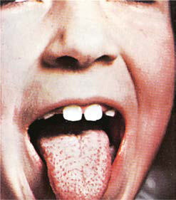

# Chapter 229: Group A Streptococcus

*Stanford T. Shulman and Ami B. Patel*

<!-- p.2171 -->
Group A *Streptococcus *(GAS)**, also known as *Streptococcus pyogenes,* is a common cause of infections of the upper respiratory tract **(pharyn gitis)** and the skin **(impetigo, pyoderma)** in children. Less frequently, GAS causes perianal cellulitis, vaginitis, septicemia, pneumonia, empy ema, endocarditis, pericarditis, osteomyelitis, suppurative arthritis, myositis, cellulitis, omphalitis, and other infections. This organism also causes distinct clinical entities **(scarlet fever** and **erysipelas)**, as well as streptococcal **toxic shock syndrome** and monomicrobial **necrotizing fasciitis**. GAS is also the cause of at least two potentially serious non suppurative complications: **rheumatic fever** (see Chapters 229.1 and 487) and **acute glomerulonephritis** (see Chapter 559.4).

**ETIOLOGY** Group A streptococci are gram-positive, coccoid-shaped bacteria that tend to grow in chains. Streptococci are broadly classified by their hemolytic activity on mammalian (typically sheep) red blood cells. The zone of complete hemolysis that surrounds colonies grown on blood agar distinguishes β-hemolytic (complete hemolysis) from α-hemolytic (green or partial hemolysis) and γ (nonhemolytic) spe cies. The β-hemolytic streptococci can be divided into groups by a group-specific polysaccharide **(Lancefield C carbohydrate)** located in the bacterial cell wall. More than 20 serologic groups are identified, designated by the letters A through V, although only A through D are medically important. Serologic grouping by the Lancefield method is precise, but group A organisms can be identified more readily by any of a number of latex agglutination, coagglutination, molecular assays or enzyme immunoassays. Group A strains can also be distinguished from other groups by differences in sensitivity to bacitracin, as other groups are generally resistant to this antibiotic.

GAS can be subdivided into at least 220 serotypes on the basis of the **M protein** antigen, which is located on the cell surface and in fimbriae that project from the outer surface of the cell. Currently, a molecular approach to M-typing GAS isolates using the polymerase chain reac tion (PCR) is based on sequencing the terminal portion of the *emm* gene of GAS that encodes the M protein. This *emm* typing system cor relates with known serotypes and *emm* types. The *emm* types can be grouped into *emm* clusters that share structural and binding proper ties. It is important to note that immunity is largely based on typespecific opsonic anti-M antibody.

M/*emm* typing is valuable for epidemiologic studies; specific GAS diseases tend to be associated with certain M types. Types 1, 12, 28, 4, 3, and 2 (in that order) are the most common causes of uncomplicated streptococcal pharyngitis in the United States. M types usually asso ciated with pharyngitis rarely cause skin infections, and the M types associated with skin infections rarely cause pharyngitis. A few **pharyn geal** GAS strains (e.g., M type 12) are associated with glomerulone phritis, but many more **skin** GAS strains (e.g., M types 49, 55, 57, and 60) are considered nephritogenic. Several pharyngeal serotypes (e.g., M types 1, 3, 5, 6, 18, and 29), but no proven skin strains, are associated with **acute rheumatic fever** in North America.

**EPIDEMIOLOGY** Humans are the natural reservoir for GAS. These bacteria are highly communicable and can cause disease in normal individuals of all ages who do not have type-specific immunity against the particular serotype involved. Disease in neonates is uncommon in developed countries, probably because of maternally acquired antibody. The incidence of **pharyngitis** is highest in children 5-15 years of age, especially in young school-age children. Acute streptococcal phar yngitis is uncommon in children younger than 3 years, and testing

is generally not recommended. These infections are most common in the northern regions of the United States, especially during win ter and early spring. Children with untreated acute pharyngitis spread GAS by salivary droplets and nasal discharge. Transmission is favored by close proximity; therefore schools, military barracks, and homes are important environments for spread. GAS has the potential to be an important upper respiratory tract pathogen and to produce outbreaks of disease in the daycare setting. Foods contaminated by GAS occasionally cause explosive outbreaks of pharyngotonsillitis. The incubation period for pharyngitis is usually 2-5 days. Children are usually no longer infectious within 24 hours of starting appro priate antibiotic therapy. Chronic pharyngeal carriers of GAS rarely transmit this organism to others.

**Streptococcal pyoderma (impetigo, pyoderma)** occurs most fre quently during the summer in temperate climates, or year-round in warmer climates, when the skin is exposed and abrasions and insect bites are more likely to occur (see Chapter 727). Colonization of healthy skin by GAS usually precedes the development of impetigo. Because GAS cannot penetrate intact skin, impetigo and other skin infections usually occur at the site of open lesions (insect bites, trau matic wounds, burns). Although impetigo serotypes may colonize the throat, spread is usually from skin to skin, not via the respiratory tract. Fingernails and the perianal region can harbor GAS and play a role in disseminating impetigo. Multiple cases of impetigo in the same family are common. Both impetigo and pharyngitis are more likely to occur among children living in crowded homes and in poor hygienic circumstances.

The incidence of **severe invasive** GAS infections, including bac teremia, pneumonia and empyema, osteomyelitis, septic arthritis, retropharyngeal abscess, lymphadenitis, streptococcal **toxic shock syndrome**, **scarlet fever**, and **necrotizing fasciitis**, has increased in recent decades. The incidence appears to be highest in very young and elderly persons. Before the routine use of varicella vaccine, varicella was the most commonly identified risk factor for invasive GAS infection in children. Other risk factors include diabetes mel litus, HIV infection, intravenous drug use, and chronic pulmonary or chronic cardiac disease. The portal of entry is unknown in almost 50% of cases of severe invasive GAS infection; in most cases, it is believed to be skin or, less often, mucous membranes. Severe invasive disease rarely follows clinically apparent GAS pharyngitis. Invasive GAS disease was reported in many children’s hospitals in multiple countries during the COVID-19 pandemic. It is unclear why this has happened, but masking, social distancing, and school closures may have reduced exposure to common viral pathogens or colonization with GAS, resulting in more severe infection when mask and social distancing have stopped and schools have reopened. Co-infection with respiratory viruses (respiratory syncytial virus [RSV], other) may predispose to more severe infection.

**PATHOGENESIS** The virulence of GAS depends primarily on the **M protein**, and strains rich in M protein resist phagocytosis in fresh human blood, whereas M-negative strains do not. M protein stimulates the production of pro tective opsonophagocytic antibodies that are type specific, protecting against infection with a homologous M type but much less so against other M types. Therefore multiple GAS infections attributable to vari ous M types are common during childhood and adolescence. By adult life, individuals are probably immune to many of the common M types in the environment.

GAS produces a large variety of extracellular enzymes and toxins, including erythrogenic toxins, known as **streptococcal pyrogenic exo toxins**. Streptococcal pyrogenic exotoxins A, C, and SSA, alone or in combination, are responsible for the **rash of scarlet fever** and are elab orated by streptococci that contain a particular bacteriophage. These exotoxins stimulate the formation of specific antitoxin antibodies that provide immunity against the scarlatiniform rash but not against other streptococcal infections. Pathogenic variants in genes that are promot ers of several virulence genes, including pyrogenic exotoxins, as well as several newly discovered exotoxins, appear to be involved in the

*Stanford T. Shulman and Ami B. Patel*

<!-- p.2172 -->
pathogenesis of invasive GAS disease, including streptococcal toxic shock syndrome.

The importance of other streptococcal toxins and enzymes in human disease is not yet established. Many of these extracellular substances are antigenic and stimulate antibody production after an infection. However, these antibodies do not confer immunity. The measurement of select toxins and antibodies is useful for establishing evidence of a recent streptococcal infection to aid in the diagnosis of postinfectious illnesses. Tests for antibodies against streptolysin O (anti–streptolysin O) and DNase B (anti–DNase B) are the most frequently used antibody determinations.

**CLINICAL MANIFESTATIONS** The most common infections caused by GAS involve the respiratory tract and the skin and soft tissues.

**Respiratory Tract Infections** GAS is an important cause of acute **pharyngitis** (see Chapter 430) and pneumonia, often with empyema (see Chapter 449).

**Scarlet Fever Scarlet fever** is GAS pharyngitis associated with a characteristic rash, which is caused by an infection with **pyrogenic exotoxin** (erythrogenic toxin)–producing GAS in individuals who do not have antitoxin anti bodies. It is now encountered less often and is less virulent than in the past, but the incidence is cyclic, depending on the prevalence of toxinproducing strains and the immune status of the population. The modes of transmission, age distribution, and other epidemiologic features are otherwise similar to those for GAS pharyngitis.

The scarlet fever rash appears within 24-48 hours after the onset of symptoms, although it may appear with the first signs of illness (Fig. 229.1A). It often begins around the neck and spreads over the trunk and extremities. The rash is a diffuse, finely papular, erythem atous eruption producing bright-red discoloration of the skin, which blanches on pressure. It is often accentuated in the creases of the elbows, axillae, and groin (Pastia lines). The skin has a goose-pimple appearance and feels rough. The cheeks are often erythematous with perioral pallor. After 3-4 days, the rash begins to fade and is fol lowed by **desquamation**, initially on the face, progressing caudally, and often resembling a mild sunburn. Occasionally, sheetlike des quamation may occur around the free margins of the fingernails, the palms, and the soles. Examination of the pharynx of a patient with scarlet fever reveals essentially the same findings as with GAS pharyngitis. In addition, the tongue is usually coated and the papil lae are swollen (see Fig. 229.1B). After desquamation, the reddened papillae are prominent, giving the tongue a strawberry appearance (see Fig. 229.1C).

Typical scarlet fever is not difficult to diagnose; the milder form with equivocal pharyngeal findings can be confused with viral exanthems, Kawasaki disease, and drug eruptions. Staphylococcal infections are occasionally associated with a scarlatiniform rash. A history of recent exposure to a GAS infection is helpful. Identification of GAS in the pharynx confirms the diagnosis.

**Impetigo** Impetigo (or pyoderma) has traditionally been classified into two clinical forms: bullous and nonbullous (see Chapter 706.1). **Nonbul lous impetigo** is the more common form and is a superficial infection of the skin that appears first as a discrete papulovesicular lesion sur rounded by a localized area of redness. The vesicles rapidly become purulent and covered with a thick, confluent, amber-colored crust that gives the appearance of having been stuck onto the skin. The lesions may occur anywhere but are most common on the face and extremi ties. If untreated, nonbullous impetigo is a mild but chronic illness, often spreading to other parts of the body, but occasionally self-limited. Regional **lymphadenitis** is common. Nonbullous impetigo is gener ally not accompanied by fever or other systemic signs or symptoms. Impetiginized excoriations around the nares are seen with active GAS

infections of the nasopharynx, particularly in young children. How ever, impetigo is rarely associated with overt streptococcal infection of the upper respiratory tract.

**Bullous impetigo** is less common and occurs most often in neo nates and young infants. It is characterized by flaccid, transpar ent bullae usually <3 cm in diameter on previously untraumatized skin. The usual distribution involves the face, buttocks, trunk, and perineum.

Although *Staphylococcus aureus* has traditionally been accepted as the sole pathogen responsible for bullous impetigo, there has been confusion about the organisms responsible for nonbullous impetigo. In most episodes of nonbullous impetigo, either GAS or *S. aureus* (or both) is isolated. Earlier investigations suggested that GAS was the causative agent in most cases of nonbullous impetigo and that *S. aureus* was only a secondary invader. However, *S. aureus* has emerged as the causative agent in most cases of nonbullous impetigo. Culture of the lesions is the only way to distinguish nonbullous impetigo caused by *S. aureus* from that caused by GAS.

**Erysipelas** Erysipelas is a relatively rare acute GAS infection involving the deeper layers of the skin and the underlying connective tissue. The skin in the affected area is edematous, highly erythematous, and very tender. The erythema associated with erysipelas is very bright, which differentiates it from the dusky appearance of necrotizing fasciitis. Superficial blebs may be present. The most characteristic finding is a sharply defined, slightly elevated border. At times, reddish streaks of lymphangitis project out from the margins of the lesion. The onset is abrupt, and signs and symptoms of a systemic infection, such as high fever and sepsis, are often present. Cultures obtained by needle aspirate of the advancing margin of the inflamed area often reveal the causative agent.

**Perianal Dermatitis** Perianal dermatitis, also called *perianal cellulitis* or **perianal strep tococcal disease**, is a distinct clinical entity characterized by welldemarcated, perianal erythema associated with anal pruritus, painful defecation, and occasionally blood-streaked stools. Most children are 2-7 years old (range: 18 days-12 years). Physical examination reveals flat, pink to beefy-red perianal erythema with sharp margins extending

A

B

C

**Fig. 229.1** Scarlet fever. A, Punctate, erythematous rash (second day). B, White strawberry tongue (first day). C, Red strawberry tongue (third day). (Courtesy Dr. Franklin H. Top, Professor and Head of the Department of Hygiene and Preventive Medicine, State University of Iowa, College of Medicine, Iowa City, IA; and Parke, Davis & Company’s Therapeutic Notes. From Gershon AA, Hotez PJ, Katz SL. Krugman’s Infectious Diseases of Children, 11th ed. Philadelphia: Mosby; 2004, Plate 53.)

<!-- p.2173 -->
as far as 2 cm from the anus. Erythema may involve the vulva and vagina. Lesions may be very tender and, particularly when chronic, may fissure and bleed. Systemic symptoms and fever are unusual. Cul ture or a rapid streptococcal test of a perianal swab will yield GAS or detect antigen.

**Vaginitis** GAS is a common cause of vaginitis in prepubertal girls (see Chapter 586). Patients usually have a serous discharge with marked erythema and irritation of the vulvar area, accompanied by discomfort in walk ing and in urination.

**Severe Invasive Disease** Invasive GAS infection is defined by isolation of GAS from a normally sterile body site and includes three overlapping clinical syndromes. **GAS toxic shock syndrome (TSS)** is differentiated from other types of invasive GAS infections by the presence of shock and multiorgan system dysfunction early in the course of the infection (Table 229.1). The second syndrome is **GAS necrotizing fasciitis**, characterized by extensive local necrosis of subcutaneous soft tissues and skin. The third syndrome is the group of **focal and systemic infections** that do not meet the criteria for TSS or necrotizing fasciitis and includes bacte remia with sepsis with no identified focus, meningitis, pneumonia and empyema, peritonitis, puerperal sepsis, osteomyelitis, suppurative arthritis, myositis, and surgical wound and other infections. GAS TSS, necrotizing fasciitis, and focal and systemic infections can be present in any combination.

The pathogenic mechanisms responsible for severe, invasive GAS infections, including streptococcal TSS and necrotizing fasciitis, have yet to be defined completely, but an association with **streptococcal pyrogenic exotoxins** is strongly suspected. At least two of the three original streptococcal pyrogenic exotoxins (A and C) and potentially other as yet unidentified toxins produced by GAS act as **superantigens**, which stimulate intense activation and proliferation of T lymphocytes and macrophages, resulting in the production of large quantities of proinflammatory cytokines. These cytokines are capable of inducing shock and tissue injury and appear to mediate many of the clinical manifestations of severe, invasive GAS infections.

**DIAGNOSIS OF GAS PHARYNGITIS** When deciding whether to perform a diagnostic test on a patient presenting with acute pharyngitis, the clinical and epidemiologic findings should be considered. A history of close contact with a welldocumented case of GAS pharyngitis is helpful, as is an awareness of a high prevalence of GAS infections in the community. The signs and symptoms of streptococcal and nonstreptococcal pharyngitis over lap too broadly to allow the requisite diagnostic precision on clinical grounds alone. The clinical diagnosis of GAS pharyngitis cannot be made with reasonable accuracy even by the most experienced physi cians, and laboratory confirmation is required, except for patients with

overt viral signs and symptoms (e.g., rhinorrhea, cough, mouth ulcers, hoarseness), who generally do not need a GAS diagnostic test per formed, as GAS is highly unlikely.

Culture of a throat swab on a sheep blood agar plate is effective for documenting the presence of GAS and for confirming the clinical diag nosis of acute GAS pharyngitis. When performed correctly, a single throat swab has a sensitivity of 90–95% for detecting the presence of GAS in the pharynx.

The significant disadvantage of culturing a throat swab on a blood agar plate is the delay (overnight or longer) in obtaining the culture result. **Streptococcal rapid antigen detection** tests are available for the identification of GAS directly from throat swabs. Their advantage over culture is the speed in providing results, often <10-15 minutes. Rapid identification and treatment of patients with streptococcal pharyngitis can reduce the risk for spread of GAS, allowing the patient to return to school or work sooner, and can reduce the acute morbidity of this illness.

Almost all currently available rapid antigen detection tests have excellent specificity of >95% compared with blood agar plate cultures. False-positive test results are quite unusual, and therefore therapeutic decisions can be made with confidence on the basis of a positive test result. Unfortunately, the sensitivity of most of these tests is 70–90% when compared with blood agar plate culture. Therefore a negative rapid test does not completely exclude the presence of GAS, and a confirmatory throat culture should be performed in children and adolescents, but not necessarily in adults, who are at exceptionally low risk for developing acute rheumatic fever. Definitive studies are not available to determine whether some rapid antigen detection tests are significantly more sensitive than others or whether any of these tests is sensitive enough to be used routinely in children and ado lescents without throat culture confirmation of negative test results. Some experts believe that physicians who use a rapid antigen detec tion test without culture backup should compare the results with that specific test to those of throat cultures to confirm adequate sensitivity in their practice.

In point-of-care settings and laboratories testing for GAS phar yngitis, culture methods are being replaced by rapid antigen and molecular assays. These molecular assays include PCR methods and **nucleic acid amplification tests** using isothermal loop amplification. Some of these methods have been reported to have a sensitivity of up to 100% and specificity of >96% compared to culture or PCR. This very high sensitivity may lead to higher numbers of positive results, which in turn may contribute to identification of more patients with asymptomatic GAS colonization and unnecessary antibiotic therapy. Therefore it is important that the appropriate clinical context to per form these highly sensitive tests be considered. However, the benefit of faster results, sometimes <10 minutes, which ensures more expe dited initiation of appropriate antibiotic therapy for patients with GAS pharyngitis, may be of value.

GAS infection can also be diagnosed retrospectively on the basis of an elevated or increasing streptococcal antibody titer. The **anti–strep tolysin O** assay is the streptococcal antibody test most often used. The test is not specific for group A infection because streptolysin O also is produced by groups C and G streptococci. The anti–streptolysin O response can be feeble after streptococcal skin infection. In contrast, the anti–DNase B responses are generally present after either skin or throat infections. A significant antibody increase is usually defined as an increase in titer of two or more dilution increments (≥ fourfold rise) between the acute-phase and convalescent-phase specimens, regard less of the actual height of the antibody titer. Physicians frequently misinterpret streptococcal antibody titers because of a failure to appre ciate that the normal levels of these antibodies are substantially higher among school-age children than adults. Both the traditional anti– streptolysin O and the anti–DNase B tests are neutralization assays. Newer tests use **latex agglutination** or nephelometric assays. Unfortu nately, these newer tests often have not been well standardized against the traditional neutralization assays. Physicians should be aware of these potential problems when interpreting the results of streptococcal serologic testing.

Syndrome

#### **Table 229.1** Definition of Streptococcal Toxic Shock

| Category / Parameter | Clinical Details & Findings |
| --- | --- |
| **CLINICAL CRITERIA** | Hypotension plus two or more of the following:; Renal impairment; Coagulopathy; Hepatic involvement; Adult respiratory distress syndrome; Generalized erythematous macular rash; Soft tissue necrosis |
| **DEFINITE CASE** | Clinical criteria plus group A Streptococcus from a normally sterile; site |
| **PROBABLE CASE** | Clinical criteria plus group A Streptococcus from a nonsterile site |

<!-- p.2174 -->
**Differential Diagnosis** Viruses are the most common cause of acute pharyngitis in children. Respiratory viruses such as influenza virus, parainfluenza virus, rhino virus, coronavirus, adenovirus, and RSV are frequent causes of acute pharyngitis. Other viral causes of acute pharyngitis include enterovi ruses and herpes simplex virus. Epstein-Barr virus is a frequent cause of acute pharyngitis that is often accompanied by other clinical find ings of infectious mononucleosis (e.g., splenomegaly, generalized lymphadenopathy). Systemic infections with other viral agents, includ ing cytomegalovirus, rubella virus, measles virus, and HIV, may be associated with acute pharyngitis.

GAS is by far the most common cause of *bacterial* pharyngitis, accounting for 15–30% of cases of acute pharyngitis in children and a lower proportion in adults. Groups C and G β-hemolytic streptococ cus also cause acute pharyngitis, typically in teens and young adults (see Chapter 231). *Arcanobacterium haemolyticum* and *Fusobacte rium necrophorum* are additional, less common causes. *Neisseria gon orrhoeae* can occasionally cause acute pharyngitis in sexually active adolescents and adults. Other bacteria, such as *Francisella tularensis* and *Yersinia enterocolitica,* as well as mixed infections with anaer obic bacteria (Vincent angina), are very rare causes of acute phar yngitis. *Chlamydia pneumoniae* and *Mycoplasma pneumoniae* have been implicated as causes of acute pharyngitis, particularly in adults. *Corynebacterium diphtheriae* is a serious cause of pharyngitis but is very rare in areas with universal immunization (see Chapter 233). Although other bacteria (e.g., *S. aureus, Haemophilus influenzae, Streptococcus pneumoniae*) are frequently cultured from the throats of children with acute pharyngitis, their etiologic role in pharyngitis has not been established, because they are often isolated from healthy children.

*GAS pharyngitis is the only common cause of acute pharyngitis for which antibiotic therapy is definitely indicated*. Therefore when con fronted with a patient with acute pharyngitis, the clinical decision that usually needs to be made is whether or not the pharyngitis is attribut able to GAS.

**TREATMENT OF GAS PHARYNGITIS** Timely antibiotic therapy for patients with GAS pharyngitis can prevent **acute rheumatic fever** (RF), shorten the clinical course of the illness, reduce transmission of the infection to others, and prevent suppurative complications. *For the patient with classic scarlet fever, antibiotic ther apy should be started immediately, but for the majority of patients, who present with much less distinctive findings, treatment should be withheld until there is laboratory confirmation by throat culture, molecular assay, or rapid antigen detection test.* Rapid antigen detection tests, because of their high degree of specificity, allow initiation of antibiotic therapy immediately for the patient with a positive test result.

GAS is exquisitely sensitive to penicillin and cephalosporins, and resistant strains have never been encountered. Penicillin or amoxicil lin is therefore the drug of choice (except in patients who are allergic to penicillins) for pharyngeal infections and for suppurative complica tions. Oral penicillin V (250 mg/dose 2 or 3 times daily [bid-tid] for children weighing ≤60 lb and 500 mg/dose bid-tid for children >60 lb) is recommended but must be taken for a full 10 days, even though symptomatic improvement may occur within 2-3 days. Penicillin V (phenoxymethylpenicillin) is preferred over penicillin G, because it may be given without regard to mealtime. The major concern with all forms of oral therapy is the risk that the drug will be discontin ued before the 10-day course has been completed. Therefore when oral treatment is prescribed, the necessity of completing a full course of therapy must be emphasized. If the parents seem unlikely to com ply with oral therapy because of family disorganization, difficulties in comprehension, or other reasons, parenteral therapy with a single intramuscular (IM) injection of benzathine penicillin G (600,000 IU for children weighing ≤60 lb and 1.2 million IU for children >60 lb) is the most efficacious and often the most practical method of treatment. Disadvantages include soreness around the site of injection, which may last for several days, and potential for injection into nerves or blood

vessels if not administered correctly. The local reaction is diminished when the refrigerated drug is warmed to room temperature and when benzathine penicillin G is combined in a single injection with procaine penicillin G, although it is necessary to ensure that an adequate dose of benzathine penicillin G is administered.

In several comparative clinical trials, once-daily amoxicillin (50 mg/ kg, maximum: 1,000 mg) for 10 days has been demonstrated to be as effective in treating GAS pharyngitis as amoxicillin administered orally multiple times per day. This somewhat broader-spectrum agent has the advantage of once-daily dosing, which may enhance adherence. In addition, amoxicillin is relatively inexpensive and is considerably more palatable than penicillin V suspension.

A 10-day course of a narrow-spectrum oral cephalosporin is rec ommended for most **penicillin-allergic** individuals. It has been sug gested that a 10-day course with an oral cephalosporin is superior to 10 days of oral penicillin in eradicating GAS from the pharynx. Analysis of these data suggests that the difference in eradication is mainly the result of a higher rate of eradication of GAS carriage included unin tentionally in these clinical trials. Some penicillin-allergic persons (up to 10%) are also allergic to cephalosporins, and these agents should be avoided in patients with immediate (anaphylactic-type) hypersensi tivity to penicillin. Most oral broad-spectrum cephalosporins are con siderably more expensive than penicillin or amoxicillin and are more likely to select for antibiotic-resistant flora.

Oral clindamycin is an appropriate agent for treating penicillinallergic patients, and resistance to clindamycin among GAS isolates in the United States is currently <6%. An oral macrolide (erythromycin or clarithromycin) or azalide (azithromycin) is also an appropriate agent for patients allergic to penicillins. Ten days of therapy is indi cated except for azithromycin, which is given at 12 mg/kg on day 1 and then 6 mg/kg on days 2-5. Erythromycin is associated with substan tially higher rates of gastrointestinal side effects than the other agents. In recent years, macrolide resistance rates among pharyngeal isolates of GAS in most areas of the United States have been approximately 5–10%. Sulfonamides and the tetracyclines are not recommended for treatment of GAS pharyngitis. However, studies showed that trimethoprim-sulfamethoxazole (TMP-SMX) is highly active in vitro against GAS and was comparable to IM penicillin for GAS impetigo in clinical trials.

Most oral antibiotics must be administered for the conventional 10 days to achieve maximal pharyngeal eradication rates of GAS and pre vention of RF, but certain newer agents are reported to achieve com parable bacteriologic and clinical cure rates when given for ≤5 days. However, definitive results from comprehensive studies are not avail able to allow full evaluation of these proposed shorter courses of oral antibiotic therapy, which therefore cannot be recommended at this time. In addition, these antibiotics have a much broader spectrum than penicillin and are generally more expensive, even when administered for short courses.

The majority of patients with GAS pharyngitis respond clinically to antimicrobial therapy, and GAS is eradicated from the pharynx. Posttreatment throat cultures are indicated only in the relatively few patients who remain symptomatic, whose symptoms recur, or who have had RF or rheumatic heart disease and are therefore at unusually high risk for recurrence.

**Treatment of GAS Skin Infections** Antibiotic therapy for a patient with nonbullous impetigo can prevent local extension of the lesions, spread to distant infectious foci, and transmission of the infection to others. However, the ability of antibi otic therapy to prevent poststreptococcal glomerulonephritis has not been definitively demonstrated. Patients with a few superficial, isolated lesions and no systemic signs can be treated with topical antibiotics. **Mupirocin** is a safe and effective agent that has become the topical treatment of choice. If there are widespread lesions or systemic signs, oral therapy with coverage for both GAS and *S. aureus* is needed. With the rapid emergence of methicillin-resistant *S. aureus* in many commu nities, one should consider using clindamycin alone or a combination

<!-- p.2175 -->
of TMP-SMX and amoxicillin as first-line therapy. Oral cefuroxime is an effective treatment of perianal streptococcal disease.

**Treatment of Invasive GAS Infection** Theoretical considerations and experimental data suggest that intrave nous clindamycin is a more effective agent for the treatment of severe, invasive GAS infections than IV penicillin. However, because approxi mately 4–6% of GAS isolates in the United States are resistant to clindamycin, clindamycin initially should be used in combination with penicillin for these infections until susceptibility to clindamycin has been established. If **necrotizing fasciitis** is suspected, immediate surgi cal exploration may be required to identify a deep soft tissue infection that should be debrided immediately. Patients with **streptococcal TSS** require rapid and aggressive fluid replacement, management of respira tory or cardiac failure, if present, and anticipatory management of mul tiorgan system failure. Limited data suggest that intravenous immune globulin (IVIG) is effective as adjunctive therapy in the management of streptococcal TSS.

**COMPLICATIONS** Suppurative complications from the spread of GAS to adjacent struc tures were extremely common in the preantibiotic era. Cervical lymph adenitis, peritonsillar abscess, retropharyngeal abscess, otitis media, mastoiditis, and sinusitis still occur in children in whom the primary illness has gone unnoticed or in whom treatment of the pharyngitis has been inadequate. GAS pneumonia can also occur.

**Acute rheumatic fever** (see Chapter 229.1) and acute poststrepto coccal **glomerulonephritis** (see Chapter 559.4) are both nonsuppura tive sequelae of infections with GAS that occur after an asymptomatic latent period. These complications occur after the initial GAS infection resolves and involves sites distal to the initial GAS infection site. These sequelae are thought to be the result of the immune response and not of direct GAS infection. Acute RF and acute glomerulonephritis differ in their clinical manifestations, epidemiology, and potential morbidity. In addition, acute glomerulonephritis follows a GAS infection of either the upper respiratory tract or the skin, but acute RF is only proven to follow an infection of the upper respiratory tract. Some investigators have suggested that in some highly endemic areas, particularly in New Zealand and Australia, GAS skin infection may trigger acute RF, but this remains controversial.

**PROGNOSIS** The prognosis for appropriately treated GAS pharyngitis is excellent, and complete recovery is the rule. When therapy is instituted within 9 days of the onset of symptoms and continued for the full course, acute RF is almost always prevented. There is no comparable evi dence that acute poststreptococcal glomerulonephritis can be pre vented once pharyngitis or pyoderma with a nephritogenic strain of GAS has occurred. In rare instances, particularly in neonates or in children whose response to infection is compromised, fulminant pneumonia, septicemia, and death may occur despite usually ade quate therapy.

**PREVENTION** The only specific indication for long-term use of an antibiotic to pre vent GAS infections is for patients with a history of acute RF and/or rheumatic heart disease. Mass prophylaxis is generally not feasible except possibly to reduce the number of infections during epidemics of impetigo and to control epidemics of pharyngitis in military popula tions and in schools. Because the ability of antimicrobial agents to pre vent GAS infections is limited, a group A streptococcal vaccine would offer the possibility of a more effective approach.

Several candidate vaccines are in development, including a 30-valent M protein–based recombinant vaccine, another recombinant vaccine that includes several conserved non–M protein epitopes that induce protective antibody, and an M-protein vaccine that includes an epitope

in a highly conserved region of M protein to provide broad immunity. All these vaccines are in relatively early stages of development.

**Poststreptococcal Reactive Arthritis** Poststreptococcal reactive arthritis (PSRA) describes a syndrome characterized by the onset of acute arthritis after an episode of GAS pharyngitis in a patient whose illness does not fulfill the Jones Cri teria for diagnosis of acute RF. It is still unclear whether this entity represents a distinct syndrome or is a variant of acute RF. Although PSRA usually involves the large joints, similar to the arthritis of acute RF, it may also involve small peripheral joints and the axial skeleton and is typically nonmigratory, a characteristic distinct from the arthritis of acute RF. The latent period between the antecedent episode of GAS pharyngitis and PSRA may be considerably *shorter* (usually <10 days) than that typically seen with acute RF (usually 14-21 days). In contrast to the arthritis of acute RF, PSRA *does not* respond dramatically to therapy with aspirin or other nonsteroi dal antiinflammatory drugs (NSAIDs). In addition, fewer patients with PSRA than with acute RF have a temperature >38°C (100.4°F). Even though no more than half of PSRA patients with throat cul ture have GAS isolated, all have serologic evidence of a recent GAS infection. Because a very small proportion of patients with PSRA have been reported to develop valvular heart disease subsequently, these patients should be carefully observed for several months for clinical evidence of carditis. Some recommend that these patients receive secondary antistreptococcal prophylaxis for up to 1 year. If clinical evidence of carditis is not observed at that point, the pro phylaxis can be discontinued. If valvular disease is detected, the patient should be classified as having had acute RF and should continue to receive secondary prophylaxis appropriate for RF patients.

**Pediatric Autoimmune Neuropsychiatric Disorders Associated with Streptococcus pyogenes** Pediatric autoimmune neuropsychiatric disorders associated with *S. pyogenes *(PANDAS)** is a term proposed for a group of neuro psychiatric disorders (originally obsessive-compulsive disorder [OCD], tic disorder, and Tourette syndrome, or only OCD or feed ing abnormality) for which a possible relationship with GAS infec tions has been hypothesized (see Chapter 37). *This relationship has not been proved.* It has been proposed that this subset of patients with OCDs may produce autoimmune antibodies in response to a GAS infection that cross-react with brain tissue, similar to the autoimmune response believed to be responsible for the manifes tations of **Sydenham chorea**. It has also been suggested that sec ondary prophylaxis that prevents recurrences of rheumatic fever, including Sydenham chorea, might also be effective in preventing exacerbations of OCDs in these patients, but clinical trials have not confirmed this. It has also been proposed that these patients may benefit from immunoregulatory therapy such as plasma exchange or IVIG, but these unproven modalities should only be used in a clinical research trial. That PANDAS may represent an extension of the spectrum of acute RF is intriguing, but it should be consid ered only as a yet-unproven hypothesis. Until carefully designed and well-controlled studies have established a causal relationship between neurobehavioral abnormalities and GAS infections, rou tine diagnostic laboratory testing for GAS and antistreptococcal antibodies, long-term antistreptococcal prophylaxis, or immuno regulatory therapy (e.g., IVIG, plasma exchange) to treat exacerba tions of this disorder clearly are not recommended (see Chapter 37). It has also been suggested that a broad spectrum of infectious agents may have the ability to trigger exacerbations in children with these neurobehavioral disorders, which have been termed *pediatric acute-onset neuropsychiatric syndrome* (PANS), but this remains highly controversial.

*Visit Elsevier eBooks+ at eBooks.Health.Elsevier.com** for Bibliography.*

<!-- p.2176 -->

<!-- p.2177 -->

## 229.1  Rheumatic Fever Stanford T. Shulman and Ami B. Patel

See also Chapter 487.

Overwhelming evidence supports the link between antecedent GAS pharyngitis and **acute rheumatic fever** (RF) and **rheumatic heart disease**. As many as two thirds of patients with an acute epi sode of RF have a history of an upper respiratory tract infection several weeks before; the peak age and seasonal incidence of acute RF closely parallel that of GAS pharyngitis. Patients with acute RF almost always have serologic evidence of a recent GAS infection. Their antibody titers are usually *considerably higher* than those seen in patients with uncomplicated GAS infections. Outbreaks of GAS pharyngitis in closed communities, such as boarding schools or mili tary bases, may be followed by community outbreaks of acute RF. Antimicrobial therapy that eliminates GAS from the pharynx also prevents initial episodes of acute RF, and long-term, continuous anti biotic prophylaxis that prevents GAS pharyngitis also prevents recur rences of acute RF.

Not all serotypes of GAS can cause RF. When some GAS strains (e.g., M type 4) caused acute pharyngitis in a very susceptible rheu matic population, there were no recurrences of RF. In contrast, episodes of pharyngitis caused by other serotypes in the same popu lation led to frequent recurrences of acute RF, suggesting that the lat ter organisms were rheumatogenic. The concept of *rheumatogenicity* is further supported by the observation that although serotypes of GAS frequently associated with skin infection can be isolated also from the upper respiratory tract, they rarely cause recurrences of RF in individuals with a previous history of RF or first episodes of RF. In addition, certain serotypes of GAS (M types 1, 3, 5, 6, 18, and 29) are more frequently isolated from patients with acute RF than are other serotypes.

**EPIDEMIOLOGY** The annual incidence of acute RF in some developing countries exceeds 50 per 100,000 children, and very high rates are also seen in ethnic minority populations within Australia and New Zealand. Worldwide, **rheumatic heart disease** remains the most common form of acquired heart disease in all age-groups, accounting for up to 50% of all car diovascular disease and 50% of all cardiac admissions in many devel oping countries. Striking differences in the incidence of acute RF and rheumatic heart disease among different ethnic groups are often evi dent within the same country; these differences are partially related to differences in socioeconomic status, and there is a genetic basis for increased susceptibility.

In the United States at the beginning of the 20th century, acute RF was a leading cause of death among children and adolescents, with annual incidence rates of 100-200 per 100,000 population. In addi tion, rheumatic heart disease was a leading cause of heart disease among adults <40 years old. At that time, as many as 25% of pediat ric hospital beds in the United States were occupied by patients with acute RF or its complications. By the 1940s, the annual incidence of acute RF had decreased to 50 per 100,000 population, and over the next 4 decades, the decline in incidence accelerated rapidly. By the early 1980s, the annual incidence in some areas of the United States was as low as 0.5 per 100,000 population, and rates of acute RF since the 1980s have declined substantially. This sharp decline in the inci dence of acute RF has been observed in other industrialized countries as well.

The explanation for this dramatic decline in the incidence of acute RF and rheumatic heart disease in the United States and other industri alized countries is not clear but is likely related in large part to a *decline in circulating rheumatogenic strains causing acute pharyngitis*. Histori cally, acute RF was associated with poverty and overcrowding, particu larly in urban areas. Much of the decline in the incidence of acute RF in industrialized countries during the preantibiotic era was probably the result of improved living conditions. Of the various manifestations of poverty, crowding, which facilitates the spread of GAS infections,

is most closely associated with the incidence of acute RF. The decline in incidence of acute RF in industrialized countries over the past 4 decades is also attributable to the greater availability of medical care and to the widespread use of antibiotics. Antibiotic therapy of GAS pharyngitis is important in preventing initial attacks and, particularly, recurrences of the disease. In addition, the decline in the United States is attributed to a shift in the prevalent strains of GAS causing pharyngi tis from mostly rheumatogenic to nonrheumatogenic.

Certain rheumatogenic serotypes (types 1, 3, 5, 6, and 18) that were isolated less often during the 1970s and early 1980s dramatically reap peared during rheumatic fever outbreaks, and their appearance in selected communities was probably a major factor. GAS that are asso ciated with rheumatogenicity often form highly mucoid colonies on throat culture plates.

In addition to the specific characteristics of the infecting strain of GAS, the risk of developing acute RF also depends on various host factors. The incidence of both initial attacks and recurrences of acute RF peaks in children 5-15 years old, the age of greatest risk for GAS pharyngitis. Patients who have had an attack of acute RF tend to have recurrences, and the clinical features of the recurrences tend to mimic those of the initial attack. In addition, there appears to be a genetic predisposition to acute RF. Studies in twins show a higher concordance rate of acute RF in monozygotic than in dizygotic twin pairs. Prelimi nary studies from Oceania in a population with high rates of rheumatic heart disease have identified an allele of interest that increases one’s risk of rheumatic heart disease.

**PATHOGENESIS** The **cytotoxicity theory** suggests that a GAS toxin is involved in the pathogenesis of acute RF and rheumatic heart disease. GAS produces a number of enzymes that are cytotoxic for mammalian cardiac cells, such as streptolysin O, which has a direct cytotoxic effect on mam malian cells in tissue culture. A major problem with the cytotoxicity hypothesis is its inability to explain the substantial latent period (usu ally 10-21 days) between GAS pharyngitis and onset of acute RF.

An **immune-mediated pathogenesis** for acute RF and rheumatic heart disease has been suggested by its clinical similarity to other ill nesses with an immunopathogenesis and by the latent period between the GAS infection and acute RF. The immunologic cross-reactivity of several GAS cellular and extracellular epitopes with cardiac antigenic epitopes also lends support to the hypothesis of molecular mimicry. Common epitopes are shared between certain GAS components (e.g., M protein, cell membrane, group A cell wall carbohydrate, capsular hyaluronate) and specific mammalian tissues (e.g., heart valve, sarco lemma, brain, joint).

**CLINICAL MANIFESTATIONS AND DIAGNOSIS** The current **Jones Criteria**, as revised in 2015 by the American Heart Association (AHA), are intended for diagnosis of the *initial* attack of acute RF and *recurrent* attacks (Table 229.2). There are **five major and four minor criteria** and a requirement for evidence of recent GAS infection. The 2015 revision includes separate criteria for **low-risk populations** (defined as those with incidence ≤2 per 100,000 schoolage children per year or all-age rheumatic heart disease prevalence of ≤1 per 1,000 population) and **moderate/high-risk populations** (defined as those with higher incidence or prevalence rates). Virtually all of the United States, Canada, and Western Europe are low-risk, whereas moderate/high-risk populations include Maoris in New Zea land, aborigines in Australia, Pacific Islanders, and most developing countries. Diagnosis of a first attack or recurrent attack of acute RF can be established when a patient fulfills **two major or one major and two minor criteria and has evidence of preceding GAS infection**. Diagnosis of recurrent acute RF can also be made only in the moder ate/high-risk population by the presence of three minor criteria with evidence of preceding GAS infection. In the 2015 Jones Criteria, a major change from previous versions expands the definition of the major criterion **carditis** to include *subclinical evidence* (e.g., in the absence of a murmur, echocardiographic evidence of mitral regurgi tation [MR] meeting specific criteria to distinguish physiologic from

<!-- p.2178 -->
pathologic MR) (see Table 487.1). Areas in which the Jones Criteria differ in low-risk from moderate/high-risk populations relate to the major criterion of **arthritis** and the minor criteria of arthralgia, defi nition of fever, and elevated inflammatory markers (see Table 229.2 and text that follows). These changes are designed to make it easier to fulfill the Jones Criteria in patients from moderate/high-risk popula tions. Even with strict application of the criteria, overdiagnosis and underdiagnosis of acute RF may occur. The diagnosis of acute RF can be made without strict adherence to the Jones Criteria in three cir cumstances: (1) when chorea occurs as the only major manifestation of acute RF, (2) when indolent carditis is the only manifestation in patients who first come to medical attention only months after the apparent onset of acute RF, and (3) in a limited number of patients with recurrence of acute RF in particularly high-risk populations.

**The Five Major Criteria Migratory Polyarthritis Arthritis** occurs in approximately 75% of patients with acute RF and typically involves larger joints, particularly the knees, ankles, wrists, and elbows. Involvement of the spine, small joints of the hands and feet, or hips is uncommon. Rheumatic joints are classically hot, red, swollen, and exquisitely tender, with even the friction of bedclothes being uncomfortable. The pain can precede and can appear to be dis proportionate to the objective findings. The joint involvement is char acteristically migratory in nature; that is, a severely inflamed joint can become normal within 1-3 days without treatment, even as one or more other large joints become involved. Severe arthritis can per sist for several weeks in untreated patients. Monoarticular arthritis is unusual unless antiinflammatory therapy is initiated prematurely, aborting the progression of the migratory polyarthritis. If a child with fever and arthritis is suspected to have acute RF, it is frequently useful to withhold antiinflammatory medications like salicylates or NSAIDs and observe for migratory progression. A dramatic response to even low doses of salicylates is another characteristic feature of the arthri tis, and the absence of such a response should suggest an alternative diagnosis.

Rheumatic arthritis is almost never deforming. Synovial fluid in acute RF usually has 10,000-100,000 white blood cells/μL with a pre dominance of neutrophils, protein level of approximately 4 g/dL, nor mal glucose level, and formation of a good mucin clot. Frequently, arthritis is the earliest manifestation of acute RF and may correlate temporally with peak antistreptococcal antibody titers. There is often an inverse relationship between the severity of arthritis and the sever ity of cardiac involvement. In moderate/high-risk populations only,

monoarthritis in the absence of prior inflammatory therapies, or even polyarthralgia without frank objective signs of arthritis, can fulfill this major criterion. Before **polyarthralgia** should be considered a major criterion in the moderate/high-risk population, other potential causes should be excluded.

**Carditis** A major change in the 2015 revision of the Jones Criteria is the accep tance of **subclinical carditis** (defined as without a murmur of valvulitis but with echocardiographic evidence of valvulitis) or **clinical carditis** (with a valvulitis murmur) as fulfilling the major criterion of carditis in all populations. The echocardiographic features of subclinical carditis must meet those included in Table 487.1 in Chapter 487 to distinguish pathologic from physiologic degrees of valve regurgitation. Silent or latent rheumatic heart disease describes echocardiographic evidence of rheumatic heart disease in individuals with no known history of acute RF and no clinical symptoms. In endemic regions, active surveillance via screening echocardiography has emerged as a potential strategy to detect *asymptomatic subclinical* rheumatic heart disease.

Carditis and resultant chronic rheumatic heart disease are the most serious manifestations of acute RF and account for essentially all the associated morbidity and mortality. Rheumatic carditis is character ized by **pancarditis**, with active inflammation of the myocardium, pericardium, and endocardium (see Chapter 487). Cardiac involve ment during acute RF varies in severity from fulminant, potentially fatal exudative pancarditis to mild, transient cardiac involvement. **Endocarditis** (valvulitis) is a universal finding in rheumatic cardi tis, whereas the presence of pericarditis or myocarditis is variable. Myocarditis and/or pericarditis without clinical evidence of endo carditis almost never is rheumatic carditis; alternative etiologies (especially viral) need to be sought. Most rheumatic heart disease is isolated mitral valvular disease or combined aortic and mitral valvu lar disease. Isolated aortic or right-sided valvular involvement is quite uncommon. Serious and long-term illness is related entirely to the severity of valvular heart disease as a consequence of a single attack or recurrent attacks of acute RF. Valvular insufficiency is characteristic of both acute and convalescent stages of acute RF, whereas mitral and/ or aortic valvular stenosis usually appears years or even decades after the acute illness. However, in developing countries, where acute RF often occurs at a younger age, mitral stenosis and aortic stenosis may develop sooner after acute RF than in developed countries and can occur in young children.

**Acute rheumatic carditis** usually presents as tachycardia and car diac murmurs, with or without evidence of myocardial or pericardial

2015)1–5

#### **Table 229.2** Guidelines for the Diagnosis of an Initial or Recurrent Attack of Rheumatic Fever (Jones Criteria, Updated

| Category / Parameter | Clinical Details & Findings |
| --- | --- |
| **GROUP A STREPTOCOCCAL INFECTION** | Carditis; Polyarthritis; Erythema marginatum; Subcutaneous nodules; Chorea |
| **Clinical features:** | Arthralgia; Fever; Positive throat culture or rapid streptococcal antigen; test; Elevated or increasing streptococcal antibody titer |
| **Laboratory features:** | Elevated acute-phase reactants:; Erythrocyte sedimentation rate; C-reactive protein; Prolonged P-R interval; 1Initial attack: Two major manifestations or one major and two minor manifestations plus evidence of recent GAS infection. Recurrent attack: Two major, or one major and two minor,; or three minor manifestations (the latter only in the moderate/high-risk population), plus evidence of recent GAS infection (see text).; 2Low-risk population is defined as acute rheumatic fever (ARF) incidence <2 per 100,000 school-age children per year or all-age rheumatic heart disease (RHD) prevalence of <1 per; 1,000 population. Moderate/high-risk population is defined as ARF incidence >2 per 100,000 school-age children per year or all-age RHD prevalence of >1 per 1,000 population.; 3Carditis is now defined as clinical and/or subclinical (echocardiographic valvulitis). See Table 229.3.; 4Arthritis (major) refers only to polyarthritis in low-risk populations but also to monoarthritis or polyarthralgia in moderate/high-risk populations.; 5Minor criteria for moderate/high-risk populations only include monoarthralgia (polyarthralgia for low-risk populations), fever of >38°C (>38.5°C in low-risk populations), and ESR >30; mm/hr (>60 mm/hr in low-risk populations).; From Gewitz MH, Baltimore RS, Tani LY, et al. Revision of the Jones Criteria for the diagnosis of acute rheumatic fever in the era of Doppler echocardiography: a scientific statement; from the American Heart Association. Circulation. 2015;131(20):1806–1818. |

<!-- p.2179 -->
involvement. Moderate to severe rheumatic carditis can result in cardio megaly and heart failure with hepatomegaly and peripheral and pulmo nary edema. Echocardiographic findings include pericardial effusion, decreased ventricular contractility, and aortic and/or mitral regurgita tion. **Mitral regurgitation** is characterized typically by a high-pitched apical holosystolic murmur radiating to the axilla. In patients with sig nificant MR, this may be associated with an apical mid-diastolic mur mur of relative mitral stenosis. Aortic insufficiency is characterized by a high-pitched decrescendo diastolic murmur at the left sternal border.

Carditis occurs in approximately 50–60% of all cases of acute RF. Recurrent attacks of acute RF in patients who had carditis with their initial attack are associated with high rates of carditis with increasing severity of cardiac disease. The major consequence of acute rheumatic carditis is chronic, progressive valvular disease, particularly valvular stenosis, which can require surgical intervention.

**Chorea Sydenham chorea** occurs in approximately 10–15% of patients with acute RF and usually presents as an isolated, frequently subtle, movement disorder. Emotional lability, incoordination, poor school performance, uncontrollable movements, and facial grimacing are characteristic, all *exacerbated* by stress and *disappearing* with sleep. Chorea occasionally is unilateral (hemichorea). The latent period from acute GAS infection to chorea is usually substantially longer than for arthritis or carditis and can be months. The onset can be insidious, with symptoms being present for several months before recognition. Clinical maneuvers to elicit features of chorea include (1) demonstration of *milkmaid’s grip* (irregular contractions and relaxations of the muscles of the fingers while squeezing the exam iner’s fingers), (2) spooning and pronation of the hands when the patient’s arms are extended, (3) wormian darting movements of the tongue on protrusion, and (4) examination of handwriting to evalu ate fine motor movements. Diagnosis is based on clinical findings with supportive evidence of GAS antibodies. However, in the usual patient with a long latent period from the inciting streptococcal infection to onset of chorea, antibody levels have often declined to normal. Although the acute illness is distressing, chorea rarely, if ever, leads to permanent neurologic sequelae.

**Erythema Marginatum Erythema marginatum** is a rare (approximately 1% of patients with acute RF) but characteristic rash of acute RF. It consists of erythema tous, serpiginous, macular lesions with pale centers that are not pru ritic (Fig. 229.2). It occurs primarily on the trunk and extremities, but not on the face, and it can be accentuated by warming the skin.

**Subcutaneous Nodules** Subcutaneous nodules are a rare (≤1% of patients with acute RF) find ing and consist of firm nodules approximately 0.5-1 cm in diameter along the extensor surfaces of tendons near bony prominences. There is a correlation between the presence of these nodules and significant rheumatic heart disease.

**Minor Criteria** These are more *nonspecific* than major criteria, and the 2015 revised Jones Criteria have included some changes from the previous criteria. The first of the two clinical **minor criteria** involve joint manifesta tions (only if arthritis is not used as a major criterion) and is defined as *polyarthralgia* in low-risk populations and *monoarthralgia* in mod erate/high-risk populations. The second clinical minor manifestation is fever, defined as *at least 38.5°C* in low-risk populations and *at least 38.0°C* in moderate/high-risk populations. The two laboratory minor criteria are (1) elevated acute-phase reactants, defined as erythrocyte sedimentation rate (ESR) at least 60 mm/hr and/or C-reactive protein (CRP) at least 3.0 mg/dL (30 mg/L) in low-risk populations and ESR at least 30 mm/hr and/or CRP at least 3.0 mg/dL (30 mg/L) in moderate/ high-risk populations and (2) prolonged P-R interval on ECG (unless carditis is a major criterion). However, a prolonged P-R interval alone does not constitute evidence of carditis or predict long-term cardiac sequelae.

**Recent Group A Streptococcus**** Infection** An absolute requirement for the diagnosis of acute RF is supporting evidence of a recent GAS infection. Acute RF typically develops 10-21 days after an acute episode of GAS pharyngitis at a time when clinical findings of pharyngitis are no longer present and when only 10–20% of patients still harbor GAS in the throat. One third of patients with acute RF have no history of an antecedent clinically symptomatic phar yngitis. Therefore evidence of an antecedent GAS infection is usually based on elevated or rising serum antistreptococcal antibody titers. If only a single antibody is measured (usually anti–streptolysin O), only 80–85% of patients with acute RF have an elevated titer; however, 95–100% have an elevation if three different antibodies (anti–strepto lysin O, anti–DNase B, anti-hyaluronidase) are measured. Therefore when acute RF is suspected clinically, multiple antibody tests should be performed. Except for chorea, the clinical findings of acute RF gen erally coincide with peak antistreptococcal antibody responses. Most patients with chorea have elevation of antibodies to at least one GAS antigen. However, in patients with a long latent period from the incit ing GAS infection, antibody levels may have declined to within the normal range. The diagnosis of acute RF should *not* be made in those patients with elevated or increasing streptococcal antibody titers who do not fulfill the Jones Criteria.

**Differential Diagnosis** The differential diagnosis of RF includes many infectious and noninfectious illnesses (Table 229.3). When children present with arthritis, a collagen vascular disease must be considered. **Juvenile idiopathic arthritis** (JIA) must be distinguished from acute RF. Children with JIA tend to be younger and usually have less joint pain relative to their other clinical findings than those with acute RF. Spiking fevers, nonmigratory arthritis, lymphadenopathy, and sple nomegaly are more suggestive of JIA than acute RF. The response to salicylate therapy is also much less dramatic with JIA than with acute RF. **Systemic lupus erythematosus** (SLE) can usually be dis tinguished from acute RF by antinuclear antibodies in SLE. Other causes of arthritis such as pyogenic arthritis, malignancies, serum sickness, Lyme disease, sickle cell disease, and reactive arthritis related to gastrointestinal infections (e.g., *Shigella, Salmonella, Yer sinia*) should also be considered. Poststreptococcal reactive arthritis is discussed earlier (see Chapter 229).

When **carditis** is the sole major manifestation of suspected acute RF, viral myocarditis, viral pericarditis, Kawasaki disease, and infec tive endocarditis should also be considered. Patients with infective

**Fig. 229.2** Polycyclic red borders of erythema marginatum in a febrile child with acute rheumatic fever. (From Schachner LA, Hansen RC, eds. Pediatric Dermatology, 3rd ed. Philadelphia: Mosby; 2003:808.)

<!-- p.2180 -->

#### **Table 229.3** Differential Diagnosis of Acute Rheumatic Fever

| Category / Parameter | Clinical Details & Findings |
| --- | --- |
| **CHOREA** | Juvenile idiopathic arthritis; Viral myocarditis; Huntington chorea; Reactive arthritis (e.g., Shigella, Salmonella, Yersinia); Viral pericarditis; Wilson disease; Serum sickness; Infective endocarditis; Systemic lupus erythematosus; Sickle cell disease; Kawasaki disease; Tic disorder; Malignancy; Congenital heart disease; Hyperactivity; Systemic lupus erythematosus; Mitral valve prolapse; Encephalitis (infectious or autoimmune); Lyme disease (Borrelia burgdorferi); Innocent murmurs; Pyogenic arthritis |
| **MIS-C** | Poststreptococcal reactive arthritis; Lyme disease; MIS-C, Multisystem inflammatory syndrome in children (COVID-19). |

endocarditis may present with both joint and cardiac manifestations. These patients can usually be distinguished from patients with acute RF by blood cultures and the presence of extracardiac findings (e.g., hema turia, splenomegaly, splinter hemorrhages). When **chorea** is the sole major manifestation of suspected acute RF, Huntington chorea, Wilson disease, SLE, and various encephalitides should also be considered.

**TREATMENT** All patients with acute RF should be placed on bed rest and monitored closely for evidence of **carditis**. They can be allowed to ambulate when the signs of acute inflammation have improved. However, patients with carditis require longer periods of bed rest.

**Antibiotic Therapy** Once the diagnosis of acute RF has been established and regardless of the throat culture results, the patient should receive 10 days of orally administered penicillin or amoxicillin or a single IM injection of ben zathine penicillin to ensure eradication of GAS from the upper respi ratory tract. If penicillin allergic, 10 days of erythromycin, 5 days of azithromycin, or 10 days of clindamycin is indicated. After this initial course of antibiotic therapy, long-term antibiotic prophylaxis for sec ondary prevention should be instituted (see later).

**Antiinflammatory Therapy** Antiinflammatory agents (e.g., salicylates, corticosteroids) should be withheld if arthralgia or atypical arthritis is the only clinical manifes tation of presumed acute RF. Premature treatment with one of these agents may interfere with the development of the characteristic migra tory polyarthritis and thus obscure the diagnosis of acute RF. Acet aminophen can be used to control pain and fever while the patient is being observed for more definite signs of acute RF or for evidence of another disease.

Patients with typical migratory polyarthritis and those with cardi tis without cardiomegaly or congestive heart failure should be treated with oral salicylates. The usual dose of aspirin is 50-70 mg/kg/day in four divided doses orally (PO) for 3-5 days, followed by 50 mg/kg/day in four divided doses PO for 2-3 weeks and half that dose for another 2-4 weeks. Determination of the serum salicylate level is not necessary unless the arthritis does not respond or signs of salicylate toxicity (tin nitus, hyperventilation) develop. There is no evidence that NSAIDs are more effective than salicylates.

Patients with carditis and more than minimal cardiomegaly and/or congestive heart failure should receive corticosteroids. The usual dose of prednisone is 2 mg/kg/day in four divided doses for 2-3 weeks, fol lowed by half the dose for 2-3 weeks, and then tapering of the dose by 5 mg/24 hr every 2-3 days. When prednisone is being tapered, aspirin should be started at 50 mg/kg/day in four divided doses for 6 weeks to prevent rebound of inflammation. Supportive therapies for patients with moderate to severe carditis include digoxin, fluid and salt restric tion, diuretics, and oxygen. The cardiac toxicity of digoxin is enhanced with myocarditis.

Termination of the antiinflammatory therapy may be followed by the reappearance of clinical manifestations or of elevation in ESR and CRP (rebound). It may be prudent to increase salicylates or cor ticosteroids until near-normalization of inflammatory markers is achieved.

**Sydenham Chorea** Because chorea often occurs as an isolated manifestation after the reso lution of the acute phase of the disease, antiinflammatory agents are usually not indicated. Sedatives may be helpful early in the course of chorea; phenobarbital (16-32 mg every 6-8 hours PO) is the drug of choice. If phenobarbital is ineffective, haloperidol (0.01-0.03 mg/kg/24 hr divided twice daily PO) or chlorpromazine (0.5 mg/kg every 4-6 hours PO) should be initiated. Some patients may benefit from a fewweek course of corticosteroids.

**COMPLICATIONS** The arthritis and chorea of acute RF resolve completely without sequelae. Therefore the long-term sequelae of RF are essentially limited to the heart (see Chapter 487).

The AHA has published updated recommendations regarding the use of prophylactic antibiotics to prevent infective endocarditis (see Chapter 486). The AHA recommendations no longer suggest routine endocarditis prophylaxis for patients with rheumatic heart disease who are undergoing dental or other procedures. However, the maintenance of optimal oral healthcare remains an important component of an over all healthcare program. For the relatively few patients with rheumatic heart disease in whom infective endocarditis prophylaxis remains rec ommended, such as those with a prosthetic valve or prosthetic mate rial used in valve repair, the current AHA recommendations should be followed (see Chapter 486). These recommendations advise using an agent other than a penicillin to prevent infective endocarditis in those receiving penicillin prophylaxis for RF because oral α-hemolytic strep tococci are likely to have developed resistance to penicillin.

**PROGNOSIS** The prognosis for patients with acute RF depends on the clinical mani festations present at the initial episode, the severity of the initial episode, and the prevention of recurrences. Approximately 50–70% of patients with carditis during the initial episode of acute RF recover with no residual heart disease; the more severe the initial cardiac involvement, the greater the risk for residual heart disease. Patients without carditis during the initial episode are less likely to have carditis with recurrent attacks, but there is a stepwise increase in cardiac involvement as the number of episodes increases. In contrast, patients with carditis during the initial episode are very likely to have carditis with recurrences, and the risk for permanent heart damage increases with each recurrence. Patients who have had acute RF are susceptible to recurrent attacks after reinfection of the upper respiratory tract with GAS, with approxi mately 50% risk with each GAS pharyngitis. Therefore these patients require long-term continuous chemoprophylaxis.

<!-- p.2181 -->
Before antibiotic prophylaxis was available, 75% of patients who had an initial episode of acute RF had one or more recurrences in their lifetime. These recurrences were a major source of morbidity and mor tality. The risk of recurrence is highest in the first 5 years after the initial episode and decreases with time.

Approximately 20% of patients who present with isolated chorea who are not given secondary prophylaxis develop rheumatic heart disease within 20 years. Therefore patients with chorea, even in the absence of other manifestations of RF, require long-term antibiotic prophylaxis (Table 229.4).

**PREVENTION** Prevention of both initial and recurrent episodes of acute RF depends on controlling GAS infections of the upper respiratory tract. Preven tion of initial attacks **(primary prevention)** depends on identification and eradication of GAS causing acute pharyngitis. A New Zealand study in a population with very high rates of acute RF showed that a school-based GAS pharyngitis screening and management program using oral amoxicillin substantially decreased pharyngeal GAS preva lence and rates of acute RF. Individuals who have already suffered an attack of acute RF are particularly susceptible to recurrences of RF with any subsequent GAS upper respiratory tract infection, whether or not they are symptomatic. Therefore these patients should receive continuous antibiotic prophylaxis to prevent recurrences **(secondary prevention)**.

**Primary Prevention** Appropriate antibiotic therapy instituted before the ninth day of symp toms of acute GAS pharyngitis is highly effective in preventing the first attacks of acute RF. However, approximately 30% of patients with acute RF do not recall a preceding episode of pharyngitis and did not seek therapy.

**Secondary Prevention** Secondary prevention is directed at preventing acute GAS pharyngitis in patients at substantial risk of recurrent acute RF. Secondary preven tion requires continuous antibiotic prophylaxis, which should begin as soon as the diagnosis of acute RF has been made and immediately after a full course of antibiotic therapy has been completed. Because patients who have had carditis with their initial episode of acute RF are at higher risk for having carditis with recurrences and for sustaining additional cardiac damage, they should receive long-term antibiotic prophylaxis well into adulthood and perhaps for life (see Table 229.4 and Table 229.5).

Patients who did not have carditis with their initial episode of acute RF have a relatively low risk for carditis with recurrences. Antibiotic prophylaxis should continue in these patients until the patient reaches

21 years of age or until 5 years have elapsed since the last RF attack, whichever is longer. The decision to discontinue prophylactic antibiot ics should be made only after careful consideration of potential risks and benefits and of epidemiologic factors such as the risk for exposure to GAS infections.

The regimen of choice for secondary prevention is a single IM injec tion of benzathine penicillin G (600,000 IU for children weighing ≤60 lb and 1.2 million IU for those >60 lb) every 4 weeks (see Table 229.4). In certain high-risk patients and in certain areas of the world where the incidence of RF is particularly high, use of benzathine penicillin G every 3 weeks may be necessary because serum concentrations of penicillin may decrease to marginally effective levels after 3 weeks. In the United States, administration of benzathine penicillin G every 3 weeks is recommended only for those who have recurrent acute RF despite adherence to a 4-week regimen. In compliant patients, continu ous oral antimicrobial prophylaxis can be used. Penicillin V (250 mg twice daily) and sulfadiazine or sulfisoxazole (500 mg for those weigh ing ≤60 lb or 1,000 mg for those >60 lb, once daily) are equally effective when used in such patients. For the exceptional patient who is aller gic to both penicillin and sulfonamides, a macrolide (erythromycin or clarithromycin) or azalide (azithromycin) may be used. Table 229.5 notes the duration of secondary prophylaxis.

*Visit Elsevier eBooks+ at eBooks.Health.Elsevier.com** for Bibliography.*

#### **Table 229.4** Chemoprophylaxis for Recurrences of Acute Rheumatic Fever (Secondary Prophylaxis)

| Category / Parameter | Clinical Details & Findings |
| --- | --- |
| **ROUTE** | Penicillin G benzathine; 600,000 IU for children weighing ≤60 lb and 1.2; million IU for children >60 lb, every 4 wk*; Intramuscular |
| **or** | Penicillin V; 250 mg, twice daily; Oral |
| **or** | Sulfadiazine or sulfisoxazole; 500 mg  once daily for patients weighing ≤60 lb; Oral; 1000 mg  once daily for patients weighing >60 lb |
| **FOR PEOPLE WHO ARE ALLERGIC TO PENICILLIN AND SULFONAMIDE DRUGS** | Macrolide or azalide; Variable; Oral; *In high-risk situations, administration every 3 wk is recommended.; Adapted from Gerber MA, Baltimore RS, Eaton CB, et al. Prevention of rheumatic fever and diagnosis and treatment of acute streptococcal pharyngitis: a scientific statement from; the American Heart Association Rheumatic Fever, Endocarditis, and Kawasaki Disease Committee of the Council on Cardiovascular Disease in the Young. Circulation. 2009;119:1541–; 1551. |

Have Had Acute Rheumatic Fever: AHA Recommendations

#### **Table 229.5** Duration of Prophylaxis for People Who

| Category / Parameter | Clinical Details & Findings |
| --- | --- |
| **DURATION** | Rheumatic fever without carditis; 5 yr or until 21 yr of age,; whichever is longer; Rheumatic fever with carditis but; without residual heart disease; (no valvular disease*); 10 yr or until 21 yr of age,; whichever is longer; Rheumatic fever with carditis; and residual heart disease; (persistent valvular disease*); 10 yr or until 40 yr of age,; whichever is longer; sometimes; lifelong prophylaxis; *Clinical or echocardiographic evidence.; Adapted from Gerber MA, Baltimore RS, Eaton CB, et al. Prevention of rheumatic fever; and diagnosis and treatment of acute streptococcal pharyngitis: a scientific statement; from the American Heart Association (AHA) Rheumatic Fever, Endocarditis, and; Kawasaki Disease Committee of the Council on Cardiovascular Disease in the Young.; Circulation. 2009;119:1541–1551. |

<!-- p.2182 -->
