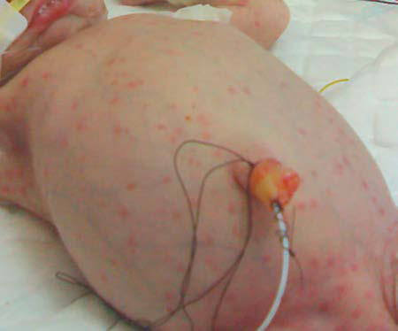

# Chapter 234: Listeria monocytogenes

*Ashley C. Howard and Thomas S. Murray*

<!-- p.2199 -->
decreased from 86% in 2019 to 83% in 2020. The impact this will have on the resurgence of vaccine-preventable infections is yet to be determined.

Diphtheria toxoid is prepared by formaldehyde treatment of toxin, standardized for potency and adsorbed to aluminum salts, enhancing immunogenicity. Two preparations of diphtheria toxoids are formu lated according to the *limit of flocculation* (Lf) content, a measure of the quantity of toxoid. The pediatric (6 months to 6 years) prepara tions (i.e., **DTaP** [diphtheria and tetanus toxoids with acellular pertus sis vaccine] and **DT** [diphtheria and tetanus toxoids vaccine]) contain 6.7-25.0 Lf units of diphtheria toxoid per 0.5 mL dose; tetanus toxoid with vaccines for ≥7 years (Td [tetanus and diphtheria toxoid vac cine] and **Tdap** [diphtheria and tetanus toxoids with acellular pertussis vaccine]) contain no more than 2-2.5 Lf units of toxoid per 0.5 mL dose. The *higher-potency* (D) formulation of toxoid is used for primary series and booster doses for children through 6 years of age, given its superior immunogenicity and minimal reactogenicity. For individuals ≥7 years old, Td or Tdap is recommended for the primary series and booster doses because the lower concentration of diphtheria toxoid is adequately immunogenic and increasing the content of diphtheria tox oid heightens reactogenicity with increasing age.

For children 6 weeks to 6 years of age, five 0.5-mL doses of diphtheriacontaining (D) vaccine (DTaP preferred) are given in the primary series, including doses at 2, 4, and 6 months of age, and a fourth dose, an integral part of the primary series, at 15-18 months. Dose 4 may be administered as early as age 12 months if at least 6 months have elapsed since dose 3. A booster dose is given at 4-6 years of age (unless the fourth primary dose was administered at ≥4 years). For persons ≥7 years to 18 years not previously immunized for diphtheria, three 0.5mL doses of *lower-level* diphtheria-containing (d) vaccine are given in a primary series of two doses at least 4 weeks apart and a third dose 6 months after the second dose. The first dose should be Tdap, and sub sequent doses can be Td or Tdap.

A booster dose, consisting of Tdap, is recommended at 11-12 years of age. Tdap may be administered regardless of the interval since the last tetanus- and diphtheria-toxoid-containing vaccine. Adolescents 13-18 years old who have not received Tdap at 11-12 years should receive a single dose of Tdap, then a Td or Tdap booster every 10 years. Pregnant women should receive a single dose of Tdap during every pregnancy, preferably during gestational weeks 27-36. Adults who have never received Tdap should receive a single dose of Tdap, regardless of when they last got Td. A Td or Tdap booster should be given every 10 years.

Updated recommendations allow for use of either Td or Tdap vac cine in situations where previously only Td was recommended. This includes the decennial Td booster, tetanus prophylaxis for wound man agement, and for additional required doses in the catch-up immuniza tion schedule if a person has received at least one Tdap dose.

The only contraindication to tetanus and diphtheria toxoid is a his tory of neurologic or severe hypersensitivity reaction after a prior dose. For children <7 years old in whom pertussis immunization is contra indicated, DT is used. Those whose immunization is begun with DTaP or DT before 1 year of age should have a total of five 0.5-mL doses of diphtheria-containing (D) vaccines by 6 years of age. For those whose immunization is begun at around 1 year old, the primary series is three 0.5-mL doses of diphtheria-containing (D) vaccine, with a booster given at 4-6 years, unless the third dose was given after the fourth birthday.

There is no association of DT or Td with seizures. Local adverse effects alone do not preclude continued use. The rare patient who experiences an Arthus-type hypersensitivity reaction or a temperature >39.4°C (103°F) after a dose of Td usually has high serum tetanus anti toxin levels and should not be given Td more frequently than every 10 years, even if the patient sustains a significant tetanus-prone injury. The DT or Td preparation can be given concurrently with other vac cines. Meningococcal and pneumococcal conjugate vaccines contain ing diphtheria toxoid or a variant of diphtheria toxin, CRM197 protein, are not substitutes for diphtheria toxoid immunization and do not affect reactogenicity.

*Visit Elsevier eBooks+ at eBooks.Health.Elsevier.com** for Bibliography.*

*Ashley C. Howard and Thomas S. Murray*

**Listeriosis** in humans is caused principally by *Listeria monocyto genes,* 1 of 17 species of the genus *Listeria* that are widely distrib uted in the environment and throughout the food chain. Human infections can usually be traced to an animal reservoir. Infection usually occurs at the extremes of age. In the pediatric population, perinatal infections predominate and usually occur secondary to maternal infection or colonization. Outside the newborn period, disease is most often encountered in *immunosuppressed* (usually T-cell deficiencies) children and adults and in elderly persons. For most people the major risk for infection with *Listeria* is **food- borne transmission**. In the United States, food-borne outbreaks are caused by improperly processed dairy products and contaminated vegetables and principally affect the same individuals at risk for spo radic disease.

**ETIOLOGY** Members of the genus *Listeria* are facultatively anaerobic, non– spore-forming, motile, gram-positive bacilli that are catalase posi tive. The 17 *Listeria* species are divided into two genomically distinct groups on the basis of DNA-DNA hybridization studies. One group contains the species *L. grayi,* and 10 others discovered since 2009 are considered nonpathogenic. The second group contains six spe cies: the nonhemolytic species *L. innocua*, *L. welshimeri,* and *L. marthii* and the hemolytic species *L. monocytogenes, L. seeligeri,* and *L. ivanovii. L. ivanovii* is pathogenic primarily in animals, and the vast majority of both human and animal disease is caused by *L. monocytogenes.*

Subtyping of *L. monocytogenes* isolates for epidemiologic purposes is now performed predominately with whole genome sequencing. This demonstrates the clonal structure of populations of *L. monocytogenes* as well as the sharing of populations between human and animal sources. **Subtyping** is an important component of determining whether cases are connected or sporadic but usually requires collaboration with a specialized laboratory.

Historically, selected biochemical tests, together with the demon stration of *tumbling motility,* an umbrella-type formation below the surface in semisolid medium, hemolysis, and a typical cyclic adenos ine monophosphate test, are usually sufficient to establish a presump tive identification of *L. monocytogenes*. Once growth is present, *L. monocytogenes* can now be rapidly identified with matrix-assisted laser desorption/ionization time of flight (MALDI-TOF) mass spectrometry.

**EPIDEMIOLOGY* L. monocytogenes* is widespread in nature, has been isolated through out the environment, and is associated with epizootic disease and asymptomatic carriage in >42 species of wild and domestic animals and 22 avian species. Epizootic disease in large animals (e.g., sheep, cattle) is associated with abortion and “circling disease,” a form of bas ilar meningitis. *L. monocytogenes* is isolated from sewage, silage, and soil, where it survives for >295 days. Human-to-human transmission rarely occurs except in maternal-fetal transmission. The annual inci dence of listeriosis decreased by 36% between 1996 and 2004 and has remained level since then, estimated between two and five cases per year per million people. However, **food-borne outbreaks** continue to occur. The rate of *Listeria* infections varies among states. Epidemic human listeriosis has been associated with food-borne transmission in several large outbreaks, especially in association with aged soft cheeses; improperly pasteurized milk and milk products; contaminated raw and ready-to-eat beef, pork, and poultry and packaged meats and

<!-- p.2201 -->
salads; and vegetables, both fresh and frozen, harvested from farms where the ground is contaminated with the feces of colonized animals. In 2017-2018, the largest *Listeria* outbreak ever recorded occurred in South Africa with >900 cases and 200 deaths related to a processed contaminated meat product, “polony.” U.S. food-borne outbreaks from 2019 to 2020 included deli meats and cheeses, packaged hard boiled eggs, and enoki mushrooms. The ability of *L. monocytogene*s to grow at temperatures as low as 4°C (39.2°F) increases the risk for transmission from aged soft cheeses and stored contaminated food. Listeriosis is an uncommon but important recognized etiology of neo natal sepsis and meningitis. Small clusters of nosocomial person-toperson transmission have occurred in hospital nurseries and obstetric suites. Sporadic endemic listeriosis is less well characterized. Likely routes include food-borne infection and zoonotic spread. **Zoonotic transmission** with cutaneous infections occurs in veterinarians and farmers who handle sick animals.

Reported cases of listeriosis are clustered at the extremes of age. Some studies show higher rates in males and a seasonal predomi nance in the late summer and fall in the Northern Hemisphere. In the United States, there is an increased risk of infection in nonpreg nant non-Hispanic Asians, non-Hispanic Blacks, and Hispanics compared with non-Hispanic Whites. Outside the newborn period and during pregnancy, disease is usually reported in patients with underlying immunosuppression, with a 100-300 times increased risk in HIV-infected persons and in the elderly population (Table 234.1). In a prospective cohort study for listeriosis, 82.5% of par ticipants had at least one immunocompromising condition, and those with bacteremia and neurolisteriosis disease were found to have a fivefold increased risk of death if there was an underlying malignancy.

The incubation period, which is defined only for common-source food-borne disease, is 21-30 days but in some cases may be longer. Asymptomatic carriage and fecal excretion are reported in 1–5% of healthy persons and 5% of abattoir workers, but duration of excretion, when studied, is short (<1 month).

**PATHOLOGY** One of the major concepts of *Listeria* pathology and pathogenesis is its ability to survive as an intracellular pathogen. *Listeria* incites a mononuclear response and elaboration of cytokines, producing multisystem disease, particularly pyogenic meningitis. Granuloma tous reactions and microabscess formation develop in many organs, including the liver, lungs, adrenals, kidneys, central nervous sys tem (CNS), and notably the placenta. Animal models demonstrate *translocation,* the transfer of intraluminal organisms across intact intestinal mucosa. Histologic examination of tissues, including the placenta, shows granulomatous inflammation and microabscess for mation. Intracellular organisms can often be demonstrated with spe cial stains.

**PATHOGENESIS* Listeria* organisms usually enter the host through the gastrointesti nal (GI) tract. Gastric acidity provides some protection, and drugs that raise gastric pH may promote infection. Studies of intracellular and intercellular spread of *L. monocytogenes* have revealed a com plex pathogenesis. Four pathogenic steps are described: internal ization, escape from the vacuole, nucleation of actin filaments, and cell-to-cell spread. **Listeriolysin O**, a hemolysin, mediates lysis of vacuoles and is responsible for the zone of hemolysis around colonies on blood-containing solid media. In cell-to-cell spread, locomotion proceeds via polymerization of actin filaments, which extrude the bacteria in pseudopods, which in turn are internalized by adjacent cells, necessitating escape from a double-membrane vacuole. This mechanism protects intracellular bacteria from the humoral arm of immunity and is responsible for the well-known requirement of T-cell–mediated activation of monocytes by lymphokines for clear ance of infection and establishment of immunity. The significant risk for listeriosis in patients with depressed T-cell immunity speaks for the role of this arm of the immune system. The role of opsoniz ing antibody in protecting against infection is unclear. In addition, siderophores scavenge iron from the host, enhancing growth of the organism and likely explaining the relatively high risk of listeriosis in iron overload syndromes.

**CLINICAL MANIFESTATIONS** The clinical presentation of listeriosis depends greatly on the age of the patient and the circumstances of the infection.

**Listeriosis in Pregnancy** Pregnant women have increased susceptibility to *Listeria* infections (approximately 20 times higher than nonpregnant women), prob ably because of a relative impairment in cell-mediated immunity. *L. monocytogenes* has been grown from placental and fetal cultures of pregnancies ending in spontaneous abortion. The usual presenta tion in the second and third trimesters is a flulike illness that may result in seeding of the uterine contents by bacteremia. Rarely is maternal listeriosis severe, but meningitis in pregnancy has been reported. Recognition and treatment at this stage are associated with normal pregnancy outcomes, but the fetus may not be infected even if listeriosis in the mother is not treated. In other instances, placental listeriosis develops with infection of the fetus that may be associated with stillbirth or premature delivery. Delivery of an infected premature fetus is associated with very high infant mortal ity. Disseminated disease is apparent at birth, often with a diffuse pustular rash. Infection in the mother usually resolves without spe cific therapy after delivery, but postpartum fever and infected lochia may occur.

**Neonatal Listeriosis** Two clinical presentations are recognized for neonatal listeriosis: earlyonset neonatal disease (<5 days, usually within 1-2 days of birth), which is a predominantly **septicemic** form, and late-onset neona tal disease (>5 days, mean 14 days of life), which is a predominantly **meningitic** form (Table 234.2). The principal characteristics of the two presentations resemble the clinical syndromes described for group B *Streptococcus* (see Chapter 230).

**Early-onset disease** occurs with milder transplacental or ascending infections from the female genital tract. There is a strong association with recovery of *L. monocytogenes* from the maternal genital tract, obstetric complications, prematurity, and neonatal sepsis with multi organ involvement, including rash, but without CNS localization (Fig. 234.1). The mortality rate is approximately 20–30%. The epidemiology of **late-onset disease** is poorly understood. Onset is usually after 5 days but before 30 days of age. Affected infants fre quently are full-term, and the mothers are culture negative and asymp tomatic. The presenting syndrome is usually purulent meningitis with parenchymal brain involvement, which, if adequately treated, has a mortality rate of <20%.

#### **Table 234.1** Types of Listeria monocytogenes Infections

| Category / Parameter | Clinical Details & Findings |
| --- | --- |
| **General** | Listeriosis in pregnancy; Neonatal listeriosis; Early onset; Late onset; Food-borne outbreaks/febrile gastroenteritis; Listeriosis in normal children and adults (rare); Focal Listeria infections (e.g., meningitis, endocarditis, pneumonia,; liver abscess, osteomyelitis, septic arthritis); Listeriosis in immunocompromised persons; Lymphohematogenous malignancies; Collagen vascular diseases; Diabetes mellitus; HIV infection; Transplantation; Renal failure with peritoneal dialysis; Listeriosis in elderly persons |

<!-- p.2202 -->
**Postneonatal Infections** Listeriosis beyond the newborn period may rarely occur in otherwise healthy children but is most often encountered in association with underlying malignancies (especially lymphomas) or immunosuppres sion. When associated with food-borne outbreaks, disease may cause GI symptoms or any of the *Listeria* syndromes. The clinical presenta tion is usually meningitis, less commonly sepsis, and rarely other CNS involvement, such as cerebritis, meningoencephalitis, brain abscess, spinal cord abscess, or a focus outside the CNS, such as suppurative arthritis, osteomyelitis, endocarditis, peritonitis (associated with peri toneal dialysis), or liver abscess. It is not known whether the frequent GI signs and symptoms result from enteric infection because the mode of acquisition is often unknown.

**DIAGNOSIS** Listeriosis should be included in the differential diagnosis of infec tions in pregnancy, of neonatal sepsis and meningitis, and of sepsis or meningitis in older children who have underlying malignancies (lymphomas), are receiving immunosuppressive therapy, or have undergone transplantation. The diagnosis is established by culture of *L. monocytogenes* from blood or cerebrospinal fluid (CSF). Cultures from the maternal cervix, vagina, lochia, and placenta, if possible, should be obtained when intrauterine infections lead to premature delivery or early-onset neonatal sepsis. Cultures from closed-space

infections may also be useful. It is helpful to alert the laboratory to suspected cases so that *Listeria* isolates are not discarded as contami nating diphtheroids.

Histologic examination of the placenta is also useful. Molecular assays are now commercially available to detect *L. monocytogenes* from CNS samples and directly from positive blood culture bottles. Serodi agnostic tests are not useful.

**Differential Diagnosis** Listeriosis is indistinguishable clinically from neonatal sepsis and meningitis caused by other organisms. The presence of increased peripheral blood monocytes suggests listeriosis. Monocytosis or lymphocytosis may be modest or striking. Beyond the neonatal period, *L. monocytogenes* CNS infection is associated with fever, headache, seizures, and signs of meningeal irritation. The brain stem may be characteristically affected. The white blood cell concentration may vary from normal to slightly elevated, and the CSF laboratory findings are variable and less striking than in the more common causes of bacterial meningitis. Polymorpho nuclear leukocytes or mononuclear cells may predominate, with shifts from polymorphonuclear to mononuclear cells in sequen tial lumbar puncture specimens. The CSF glucose concentration may be normal, but a low level mirrors the severity of disease. The CSF protein concentration is moderately elevated. *L. monocyto genes* is isolated from the blood in 40–75% of cases of meningitis caused by the organism. Deep focal infections from *L. monocyto genes,* such as endocarditis, osteomyelitis, and liver abscess, are also indistinguishable clinically from such infections from more common organisms. Cutaneous infections should be suspected in patients with a history of contact with animals, especially prod ucts of conception.

**TREATMENT** The emergence of multiantibiotic resistance mandates routine sus ceptibility testing of all isolates. The recommended therapy is **ampi cillin** (100-200 mg/kg/day divided every 6 hours intravenously [IV]; 300-400 mg/kg/day divided every 6 hours IV if meningitis is pres ent), alone or in combination with an **aminoglycoside** (2.0-3.0 mg/ kg/day IV divided every 8-24 hours depending on postnatal age). The aminoglycoside enhances the bactericidal activity and is gener ally recommended in cases of endocarditis and meningitis. The adult dose is ampicillin 4-6 g/day divided every 6 hours plus an aminogly coside. The ampicillin dose is doubled if meningitis is present. Spe cial attention to dosing is required for neonates, who require longer dosing intervals because of the longer half-lives of the antibiotics in their bodies. *L. monocytogenes* is not susceptible to the cephalo sporins, including third-generation cephalosporins. If these agents are used for empirical therapy for neonatal sepsis or meningitis in a newborn, ampicillin must be added for possible *L. monocytogenes* infection. Vancomycin, vancomycin plus an aminoglycoside, and trimethoprim-sulfamethoxazole are alternatives to ampicillin. The duration of therapy is usually 2-3 weeks, with 3 weeks recommended for immunocompromised persons and patients with meningitis. A longer course is needed for endocarditis, brain abscess, and osteomy elitis. Antibiotic treatment is unnecessary for gastroenteritis without invasive disease.

**PROGNOSIS** Early gestational listeriosis may be associated with abortion or stillbirth, although maternal infection with sparing of the fetus has been reported. There is no convincing evidence that *L. monocyto genes* is associated with repeated spontaneous abortions in humans. The mortality rate is >50% for premature infants infected in utero, 30% for early-onset neonatal sepsis, 15% for late-onset neonatal meningitis, and <10% in older children with prompt institution of appropriate antimicrobial therapy. Mental retardation, hydrocepha lus, and other CNS sequelae are reported in survivors of *Listeria* meningitis.

Late-Onset Neonatal Listeriosis

#### **Table 234.2** Characteristic Features of Early- and

| Category / Parameter | Clinical Details & Findings |
| --- | --- |
| **LATE ONSET (≥5 DAYS)** | Positive result of maternal; Listeria culture; Negative results of maternal; Listeria culture; Obstetric complications; Uncomplicated pregnancy; Premature delivery; Term delivery; Low birthweight; Normal birthweight; Neonatal sepsis; Neonatal meningitis; Mean age at onset 1.5 days; Mean age at onset 14.2 days; Mortality rate <30%; Mortality rate <20%; Nosocomial outbreaks |

**Fig. 234.1** Listeria monocytogenes. The generalized maculopapu lar rash present at birth disappeared within a few hours of life. (From Benitez-Segura I, Fiol-Jaume M, Balliu PR, Tejedor M. Listeria mono cytogenes: generalized maculopapular rash may be the clue. Arch Dis Child Fetal Neonatal Ed. 2013;98[1]:F64, Fig. 1.)

<!-- p.2203 -->
**PREVENTION** Listeriosis can be prevented by pasteurization and thorough cooking of foods. Irradiation of meat products may also be beneficial. Consump tion of unpasteurized or improperly processed dairy products should be avoided, especially aged soft cheeses, uncooked and precooked meat products that have been stored at 4°C (39.2°F) for extended periods, and unwashed vegetables (Table 234.3). This avoidance is particularly important during pregnancy and for immunocompromised persons. Infected domestic animals should be avoided when possible. Education regarding risk reduction is aimed particularly at pregnant women and people being treated for cancer.

Careful handwashing is essential to prevent nosocomial spread within obstetric and neonatal units. Immunocompromised patients

given prophylaxis with trimethoprim-sulfamethoxazole are protected from *Listeria* infections. Cases, and especially outbreaks, should be reported immediately to public health authorities so that timely inves tigation can be initiated in order to interrupt transmission from the contaminated source.

**ACKNOWLEDGMENTS** We would like to acknowledge Robert S. Baltimore, MD, for his contri bution to this chapter and Michelle R. Rychalsky, PharmD, for review ing antibiotic dosing regimens.

*Visit Elsevier eBooks+ at eBooks.Health.Elsevier.com** for Bibliography.*

#### **Table 234.3** Prevention of Food-Borne Listeriosis

| Category / Parameter | Clinical Details & Findings |
| --- | --- |
| **General** | *Including pregnant women, persons with a weakened immune system, and older adults.; FDA, Food and Drug Administration; USDA, U.S. Department of Agriculture.; Adapted from Centers for Disease Control and Prevention: Listeria (listeriosis): prevention. http://www.cdc.gov/listeria/prevention.html. |
| **FDA recommendations for washing and handling food:** | • Rinse raw produce, such as fruits and vegetables, thoroughly under; running tap water before eating, cutting, or cooking. Even if the; produce will be peeled, it should still be washed first.; • Scrub firm produce, such as melons and cucumbers, with a clean; produce brush.; • Dry the produce with a clean cloth or paper towel.; • Separate uncooked meats and poultry from vegetables, cooked; foods, and ready-to-eat foods. |
| **Keep your kitchen and environment cleaner and safer:** | • Wash hands, knives, countertops, and cutting boards after handling; and preparing uncooked foods.; • Be aware that Listeria monocytogenes can grow in foods in the; refrigerator. Use an appliance thermometer, such as a refrigerator; thermometer, to check the temperature inside your refrigerator. The; refrigerator should be 4.5°C (40°F) or lower and the freezer −17.8°C; (0°F) or lower.; • Clean up all spills in your refrigerator promptly, especially juices from; hot dog and lunch meat packages, raw meat, and raw poultry.; • Clean the inside walls and shelves of your refrigerator with hot water; and liquid soap, then rinse. |
| **Cook meat and poultry thoroughly:** | • Thoroughly cook raw food from animal sources, such as beef, pork,; or poultry, to a safe internal temperature. For a list of recommended; temperatures for meat and poultry, visit the safe minimum cooking; temperatures chart at http://www.FoodSafety.gov. |
| **Store foods safely:** | • Use precooked or ready-to-eat food as soon as you can. Do not; store the product in the refrigerator beyond the use-by date; follow; USDA refrigerator storage time guidelines:; • Hot dogs: store opened package no longer than 1 wk and; unopened package no longer than 2 wk in the refrigerator.; • Luncheon and deli meat: store factory-sealed, unopened; package no longer than 2 wk. Store opened packages and; meat sliced at a local deli no longer than 3-5 days in the; refrigerator.; • Divide leftovers into shallow containers to promote rapid, even; cooling. Cover with airtight lids or enclose in plastic wrap or; aluminum foil. Use leftovers within 3-4 days. |
| **Choose safer foods:** | • Do not drink raw (unpasteurized) milk, and do not eat foods that; have unpasteurized milk in them. |
| **RECOMMENDATIONS FOR PERSONS AT HIGHER RISK*** | In addition to the recommendations listed above, include: |
| **Meats** | • Do not eat hot dogs, luncheon meats, cold cuts, other deli meats; (e.g., bologna) or fermented or dry sausages unless they are heated; to an internal temperature of 73.9°C (165°F) or until steaming hot; just before serving.; • Avoid getting fluid from hot dog and lunch meat packages on other; foods, utensils, and food preparation surfaces, and wash hands after; handling hot dogs, luncheon meats, and deli meats.; • Pay attention to labels. Do not eat refrigerated pâté or meat spreads; from a deli or meat counter or from the refrigerated section of a store.; Foods that do not need refrigeration, such as canned or shelf-stable; pâté and meat spreads, are safe to eat. Refrigerate after opening. |
| **Cheeses** | • Do not eat soft cheese such as feta, queso blanco, queso fresco,; brie, Camembert, blue-veined, or panela (queso panela) unless it; is labeled as made with pasteurized milk. Make sure the label says; “Made With Pasteurized Milk.” |
| **Seafood** | • Do not eat refrigerated smoked seafood, unless it is contained in a; cooked dish, such as a casserole, or unless it is a canned or shelf-; stable product.; • Refrigerated smoked seafood, such as salmon, trout, whitefish, cod,; tuna, and mackerel, is most often labeled as “nova-style,” “lox,”; “kippered,” “smoked,” or “jerky.”; • These fish are typically found in the refrigerator section or; sold at seafood and deli counters of grocery stores and; delicatessens.; • Canned and shelf-stable tuna, salmon, and other fish products are; safe to eat. |
| **Follow this general FDA advice for melon safety:** | • Consumers and food preparers should wash their hands with; warm water and soap for at least 20 sec before and after; handling any whole melon, such as cantaloupe, watermelon, or; honeydew.; • Scrub the surface of melons, such as cantaloupes, with a clean; produce brush under running water and dry them with a clean; cloth or paper towel before cutting. Be sure that your scrub brush; is sanitized after each use to avoid transferring bacteria between; melons.; • Promptly consume cut melon or refrigerate promptly. Keep your cut; melon refrigerated ≤4.5°C (40°F) (0–1.1°C [32–34°F] is best) for no; more than 7 days.; • Discard cut melons left at room temperature for >4 hours. |

<!-- p.2204 -->
