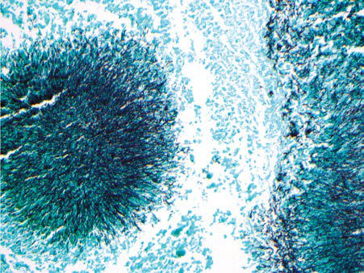

# Chapter 235: Actinomyces

*Hamid Bassiri*

<!-- p.2205 -->
**TAXONOMY AND MICROBIOLOGY** Members of the phylum Actinobacteria are common soil and water gram-positive bacteria with high guanine and cytosine DNA content and play important roles in the decomposition of organic materials. A proportion of Actinobacteria form filamentous and branching struc tures (similar to *Nocardia* spp.) that resemble fungal mycelia; these are included in the class Actinomycetia*.* The genus *Actinomyces* (which translates literally to “ray fungus”) belongs to the order Actinomyceta les (along with *Mycobacteria* and *Nocardia*) and family Actinomyceta ceae and constitutes several microaerophilic to facultatively anaerobic nonmotile species that are fastidious and slow growing.

More than 50 species of *Actinomyces* have been identified using 16S rRNA sequencing, with more than half of these species associated with human infection. **Actinomyces israelii** is the predominant species causing human actinomycosis. Other species associated with infection include but are not limited to *A. odontolyticus, A. meyeri, A. naeslundii, A. graevenitzii, A. neuii,* and *A. turicensis.*

**PATHOGENESIS AND EPIDEMIOLOGY* Actinomyces* are commensal organisms of the human oropharynx and gastrointestinal and urogenital tracts, and infections by these organ isms (termed **actinomycosis**) typically emanate from these anatomic sites. The hallmark of actinomycosis is contiguous spread that fails to respect tissue or fascial planes. As such, these infections can extend to contiguous structures and form abscesses and chronically suppura tive granulomatous infections and sinus tracts. Cicatricial healing can then ensue, from which the organism can further spread by burrow ing along fascial planes, causing deeply communicating scarred sinus tracts. Sites of infection show dense cellular infiltrates and suppuration that form many interconnecting abscesses and sinus tracts. Bacteremia and infections of more distal sites (such as endocarditis, pericarditis, and central nervous system [CNS] infections) have also been docu mented. Notably, polymicrobial infections are typical, especially with copathogens such as *Aggregatibacter* (formerly *Actinobacillus*) *acti nomycetemcomitans,* as well as *Fusobacterium, Clostridia, Eikenella, Enterococcus, Bacteroides,* and *Peptostreptococcus* spp.

Knowledge regarding the epidemiology of actinomycosis is limited to case reports and case series. Based on these reports, actinomycosis appears to affect people of all ages, with no racial or ethnic predilec tion, seasonality, or occupational associations. Actinomycosis occurs in immunocompetent and immunocompromised hosts. However, pediatric actinomycosis only represents approximately 3% of reported cases. Risk factors in children include trauma, dental caries, debilita tion, and poorly controlled diabetes. Although actinomycosis is not a common opportunistic infection, disease has been associated with corticosteroid use, leukemia, renal failure, congenital immunodefi ciencies, HIV infection, and solid organ or hematopoietic stem cell transplantation.

Given the sites of colonization, the most common presentations of *Actinomyces* infections include cervicofacial, abdominal/pelvic, and thoracic regions (in order of frequency). Importantly, certain medical interventions can result in mucosal barrier injuries and infection. For instance, use of intrauterine contraceptive devices can predispose to pelvic actinomycosis, and aspiration events, poor dentition, and recent dental procedures can result in involvement of the thoracic region. However, more than one third of patients do not have an identifiable antecedent event that would explain the onset of actinomycosis. Importantly, actinomyces infections are not contagious.

**DIAGNOSIS** Diagnosis of actinomycosis relies on identification of the organism in tissues of affected areas via culture, molecular methods, and/or histo pathology. However, growth in cultures can take up to 2-3 weeks, and up to 50% of cultures may reveal no growth because of prior antibi otic exposure, failure to maintain anaerobic conditions during sample transport, or inadequate incubation.

The presence of **sulfur granules** on macroscopic or microscopic evaluation (Fig. 235.1) of involved tissue is suggestive of actinomycosis. Despite their name, these granules are not composed of sulfur, instead deriving this designation because of their typical yellow color on mac roscopic appearance; they can also be white, gray, or brown. Similar granules can be formed by *Nocardia brasiliensis, Streptomyces madu rae* (which can cause mycetomas), and *Staphylococcus aureus* (which can cause botryomycosis). Microscopically, these granules appear on hematoxylin-eosin or Gomori methenamine silver stains as masses of gram-positive, branching, filamentous rods surrounded by the host immune cells (e.g., polymorphonuclear neutrophils) and a milieu of eosinophilic staining inert material, often referred to as the **Splendore- Hoeppli phenomenon**. Notably, *A. meyeri* is nonbranching and *A. odontolyticus* does not form sulfur granules.

*Nocardia* are indistinguishable from *Actinomyces* on Gram stain, but *Nocardia* take up the modified acid-fast stain, whereas *Actinomy ces* spp. do not. Although suggestive of actinomycosis, sulfur gran ules are often absent, and thus additional testing such as cultures are necessary for the diagnosis. Affected tissues can be cultured on

*Hamid Bassiri*

A

B

**Fig. 235.1** Actinomycosis. A, Small cluster of Actinomyces on left, with sulfur granule and surrounding mixed inflammation demonstrating the Splendore-Hoeppli phenomenon (×200). B, Gomori methenamine silver stain of the same field, highlighting the filamentous forms (×200). (From Johnson MM. Ear, nose, and throat infections. In: Kradin RL, ed. Diagnostic Pathology of Infectious Disease, 2nd ed. Philadelphia: Else vier; 2018: Fig. 7.6.)

<!-- p.2206 -->
brain-heart infusion agar incubated at 37°C anaerobically and aero bically to reveal organisms within the lines of streak at 24-48 hours. *A. israelii* colonies appear as loose masses of delicate, branching fila ments with a characteristic spider-like growth. Unfortunately, even under the right conditions, it is challenging to grow *Actinomyces,* and the yield of different culturing techniques varies by species. Addition ally, conventional biochemical testing for speciation is complex and may result in misclassifications. The evolution of diagnostic tools such as 16S rRNA sequence analysis and matrix-assisted laser desorp tion/ionization time of flight (MALDI-TOF) mass spectrometry has improved the accuracy of speciation of cultured organisms and high lighted the potential for detection of *Actinomyces* directly from the involved tissue without culture.

Importantly, actinomycosis is usually, if not always, **polymicrobial** in nature. In a large study of >650 cases, infection with *Actinomyces* was identified in pure culture in only 1 case. Cultures usually also identify other endogenous flora, including members of the **HACEK group**, which includes *Haemophilus* spp. (typically *H. aphrophilus, 
 H. parainfluenzae,* or *H. paraphrophilus*), *A. actinomycetemcomitans, Cardiobacterium hominis, Eikenella corrodens,* and *Kingella kingae. A. actinomycetemcomitans* is a fastidious, gram-negative bacillus that is part of the oral flora and has been implicated in periodontal disease. Other bacteria frequently isolated concomitantly in human actinomy cosis include *Fusobacterium, Bacteroides, Capnocytophaga,* and aerobic and anaerobic streptococci.

CT or MRI of involved areas is often employed in the initial patient evaluation. Imaging evidence of an invasive process spreading across tissue planes and ignoring anatomic boundaries is highly suggestive of actinomycosis. Furthermore, imaging can be helpful in establishing the extent of the infection, guiding subsequent diagnostic and therapeutic interventions, and monitoring for disease resolution.

**COMMON CLINICAL PRESENTATIONS Cervicofacial Actinomycosis** Cervicofacial disease is the most common form of pediatric actinomy cosis and often manifests as a neck or submandibular mass that per sists for weeks to months. Less than half of patients will have associated pain, and less than one third of patients will have fever. A minority of patients will report dysphagia or have a draining sinus (Fig. 235.2). Less frequently, cervicofacial actinomycosis manifests clinically as an acute pyogenic infection with a tender, fluctuant mass with trismus, firm swelling, and fistulas with drainage containing sulfur granules. Bone is not involved early in the disease, but periostitis, mandibular osteomyelitis, or perimandibular abscess may subsequently develop. Infection may spread through sinus tracts to cranial bones, possibly leading to meningitis. The ability of *Actinomyces* to burrow through tissue planes, including the periosteum, is a key difference between

actinomycosis and nocardiosis. Whereas predisposing factors for cer vicofacial actinomycosis are not well defined for children, adult cases are often preceded by a history of oral trauma, oral surgery, dental procedures, or caries, facilitating entry of organisms into cervicofacial tissues.

**Abdominal and Pelvic Actinomycosis** Of all the forms of actinomycosis, delayed diagnosis is most typical for abdominal and pelvic infection. A disruption of the mucosa of the gastrointestinal (GI) tract (e.g., acute GI perforation, abdominal trauma, prior abdominal surgery) is often postulated as the inciting event for adult-onset abdominopelvic actinomycosis. In pediatric patients, however, medical history sometimes fails to identify prior evidence of mucosal barrier injury. In a contemporary pediatric case series of abdominal and pelvic actinomycosis, prior abdominal sur gery (all appendectomies) was reported in only 21% of patients and dental caries in 11%. In two thirds to three fourths of patients, the presenting signs are abdominal pain and a palpable mass on physi cal exam. Fever accompanies the abdominal pain in more than half of cases, with weight loss in almost one third. As with other forms of actinomycosis, abdominopelvic infection can spread across tissue planes by contiguous extension involving any tissue or organ, includ ing muscle, solid abdominopelvic viscera, and walls of the intesti nal tract. Imaging studies may reveal a mass with invasion of tissue planes, leading to misdiagnosis of malignancies, inflammatory bowel disease with fistulae, or abdominal tuberculosis. Genitourinary acti nomycosis is often associated with use of intrauterine contraceptive devices (IUDs) in adults and can mimic gynecologic tumors, but these infections are quite rare in adolescents. Because of delays in diagnosis, more than one third of pediatric cases present with drain ing sinus fistulae.

**Thoracic Actinomycosis** Thoracic actinomycosis may present with cough, chest pain, hemop tysis, and fever. In a retrospective review of reported pediatric cases of thoracic infection, almost half presented with a chest wall mass. Additional symptoms such as cough, fever, chest pain, and weight loss were reported in <40% of patients. Radiographic imaging may reveal hilar lymphadenopathy, endobronchial infection, tumor-like lesions, diffuse pneumonia, pleural effusions, or abscesses with or without cavitation and parenchymal lung destruction. These abscesses can also form sinus tracts to the diaphragm or mediastinum, which are often pathognomonic for actinomycosis. Other complications include bony destruction of adjacent ribs, sternum, and vertebral bodies. Multiple lobe involvement of the lungs is occasionally found. Impor tantly, evidence of thoracic actinomycosis can be found incidentally on radiographs ordered for noninfectious concerns. The variation in presentation and indolent nature of thoracic actinomycosis often delay the diagnosis.

**Other Forms of Actinomycosis CNS actinomycosis** is often the result of hematogenous spread to the brain parenchyma from a distant site but can also ensue from con tiguous spread from a cervicofacial lesion. The former often results in multiple brain abscesses. **Laryngeal** actinomycosis rarely has been reported in older teenagers. Oropharyngeal colonization with *Acti nomyces* may be involved in the development of obstructive tonsil lar hypertrophy. Severe forms of **periodontitis**, particularly localized juvenile periodontitis, are associated with *Actinomyces,* especially in adolescents. *Actinomyces* has a propensity for infecting heart valves, a process that results in subacute endocarditis, with fever present in less than half of cases.

**DIFFERENTIAL DIAGNOSIS** Actinomycosis has been referred to as a “great imitator” with presenta tions that mimic appendicitis, pseudoappendicitis caused by *Yersinia enterocolitica,* amebiasis, malignancy, and inflammatory bowel disease. Actinomycosis must be differentiated from other chronic infections,

**Fig. 235.2** A 2-yr-old male with HIV infection who has cervicofacial actinomycosis and a draining fistula.

<!-- p.2208 -->
