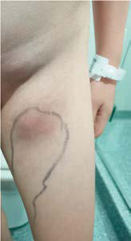

# Chapter 236: Nocardia

*Coralee Del Valle Mojica INFECTIONS*

<!-- p.2207 -->
including tuberculosis, nocardiosis, polymicrobial bacterial infections, and fungal infections.

**TREATMENT** Most cases of actinomycosis can be managed with antibiotics, although surgery can be adjunctive and may shorten the duration of antibiotic use. Routine susceptibility testing is not typically performed, as most *Actinomyces* spp. are susceptible to penicillin. Accordingly, penicillin G is the drug of choice for parenteral therapy, and penicillin V or amoxi cillin is the preferred enteral antibiotic. Because actinomycosis is often found to be polymicrobial in nature, use of combination β-lactam/βlactamase inhibitors (e.g., ampicillin-sulbactam or amoxicillinclavulanate) may be warranted, especially if there is an initial poor response. In particular, **A. actinomycetemcomitans** is a copathogen in at least 30% of cases of actinomycosis. Failure to recognize this organism and treat it adequately has resulted in clinical relapse and deterioration.

Treating actinomycosis in a patient with a penicillin allergy can be challenging, as there is variation in susceptibility by *Actinomyces* spp. to other antibiotic classes; alternatives generally include cephalo sporins, carbapenems, macrolides, and tetracyclines. Despite being anaerobic, a large percentage of *Actinomyces* are not susceptible to metronidazole, and isolates are variably susceptible to clindamy cin. Fluoroquinolones and aminoglycosides have little to no activ ity against *Actinomyces* spp. Infectious disease specialists should be consulted to guide antibiotic usage in patients with penicillin allergy or deep-seated infections such as brain abscesses, endocarditis, or osteomyelitis. Commercially available sensitivity testing methods are available and can be employed in patients with severe disease or poor response to initial therapy.

No definitive comparative effectiveness data exist to guide the opti mal route and duration of therapy. For severe or extensive infections, most experts recommend initial parenteral administration of anti biotics for 4-6 weeks and then transitioning to enteral therapy upon documentation of clinical improvement. The exceptions include endocarditis and CNS disease, which generally require parenteral administration for the entire course of therapy. In cases of mild or limited disease, enteral antibiotics could be considered even at initia tion. Given concern for relapses, antibiotics are often continued for several months, with total durations ranging between 2-6 months for mild/limited disease and 6-12 months for severe/extensive disease. Shorter courses of antibiotic therapy can result in relapses, especially in cases of thoracic actinomycosis without surgical debridement. Longer courses up to 18 months have also been used in invasive dis ease and in immunocompromised patients. At the same time, courses of antibiotic therapy <3 months have been used successfully in cases of local disease, especially after surgical resection. Close follow-up and monitoring are indicated in patients treated with short courses of antibiotics. The total duration of treatment is often ultimately dic tated by the location of the infection and follow-up clinical exams and imaging.

Traditionally, an adjunctive surgical intervention was thought to be necessary for a successful outcome. However, in some case series a subset of patients have responded well to medical management alone. In the setting of significant abscesses and/or sinus tracts, a surgical approach to establish source control and, if possible, completely resect involved issue can hasten clinical improvement. The morbidity of the surgical procedure needs to be weighed against the potential benefits for each patient.

**PROGNOSIS** The prognosis is excellent with early diagnosis, prompt initiation of antibiotic therapy, adherence to a prolonged course of antibiotics, and adequate surgical debridement, if necessary. Despite a good overall prognosis, permanent scarring can still develop. Although actinomyco sis can present in immunocompetent children, disseminated or recalci trant actinomycosis should raise suspicion for immunodeficiency.

*Visit Elsevier eBooks+ at eBooks.Health.Elsevier.com** for Bibliography.*

*Coralee Del Valle Mojica*

Various *Nocardia* species have been identified causing localized and disseminated disease in children and adults. These organisms are predominantly opportunistic pathogens infecting immunocom promised individuals, but cases in immunocompetent hosts are increasingly reported. Infection caused by these bacteria is termed *nocardiosis,* which consists of acute, subacute, or chronic suppurative manifestations.

**ETIOLOGY* Nocardia* spp. are a complex group of environmental, gram-positive bacteria that belong to aerobic actinomycetes. They can grow on diverse media (e.g., blood agar, brain-heart infusion agar, Lowenstein-Jensen media, buffered charcoal-yeast extract [BCYE], Sabouraud dextrose agar) and have been referred to as bacteria that masquerade as fungi, sometimes misdirected to the mycology or mycobacteriology section of clinical laboratories for identification. Colonies can appear as early as 48 hours, but typically growth of *Nocardia* is slower than in other bacteria and may take 1-2 weeks. Growth appears as waxy, folded, or heaped colonies at the edges, and yield is best achieved in conditions that include a temperature of 37°C (98.6°F) with 10% carbon dioxide. However, many isolates of *Nocardia* are thermophilic and will grow at temperatures up to 50°C (122°F). Microscopically, *Nocardia* spp. are weakly gram-positive, rod-shaped, filamentous bacteria. For some isolates, there may be alternating areas of gram-positive and gramnegative staining, giving a beaded appearance often described with *Nocardia*. These organisms are also weakly acid-fast, and the modi fied Kinyoun acid-fast staining technique can be helpful to identify organisms from clinical specimens such as a tissue biopsy or bron choalveolar lavage (BAL).

To date, more than 80 species of *Nocardia* have been described and 50 species have been identified to be human pathogens. The distribution of *Nocardia* spp. causing disease varies across studies, partly because of revisions in taxonomic classification over time. A retrospective study looking at isolates in the United States from 1995 to 2004 reported *N. nova, N. brasiliensis,* and *N. farcinica* as the most common species. In contrast, a more recent study from China reported *N. otitidiscaviarum* as the most common species, and a systematic review from Iran from 1992 to 2021 reported *N*. a*steroi des* and *N*. c*yriacigeorgica* as the two most common species. Species identification can be critical for optimal clinical outcomes because of variability in virulence strategies and antibiotic-resistance profiles. Traditional approaches to speciation require biochemical processing that can be laborious and inefficient. Techniques such as 16S rDNA polymerase chain reaction (PCR) or matrix-assisted laser desorp tion/ionization (MALDI) time of flight (TOF) mass spectrometry are now considered the gold standard.

**EPIDEMIOLOGY** Once thought to be a rare human disease, nocardiosis is being recog nized more frequently and has been diagnosed in people of all ages. Pediatric patients with compromised cellular immunity are at par ticular risk, including children receiving immune suppression after solid organ or stem cell transplantation, chemotherapy for malig nancy, prolonged corticosteroid therapy, children with poorly con trolled HIV infection, or those with a primary immunodeficiency, especially chronic granulomatous disease. Notably, nocardiosis has been described in patients without an identified immune defect, although in these clinical scenarios, other predisposing factors such as bronchiectasis are often present.

<!-- p.2209 -->
A B

**Fig. 236.1** A 9-yr-old healthy child with infected knee laceration (A) 10 days after falling onto concrete in his school playground, compli cated by nodular lymphangitis (B). (From Williams PCM, Bartlett AW, Palasanthiran P, McMullan B. A not so innocuous playground fall: lym phocutaneous nocardiosis in an immunocompetent boy. Arch Dis Child. 2022;107[3]:257–258, Figs. 1 and 2.)

Due to the lack of a national reporting system for *Nocardia* infec tions and the molecular advances impacting the classification of this organism, measuring the incidence of the disease remains a challenge. Current knowledge of nocardiosis incidence in the United States is based on a historical survey of 171 infectious diseases physicians from 1974 and isolates received at the CDC reference laboratory, estimating 500-1000 cases annually. Prevalence estimates in high-risk populations have been reported to be less than 1%, with conflicting reports about the trends of infections in different geographic locations around the world.

**PATHOGENESIS* Nocardia* organisms are environmental saprophytes that are ubiquitous in soil and decaying vegetable matter and have been isolated from soil worldwide. Infection can be acquired via inhalation or direct cutane ous inoculation, including after arthropod and cat bites. From 70% to 80% of *Nocardia* infections originate in the pulmonary parenchyma, with 10–25% being primary cutaneous disease.

*Nocardia* can disseminate from the primary site of infection to any organ or any musculoskeletal location. Dissemination after primary lung infection is common, occurring in 15–50% of patients; those with an underlying immunocompromised condition are more likely to have disseminated disease. The central nervous system (CNS) is the most concerning and most common secondary site of infection, compli cating as much as 25% of pulmonary disease. Although rare, isolated CNS disease has been described. Whereas most cases are the result of environmental exposure, *Nocardia* species diversity in the hospital environment has been reported as a reservoir for the development of nosocomial infections.

**CLINICAL AND RADIOGRAPHIC MANIFESTATIONS** The clinical presentation can be nonspecific, with fever reported in approximately 60% of patients, cough in 30%, and dyspnea in 25%. Extrapulmonary signs and symptoms can correspond to the site of infection. In particular, neurologic deficit has been reported in up to 25% of all cases and in more than 50% of patients with CNS involve ment. Neurologic complaints can include headache, confusion or altered mental status, weakness, and speech impairment. Renal nocar diosis can cause dysuria, hematuria, or pyuria, and gastrointestinal (GI) involvement may be associated with nausea, vomiting, diarrhea, abdominal distention, or melena. Skin infection can manifest with nodular lymphangitis (Fig. 236.1). Mycetoma is a chronic, progressive infection developing days to months after inoculation, usually on a dis tal location on the limbs. Musculoskeletal, endovascular, and ocular infections have also been reported.

Given the nonspecific symptoms and signs of nocardiosis (with the exception of cutaneous lesions), radiographic imaging is often neces sary to define the location and extent of disease. Pulmonary infection can appear as a consolidation consistent with typical bacterial pneu monia or even as a necrotizing pneumonia with or without a pleural effusion. Single or multiple nodules and cavitary lesions have also been described. Cavitary lesions are more common in patients with an underlying immunocompromising condition. CNS disease can take the form of meningitis or focal lesions. Meningitis presents as neutro phil- or lymphocyte-predominant pleocytosis, elevated cerebrospinal fluid protein, and hypoglycorrhachia. For focal lesions, CT or MRI of the brain often reveals single- or multiple-ring enhancing lesions. Sim ilar to the brain, when other organs or soft tissues are involved, CT or MRI also typically reveals single- or multiple-ring enhancing lesions, suggestive of an abscess or abscesses.

**DIAGNOSIS** Microbiologic evidence is necessary to confirm the diagnosis of nocar diosis. In one systematic review, blood cultures were the only positive microbiologic specimen in 38% of cases, thus serving as an important noninvasive diagnostic test for nocardiosis. In the remaining patients,

an invasive procedure such as bronchoscopy, tissue biopsy, or abscess aspiration is necessary to procure specimens for diagnostic testing. Histopathologic staining of such material can reveal beaded, weakly gram-positive or modified acid-fast filamentous bacteria. Histopathol ogy can also show delicately branching bacteria with a proclivity to fragment.

Molecular methodologies, specifically gene sequencing, have become the most accurate for definitively identifying *Nocardia* to the species level. Speciation of *Nocardia* is becoming increasingly reliant on 16S rDNA PCR or MALDI-TOF technologies, with a specificity of 74% and a sensitivity of 88% in a multicenter study assessing the per formance of 16S sequencing in 68 patients with proven or probable nocardiosis. Given that *Nocardia* spp. can colonize the respiratory airway, a sputum or BAL culture that yields a *Nocardia* species is not itself confirmatory of nocardiosis. However, a positive microbiologic test for a *Nocardia* species from one of these specimens in conjunc tion with the clinical and radiographic findings is strongly supportive of nocardiosis.

When a diagnosis of nocardiosis is made, strong consideration should be given to evaluation for disseminated disease, even in the absence of signs or symptoms, especially in the immunocompromised host. Although data are limited, most experts agree that, at a minimum, MRI of the brain should be performed in the immunocompromised host with nocardiosis.

**TREATMENT** The choice, dose, and duration of antimicrobial treatment depend on the site and extent of infection, immune status of the patient, initial clinical response, and species and susceptibility testing of the *Nocardia* isolate. Several therapeutic options exist for the treatment of nocardiosis; however, there are no comparative effectiveness studies to inform the optimal therapeutic regimen. **Trimethoprim- sulfamethoxazole (TMP-SMX)** is the sulfonamide formulation that is recommended, although sulfadiazine and sulfisoxazole have been used. Increasing recognition of resistance to TMP-SMX across and within *Nocardia* spp. highlights the importance of speciation of *Nocardia* isolates and of performing sensitivity testing in a certi fied microbiology laboratory. TMP-SMX resistance rates as high as 42% have been reported. Administration of TMP-SMX as prophy laxis against *Pneumocystis jirovecii* pneumonia is not always pro tective against nocardiosis, and thus clinicians should not exclude this diagnosis from the differential in patients receiving TMP-SMX prophylaxis.

<!-- p.2211 -->
