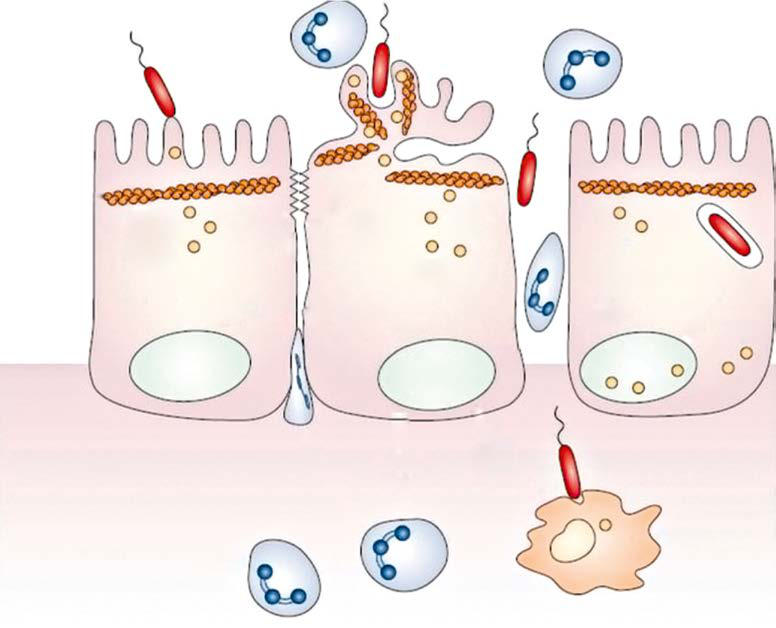
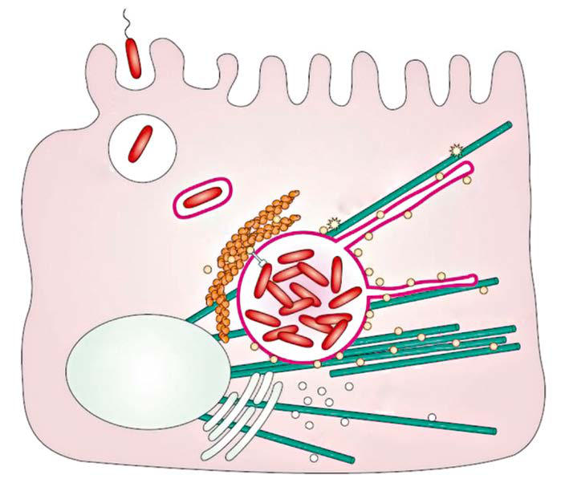

# Chapter 244: Salmonella

*Jeffrey S. McKinney*

<!-- p.2245 -->
**DTaP Vaccines** Several diphtheria and tetanus toxoids combined with acellular pertussis vaccines **(DTaP)** or combination products currently are licensed in the United States for children <7 years old. Acellular pertussis vaccines all contain inactivated PT and two or more addi tional antigens (FHA, Prn, and Fim 2 and 3). Clinical effectiveness immediately at completion of the five-dose series is approximately 80% for illness defined as “paroxysmal cough” for >21 days. Mild local and systemic adverse events are not uncommon, but more serious events (i.e., persistent crying for ≥3 hours or a hypotonic hyporesponsive episode) are rare after DTaP, are not specific to per tussis vaccine or associated with serious sequelae, and are not con traindications to subsequent doses.

Four doses of DTaP should be administered during the first 2 years of life, generally at ages 2, 4, 6, and 15-18 months. In high-risk settings, infants may be given DTaP as early as 6 weeks of age, with monthly doses through the third dose. The fourth dose may be administered as early as 12 months of age, provided that 6 months have elapsed since the third dose. When feasible, the same DTaP product is recommended for all doses of the primary vaccination series. The fifth dose of DTaP is recom mended for children at 4-6 years of age; a fifth dose is not necessary if the fourth dose in the series is administered on or after the fourth birthday.

Local reactions increase modestly in rate and severity with succes sive doses of DTaP. Swelling of the entire thigh or upper arm, some times accompanied by pain, erythema, and fever, has been reported in 2–3% of vaccinees after the fourth or fifth dose of a variety of DTaP products. Limitation of activity is less than might be expected. Swell ing subsides spontaneously without sequelae. The pathogenesis is unknown. Extensive limb swelling after the fourth dose of DTaP usu ally is not associated with a similar reaction to the fifth dose and is not a contraindication to subsequent dose(s) of pertussis vaccines.

Exempting children from pertussis immunization should be consid ered only within the narrow limits as recommended. Exemptors have significantly increased the risk for pertussis and play a role in outbreaks of pertussis among immunized populations. Although well-documented pertussis confers short-term protection, the duration of protection is unknown; immunization should be completed on schedule in children diagnosed with pertussis. Pertussis vaccine (DTaP or Tdap) can be admin istered concurrently with any vaccine on the immunization schedule.

**Tdap Vaccines** Two tetanus toxoid, reduced-diphtheria toxoid, and acellular pertus sis antigen vaccine (Tdap) products were licensed in 2005 and rec ommended universally in 2006 for adolescents. The preferred age for Tdap vaccination is 11-12 years. All adolescents and adults of any age (including ≥65 years) who have not received Tdap should receive a single dose of Tdap promptly, regardless of interval since Td, or at least in place of one Td booster at the 10-year interval, or when indicated during wound management.

Pregnant women should be given Tdap during *every* pregnancy to provide passive antibody protection to the infant until administration of DTaP. Although Tdap can be given at any time during pregnancy, optimal administration is early in the period between 27 through 36 weeks of gestation to maximize antibody concentration at birth. The safety of Tdap during pregnancy and effectiveness in reducing fatal pertussis in infants are proven. Special effort should be made to ensure that contacts of infants have received DTaP or Tdap as recommended.

Clinical trials support the safety and immunogenicity of a second dose of Tdap; however, antipertussis antibodies decline rapidly after the first year. The CDC performed a decision analysis model of repeating Tdap at either a 5- or 10-year interval for the general population and concluded that “booster(s)” would have limited impact on pertussis disease burden. There is not a recommendation for a routine second dose of Tdap in the general population. A single dose of Tdap should be given to children 7-10 years of age who lack DTaP dose(s). Since 2019, the updated CDC recommendations allow use of either Tdap or Td when Td alone is indicated for catch-up dose(s), or for decennial immunization, or for wound management in individuals who have received Tdap.

**Vaccines Under Development** Several strategies are being tested to create pertussis vaccines that elicit a Th1 response, dampen the density of mucosal infection and trans mission, provide sustained protection against disease, and have toler able reactogenicity. These include use of live attenuated *B. pertussis,* a genetically (rather than a chemically) inactivated PT component, novel antigens, and adjuvants.

*Visit Elsevier eBooks+ at eBooks.Health.Elsevier.com** for Bibliography.*

*Jeffrey S. McKinney*

**Salmonellosis** is one of the most widely distributed and common food-borne and fecal-oral diseases in humans, and **Salmonellae** live in the intestinal tracts of multiple species. *Salmonella* infections are a major public health problem, with disproportionate morbidity and mortality among infants and children and in certain immunocompro mised individuals.

Clinically, *Salmonellae* have been most broadly classified as being either nontyphoidal or typhoidal, with the latter causing typhoid (also known as *enteric*) fever. The differences in the disease mani festations from these two groups of pathogens, one predominantly causing intestinal inflammation and the other leading to sys temic disease, are increasingly understood to be related to specific genes and pathogenicity islands in the genomes of the respective organisms.

Most nontyphoidal serovars of *Salmonella* (widely distributed across multiple host species) are rarely able to overcome defense mechanisms in humans that limit bacterial dissemination from the intestine. Thus in immunocompetent humans, nontyphoidal serovars usually produce a self-limiting gastroenteritis. By contrast, *S.* Typhi and *S.* Paratyphi (i.e., the typhoidal strains of *Salmonella,* notably host-restricted to only humans) possess virulence traits that more readily allow them to over come mucosal barrier functions and then cause severe systemic illness, even in immunocompetent patients.

However, a purely binary classification of *Salmonellae* as nontyphoi dal vs typhoidal can be a problematic oversimplification. For example, reports from Africa have identified strains of nontyphoidal *Salmo nellae* that are highly invasive and increasingly common. Like many gram-negative bacteria, mobile or differentially expressed genetic elements can radically alter phenotypes in *Salmonellae,* sometimes in direct response to selective pressures like antimicrobial exposures given to individual patients and/or in broader settings like agricultural antimicrobial use.

Although DNA hybridization studies result in enough similarities for all *Salmonellae* to currently be classified in the single species *Sal monella enterica,* serologic studies can resolve more than 2,000 sero types. Serotype and DNA sequencing identification has helped clinical laboratories better trace disease outbreaks, and the Centers for Disease Control and Prevention (CDC) has published recent guidelines for a more consistent terminology to help both laboratory and clinical teams confront complex classification nomenclature.

Host differences are also profoundly relevant to the outcomes of *Salmonella* exposures, infections, and disease. Infants and children, patients with certain immunologic vulnerabilities, and the extent to which a given *Salmonella* infection can evade host defenses and/or antibacterial drugs can help predict, or at least better understand, the ultimate impact of *Salmonella* on both individual and public health.

<!-- p.2247 -->

## 244.1  Nontyphoidal Salmonellosis Jeffrey S. McKinney

**ETIOLOGY* Salmonellae* are motile, nonsporulating, gram-negative rods that grow in aerobic and facultative anaerobic conditions. They remain viable at ambient or reduced temperatures for days and may survive for weeks in sewage, foods, pharmaceutical agents, and fecal material. They are resistant to many physical agents but can be killed by heat to 54.4°C (130°F) for 1 hour or 60°C (140°F) for 15 minutes.

Most serotypes of nontyphoidal *Salmonella* have a broad host spec trum, including both warm-blooded and cold-blooded vertebrates, and even insects like flies and cockroaches. Some serotypes have more limited host ranges, such as *S. dublin* in cattle (recovered in human infections associated with unpasteurized milk) and *S. choleraesuis* in pigs. In human infections, these two serotypes also have a notable propensity to cause more bacteremia and fewer gastrointestinal symp toms as compared with many other nontyphoidal *Salmonellae*. In sub- Saharan Africa, nontyphoidal *Salmonella* has become a leading cause of **bacteremia**. Up to 95% of the serovars associated with invasive *Sal monella* disease among children in this geographic region are *Salmo nella* serovar Typhimurium (mostly of an unusual variant designated **multilocus sequence type 313**), a variant of sequence type 313 that does not express phase 2 flagella, or *Salmonella* serovar Enteritidis. This information represents a deviation from the historical assumption that nontyphoidal *Salmonella* is, by definition, relatively noninvasive.

In the United States, nontyphoidal *Salmonella* infections still gener ally cause **gastroenteritis** that is localized and self-limiting. In these uncomplicated cases, nontyphoidal *Salmonella* infection does not jus tify treatment with antibiotics. However, nontyphoidal infections can be severe in the young, the elderly, and patients with vulnerabilities in their immunity.

**EPIDEMIOLOGY** Salmonellosis has a significant cost to society. Globally, estimates sug gest there are more than 90 million cases of *Salmonella* gastroenteritis annually, causing more than 150,000 deaths. In the United States, CDC estimates suggest an annual burden of more than 1.3 million *Salmo nella* infections, causing more than 26,000 hospitalizations, 420 deaths, and $400 million in direct medical costs, with approximately 30 people with unreported *Salmonella* illness for every one case confirmed by a laboratory test. Nearly half of culture-proven nontyphoidal *Salmonella* infections occur in children, with the highest incidence among infants. With the burden of HIV infections and malnutrition in Africa, nonty phoidal *Salmonella* bacteremia has emerged as a major cause of mor bidity and mortality among both children and adults in Africa.

Nontyphoidal *Salmonella* has a worldwide distribution, with the incidence influenced by local standards of hygiene, sanitation, and availability of safe water and food. Modern practices of mass food pro duction and distribution increase the potential for epidemics, which may be scattered so broadly as to only be fully appreciated via **robust national monitoring systems**, such as the CDC’s **FoodNet** (https:// www.cdc.gov/foodnet/foodnet-fast.html). FoodNet also helps build capacity for food-borne disease surveillance through close collabora tions with PulseNet, EHS-Net, Global SalmSurv, and other partners.

Poultry meat and eggs are traditionally known to be a common source of salmonellosis, and even riding in a shopping cart next to poultry meat is a risk factor for infection of infants. However, con sumption of a wide variety of foods has now been associated with outbreaks, including fruits, vegetables, and multiple factory-processed foods such as peanut butter, cookies, and infant formula.

*Salmonella* infections in many parts of the world may be related to **animal husbandry practices**, including drug-resistant strains that emerge in response to the widespread use of agricultural antimicrobi als. Subtherapeutic antimicrobials are often added to animal feeds to promote animal growth. There is now strong evidence linking resis tance to quinolones to the use of this group of antimicrobials in animal

feeds. Resistance to ciprofloxacin approached 10% of all nontyphoidal *Salmonella* isolates assessed by the CDC in 2017.

In addition to the effect of antibiotic use in animal feeds, the rela tionship of *Salmonella* infections to prior antibiotic use in children in the month before the infection is well recognized. This association may be related to alterations in gut microbial ecology, which predisposes to colonization and infection with antibiotic-resistant *Salmonella* isolates. The CDC reports that nontyphoidal *Salmonella* isolates during the period 2015–2017 continue to manifest increasing rates of resistance, with 16% of isolates being resistant to at least one essential antibiotic (including ciprofloxacin, azithromycin, ceftriaxone, ampicillin, and trimethoprim-sulfamethoxazole). *Variation in resistance among differ ent strains makes Salmonella culture and antibiotic susceptibility testing very important.*

It appears that some **multidrug-resistant (MDR)** strains of *Sal monella* are also more virulent than susceptible strains. Poor clini cal outcomes with these infections do not relate solely to the initial empiric choice of ineffective antibiotics. Over the past 3 decades, **S. Typhimurium phage type DT104** has emerged as a globally dissemi nated MDR strain. Typically resistant to ampicillin, chloramphenicol, streptomycin, sulfonamides, and tetracycline, DT104 also has the capacity to acquire resistance to other antibiotics. Many of the resis tance genes in DT104 are harbored on genomic islands. Integrons can also encode and disseminate virulence genes.

Several risk factors are associated with outbreaks of *Salmonella* infection. Animals constitute the principal source of human dis ease from nontyphoidal *Salmonella*. **High-risk pets** include reptiles, amphibians, poultry and other birds, rodents, and other small mam mals. The risk of *Salmonella* from turtles was so high that the U.S. Food and Drug Administration (FDA) banned the interstate sale and distri bution of turtles with shell length of less than 4 inches. Exposures can also occur from contact with cages or tanks with pets, from touching some pet foods and treats, and even at zoos *without* direct contact with an infected animal.

Animals that carry *Salmonella* still appear healthy and clean and can readily transmit nontyphoidal *Salmonella,* including in **childcare centers and schools**. When nontyphoidal serovars are identified in a childcare attendee or staff member, adherence to hygiene practices is used to control infection. Return to school is allowed as long as stools are contained in a young child’s diaper, toilet-trained children do not have accidents using the toilet, and stool frequency becomes no more than two stools above the child’s normal stooling frequency per day. In notable contrast to infections with typhoidal strains, demonstration of clearance of nontyphoidal *Salmonella* from stool cultures is neither sought nor required.

Given the ubiquitous nature of the organism, **nosocomial infec tions** with nontyphoidal *Salmonella* strains can also occur via con taminated equipment and diagnostic or pharmacologic preparations. Patient-to-patient spread can also occur in hospital settings, par ticularly among vulnerable hosts like neonates. Nursery nosocomial infections from *Salmonella* can be very difficult to control, sometimes taking months to stop and/or serving as a source for further spread through a hospital.

**PATHOGENESIS** The estimated number of bacteria that must be ingested to cause symp tomatic disease in healthy adults is 106-108 *Salmonella* organisms. Normal gastric acidity inhibits *Salmonella* multiplication, with most organisms rapidly killed at gastric pH <2.0. Achlorhydria, buffering medications, and rapid gastric emptying after gastroenterostomy allow more viable organisms to reach the small intestine and thus lower the infectious dose. Neonates and infants have hypochlorhydria and rapid gastric emptying, which contribute to their increased vulnerability to infection, even at lower inoculum exposures.

The typical intestinal response to nontyphoidal *Salmonella* infec tion is **enterocolitis**, with diffuse mucosal inflammation and edema, sometimes with erosions and microabscesses. Intestinal inflamma tion with neutrophils and macrophages usually involves the lamina propria. Underlying intestinal lymphoid tissue and mesenteric lymph

<!-- p.2248 -->
nodes enlarge and may demonstrate small areas of necrosis. Lymphoid hypertrophy may interfere with blood supply to the gut mucosa and/or serve as a leading edge for intussusception. Hyperplasia of the reticu loendothelial system can also be found in the liver and spleen. If bac teremia develops, it may lead to localized infection and suppuration in almost any organ.

Central to *S.* Typhimurium pathogenesis are two **type III secre tion systems**. These systems secrete and translocate bacterial proteins termed **effectors** into host cells. These effectors manipulate the host cell to allow bacterial invasion and assembly of an intracellular niche conducive to bacterial survival and replication. Two **genomic pathoge nicity islands** encode these type III systems.

The *Salmonella* pathogenicity island 1 (SPI-1) is involved with epi thelial cell adherence and invasion (Fig. 244.1), which involves host cell membrane ruffling caused by organized actin rearrangement (Fig. 244.2). This adherent and invasive phenotype of *Salmonella* is activated under conditions like those found in the human small intestine (high osmolarity, low oxygen).

The *Salmonella* pathogenicity island 2 (SPI-2) is involved with for mation of the *Salmonella*-containing vacuole (Fig. 244.3), creating a replication-permissive intracellular space (Fig. 244.4). Intracellular *S.* Typhimurium is found within special vacuoles that have diverged from the normal endocytic pathway. An ability to survive within monocytes/ macrophages is a key process for *S.* Typhimurium to establish a sys temic infection. Survival within host cells also shields *Salmonella* from antimicrobials. For example, gentamicin is not considered effective in vivo against *Salmonella,* even for strains found susceptible to this drug in vitro, because gentamicin does not effectively reach intracel lular bacteria.

Bacteremia and systemic disease are possible with any *Salmonella* sero type, especially in individuals with reduced host defenses. Inflammatory bowel disease or gut ischemia can cause intestinal mucosal barrier defects. Malnutrition, corticosteroid therapy, interleukin (IL)-12/interferon gamma axis defects, and posttransplant immunosuppressant agents can significantly compromise cell-mediated immunity. The reticuloendothe lial system can be overloaded with hemoglobin or iron or have impaired function from lymphoma or leukemia. In addition, other underlying sys temic conditions can predispose to serious *Salmonella* infections, includ ing sickle cell disease, collagen vascular diseases, HIV/AIDS, defects in TH1 or TH17 immunity, and chronic granulomatous disease.

As stated earlier, neonates and infants less than 3 months of age are also at higher risk of bacteremia from nontyphoidal *Sal monella*. This risk influences empiric treatment with appropri ate antibiotics, even in otherwise healthy patients in this young age-group.

Patients with sickle cell disease are at very high risk for *Salmonella* septicemia and osteomyelitis. This risk may be related to the presence of numerous infarcted areas in the gastrointestinal tract, bones, and reticuloendothelial organs, along with reduced phagocytic and opso nizing capacity of patients with sickle cell disease.

**CLINICAL MANIFESTATIONS Acute Enteritis** The most common clinical presentation of salmonellosis is acute enteritis. After an incubation period of 6-72 hours (mean 24 hours), there is often abrupt-onset nausea, vomiting, and crampy abdominal pain, located predominantly in the periumbilical area and the lower abdominal quadrants. These symptoms are usually followed by mild to severe watery diarrhea, sometimes containing blood, neutrophils, and mucus. Although fever is a classic feature, younger infants may exhibit a normal or subnormal temperature. Symptoms usually sub side within 2-7 days in otherwise healthy children. However, some children experience a septicemia-like picture, with symptoms includ ing high fever, drowsiness, confusion, abdominal distention, menin gismus, and/or seizures.

## Bacteremia After Salmonella gastroenteritis, it is estimated that 1–5% of oth erwise healthy children are thought to experience transient

bacteremia after nontyphoidal *Salmonella* in U.S. settings. Bactere mia is usually accompanied by fever in older children but is often not associated with fever in infants. As described earlier, specific vulnerable hosts are far more likely to have systemic infection. Chil dren with HIV can have recurrent nontyphoidal *Salmonella* septice mia, despite antibiotic therapy, even without positive stool cultures or any clear nidus of infection. Some nontyphoidal strains are more likely to result in bacteremia, even without obvious gastrointestinal symptoms, including *S. dublin* and *S. choleraesuis.* In Africa, non typhoidal *Salmonella* is a much more common cause of pediatric bacteremia (see next).

**Nontyphoidal Salmonella****Bacteremia as Emerging Disease in Africa** In Africa, particularly sub-Saharan Africa, nontyphoidal *Salmonella* has been increasingly recognized among the most common causes of *all* bacteremia in febrile children. Children age 6-36 months are at greatest risk, and case fatality rates can reach 25%.

Clinical features among children with invasive nontyphoidal *Sal monella* infections can be confusing, as diarrhea is often *not* a promi nent feature. Furthermore, 60% of these children have an apparent lower respiratory tract infection (perhaps from co-infection or comorbidity). Fever is present in 95% but may have no apparent focus. Figure 244.5 summarizes other clinical features. The lack of specificity of these features severely compromises the ability of cur rent clinical algorithms to identify invasive nontyphoidal *Salmonella* infections. Accordingly, blood culture and clinical microbiology systems for bacterial growth, isolation, speciation, and antibiotic susceptibility testing are required for diagnosis and well-informed treatment decision-making.

It remains unclear exactly why invasive infections by nontyphoidal *Salmonella* seem so much more frequent in Africa compared with the dominance of typhoid *Salmonellae* in Asia. HIV is one identified host risk factor for nontyphoidal *Salmonella* infection. Indeed, recurrent nontyphoidal *Salmonella* infection was part of early CDC case defini tions for AIDS. However, only 20% of African children with invasive nontyphoidal *Salmonella* disease are HIV positive. Other risks for invasive nontyphoidal *Salmonella* may include recent or severe malaria infections, anemia, and malnutrition.

The epidemic patterns thus far appreciated for invasive infections by nontyphoidal *Salmonella* in Africa suggest that epidemics may occur over several years, peaking in the rainy season. However, it remains unclear how relevant human diarrheal disease or gastrointestinal car riage, or even food or zoonotic sources are, for invasive nontyphoidal *Salmonella* infection in this setting. Thus optimal strategies for inter rupting transmission are also not known. This is particularly prob lematic, given the emergence of extensive antibiotic resistance among nontyphoidal *Salmonella* isolates, including the lineage referred to as *sequence type 313* (ST313).

Recent studies have attempted to better understand the geographic spread and genetic features of ST313 lineage variants isolated inter nationally over time. Intriguingly, the antibiotic-resistance patterns of these lineages seem to correlate with some large-scale or sequential changes in empiric (e.g., chloramphenicol, third-generation cephalo sporins, ciprofloxacin, and azithromycin) antibiotic use. ST313 lin eage genomic analysis also reveals the accumulation of **pseudogenes**, in what may be crucial **loss****-of-function genetic events** involved in ST313 stepwise evolution, perhaps as part of adaptation to a more restricted (human) host range and from an intestinal to a systemic lifestyle.

For invasive nontyphoidal *Salmonella* infections in Africa, evolv ing resistance patterns seem likely to force increasing reliance on more expensive treatment options. Local resistance patterns may help empirically, but given the rapid spread of various ST313 lin eages, susceptibility testing of individual patient isolates will be needed to ensure appropriate antibiotic choices. Targeted resistance gene sequencing, especially for gyrase mutations related to quino lone resistance, may also be warranted as that drug class becomes more widely used.

<!-- p.2249 -->
**Nontyphoidal Salmonella****Bacteremia in Other Geographic Regions** The emergence of invasive, high-mortality nontyphoidal *Salmonella* infections in Africa underscores that the traditional binary division of *Salmonella* infections into typhoidal vs nontyphoidal may be a prob lematic oversimplification. However, in settings outside of Africa, nontyphoidal *Salmonella* infections still tend to be self-limiting and noninvasive and are low-mortality events for most children who are immunocompetent.

Risk factors for systemic spread of nontyphoidal *Salmonella* include underlying sickle cell disease, HIV/AIDS, intestinal mucosal barrier defects, malnutrition, IL-12/interferon gamma axis defects, defects in TH1 or TH17 immunity, corticosteroid therapy or posttransplant immunosuppressants, reticuloendothelial system dysfunction (e.g., from overload with hemoglobin or iron), lymphoma or leukemia, col lagen vascular diseases, and chronic granulomatous disease. Neonates and infants less than 3 months of age are also at higher risk of bactere mia from nontyphoidal *Salmonella*.

**Extraintestinal Focal Infection** After bacteremia, *Salmonellae* have the propensity to cause focal sup purative infection of many organs. The most common focal infections involve the skeletal system, meninges, and intravascular sites. The peak incidence of *Salmonella* meningitis is in infancy, and the infection may

be associated with a florid clinical course, high mortality, and neuro logic sequelae in survivors.

**Chronic Salmonella**** Carriage** Although traditionally considered a complication among *adults* with *Salmonella* infection, chronic *Salmonella* carriage has important medi cal and epidemiologic implications and may occasionally occur in children. Colonization of the gallbladder by *S.* Typhi and persistent shedding from the gallbladder have long been appreciated. Reports sug gest some nontyphoidal *Salmonellae* (e.g., invasive nontyphoidal *Salmo nella* currently in Africa) can also establish long-term carriage states.

Antibiotic treatments of *Salmonella* infections are paradoxical in that the prospect of becoming a chronic carrier is believed to be increased by exposure to antibiotics. Yet clearance of established chronic carrier status requires prolonged medical treatment using antibiotics to which the *Salmonella* is susceptible and sometimes requires gallstone or gall bladder removal.

**DIAGNOSIS** Few clinical features are specific enough to *Salmonella* to allow differ entiation from other infectious causes of gastroenteritis or diarrhea. Serologic tests also do not have diagnostic value. Definitive diagnosis requires identification of *Salmonella* via stool **nucleic acid amplifica tion test** (NAAT) or **bacterial cultures**. Stool cultures have higher yields

**Fig. 244.1** On contact with the epi thelial cell, Salmonellae assemble the Salmonella pathogenicity island 1–en coded type III secretion system (TTSS- 1) and translocate effectors (yellow spheres) into the eukaryotic cytoplasm. Effectors such as SopE, SopE2, and SopB then activate host Rho guano sine triphosphatase (GTPase), result ing in the rearrangement of the actin cytoskeleton into membrane ruffles, induction of mitogen-activated protein kinase (MAPK) pathways, and destabi lization of tight junctions. Changes in the actin cytoskeleton, which are fur ther modulated by the actin-binding proteins SipA and SipC, lead to bac terial uptake. MAPK signaling acti vates the transcription factors activator protein-1 (AP-1) and nuclear factor-κB (NF-κB), which turn on production of the proinflammatory polymorphonu clear leukocyte (PMN) chemokine in terleukin (IL)-8. SipB induces caspase- 1 activation in macrophages, with the release of IL-1β and IL-18, augmenting the inflammatory response. In addi tion, SopB stimulates Cl− secretion by its inositol phosphatase activity. The destabilization of tight junctions allows the transmigration of PMNs from the basolateral to the apical sur face, paracellular fluid leakage, and access of bacteria to the basolateral surface. However, the transmigration of PMNs also occurs in the absence of tight-junction disruption and is further promoted by SopA. The actin cytoskel eton is restored, and MAPK signaling is turned off by the enzymatic activities of SptP. This also results in the downmod ulation of inflammatory responses, to which SspH1 and AvrA also contribute by inhibiting activation of NF-κB. (From Haraga A, Ohlson MB, Miller SI. Salmo nellae interplay with host cells. Nat Rev Microbiol. 2008;6:53–66.)

Membrane ruffle Tight junction

*Salmonella* spp.

Actin

Epithelial cell

SopE SopE2 SopB

Rho GTPases

SipA SipC

MAPK MAPK

SopB

SopA

Cl–

Cl– NF-κB AP-1

NF-κB

IL-8

PMN SipB

Macrophage

IL-1β IL-18

SspH1 AvrA

Rho GTPases

SptP

<!-- p.2250 -->

**Fig. 244.3** Formation of the Salmonella-containing vacuole (SCV) and induction of the Salmonella patho genicity island 2 (SPI-2) type III secretion system (TTSS) within the host cell. Shortly after internalization by macropinocytosis, Salmonellae are enclosed in a spa cious phagosome that is formed by membrane ruffles. Later, the phagosome fuses with lysosomes, acidifies, and shrinks to become adherent around the bacterium and is called the SCV. It contains the endocytic marker lysosomal-associated membrane protein 1 (LAMP- 1; purple). The Salmonella SPI-2 is induced within the SCV and translocates effector proteins (yellow spheres) across the phagosomal membrane several hours after phagocytosis. The SPI-2 effectors SifA and PipB2 contribute to formation of Salmonella-induced filament along microtubules (green) and regulate mi crotubule motor (yellow star shape) accumulation on the Sif and the SCV. SseJ is a deacylase that is active on the phagosome membrane. SseF and SseG cause microtubule bundling adjacent to the SCV and direct Golgi-derived vesicle traffic toward the SCV. Actin accumulates around the SCV in an SPI-2–dependent manner, in which SspH2, SpvB, and SseI are thought to have a role. (From Haraga A, Ohlson MB, Miller SI. Sal monellae interplay with host cells. Nat Rev Microbiol. 2008;6:53–66.)

SifA PipB2

SCV

Salmonella spp.

Actin

Epithelial cell

Spacious phagosome

Sif

SseJ

SseF SseG

Nucleus

Golgi

Microtubules

Secretory vesicles

SspH2 SpvB Ssel

Microtubule motors

1 Pm

10 Pm

B

A

**Fig. 244.2** Salmonella SPI-1–mediated effects include host cell actin cytoskeletal rearrangements and host cell membrane ruffling as part of Salmonella invasion. A, HeLa cell infected with Salmonella fixed and stained for the actin cytoskeleton with phalloidin (green) and for Sal monella (yellow). B, Cos cell infected with Salmonella and prepared for scanning electron microscopy. Cell surface extensions in the process of enveloping the bacterium are pseudocolored green, and the microbe is in yellow. (From Rottner K, Stradal TEB, Wehland J. Bacteria-host-cell interactions at the plasma membrane: stories on actin cytoskeleton sub version. Dev Cell. 2005;9:3–17.)

than rectal swabs. Blood cultures are suggested for patients at higher risk of bacteremia or endovascular focus and when enteric fever is a concern. Additionally, cultures of bone marrow (particularly valuable

if antimicrobial agents have been administered or if stringent criteria are met for **fever of unknown origin**), duodenal fluid, and urine may be beneficial to detect enteric fever. In patients with sites of local sup puration, aspirated specimens should be Gram-stained and cultured.

*Salmonella* organisms grow well on nonselective or enriched media, such as blood agar, chocolate agar, and nutrient broth, but stool speci mens containing mixed bacterial flora require a selective medium, such as McConkey, xylose-lysine-deoxycholate, bismuth sulfate, or Salmonella-Shigella (SS) agar for isolation of *Salmonella*. Given *Sal monella* variation and evolution, it is important to pursue bacterial isolation, species identification, and **antibiotic susceptibility testing* to best inform the choice of effective therapeutic agents.* State public health laboratories require *Salmonella* isolates as part of outbreak detection and investigation, increasingly via genomic characterization of strains.

**TREATMENT** Appropriate therapy depends on the specific clinical presentation of *Salmonella* infection. In children with gastroenteritis, rapid clinical assessment, correction of dehydration and electrolyte disturbances, and supportive care are key. Antimotility drugs (e.g., loperamide) should not be given to children less than 18 years of age with acute diarrhea, but antiemetic drugs (e.g., ondansetron) can be given to facil itate oral rehydration in children older than 4 years.

Antibiotics are generally *not* recommended for the treatment of iso lated uncomplicated *Salmonella* gastroenteritis because they can dis rupt normal intestinal flora and potentially prolong the fecal excretion of *Salmonella*.

However, empiric antibiotics are started for young infants (<3 months old) and for children with increased possibility of disseminated infec tion (e.g., children with HIV, malignancies, sickle cell disease, immuno deficiencies, or immunosuppression, as detailed earlier). In the United States, this empiric therapy includes a third-generation cephalosporin, with a blood culture obtained just before the initial dose. If a patient does not appear ill and does not have any evidence of disseminated infection, oral azithromycin can be started, pending blood culture results. Ampicillin, trimethoprim-sulfamethoxazole, or a fluoroquino lone may be considered as treatment options for susceptible strains.

In cases of bacteremia, blood cultures need to be repeated to con firm clearance of infection. Transition from parenteral third-generation

<!-- p.2251 -->
cephalosporin to oral azithromycin or a fluoroquinolone can be con sidered after documented clearance of blood cultures and exclusion of

secondary sites, for a total 7- to 10-day course. Disseminated disease needs to be rigorously excluded, as therapy is more prolonged for men ingitis (4 weeks) and osteomyelitis or other focal metastatic infections (4-6 weeks).

Given the heterogeneity, evolution, and rapid geographic spread of *Salmonella,* it is important to maintain awareness of resistance trends as related to local and national community isolate patterns, any relevant interstate outbreaks, and global patterns of emerging *Salmonella* resis tance. Serially updated resources with this information include local microbiology laboratory data and open-access reporting systems like the U.S. National Antimicrobial Resistance Monitoring System for Enteric Bacteria (NARMS). In NARMS reports from 2018, the majority (81%) of nontyphoidal *Salmonella* from humans were still *not* resistant to any of the antimicrobials tested. However, approximately 3%, 10%, and 0.3% of nontyphoidal *Salmonella* isolated from humans were intrinsically resistant to ceftriaxone, ciprofloxacin, and azithromycin, respectively.

Some contemporary nontyphoidal *Salmonellae* are of particular interest, given their resistance to antimicrobials. *S.* Typhimurium DT104 spread globally in the 1990s, when it was resistant to ampicillin, chloramphenicol, streptomycin, sulfonamides, and tetracycline. DT104 now sometimes also has reduced susceptibility to fluoroquinolones. Nontyphoidal *Salmonella* ST313 lineages (described earlier) continue

A B

C D E

**Fig. 244.4** Ultrastructural analysis of the distal small intestine with transmission electron microscopy. Distal small intestinal tissue was fixed with 1% glutaraldehyde. Short segments were cut open, post fixed with osmium tetroxide, contrasted with uranyl acetate, and dehydrated with a graded etha nol series before been embedded in epoxy resin. Thin sections were contrasted with lead citrate and analyzed in a JEM-1400 transmission electron mi croscope (JEOL). Images were taken with TemCam-F216 camera using EM MENU software (both TVIPS). A, Enterocytes in the distal intestine of healthy 5-day old neonates exhibit large supranuclear vacuoles (SNV) in their apical cytoplasm; the nuclei are situated at the basolateral site (N). SNV contain internalized milk proteins. Asterisks indicate intercellular spaces between enterocytes. B, 4 days after infection of 1-day-old mice with S. Typhimurium, the epithelium is infiltrated by polymorphonuclear cells (PMN). C-E, Intraepithelial Salmonella microcolonies are observed. Some bacteria reside in spherical vacuoles, which contain electron-dense material resembling the content of SNVs. Other bacteria appear to be localized in tight membrane- bound vesicles with few visible connections between them, or with vesicles filled with electron dense material. (From Zhang K, Griffiths G, Repnik U, Hornef M. Seeing is understanding: Salmonella’s way to penetrate the intestinal epithelium. Int J Med Microbiol. 2018 Jan;308:97-106. Fig. 2.)

**Fever:** 95% of cases, no apparent focus in 35%

**Blood tests:** Severe anemia in 40–50% of adults and 25–40% of children, 95% of adults and 20% of children are HIV positive, CD4 count <200 cells per µL in 80% of adults

**Splenomegaly:** 30–45% of cases

**Hepatomegaly:** 15–35% of cases **Diarrhea:** 20–50% of cases, but often not a prominent feature

**Pneumonia:** 60% of children and 30% of adults have an apparent lower respiratory tract infection focus, commonly due to co-infection

**Fig. 244.5** Clinical features of invasive nontyphoidal Salmonella (NTS) disease in adults and children in Africa. (From Feasey NA, Dougan G, Kingsley RA, et  al. Invasive non-typhoidal Salmonella disease: an emerging and neglected tropical disease in Africa. Lancet. 2012;379: 2489–2499.)

<!-- p.2252 -->
to show resistance pattern evolution in Africa. In the United States, *S.* Infantis has now supplanted other leading serotypes in poultry and not only exhibits deceased susceptibility to fluoroquinolones because of a gyrA pathogenic variant but also contains an MDR plasmid that car ries up to 10 resistance genes, conferring resistance to cephalosporins, tetracycline, chloramphenicol, and sulfonamides. This MDR strain of serovar Infantis has been reported to account for up to 35% of the non typhoidal Salmonella infections in Israel.

**PROGNOSIS** Most otherwise healthy children with *Salmonella* gastroenteritis recover fully without antimicrobial treatment. Malnourished children and those who do not receive adequate supportive care can be at risk for prolonged diarrhea and complications. Young infants and immu nocompromised patients often have systemic involvement, and chil dren with HIV can have a florid and recurring course.

After infection, nontyphoidal *Salmonella* are excreted in feces for a median of 5 weeks, during which time the recovering patient can infect others via fecal-oral routes or by contaminating foods. A prolonged carrier state is rare in children but is more common among those with biliary tract disease and/or cholelithiasis.

**PREVENTION** Control of transmission of *Salmonella* infections to humans requires control of the infection in animal reservoirs, judicious use of agri cultural antimicrobials, prevention of contamination of foodstuffs, and appropriate standards of food processing and inspection. Parents should be advised about the risk of various pets (especially reptiles, amphibians, and rodents).

Large outbreaks are often related to mass food production, present ing among widely geographically distributed patients. In the United States, CDC outbreak investigations are reported, via this site: https: //www.cdc.gov/Salmonella/outbreaks.html, which includes maps and epidemiologic, traceback, and laboratory data, including outbreaks linked to specific foods, animals, and other sources. Awareness of these events can potentially blunt the extent of a given outbreak and/or alert caregivers of vulnerable hosts.

*Visit Elsevier eBooks+ at eBooks.Health.Elsevier.com** for Bibliography.*

## 244.2  Enteric Fever (Typhoid and Paratyphoid Fever) Jeffrey S. McKinney

Enteric fever *(typhoid or paratyphoid fever)* remains endemic in many developing countries. Given the ease of modern travel, cases regularly occur in developed countries as well, usually among returning travelers or from secondary transmission from an asymptomatic carrier.

**ETIOLOGY** Typhoid fever is caused by *S. enterica* serovar Typhi (*S.* Typhi). A similar but often less severe disease is caused by *Salmonella* Paratyphi A, B, and C. All are classically referred to as typhoidal *Salmonellae*. Typhoidal *Salmonellae* share more than 90% of their genes with the classic nontyphoidal strain, *S.* Typhimurium, but several genetic clus ters known as *pathogenicity islands* and other genes have been acquired during evolution. The inactivation of single genes and the acquisition or loss of genes may have contributed to host adaptation and restriction of typhoidal strains. Importantly, whereas nontyphoidal *Salmonella* are found in many hosts and can be transmitted among them, typhoidal *Salmonella* only infects humans.

In contrast to the diarrheal symptoms classically encountered in gastroenteritis caused by nontyphoidal *Salmonellae,* enteric fever caused by typhoid or paratyphoid *Salmonellae* may present as abdomi nal pain without diarrhea, a fever without focus, and/or with extraint estinal foci of infection. Indeed, although enteric fever clearly starts in the gastrointestinal tract, the systemic nature of its presentation and

symptomatology (and even its initial hard-to-detect primary bactere mia) can delay diagnosis, in particular among patients returning from or living in endemic areas, where the differential diagnosis for fevers is broad.

**EPIDEMIOLOGY** Recent large-scale data and modeling efforts estimate that 14.3 million cases of typhoid and paratyphoid fevers occurred globally in 2017, a decline from 25.9 million cases in 1990. Incidence rates peak in the 5to 9-year-old age-group, with roughly 13% of cases occurring in chil dren younger than 5 years and roughly 56% of cases among children younger than 15 years of age. South and Southeast Asia have notably high incidence rates, whereas moderate incidence rates are reported from Central and South America, Africa, Central and East Asia, and Oceania (Fig. 244.6).

*Typhoid fever is notable for the ongoing emergence of heterogeneous new patterns of drug resistance.* After early outbreaks of chloramphenicolresistant *S.* Typhi infections, *S.* Typhi strains emerged that were **multidrug resistant (MDR)**, fully resistant to all *three* of the tradi tional primary treatment antimicrobials: ampicillin, trimethoprimsulfamethoxazole, and chloramphenicol. There is also a considerable increase in fluoroquinolone-resistant and even ceftriaxone-resistant isolates of *S.* Typhi. In the United States, most travel-associated cases of typhoid fever are now fluoroquinolone resistant.

There are now *S.* Typhi strains that are **extensively drug resistant (XDR)** not only to ampicillin, trimethoprim-sulfamethoxazole, and chloramphenicol but also to ceftriaxone and with full or intermedi ate resistance to ciprofloxacin. It appears that the new XDR *S*. Typhi strains came from a large outbreak in 2016 linked to contaminated water in Pakistan’s Sindh province. XDR Typhi infections were then reported globally among travelers to or from Pakistan. In 2019 U.S. res idents with *no* history of international travel were also diagnosed with XDR typhoid fever. The optimal therapy for these XDR isolates is still being determined, with preliminary recommendations suggesting the empiric use of a carbapenem (e.g., meropenem), azithromycin, or both.

*S.* Typhi is highly adapted to infections of humans, and the discovery of a large number of **pseudogenes** in *S.* Typhi suggests that its genome may have undergone degeneration as part of a specialized association with the human host. *S*. Typhi has no apparent ability to cause trans missible disease in other animals. Thus direct or indirect contact with an infected human (either sick or a chronic carrier) is a prerequisite for infection. Ingestion of foods or water contaminated with human feces is the most common mode of transmission. So-called street vendor foods outside the home are one risk factor noted in one case control study from Pakistan; such risks are included in practical guidance for travelers about food and water precautions from the CDC Yellow Book (Health Information for International Travel). However, more general water-borne outbreaks related to poor sanitation or water system con tamination have also been described. Other causes of infection include consuming oysters and other shellfish cultivated in water contaminated by human sewage and the use of night soil as fertilizer.

**PATHOGENESIS** Human volunteer experiments have established an infecting dose of about 105–109 organisms, with an incubation period ranging from 4 to 14 days. After ingestion, *S*. Typhi invades the gut mucosa of the terminal ileum via specialized antigen sampling cells known as *M cells* that overlie gut-associated lymphatic tissues, through enterocytes, or via a paracellular route. In contrast to nontyphoi dal *Salmonella, S.* Typhi expresses factors that notably downregu late the pathogen receptor–mediated host inflammatory response. It assembles type III secretion systems to inject bacterial effectors that modulate host cell biology in elegant ways, including but not limited to rearrangements of host cell actin, facilitating invasion across the outer cell membrane and a host cell membrane ruffling process that forms a phagosome containing the bacteria. This phagosome fuses with lysosomes, acidifies, and shrinks to become adherent around the bacterium, forming the *Salmonella*-containing vacuole (SCV). This intracellular niche offers *Salmonella* a physical barrier to some

<!-- p.2253 -->

<!-- p.2254 -->
drugs (e.g., gentamicin, which has very poor intracellular penetra tion) and an intracellular replication site and means of host cell– mediated systemic spread.

After passing through the intestinal mucosa, *S.* Typhi organisms enter the mesenteric lymphoid system and then pass into the blood stream via the lymphatics. This primary bacteremia is usually asymp tomatic, and blood culture results are frequently negative at this early stage. The blood-borne bacteria are disseminated through the body and are thought to colonize the organs of the reticuloendothelial system, where they replicate within macrophages. After a period of bacterial replication, *S.* Typhi organisms are shed back into the blood, causing a secondary bacteremia that coincides with the onset of clinical symp toms and marks the end of the incubation period (Fig. 244.7). During this secondary bacteremia, classically with fever, blood cultures are far more frequently positive, although culture of bone marrow can be even more sensitive.

Both typhoidal and nontyphoidal *Salmonellae* are members of the same species and share substantive commonalities, including more than 90% of their DNA sequences. Yet a deeper appreciation of how and why typhoidal and nontyphoidal species differ offers insights at multiple levels, ranging from genetics and ecology, to pathobiology, to more nuanced clinical recognition and care.

Despite typhoidal (and paratyphoidal, used interchangeably in this section, unless specified otherwise) fevers being synonymous with the clinical diagnosis of **enteric fever**, the initial enteric inflamma tion from *S.* Typhi is notably less than that caused from most non typhoidal *Salmonellae*. Clinically, presenting symptoms of typhoid tend to include less diarrhea and far less gut mucosal inflammation. In host cell cultures, *S.* Typhi induces lower levels of IL-8 neutrophil chemoattractant and less of a toll-like receptor 5 (TLR5)–driven pro inflammatory response than seen with nontyphoidal *Salmonella*. One potential implication of this is that nontyphoidal *Salmonella* may use inflammation-derived luminal substances such as electron acceptors

like nitrate and tetrathionate, perhaps in competition with other fer menting gut microbes. Intriguingly, *S.* Typhi has genomic *decay* in a network of nontyphoidal *Salmonella* genes that are involved in anero bic metabolic pathways.

This is not to say that *S.* Typhi never results in intestinal lesions. In advanced stages of typhoid fever, life-threatening intestinal perforation can occur. However, the histopathology of typhoid perforation is dis tinct from the inflammation seen with nontyphoidal *Salmonella* gas troenteritis. With *S.* Typhi, inflammation that can finally penetrate the intestinal muscularis and serosa to cause perforation seems to originate from *deeper* sites, including underlying lymphoid tissue. In other tis sues, including liver, spleen, lymph nodes, and bone marrow, **typhoid nodules** composed of macrophage aggregates can also form.

**Gallbladder colonization** is also a notable feature of *S.* Typhi and can result in years-long *Salmonella* carriage and shedding, with pro found public health implications. The primary bacteremia of *S.* Typhi can seed the gallbladder, where exposure to bile upregulates *S.* Typhi (but seemingly *not* nontyphoidal *Salmonella*) type 3 secretion system genes that result in increased epithelial cell invasion.

*S.* Typhi expresses a surface **Vi (virulence) capsular polysaccha ride** that is *not* present in nontyphoidal *Salmonella* or in *S.* Paratyphi A or B (which is relevant to the community-level impact of current Vi-based vaccines). Encoded as part of the *S.* Typhi pathogenicity island 7 (SPI-7), the Vi capsular polysaccharide interferes with the sur face exposure of *S.* Typhi lipopolysaccharide and flagellin in ways that dampen host TLR-4 and -5 mediated **innate immune responses**. Vi also blocks complement C3 binding to the *S.* Typhi surface, interfering with **phagocytosis**.

Characterization of the **typhoid toxin** represents a major advance in understanding typhoid fever. Furthermore, in contrast to the Vi capsular polysaccharide, the typhoid toxin is expressed in both typhoi dal *and* paratyphoidal *Salmonellae*. This toxin may prove important for new therapeutic or diagnostic innovations based on antitoxin

Incidence rate (per100000)

0 to <15

ATG VCT

Grenada Dominica

Barbados Comoros Marshall Isl Kiribati

Solomon Isl FSM

Vanuatu Samoa

Fiji Tonga

Maldives Mauritius

TTO LCA Caribbean TLS Persian Gulf Singapore

Malta

Eastern Mediterranean

Balkan Peninsula Seychelles

West Africa

15 to <50 50 to <100 100 to <200 200 to <500 500 to <700

**Fig. 244.6** Incidence rates (per 100,000) of typhoid and paratyphoid fevers, by country, in 2017. Inset maps detail smaller locations. ATG, Antigua and Barbuda; FSM, Federated States of Micronesia; Isl, Islands; LCA, Saint Lucia; TLS, Timor-Leste; TTO, Trinidad and Tobago; VCT, Saint Vincent and the Grenadines. (From GBD 2017 Typhoid and Paratyphoid Collaborators. The global burden of typhoid and paratyphoid fevers: a systematic analysis for the Global Burden of Disease Study 2017. Lancet Infect Dis. 2019;19[4]:369–381.)

<!-- p.2255 -->
approaches. Typhoid toxin has three subunits. Subunit CdtB has DNAse I–like nuclease activity that causes double-stranded breaks in host cell DNA, leading to host G2/M cell cycle arrest and/or cell death. Subunit PltA is a pertussis-like toxin with mono–adenosine diphos phate (ADP)–ribotransferase activity. Subunit PltB is a pertussis-like toxin with receptor binding activity to glycans, especially sialoglycans, terminated in Neu5Ac. The functional typhoid toxin is composed of one CdtB and one PltA subunit, plus five PltB subunits. Typhoid toxin genes are expressed by intracellular *S.* Typhi in the SCV of host cells. The trafficking of the toxin uses an elegant mechanism, in which PltB binding to Neu5Ac is involved in both toxin export and toxin endocy tosis into target cells. The fact that Neu5Ac is the target for binding by PltB may help explain the cell tropism of typhoid toxin and also some of the human restriction of typhoidal infections and pathobiology at a molecular level.

The presence/gain/site-specific expression of certain virulence factors by typhoidal *Salmonellae* may help explain disease nuances involved in typhoid fever. Acquisition and spread of resistance genes are also a clear and present danger.

The overall quantity of **pseudogenes** in *S.* Typhi versus nontyphoi dal *Salmonella* genomes is also noteworthy. Whereas *S.* Typhi’s 200 pseudogenes account for roughly 4% of all its genes, the classic non typhoidal *Salmonella* exemplar *S.* Typhimurium genome includes less than 1% pseudogenes. One broad conceptual model for this is that *S.* Typhimurium remains more of a “generalist,” with a broad host range and more genes to facilitate survival in different hosts. By contrast, *S.* Typhi may have become a “specialist,” evolving to infect only humans. Furthermore, *S.* Typhi may infect humans in specific ways that bet ter evade/suppress early mucosal inflammatory events and cause more systemic spread, as well as sustained colonization and long-term shed ding. This conceptual model may offer insights to understand the ongoing evolution or emergence of some new nontyphoidal *Salmo nella* strains that (akin to typhoidal strains) tend to cause more sys temic infections, as highlighted by the evolution of the nontyphoidal *Salmonella* ST313 strain in Africa.

In addition to the virulence of infecting organisms, host factors also influence predisposition to infection. Patients with HIV are at significantly higher risk for infection with *S.* Typhi and *S.* Paratyphi. Patients with *Helicobacter pylori* infection also have an increased risk of acquiring typhoid fever. Compared to most nontyphoidal

*Salmonella* infections that are often more severe and systemic in hosts with immune abnormalities, outbreaks of typhoid fever with systemic spread often affect many hosts who do *not* have significant underlying immunocompromise.

**CLINICAL MANIFESTATIONS** The incubation period of typhoid fever is usually 7-14 days but depends on the infecting dose and ranges between 3 and 30 days. The presenta tion varies, from mild illness with low-grade fever and malaise, to a severe clinical picture with profound abdominal discomfort and mul tiple complications.

Severity and clinical outcome are influenced by many factors. These include duration of illness, age, previous exposure or vacci nation history, virulence of the infecting strain, and quantity of the inoculum ingested. Given the profound changes in antimicrobial susceptibility patterns, choice of appropriate antimicrobial therapy is increasingly challenging, both empirically (given multiple various patterns of resistance) and after antimicrobial susceptivity results are secured (given the increasing inadequacy of many previously effec tive drugs).

The presentation of typhoid fever may vary by patient age. Some reports from South Asia suggest typhoid fever may be more severe in children less than 5 years old in terms of rates of complications and hospitalization. In infancy, complications such as disseminated intra vascular coagulation seem more common, with higher case fatality rates. By contrast, neurologic complications and intestinal bleeding or perforation seem less common among children.

Typhoid fever can start as a seemingly mild illness and then progress to a clinical picture that manifests as high-grade fever. It can include a wide variety of associated features, such as anorexia, vomiting, hepatomegaly or splenomegaly, abdominal pain, and/or headache (Table 244.1). In children, diarrhea may occur in earlier stages of the illness but may be followed by constipation, potentially interfering with ready access to stool for important microbial culture and susceptibility testing. In the absence of localizing signs, the early stages of the disease may be very difficult to differentiate from other endemic diseases, such as malaria and dengue fever. In some cases, a macular or maculopapular rash (“rose spots”) may be visible around the seventh to tenth day of the illness. These lesions may be difficult to see in dark-skinned children and may occur in crops on the lower

**Fig. 244.7** Pathogenesis of typhoid fever, involving invasion of ileal enterocyte and Peyer patches and mesenteric lymph nodes, seeding the reticuloendothelial system (RES). Both primary and secondary bacteremia events can occur and relate to clinical stages of disease. (Adapted from Richens J. Typhoid fever. In: Cohen J, Powderly WG, Opal SM, eds. Infectious Diseases, 2nd ed. London: Mosby; 2004:1561–1566.)

*Salmonella typhi*

M cell

Enterocytes lining terminal ileum

Peyer patch and resident macrophage

Mesenteric lymph nodes

Primary bacteremia

Seeding of RES: liver, spleen, gall bladder, bone marrow

Secondary bacteremia

Peyer patches re-exposed to *S. typhi* via bile

Widespread dissemination

**Pathogenesis of typhoid fever**

<!-- p.2256 -->
chest and abdomen, typically lasting 2-3 days (Fig. 244.8). Although so-called pulse fever dissociation (relative bradycardia during fevers) has historically been invoked as a feature of typhoid fever, it has low positive predictive value, is nonspecific, and seems much less com mon in children than in adults.

It is recognized that MDR *S.* Typhi infection is a more severe clini cal illness with higher rates of toxicity, complications, and case fatality rates. Depending on the specific infecting strain, this may be related to greater virulence and higher numbers of circulating bacteria.

If no complications occur, symptoms and physical findings gradu ally resolve within 2-4 weeks. However, illness may contribute to malnutrition. Although enteric fever caused by *S.* Paratyphi has tradi tionally been considered a more mild illness than that from *S.* Typhi, paratyphoid fever can also be severe, with significant drug resistance, morbidity, and complications.

**COMPLICATIONS** Although altered liver function is found in many patients with enteric fever, clinically significant hepatitis, jaundice, and cholecystitis are relatively rare and may be associated with worse outcomes. Intestinal hemorrhage and perforation are infrequent among children. Intestinal perforation may be preceded by marked increase in abdominal pain (often in the right lower quadrant), tenderness, vomiting, and features of peritonitis. Peritoneal signs may be masked in patients receiving steroids.

Rare complications include toxic myocarditis, which may mani fest as arrhythmias, sinoatrial block, or cardiogenic shock (Table 244.2). Neurologic complications are relatively uncommon among children; they include delirium, psychosis, increased intracranial pressure, acute cerebellar ataxia, chorea, deafness, and Guillain- Barré syndrome. Although case fatality rates can be higher among patients with neurologic complications, recovery usually occurs without sequelae. Other reported complications include fatal bone marrow necrosis, disseminated intravascular coagulation, hemolytic-uremic syndrome, pyelonephritis, nephrotic syndrome, meningitis, endocarditis, parotitis, orchitis, and suppurative lymphadenitis.

The propensity to become a carrier follows the epidemiology of gall bladder disease and cholelithiasis, generally increasing with patient age and antimicrobial resistance.

**DIAGNOSIS** The mainstay of the diagnosis of typhoid fever is a positive culture of *S.* Typhi or *S.* Paratyphi from the blood or other anatomic site. Results of blood cultures are positive in 40–60% of patients seen early in the course of disease, but serial high-volume blood cultures may be required to identify *Salmonella* bacteremia. Stool and urine culture results may also become positive after the first week, and the stool cul ture may occasionally be positive even during the incubation period. NAATs for *Salmonella* can be part of diagnostic screening, but rec tal swab samples are less sensitive than stool samples. In this era of increasing antibiotic resistance (not only common but also heteroge neous patterns), species identification without culture to check anti biotic susceptibilities is suboptimal. *Indeed, antibiotic susceptibility testing is now essential for determining optimal therapy.* Bone marrow culture is highly sensitive (around 90%) and remains positive in more than 50% of cases despite several days of antibiotic therapy. Bone mar row collection is relatively invasive, however, and tends to be employed as part of an extensive workup for patients meeting stringent criteria for a true fever of unknown origin. Punch biopsies from characteristic rose spots may be culture positive in up to 63% of cases, even with prior antibiotic treatment.

Results of other laboratory investigations are largely nonspecific for the diagnosis of typhoid fever. The Widal test has common falsenegative and false-positive results, and as a serologic test is highly dependent on geographic area and endemicity. Tests such as coagu lation studies, liver function studies, and abdominal imaging are examples of studies that may be of use in assessing for complications of typhoid fever.

in Children*

#### **Table 244.1** Common Clinical Features of Typhoid Fever

| Category / Parameter | Clinical Details & Findings |
| --- | --- |
| **RATE (%)** | High-grade fever; 95; Coated tongue; 76; Anorexia; 70; Vomiting; 39; Hepatomegaly; 37; Diarrhea; 36; Toxicity; 29; Abdominal pain; 21; Pallor; 20; Splenomegaly; 17; Constipation; 7; Headache; 4; Jaundice; 2; Obtundation; 2; Ileus; 1; Intestinal perforation; 0.5; *Data collected in Karachi, Pakistan, from 2,000 children. |

A

B

**Fig. 244.8** A, “Rose spot” in volunteer with experimental typhoid fever. B, Small cluster of rose spots, usually located on lower abdo men. Lesions may be more difficult to identify in darker-skinned people. (From Huang DB, DuPont HL. Problem pathogens: extra-intestinal com plications of Salmonella enterica serotype Typhi infection. Lancet Infect Dis. 2005;5:341–348.)

<!-- p.2257 -->

#### **Table 244.2** Extraintestinal Infectious Complications of Typhoid Fever Caused by Salmonella enterica Serotype Typhi

| Category / Parameter | Clinical Details & Findings |
| --- | --- |
| **COMPLICATIONS** | Central nervous system; 3–35; Residence in endemic region, malignancy,; endocarditis, congenital heart disease,; paranasal sinus infections, pulmonary; infections, meningitis, trauma, surgery,; osteomyelitis of skull; Encephalopathy, cerebral edema,; subdural empyema, cerebral abscess,; meningitis, ventriculitis, transient; Parkinsonism, motor neuron disorders,; ataxia, seizures, Guillain-Barré; syndrome, psychosis; Cardiovascular system; 1–5; Cardiac abnormalities (e.g., existing; valvular abnormalities, rheumatic heart; disease, congenital heart defects); Endocarditis, myocarditis, pericarditis,; arteritis, congestive heart failure; Pulmonary system; 1–6; Residence in endemic region, past; pulmonary infection, sickle cell anemia,; alcohol abuse, diabetes, HIV infection; Pneumonia, empyema, bronchopleural; fistula; Bone and joint; <1; Sickle cell anemia, diabetes, systemic; lupus erythematosus, lymphoma, liver; disease, previous surgery or trauma,; extremes of age, corticosteroid use; Osteomyelitis, septic arthritis; Hepatobiliary system; 1–26; Residence in endemic region, pyogenic; infections, intravenous drug use, splenic; trauma, HIV, hemoglobinopathy; Cholecystitis, hepatitis, hepatic; abscesses, splenic abscess, peritonitis,; paralytic ileus; Genitourinary system; <1; Urinary tract abnormalities, pelvic; pathology, systemic abnormalities; Urinary tract infection, renal abscess,; pelvic infections, testicular abscess,; prostatitis, epididymitis; Soft tissue infections; At least 17 cases reported; in English-language; literature; Diabetes; Psoas abscess, gluteal abscess,; cutaneous vasculitis; Hematologic; At least 5 cases reported; in English-language; literature; Hemophagocytosis syndrome; From Huang DB, DuPont HL. Problem pathogens: extra-intestinal complications of Salmonella enterica serotype Typhi infection. Lancet Infect Dis. 2005;5:341–348. |

**DIFFERENTIAL DIAGNOSIS** Typhoid fever may mimic many febrile illnesses without localizing signs. In early stages, it can be confused with alternative conditions, such as gastroenteritis, bronchitis, and bronchopneumonia. As the disease pro gresses, the differential diagnosis may include bacterial sepsis, malaria, dengue fever, infectious mononucleosis, acute hepatitis, tuberculosis, brucellosis, tularemia, leptospirosis, amebiasis, Q fever, toxoplasmo sis, and rickettsial diseases. A classic cause of fevers among travelers returning from endemic areas, typhoid fever can also occur in those with direct, or even unappreciated, contact with other infected people.

**TREATMENT** Antibiotic resistance among *S.* Typhi strains is now so heterogeneous and dynamic that the importance of obtaining **antibiotic susceptibility tests** on clinical isolates cannot be overemphasized. Although empiric antibiotics still may be started, final decision-making about optimal treatment should be based on antibiotic susceptibility results. Molecu lar testing of specific resistance genes can also help assess mechanisms and evolution of resistance.

For years, third-generation cephalosporins (e.g., ceftriaxone or cefo taxime) were a mainstay of empiric therapy. They were considered effective even for **MDR* S.* Typhi and/or for the increasing number of *S*. Typhi that were quinolone resistant. Yet now, with the recent emer gence of **XDR* S.* Typhi, third-generation cephalosporins may no lon ger be sufficient.

In *S.* Typhi, MDR isolates are defined as resistant to all the first line of antibiotics previously suggested by the World Health Orga nization (WHO): ampicillin, trimethoprim-sulfamethoxazole, and chloramphenicol. XDR *S.* Typhi is not only resistant to ampicil lin, trimethoprim-sulfamethoxazole, and chloramphenicol but also resistant to third-generation cephalosporins and quinolones. Gene sequencing, including one innovative study using clinical isolates from children with *S.* Typhi septicemia, found the phenotype of the XDR *S*.

Typhi isolates matches with their genotypes, featured by the acquisi tions of the genes blaTEM1, dhfR7, sul1, catA1, qnrS, and blaCTX-M-15 and a point mutation on gyrA.

XDR *S.* Typhi cases were first noted by Pakistani health authorities in 2016, originating in Hyderabad, Sindh. By 2018, international trans mission of XDR *S.* Typhi cases had been noted. In 2019 and 2020, XDR *S.* Typhi was recovered from patients in the United States, both with and *without* a travel history. Patients without a travel history lived in six widely distributed states and did not appear to be linked or have a com mon source of infection. An unrelated cluster of ceftriaxone-resistant Typhi infections linked to Iraq has also been reported in the United States and the United Kingdom.

Taken together, this information led to an official CDC Health Advi sory in 2021 suggesting the need for empiric carbapenem, azithromy cin, or both for patients in the United States with suspected typhoid fever who traveled to Pakistan or Iraq, as well as those who had *not* trav eled from the United States. Patients with severe or complicated illness should receive a carbapenem, such as meropenem. Case reports have suggested that patients who do not improve on a carbapenem alone may benefit from the addition of a second antibiotic such as azithromycin. Patients with uncomplicated illness may be treated with oral azithromy cin alone. By contrast, for patients in the United States who traveled to countries other than Pakistan or Iraq, ceftriaxone *may* still be effective.

In the United States, resistance to meropenem (a carbapenem) or azithromycin was not reported during 2017–2021. By contrast, roughly 80% of Typhi strains isolated in the United States now are resistant or have decreased susceptibility to quinolones, including ciprofloxacin.

New MDR and XDR strains illustrate the profound importance of recognizing what antimicrobials will likely *not* work. Meanwhile, an encouraging relative reduction in the proportion of MDR strains in some areas of Asia means some patients with susceptible *S.* Typhi infections can be treated with agents recently considered ineffective. Namely, in some highly endemic regions of South and Southeast Asia,

<!-- p.2259 -->
