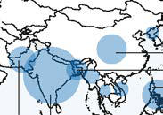

# Chapter 261: Tuberculosis (Mycobacterium tuberculosis)

*Lindsay H. Cameron and Jeffrey R. Starke*

<!-- p.2342 -->
diarrhea with possible pseudomembranous colitis), and CNS related (dizziness, vertigo). Potential additive adverse effects can occur when cefoxitin is used with aminoglycosides.

Routine laboratory monitoring with long-term use includes CBC and liver and renal function tests.

**Doxycycline** Doxycycline is in the tetracycline family of antibiotics and has lim ited use in pediatrics. As with other tetracyclines, doxycycline acts to decrease protein synthesis by binding to the 30S ribosome and to trans fer RNA. It can also cause alterations to the cytoplasmic membrane of susceptible bacteria.

Doxycycline is used to treat *M. fortuitum* (see Table 260.3). Although it can be used to treat *M. marinum,* adult treatment failures have occurred. Pediatric dosing is based on age and weight. For children >8 years old who weigh <45 kg, the dosage is 4.4 mg/kg/day divided twice daily. Dosing for larger children and adults is 100 mg twice daily. Doxycycline is available as 50- and 100-mg capsules or tablets and in 25-mg/5 mL and 50-mg/5 mL suspensions. Doxycycline use in children is limited by a **permanent tooth dis coloration**, which becomes worse with long-term use. Other **adverse effects** include photosensitivity, liver and kidney dysfunction, and esophagitis, which can be minimized by dosing with large volumes of liquid. Doxycycline can decrease the effectiveness of oral contracep tives. Rifampin, carbamazepine, and phenytoin can decrease the con centration of doxycycline.

Routine laboratory monitoring with long-term use includes kidney and liver function tests as well as CBC.

**Macrolides** Clarithromycin and azithromycin belong to the macrolide family of antibiotics. Clarithromycin is a methoxy derivative of erythromy cin. Macrolides act by binding the 50S subunit of ribosomes, sub sequently inhibiting protein synthesis. Resistance mechanisms for mycobacteria are not well understood but might involve binding site alterations. Clarithromycin appears to have synergistic antimy cobacterial activity when combined with rifamycins, ethambutol, or clofazimine.

**Clarithromycin** is widely used for the prophylaxis and treatment of *M. avium* complex disease and also has activity against *M. absces sus, M. fortuitum,* and *M. marinum.* Azithromycin has significantly different pharmacokinetics compared with other macrolide agents and has not been studied and is not indicated for mycobacterial infections. The pediatric dosage of clarithromycin for primary prophylaxis of *M. avium* complex infections is 7.5 mg/kg/dose PO given twice daily, not to exceed 500 mg/day. This dosage is used for recurrent *M. avium* complex disease in combination with ethambu tol and rifampin. The adult dosage is 500 mg PO twice daily to be used as a single agent for primary prophylaxis or as part of combi nation therapy with ethambutol and rifampin. Dosage adjustment is needed for renal insufficiency but not liver failure. Clarithromycin is available in 250- and 500-mg tablets and suspensions of 125 mg/5 mL and 250 mg/5 mL.

The primary adverse effect of clarithromycin is **GI upset**, includ ing vomiting (6%), diarrhea (6%), and abdominal pain (3%). Other **adverse effects** include taste disturbances, headache, and QT prolon gation if used with inhaled anesthetics, clotrimazole, antiarrhythmic agents, or azoles. Clarithromycin should be used cautiously in patients with renal insufficiency or liver failure.

Routine laboratory monitoring with prolonged use of clarithromy cin includes periodic liver enzyme tests. Diarrhea is an early sign of pseudomembranous colitis.

**Trimethoprim-Sulfamethoxazole** Trimethoprim-sulfamethoxazole (TMP-SMX) is formulated in a fixed ratio of one part TMP to five parts SMX. SMX is a sulfonamide that inhibits synthesis of dihydrofolic acid by competitively inhibiting PABA, similar to dapsone. TMP blocks production of tetrahydrofolic

acid and downstream biosynthesis of nucleic acids and protein by reversibly binding to dihydrofolate reductase. The combination of the two agents is synergistic and often bactericidal.

TMP-SMX is often used in combination therapy for mycobacte rial disease (see Table 260.3). Oral or IV pediatric dosage for serious infections is TMP 15-20 mg/kg/day divided every 6-8 hours, and for mild infections, TMP 6-12 mg/kg/day divided every 12 hours. The adult dosage is 160 mg TMP and 800 mg SMX every 12 hours. Dosage reduction may be needed in renal insufficiency. TMP-SMX is available in single-strength tablets (80/400 mg TMP-SMX) and double-strength tablets (160/800 mg TMP-SMX) and in a suspension of 40 mg TMP and 200 mg SMX per 5 mL.

The most common adverse effect with TMP-SMX is **myelosuppres sion**. It must be used with caution in patients with G6PD deficiency. Other **adverse effects** include renal abnormalities, rash, aseptic men ingitis, GI disturbances (e.g., pancreatitis, diarrhea), and prolonged QT interval if co-administered with inhaled anesthetics, azoles, or macrolides.

Routine laboratory monitoring includes monthly CBC and periodic electrolytes and creatinine to monitor renal function.

*Visit Elsevier eBooks+ at eBooks.Health.Elsevier.com** for Bibliography.*

*Mycobacterium tuberculosis* has caused human disease for more than 4,000 years and is one of the most important infectious diseases world wide. There are five closely related mycobacteria in the *Mycobacterium tuberculosis* complex: *M. tuberculosis, M. bovis, M. africanum, M. microti,* and *M. canetti. M. tuberculosis* is the most important cause of tuberculosis (TB) disease in humans. The tubercle bacilli are non– spore-forming, nonmotile, pleomorphic, weakly gram-positive curved rods 1-5 μm long, typically slender, and slightly bent. They can appear beaded or clumped under microscopy. They are obligate aerobes that grow in synthetic media containing glycerol as the carbon source and ammonium salts as the nitrogen source (Löwenstein-Jensen culture media). These mycobacteria grow best at 37–41°C (98.6–105.8°F), produce niacin, and lack pigmentation. A lipid-rich cell wall accounts for resistance to the bactericidal actions of antibody and complement. A hallmark of all mycobacteria is **acid fastness**—the capacity to form stable mycolate complexes with arylmethane dyes (crystal violet, car bolfuchsin, auramine, and rhodamine). They resist decoloration with ethanol and hydrochloric or other acids.

*M. tuberculosis* grows slowly, with a generation time of 12-24 hours. Isolation from clinical specimens on solid synthetic media usually takes 3-6 weeks, and drug susceptibility testing requires an additional 2-4 weeks. Growth can be detected in 1-3 weeks in selective liquid medium using radiolabeled nutrients (e.g., BACTEC radiometric sys tem), and drug susceptibilities can be determined in an additional 3-5 days. Once mycobacterial growth is detected, the species of mycobac teria present can be determined within hours using high-pressure liq uid chromatography analysis (identifying the mycolic acid fingerprint of each species) or DNA probes/nucleic amplification tests (NAATs).

*Lindsay H. Cameron and Jeffrey R. Starke*

<!-- p.2344 -->
NAATs are used to identify genes associated with *M*. *tuberculosis* drug resistance and complement phenotypic drug susceptibility testing. Results are available in hours, which expedites management decisions. Phenotypic drug susceptibility testing is necessary to confirm suscepti bility to each drug. Restriction fragment length polymorphism genetic profiling of mycobacteria is a helpful tool to study the epidemiology of TB strain relatedness in both outbreaks and routine epidemiology of TB in a community.

**CLINICAL STAGES** There are three major clinical stages of TB: exposure, infection, and disease. **Exposure** means a child has had recent significant contact (shared the air) with an adult or adolescent with infectious TB but lacks proof of infection. In this stage, the tuberculin skin test (TST) or interferon-γ release assay (IGRA) result is negative, the chest radiograph is normal, the physical examination is normal, and the child lacks signs or symptoms of disease. However, the child may be infected and develop TB disease rapidly, because there may not have been enough time for the TST or IGRA to turn positive. **Tuberculosis infection (TBI)** occurs when the individual inhales droplet nuclei containing *M. tuberculosis,* which survive intracellularly within the lung and associated lymphoid tissue. The hallmark of TBI is a positive TST or IGRA result. In this stage the child has no signs or symptoms and has a normal physical examination, and the chest radiograph is either normal or reveals only granuloma or calcifications in the lung parenchyma. **Disease** occurs when signs or symptoms or radio graphic manifestations caused by *M. tuberculosis* become apparent. Not all infected individuals have the same risk of developing disease. An immunocompetent adult with untreated TBI has approximately a 5–10% lifetime risk of developing disease. In contrast, an infected child <1 year old has a 40% chance of developing TB disease within 9 months.

**EPIDEMIOLOGY** TB remains a leading cause of death from an infectious disease world wide. The global burden of TB is influenced by several factors, includ ing the HIV pandemic; the development of **multidrug-resistant (MDR) tuberculosis**; the disproportionately low access of populations in low-resource settings worldwide to both diagnostic tests and effec tive medical therapy; and the COVID-19 pandemic.

The World Health Organization (WHO) 2020 Global Tuberculosis Report estimates that the COVID-19 pandemic could have a significant

impact on access to essential TB services (human capital, financial), which may increase the rates of TB-associated morbidity and mortal ity. Many countries have had to allocate public health resources from TB prevention efforts toward COVID-19 prevention, including con tact tracing and using GeneXpert machines for COVID-19 testing. The WHO predicts that this resource diversion from TB case-finding, test ing, treatment, and prevention may result in an increase of global TBassociated deaths by 0.2-0.4 million per year.

Approximately 95% of TB cases occur in the developing world. In 2019, the 30 high-TB-burden countries accounted for 87% of incident cases (Fig. 261.1). Two thirds of cases occurred in eight countries, including India, Indonesia, China, the Philippines, Pakistan, Nigeria, Bangladesh, and South Africa. An estimated 10 million incident cases and 1.4 million TB-associated deaths occurred worldwide in 2019. The WHO 2020 Global Tuberculosis Report estimates that in 2019 there were 1.2 million childhood incident cases and 230,000 TB-associated deaths among children, including 32,000 TB-associated deaths among children living with HIV.

The incidence of drug-resistant TB has increased in some areas of the world in both adults and children. In 2019, the WHO reported a global total of 206,030 cases of multidrug- or rifampicin-resistant TB, a 10% increase from 2018 (Fig. 261.2). Isoniazid (INH)–mono resistant TB is resistance to INH alone, rifampicin-resistant TB (RR- TB) is resistance to at least rifampin, MDR-TB is defined as resistance to at least isoniazid and rifampin, and extensively drug-resistant tuberculosis TB (XDR-TB) includes MDR-TB plus resistance to any fluoroquinolone and at least one of three injectable drugs (kanamy cin, capreomycin, or amikacin). In 2014, the worldwide estimate for MDR-TB in children was 2.9% of all cases and 0.1% for XDR-TB. The highest incidence of MDR-TB in children occurs in the Southeast Asian, African, and Western Pacific regions; however, the proportion of drug-resistant cases is highest in countries belonging to the Rus sian Federation, where over 30% of children with TB have a drugresistant organism.

In the United States, TB case rates decreased steadily during the first half of the 20th century, long before the advent of antituberculosis drugs, as a result of improved living conditions and likely genetic selec tion favoring persons resistant to developing disease. A resurgence of TB in the late 1980s was associated primarily with the HIV epidemic, transmission of the organism in congregate settings including health care institutions, disease occurring in recent immigrants, and poor conduct of community TB control. Since 1992, the TB incidence in the

Number of incident cases

100 000

500 000

1 000 000

2 000 000

India

China

Indonesia

Philippines

Pakistan Nigeria

Bangladesh

Democratic Republic

of the Congo

**Fig. 261.1** Countries that had at least 100,000 incident cases of TB in 2021. The countries that rank first to eighth in terms of numbers of cases and that accounted for about two thirds of global cases in 2021 are labeled. (From the World Health Organization: Global Tuberculosis Report 2022. Geneva: World Health Organization; 2022, Fig 12. License: CC BY-NC-SA 3.0 IGO.)

<!-- p.2345 -->
United States has decreased over time. In 2020, the case rate was at the all-time low of 2.2 per 100,000 persons (Fig. 261.3).

In 2017, the incidence rate of TB among children <15 years was 0.7 cases per 100,000 person-years, a decline of 41% from 1993. The TB incidence rates were highest in children less than 12 months of age (1.3 per 100,000 person-years), followed by children age 1-4 years (1.1 per 100,000 person-years), and were lowest among children age 5-14 years (0.5 per 100,000 person-years) (Fig. 261.4).

From 1993 to 2017, non-United States–born children, children born to non-United States–born parents, and children of racial or ethnic minority status were disproportionately affected by TB. Non-United States–born children accounted for approximately 25% of the total number of childhood TB cases, the majority being from Mexico, fol lowed by the Philippines, Somalia, Vietnam, Ethiopia, and Haiti (Fig. 261.5). According to data reported to the National TB Surveillance System from 2007 to 2017, among United States–born children, the incidence rates of TB if both parents were non-United States–born and if one parent was non-United States–born were eight and three times higher, respectively, compared to United States–born children with both par ents being United States–born. This is supported by prior research that found that 75% of United States–born children with TB had some international connection through a family member or previous travel or residence in a TB-endemic country. Similar to adults in the United

Number

of cases

1000 10 000

100 000

India

China

Indonesia

Philippines

Pakistan

South Africa

Russian Federation

**Fig. 261.2** Percentage of new TB cases with MDR-/RR-TB. The seven countries with the highest burden in terms of numbers of MDR/RR -TB cases and that accounted for two thirds of global MDR-/RR-TB cases in 2021 are labeled. (From the World Health Organization: Global Tuberculosis Report 2022. Geneva: World Health Organization; 2022, Fig 17. License: CC BY-NC-SA 3.0 IGO.)

30,000

25,000

20,000

15,000

10,000

5,000

0

Number of cases

1993

1995

1997

1999

2001

2003

2005

2007

Year

2009

2011

2013

2015

2017

2019

12

10

8

6

4

2

0

Cases per 100,000 persons

Number of cases

Incidence rate

**Fig. 261.3** Reported tuberculosis cases in the United States for 1993– 2019 (as of October 29, 2020). (From Centers for Disease Control and Prevention. Trends in Tuberculosis, 2019. Atlanta: U.S. Department of Health and Human Services; 2020.)

Age <1 year Age 1–4 years Age 5–9 years Age 10–14 years

**N=22,037** 1000

100

10

1

0.1

0.01

Cases per 100,000 Person-Years*

1993

1995

1997

1999

2001

2003

2005

2007

2009

2011

2013

2015

2017

**Fig. 261.4** Reported pediatric tuberculosis (TB) cases in the United States by age-group for the years 1993-2017. *Rates are presented on a logarithmic scale. (From Centers for Disease Control and Prevention, National Center for HIV/AIDS, Viral Hepatitis, STD and TB Prevention. Pediatric Tuberculosis in United States, 1993–2017. Atlanta: U.S. De partment of Health and Human Services; 2018.)

Mexico Philippines Somalia Vietnam Ethiopia Haiti

1993 1995 1997 1999 2001 2003 2005 2007 2009 2011 2013 2015 2017

400

350

300

250

200

150

100

50

0

**Fig. 261.5** Top six countries of birth for non–United States–born* pediatric TB cases for the years 1993-2017. *Non-United States–born refers to persons born outside the United States or its territories or not born to a US citizen. †Cases in United States–born children of non- United States–born parents are included in United States–born counts and thus not displayed in this figure. (From Centers for Disease Control and Prevention, National Center for HIV/AIDS, Viral Hepatitis, STD and TB Prevention. Pediatric Tuberculosis in United States, 1993–2017. At lanta: U.S. Department of Health and Human Services; 2018.)

<!-- p.2346 -->
States, TB among children of racial-ethnic minority status occurs dis proportionately. The incidence rates of TB among children of Native Hawaiian or Pacific Islander, Asian, Native American or Native Alas kan, Black, and Hispanic children were 144, 44, 22, 19, and 18 times higher, respectively, than among non-Hispanic White children.

The rates of drug-resistant TB in children in the United States remain low. A total of 89 childhood cases of MDR-TB were reported in the United States in 2015; of those, 70.8% were non-United States– born. Among children with culture-confirmed TB in the United States in 2015, 15.2% had organisms with resistance to at least one first-line drug and 0.9% had MDR organisms.

Most children are infected with *M. tuberculosis* in their home by someone close to them, but outbreaks of childhood TB also have occurred in elementary and high schools, nursery schools, daycare centers and homes, churches, school buses, and sports teams. Adults living with HIV who have pulmonary TB can transmit *M. tuberculo sis* to children, and children living with HIV are at increased risk for developing TB after infection. Other specific groups are at high risk for acquiring TBI and progressing to tuberculosis disease (Table 261.1).

**TRANSMISSION** Transmission of *M. tuberculosis* is usually by inhalation of airborne mucus droplet nuclei, particles 1-5 μm in diameter that contain *M. tuberculosis.* Transmission rarely occurs by direct contact with an infected discharge or a contaminated fomite. The chance of transmission increases when the patient has a positive acid-fast smear of sputum, an extensive upper lobe infiltrate or cavity, copious production of thin spu tum, and severe and forceful cough (although the absence of cough does not eliminate the risk of TBI). Environmental factors such as poor air circulation enhance transmission. Within several days to 2 weeks after beginning adequate chemotherapy, most adults no longer transmit the organism, but some patients remain infectious for many weeks. Young children with TB rarely infect other children or adults; tubercle bacilli are sparse in their endobronchial secretions, and cough is often absent or lacks the tussive force required to suspend infectious particles of the correct size. However, adolescents often present with adult-type cavity or endobronchial TB and can easily transmit the organism.

Airborne transmission of *M. bovis* and *M. africanum* also occurs rarely. *M. bovis* can penetrate the gastrointestinal (GI) mucosa or invade the lymphatic tissue of the oropharynx when large numbers of the organism are ingested. Human infection with *M. bovis* is rare in developed countries as a result of the pasteurization of milk and effective TB control programs for cattle. Approximately 46% of culture-proven childhood TB cases from the San Diego, Califor nia, region since 1994 were caused by *M. bovis,* likely acquired by children when visiting Mexico or another country or consuming dairy products from countries with suboptimal veterinary TB con trol programs.

Zoonotic transmission is an uncommon source of *M. tuberculosis* that has been reported in adults exposed to elephants and potentially cattle.

**PATHOGENESIS** The **primary complex** (or **Ghon complex**) of TB includes local infec tion at the portal of entry and the regional lymph nodes that drain the area. The lung is the portal of entry in >98% of cases. The tubercle bacilli multiply initially within alveoli and alveolar ducts. Most of the bacilli are killed, but some survive within nonactivated macrophages, which carry them through lymphatic vessels to the regional lymph nodes. When the primary infection is in the lung, the hilar lymph nodes usually are involved, although an upper lobe focus can drain into paratracheal nodes. The tissue reaction in the lung parenchyma and lymph nodes intensifies over the next 2-12 weeks as the organisms grow in number and **tissue hypersensitivity** develops. The parenchy mal portion of the primary complex often heals completely by fibrosis or calcification after undergoing caseous necrosis and encapsulation (Fig. 261.6). Occasionally, this portion continues to enlarge, resulting in focal pneumonitis and pleuritis. If caseation is intense, the center of the lesion liquefies and empties into the associated bronchus, leaving a residual cavity.

Tuberculosis Infection and Developing Disease in Countries with Low Incidence

#### **Table 261.1** Groups at High Risk for Acquiring

| Category / Parameter | Clinical Details & Findings |
| --- | --- |
| **RISK FACTORS FOR TUBERCULOSIS INFECTION** | Children exposed to high-risk adults; Foreign-born persons from high-prevalence countries; Homeless persons; Persons who inject drugs; Present and former residents or employees of correctional; institutions, homeless shelters, and nursing homes; Healthcare workers caring for high-risk patients (if infection control is; not adequate) |
| **INFECTION TO TUBERCULOSIS DISEASE** | Infants and children ≤4 yr old, especially those <2 yr old; Adolescents and young adults; Persons co-infected with human immunodeficiency virus; Persons with skin test conversion in the past 1-2 yr; Persons who are immunocompromised, especially in cases of; malignancy and solid organ transplantation, immunosuppressive; medical treatments including anti–tumor necrosis factor therapies,; diabetes mellitus, chronic renal failure, silicosis, and malnutrition |
| **RISK FACTORS FOR DRUG-RESISTANT TUBERCULOSIS** | Personal or contact history of treatment for tuberculosis; Contacts of patients with drug-resistant tuberculosis; Birth or residence in a country with a high rate of drug resistance; Poor response to standard therapy; Positive sputum smears (acid-fast bacilli) or culture ≥2 mo after; initiating appropriate therapy |

**Fig. 261.6** Posteroanterior (A) and lateral (B) chest radiographs of an ado lescent showing a 7-mm calcified gran uloma in the left lower lobe (arrows). (From Lighter J, Rigaud M. Diagnosing childhood tuberculosis: traditional and innovative modalities. Curr Probl Pedi atr Adolesc Health Care. 2009;39:55– 88.)

A B

<!-- p.2347 -->
The foci of infection in the regional lymph nodes develop some fibrosis and encapsulation, but healing is usually less complete than in the parenchymal lesion. Viable *M. tuberculosis* can persist for decades within these foci. In most cases of initial TBI, the lymph nodes remain normal in size. However, hilar and paratracheal lymph nodes that enlarge significantly as part of the host inflammatory reaction can encroach on a regional bronchus (Figs. 261.7 and 261.8). Par tial obstruction of the bronchus caused by external compression can cause hyperinflation in the distal lung segment. Complete obstruction results in atelectasis. Inflamed caseous nodes can attach to the bron chial wall and erode through it, causing endobronchial TB or a fistula tract. The caseum causes complete obstruction of the bronchus. The resulting lesion is a combination of pneumonitis and atelectasis and has been called a **collapse-consolidation lesion** or **segmental lesion** (Fig. 261.9).

During the development of the primary complex, tubercle bacilli are carried to most tissues of the body through the blood and lymphatic vessels. Although seeding of the organs of the reticuloendothelial sys tem is common, bacterial replication is more likely to occur in organs with conditions that favor their growth, such as the lung apices, brain, kidneys, and bones. **Disseminated tuberculosis** occurs if the number of circulating bacilli is large and the host’s cellular immune response is inadequate. More often, the number of bacilli is small, leading to

clinically inapparent metastatic foci in many organs. These remote foci usually become encapsulated, but they may be the origin of both **extra pulmonary tuberculosis** and **reactivation pulmonary tuberculosis**.

The time between initial infection and clinically apparent TB disease is variable. Disseminated and meningeal TB are early manifestations, often occurring within 2-6 months of acquisition. Significant lymph node or endobronchial TB usually appears within 3-9 months. Lesions of the bones and joints take several years to develop, whereas renal lesions become evident decades after infection. Extrapulmonary mani festations are more common in children than in adults and develop in 25–35% of children with TB vs approximately 10% of immunocompe tent adults.

Pulmonary TB that occurs >1 year after the primary infection is usu ally caused by endogenous regrowth of bacilli persisting in partially encapsulated lesions. This **reactivation TB** is rare in young children but is common among adolescents and young adults. The most com mon form is an infiltrate or cavity in the apex of the upper lobes, where oxygen tension and blood flow are highest.

The risk for dissemination of *M. tuberculosis* is very high in persons living with HIV. Reinfection also can occur in persons with advanced HIV or AIDS. In immunocompetent persons, the response to the ini tial infection with *M. tuberculosis* usually provides protection against reinfection when a new exposure occurs. However, exogenous reinfec tion has been reported to occur in adults and children without immune compromise in highly endemic areas.

**Immunity** Conditions that adversely affect cell-mediated immunity predispose to progression from TBI to disease. Rare specific genetic defects (Mende lian susceptibility to mycobacterial disease [MSMD]) associated with deficient cell-mediated immunity in response to mycobacteria include interleukin (IL)-12 receptor B1 deficiency *TYK2* pathogenic gene vari ants; ∼15 other genes associated with primary immunodeficiencies such as *NEMO, STAT1, JAK1,* and *RORC;* and complete and partial interferon (IFN)-γ receptor 1 chain deficiencies. TBI is associated with a humoral antibody response, which plays a little known role in host defense. Shortly after infection, tubercle bacilli replicate in both free alveolar spaces and inactivated alveolar macrophages. Sulfatides in the

A B

**Fig. 261.7** A 14-yr-old child with proven primary tuberculosis. Frontal (A) and lateral (B) views of the chest show hyperinflation, prominent left hilar lymphadenopathy, and alveolar consolidation involving the pos terior segment of the left upper lobe and the superior segment of the left lower lobe. (From Hilton SVW, Edwards DK, eds. Practical Pediatric Radiology, 3rd ed. Philadelphia: Saunders; 2003:334.)

**Fig. 261.8** An 8-yr-old child with a history of cough. A single frontal view of the chest shows marked right hilar and paratracheal lymphadenopathy with alveolar disease involving the right middle and lower lung fields. This was also a case of primary tuberculosis. (From Hilton SVW, Edwards DK, eds. Practical Pediatric Radiology, 3rd ed. Philadelphia: Saunders; 2003:335.)

**Fig. 261.9** Right-sided hilar lymphadenopathy and collapse-consolidation lesions of primary tuberculosis in a 4-yr-old child. (From Kimberlin DW, Bar nett ED, Lynfield R, Sawyer MH (eds). Red Book: 2021-2024 Report of the Committee on Infectious Diseases, 32nd ed. Itasca, IL: American Academy of Pediatrics, 2021. p 805-806; with data from Furin J, Seddon J, Becerra M, et al. Management of Multi-drug-Resistant Tuberculosis Children: A Field Guide, 4th ed. Boston: The Sentinel Project for Pediatric Drug-Resistant Tuberculosis, 2019. Available at: http://sentinel-project.org/wp-content/up loads/2019/02/Updated_DRTB-Field-Guide-2019-V3.pdf)

<!-- p.2348 -->
mycobacterial cell wall inhibit fusion of the macrophage phagosome and lysosomes, allowing the organisms to escape destruction by intra cellular enzymes. **Cell-mediated immunity** develops 2-12 weeks after infection, along with tissue hypersensitivity (Fig. 261.10). After bacilli enter macrophages, lymphocytes that recognize mycobacterial antigens proliferate and secrete lymphokines and other mediators that attract other lymphocytes and macrophages to the area. Certain lymphokines activate macrophages, causing them to develop high concentrations of lytic enzymes that enhance their mycobactericidal capacity. A discrete subset of regulator helper and suppressor lymphocytes modulates the immune response. Development of specific cellular immunity prevents progression of the initial infection in most persons.

The pathologic events in the initial TBI seem to depend on the bal ance among the mycobacterial antigen load; cell-mediated immunity (which enhances intracellular killing); and tissue hypersensitivity, which promotes extracellular killing. When the antigen load is small and the degree of tissue sensitivity is high, granuloma formation results from the organization of lymphocytes, macrophages, and fibroblasts. When both antigen load and degree of sensitivity are high, granuloma

formation is less organized. Tissue necrosis is incomplete, resulting in formation of caseous material. When the degree of tissue sensitivity is low, as often occurs in infants or immunocompromised persons, the reaction is diffuse and the infection is not well contained, leading to dissemination and local tissue destruction. Tumor necrosis factor (TNF) and other cytokines released by specific lymphocytes promote cellular destruction and tissue damage in susceptible persons.

**CLINICAL MANIFESTATIONS Primary Pulmonary Disease** The **primary complex** includes the parenchymal pulmonary focus and the regional lymph nodes. Approximately 70% of lung foci are subpleural, and localized pleurisy is common. The initial parenchymal inflammation usually is not visible on chest radiograph, but a local ized, nonspecific infiltrate may be seen before the development of tis sue hypersensitivity. All lobar segments of the lung are at equal risk for initial infection. Two or more primary foci are present in 25% of cases. The hallmark of primary TB in the lung is the relatively large size of the regional lymphadenitis compared with the relatively small size

Cross-priming

M. tuberculosis

M. tuberculosis

PRR

PRR

CD8

CD8 Direct presentation

PNG MHC I

MHC I

MHC II

MHC II

DC

DC

IL17

T

T

IFNJ

MI MI MI

MI

MI

IFNJ

IFNJ

IL10 TGFβ

IFNJ

Th1 Th17 CD4

CD4

IL2

IL4

B

Th2 Treg

Suppression

Active disease

Caseous granuloma

Latent infection

Solid granuloma

Protection

Protection

Exhaustion

TNF

CD4

Teff

CD8

Teff

CD8 CTL Lysis

Lysis

CD8

TM

CD8

TM

Th1

TM

**Fig. 261.10** Overview of the immune response in tuberculosis. Control of Mycobacterium tuberculosis is mainly the result of productive teamwork between T-cell populations and macrophages (Mø). M. tuberculosis survives within macrophages and dendritic cells (DCs) inside the phagosomal compartment. Gene products of major histocompatibility complex (MHC) class II are loaded with mycobacterial peptides that are presented to CD4 T cells. CD8 T-cell stimulation requires loading of MHC I molecules by mycobacterial peptides in the cytosol, either by egression of mycobacterial antigens into the cytosol or cross-priming, by which macrophages release apoptotic bodies carrying mycobacterial peptides. These vesicles are taken up by DCs and peptides presented. The CD4 T-helper (Th) cells polarize into different subsets. DCs and macrophages express pattern recogni tion receptors (PRRs), which sense molecular patterns on pathogens. Th1 cells produce interleukin (IL)-2 for T-cell activation, interferon-γ (IFN-γ), or tumor necrosis factor (TNF) for macrophage activation. Th17 cells, which activate polymorphonuclear granulocytes (PNGs), contribute to the early formation of protective immunity in the lung after vaccination. Th2 cells and regulatory T cells (Treg) counterregulate Th1-mediated protection via IL-4, transforming growth factor-β (TGF-β), or IL-10. CD8 T cells produce IFN-γ and TNF, which activate macrophages. They also act as cytolytic T lymphocytes (CTLs) by secreting perforin and granulysin, which lyse host cells and directly attack M. tuberculosis. These effector T cells (Teff) are succeeded by memory T cells (TM). TM cells produce multiple cytokines, notably IL2, IFN-γ, and TNF. During active containment in solid granuloma, M. tuberculosis recesses into a dormant stage and is immune to attack. Exhaustion of T cells is mediated by interactions between T cells and DCs through members of the programmed death 1 system. Treg cells secrete IL-10 and TGF-β, which suppress Th1. This process allows resuscitation of M. tuberculosis, which leads to granuloma caseation and active disease. B, B cell. (From Kaufman SHE, Hussey G, Lambert PH. New vaccines for tuberculosis. Lancet. 2010;375:2110–2118.)

<!-- p.2349 -->
of the initial lung focus (see Figs. 261.7 and 261.8). As delayed-type hypersensitivity develops, the hilar lymph nodes continue to enlarge in some children, especially infants, compressing the regional bronchus and causing obstruction. The usual sequence is *hilar lymphadenopathy, focal hyperinflation,* and then *atelectasis.* The resulting radiographic shadows have been called **collapse-consolidation** or *segmental* TB (see Fig. 261.9). Rarely, inflamed caseous nodes attach to the endobronchial wall and erode through it, causing endobronchial TB or a fistula tract. The caseum causes complete obstruction of the bronchus, resulting in extensive infiltrate and collapse. Enlargement of the subcarinal lymph nodes can cause compression of the esophagus and, rarely, a broncho esophageal fistula.

Most cases of tuberculous bronchial obstruction in children resolve fully with appropriate treatment. Occasionally, there is residual calcifi cation of the primary focus or regional lymph nodes. The appearance of calcification implies that the lesion has been present for at least 6-12 months. Healing of the segment can be complicated by scarring or con traction associated with cylindrical bronchiectasis, but this is rare.

Children can have lobar TB pneumonia without impressive hilar lymphadenopathy. If the primary infection is progressively destructive, liquefaction of the lung parenchyma can lead to formation of a thinwalled primary TB cavity. Rarely, bullous tuberculous lesions occur in the lungs and lead to pneumothorax if they rupture. Erosion of a parenchymal focus of TB into a blood or lymphatic vessel can result in dissemination of the bacilli and a **miliary** pattern, with small nodules evenly distributed on the chest radiograph (Fig. 261.11).

The symptoms and physical signs of primary pulmonary TB in chil dren are surprisingly meager considering the degree of radiographic changes often present. When active case finding is performed, up to 50% of infants and children with radiographically moderate to severe pulmonary TB have no physical findings. Infants are more likely to experience signs and symptoms. Nonproductive cough and mild dys pnea are the most common symptoms. Systemic complaints such as fever, night sweats, anorexia, and decreased activity occur less often. Some infants have difficulty gaining weight or develop a true failure-tothrive syndrome that often does not improve significantly until several months of effective treatment have been taken. Pulmonary signs are even less common. Some infants and young children with bronchial obstruction have localized wheezing or decreased breath sounds that may be accompanied by tachypnea or, rarely, respiratory distress. These pulmonary symptoms and signs are occasionally alleviated by antibiot ics, suggesting bacterial superinfection.

**Progressive Primary Pulmonary Disease** A rare but serious complication of TB in a child occurs when the primary focus enlarges steadily and develops a large caseous center. Liquefaction can cause formation of a primary cavity associated with large numbers of tubercle bacilli. The enlarging focus can slough necrotic debris into the adjacent bronchus, leading to further intrapulmonary dissemination.

Significant signs or symptoms are common in locally progressive disease in children. High fever, severe cough with sputum production, weight loss, and night sweats are common. Physical signs include diminished breath sounds, rales, and dullness or egophony over the cavity. The prog nosis for full recovery is excellent with appropriate therapy.

**Reactivation Tuberculosis** Pulmonary TB in adults usually represents endogenous reactivation of a site of TBI established previously in the body. This form of TB is rare in childhood but can occur in adolescence. Children with a healed TBI acquired when they were <2 years old rarely develop chronic reactiva tion pulmonary disease, which is more common in those who acquire the initial infection when they are >7 years old. The most common pulmonary sites are the original parenchymal focus, lymph nodes, and the apical seedings **(Simon foci)** established during the hematogenous phase of the early infection. This form of TB disease usually remains localized in the lungs, because the established immune response pre vents further extrapulmonary spread. The most common radiographic findings are extensive infiltrates and thick-walled cavities in the upper lobes.

Older children and adolescents with reactivation TB are more likely to experience fever, anorexia, malaise, weight loss, night sweats, pro ductive cough, hemoptysis, and chest pain than children with primary pulmonary TB. However, physical examination findings usually are minor or absent, even when cavities or large infiltrates are present. Most signs and symptoms improve within several weeks of starting effective treatment, although the cough can last for several months. This form of TB may be highly contagious if there is significant sputum production and cough. The prognosis for full recovery is excellent with appropriate therapy.

**Pleural Effusion** Tuberculous pleural effusions, which can be local or general, origi nate in the discharge of bacilli into the pleural space from a subpleural pulmonary focus or caseated lymph node. Asymptomatic local pleu ral effusion is so common in primary TB that it is considered part of the primary complex. Larger and clinically significant effusions occur months to years after the primary infection. Tuberculous pleural effu sion is uncommon in children <6 years old and rare in children <2 years old. Effusions are usually unilateral but can be bilateral. They are rarely associated with a segmental pulmonary lesion and are uncom mon in disseminated TB. Often the radiographic abnormality is more extensive than would be suggested by physical findings or symptoms (Fig. 261.12).

Clinical onset of tuberculous pleurisy is often sudden and charac terized by low to high fever, shortness of breath, chest pain on deep inspiration, and diminished breath sounds. The fever and other symp toms can last for several weeks after the start of antituberculosis che motherapy. The TST is positive in 70–80% of cases. The prognosis is

**Fig. 261.11** Posteroanterior (A) and lateral (B) chest radiographs of an in fant with miliary tuberculosis. The child’s mother had failed to complete treatment for pulmonary tuberculosis twice within 3 years of this child’s birth.

A B

<!-- p.2350 -->
excellent, but radiographic resolution often takes months. Scoliosis is a rare complication from a long-standing effusion.

Examination of pleural fluid and the pleural membrane is important to establish the diagnosis of tuberculous **pleurisy**. The pleural fluid is usually yellow and only occasionally tinged with blood. The specific gravity is usually 1.012-1.025, the protein level is usually 2-4 g/dL, and the glucose concentration may be low, although it is usually in the lownormal range (20-40 mg/dL). Typically, there are several hundred to several thousand white blood cells per microliter (WBCs/μL), with an early predominance of polymorphonuclear leukocytes (PMNs) fol lowed by a high percentage of lymphocytes. Acid-fast smears of the pleural fluid are rarely positive. Cultures of the fluid are positive in <30% of cases. Measurement of adenosine deaminase (ADA) levels may enhance the diagnosis of pleural TB. Biopsy of the pleural mem brane is more likely to yield a positive acid-fast stain or culture, and granuloma formation can be demonstrated.

**Pericardial Disease** The most common form of cardiac TB is pericarditis. It is rare, occur ring in 0.5–4% of TB cases in children. Pericarditis usually arises from direct invasion or lymphatic drainage from subcarinal lymph nodes. The presenting symptoms are nonspecific, including low-grade fever, malaise, and weight loss. Chest pain is unusual in children. A pericar dial friction rub or distant heart sounds with pulsus paradoxus may be present. The pericardial fluid is typically serofibrinous or hemorrhagic. Acid-fast smear of the fluid rarely reveals the organism, but cultures are positive in 30–70% of cases. ADA levels are elevated in TB pericar ditis. The culture yield from pericardial biopsy may be higher, and the presence of granulomas often suggests the diagnosis. Partial or com plete pericardiectomy may be required when constrictive pericarditis develops.

**Lymphohematogenous (Disseminated) Disease** Tubercle bacilli are disseminated to distant sites, including the liver, spleen, skin, and lung apices, in all cases of TBI. Lymphohematogenous spread is usually asymptomatic. Rare patients experience protracted hematogenous TB caused by the intermittent release of tubercle bacilli as a caseous focus erodes through the wall of a blood vessel in the lung. The clinical picture subsequent to lymphohematogenous dissemina tion depends on the burden of organisms released from the primary focus to distant sites and the adequacy of the host’s immune response. Although the clinical picture may be acute, more often it is indolent and prolonged, with spiking fever accompanying the release of organisms

into the bloodstream. Multiple organ involvement is common, leading to hepatomegaly, splenomegaly, lymphadenitis in superficial or deep nodes, and papulonecrotic tuberculids appearing on the skin. Bones and joints or kidneys also can become involved. Meningitis occurs only late in the course of the disease. Early pulmonary involvement is surprisingly mild, but diffuse involvement becomes apparent with prolonged infection.

The most clinically significant form of disseminated TB is miliary disease, which occurs when massive numbers of tubercle bacilli are released into the bloodstream, causing disease in two or more organs. **Miliary tuberculosis** usually complicates the primary infection, occur ring within 2-6 months of the initial infection. Although this form of disease is most common in infants and young children, it is also found in adolescents and older adults, resulting from the breakdown of a pre viously healed primary pulmonary lesion. The clinical manifestations of miliary TB are protean, depending on the number of organisms that disseminate and where they lodge. Lesions are often larger and more numerous in the lungs, spleen, liver, and bone marrow than in other tissues. Because this form of TB is most common in infants and mal nourished or immunosuppressed patients, the host’s immune incom petence likely plays a role in pathogenesis.

Rarely, the onset of miliary TB is explosive, and the patient can become gravely ill in several days. More often, the onset is insidious, with early systemic signs, including anorexia, weight loss, and lowgrade fever. At this time, abnormal physical signs are usually absent. Generalized lymphadenopathy and hepatosplenomegaly develop within several weeks in approximately 50% of cases. The fever can then become higher and more sustained, although the chest radiograph usu ally is normal and respiratory symptoms are minor or absent. Within several more weeks, the lungs can become filled with tubercles, and dyspnea, cough, rales, or wheezing occur. The lesions of miliary TB are usually <2-3 mm in diameter when first visible on chest radiograph (see Fig. 261.11). The smaller lesions coalesce to form larger lesions and sometimes extensive infiltrates. As the pulmonary disease progresses, an alveolar air block syndrome can result in frank respiratory distress, hypoxia, and pneumothorax or pneumomediastinum. Signs or symp toms of meningitis or peritonitis are found in 20–40% of patients with advanced disease. Chronic or recurrent headache in a patient with miliary TB usually indicates the presence of meningitis, whereas the onset of abdominal pain or tenderness is a sign of tuberculous peritoni tis. **Cutaneous lesions** include papulonecrotic tuberculids, nodules, or purpura. Choroid tubercles occur in 13–87% of patients and are highly specific for the diagnosis of miliary TB. Unfortunately, the TST is non reactive in up to 40% of patients with disseminated TB.

Diagnosis of disseminated TB can be difficult, and a high index of suspicion by the clinician is required. Often the patient presents with fever of unknown origin (FUO). Early sputum or gastric aspirate cul tures have a low sensitivity. Biopsy of the liver or bone marrow with appropriate bacteriologic and histologic examinations more often yields an early diagnosis. The most important clue is usually a history of recent exposure to an adult with infectious TB.

The resolution of miliary TB is slow, even with proper therapy. Fever usually declines within 2-3 weeks of starting chemotherapy, but the chest radiographic abnormalities might not resolve for many months. Occasionally, corticosteroids hasten symptomatic relief, especially when air block, peritonitis, or meningitis is present. The prognosis is excellent with early diagnosis and adequate chemotherapy.

**Upper Respiratory Tract Disease** TB of the upper respiratory tract is rare in developed countries but is still observed in developing countries. Children with laryngeal TB have a crouplike cough, sore throat, hoarseness, and dysphagia. Most children with laryngeal TB have extensive upper lobe pulmonary dis ease, but occasional patients have primary laryngeal disease with a normal chest radiograph. TB of the middle ear results from aspiration of infected pulmonary secretions into the middle ear or from hematog enous dissemination in older children. The most common signs and symptoms are painless unilateral otorrhea, tinnitus, decreased hearing, facial paralysis, and a perforated tympanic membrane. Enlargement of

**Fig. 261.12** Pleural tuberculosis in 16-yr-old female.

<!-- p.2351 -->
lymph nodes in the preauricular or anterior cervical chains can accom pany this infection. Diagnosis is difficult, because stains and cultures of ear fluid are often negative, and histology of the affected tissue often shows a nonspecific acute and chronic inflammation without granu loma formation.

**Lymph Node Disease** TB of the superficial lymph nodes, often referred to as **scrofula**, is the most common form of extrapulmonary TB in children (Figs. 261.13- 261.15). Historically, scrofula was usually caused by drinking unpas teurized cow’s milk laden with *M. bovis.* Most current cases occur within 6-9 months of initial infection by *M. tuberculosis,* although some cases appear years later. The tonsillar, anterior cervical, submandibular, and supraclavicular nodes become involved secondary to extension of a primary lesion of the upper lung fields or abdomen. Infected nodes in the inguinal, epitrochlear, or axillary regions result from regional

lymphadenitis associated with TB of the skin or skeletal system. The nodes usually enlarge gradually in the early stages of lymph node dis ease. They are discrete, nontender, and firm but not hard. The nodes often feel fixed to underlying or overlying tissue. Disease is most often **unilateral**, but bilateral involvement can occur because of the cross over drainage patterns of lymphatic vessels in the chest and lower neck. As infection progresses, multiple nodes are infected, resulting in a mass of matted nodes. Systemic signs and symptoms other than a low-grade fever are usually absent. The TST is usually reactive. The chest radio graph is often normal (in 70% of cases). The onset of illness is occasion ally more acute, with rapid enlargement, tenderness, and fluctuance of lymph nodes and with high fever. The initial presentation is rarely a fluctuant mass with overlying cellulitis or skin discoloration.

Lymph node TB can resolve if left untreated but more often pro gresses to caseation and necrosis. The capsule of the node breaks down, resulting in the spread of infection to adjacent nodes. Rupture of the node usually results in a draining sinus tract that can require surgi cal removal. **Tuberculous lymphadenitis** can usually be diagnosed by fine-needle aspiration (FNA) of the node and responds well to antitu berculosis therapy, although the lymph nodes do not return to normal size for months or even years. Surgical removal is not usually necessary and must be combined with antituberculosis medication, because the lymph node disease is only one part of a systemic infection.

A definitive diagnosis of tuberculous adenitis usually requires histo logic, bacteriologic, or molecular confirmation, which is best accom plished by FNA for culture, molecular testing, stain, and histology. If FNA is not successful in establishing a diagnosis, excisional biopsy of the involved node is indicated. Culture of lymph node tissue yields the organism in only approximately 50% of cases. Many other condi tions can be confused with tuberculous adenitis, including infection caused by **nontuberculous mycobacteria (NTM)**, cat scratch disease *(Bartonella henselae),* tularemia, brucellosis, toxoplasmosis, pyogenic infection, or noninfectious causes, including tumor, branchial cleft cyst, and cystic hygroma. The most common problem is distinguish ing infection caused by *M. tuberculosis* from lymphadenitis caused by NTM in geographic areas where NTM are common. Both conditions are usually associated with a normal chest radiograph and a reactive TST. An important clue to the diagnosis of tuberculous adenitis is an epidemiologic link to an adult with infectious TB. In areas where both diseases are common, culture or PCR testing of the involved tissue may be necessary to establish the exact cause of the disease.

**Central Nervous System Disease** TB of the central nervous system (CNS) is the most serious complica tion in children and is fatal without prompt and appropriate treatment. **Tuberculous meningitis** usually arises from the formation of a meta static caseous lesion in the cerebral cortex or meninges that develops

**Fig. 261.13** Scrofula. Axial CT image of the neck in 8-yr-old male shows calcified right cervical lymphadenopathy (black arrow) and tonsil lar swelling (white arrow). (From Lighter J, Rigaud M. Diagnosing child hood tuberculosis: traditional and innovative modalities. Curr Probl Pediatr Adolesc Health Care. 2009;39:55–88.)

A B

**Fig. 261.14** Scrofula. A, Ulcerative lesion 3.2 × 2.1 cm with under mined edges and necrotic base with surrounding induration. B, Acid- fast bacilli. (From Sharawat IK. Scrofula. J Pediatr. 2017;189:236.)

**Fig. 261.15** Scrofula. Tuberculous lymphadenitis with fistula in 4-yr-old male associated with scrofuloderma (arrows). (From Pereira C, Cascais M, Felix M, Salgado M. Scrofula in a child. J Pediatr. 2017;189:235.)

<!-- p.2352 -->
during the lymphohematogenous dissemination of the primary infec tion. This initial lesion increases in size and discharges small numbers of tubercle bacilli into the subarachnoid space. The resulting gelati nous exudate infiltrates the corticomeningeal blood vessels, producing inflammation, obstruction, and subsequent infarction of the cerebral cortex. The brainstem is often the site of greatest involvement, which accounts for the commonly associated dysfunction of cranial nerves III, VI, and VII. The exudate also interferes with the normal flow of cerebrospinal fluid (CSF) in and out of the ventricular system at the level of the basilar cisterns, leading to a communicating hydrocepha lus. The combination of vasculitis, infarction, cerebral edema, and hydrocephalus results in the severe damage that can occur gradually or rapidly. Profound abnormalities in electrolyte metabolism from salt wasting or the syndrome of inappropriate antidiuretic hormone secre tion (SIADH) also contribute to the pathophysiology of tuberculous meningitis.

Tuberculous meningitis complicates approximately 0.3% of untreated TBIs in children. It is most common in children 6 months to 4 years old. Occasionally, tuberculous meningitis occurs many years after the infection, when rupture of one or more of the subependy mal tubercles discharges tubercle bacilli into the subarachnoid space. The clinical progression of tuberculous meningitis may be rapid or gradual. Rapid progression tends to occur more often in infants and young children, who can experience symptoms for only several days before the onset of acute hydrocephalus, seizures, and cerebral edema. More often, the signs and symptoms progress slowly over weeks and are divided into three stages.

The **first stage** typically lasts 1-2 weeks and is characterized by non specific symptoms such as fever, headache, irritability, drowsiness, and malaise. Focal neurologic signs are absent, but infants can experience a stagnation or loss of developmental milestones. The **second stage** usually begins more abruptly. The most common features are lethargy, nuchal rigidity, seizures, positive Kernig and Brudzinski signs, hyper tonia, vomiting, cranial nerve palsies, and other focal neurologic signs. The accelerating clinical illness usually correlates with the develop ment of hydrocephalus, increased intracranial pressure, and vasculitis. Some children have no evidence of meningeal irritation but can have signs of encephalitis, such as disorientation, movement disorders, or speech impairment. The **third stage** is marked by coma, hemiplegia or paraplegia, hypertension, decerebrate posturing, deterioration of vital signs, and eventually death.

The prognosis of tuberculous meningitis correlates most closely with the clinical stage of illness at the time treatment is initiated. The major ity of patients in the first stage have an excellent outcome, whereas most patients in the third stage who survive have permanent disabili ties, including blindness, deafness, paraplegia, diabetes insipidus, or mental retardation. The prognosis for young infants is generally worse than for older children. It is imperative that antituberculosis treat ment be considered for any child who develops basilar meningitis and hydrocephalus, cranial nerve palsy, or stroke with no other apparent etiology. Often the key to the correct diagnosis is identifying an adult who has infectious TB and is in contact with the child. Because of the short incubation period of tuberculous meningitis, the illness has not yet been diagnosed in the adult in many cases.

The diagnosis of tuberculous meningitis can be difficult early in its course, requiring a high degree of suspicion on the part of the clinician. The TST is nonreactive in up to 50% of cases, and 20–50% of children have a normal chest radiograph. The most important laboratory test for the diagnosis of tuberculous meningitis is examination and culture of the lumbar CSF. The CSF leukocyte count usually ranges from 10 to 500 cells/μL. PMNs may be present initially, but lymphocytes predominate in the majority of cases. The CSF glucose is typically <40 mg/dL but rarely <20 mg/dL. The protein level is elevated and may be extremely high (400-5,000 mg/dL) secondary to hydrocephalus and spinal block. Although the lumbar CSF is grossly abnormal, ventricular CSF can have normal chemistries and cell counts because this fluid is obtained from a site proximal to the inflammation and obstruction. During early stage one, the CSF can resemble that of viral aseptic meningitis, only to progress to the more severe CSF profile over several weeks. The success

of the microscopic examination of acid-fast–stained CSF and myco bacterial culture is related directly to the volume of the CSF sample. Examinations or culture of small amounts of CSF are unlikely to dem onstrate *M. tuberculosis.* It is recommended that serial collections of large-volume lumbar CSF (up to 15 mL) be obtained for acid-fast stain and culture. When 5-10 mL of lumbar CSF can be obtained, the acidfast stain of the CSF sediment is positive in up to 30% of cases and the culture is positive in 50–70% of cases. Polymerase chain reaction (PCR) testing of the CSF and ADA levels can improve the diagnosis. Cultures of other body fluids can help confirm the diagnosis.

Radiographic studies can aid in the diagnosis of tuberculous men ingitis. CT or MRI of the brain of patients with tuberculous meningitis may be normal during early stages of the disease. As the disease pro gresses, basilar enhancement and communicating hydrocephalus with signs of cerebral edema or early focal ischemia are the most common findings (Fig. 261.16). Some young children with tuberculous menin gitis have one or several clinically silent tuberculomas, occurring most often in the cerebral cortex or thalamic regions.

Another manifestation of CNS TB is the **tuberculoma,** a tumorlike mass resulting from aggregation of caseous tubercles that usually manifests clinically as a brain tumor. Tuberculomas account for up to 30% of brain tumors in some areas of the world but are rare in North America. In adults, tuberculomas are most often supratentorial, but in children, they are often infratentorial, located at the base of the brain near the cerebellum (Fig. 261.17). Lesions are most often singular but may be multiple. The most common symptoms are headache, fever, focal neurologic findings, and convulsions. The TST is usually reac tive, but the chest radiograph is usually normal. Surgical excision is sometimes necessary to distinguish tuberculoma from other causes of brain tumor. However, surgical removal is not necessary because most tuberculomas resolve with medical management. Corticoste roids are administered during the first few weeks of treatment or in the immediate postoperative period to decrease cerebral edema. On CT or MRI of the brain, tuberculomas usually appear as discrete lesions with a significant amount of surrounding edema. Contrast medium enhancement is often impressive and can result in a ringlike lesion. Since the advent of CT, the paradoxical development of tuberculomas in patients with tuberculous meningitis who are receiving ultimately effective chemotherapy has been recognized. The cause and nature of these tuberculomas are poorly understood, but they do not represent failure of antimicrobial treatment. This phenomenon should be con sidered whenever a child with tuberculous meningitis deteriorates or develops focal neurologic findings during treatment. Corticosteroids

A B

**Fig. 261.16** Tuberculous meningitis in a child. A and B, Postcontrast CT images demonstrate intense enhancement in the suprasellar cistern, sylvian cistern, and prepontine cistern. Dilation of the ventricular system is seen, consistent with associated hydrocephalus. (From Lerner A, Ra jamohan A, Shiroishi MS, et al. Cerebral infections and inflammation. In Haaga JR, Boll DT, eds. CT and MRI of the Whole Body, 6th ed. Phila delphia: Elsevier; 2017: Fig 10-20.)

<!-- p.2353 -->
can alleviate the occasionally severe clinical signs and symptoms that occur. These lesions can persist for months or years.

**Cutaneous Disease** Cutaneous TB is rare in the United States but occurs worldwide and accounts for 1–2% of tuberculosis (see Chapter 706).

**Bone and Joint Disease** TB involving bone or joints is most likely to involve the vertebrae. The classic manifestation of **tuberculous spondylitis** is progression to **Pott disease**, in which destruction of the vertebral bodies leads to gibbus deformity and kyphosis (Fig. 261.18) (see Chapter 720.4). **Skeletal tuberculosis** is a late complication of TB and has become a rare entity since the availability of antituberculosis therapy but is more likely to occur in children than in adults. Tuberculous bone lesions can resemble pyogenic and fungal infections or bone tumors. *Multifocal bone involvement can occur.* A bone biopsy is essential to confirm the diagnosis. Surgical intervention is generally not necessary for cure, and the prognosis is excellent with adequate medical treatment. A sterile polyarticular (large joint) arthritis may also be noted in patients with active TB at another site.

**Abdominal and Gastrointestinal Disease** TB of the oral cavity or pharynx is quite unusual. The most common lesion is a painless ulcer on the mucosa, palate, or tonsil with enlarge ment of the regional lymph nodes. TB of the parotid gland has been reported rarely in endemic countries. TB of the esophagus is rare in children but may be associated with a tracheoesophageal fistula in infants. These forms of TB are usually associated with extensive pul monary disease and swallowing of infectious respiratory secretions. They can occur in the absence of pulmonary disease, by spread from mediastinal or peritoneal lymph nodes.

**Tuberculous peritonitis** occurs most often in young males and is uncommon in adolescents and rare in children. Generalized peritoni tis can arise from subclinical or miliary hematogenous dissemination. Localized peritonitis is caused by direct extension from an abdominal lymph node, intestinal focus, or genitourinary TB. Rarely, the lymph nodes, omentum, and peritoneum become matted and can be palpated as a doughy, irregular, nontender mass. Abdominal pain or tenderness, ascites, anorexia, and low-grade fever are typical manifestations. The TST is usually reactive. The diagnosis can be confirmed by paracen tesis with appropriate stains and cultures, but this procedure must be performed carefully to avoid entering a bowel that is adherent to the omentum.

**Tuberculous enteritis** is caused by hematogenous dissemination or by swallowing tubercle bacilli discharged from the patient’s own lungs. The jejunum and ileum near Peyer patches and the appendix are the most common sites of involvement. The typical findings are shallow ulcers that cause pain, diarrhea or constipation, weight loss, and lowgrade fever. Mesenteric adenitis usually complicates the infection. The enlarged nodes can cause intestinal obstruction or erode through the omentum to cause generalized peritonitis. The clinical presentation of tuberculous enteritis is nonspecific, mimicking other infections and conditions that cause diarrhea. The disease should be suspected in any child with chronic GI complaints and a reactive TST or positive IGRA. Biopsy, acid-fast stain, and culture of the lesions are usually necessary to confirm the diagnosis.

**Genitourinary Disease Renal TB** is rare in children because the incubation period is several years or longer. Tubercle bacilli usually reach the kidney during lym phohematogenous dissemination. The organisms often can be recov ered from the urine in cases of miliary TB and in some patients with pulmonary TB in the absence of renal parenchymal disease. In true renal TB, small caseous foci develop in the renal parenchyma and release *M. tuberculosis* into the tubules. A large mass develops near the renal cortex that discharges bacteria through a fistula into the renal pel vis. Infection then spreads locally to the ureters, prostate, or epididy mis. Renal TB is often clinically silent in its early stages, marked only by sterile pyuria and microscopic hematuria. Dysuria, flank or abdominal pain, and gross hematuria develop as the disease progresses. Superin fection by other bacteria is common and can delay recognition of the underlying TB. Hydronephrosis or ureteral strictures can complicate the disease. Urine cultures for *M. tuberculosis* are positive in 80–90% of cases, and acid-fast stains of large volumes of urine sediment are positive in 50–70% of cases. The TST is nonreactive in up to 20% of patients. A pyelogram or CT scan often reveals mass lesions, dilation of the proximal ureters, multiple small filling defects, and hydronephrosis if ureteral stricture is present. Disease is most often unilateral.

**Genital tract TB** is uncommon in prepubescent males and females. This condition usually originates from lymphohematogenous spread, although it can be caused by direct spread from the intestinal tract or bone. Adolescent females can develop genital tract TB during the pri mary infection. The fallopian tubes are most often involved (90–100% of cases), followed by the endometrium (50%), ovaries (25%), and cervix (5%). The most common symptoms are lower abdominal pain and dysmenorrhea or amenorrhea. Systemic manifestations are usually absent, and the chest radiograph is normal in the majority of cases. The TST is usually reactive. Genital TB in adolescent males causes epididymitis or orchitis. The condition usually manifests as a painless, unilateral nodular swelling of the scrotum. Involvement of the glans

**Fig. 261.18** Tuberculosis of the spine in a toddler. (From Feder HM Jr, Rigos L, Teti K. Pott’s disease in a Connecticut toddler. Lancet. 2016;388:504–505.)

**Fig. 261.17** MRI of brain of 3-yr-old child showing multiple pontine tuberculomas.

<!-- p.2354 -->
penis is extremely rare. Genital abnormalities and a positive TST in an adolescent male or female suggest genital tract TB.

**Pregnancy and the Newborn** Pulmonary and particularly extrapulmonary TB other than lymph adenitis in a pregnant woman is associated with increased risk for prematurity, fetal growth retardation, low birthweight, and perinatal mortality. **Congenital TB** is rare because the most common result of female genital tract TB is infertility. Primary infection in the mother just before or during pregnancy is more likely to cause congeni tal infection than is reactivation of a previous infection. Congenital transmission usually occurs from a lesion in the placenta through the umbilical vein, when tubercle bacilli infect the fetal liver, where a pri mary focus with periportal lymph node involvement can occur. Organ isms pass through the liver into the main fetal circulation and infect many organs. The bacilli in the lung usually remain dormant until after birth, when oxygenation and pulmonary circulation increase signifi cantly. Congenital TB can also be caused by aspiration or ingestion of infected amniotic fluid. However, the most common route of infection for the neonate is postnatal airborne transmission from an adult with infectious pulmonary TB.

**Perinatal Disease** Symptoms of congenital TB may be present at birth but usually begin by the second or third week of life. The most common signs and symp toms are respiratory distress, fever, hepatic or splenic enlargement, poor feeding, lethargy or irritability, lymphadenopathy, abdominal distention, failure to thrive, ear drainage, and skin lesions. The clini cal manifestations vary in relation to the site and size of the caseous lesions. Many infants have an abnormal chest radiograph, most often with a miliary pattern. Some infants with no pulmonary findings early in the course of the disease later develop profound radiographic and clinical abnormalities. Hilar and mediastinal lymphadenopathy and lung infiltrates are common. Generalized lymphadenopathy and men ingitis occur in 30–50% of infants.

The clinical presentation of TB in newborns is similar to that caused by bacterial sepsis and other congenital infections, such as syphilis, toxoplasmosis, and cytomegalovirus. The diagnosis should be suspected in an infant with signs and symptoms of bacterial or congenital infection whose response to antibiotic and supportive therapy is poor and in whom evaluation for other infections is unre vealing. The most important clue for rapid diagnosis of congenital TB is a maternal or family history of TB. Often, the mother’s disease is discovered only after the neonate’s diagnosis is suspected. The infant’s TST is negative initially but can become positive in 1-3 months. A positive acid-fast stain of an early morning gastric aspirate from a newborn usually indicates TB. Direct acid-fast stains on middle ear discharge, bone marrow, tracheal aspirate, or tissue biopsy (especially liver) can be useful. The CSF should be examined, cultured, and sent for PCR testing. The mortality rate of congenital TB remains very high because of delayed diagnosis. Many children have a complete recovery if the diagnosis is made promptly and adequate chemother apy is started.

**Tuberculosis Disease in Children Living with HIV** In the United States, the rate of TB disease in children living with untreated HIV is 30 times higher than in children without HIV. Estab lishing the diagnosis of TB in a child living with HIV may be difficult because TST reactivity can be absent (also with a negative IGRA), cul ture confirmation is difficult, and the clinical features of TB are similar to many other HIV-related opportunistic infections and conditions. TB in children living with HIV is often more severe, progressive, and likely to occur in extrapulmonary sites. Radiographic findings are similar to those in children with normal immune systems, but lobar disease and lung cavitation are more common. Nonspecific respiratory symptoms, fever, and weight loss are the most common complaints. Rates of drugresistant TB tend to be higher in adults living with HIV and probably are also higher in children living with HIV. Recurrent TB disease and relapsed TB occur more frequently in children living with HIV. The

prognosis generally is good if TB disease is not far advanced at diagno sis and appropriate antituberculosis drugs are available.

The mortality rate of children living with HIV with TB is high, espe cially as the CD4 lymphocyte numbers decrease. In adults, the host immune response to TBI appears to enhance HIV replication and accelerate the immune suppression caused by HIV. Increased mortal ity rates are attributed to progressive HIV infection rather than TB. Therefore children living with HIV with potential TB exposures and/ or recent TBI should be promptly evaluated and treated for TB. Con versely, all children with TB disease should be tested for HIV infection.

Children living with HIV who are given highly active antiretroviral therapy (HAART) are at high risk of developing **immune reconstitu tion inflammatory syndrome (IRIS)**. IRIS should be suspected in patients who experience a worsening of TB symptoms while receiving antituberculosis therapy (*paradoxical* IRIS) or who develop new-onset TB symptoms and radiographic findings after initiation of HAART (*unmasking* IRIS). Factors suggesting IRIS are temporal association (within 3 months of starting HAART), unusual clinical manifesta tions, unexpected clinical course, exclusion of alternative explanations, evidence of preceding immune restoration (rise in CD4 lymphocyte count), and decrease in HIV viral load. The most common clinical manifestations of IRIS in children are fever, cough, new skin lesions, enlarging lymph nodes in the thorax or neck, and appearance or enlargement of tuberculomas in the brain, with or without accompany ing meningitis. The treatment of TB-associated IRIS in children living with HIV often included steroids but should be undertaken by a clini cian with specific expertise in TB treatment.

**IMMUNE-BASED TESTING (“TESTS OF TUBERCULOSIS INFECTION”) Tuberculin Skin Testing** The development of delayed-type hypersensitivity in most persons infected with the *M. tuberculosis* complex organisms makes the TST a useful diagnostic tool. The **Mantoux TST** is the intradermal injec tion of 0.1 mL purified protein derivative stabilized with Tween 80. T cells sensitized by prior infection are recruited to the skin, where they release lymphokines that induce induration through local vasodilation, edema, fibrin deposition, and recruitment of other inflammatory cells to the area. The amount of induration in response to the test should be measured by a trained person 48-72 hours after administration. In some patients, the onset of induration is >72 hours after placement; this is also a positive result. Immediate hypersensitivity reactions to tuberculin or other constituents of the preparation are short-lived (<24 hours) and not considered a positive result. Tuberculin sensitivity develops 3 weeks to 3 months (most often in 4-8 weeks) after inhala tion of organisms.

Host-related factors, including very young age, malnutrition, immunosuppression by disease or drugs, viral infections (measles, mumps, varicella, influenza), vaccination with live-virus vaccines, and overwhelming TB, can depress the skin test reaction in a child infected with *M. tuberculosis.* Corticosteroid therapy can decrease the reaction to tuberculin, but the effect is variable; TST done at the time of initiating corticosteroid therapy is usually reliable. Approximately 10% of immunocompetent children with TB disease (up to 50% of those with meningitis or disseminated disease) do not react initially to purified protein derivative; most become reactive after several months of antituberculosis therapy. False-positive reactions to tuber culin can be caused by cross-sensitization to antigens of NTM, which generally are more prevalent in the geographic environment as one approaches the equator. These cross-reactions are usually transient over months to years and produce <10-12 mm of induration, but larger areas of induration can occur. Previous vaccination with bacille Calmette-Guérin (BCG) also can cause a reaction to a TST, especially if a person has received two or more BCG vaccinations. Approxi mately 50% of the infants who receive a BCG vaccine never develop a reactive TST, and the reactivity usually wanes in 2-3 years in those with initially positive skin test results. Older children and adults who receive a BCG vaccine are more likely to develop tuberculin reactivity, but most lose the reactivity by 5-10 years after vaccination. However,

<!-- p.2355 -->
some individuals maintain tuberculin reactivity from BCG vaccine for many years. When present, skin test reactivity usually causes <10 mm of induration, although larger reactions occur in some persons.

The appropriate size of induration indicating a positive Mantoux TST result varies with related epidemiologic and risk factors. In children with no TB risk factors, skin test reactions are usually false-positive results. The American Academy of Pediatrics (AAP) and Centers for Disease Control and Prevention (CDC) discourage routine testing of all children and recommend targeted tuberculin testing of children at risk identified through periodic screening questionnaires (Table 261.2). Possible exposure to an adult with or at high risk for infectious pulmonary TB is the most crucial risk factor for children. Reaction size limits for determining a positive TST result vary with the person’s risk for infection (Table 261.3). In those at highest risk of progression to TB disease, TST sensitivity is most important, whereas specificity is more important for persons at low risk of progression.

**Interferon-****γ**** Release Assay** Two blood tests—T-SPOT.*TB* (Oxford Immunotec; Marlborough, MA) and QuantiFERON-TB Gold/Gold Plus (QFT, Qiagen; Ger mantown, MD) detect IFN-γ generation by the patient’s T cells in response to specific *M. tuberculosis* antigens (ESAT-6, CFP-10, and TB7.7). The QFT test measures whole blood concentrations of IFNγ, and the T-SPOT.*TB* test measures the number of lymphocytes/ monocytes producing IFN-γ. The test antigens are not present on *M. bovis*–BCG (vaccine) and *M. avium* complex, the major group of environmental mycobacteria, so one would expect higher specificity

compared with the TST and fewer false-positive results. Both IGRAs have internal positive and negative controls. Internal positive con trols allow for detection of an anergic test response, which is useful in children who are young and immunocompromised. Indeterminate (QFT)/invalid (T-SPOT.*TB*) responses occur when the test sample is negative but the positive control has insufficient activity or if the negative control has high background activity. Indeterminate/invalid results are also caused by technical factors (e.g., insufficient shaking of QFT tubes, delayed processing time). Most studies report indeter minate or invalid rates in children of 0–10%, which is influenced by a child’s age and immune status. In children <2 years old, indetermi nate rates can be as high as 8.1% vs 2.7% in older children, although more recent studies generally report much lower rates. *An indetermi nate or invalid IGRA result is neither negative nor positive and cannot be used to guide treatment decisions.*

Some IGRAs cannot differentiate between TBI and TB disease. If available, certain IGRA tests will test CD4 and CD8 T-cell reactiv ity, which may help differentiate latent from active disease. Two clear advantages of the IGRAs are the need for only one patient encounter (vs two with TST) and the lack of cross-reaction with BCG vaccination and most other mycobacteria, thereby increasing test specificity for TBI. Studies comparing IGRA and TST performance in children have shown comparable sensitivity (85% in culture-confirmed children) between the two tests and superior IGRA specificity (95% vs 49%) in BCG-immunized, low-risk children.

Neither the TST nor the IGRAs perform well in infants and young children who are malnourished, severely immunocompromised, or have disseminated TB disease. It is now standard to use an IGRA in the evaluation of healthy young children ≥2 years of age, and most experts use IGRAs in younger children who are at low risk of TB infection, especially in those who have received a BCG vaccine. Both TST and

Release Assay (IGRA): Recommendations for Infants, Children, and Adolescents*

#### **Table 261.2** Tuberculin Skin Test (TST) or Interferon-γ

| Category / Parameter | Clinical Details & Findings |
| --- | --- |
| **CHILDREN FOR WHOM IMMEDIATE TST OR IGRA IS INDICATED†** | Contacts of people with confirmed or suspected contagious; tuberculosis (contact investigation); Children with radiographic or clinical findings suggesting; tuberculosis disease; Children immigrating from countries with endemic infection (e.g.,; Asia, Middle East, Africa, Latin America, countries from former; Soviet Union), including international adoptees; Children with travel histories to countries with endemic infection and; substantial contact with indigenous people from such countries‡; Children who should have annual TST or IGRA: Children infected; with human immunodeficiency virus |
| **TUBERCULOSIS INFECTION TO TUBERCULOSIS DISEASE** | Children with other medical conditions, including diabetes mellitus,; chronic renal failure, malnutrition, and congenital or acquired; immunodeficiencies, and children receiving tumor necrosis factor; (TNF) antagonists deserve special consideration. Without recent; exposure, these children are not at increased risk of acquiring; tuberculosis infection. Underlying immune deficiencies associated; with these conditions theoretically would enhance the possibility; for progression to severe disease.; Initial histories of potential exposure to tuberculosis should be; included for all of these patients. If these histories or local; epidemiologic factors suggest a possibility of exposure, immediate; and periodic TST or IGRA should be considered. |
| **child requiring these treatments.** | *Bacille Calmette-Guérin immunization is not a contraindication to a TST.; †Beginning as early as 3 mo of age.; ‡If the child is well and has no history of exposure, the TST or IGRA should be delayed; up to 10 wk after return.; From Kimberlin DW, Barnett ED, Lynfield R, Sawyer MH, eds. Red Book: 2021–2024; Report of the Committee on Infectious Diseases, 32nd ed. Itasca, IL: American; Academy of Pediatrics; 2021:789. |

Test (TST) Results in Infants, Children, and Adolescents*

#### **Table 261.3** Definitions of Positive Tuberculin Skin

| Category / Parameter | Clinical Details & Findings |
| --- | --- |
| **INDURATION ≥5 MM** | Children in close contact with known or suspected contagious; people with tuberculosis disease; Children suspected to have tuberculosis disease:; • Findings on chest radiograph consistent with active or; previously tuberculosis disease; • Clinical evidence of tuberculosis disease†; Children receiving immunosuppressive therapy‡ or with; immunosuppressive conditions, including HIV infection |
| **INDURATION ≥10 MM** | Children at increased risk of disseminated tuberculosis disease:; • Children <4 yr old; • Children with other medical conditions, including Hodgkin; disease, lymphoma, diabetes mellitus, chronic renal failure, or; malnutrition (see Table 261.2); Children with increased exposure to tuberculosis disease:; • Children born in high-prevalence regions of the world; • Children often exposed to adults with HIV infection, homeless,; users of illicit drugs, residents of nursing homes, incarcerated; or institutionalized, or migrant farm workers; • Children who travel to high-prevalence regions of the world |
| **INDURATION ≥15 MM** | Children ≥4 yr old without any risk factors; *These definitions apply regardless of previous BCG immunization; erythema at TST; site does not indicate a positive test result. Tests should be read at 48-72 hr after; placement.; †Evidence by physical examination or laboratory assessment that would include; tuberculosis in the working differential diagnosis (e.g., meningitis).; ‡Including immunosuppressive doses of corticosteroids or tumor necrosis factor-α; antagonists.; BCG, Bacille Calmette-Guérin; HIV, human immunodeficiency virus.; From Kimberlin DW, Barnett ED, Lynfield R, Sawyer MH, eds. Red Book: 2021–2024; Report of the Committee on Infectious Diseases, 32nd ed. Itasca, IL: American; Academy of Pediatrics; 2021:788. |

<!-- p.2356 -->
IGRA testing should be considered in children whose initial TST or IGRA result is negative for whom the risk of TB is high (to enhance the sensitivity of the combination of the two tests).

Technical advantages of the IGRAs over the TST include the need for a single patient encounter (vs two spaced in time with the TST), the lack of cross-reaction with BCG vaccination and most environ mental mycobacteria, and eliminating the need for experience in correctly interpreting the TST. IGRAs are also useful for those who are unlikely to return for TST interpretation, those whose family is reluctant to treat a child with TBI based on a TST result alone, and those with a positive TST result in whom NTM disease is suspected (Table 261.4).

Most studies have shown no consistent, significant difference between the two commercially available IGRAs, and the CDC recom mends no preference. Because of cost constraints, the WHO does not endorse IGRA use in low- and middle-income countries, even in those with a high prevalence of tuberculosis.

**MYCOBACTERIAL SAMPLING, SUSCEPTIBILITY, AND CULTURE** The most specific confirmation of pulmonary TB is isolation of *M. tuberculosis* from a clinical sample. Sputum specimens for culture should be collected from adolescents and older children who are able to expectorate. Induced sputum with a jet nebulizer, inhaled saline, and chest percussion followed by nasopharyngeal suctioning is effec tive in children as young as 1 year. Sputum induction provides samples for both culture and acid-fast bacilli (AFB) staining. The traditional culture specimen in young children is the early morning gastric acid obtained before the child has arisen and peristalsis has emptied the stomach of the pooled respiratory secretions that have been swallowed overnight. However, even under optimal conditions, three consecu tive morning gastric aspirates yield the organisms in <50% of cases. The culture yield from bronchoscopy is even lower, but this procedure can demonstrate the presence of endobronchial disease or a fistula. To improve the sensitivity of a diagnosis of TB in children, in high-burden TB settings, there is an increasing trend to collect nontraditional speci mens, including stool, nasopharyngeal, and urine specimens. These specimens are easier to obtain than respiratory specimens but less sensitive in diagnosing TB in children compared to sputum or serial gastric aspirate specimens. Their diagnostic utility is increased when multiple specimens are collected in conjunction with traditional respi ratory specimens. *Negative cultures never exclude the diagnosis of TB*

*in a child.* The presence of a positive TST or IGRA, an abnormal chest radiograph consistent with TB, and history of recent exposure to an adult with infectious TB is highly suggestive of the clinical diagnosis of TB disease. If a likely adult source case has been identified, drug susceptibility test results of the isolate from the adult source usually can be used to determine the best therapeutic regimen for the child, except in very high-incidence areas, where the apparent source case might not be the actual one. Cultures should be always obtained from the child whenever the source case is unknown, there are multiple pos sible source cases, or the source case has possible or confirmed drugresistant TB.

Confirmation of extrapulmonary TB is best achieved with a positive culture or PCR testing. However, for many forms of TB, the culture yield is only 25–50%, and probable diagnosis is by a combination of clinical signs and symptoms, analysis of body fluids when possible, radiographic or histopathologic evidence of TB, PCR testing, and elim ination of other possible diagnoses.

**Nucleic Acid Amplification Tests** The main NAAT studied in children with TB is PCR, which uses spe cific DNA sequences as markers for microorganisms. Compared with a clinical diagnosis of pulmonary TB in children, the sensitivity of PCR has varied from 25% to 83%, and specificity has varied from 80% to 100%. A negative PCR result never eliminates the diagnosis of TB, and the diagnosis is not confirmed by a positive PCR result.

NAAT identifies genes associated with drug resistance and is used to supplement culture-based (phenotypic) methods for drug susceptibil ity testing. It also decreases the time to identification of drug resistance from weeks to hours, which expedites the initiation of optimal therapy. Culture-based, phenotypic, drug susceptibility testing is necessary to confirm susceptibility to each drug; the absence of resistance genes is not always predictive of drug susceptibility. The interpretation of molecular-based drug susceptibility testing is constantly evolving, and an expert in the management of pediatric TB should be involved when drug resistance is suspected.

**Gene Xpert MTB/RIF** cartridge and Xpert MTB Ultra cartridge (Xpert; Cepheid, Sunnyvale, CA) are real-time PCR assays for *M. tuberculosis* that simultaneously detect **rifampin resistance**, which is often used as a proxy for MDR-TB. These assays use a self-contained cartridge system, which yields results from direct specimens in 2 hours and is less operator dependent than traditional PCR detection methods. Sensitivity and specificity of Xpert MTB/RIF have averaged 72–77% and 99% in AFB sputum smear–negative adults and 98–99% and 99–100% in AFB sputum smear–positive adults, respectively. Pediatric studies reveal that, compared to culture, the sensitivity and specificity of Xpert MTB/RIF is 62% and 98% on induced or expectorated sputa and 66% and 98% on gastric aspirates, respectively. For other specimen types (nasopharyngeal aspirate and stool), Xpert MTB/RIF pooled sen sitivity for pulmonary TB ranges between 46% and 73% with a pooled specificity of 98% and 100%. Compared with smear microscopy, Xpert improved the sensitivity of detecting pediatric TB cases by 36–44%. For lymph node aspirates or biopsies, Xpert MTB/RIF compared with culture had a sensitivity and specificity of 90%. Compared to culture, Xpert MTB/RIF’s sensitivity and specificity to detect rifampin resis tance in respiratory specimens collected from children with suspected pulmonary TB are 86% and 98%, respectively.

**Xpert Ultra** is a next-generation assay that has enhanced perfor mance in children who often have paucibacillary or smear-negative TB. The pooled sensitivity of Ultra for detection of *M*. *tuberculosis* was 73% in sputum samples, 64% in gastric aspirate samples, 53% in stool speci mens, and 46% in nasopharyngeal samples. The pooled specificity was 98% in sputum samples, 98% in nasopharyngeal aspirate specimens, 98% in stool samples, and 95% in gastric aspirate samples. The WHO recommends use of Xpert Ultra in sputum and nasopharyngeal spec imens collected from children for the diagnosis of TB and rifampin resistance, in addition to the use of Xpert MTB/RIF in sputum, gastric aspirate, nasopharyngeal aspirate, and stool specimens. Although car tridges for the Xpert systems are expensive, they offer advantages in rapid detection of MDR-TB and are especially useful in settings lacking

Test (TST) and Interferon-γ Release Assay (IGRA) in Children

#### **Table 261.4** Recommendations for Use of Tuberculin Skin

| Category / Parameter | Clinical Details & Findings |
| --- | --- |
| **General** | TST preferred, IGRA acceptable:; • Children <2 yr of age*; IGRA preferred, TST acceptable:; • Children ≥2 yr of age who have received BCG vaccine; • Children ≥2 yr of age who are unlikely to return for TST reading; TST and IGRA should be considered when:; • The initial and repeat IGRAs are indeterminate or invalid; • The initial test (TST or IGRA) is negative and:; • Clinical suspicion for TB disease is moderate to high†; • The child has a TB risk factor and is at high risk of; progression and poor outcome (especially therapy with an; immunomodulating biologic agent, e.g., TNF-α antagonist)†; • The initial TST is positive and:; • ≥2 yr old and history of BCG vaccination; • Additional evidence needed to increase adherence with; therapy; *Some experts do not use an IGRA for children younger than 2 yr because of a relative; lack of data for this age-group and the high risk of progression to disease.; †Positive result of either test is considered significant in these groups.; BCG, Bacille Calmette-Guérin; TB, tuberculosis, TNF, tumor necrosis factor.; Adapted from Starke JR, AAP Committee of Infectious Diseases. Interferon-γ release; assays for diagnosis of tuberculosis infection and disease in children. Pediatrics.; 2014;134(6):e1763–1773. |

<!-- p.2357 -->
laboratory infrastructure. In many low-resource settings, Xpert has replaced smear microscopy; however, it has not replaced mycobacte rial cultures and drug susceptibility studies.

**TREATMENT** The basic principles of management of TB disease in children and ado lescents are the same as in adults. Several drugs are used to effect a rela tively rapid cure and prevent the emergence of secondary drug resistance during therapy (Tables 261.5 to 261.8). The choice of regimen depends on the extent of TB disease, the host, and the likelihood of drug resis tance (see Chapter 260, Table 260.1). As recommended by the WHO and AAP, *the standard therapy of intrathoracic, presumed or confirmed drug-susceptible TB (pulmonary disease and/or hilar lymphadenopathy) in children is a 4- to 6-month regimen of multidrug therapy. The ini tial treatment regimen includes isoniazid, rifampin, pyrazinamide, and ethambutol.* The ethambutol can be discontinued once the organism is known to be susceptible to the other first-line drugs. Pyrazinamide is

discontinued after 2 months, and isoniazid and rifampin are continued for an additional 2-4 months. Several clinical trials have shown that a 6-month regimen yields a success rate approaching 100%, with an inci dence of clinically significant adverse reactions of <2%. Data from the SHINE trial (Shorter Treatment for Minimal Tuberculosis in Children) found that a 4-month treatment regimen in children age 0-16 years (≥3 kg) with nonsevere, smear negative, presumed drug-susceptible TB was noninferior to a 6-month course. Based on the results of this trial, the WHO supports the use of a 4-month treatment regimen in eligible children. Most experts recommend that all drug administra tion be either directly observed or electronically observed, meaning that a healthcare worker watches when the medications are adminis tered to/or taken by the patients. When in-person **directly observed therapy (DOT)** or video directly observed therapy (VDOT) is used, intermittent (twice or thrice weekly) administration of drugs after an initial period as short as 2 weeks of daily therapy is as effective for drugsusceptible TB in children as daily therapy for the entire course.

#### **Table 261.5** Dosage Recommendations for the Treatment of TB in Adults and Children1

| Category / Parameter | Clinical Details & Findings |
| --- | --- |
| **3 TIMES/WK3** | Isoniazid; Adults; 5 mg/kg; (300 mg); 15 mg/kg; (900 mg); 15 mg/kg; (900 mg); 15 mg/kg; (900 mg); Children; 10– 15 mg/kg; (300 mg); —; 20– 30 mg/kg; (900 mg); —; Rifampin; Adults; 10 mg/kg; (600 mg); —; 10 mg/kg; (600 mg); 10 mg/kg; (600 mg); Children; 10– 20 mg/kg; (600 mg); —; 10– 20 mg/kg; (600 mg); Rifabutin; Adults; 5 mg/kg; (300 mg); —; 5 mg/kg; (300 mg); 5 mg/kg; (300 mg); Children ≥12 yr; Appropriate dosing for children unknown; Rifapentine; Adults; —; 10 mg/kg; (600 mg;; continuation; phase); —; —; Children; Pyrazinamide; Adults; (weight); 40– 55 kg; 18.2– 25 mg/kg; (1000 mg); —; 36.4– 50 mg/kg; (2000 mg); 27.3– 37.5 mg/kg; (1500 mg); 56– 75 kg; 20– 26.8 mg/kg; (1500 mg); —; 40– 53.6 mg/kg; (3000 mg); 33.3– 44.6; (2500 mg); 76– 90 kg; 22.2– 26.3 mg/kg; (2000 mg); —; 44.4– 52.6 mg/kg; (4000 mg); 33.3– 39.5 mg/kg; (3000 mg); Children <40 kg; 30– 40 mg/kg; (2000 mg); —; 50 mg/kg; (2000 kg); Ethambutol 4; Adults; (weight); 40– 55 kg; 14.5– 20 mg/kg; (800 mg); —; 36.4– 50 mg/kg; (2000 mg); 21.8– 30 mg/kg; (1200 mg); 56– 75 kg; 16– 21.4 mg/kg; (1200 mg); —; 37.3– 50 mg/kg; (2800 mg); 26.7– 35.7 mg/kg; (2000 mg); 76– 90 kg; 17.8– 21.1 mg/kg; (1600 mg); —; 44.4– 52.6 mg/kg; (4000 mg); 26.7– 31.6 mg/kg; (2400 mg); Children; 15– 20 mg/kg; (1000 mg); —; 50 mg/kg; (2500 mg); —; 1Although these regimens are broadly applicable, modifications may be needed for certain circumstances (patients on antiretroviral therapy [ART]). For more information, refer to; treatment of tuberculosis guidelines. MMWR 2003; 52 (No.RR-11).; 2For purposes of this document, adult dosing begins at age 15 years. Children weighing more than 40 kg should be dosed as adults. Adjust doses as the patient’s weight changes.; 3All patients prescribed an intermittent regimen should be given DOT.; 4Ethambutol should be used with caution in young children since it is difficult to monitor their vision. However, if they have TB that is resistant to INH or RIF, a dose of 15 mg/kg per; day can be used.; From Centers for Disease Control and Prevention. Core Curriculum on Tuberculosis: What the Clinician Should Know, 7th ed. Atlanta: CDC, 2021. Table 6.4. https://www.cdc.gov/tb/e; ducation/corecurr/pdf/chapter6.pdf |

<!-- p.2358 -->

#### **Table 261.6** Common Adverse Reactions to TB Drugs

| Category / Parameter | Clinical Details & Findings |
| --- | --- |
| **REACTION*** | Any drug; Allergic; • Skin rash; May be serious or minor; Ethambutol; Eye damage; • Blurred or changed vision; • Changed color vision; Serious; Isoniazid; Pyrazinamide; Rifampin; Hepatic toxicity; • Abdominal pain; • Abnormal liver function test results; • Dark urine; • Fatigue; • Fever for 3 or more days; • Flulike symptoms; • Lack of appetite; • Nausea; • Vomiting; • Yellowish skin or eyes; Serious; Isoniazid; Nervous system damage; • Dizziness; tingling or numbness around the mouth; Serious; Peripheral neuropathy; • Tingling sensation in hands and feet; Serious; Pyrazinamide; Stomach upset; • Stomach upset; • Vomiting; • Lack of appetite; May be serious or minor; Gout; • Abnormal uric acid level**; • Joint aches; Serious; Rifampin; Bleeding problems; • Easy bruising; • Slow blood clotting; Serious; Discoloration of body; fluids; • Orange urine, sweat, or tears; • Permanently stained soft contact lenses; Minor; Drug interactions; • Interferes with certain medications such as birth control pills,; birth control implants, and methadone treatment; May be serious or minor; Sensitivity to the sun; • Frequent sunburn; Minor; *Patients should stop medication for serious adverse reactions and consult a clinician immediately. Patients can continue taking medication if they have minor adverse reactions.; **Asymptomatic elevated uric acid levels are expected with PZA treatment. Acute gouty arthritis, which is rare without preexisting gout, is a contraindication to PZA use.; EMB, ethambutol; INH, isoniazid; PZA, pyrazinamide; RIF,.; From Centers for Disease Control and Prevention. Core Curriculum on Tuberculosis: What the Clinician Should Know, 7th ed. Atlanta: CDC, 2021. Table 6.11. https://www.cdc.gov/tb/; education/corecurr/pdf/chapter6.pdf |

#### **Table 261.7** Commonly Used Drug Regimens and Dosages for Treatment in Pediatric Patients with TB Infection (TBI)

| Category / Parameter | Clinical Details & Findings |
| --- | --- |
| **COMMENTS** | Isoniazid +; Rifapentine (3HP); Age ≥12 yr; INH: 15 mg/kg rounded up to the; nearest 50 or 100 mg (max 900 mg); Rifapentine (by weight):; 10-14 kg: 300 mg; 14.1-25 kg: 450 mg; 25.1-32 kg: 600 mg; 32.1-49.9 kg: 750 mg; ≥50 kg: 900 mg; Age 2-11 yr; INH: 25 mg/kg, rounded up to; the nearest 50 or 100 mg (max; 900 mg); Rifapentine (see above); Weekly (DOT); 3; Not for children; <2 yr; Take with food, containing; fat if possible, pyridoxine; for selected patients; RFP has drug-drug; interactions; Rifampin (4R); Adult: 10 mg/kg (max 600 mg); Child: 15-20 mg/kg (max 600 mg); Daily (SAT); 4; None; Drug-drug interactions; INH + Rifampin; Same daily doses as when the; drugs are used individually; Daily (SAT); 3; None; RIF has drug-drug; interactions |
| **INH** | Adult: 5 mg/kg (max 300 mg); Child 10-15 mg/kg (max 300 mg); Adult: 15 mg/kg (max 900 mg); Child: 20-30 mg/kg (max 900 mg); Daily (SAT); Twice weekly (DOT); 6 or 9; None; Seizures with overdose;; pyridoxine for selected; patients*; *Exclusively breastfed infants and for children and adolescents on meat- and milk-deficient diets; children with nutritional deficiencies, including all asymptomatic children living with; HIV infection; and pregnant adolescents and women.; From Kimberlin DW, Barnett ED, Lynfield R, Sawyer MH, eds. Red Book: 2021–2024 Report of the Committee on Infectious Diseases, 32nd ed. Itasca, IL: American Academy of |

<!-- p.2359 -->
**Extrapulmonary tuberculosis** is usually caused by small numbers of mycobacteria. In general, the treatment for most forms of extrapulmo nary TB in children, including cervical lymphadenopathy, is the same as for pulmonary TB. *Exceptions are bone and joint, disseminated, and CNS TB, for which there are inadequate data to recommend 6 months of therapy; these conditions are usually treated for 9-12 months*. Surgical debridement in bone and joint disease and ventriculoperitoneal shunt ing in CNS disease may be necessary adjuncts to medical therapy.

The optimal treatment of TB in children living with HIV has not been established. Adults living with HIV with TB disease can be treated successfully with standard regimens that include isoniazid, rifampin, pyrazinamide, and ethambutol. The total duration of therapy should be 6-9 months or 6 months after culture of sputum becomes sterile, which ever is longer. Data for children are limited to relatively small series. *Most experts believe that children living with inadequately controlled HIV who have drug-susceptible TB should receive the standard four-drug regimen for the first 2 months followed by isoniazid and rifampin for a total duration of at least 9 months. However, all treatment should be daily, not intermittent.* Children living with HIV appear to have more frequent adverse reactions to antituberculosis drugs and must be mon itored closely during therapy. Co-administration of rifampin and some antiretroviral agents results in subtherapeutic blood levels of protease inhibitors and nonnucleoside reverse transcriptase inhibitors and toxic levels of rifampin. Concomitant administration of these drugs is not recommended. Treatment of children living with HIV with TB is often empirically based on epidemiologic and radiographic information because the radiographic appearance of other pulmonary complica tions of HIV in children, such as lymphoid interstitial pneumonitis and bacterial pneumonia, may be similar to that of TB. Therapy should be considered when TB cannot be excluded.

**Drug-Resistant Tuberculosis** The incidence of drug-resistant TB is increasing in many areas of the world, including North America. There are two major types of drug resistance. **Primary resistance** occurs when a person is infected with *M. tuberculosis* that is already resistant to a particular drug. **Second ary resistance** occurs when drug-resistant organisms emerge as the dominant population during treatment. The major causes of sec ondary drug resistance are poor adherence to the medication by the patient or inadequate treatment regimens prescribed by the physi cian. Nonadherence to one drug is more likely to lead to secondary resistance than is failure to take all drugs. Secondary resistance is rare in children because of the small size of their mycobacterial popu lation. Consequently, most drug resistance in children is primary, and patterns of drug resistance among children tend to mirror those found among adults in the same population. The main predictors of drug-resistant TB among adults are history of previous antitubercu losis treatment, co-infection with HIV, and exposure to another adult with infectious drug-resistant TB.

*Treatment of drug-resistant TB is successful only when at least two bactericidal drugs are given to which the infecting strain of M. tubercu losis is susceptible.* When a child has possible drug-resistant TB, usu ally at least four or five drugs should be administered initially until the susceptibility pattern is determined and a more specific regimen can be designed. The specific treatment plan must be individualized for each patient according to the results of susceptibility testing on the isolates from the child or the adult source case. Treatment duration of 9 months with rifampin, pyrazinamide, and ethambutol is usually adequate for isoniazid-resistant TB in children. High-dose isoniazid is often added in those with low-level isoniazid-resistant TB. The recommendations for the treatment of MDR-TB have rapidly evolved in recent years. In 2019, the WHO advocated for the use of all-oral (injectable-free) regimens and reprioritized the order of the available oral drugs (Tables 261.8 and 261.9). Treatment regimens should prioritize administering group A and B drugs in addition to delamanid for children older than 3 years of age. Bedaquiline can be used in those older than 6 years of age. First-line treatment includes an all-oral regimen using three group A drugs and at least one group B drug. If only one or two group A medications are used, then group B drugs should be added to make a regimen of four drugs. Group C drugs are only used if the isolate is susceptible and when drugs from groups A and B cannot be used. The WHO recommends treatment of those with severe MDR-TB disease for 12-18 months; however, in children younger than 15 years with less severe MDR-TB disease, the treatment duration can be shortened to 9-12 months. The WHO defines severe MDR-TB disease as children with cavities or bilateral parenchymal disease on chest radiography or extrapulmonary forms of disease other than lymphadenopathy. Those with severe malnutrition; advanced immunosuppression; or positive smear, NAAT, or culture are also often treated with a longer course of therapy.

The second-line drugs require close monitoring for adverse effects and toxicity (see Table 261.9). The prognosis of single-drug–resistant or MDR-TB in children with nonsevere disease is good if the drug resistance is identified early in the treatment, if appropriate drugs are administered under DOT, if adverse reactions from the drugs are minor, and if the child and family are in a supportive environment. The treatment of drug-resistant TB in children always should be under taken by a clinician with specific expertise in TB treatment.

**Corticosteroids** Corticosteroids are useful in treating some children with TB disease. They are most beneficial when the host inflammatory reaction contrib utes significantly to tissue damage or impairment of organ function. There is convincing evidence that corticosteroids decrease mortality rates and long-term neurologic sequelae in some patients with **tuber culous meningitis** by reducing vasculitis, inflammation, and ulti mately intracranial pressure. Lowering the intracranial pressure limits tissue damage and favors circulation of antituberculosis drugs through

#### **Table 261.8** Drug Grouping for the Treatment of MDR-TB

| Category / Parameter | Clinical Details & Findings |
| --- | --- |
| **DRUG** | Group A; Include all three drugs (unless they cannot be used),; add delamanid if age >3 yr; Levofloxacin OR moxifloxacin; Bedaquiline; Linezolid; Group B; Add both drugs (unless they cannot be used); Clofazimine; Cycloserine or terizidone; Group C; Add to complete regimen (of four to five agents); Add when drugs from groups A or B cannot be used; Ethambutol; Delamanid; Pyrazinamide; Imipenem-cilastatin; Meropenem; Amikacin OR streptomycin; Ethionamide OR prothionamide; p-Aminosalicylic acid |

<!-- p.2360 -->

#### **Table 261.9** Drugs Used for Treating Drug-Resistant Tuberculosis in Infants, Children, and Adolescents*

| Category / Parameter | Clinical Details & Findings |
| --- | --- |
| **ADVERSE REACTIONS** | Amikacin†; Vials: 500 mg, 1 g; 15-20 (IV or IM administration); 1 g; Auditory and vestibular toxic; effects, nephrotoxic effects; Amoxicllin-; clavulanate; (Strength expressed in terms; of amoxicillin component); Syrup: 50 mg/mL; 80 mg/mL; 120 mg/mL (ES 600); Tablets:; 500 mg; 875 mg; 1000 mg (XR tablet); 40 (amoxicillin component),; twice daily; 4 g (amoxicillin); 500 mg (clavulanate); Abdominal pain, diarrhea, rash; Bedaquiline; Tablets: 20 mg, 100 mg; Adults and children ≥5 yr, 15 to; <30 kg weeks 1-2: 200 mg/; day; weeks 3-24: 100 mg 3x/; week; > 30 kg weeks 1-2: 400 mg/; day; weeks 3-24: 200 mg 3x/; week; 600 mg/week; QTc prolongation, reduced; levels with efavirenz co-; administration; Clofazimine; Gelcaps:; 50 mg; 100 mg; 2-5 per day; 100 mg; QTc prolongation, reversible; skin pigmentation; Cycloserine or; terizidone; Capsules: 250 mg; 10-20, given in 2 divided; doses; 1 g; Psychosis, personality changes,; seizures, rash; Delamanid; Tablets:; 50 mg; 100 mg; 6–11 years: 50 mg 2x/day; 12–17 years: 100 mg 2x/day; 100 mg/dose; QTc prolongation,; adverse events with; hypoalbuminemia, avoid if; metronidazole allergic; Ethambutol; Tablets:; 100 mg; 400 mg; Children <40 kg: 15–25; Children ≥40 kg:; 40-55 kg: 800 mg/ day PO; 56-75 kg: 1200 mg/ day PO; 76-90 kg: 1600 mg/ day PO; 2.5 g; Optic neuritis (usually; reversible), decreased red-; green color discrimination,; gastrointestinal tract; disturbances, hypersensitivity; Ethionamide; Tablets:; 125 mg; 250 mg; 15-20, given in 1–2 divided; doses; 1 g; GI tract disturbances,; hepatotoxic effects,; hypersensitivity reactions,; hypothyroidism; Imipenem-; cilastatin; 60-100 per day, divided in 4; doses; 4 g; Anemia, thrombocytopenia,; eosinophilia, elevated liver; enzymes; Levofloxacin; Tablets:; 250 mg; 500 mg; 750 mg; Oral solution: 25/mL; Vials: 25 mg/mL; Adults: 750-1000 mg (daily); Children: 15-20 mg/kg daily; 1 g; Theoretic effect on growing; cartilage, joint pain, GI tract; disturbances, rash, headache,; restlessness, confusion; Linezolid; Tablets:; 400 mg; 600 mg; Syrup: 20 mg/mL; Children <16 kg: 15 mg/kg; once daily; Children >16 kg: 10-12 mg/; kg/day once daily; 600 mg if ≥12 yr; 300 mg if <12 yr; Bone marrow suppression,; peripheral neuropathy,; lactic acidosis, potential; overlapping toxicity; with nucleoside reverse; transcriptase inhibitors; Moxifloxacin; Tablets: 400 mg; IV solution: 400 mg/250 mL in; 0.8% saline; Adults/adolescents: 400 mg; Children: 10-15 mg/kg daily; 400 mg; maximum; doses of 600-800; mg per day are used; for higher MIC or in; malabsorption; Arthropathy, arthritis; p-Aminosalicylic; acid (PAS); Packets: 3 g; 200-300 (2-4 times a day); 10 g; GI tract disturbances,; hypersensitivity, hepatotoxic; effects; Prothionamide; Tablets:; 250 mg; 500 mg; 15-20 (divided twice daily); 1 g; GI tract disturbances,; hepatotoxic effects,; hypersensitivity reactions,; hypothyroidism |

<!-- p.2361 -->

#### **Table 261.9** Drugs Used for Treating Drug-Resistant Tuberculosis in Infants, Children, and Adolescents*—cont’d

| Category / Parameter | Clinical Details & Findings |
| --- | --- |
| **ADVERSE REACTIONS** | Pyrazinamide; Scored tablets: 500 mg; 30-40; 2 g; Hepatotoxic effects,; hyperuricemia, arthralgias,; gastrointestinal tract upset; Streptomycin†; Vials:; 1 g; 4 g; 20-40 (IM administration); 1 g; Auditory and vestibular toxic; effects, nephrotoxic effects,; rash; *These drugs should be used in consultation with a specialist in tuberculosis.; †Dose adjustment in renal insufficiency.; GI, Gastrointestinal; IM, intramuscular; IV, intravenous.; From Kimberlin DW, Barnett ED, Lynfield R, Sawyer MH, eds. Red Book: 2021–2024 Report of the Committee on Infectious Diseases, 32nd ed. Itasca, IL: American Academy of; Pediatrics; 2021:805–806; and Furin J, Seddon J, Becerra M, et al. Management of Multi-drug-Resistant Tuberculosis Children: A Field Guide, 4th ed. Boston: The Sentinel Project for; Pediatric Drug-Resistant Tuberculosis; 2019. Available at: http://sentinel-project.org/wp-content/uploads/2019/02/Updated_DRTB-Field-Guide-2019-V3.pdf |

the brain and meninges. Short courses of corticosteroids also may be effective for children with **endobronchial tuberculosis** that causes respiratory distress, localized emphysema, or segmental pulmonary lesions. Several randomized clinical trials have shown that cortico steroids can help relieve symptoms and constriction associated with acute tuberculous **pericardial effusion**. Corticosteroids can cause dra matic improvement in symptoms in some patients with tuberculous pleural effusion and shift of the mediastinum. However, the long-term course of the disease is probably unaffected. Some children with severe **miliary tuberculosis** have dramatic improvement with corticosteroid therapy if the inflammatory reaction is so severe that alveolocapillary block is present. There is no convincing evidence to support a specific corticosteroid preparation. The most common regimen is **prednisone** 1-2 mg/kg/day in one to two divided doses orally for 4-6 weeks fol lowed by a taper.

**Supportive Care** Children receiving TB treatment should be followed carefully to pro mote **adherence** to therapy, to monitor for toxic reactions to medica tions, and to ensure that the TB is being adequately treated. Adequate **nutrition** is important. Patients should be seen at monthly intervals and should be given just enough medication to last until the next visit. **Anticipatory guidance** with regard to the administration of medications to children is crucial. The physician should foresee dif ficulties that the family might have in introducing several new medi cations in inconvenient dosage forms to a young child. The clinician must report all cases of suspected TB in a child to the local health department to be sure that the child and family receive appropriate care and evaluation.

**Nonadherence** to TB treatment is the major problem. The patient and family must know what is expected of them through verbal and written instructions in their primary language. Approximately 30–50% of patients taking long-term treatment are significantly nonadherent with self-administered medications, and clinicians are usually not able to determine in advance which patients will be nonadherent. Prefer ably, DOT should be instituted by the local health department.

**Mycobacterium tuberculosis Infection** The following aspects of the natural history and treatment of TBI, often referred to as *latent TB infection,* in children must be considered in the formulation of recommendations about therapy: 1.	Infants and children <5 years old with TBI who have been infected

recently. 2.	The risk for progression to disease is high. 3.	Untreated infants with TBI have up to a 40% chance of development

of TB disease. 4.	The risk for progression decreases gradually through childhood un

til adolescence, when the risk increases. 5.	Infants and young children are more likely to have life-threatening

forms of TB, including meningitis and disseminated disease. 6.	Children with TBI have more years at risk for development of dis

ease than adults.

Because of these factors and the excellent safety profile of isoniazid, rifampin, and rifapentine in children, there is a tendency to err on the side of overtreatment in infants, young children, and adolescents.

The main TBI treatment regimens used in children are summarized in Table 261.7. The regimens include 6-9 months of **isoniazid** (daily or twice weekly by DOT), 3 months of daily **rifampin** and isoniazid, 4 months of daily rifampin, and once-weekly isoniazid and **rifapen tine** (3HP) for 12 total doses. Because of improved treatment comple tion rates and noninferiority, the rifamycin-based, shorter treatment regimens are often favored over isoniazid monotherapy. The main indication for the use of isoniazid is if the child is at risk of drug-drug interactions with rifamycins.

Isoniazid therapy for TBI appears to be more effective for children than for adults, with several large clinical trials demonstrating a risk reduction of 70–90%. The risk of isoniazid-related hepatitis is mini mal in infants, children, and adolescents, who tolerate the drug bet ter than adults. Analysis of data from several studies demonstrates that the efficacy decreased significantly if isoniazid was taken for <9 months. However, the international standard is 6 months of treat ment with isoniazid because of resource considerations. Isoniazid given twice weekly has been used extensively to treat TBI in children, especially schoolchildren and close contacts of case patients. DOT or VDOT should be considered when it is unlikely that the child and family will adhere to daily self-administration or if the child is at increased risk for rapid development of disease (newborns and infants, recent contacts, immunocompromised children). For healthy children taking isoniazid but no other potentially hepatotoxic drugs, routine biochemical monitoring and supplementation with pyridox ine are not necessary. Rifampin alone for 4 months is now frequently used for the treatment of TBI in infants, children, and adolescents. This regimen is most often used when a shorter, self-administered treatment regimen is preferred, when isoniazid cannot be toler ated, or the child has had contact with a source case infected with an isoniazid-resistant but rifamycin-susceptible organism. If a child is identified with TBI during a contact investigation or if the cost of rifampin is prohibitive for families, administration of the medica tion through VDOT programs offered by health departments should be considered. Rifapentine is a rifamycin with a very long half-life, allowing for weekly administration in conjunction with high-dose isoniazid. Studies have demonstrated that 12 doses of once-weekly isoniazid and rifapentine (3HP) are as effective for treating TBI and as safe as 9 months of daily isoniazid in children as young as 2 years. This is becoming the preferred regimen for the treatment of TBI in age-eligible children who are exposed to a contact with presumed pan-susceptible TB. Given the risk of selecting for drug-resistant isolates by missing intermittent doses of rifamycins, this treatment regimen currently is recommended only with DOT under the super vision of local health departments. The main reason children or ado lescents are unable to complete this regimen is the inability to crush the tablets and the high pill burden. In these situations, the children are often transitioned to an alternative treatment regimen. A 3-month daily regimen of rifampin and isoniazid has been used throughout

<!-- p.2362 -->
Europe. Although this regimen has not been used regularly in the United States, experts believe it is favorable in children less than 5 years of age in whom the pill burden of 3HP is difficult. Studies have revealed that the shorter treatment regimens for TBI in children are equally efficacious as 9 months of isoniazid and are associated with superior treatment completion rates.

For children with MDR-TB, the regimen will depend on the drugsusceptibility profile of the contract case’s organism; an expert in TB should be consulted. There are data that support the use of levofloxacin or moxifloxacin for treatment of MDR-TBI.

Few controlled studies have been published regarding the efficacy of any form of treatment for TBI in children living with HIV. A 9-month course of daily isoniazid is recommended. Most experts recommend that routine monitoring of serum hepatic enzyme concentrations be performed and pyridoxine be given when children living with HIV are treated with isoniazid. The optimal duration of rifampin therapy in children living with HIV with TBI is not known, but many experts recommend at least a 6-month course.

*Isoniazid or rifampin should be given to children <5 years old who have a negative TST or IGRA result but who have a known recent exposure to an adult with potentially contagious TB disease.* This prac tice is often referred to as **window prophylaxis**. By the time delayed hypersensitivity develops (2-3 months), an untreated child already may have developed severe TB. For these children, TST or IGRA is repeated 8-10 weeks after contact with the source case for TB has been broken (*broken contact* is defined as physical separation or adequate initial treatment of the source case). If the second test result is posi tive, the child should complete a treatment course for TBI (either 9 months of isoniazid or 4 months of rifampin). There is a benefit to using rifampin over isoniazid for window prophylaxis (unless con traindicated because of drug-drug interactions or prohibitive because of cost). By the time of the second test result (8-10 weeks later), if positive, the child receiving rifampin has approximately 2 months of therapy to complete compared to 7 months of isoniazid. Alternatively, if a new, shorter TBI treatment course is started after the second test result becomes positive (either 4 months of rifampin [if isoniazid was given as window prophylaxis], 12 weekly doses of isoniazid and rifa pentine, or 3 months of isoniazid and rifampin), the treatment start date is day 1 of the new regimen. If the second test result is negative, TBI treatment can be stopped.

**PREVENTION** The highest priority of any TB control program should be case find ing and treatment, which interrupt transmission of infection between close contacts. All children and adults with symptoms suggestive of TB disease and those in close contact with an adult with suspected infec tious pulmonary TB should be tested for TBI (by TST or IGRA) and examined as soon as possible. On average, 30–50% of household con tacts to infectious cases are also infected, and 1% of contacts already have overt disease. This scheme relies on effective and adequate public health response and resources. Children, particularly young infants, should receive high priority during contact investigations because their risk for infection is high and they are more likely to rapidly develop severe forms of TB.

Mass testing of large groups of children for TBI is an inefficient process. When large groups of children at low risk for TB are tested, the vast majority of TST reactions are actually false-positive reactions because of biologic variability or cross-sensitization with NTM. How ever, testing of high-risk groups of adults or children should be encour aged because most of these persons with positive TST or IGRA results have TBI. Testing should take place only if effective mechanisms are in place to ensure adequate evaluation, follow-up, and treatment of the persons who test positive.

**Bacille Calmette-Guérin Vaccination** The only available vaccine against TB is the BCG vaccine. The origi nal vaccine organism was a strain of *M. bovis* attenuated by subcul ture every 3 weeks for 13 years. This strain was distributed to dozens

of laboratories that continued to subculture the organism on different media under various conditions. The result has been production of many BCG vaccines that differ widely in morphology, growth charac teristics, sensitizing potency, and animal virulence.

The administration route and dosing schedule for the BCG vac cines are important variables for efficacy. The preferred route of administration is intradermal injection with a syringe and needle because it is the only method that permits accurate measurement of an individual dose.

The BCG vaccines are extremely safe in immunocompetent hosts. Local ulceration and regional suppurative adenitis occur in 0.1–1% of vaccine recipients. Local lesions do not suggest underlying host immune defects and do not affect the level of protection afforded by the vaccine. Most reactions are mild and usually resolve spontaneously, but chemotherapy is needed occasionally. Surgical excision of a suppura tive draining node is rarely necessary and should be avoided if possible. **Osteitis** is a rare complication of BCG vaccination that appears to be related to certain strains of the vaccine that are no longer in wide use. Systemic complaints such as fever, convulsions, loss of appetite, and irritability are extraordinarily rare after BCG vaccination. Profoundly immunocompromised patients can develop disseminated BCG infec tion after vaccination. Children living with HIV appear to have rates of local adverse reactions to BCG vaccines that are comparable with rates in immunocompetent children. However, the incidence in these children of disseminated infection months to years after vaccination is currently unknown.

Recommended vaccine schedules vary widely among countries. The official WHO recommendation is a single dose administered during infancy in populations where the risk for TB is high. However, *infants with known or suspected HIV infection should not receive a BCG vacci nation.* In some countries, repeat vaccination is universal, although no clinical trials support this practice. In others, it is based on either TST or the absence of a typical scar. The optimal age for BCG administra tion and dosing schedule are unknown because adequate comparative trials have not been performed.

Although dozens of BCG trials have been reported in various human populations, the most useful data have come from several controlled trials. The results of these studies have been disparate. Some demon strated substantial protection from BCG vaccines, but others showed no efficacy at all. A meta-analysis of published BCG vaccination trials suggested that BCG is 50% effective in preventing pulmonary TB in adults and children. The protective effect for disseminated and menin geal TB appears to be slightly higher, with BCG preventing 50–80% of cases. A variety of explanations for the varied responses to BCG vac cines have been proposed, including methodologic and statistical vari ations within the trials, interaction with NTM that either enhances or decreases the protection afforded by BCG, different potencies among the various BCG vaccines, and genetic factors for BCG response within the study populations. BCG vaccination administered during infancy has little effect on the ultimate incidence of TB in adults, suggesting waning protection with time.

BCG vaccination has worked well in some situations but poorly in others. Clearly, BCG vaccination has had little effect on the ulti mate control of TB throughout the world, because >5 billion doses have been administered, but TB remains epidemic in most regions. BCG vaccination does not substantially influence the chain of transmission, because cases of contagious pulmonary TB in adults that can be prevented by BCG vaccination constitute a small frac tion of the sources of infection in a population. The best use of BCG vaccination is to prevent life-threatening forms of TB in infants and young children.

BCG vaccination has never been adopted as part of the strategy for TB control in the United States. Widespread use of the vaccine would render subsequent TSTs less useful. However, BCG vaccina tion can contribute to TB control in select population groups. BCG is recommended for TST-negative, HIV-negative infants and chil dren who are at high risk for intimate and prolonged exposure to persistently untreated or ineffectively treated adults with infectious

<!-- p.2364 -->
