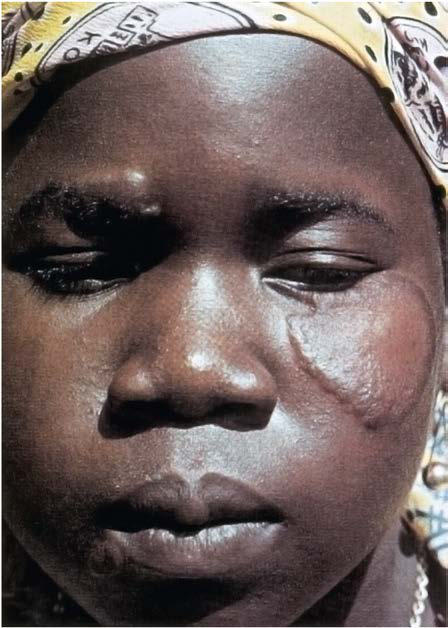
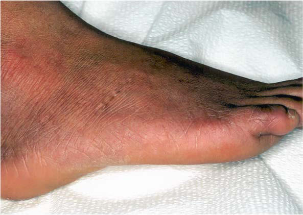

# Chapter 262: Hansen Disease (Mycobacterium leprae)

*Cristina Tomatis Souverbielle and Asuncion Mejias*

<!-- p.2363 -->
pulmonary TB and who cannot be removed from the source of infection or placed on long-term preventive therapy. It also is rec ommended for those who are continuously exposed to persons with TB who have bacilli that are resistant to isoniazid and rifampin. Any child receiving BCG vaccination should have a documented negative TST before receiving the vaccine. After receiving the vac cine, the child should be separated from the possible sources of infection until it can be demonstrated that the child has had a vac cine response, as evidenced by tuberculin reactivity, which usually develops within 1-3 months.

**Prevention of Perinatal Tuberculosis** The most effective way of preventing TB infection and disease in the neonate or young infant is through appropriate testing and treatment of the mother and other family members. High-risk pregnant women should be tested with TST or IGRA, and those with a positive test result should receive a chest radiograph with appropriate abdominal shield ing. If the mother has a negative chest radiograph and is clinically well, no separation of the infant and mother is needed after delivery. The child needs no special evaluation or treatment if the child remains asymptomatic. Other household members should undergo testing for TBI and further evaluation as indicated.

If the mother has suspected TB at the time of delivery, the new born should be separated from the mother until the chest radiograph is obtained. If the mother’s chest radiograph is abnormal, separation should be maintained until the mother has been evaluated thor oughly, including examination of the sputum. If the mother’s chest radiograph is abnormal but the history, physical examination, spu tum examination, and evaluation of the radiograph show no evi dence of current active TB, it is reasonable to assume that the infant is at low risk for infection. The mother should receive appropriate TB treatment, and she and her infant should receive careful followup care.

If the mother’s chest radiograph or AFB sputum smear shows evi dence of current TB disease, additional steps are necessary to protect the infant. Isoniazid therapy for newborns has been so effective that separation of the mother and infant is no longer considered man datory. Separation should occur only if the mother is ill enough to require hospitalization, has been or is expected to become nonadher ent to treatment, or has suspected drug-resistant TB. Isoniazid treat ment for the infant should be continued until the mother is sputum culture negative for ≥3 months. At that time, a TST should be placed on the child. If the test is positive, isoniazid is continued for a total duration of 9-12 months; if the TST is negative, isoniazid can be dis continued. Once the mother and child are taking adequate therapy, it is usually safe for the mother to breastfeed, because the medications, although found in milk, are present in low concentrations. If isoniazid resistance is suspected or the mother’s adherence to medication is in question, continued separation of the infant from the mother should be considered. The duration of separation must be at least as long as is necessary to render the mother noninfectious. A TB expert should be consulted if the young infant has potential exposure to the mother or another adult with TB disease caused by an isoniazid-resistant strain of *M. tuberculosis*.

Although isoniazid is not thought to be teratogenic, the treatment of pregnant women who have asymptomatic TBI is often deferred until after delivery. However, symptomatic pregnant women or those with radiographic evidence of TB disease should be appropriately evalu ated. Because pulmonary TB is harmful to both the mother and the fetus and represents a great danger to the infant after delivery, TB in pregnant women always should be treated. The most common regi men for drug-susceptible TB is isoniazid, rifampin, and ethambutol. The aminoglycosides and ethionamide should be avoided because of their teratogenic effect. The safety of pyrazinamide in pregnancy has not been established.

*Visit Elsevier eBooks+ at eBooks.Health.Elsevier.com** for Bibliography.*

**Leprosy** (Hansen disease [**HD**]) is a heterogeneous, curable infection caused by *Mycobacterium leprae* that primarily affects the upper air way, skin, and peripheral nerves. Disease manifestations are mainly determined by the host’s immunologic response to infection, resulting in a wide clinical spectrum. The majority of exposed individuals never develop clinical disease. HD is currently the accepted designation of leprosy, and contrary to popular folklore, HD is *not* highly transmis sible and *is* treatable. In addition, the associated morbidity and disabil ity can be prevented with early diagnosis and appropriate treatment.

**MICROBIOLOGY* M. leprae* is an obligate, intracellular, acid-fast, gram-positive bacillus of the family Mycobacteriaceae measuring 1-8 μm in length. It grows optimally at 27–33°C (80.6–91.4°F) yet cannot be cultured in vitro. The bacillus multiplies slowly, with a doubling time of 11-13 days. It is the only bacterium known to infect **Schwann cells** of peripheral nerves. Identification of acid-fast bacilli (AFB) in peripheral nerves is pathog nomonic of leprosy.

**EPIDEMIOLOGY** The prevalence of leprosy is variable, with most cases being identi fied in tropical and subtropical areas. The World Health Organization (WHO) goal to eliminate leprosy as a public health problem, defined as a reduction in its prevalence to less than 1 case per 10,000 popula tion, was achieved at the global level in 2000. Despite an overall decline in reported prevalence, HD continues to afflict more than 2 million people worldwide. In 2022, 174,059 new cases were reported globally, with most cases occurring in Southeast Asia (mostly India), Africa, and South America (mostly Brazil). Of those, 5.92% occurred in children <15 years. In 2018, the WHO reviewed the available evidence on key issues related to the elimination of leprosy and developed a guidance WHO *G*uidelines for the Diagnosis, Treatment and Prevention of Lep rosy. More recently, the WHO released Towards Zero Leprosy – Global Leprosy (Hansen’s Disease) Strategy 2021*-*2030*,* which was aligned with the 2021-2030 road map for neglected tropical diseases during the same period.

Since 1984, HD has been a *notifiable disease* in the United States, with about 14,000 cases recorded since then. Since the 1990s, an aver age of 175 new cases are reported annually. Of the 159 new U.S. cases reported in 2020, 69% were identified in Texas, Louisiana, Hawaii, Cal ifornia, Florida, and New York. Most new cases (∼75%) in the United States were identified among immigrants from HD-endemic countries or in citizens who have worked abroad in endemic areas. However, over one third of U.S. cases are **autochthonous** and do not report con tact with foreign countries or people with leprosy.

The likelihood of developing HD is determined by several variables: age (with two incidence peaks: 10-14 years and 30 years), gender (male/ female ratio 2:1, with no differences observed in children), genetics, immune status, type of leprosy (with higher risk in those exposed to patients with multibacillary disease), and possibly through exposure to **armadillos**. Whole genome sequencing has allowed identification of genes and polymorphisms associated with increased susceptibil ity to leprosy and found that approximately 5% of people are geneti cally susceptible to *M. leprae* infection. HD in immunocompromised

*Cristina Tomatis Souverbielle and 
 Asuncion Mejias*

<!-- p.2365 -->
McMullen SE, Pegues DA, Shofer FS, et al. Performance of QuantiFERON-TB Gold

and tuberculin skin test relative to subjects’ risk of exposure to tuberculosis. Clin Infect Dis. 2014;58:1260–1266. Meintjes G, Stek C, Blumenthal L, et al. Prednisone for the prevention of paradoxical

tuberculosis-associated IRIS. N Engl J Med. 2018;379(20):1915–1924. Menzies D, Adjobimey M, Ruslami R, et al. Four months of rifampin or nine months

of isoniazid for latent tuberculosis in adults. N Engl J Med. 2018;379(5):440–452. Moonan PK, Teeter LD, Salcedo K, et al. Transmission of multidrug-resistant tuber

culosis in the USA: a cross-sectional study. Lancet. 13:777–784. Moore HA, Apolles P, de Villiers PJ, et al. Sputum induction for microbiological di

agnosis of childhood pulmonary tuberculosis in a community setting. Int J Tuberc Lung Dis. 2011;15:1185–1190. Nahid P, Dorman SE, Alipanah N, et al. Official American Thoracic Society/CDC/

Infectious Diseases Society of American clinical practice guideline: treatment of drug-susceptible tuberculosis. Clin Infect Dis. 2016;63(7):e147–e195. Nemes E, Geldenhuys H, Rozot V, et al. Prevention of M. tuberculosis infection with

H4:IC31 vaccine or BCG revaccination. N Engl J Med. 2018;379(2):138–148. Nyang’wa BT, Berry C, Kazounis E, et al. A 24-week, all-oral regimen for rifampin-

resistant tuberculosis. N Engl J Med. 2022;387(25):2331–2342. Pereira C, Cascais M, Felix M, Salgado M. Scrofula in a child. J Pediatr. 2017;189:235. Pillay S, Steingart KR, Davies GR, et al. Xpert MTB/XDR for detection of pulmonary

tuberculosis and resistance to isoniazid, fluoroguinolones, ethionamide, and ami kacin (review). Cochrane Database System Rev. 2022;5:CD014841. Pinero Perez R, Santiago Garcia S, Rodriguez Marroan B, et al. Recommendations for

the preparation and administration of antituberculosis drugs in children. Second phase of the Magistral Project of the Spanish Network for the Study of Paediatric Tuberculosis (pTBred). An Pediatr (Barc). 2016;85(6):323.e1–323.e11. Posey DL, Naughton MP, Willacy EA, et al. Implementation of new TB screening

requirements for US bond immigrants and refugees—2007–2014. MMWR Morb Mortal Wkly Rep. 63:234–236. Roy A, Harris RJ, Rodrigues LC, et al. Effect of BCG vaccination against Mycobacte

rium tuberculosis infection in children: systematic review and meta-analysis. BMJ. 2014;349:g4643. Shah NS, Auld SC, Brust JCM, et al. Transmission of extensively drug-resistant tuber

culosis in South Africa. N Engl J Med. 2017;376(3):243–252. Sharawat IK. Scrofula. J Pediatr. 2017;189:236. Smith SE, Pratt R, Trieu L, et al. Epidemiology of pediatric multidrug-resistant tuber

culosis in the United States, 1993-2014. Clin Infect Dis. 2017;65. Snow KJ, Cruz AT, Seddon JA, et al. Adolescent tuberculosis. Lancet Child Adolesc.

2020;4:68–78. Solans BP, Beranger A, Radtke K, et al. Effectiveness and pharmacokinetic expo

sures of first-line drugs used to treat drug-susceptible tuberculosis in children:

a systematic review and meta-analysis. Clin Infect Dis. 2023:ciac973. https://doi. org/10.1093/cid/ciac973. Online ahead of print. Song R, Click ES, McCarthy KD, et al. Sensitive and feasible specimen collection and

testing strategies for diagnosing tuberculosis in young children. JAMA Pediatr. 2021. Starke JR. AAP Committee on Infectious Diseases: interferon-γ release assays

for diagnosis of tuberculosis infection and disease in children. Pediatrics. 2014;134(6):e1763–e1773. Starke JR, Cruz AT. The global nature of childhood tuberculosis. Pediatrics.

2014;133:e725–e727. Sun L, Tian J-I, Yin Q-Q, et al. Performance of interferon gamma release assays in

tuberculosis disease in children five years old or less. PLoS One. 10(12):e0143820. Tameris MD, Hatherill M, Landry BS, et al. Safety and efficacy of MVA85A, a new

tuberculosis vaccine, in infants previously vaccinated with BCG: a randomized, placebo-controlled phase 2b trial. Lancet. 2013;381:1021–1028. Tsang CA, Langer AJ, Navin TR, et al. Tuberculosis among foreign-born persons di

agnosed ≥10 years after arrival in the United States, 2010–2015. MMWR Morb Mortal Wkly Rep. 2017;66(11):295–298. Turkova A, Willis GH, Wobudeya E, et al. Shorter treatment for nonsevere tuberculo

sis in African and Indian children. N Engl J Med. 2022;368(10):911–922. Villarino ME, Scott NA, Weis SE, et al. Treatment for preventing tuberculosis in chil

dren and adolescents: a randomized clinical trial of a 3-month, 12 dose regimen of a combination of rifapentine and isoniazid. JAMA Pediatr. 2015;169(3):247–255. Wang Z, Posey DL, Brostrom RJ, et al. US postarrival evaluation of immigrant and

refugee children with latent tuberculosis infection diagnosed overseas, 2007-2019. J Pediatr. 2022;245:149–157. Winston CA, Menzies HJ. Pediatric and adolescent tuberculosis in the United States,

2008-2010. Pediatrics. 2012;130:6. World Health Organization Consolidated Guidelines on Tuberculosis. Module 1:

Diagnosis – Rapid Diagnostics for Tuberculosis Detection. 2021 Update. Geneva: WHO; 2021. World Health Organization. Global Tuberculosis Report 2020. Geneva: WHO; 2020. World Health Organization. Module 4 : Treatment – Drug-Resistant Tuberculosis

Treatment. Geneva: WHO; 2020. 2020. World Health Organization. Multidrug Resistant Tuberculosis in Children and Adoles

cents in the WHO European Region. Geneva: WHO; 2019. Expert opinion. 2019. World Health Organization. SHINE Trial on Shorter Treatment for Children with

Minimal TB. Geneva: WHO; 2020. 2020. Xie YL, Chakravorty S, Armstrong DT, et al. Evaluation of a rapid molecular drug-

susceptibility test for tuberculosis. N Engl J Med. 377(11):1043–1054. Zumla A, Raviglione M, Hafner R, et al. Tuberculosis. N Engl J Med. 2013;368:745–

754.

<!-- p.2366 -->
hosts has been reported in solid organ and bone marrow transplant recipients and patients receiving tumor necrosis factor (TNF)–block ing monoclonal antibodies. Patients with HIV infection do not appear to be at increased risk of acquiring leprosy, increased disease severity, or poor response to treatment. However, clinicians should be aware that concomitant HIV infection and leprosy can result in worsening of symptoms of leprosy during HIV treatment as a result of an immune reconstitution inflammatory syndrome.

The exact mechanism of transmission is not fully understood but is thought to occur primarily by the respiratory route. Natural infec tion occurs in humans and armadillos, which are the only recognized nonhuman reservoir. The risk of transmission from armadillos to humans seems low, and again, the mechanism is not fully understood. The incubation period between natural infection and overt clinical dis ease in humans ranges from 3 months to 20 years, with a mean of 4 years for **tuberculoid** leprosy and 10 years for **lepromatous** leprosy. Up to 107 viable bacilli per day can be shed in respiratory secretions of patients with **multibacillary** leprosy. The relative risk for developing disease in household contacts is 8- to 10-fold for lepromatous disease and 2- to 4-fold for the tuberculoid form. Transmissions by breast milk, the transplacental route, and through broken skin have been reported. Environmental factors and subclinically infected humans may also play a role in disease transmission. The infectivity of patients with HD becomes negligible within 24 hours of the first administration of effec tive therapy.

**PATHOGENESIS** In the skin, *M. leprae* shows affinity for keratinocytes, macrophages, and histiocytes, and in peripheral nerves, the organism can be found in the Schwann cells. The mechanism of mycobacterial dissemination from the respiratory tract to the skin and nerves is thought to occur hematogenously but has not been completely elucidated. *M. leprae* induces demyelination and binds to the laminin-2 glycoprotein pres ent in the basal lamina of Schwann cells in peripheral nerves, where it replicates slowly over several years. Infection stimulates the dedif ferentiation of Schwann cells to immature cells through the activa tion of the Erk1/2 pathway. This reprogramming of Schwann cells seems to be linked to disease dissemination. In addition to the direct nerve invasion, the immune response to infection also contributes to nerve damage. Schwann cells express human leukocyte antigen (HLA) class II molecules and present mycobacterial peptides to the HLA class II restricted CD4+ T cells, which initiate an inflammatory response. These events explain the nerve damage seen in paucibacil lary disease and in reversal reactions. Swelling within the perineu rium leads to ischemia, further nerve damage, and eventually fibrosis and axonal death.

**DISEASE CLASSIFICATION** Disease classification is important to determine potentially infec tious cases and prognosis. Based on the cellular immune response and disease dissemination, two classification schemes for leprosy are fre quently used: the Ridley-Jopling scale and the WHO classification: A.	 The **Ridley-Jopling scale** is used in the United States and describes

the five types of leprosy, according to clinical spectrum of disease, bacillary load, and findings on histopathology. 1.	 *Tuberculoid form*: Patients usually have a vigorous and specific cellular immune response to *M. leprae* antigens and have a small number of skin lesions, generally one to three well-demarcated macules or plaques with elevated borders (Fig. 262.1) and re duced or absent sensation. The lesions are infiltrated by T-helper 1 (Th1) cells producing abundant interferon (IFN)-γ and TNFα, forming well-demarcated granulomas, with few, if any, bacilli found within the lesions. 2.	 *Borderline tuberculoid form* 3.	 *Borderline form* 4.	 *Borderline lepromatous* 5.	 *Lepromatous form*: Patients have an absence of specific cellular immunity to *M. leprae* (but intact immunity to *Mycobacterium*

*tuberculosis*) and present the most severe form of disease. They manifest clinically apparent infiltration of peripheral nerves and skin lesions (usually many lesions and not all hypoesthetic or an esthetic), with a high load of bacilli in the absence of an effective cell-mediated immune response. Skin biopsies reveal extensive infiltration of the skin and nerves, containing messenger RNA for Th2 cytokines such as interleukin (IL)-4 and IL-10, poorly formed granulomas, and uncontrolled proliferation of bacilli within foamy macrophages. A large amount of circulating anti body to *M. leprae* is present but does not confer protective im munity. Over time, patients with the lepromatous form develop a systemic disease with symmetric peripheral nerve involvement and a diffuse infiltrative dermopathy that includes thickening of the facial skin and hair loss of the eyelashes and eyebrows (ma darosis), leading to the classic presentation of the *leonine facies.* They also have involvement of the nasal mucosa causing nasal congestion and epistaxis. 6.	 The majority of patients will present with a borderline form. From borderline tuberculoid to borderline lepromatous forms, there is a progressive reduction in cellular immune responses, an increase in bacillary load, more frequent hypopigmented skin lesions and nerve involvement, and higher antibody titers (Fig. 262.2). Patients with the extreme forms of the disease (tu berculoid and lepromatous) are considered to have stable cellmediated immunity, because their disease manifestations do not change much over time. In contrast, patients with border line disease have unstable cell-mediated immunity and demon strate changes in their clinical manifestations over time toward the polar forms (downgrade) or present sudden reversal reac tions (upgrade). *Indeterminate leprosy* is the earliest form of the disease and is seen most frequently in young children. Patients usually have a single hypopigmented macule with poorly defined borders, without erythema or induration. Anesthesia is minimal or absent, especially if the lesion is on the face. The diagnosis is

**Fig. 262.1** Tuberculous leprosy in a patient who has a single skin le sion with a raised border and flattened center.

<!-- p.2367 -->
usually one of exclusion in the setting of a contact investigation. Tissue biopsies show diagnostic evidence of leprosy but do not meet sufficient criteria for classification. Up to 50–75% of these lesions will heal spontaneously, and the rest will progress to an other form of leprosy. B.	 The **WHO classification** can be used when histologic evaluation

and confirmatory diagnosis is unavailable, a common scenario in the field. This simplified scheme is based on the number of skin le sions: 1.	 Paucibacillary (1-5 patches) 2.	 Multibacillary (>5 patches)

**CLINICAL MANIFESTATIONS** The host immune response determines the clinical spectrum of lep rosy. Skin and serologic studies suggest that up to 90% of infected people develop immunity after exposure, without manifesting clini cal disease. In genetically susceptible individuals with sufficient expo sure to become infected, the cellular host’s immunologic response to infection and unique tropism for peripheral nerves determine the wide spectrum of clinical (and histologic) manifestations. Regard less of the disease subtype, HD affects the skin and peripheral nerves. Leprosy lesions usually do not itch or hurt. Polymorphisms in vita min D and its receptor have been proposed to play a role in the mani festations of leprosy.

**Skin Involvement** The most common skin lesions are **macules** or **plaques** with unclear outer limits, with or without neurologic symptoms. Diffuse infil trative lesions and subcutaneous nodules are less common. Initial lesions are insidious hypopigmented macules, although they may appear erythematous on pale skin. Lesions may involve any area of the body, are more pronounced in cooler areas (e.g., earlobes, nose), and occur less frequently in the scalp, axillae, or perineum. Approx imately 70% of skin lesions have reduced sensation; the degree of hypoesthesia depends on the location and size of the lesion and the degree of Th1 immune response. Examination of the skin should ideally be performed in natural sunlight and include testing for hypoesthesia to light touch, pinprick, temperature, and anhidrosis. Studies in endemic areas in children <15 years old have shown a predominance of **paucibacillary** forms, with a predominance of single lesions.

**Nerve Involvement** Peripheral nerves are most frequently affected early in the disease and should be palpated for thickness and tenderness (Fig. 262.3), as well as evaluated for both motor and sensory function, particularly temperature and light touch. The posterior tibial nerve (medial malleolus) is the most common nerve affected, followed by the

ulnar (elbow), median (wrist), lateral popliteal (fibular neck), and facial nerves. The skin lesions overlying a nerve trunk distribution predict the involvement of nerves in the vicinity. There is a pure **neuritic** form of leprosy, usually occurring in India and Nepal, in which patients present with asymmetric neuropathy but lack skin lesions.

**Other Organ Involvement** Ocular involvement leading to vision loss results from both direct bacillary invasion of the eye and optic nerve damage. **Lagophthalmos** occurs when there is destruction of the facial nerve (cranial nerve VII), and trigeminal nerve (cranial nerve V) destruction causes anesthesia of the cornea and conjunctiva, leading to abrasions. Facial skin lesions are associated with a 10-fold higher risk of facial nerve damage. Systemic involvement of other organs is seen mainly in patients with leproma tous leprosy, where a high bacillary burden leads to infiltration of the nasal mucosa, bones, and testes. Renal involvement and amyloidosis are rare findings.

**Immunologic Reactions Leprosy reactions** are acute clinical exacerbations reflecting distur bances of the immunologic balance to *M. leprae* infection and occur ring in 30–50% of all leprosy patients. These sudden changes occur in patients with borderline and lepromatous leprosy, typically during the initial years after infection (sometimes as the initial presentation), but can occur before, during, or after completion of treatment. There are two main types of leprosy reactions, which require immediate treatment to prevent long-term complications. In children <15 years old, leprosy reactions range from 1% to 30% and are mainly type 1 reactions.

**Type 1 reactions** (also known as **reversal reactions**) occur in one third of patients with borderline disease. These reactions are characterized by acute edema and increased erythema, warmth, and painful inflammation of preexisting cutaneous plaques or nodules, with acute swelling and tenderness of peripheral nerves that can quickly progress to cause nerve abscesses and necrosis. There may be a peripheral lymphocytosis and an increased cytokine response, but systemic symptoms are uncommon and appear to be associated with an increase in Th1-mediated reactivity to mycobacterial anti gens. Increased serum concentrations of CXCL10 have been found in type 1 reactions. Rapid and sustained reversal of the inflamma tory process using corticosteroids is essential to prevent continued nerve damage.

**Type 2 reactions**, or **erythema nodosum leprosum (ENL)**, occur in borderline lepromatous and lepromatous forms, as these patients have the highest levels of *M. leprae* antigens and antibodies, most often in the first 2 years after starting therapy. ENL is distinguished from reversal reactions by the development of new painful, ery thematous subcutaneous nodules with an accompanying systemic inflammatory response. ENL is accompanied by high circulating concentrations of TNF-α. Patients develop high fever and signs

**Fig. 262.3** Thickened, superficial peroneal nerve of leprosy.

**Fig. 262.2** Borderline leprosy in a patient who has numerous hypo pigmented lesions with poorly defined borders.

<!-- p.2368 -->
of systemic toxicity, and in severe cases, ENL can be life threaten ing, presenting with features similar to septic shock. Deposition of extravascular immune complexes leads to neutrophil infiltra tion and activation of complement in the skin and other organs. Tender, erythematous dermal papules or nodules (resembling erythema nodosum) occur in clusters, typically on extensor sur faces of the lower extremities and face. Immune complex deposi tion also contributes to migrating polyarthralgias, painful swelling of lymph nodes and spleen, iridocyclitis, vasculitis, orchitis, and, rarely, nephritis. Patients may present with a single acute episode, a relapsing form comprising multiple acute episodes, or a chronic continuous form. Management of type 2 reactions is usually more complicated because of recurrence and systemic involvement.

**Lucio phenomenon (erythema necroticans)** is an uncommon but potentially fatal reaction distinct from type 1 or 2 reactions and occurs in patients with untreated lepromatous leprosy and in patients whose ancestry is from Mexico. It is a necrotizing vasculitis caused by *M. lep rae* directly invading the endothelium. Clinically, patients develop vio laceous or hemorrhagic plaques, followed by ulcerations in the absence of systemic complaints. Secondary bacterial infections are common.

**DIAGNOSIS** The diagnosis of HD requires high clinical suspicion and should be considered in any patient with a **hypoesthetic or anesthetic skin lesion that does not respond to standard treatment**, especially if there is a history of travel or residence in an endemic region or a his tory of contact with leprosy patients or armadillos. There are no reli able tests to diagnose subclinical leprosy. Full-thickness skin biopsy and polymerase chain reaction (PCR) are the main laboratory tests to aid in the diagnosis. Patients are considered to have HD if they have **one or more of the three cardinal signs**: loss of sensation in a localized skin lesion (pale or erythematous), thickened peripheral nerve with loss of sensation and/or weakness of muscles enervated by that nerve, or the presence of AFB on biopsy. The positive predic tive value for the diagnosis of leprosy in patients meeting all three criteria is 98%.

To confirm the diagnosis and determine the extent of nerve involve ment and the type of infiltrate, a full-thickness skin biopsy from the most active lesion should be performed. *M. leprae* is best identified in tissue using the *Fite stain*. Lesions from patients with the leproma tous form reveal numerous AFB in clumps (globi), whereas patients with the tuberculoid form rarely have mycobacteria identified, but the diagnosis can be made by demonstration of well-formed noncaseating granulomas and nerve involvement. The presence of **neural inflam mation** differentiates leprosy from other granulomatous disorders. Mycobacterial culture of lesions should be performed to exclude *M.*

*tuberculosis* and nontuberculous cutaneous infections. If no resources are available, slit-skin (skin smear) biopsies represent an alternative. Slit-skin smears have high specificity but low sensitivity; only 30% of adults and 10–30% of children <15 years old are smear positive (usu ally patients with the lepromatous form). The bacterial index can range from 0 (no bacilli in 100 oil-immersion fields), as generally seen in paucibacillary disease, to 6+ (>1,000 bacilli/field), as can be seen in multibacillary disease.

Diagnostic and histopathologic consultation in the United States is available through the **National Hansen’s Disease Program** (**NHDP**; http://www.hrsa.gov/hansens or 800-642-2477). Specimens (formalin or paraffin embedded) can be sent to the NHDP for pathologic analysis free of charge. A PCR test for *M. leprae* is not readily available in clini cal practice but may be performed at the NHDP. In nonendemic areas, PCR may be useful for diagnosis when AFB are discernible in tissue but clinical and histopathologic features are not typical. *M. leprae* DNA is detectable by PCR in 95% of lepromatous disease and 55% of tuber culoid lepra. PCR has also allowed detection of the organism in nasal secretions from asymptomatic people. Molecular testing for mutations causing drug resistance is also available through the NHDP and is usu ally used in the setting of relapse.

Antibodies to *M. leprae* are present in 90% of patients with untreated lepromatous disease, 40–50% of patients with paucibacillary disease, and 1–5% of healthy controls. However, serologic testing is insensitive and is not used for diagnosis.

**TREATMENT** The primary goal of treatment is early antimicrobial therapy to prevent permanent neuropathy. Leprosy is curable. Effective treatment requires multidrug therapy (MDT) with **dapsone**, **clofazimine**, and **rifampin**. Combination therapy is employed to prevent antimicrobial resistance. In the United States, clinical providers considering a diagnosis and treatment of a patient with HD should obtain **consultation from the NHDP**. The recommended combination MDT can be obtained free of charge from the NHDP (Table 262.1) and in other countries through the WHO (Table 262.2). Compared with the WHO, the NHDP advo cates for a longer duration of treatment and daily rather than monthly administration of rifampin because shorter antimicrobial regimens have been associated with a greater risk of relapse. The recommended duration by the WHO for tuberculoid disease is 6 months and for lep romatous disease is 12 months. Since 2018, the WHO has advocated for a three-drug regimen for all leprosy forms; however, NHDP guide lines recommend two drugs (dapsone and rifampin) for the treatment of paucibacillary disease.

Before starting combination MDT, patients should be tested for glucose-6-phosphate dehydrogenase deficiency, have a baseline

#### **Table 262.1** NHDP-Recommended Multidrug Therapy Regimens for Hansen Disease in the United States

| Category / Parameter | Clinical Details & Findings |
| --- | --- |
| **DURATION OF THERAPY** | Multibacillary (LL, BL, BB); Adult; Dapsone 100 mg/day and; rifampin* 600 mg/day and; clofazimine 50 mg/day; 24 mo; Pediatric†; Dapsone 1 mg/kg/day and; rifampin 10-20 mg/kg/day and; clofazimine 1 mg/kg/day‡; Paucibacillary (TT, BT); Adult; Dapsone 100 mg/day and; rifampin 600 mg/day; 12 mo; Pediatric†; Dapsone 1 mg/kg/day and; rifampin 10-20 mg/kg/day; *Rifampin is taken monthly if the patient is on prednisone.; †Daily pediatric mg/kg dose should not exceed the adult daily maximum.; ‡Clofazimine is only available through NHDP Investigational New Drug (IND) program; minimum formulation is 50 mg, and capsules should not be cut. Alternative dosing includes; clofazimine 2 mg/kg every other day; NHDP, National Hansen’s Disease Program; BB, borderline; BL, borderline lepromatous; BT, borderline tuberculoid; LL, lepromatous; TT, tuberculoid.; NHDP multidrug therapy is daily and of longer duration than WHO-recommended regimen. All drugs are administered orally. For immunologically compromised or elderly patients,; these protocols may be modified. Consultation with the NHDP is advised. |

<!-- p.2369 -->
complete blood cell count and liver function testing, and be evalu ated for evidence of active tuberculosis, in which monotherapy with rifampin should be avoided. Response to therapy is seen clinically as flattening or disappearance of skin lesions and improvement in nerve function, usually within 1-2 months after initiating MDT. Complete resolution or improvement may take 6-12 months, depending on the severity of infection. Most skin lesions heal without scarring. Identifi cation of biomarkers for the optimal identification and management of leprosy continue to be under study. CXCL10 (IP-10) has been identi fied as a potential marker to help monitor treatment efficacy in patients with multibacillary disease, as higher levels of CXCL-10 are important for the control of bacillary load.

Alternative agents to treat HD include minocycline, clarithromy cin, and some fluoroquinolones (levofloxacin, ofloxacin, moxifloxa cin). Given limited data, these alternative antimicrobials are used in selected cases of intolerance to the routine combination MDT regimen or for documented resistance. It is important to note that some patients who have been adequately treated for HD may later show evidence of chronic reversal reactions and late neuropathies, but these are bacillus negative and thus should not be considered relapses. Neuritis must be treated promptly to minimize nerve injury and disability. Treatment with corticosteroids appears to improve nerve function in two thirds of patients.

Bone marrow suppression and hepatotoxicity have been reported and should be monitored every 3 months during therapy. A screening urinalysis should be performed annually. Other reactions, such as met hemoglobinemia and hypersensitivity reactions to dapsone, are rare. An ophthalmologic evaluation should routinely be performed in all patients with HD because ocular complications can occur. Given the proclivity for testicular invasion in multibacillary leprosy with resul tant testicular dysfunction and infertility, males should be screened for elevated follicle-stimulating hormone or luteinizing hormone concen trations and decreased testosterone levels.

After completion of MDT, annual follow-up for ≥5 years for pauci bacillary and ≥10 years for multibacillary disease is warranted. Relapse of the disease after completion of MDT is rare (0.01–1.4%) and must be distinguished from the more common leprosy immunologic reactions. Patients who have a bacillary index of ≥4 pre-MDT or ≥3 at the com pletion of MDT have the highest risk of relapse (approximately 20%). When relapse occurs, it is usually within 5-10 years of MDT comple tion and a result of reactivation of drug-susceptible mycobacteria. Thus patients who are expected to relapse are generally treated with the same MDT regimen. Resistance to all three drugs has been documented,

although it rarely occurs with combination therapy. There is no role for routine baseline resistance testing, but the NHDP can provide it if needed.

**Leprosy Reactions** Immunologic reactions can occur before, during, and years after treat ment and should be treated aggressively to prevent peripheral nerve damage. In general, antimycobacterial drugs should be continued. Fatigue, malaise, or fever can be present, and the inflammation associ ated with these reactions can cause severe nerve injury. Prompt therapy with corticosteroids with or without other antiinflammatory agents, adequate analgesia, and physical support are essential for patients with active neuritis to prevent nerve damage. **If corticosteroids are indi cated for a prolonged time, the frequency of rifampicin administra tion should be decreased from daily to monthly** administration (to avoid drug interactions). In 2020, to aid with the management of lep rosy reactions, the WHO published the technical guide: *Leprosy/Han sen Disease: Management of Reactions and Prevention of Disabilities*.

For severe **type 1 reactions**, **prednisone is recommended**, 1 mg/ kg/day orally (40-60 mg) with a slow taper (decreasing by 5 mg every 2-4 weeks after evidence of improvement over 3-6 months) in addition to standard MDT. If there is evidence of peripheral nerve deteriora tion, higher doses and longer tapers may be needed. Nerve function improves after corticosteroid treatment in 30–80% of patients who did not have preexisting neuritis. In patients not responding to corticoste roids, cyclosporine may be used as a second-line agent.

For severe **type 2 reactions**, **prednisone is routinely used** at 1 mg/ kg/day for 12 weeks. However, given the recurrence and chronicity of ENL, **corticosteroid-sparing agents should be considered** to avoid complications associated with their prolonged use. **Thalidomide** (100- 400 mg/daily for 48-72 hours, tapering over 2 weeks to 100 mg/daily) is effective in treating these types of reactions. Given the teratogenicity of thalidomide (contraindicated for children <12 years old and women of childbearing age), the drug is only available through a restrictive distribution program approved by the U.S. Food and Drug Adminis tration (FDA). **Clofazimine** (300 mg/day for several months, tapering to <100 mg/day, within a year) alone or in combination with cortico steroids, has also been useful in managing patients with chronic ENL and is generally used until all signs of the reaction have abated. Other immunosuppressive drugs have been used to treat type 2 reactions with inconsistent results, including cyclosporine, mycophenolate, and methotrexate. **Lucio phenomenon is managed similarly to ENL** and treatment of underlying infections.

#### **Table 262.2** WHO-Recommended Multidrug Therapy (MDT) Regimens for Hansen Disease

| Category / Parameter | Clinical Details & Findings |
| --- | --- |
| **DURATION OF THERAPY** | Multibacillary (LL, BL, BB); Adult; Rifampicin 600 mg once monthly; and dapsone 100 mg/day and; clofazimine 300 mg once monthly; and 50 mg/day; 12 mo; Pediatric*; Rifampicin 450 mg once monthly; and dapsone 50 mg/day and; clofazimine 150 mg once monthly; and 50 mg every other day; Paucibacillary (TT, BT); Adult; Rifampicin 600 mg once monthly; and dapsone 100 mg/day and; clofazimine 300 mg once monthly; and 50 mg/day; 6 mo; Pediatric*; Rifampicin 450 mg once monthly; and dapsone 50 mg/day and; clofazimine 150 mg once monthly; and 50 mg every other day; *In children <10 yr old, or <than 40Kg, MDT dosages should be in mg/kg, not to exceed the adult daily maximum: rifampicin 10 mg/kg once monthly, dapsone 2 mg/kg/day, and; clofazimine100 mg once a month, 50 mg twice weekly.; WHO, World Health Organization; BB, borderline; BL, borderline lepromatous; BT, borderline tuberculoid; LL, lepromatous; TT, tuberculoid. |

<!-- p.2371 -->
