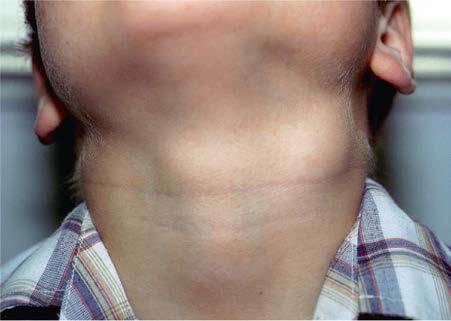
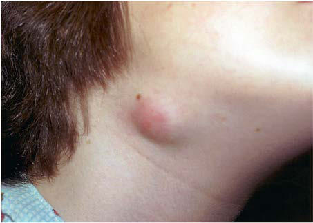

# Chapter 263: Nontuberculous Mycobacteria

*Ericka V. Hayes*

<!-- p.2370 -->
**LONG-TERM COMPLICATIONS** Leprosy is a leading cause of permanent physical disability among com municable diseases worldwide. The major chronic complications and deformities of leprosy are caused by **nerve injury**. Nerve impairment may be purely sensory, motor, or autonomic or may be a combination. The prognosis for arresting progression of tissue and nerve damage is good if therapy is started early, but recovery of lost sensory and motor function is variable and frequently incomplete. Nerve function impair ment can occur before diagnosis, during MDT, or after MDT and can develop without overt signs of skin or nerve inflammation (silent neu ropathy). Patients at highest risk of nerve impairment are those with multibacillary leprosy and preexisting nerve damage. These patients should undergo regular monthly surveillance during therapy and for at least 2 years from the time of diagnosis. In children, deformities can occur in 3–10% of cases and mainly in those with nerve enlargement. Other factors contributing to risk of deformities include increasing age in children, delay in accessing medical care, multiple skin lesions, mul tibacillary disease, smear positivity, multiple nerve involvement, and leprosy reaction at presentation.

**PREVENTION** In addition to treating active leprosy cases, control measures for HD include the management of **contacts** of index patients. In endemic countries, close monitoring of household contacts of HD patients, particularly HD patients with multibacillary disease, is warranted to ensure that early treatment can be implemented if evidence of early HD develops. These household contacts should be examined at base line and then yearly for 5 years. In nonendemic areas, disease pre senting in the contacts of patients with HD is rare. A single dose of bacille Calmette-Guérin (BCG) vaccine has variable protective efficacy against leprosy, ranging from 10% to 80%; an additional dose results in increased protection. Any suspected or newly diagnosed case of lep rosy in the United States should be reported to local and state public health departments, the Centers for Disease Control and Prevention (CDC), and NHDP. There are no leprosy vaccines available or recom mended for use in the United States. In the hospital setting, **standard precautions** should be implemented. Hand hygiene is recommended for all people in contact with a patient with lepromatous leprosy. The use of chemoprophylaxis with a single dose of rifampin (SDR) within endemic areas is recommended by the WHO, but not the NHDP, for adults and children ≥2 years in contact with leprosy patients. Because leprosy is a highly stigmatized disease, caution must be exercised when implementing SDR in contacts, particularly for those outside the patient’s family.

*Visit Elsevier eBooks+ at eBooks.Health.Elsevier.com** for Bibliography.*

Nontuberculous mycobacteria **(NTM)**, also referred to as **atypical mycobacteria** and **mycobacteria other than tuberculosis** (MOTT), are all members of the genus *Mycobacterium* and include species other than *Mycobacterium tuberculosis* complex and *Mycobacterium leprae*. The NTM constitute a highly diverse group of bacteria that differ from *M. tuberculosis* complex bacteria in their pathogenicity, interhuman transmissibility, nutritional requirements, ability to produce pigments,

*Ericka V. Hayes*

enzymatic activity, and drug susceptibility. In contrast to the *M. tuber culosis* complex, NTM are acquired from environmental sources and not by person-to-person spread, although the latter is under debate, especially in patients with cystic fibrosis (CF). Their omnipresence in the environment means that the clinical relevance of NTM isola tion from clinical specimens is sometimes unclear; a positive culture might reflect occasional presence or contamination rather than true NTM disease. NTM are associated with pediatric lymphadenitis, oto mastoiditis, serious lung infections, and, rarely, disseminated disease. Treatment is long-term and cumbersome and often requires adjunc tive surgical intervention. Comprehensive guidelines on diagnosis and treatment are provided by the American Thoracic Society (ATS) and British Thoracic Society (BTS).

**ETIOLOGY** NTM are ubiquitous in the environment all over the world, existing as saprophytes in soil and water (including municipal water supplies, tap water, hot tubs, and shower heads), environmental niches that are the supposed sources of human infections. With the introduction of molecular identification tools such as 16S recombinant DNA gene sequencing, the number of identified NTM species has grown to more than 150; the *clinical relevance* (i.e., percentage of isolates that are caus ative agents of true NTM disease, rather than occasional contaminants) differs significantly by species.

*Mycobacterium avium* complex (**MAC**; i.e., *M. avium, Mycobacte rium intracellulare,* and several closely related but rarer species) and *Mycobacterium kansasii* are most often isolated from clinical samples, yet the isolation frequency of these species differs significantly by geo graphic area. MAC bacteria have been frequently isolated from natural and synthetic environments, and cases of MAC disease have been suc cessfully linked to home exposure to shower and tap water. Although the designation *M. avium* suggests that human infections are acquired from birds (Latin *avium*), molecular typing has established that *M. avium* strains that cause pediatric lymphadenitis and adult pulmo nary disease represent the *M. avium* hominis suis subgrouping, mainly found in humans and pigs and not in birds.

Some NTM have well-defined ecologic niches that help explain infection patterns. The natural reservoir for *Mycobacterium marinum* is fish and other cold-blooded animals, and the **fish tank granuloma**, a localized skin infection caused by *M. marinum,* follows skin injury in an aquatic environment. *Mycobacterium fortuitum* complex bacteria and *Mycobacterium chelonae* are ubiquitous in water and have caused clusters of nosocomial surgical wound and venous catheter–related infections*. Mycobacterium ulcerans* is associated with severe, chronic skin infections **(Buruli ulcer disease)** and is endemic mainly in West Africa and Australia, although other foci exist. Its incidence is high est in children <15 years old. *M. ulcerans* had been detected in envi ronmental samples by polymerase chain reaction (PCR) and has been recovered by culture from a water strider (an insect of the *Gerris* genus) from Benin.

**EPIDEMIOLOGY** Humans are exposed to NTM on a daily basis. In rural U.S. counties, where *M. avium* is common in swamps, the prevalence of asymp tomatic infections with *M. avium* complex, as measured by skin test sensitization, approaches 70% by adulthood. Still, the incidence and prevalence of the various NTM disease types remain largely unknown, especially for pediatric NTM disease. In Australian chil dren, the overall incidence of NTM infection is 0.84 per 100,000, with lymphadenitis accounting for two thirds of cases. The incidence of pediatric NTM disease in the Netherlands is estimated at 0.77 infections per 100,000 children per year, with lymphadenitis making up 92% of all infections.

In comparison, estimations of the prevalence of NTM from respi ratory samples in adults are 5-15 per 100,000 persons per year, with important differences between countries or regions. Because pulmo nary NTM disease progresses slowly, over years rather than months, and usually takes several years to cure, the prevalence of pulmonary NTM disease is much higher than incidence rates would suggest.

<!-- p.2372 -->
The paradigm that NTM disease is a rare entity limited to resourcerich countries is changing. In recent studies in African countries with a high prevalence of HIV infection, it has been found that NTM might play a much larger role as a cause of tuberculosis-like disease of chil dren and adults than previously assumed and thus confuse the diagno sis of tuberculosis.

Although it is generally believed that NTM infections are contracted from environmental sources, whole genome sequence analysis of *Mycobacterium abscessus* strains of patients in a CF clinic in the United Kingdom supports the possibility of nosocomial horizontal transmis sion among CF patients.

**PATHOGENESIS** The histologic appearances of lesions caused by *M. tuberculosis* and NTM are often indistinguishable. The classic pathologic lesion consists of caseating granulomas. Compared with *M. tuberculosis* infections, NTM infections are more likely to result in **granulomas that are non caseating**, poorly defined (nonpalisading), irregular or serpiginous, or even absent, with only chronic inflammatory changes observed. The histology likely reflects the immune status of the patient.

In patients with AIDS and disseminated NTM infection, the inflam matory reaction is usually scant, and tissues are filled with large

numbers of histiocytes packed with acid-fast bacilli (AFB). These dis seminated NTM infections typically occur only after the number of CD4 T lymphocytes has fallen below 50/μL in children ≥6 years, below 75/μL in children 2 to <6 years, below 500/μL in children 1 to <2 years, and below 750/μL in children <1 year, suggesting that specific T-cell products or activities are required for immunity to mycobacteria.

The pivotal roles of interferon (IFN)-γ, interleukin (IL)-12, and tumor necrosis factor (TNF)-α in disease pathogenesis are demon strated by the high incidence of mostly disseminated NTM disease in children with IFN-γ and IL-12 pathway deficiencies and in persons treated with agents that neutralize TNF-α.

Observed differences in pathogenicity, clinical relevance, and spectrum of clinical disease associated with the various NTM spe cies emphasize the importance of bacterial factors in the pathogen esis of NTM disease, although exact virulence factors remain largely unknown.

**CLINICAL MANIFESTATIONS Lymphadenitis** of the superior anterior cervical or submandibular lymph nodes is the most common manifestation of NTM infection in children (Table 263.1). Preauricular, posterior cervical, axillary, and inguinal nodes are involved occasionally. Lymphadenitis is most

#### **Table 263.1** Major Clinical Syndromes Associated with Nontuberculous Mycobacterial Infection

| Category / Parameter | Clinical Details & Findings |
| --- | --- |
| **LESS FREQUENT CAUSES*** | Chronic nodular disease (adults with; bronchiectasis; cystic fibrosis); MAC (M. intracellulare, M. avium),; M. kansasii, M. abscessus; M. xenopi, M. malmoense, M. szulgai, M. smegmatis,; M. celatum, M. simiae, M. goodii, M. asiaticum,; M. heckeshornense, M. branderi, M. lentiflavum, M. triplex,; M. fortuitum, M. arupense, M. abscessus subsp. bolletii,; M. phocaicum, M. aubagnense, M. florentinum, M. abscessus; subsp. massiliense, M. nebraskense, M. saskatchewanense,; M. seoulense, M. senuense, M. paraseoulense, M. europaeum,; M. sherrisii, M. kyorinense, M. noviomagense, M. mantenii,; M. shinjukuense, M. koreense, M. heraklionense,; M. parascrofulaceum, M. arosiense; Cervical or other lymphadenitis; (especially children) |
| **MAC** | M. scrofulaceum, M. malmoense (northern Europe),; M. abscessus, M. fortuitum, M. lentiflavum,; M. tusciae, M. palustre, M. interjectum, M. elephantis,; M. heidelbergense, M. parmense, M. bohemicum,; M. haemophilum, M. europaeum, M. florentinum, M. triplex,; M. asiaticum, M. kansasii, M. heckeshornense; Skin and soft tissue disease; M. fortuitum group, M. chelonae,; M. abscessus, M. marinum, M. ulcerans; (Australia, tropical countries only); M. kansasii, M. haemophilum, M. porcinum, M. smegmatis,; M. genavense, M. lacus, M. novocastrense, M. houstonense,; M. goodii, M. immunogenum, M. mageritense, M. abscessus; subsp. massiliense, M. arupense, M. monacense,; M. bohemicum, M. branderi, M. shigaense, M. szulgai,; M. asiaticum, M. xenopi, M. kumamotense, M. setense,; M. montefiorense (eels), M. pseudoshottsii (fish), M. shottsii (fish); Skeletal (bone, joint, tendon); infection; M. marinum, MAC, M. kansasii,; M. fortuitum group, M. abscessus,; M. chelonae; M. haemophilum, M. scrofulaceum, M. heckeshornense,; M. smegmatis, M. terrae/chromogenicum complex,; M. wolinskyi, M. goodii, M. arupense, M. xenopi, M. triplex,; M. lacus, M. arosiense; Disseminated infection; M. genavense, M. haemophilum, M. xenopi; HIV-seropositive host; M. avium, M. kansasii; M. marinum, M. simiae, M. intracellulare, M. scrofulaceum,; M. fortuitum, M. conspicuum, M. celatum, M. lentiflavum,; M. triplex, M. colombiense, M. sherrisii, M. heckeshornense; HIV-seronegative host; M. abscessus, M. chelonae; M. marinum, M. kansasii, M. haemophilum, M. chimaera,; M. conspicuum, M. shottsii (fish), M. pseudoshottsii (fish); Catheter-related infections; M. fortuitum, M. abscessus, M. chelonae; M. mucogenicum, M. immunogenum, M. mageritense,; M. septicum, M. porcinum, M. bacteremicum, M. brumae; Hypersensitivity pneumonitis (metal; workers; hot tub users); M. immunogenum, M. avium; *The available information is sparse for selected pathogens such as M. xenopi, M. malmoense, M. szulgai, M. celatum, and M. asiaticum and the newly described species.; HIV, Human immunodeficiency virus; MAC, Mycobacterium avium complex.; From Brown-Elliott BA, Wallace RJ Jr. Infections caused by nontuberculous mycobacteria other than Mycobacterium avium complex. In Bennett JF, Dolin R, Blaser MJ, eds. Mandell,; Douglas, and Bennett’s Principles and Practice of Infectious Diseases, 8th ed. Philadelphia: Elsevier; 2015: Table 254-1. |

<!-- p.2373 -->
common in children 1-5 years of age and has been related to soil exposure (e.g., playing in sandboxes) and teething, although exact predisposing conditions have not been identified. Given the constant environmental exposure to NTM, the occurrence of these infections might also reflect an atypical immune response of a subset of the infected children during or after their first contact with NTM. How ever, in healthy children with isolated NTM lymphadenitis, immuno deficiency is quite rare.

Affected children usually lack constitutional symptoms and present with a unilateral, subacute, and slowly enlarging lymph node or group of closely approximated nodes >1.5 cm in diameter that are firm, pain less, freely movable, and not erythematous (Fig. 263.1). The involved nodes occasionally resolve without progression, but most undergo rapid suppuration after several weeks (Fig. 263.2). The center of the node becomes fluctuant, and the overlying skin thins and becomes erythematous and often even violaceous. Eventually, the nodes rupture and can form cutaneous sinus tracts that can drain persistently, remi niscent of scrofula from tuberculosis (Fig. 263.3).

In the United States and Western Europe, MAC accounts for approx imately 80% of NTM lymphadenitis in children. *M. kansasii* accounts for most other cases of lymphadenitis in the United States. *M. mal moense* and *M. haemophilum* have also been described as causative agents of lymphadenitis. *M. malmoense* is most common in North western Europe. For *M. haemophilum,* underestimation of its impor tance is likely because the bacteria require specific culture conditions (hemin-enriched media, low incubation temperatures). On the basis of PCR analysis of lymph node samples from lymphadenitis cases in The Netherlands, *M. haemophilum* is the second most common cause of this infection, after MAC. One study suggests that children with MAC

lymphadenitis are significantly younger than those infected by *M. hae mophilum,* possibly related to age-specific environmental exposures. *Mycobacterium lentiflavum* is also an emerging NTM associated with lymphadenitis.

**Cutaneous disease** caused by NTM is rare in children (see Table 263.1). Infection usually follows percutaneous inoculation with fresh or salt water contaminated by *M. marinum.* Within 2-6 weeks after exposure, an erythematous papule develops at the site of minor abra sions on the elbows, knees, or feet **(swimming pool granuloma)** and on the hands and fingers of fish tank owners, mostly inflicted during tank cleaning **(fish tank granuloma)**. These lesions are usually non tender and enlarge over 3-5 weeks to form violaceous plaques. Nodules or pustules can develop and occasionally will ulcerate, resulting in a serosanguineous discharge. The lesions sometimes resemble sporotri chosis, with satellite lesions near the site of entry, extending along the superficial lymphatics. Lymphadenopathy is usually absent. Although most infections remain localized to the skin, penetrating *M. mari num* infections can result in tenosynovitis, bursitis, osteomyelitis, or arthritis.

*M. ulcerans* infection is the third most common mycobacterial infec tion in immunocompetent patients, after *M. tuberculosis* and *M. leprae* infection, and causes cutaneous disease in children living in tropical regions of Africa, South America, Asia, and parts of Australia. In some communities in West Africa, up to 16% of people have been affected. Children <15 years old are particularly affected in rural tropical coun ties, accounting for 48% of infected individuals in Africa. Infection fol lows percutaneous inoculation from minor trauma, such as pricks and cuts from plants or insect bites. After an incubation period of approxi mately 3 months, lesions appear as an erythematous nodule, usually on the legs or arms. The lesion undergoes central necrosis and ulceration. The lesion, often called a **Buruli ulcer** after the region in Uganda where a large case series was reported, has a characteristic undermined edge, expands over several weeks, and can result in extensive, deep soft tis sue destruction or bone involvement (Fig. 263.4). Lesions are typically painless, and constitutional symptoms are unusual. Lesions might heal slowly over 6-9 months or might continue to spread, leading to defor mities, contractures, and disability. Depending on the location of the ulcer, these can be significantly disfiguring.

Skin and soft tissue infections caused by **rapidly growing myco bacteria**, such as *M. fortuitum, M. chelonae,* or *M. abscessus,* are rare in children and usually follow percutaneous inoculation from puncture or surgical wounds, minor abrasions, or tattooing. There has been a large outbreak of *M. fortuitum* furunculosis related to nail salon footbaths. Clinical disease usually arises after a 4- to 6-week incubation period and manifests as localized cellulitis, painful nodules, or a draining abscess. *M. haemophilum* can cause painful subcutaneous nodules, which often ulcerate and suppu rate in immunocompromised patients, particularly after kidney transplantation.

**Fig. 263.1** Enlarging cervical lymph node infected with Mycobacte rium avium complex infection. The node is firm, painless, freely mov able, and not erythematous.

**Fig. 263.2** Suppurating cervical lymph node infected with Mycobac terium avium complex.

**Fig. 263.3** Ruptured cervical lymph node infected with Mycobacteri um avium complex, which resembles the classic scrofula of tuberculosis.

<!-- p.2374 -->
NTM are an uncommon cause of **catheter-associated infections** but are becoming increasingly recognized in this respect. Infections caused by *M. fortuitum, M. chelonae,* or *M. abscessus* can manifest as bactere mia or localized catheter tunnel infections.

**Otomastoiditis**, or chronic otitis media, is a rare extrapulmonary NTM disease type that specifically affects children with tympanostomy tubes and a history of topical antibiotic or steroid use. *M. abscessus* is the most common causative agent, followed by MAC (see Table 263.1). Patients present with painless, chronic otorrhea resistant to antibiotic therapy. CT can reveal destruction of the mastoid bone with mucosal swelling (Fig. 263.5).

Delayed or unsuccessful treatment can result in permanent hearing loss. In unusual circumstances, NTM cause other bone and joint infections that are indistinguishable from those pro duced by *M. tuberculosis* or other bacterial agents. Such infec tions usually result from operative incision or accidental puncture wounds. *M. fortuitum* infections from puncture wounds of the foot resemble infections caused by *Pseudomonas aeruginosa* and *Staphylococcus aureus*.

**Pulmonary infections** are the most common form of NTM illness in adults but are rare in children. MAC bacteria, the most commonly identified organisms (see Table 263.1), are capable of causing acute pneumonitis, chronic cough, or wheezing associated with paratracheal or peribronchial lymphadenitis and airway compression in normal children. Associated constitutional symptoms such as fever, anorexia, and weight loss occur in 60% of these children. Chest radiographic findings are similar to those for primary tuberculosis, with unilateral

A B C D

**Fig. 263.4** Buruli ulcer lesions in patients from West Africa (A and B) and Japan (C and D). (A, B from Röltgen K, Pluschke G. Buruli ulcer: history and disease burden. In: Pluschke G, Röltgen K, eds. Buruli Ulcer. Cham: Springer; 2019; C, D courtesy Dr Mikio Ohtsuka, Fukushima Medical University.)

**Fig. 263.5** CT images of the middle ear of 6-yr-old child infected with My cobacterium abscessus, demonstrating extensive bone destruction in the right mastoid and associated right-sided mucosal swelling. A, Bone tissue win dow setting. B, Soft tissue window set ting.

A B

**Fig. 263.6** Chest radiograph of 2-yr-old child infected with Mycobac terium avium complex, demonstrating a left upper lobe infiltrate and

<!-- p.2375 -->
Microbiologic Criteria for Diagnosis of Nontuberculous Mycobacteria (NTM) Pulmonary Disease

#### **Table 263.2** American Thoracic Society Clinical and

| Category / Parameter | Clinical Details & Findings |
| --- | --- |
| **PULMONARY OR SYSTEMIC SYMPTOMS** | Radiologic*; Nodular or cavitary opacities on chest; radiograph or a high-resolution computed; tomography (HRCT) scan that shows; bronchiectasis with multiple small nodules |
| **AND** | Appropriate exclusion of other diagnoses; Microbiologic; 1.	 Positive culture results from at least two; separate expectorated sputum samples.; If the results are nondiagnostic, consider; repeat sputum AFB smears and cultures. |
| **or** | 2.	 Positive culture results from at least one; bronchial wash or lavage. |
| **or** | 3.	 Transbronchial or other lung biopsy; with mycobacterial histologic features; (granulomatous inflammation or AFB); and positive culture for NTM or biopsy; showing mycobacterial histologic features; (granulomatous inflammation or AFB) and; one or more sputum or bronchial washings; that are culture-positive for NTM.; *Note: Both clinical and radiologic criteria are required.; AFB, Acid-fast bacilli.; From Daley CL, Iaccarino JM, Lange C, et al. Treatment of nontuberculous; mycobacterial pulmonary disease: an official ATS/ERS/ESCMID/IDSA Clinical Practice; Guideline [published correction appears in Clin Infect Dis. 2020 Dec 31;71(11):3023].; Clin Infect Dis. 2020;71(4):e1–e36. |

uncommon. Rare cases of progression to endobronchial granulation tissue have been reported.

Pulmonary infections usually occur in adults with underlying chronic lung disease. The onset is insidious and consists of cough and fatigue, progressing to weight loss, night sweats, low-grade fever, and generalized malaise in severe cases. Thin-walled cavities with mini mal surrounding parenchymal infiltrates are characteristic, but radio graphic findings can resemble those of tuberculosis. A separate disease manifestation occurs typically in postmenopausal women and is radio logically characterized by bronchiectasis and nodular lesions, often affecting the middle lobe and lingula (Lady Windemere’s syndrome).

**Chronic pulmonary infections** specifically affect children with CF and are generally caused by *M. abscessus* or MAC. *M. abscessus* pri marily affects children, and MAC is most common among adults. The percentage of CF patients with at least one sputum culture positive for NTM is 6–8.1% overall and increases with age; in CF patients <12 years old, a prevalence of 3.9% has been reported. The strong representa tion of *M. abscessus* in these patients is remarkable, because this bac terium is an uncommon isolate in other categories of patients. There are indications that NTM infections in CF patients further accelerate the decline in lung function; antimycobacterial therapy can result in weight gain and improved lung function in affected patients.

**Disseminated disease** is usually associated with MAC infection and occurs in immunocompromised children. The first category of patients with disseminated disease includes persons with mutations in genes coding for the interferon-γ receptor (IFNGR) or the IL-12 receptor or for IL-12 production. Patients with complete **IFNGR deficiency** have severe, difficult-to-treat disease. Those with partial IFNGR deficiency or IL-12 pathway mutations have milder disease that can respond to IFN-γ and antimycobacterial therapy. **Multifocal osteomyelitis** is particularly prevalent in persons with the IFNGR1 818del4 mutation. Recurrences, even years after a course of treatment, and multiple infec tions are well documented. The second category of patients affected by disseminated disease is patients with **AIDS**. Disseminated NTM disease in patients with AIDS usually appears when CD4 cell counts are <50/μL for children ≥6 years , <75/μL in children 2 to <6 years, <500/μL in children 1 to <2 years, and <750/μL in children <1 year. The most recent estimate of the incidence of disseminated NTM dis ease is 0.14-0.2 episodes per 100 person-years, a 10-fold decrease from its incidence before combination antiretroviral therapy (cART) was available.

Colonization of the respiratory or gastrointestinal (GI) tract prob ably precedes disseminated MAC infections, but screening studies of respiratory secretions or stool samples are not useful to predict dissem ination. Continuous high-grade bacteremia is common, and multiple organs are infected, typically including the lymph nodes, liver, spleen, bone marrow, and GI tract. The thyroid, pancreas, adrenal gland, kid ney, muscle, and brain can also be involved. The most common signs and symptoms of disseminated MAC infections in patients with AIDS are fever, night sweats, chills, anorexia, marked weight loss, wasting, weakness, generalized lymphadenopathy, and hepatosplenomegaly. Jaundice, elevated alkaline phosphatase or lactate dehydrogenase lev els, anemia, and neutropenia can occur. Imaging studies usually dem onstrate massive lymphadenopathy of hilar, mediastinal, mesenteric, or retroperitoneal nodes. Successful treatment of disseminated infection in children with AIDS requires immune reconstitution and cART in addition to specific NTM therapy. The survival in children with AIDS has improved considerably with the availability of cART.

Disseminated disease in children without any apparent immunode ficiency is exceedingly rare.

**DIAGNOSIS** For infections of lymph nodes, skin, bone, and soft tissues, isolation of the causative NTM bacteria by *Mycobacterium* culture, preferably with histologic confirmation of granulomatous inflammation, normally suffices for diagnosis. The differential diagnosis of NTM lymphad enitis includes acute bacterial lymphadenitis, tuberculosis, cat scratch disease *(Bartonella henselae* infection*)*, mononucleosis, toxoplasmo sis, brucellosis, tularemia, and malignancies, especially lymphomas.

Differentiation between NTM and *M. tuberculosis* may be difficult, but children with NTM lymphadenitis usually have a Mantoux tubercu lin skin test reaction of <15 mm induration, unilateral anterior cervi cal node involvement, a normal chest radiograph, and no history of exposure to tuberculosis. Definitive diagnosis requires excision of the involved nodes for culture and histology. Fine-needle aspiration for PCR and culture can enable earlier diagnosis, before excisional biopsy.

The diagnosis of pulmonary NTM infection in children is difficult because many species of NTM, including MAC, are omnipresent in our environment and can contaminate clinical samples or be present but not causative of disease. As a result, isolation of these bacteria from nonsterile specimens (respiratory and digestive tract) does not neces sarily reflect true disease. To determine the clinical relevance of isola tion of NTM, the ATS/BTS diagnostic criteria are an important support (Table 263.2). These criteria take into consideration clinical features and radiologic, pathologic, and microbiologic findings. Their hallmark is the need for multiple positive cultures yielding the same NTM spe cies to make a definitive diagnosis of pulmonary NTM disease, though a single culture from bronchoalveolar lavage (BAL)/bronchial lavage is acceptable in patients who meet clinical and radiologic criteria. In chil dren, definitive diagnosis often requires invasive procedures such as bronchoscopy and pulmonary or endobronchial biopsy; in CF patients, more aggressive sample pretreatment in the clinical microbiology labo ratory is necessary to prevent overgrowth by other species, especially *Pseudomonas*. The chance of NTM isolation being clinically relevant differs significantly by species; some species are more likely causative agents of true pulmonary disease *(M. avium, M. kansasii*, *M. abscessus, M. malmoense)*, whereas others are more likely contaminants (*M. gor donae, M. fortuitum, M. chelonae)*.

Blood cultures are 90–95% sensitive in AIDS patients with dissemi nated infection. MAC may be detected within 7-10 days of inocula tion in almost all patients by automated blood culture systems. In adults, some studies have shown that liver biopsy cultures and stains are more sensitive than blood culture or bone marrow biopsy workup. Commercially available DNA probes differentiate NTM from *M.*

<!-- p.2376 -->
*tuberculosis.* If DNA probes cannot identify the causative mycobacte ria, DNA sequencing of bacterial housekeeping genes can yield a clue to the identity of these NTM. Identification of histiocytes containing numerous AFB from bone marrow and other biopsy tissues provides a rapid presumptive diagnosis of disseminated mycobacterial infection.

**TREATMENT** Therapy for NTM infections is long-term and cumbersome; expert consultation is advised. Therapy involves medical, surgical, or often combined treatment (see Chapter 260, Table 260.3). Isolation of the infecting strain followed by drug-susceptibility testing is ideal, because it provides a baseline for drug susceptibility. Important discrepancies exist between in vitro drug susceptibility and in vivo response to treat ment, explained in part by synergism, mainly among first-line antitu berculosis drugs. In vitro, **slow growers* (M. kansasii, M. marinum, M. xenopi, M. ulcerans, M. malmoense)* are usually susceptible to the firstline antituberculosis drugs **rifampin** and **ethambutol**; MAC bacteria are often resistant to these drugs alone but susceptible to the combina tion and have variable susceptibility to other antibiotics, most impor tantly the macrolides. **Rapid growers* (M. fortuitum, M. chelonae, M. abscessus)* are highly resistant to antituberculosis drugs and often have inducible macrolide-resistance mechanisms. Susceptibility to macro lides, aminoglycosides, carbapenems, tetracyclines, and glycylcyclines are most relevant for therapy guidance. In all NTM infections, multi drug therapy (MDT) is essential to avoid development of resistance.

**The preferred treatment of NTM lymphadenitis is complete sur gical excision.** Clinical trials revealed that surgery is more effective than antibiotic treatment (see Table 260.3). Nodes should be removed while still firm and encapsulated. Excision is more difficult if extensive caseation with extension to surrounding tissue has occurred, and com plications of facial nerve damage or relapse of infection are more likely in such cases. Incomplete surgical excision is not advised, because chronic drainage can develop. If there are concerns or risk factors for possible *M. tuberculosis* infection, therapy with isoniazid, rifampin, ethambutol, and pyrazinamide should be administered until cultures confirm the cause to be NTM (see Chapter 261). If surgery of NTM lymphadenitis cannot be performed, or removal of infected tissue is incomplete, or recurrence or chronic drainage develops, a 3-month trial of antibiotic therapy should be considered. **Clarithromycin or azithromycin combined with rifampin or ethambutol are the most common therapy regimens reported for MAC lymphadenitis** (see Table 260.3). Suppuration may still occur on appropriate antibiotic therapy. In immunocompetent patients, **an observational approach** to NTM lymphadenitis can be chosen without antibiotic therapy, although resolution will take up to 12 months.

Posttraumatic cutaneous NTM lesions in immunocompetent patients usually heal spontaneously after incision and drainage without other therapy. *M. marinum* is susceptible to rifampin, amikacin, etham butol, sulfonamides, trimethoprim-sulfamethoxazole, and tetracycline. Therapy with a combination of these drugs, particularly clarithromy cin and ethambutol, may be given until 1 month after the lesion has disappeared. Corticosteroid injections should not be used. Superficial infections with *M. fortuitum* or *M. chelonae* usually resolve after sur gical incision and open drainage, but deep-seated or catheter-related infections require removal of infected central lines and therapy with parenteral amikacin plus cefoxitin, ciprofloxacin, or clarithromycin.

Some localized forms of *M. ulcerans* skin disease (Buruli ulcer) can heal spontaneously; for most forms, excisional surgery with pri mary closure or skin grafting is recommended. **The combination of rifampin (10 mg/kg once daily) and clarithromycin (7.5 mg/kg twice daily) for 8 weeks results in excellent outcomes and is now the rec ommended treatment for early limited Buruli ulcer.** Another agent that shows great promise is telacebec (also known as *Q203*), a novel first-in-class antituberculosis drug targeting cellular energy production through inhibition of the mycobacterial cytochrome bc1 complex; ani mal studies have demonstrated significant potency against *M. ulcerans,* possibly allowing for shorter courses of treatment. In January 2021, the U.S. Food and Drug Administration granted orphan drug designation (ODD) to telacebec for Buruli ulcer treatment. **Physiotherapy** after surgery is essential to prevent contractures and functional disabilities.

For patients who meet diagnostic criteria for pulmonary NTM infections (see Table 263.2), treatment rather than observation is rec ommended, particularly with persistently positive sputum smears and/or cavitary lung disease. Although treatment offers possibility of cure, there can be significant adverse effects of treatment and low cure rates for some forms of infection. Patients who require treatment for NTM pulmonary disease should have isolates sent for susceptibility testing, with the caveat that this testing is helpful for NTM for anti biotics where there is a well-documented correlation between in vitro activity and microbiologic response to therapy. Drugs for which this correlation exist include macrolides (azithromycin, clarithromycin) and amikacin for MAC and *M. abscessus* and rifampin for *M. kansasii*. **For macrolide-susceptible MAC pulmonary disease, treatment with three drugs for at least 12 months after culture conversion is rec ommended, generally azithromycin, rifampin, and ethambutol.** For macrolide-resistant isolates, parenteral amikacin is often used, as MAC isolates are usually susceptible in vitro to this agent.

Macrolides are a mainstay in the treatment of *M. abscessus* pulmo nary disease. However, macrolide resistance can develop via chro mosomal mutation or through induction of the erm(41) gene. **For M. abscessus**** disease caused by strains without inducible or chro mosomal macrolide resistance, a macrolide-containing treatment regimen is recommended, typically with at least three active drugs. If macrolide resistance (chromosomal or inducible) is present, at least four active drugs are recommended. Treatment regimens for 
 M. abscessus****are complex, usually with oral plus parental drugs. Regimens typically include two to three oral agents, which may include azithromycin, clofazimine, or linezolid, and at least one parenteral agent, with options including amikacin, imipenem, and tigecycline.** In CF patients, inhaled agents may also have a role. Choice of treatment regimens and duration of therapy should be guided by expert consultation. For select patients, surgical resec tion of severely diseased lung in addition to medical therapy may be indicated.

For *M. kansasii* pulmonary disease, susceptibility-based treatment for rifampin is recommended over empirical therapy. The recom mended treatment regimen for rifampin-susceptible *M. kansasii* infec tions is rifampin, ethambutol, and either isoniazid or a macrolide for at least 12 months. Fluoroquinolones also have good activity against *M. kanasasii* but are reserved for rifampin-resistant *M. kansasii* infection treatment and for patients who have intolerance to one of the first-line antibiotics.

Patients with disseminated MAC and IL-12 pathway defects or IFNGR deficiency should be treated for at least 12 months with clar ithromycin or azithromycin combined with rifampin or rifabutin and ethambutol. In  vitro susceptibility testing for macrolides is impor tant to guide therapy. Once the clinical illness has resolved, lifelong daily prophylaxis with azithromycin or clarithromycin is advisable to prevent recurrent disease. The use of IFN adjunctive therapy is deter mined by the specific genetic defect.

In children with AIDS, prophylaxis with azithromycin or clarithro mycin is indicated to prevent infection with MAC. Although few pedi atric studies exist, the U.S. Public Health Service recommends either **azithromycin** (20 mg/kg once weekly PO, maximum 1,200 mg/dose *or* 5 mg/kg once daily PO, maximum 250 mg/dose in patients intolerant of the larger dose) or **clarithromycin** (7.5 mg/kg/dose twice daily PO; maximum 500 mg/dose) for HIV-infected children with significant immune deficiency, as defined by the CD4 count (children ≥6 years old, CD4 count <50 cells/μL; 2 to <6 years old, <75/μL; 1 to <2 years old, <500/μL; <1 year old, <750/μL). Rifabutin may also be used. Pri mary prophylaxis may be safely discontinued in children >2 years old receiving stable highly active antiretroviral therapy (HAART) for >6 months and experiencing sustained (>3 months) CD4 cell recovery well above the age-specific target for initiation of prophylaxis: >100 cells/μL for children ≥6 years old and >200/μL for children 2-5 years old. For children <2 years old, no specific recommendations for dis continuing MAC prophylaxis exist.

*Visit Elsevier eBooks+ at eBooks.Health.Elsevier.com** for Bibliography.*

<!-- p.2377 -->
