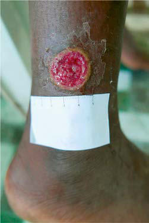
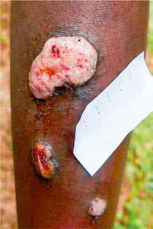

# Chapter 265: Nonvenereal Treponemal Infections

*Stephen K. Obaro and H. Dele Davies*

<!-- p.2389 -->
Nonvenereal treponemal infections—yaws, bejel (endemic syphilis), and pinta—are caused by different subspecies of *Treponema pallidum* and occur in tropical and subtropical areas. The causative agents of nonve nereal treponematoses—*T. pallidum pertenue, T. pallidum* subspecies *endemicum,* and *Treponema carateum*—cannot be distinguished from *T. pallidum* subspecies *pallidum* by morphologic or serologic tests.

In general, nonvenereal treponematoses have prominent cutaneous manifestations and relapsing courses, as in venereal syphilis, but they are not found in urban centers, they are not sexually transmitted, and they are not congenitally acquired. Transmission is primarily through body contact, poor hygiene, crowded conditions, and poor access to healthcare. Children also serve as the primary reservoirs for these organisms, spreading infection via skin-to-skin and skin–to–mucous membrane contact, and possibly via fomites as well.

*Penicillin remains the treatment of choice for syphilis and nonvenereal treponemal infections*.

*Visit Elsevier eBooks+ at eBooks.Health.Elsevier.com** for Bibliography.*

## 265.1  Yaws (Treponema pertenue) Stephen K. Obaro and H. Dele Davies

Yaws is the most prevalent nonvenereal treponematosis. The caus ative agent, *Treponema pertenue,* bears very close genomic resem blance to *T. pallidum* subspecies *pallidum*. The overall sequence

identity between the genomes of *T. pallidum pertenue* and *T. pal lidum* subspecies *pallidum is* 99.8%. Yaws is a contagious, chronic, relapsing infection involving the skin and bony structures caused by the spirochete *T. pertenue,* which is identical to *T. pallidum* micro scopically and serologically. This disease occurs in tropical regions with heavy rainfall and annual temperatures ≥27°C (80°F). Almost all cases occur in children in tropical and subtropical countries. It is also referred to as “framboesia,” “pian,” “parangi,” and “bouba.” A high percentage of the population is infected in endemic areas.

*T. pertenue* is transmitted by direct contact from an infected lesion through a skin abrasion or laceration. Transmission is facili tated by overcrowding and poor personal hygiene in the rainfor est areas of the world. Yaws predominantly affects children, with approximately 75% of cases being reported in children younger than 15 years of age. This population also constitutes the reservoir for disease transmission. The initial papular lesion, which constitutes **primary yaws**, also described as the **mother yaw,** occurs 2-8 weeks after inoculation. This lesion typically involves the buttocks or lower extremities. The papule develops into a raised, raspberry-like papilloma and is often accompanied by regional lymphadenopathy. The skin pathology is similar to that of venereal syphilis, consisting of epidermal hyperplasia and papillomatosis (Fig. 265.1). Healing of the mother yaw leaves a hypopigmented scar. The **secondary-stage** lesions can erupt anywhere on the body before or after the healing of the mother yaw and may be accompanied by lymphadenopathy, anorexia, and malaise. Multiple cutaneous lesions (daughter yaws, pianomas, or framboesias) appear, spread diffusely, ulcerate, and are covered by exudates containing treponemes. Secondary lesions heal without scarring. Recurrent lesions are common within 5 years after the primary lesion.

The lesions are often associated with bone pain resulting from underlying periostitis or osteomyelitis, especially of the fingers, nose, and tibia. The initial period of clinical activity is followed by a 5- to 10-year period of latency. The appearance of tertiarystage lesions develops in approximately 10% of infected patients, with onset typically at puberty, with solitary and destructive lesions. These lesions occur as painful papillomas on the hands and feet, gummatous skin ulcerations, or osteitis. Bony destruction and deformity, juxtaarticular nodules, depigmentation, and painful

*Stephen K. Obaro and H. Dele Davies*

A B C 100 Pm

**Fig. 265.1** Yaws lesions in a patient with treatment failure associated with macrolide-resistant T p pertenue. A, Primary lesion (red, moist 2.5-cm ulcer) on the left leg of an 11-yr-old patient with yaws observed at the 30-mo survey. Lesional swab PCR was positive for T p pertenue with wild-type 23S rRNA. B, Secondary yaws papillomas (multiple nodules with yellow granular surface) seen at 36-mo survey. These lesions were PCR positive for T p pertenue with A2059G mutation in 23S rRNA. C, Photomicrograph of skin biopsy of the larger papilloma lesion in panel B with abundant spiro chete organisms stained bright red by the Treponema pallidum immunohistochemical stain (×400 magnification). T p pertenue, Treponema pallidum subspecies pertenue. (From Mitja O, Godornes C, Houinei W, et al. Re-emergence of yaws after single mass azithromycin treatment followed by targeted treatment: a longitudinal study. Lancet. 2018;391:1599–1606, Fig. 2.)

<!-- p.2390 -->
hyperkeratosis **(dry crab yaws)** of the palms and soles are common. Approximately 10% of patients may progress and develop tertiarystage lesions after 5 years or more of untreated infection, although this outcome is now rare.

The diagnosis is based on the characteristic clinical manifesta tions of the disease in an endemic area. Dark-field examination of cutaneous lesions for treponemes and both treponemal and non treponemal serologic tests for syphilis, which are positive because of cross reactivity, are used to confirm the diagnosis. The nontrepo nemal agglutination tests, such as the rapid plasma reagin and Vene real Diseases Research Laboratory tests, are positive in untreated cases, and these tests can be used for test of cure, because they revert to negative after treatment. However, the treponemal tests (*T. pallidum* hemagglutination assay, *T. pallidum* particle aggluti nation assay, and fluorescent treponemal antibody absorption) are more specific and remain positive for life. New immunochromato graphic test strips that can be applied for testing both whole blood and serum are simple, cheap, and easy to use and do not require refrigeration. However, they have lower sensitivity compared with the antibody assays and appear to work best in persons with more active disease.

The differential diagnosis includes other conditions with similar cutaneous manifestations such as eczema, psoriasis, excoriated chronic scabies, tungiasis, leishmaniasis, tropical ulcer cutaneous mycoses, and verrucae. Involvement of the bone may mimic dactylitis that is com monly associated with sickle cell disease.

Treatment of yaws consists of a single dose of the long-acting benzathine penicillin G (1.2 million units IM for adults and 0.6 mil lion units for children <10 years) for index patients and all contacts. Patients allergic to penicillin may be treated with erythromycin, doxycycline, or tetracycline at appropriate doses for venereal syphilis (see Chapter 264). One oral dose of azithromycin (30 mg/kg; maxi mum: 2 g) is as effective as benzathine penicillin. Treatment cures the lesions of active yaws, renders them noninfectious, and prevents relapse. Family members, contacts, and patients with latent infection should receive the same dose as those with active disease. Eradication of yaws from some endemic areas has been accomplished by treating the entire population (mass treatment) with azithromycin, although reemergence has been reported in those who did not receive mass treatment. In 2023, due to manufacturing limitations and increased demand, the United States entered a period of penicillin G shortage, potentially causing treatment to shift to erythromycin, doxycycline, or tetracycline until the shortages are resolved.

*Visit Elsevier eBooks+ at eBooks.Health.Elsevier.com** for Bibliography.*

## 265.2  Bejel (Endemic Syphilis; Treponema pallidum endemicum)

*Stephen K. Obaro and H. Dele Davies*

Bejel, or endemic syphilis, affects children in remote rural com munities living in poor hygienic conditions. Unlike yaws, bejel can occur in temperate and dry, hot climates. Infection with *T. palli dum* subspecies *endemicum* follows penetration of the spirochete through traumatized skin or mucous membranes. In experimen tal infections, a primary papule forms at the inoculation site after an incubation period of 3 weeks. A primary lesion is almost never visualized in human infections; however, primary ulcers have been described surrounding the nipples of nursing mothers with infected children.

The clinical manifestations of the **secondary stage** typically occur 3-6 months after inoculation and are confined to the skin and mucous membranes. They consist of highly infectious mucous patches on the oral mucosa and condyloma-like lesions on the moist areas of the body, especially the axilla and anus. These

mucocutaneous lesions resolve spontaneously over a period of sev eral months, but recurrences are common. The secondary stage is followed by a variable latency period before the onset of late or ter tiary bejel. The tertiary stage can occur as early as 6 months or as late as several years after resolution of initial symptoms. The lesions in the tertiary stage are identical to those of yaws and include gumma formation in skin, subcutaneous tissue, and bone, resulting in painful destructive ulcerations, swelling, and deformity.

The diagnosis is based on the characteristic clinical manifestations of the disease in an endemic area. Dark-field examination of cutaneous lesions for treponemes and both treponemal and nontreponemal sero logic tests for syphilis, which are positive because of cross reactivity, are used to confirm the diagnosis.

Differentiation from venereal syphilis is extremely difficult in an endemic area. Bejel is distinguished by the absence of a primary chan cre and lack of involvement of the central nervous system and cardio vascular system during the late stage.

Treatment of early infection consists of a single dose of benza thine penicillin G (1.2 million units IM for adults and 0.6 million units for children <10 years). Late infection is treated with three injections of the same dosage at intervals of 7 days. Patients aller gic to penicillin may be treated with erythromycin or tetracycline. Similarly, when penicillin G is unavailable because of manufac turing limitations, treatment with erythromycin or tetracycline is appropriate.

*Visit Elsevier eBooks+ at eBooks.Health.Elsevier.com** for Bibliography.*

## 265.3  Pinta (Treponema carateum) Stephen K. Obaro and H. Dele Davies

Pinta is a chronic, nonvenereally transmitted infection caused by *T. pallidum* subsp. *carateum,* a spirochete morphologically and serologi cally indistinguishable from other human treponemes. This is perhaps the mildest of the nonvenereal treponematoses. The disease is endemic in Mexico, Central America, South America, and parts of the West Indies and largely affects children younger than 15 years of age.

Infection follows direct inoculation of the treponeme through abraded skin. After a variable incubation period of days, the **pri mary** lesion appears at the inoculation site as a small asymptomatic erythematous papule resembling localized psoriasis or eczema. The regional lymph nodes are often enlarged. Spirochetes can be visu alized on dark-field examination of skin scrapings or from biopsy of the involved lymph nodes. After a period of enlargement, the primary lesion disappears. Unlike primary yaws, the lesion does not ulcerate but can expand with central depigmented resolution. **Sec ondary** lesions follow within 6-8 months and consist of small mac ules and papules on the face, scalp, and other sun-exposed portions of the body. These pigmented, highly infectious lesions are scaly and nonpruritic and can coalesce to form large plaquelike eleva tions resembling psoriasis. In the late or **tertiary** stage, atrophic and depigmented lesions develop on the hands, wrists, ankles, feet, face, and scalp. Hyperkeratosis of palms and soles is uncommon.

The diagnosis is based on the characteristic clinical manifestations of the disease in an endemic area. Dark-field examination of cutaneous lesions for treponemes and both treponemal and nontreponemal sero logic tests for syphilis, which are positive because of cross reactivity, are used to confirm the diagnosis.

Treatment consists of a single dose of benzathine penicillin G (1.2 million units IM for adults and 0.6 million units for chil dren <10 years). Tetracycline and erythromycin are alternatives for patients allergic to penicillin and during periods when penicillin G is unavailable because of manufacturing limitations. Treatment campaigns and improvement of standards of living are necessary for reduction and elimination of the disease.

<!-- p.2391 -->

<!-- p.2392 -->

<!-- p.2393 -->
