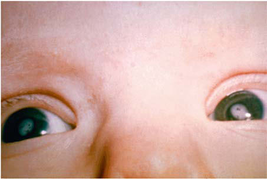

# Chapter 294: Rubella

*Hayley A. Gans*

<!-- p.2521 -->
Rubella (**German measles** or **3-day measles**) is a mild, often exan thematous disease of childhood that is typically more severe and asso ciated with more complications in adults. Its major clinical significance is transplacental infection and fetal damage as part of the **congenital rubella syndrome (CRS)**.

**ETIOLOGY** Rubella virus is a member of the family Togaviridae and is the only spe cies of the genus *Rubivirus.* It is a positive-sense single-stranded RNA virus with a lipid envelope and three structural proteins, including a nucleocapsid protein (C) that is associated with the nucleus and two glycoproteins, E1 and E2, that are associated with the envelope, carry the main epitopes, and therefore are the major antigenic sites of the virus. The virus is sensitive to heat, ultraviolet light, and extremes of pH but is relatively stable at cold temperatures. Humans are the only known reservoir.

**EPIDEMIOLOGY** Rubella is found worldwide and circulates predominantly in late winter and early spring. In the United States, in the prevaccine era, rubella appeared to occur in major epidemics every 6-9 years, with smaller peaks interspersed every 3-4 years, and was most com mon in preschool-age and school-age children. During the rubella epidemic of 1964–1965 there were an estimated 12.5 million cases of rubella associated with 2,000 cases of encephalitis, more than 13,000 abortions or perinatal deaths, and 20,000 cases of CRS. After introduction of the rubella vaccine in 1969 in the United States, the incidence of rubella fell 78% and CRS cases fell 69% by 1976 (Fig. 294.1). Further decline in rubella and CRS cases occurred when certain at-risk populations were added to those for whom rubella immunization is indicated, including adolescents and col lege students. After years of decline, a resurgence of rubella and CRS cases occurred during 1989–1991 in association with the epi demic of measles during that period (see Fig. 294.1). Subsequently, a two-dose recommendation for rubella vaccine was implemented and resulted in a decrease in incidence of rubella from 0.45 per

100,000 population in 1990 to 0.1 per 100,000 population in 1999 and a corresponding decrease of CRS, with an average of six infants with CRS reported annually from 1992 to 2004. Mothers of these infants tended to be young, Hispanic, or foreign born. The number of reported cases of rubella continued to decline through the 1990s and the first decade of this century.

The endemic spread of rubella was declared eliminated in the United States in 2004 and eliminated in the Americas in 2015. However, cases of rubella continue to be imported into the United States from coun tries where it remains endemic. Accelerated global vaccine efforts have resulted in declines of rubella cases worldwide from 94,277 in 2012 to 10,194 in 2020. Rubella elimination has been verified in 93 (48%) of 194 countries, with 70% of infants globally receiving a rubella vaccine in 2020. From 2004 to 2016 there were 101 cases of rubella and 11 cases of CRS reported in the United States, all of which were imported cases of unknown source. Three of the CRS cases were acquired in Africa. This information highlights the need for continued maintenance of high levels of immunity in the United States.

**PATHOLOGY** Little information is available on the pathologic findings in rubella occurring postnatally. The few reported studies of biopsy or autopsy material from cases of rubella revealed only nonspecific findings of lymphoreticular inflammation and mononuclear perivascular and meningeal infiltration. The pathologic findings for CRS are often severe and may involve nearly every organ system (Table 294.1).

**PATHOGENESIS** The viral mechanisms for cell injury and death in postnatal or congeni tal rubella are not well delineated. The main mechanisms of transmis sion is respiratory for postnatal infection and transplacental in CRS. The incubation period following respiratory exposure averages 14 days, with a range from 12 to 23 days. After infection, the virus replicates in the respiratory epithelium and then spreads to regional lymph nodes (Fig. 294.2). Viremia ensues and is most intense from 10 to 17 days after infection. Viral shedding from the nasopharynx begins approxi mately 10 days after infection and may be detected up to 2 weeks after onset of the rash. The period of highest communicability is from 5 days before to 6 days after the appearance of the rash.

Congenital infection occurs during maternal viremia. After infect ing the placenta, the virus spreads through the vascular system of the developing fetus and may infect any fetal organ. The most important risk factor for severe congenital defects is the stage of gestation at the time of infection. Maternal infection during the first 8 weeks of ges tation results in the most severe and widespread defects. The risk for congenital defects has been estimated at 90% for maternal infection before 11 weeks of gestation, 33% at 11-12 weeks, 11% at 13-14 weeks, and 24% at 15-16 weeks. Defects occurring after 16 weeks of gestation are uncommon, even if fetal infection occurs.

Causes of cellular and tissue damage in the infected fetus may include tissue necrosis due to vascular insufficiency, reduced cellular multiplication time, chromosomal breaks, and production of a protein inhibitor causing mitotic arrests in certain cell types. The most distinc tive feature of congenital rubella is chronicity. Once the fetus is infected early in gestation, the virus persists in fetal tissue until well beyond delivery. Persistence suggests the possibility of ongoing tissue damage and reactivation, most notably in the brain.

**CLINICAL MANIFESTATIONS Postnatal infection** with rubella is typically a mild disease not easily discernible from other viral infections, especially in children. After an incubation period of 12-23 days, a prodrome consisting of low-grade fever, sore throat, red eyes with or without eye pain, headache, malaise, anorexia, and lymphadenopathy begins. Suboccipital, postauricular, and anterior cervical lymph nodes are most prominent. In children, the first manifestation of rubella is usually the rash, which is vari able and not distinctive, often more prominent with heat. It begins on the face and neck as small, irregular pink macules that coalesce, and it spreads centrifugally to involve the torso and extremities, where

*Hayley A. Gans*

70,000

60,000

40,000

50,000

20,000

30,000

10,000

0 1966 1971 1976 1981 1986 1996 1991 Year

No. rubella cases

No. CRS cases*

*By year of birth.

2001 2011 0 10 20 30 40 50 60 70 80 90 100 Rubella

**Number of rubella and congenital rubella syndrome (CRS) cases—United States,1966–2011**

CRS

2006

**Fig. 294.1** Number of rubella and congenital rubella syndrome cas es—United States, 1966–2011. Rubella and CRS data provided were reported voluntarily to Centers for Disease Control and Prevention from state health departments. (From McLean HQ, Fiebelkorn AP, Temte JL, et al. Prevention of measles, rubella, congenital rubella syndrome, and mumps, 2013. MMWR Recomm Rep. 2013;62[RR-04]:1–34.)

<!-- p.2522 -->
it tends to occur as discrete macules (Fig. 294.3). About the time of onset of the rash, examination of the oropharynx may reveal tiny, rosecolored lesions **(Forchheimer spots)** or petechial hemorrhages on the soft palate. The rash fades from the face as it extends to the rest of the body so that the whole body may not be involved at any one time. The duration of the rash is generally 3 days, and it usually resolves with out desquamation. Subclinical infections are common, and 25–40% of children may not have a rash. Teenagers and adults tend to be more

symptomatic and have systemic manifestations, with up to 70% of females demonstrating arthralgias and arthritis.

**LABORATORY FINDINGS** Leukopenia, neutropenia, and mild thrombocytopenia have been described during postnatal rubella.

**DIAGNOSES** A specific diagnosis of rubella is important for epidemiologic reasons, for diagnosis of infection in pregnant women, and for confirmation of the diagnosis of congenital rubella. The most common diagnostic test is rubella immunoglobulin (Ig) M enzyme immunosorbent assay, which is typically present ∼4 days after the appearance of the rash. As with any serologic test, the positive predictive value of testing decreases in populations with low prevalence of disease and in immunized indi viduals. Tests should be performed in the context of a supportive his tory of exposure or consistent clinical findings. The relative sensitivity and specificity of commercial kits used in most laboratories range from 96–99% and 86–97%, respectively. A caveat for testing of congenitally infected infants early in infancy is that false-negative results may occur owing to competing IgG antibodies circulating in these patients. In

Syndrome

#### **Table 294.1** Pathologic Findings in Congenital Rubella

| Category / Parameter | Clinical Details & Findings |
| --- | --- |
| **PATHOLOGIC FINDINGS** | Cardiovascular; Patent ductus arteriosus; Pulmonary artery stenosis; Ventriculoseptal defect; Myocarditis; Central nervous system; Chronic meningitis; Parenchymal necrosis; Vasculitis with calcification; Eye; Microphthalmia; Cataract; Iridocyclitis; Ciliary body necrosis; Glaucoma; Retinopathy; Ear; Cochlear hemorrhage; Endothelial necrosis; Lung; Chronic mononuclear interstitial; pneumonitis; Liver; Hepatic giant cell transformation; Fibrosis; Lobular disarray; Bile stasis; Kidney; Interstitial nephritis; Adrenal gland; Cortical cytomegaly; Bone; Malformed osteoid; Poor mineralization of osteoid; Thinning cartilage; Spleen, lymph node; Extramedullary hematopoiesis; Thymus; Histiocytic reaction; Absence of germinal centers; Erythropoiesis in dermis; Skin |

**Fig. 294.2** Pathophysiologic events in postnatally acquired rubella virus infection. *Possible complications in clude arthralgia and/or arthritis, throm bocytopenic purpura, and encepha litis. CF, Complement fixation titer; HI, hemagglutination-inhibition titer. (From Lamprecht CL. Rubella virus. In: Beshe RB, ed. Textbook of Human Virology, 2nd ed. Littleton, MA: PSG Publishing; 1990:685.) Days Mo Yr 16 14 12 10 8 6 4 2 0 2 4 6 1 2 3 4 1 2 3 4 5 6

Antibody levels

HI

Neutralizing Fever

CF

Viral excretion from pharynx

Viremia

Lymph node enlargement

RASH

Malaise, sore throat

(Complications)*

Exposure to

rubella

Incubation 16-18 days Illness 1-4 days Convalescence

**Fig. 294.3** Rash of rubella.

<!-- p.2523 -->
such patients, an IgM capture assay, reverse transcriptase polymerase chain reaction (PCR) test, or viral culture should be performed for con firmation. Virus can be detected by PCR in nasal, throat, urine, blood, and cerebrospinal fluid (CSF) specimens up to 10 days after rash onset (with highest yield within 3 days). Viral isolation by culture or PCR of nasopharyngeal secretions, urine in the newborn (as close to birth as possible), or cord blood or placenta can be used to diagnose congenital infection. PCR testing of amniotic fluid during pregnancy is also an appropriate approach to diagnose congenital infection. If CRS is con firmed, infants should be screened for viral shedding monthly after the age of 3 months until two consecutive negative tests are obtained. Viral shedding may be detected for up to 1 year.

**DIFFERENTIAL DIAGNOSES** Rubella may manifest as distinctive features suggesting the diagnosis. It is frequently confused with other infections because it is uncommon, is similar to other viral exanthematous diseases, and demonstrates variability in the presence of typical findings. In severe cases, it may resemble measles. The absence of Koplik spots, a severe prodrome, and a shorter course, allow for differentiation from measles. Other diseases frequently confused with rubella include infections caused by adeno viruses, parvovirus B19 (erythema infectiosum), Epstein-Barr virus, enteroviruses, roseola, and *Mycoplasma pneumoniae.*

**COMPLICATIONS** Complications following postnatal infection with rubella are infre quent and generally not life threatening.

Postinfectious **thrombocytopenia** occurs in approximately 1 in 3,000 cases of rubella and occurs more frequently among children and in girls. It manifests about 2 weeks after the onset of the rash as pete chiae, epistaxis, gastrointestinal bleeding, and hematuria and is usually self-limited.

**Arthritis** following rubella occurs more commonly among adults, especially women. It begins within 1 week of onset of the exanthem and classically involves the small joints of the hands. It is self-limited and resolves within weeks without sequelae. There are anecdotal reports and some serologic evidence linking rubella with rheumatoid arthritis, but a true causal association remains speculative.

**Encephalitis** is the most serious complication of postnatal rubella. It occurs in two forms: a postinfectious syndrome following acute rubella and a rare progressive panencephalitis manifesting as a neurodegen erative disorder years after rubella.

Postinfectious encephalitis is uncommon, occurring in 1 in 5,000 cases of rubella. It appears within 7 days after onset of the rash, consist ing of headache, seizures, confusion, coma, focal neurologic signs, and ataxia. Fever may recrudesce with the onset of neurologic symptoms. CSF may be normal or have a mild mononuclear pleocytosis and/or elevated protein concentration. Virus is rarely, if ever, isolated from CSF or brain, suggesting a noninfectious pathogenesis. Most patients recover completely, but mortality rates of 20% and long-term neuro logic sequelae have been reported.

**Progressive rubella panencephalitis (PRP)** is an extremely rare complication of either acquired rubella or CRS. It has an onset and course similar to those of the subacute sclerosing panencephalitis asso ciated with measles (see Chapter 293). However, unlike in the postin fectious form of rubella encephalitis, rubella virus may be isolated from brain tissue of the patient with PRP, suggesting an infectious patho genesis, albeit a slow one. The clinical findings and course are indis tinguishable from those of subacute sclerosing panencephalitis and transmissible spongiform encephalopathies (see Chapter 324). Death occurs 2-5 years after onset.

Other neurologic syndromes rarely reported with rubella include Guillain-Barré syndrome and peripheral neuritis. Myocarditis is a rare complication.

**Congenital Rubella Syndrome** In 1941 an ophthalmologist first described a syndrome of cataracts and congenital heart disease that he correctly associated with rubella

infections in the mothers during early pregnancy (Table 294.2). Shortly after the first description, hearing loss was recognized as a common finding often associated with microcephaly. In 1964 to 1965 a pan demic of rubella occurred, with 20,000 cases reported in the United States, leading to more than 11,000 spontaneous or therapeutic abor tions and 2,100 neonatal deaths. From this experience emerged the expanded definition of CRS that includes numerous other transient or permanent abnormalities.

Nerve deafness is the single most common finding among infants with CRS. Most infants have some degree of intrauterine growth restriction. Retinal findings described as **salt-and-pepper retinopathy** are the most common ocular abnormality but have little early effect on vision. Unilateral or bilateral cataracts are the most serious eye finding, occurring in about a third of infants (Fig. 294.4). Cardiac abnormalities occur in half of the children infected during the first 8 weeks of gesta tion. Patent ductus arteriosus is the most frequently reported cardiac defect, followed by lesions of the pulmonary arteries and valvular dis ease. Interstitial pneumonitis leading to death in some cases has been reported. Neurologic abnormalities are common and may progress following birth. Meningoencephalitis is present in 10–20% of infants with CRS and may persist for up to 12 months. Longitudinal followup through 9-12 years of infants without initial retardation revealed progressive development of additional sensory, motor, and behavioral abnormalities, including hearing loss and autism. PRP has also been recognized rarely after CRS. Subsequent postnatal growth retardation and ultimate short stature have been reported in a minority of cases. Rare reports of immunologic deficiency syndromes have also been described.

A variety of late-onset manifestations of CRS have been recognized. In addition to PRP, they include diabetes mellitus (20%), thyroid dys function (5%), and glaucoma and visual abnormalities associated with the retinopathy, which had previously been considered benign.

**TREATMENT** There is no specific treatment available for either acquired rubella or CRS.

Rubella Syndrome in 376 Children After Maternal Rubella*

#### **Table 294.2** Clinical Manifestations of Congenital

| Category / Parameter | Clinical Details & Findings |
| --- | --- |
| **RATE (%)** | Deafness; 67; Ocular; 71; Cataracts; 29; Retinopathy; 39; Heart disease†; 48; Patent ductus arteriosus; 78; Right pulmonary artery stenosis; 70; Left pulmonary artery stenosis; 56; Valvular pulmonic stenosis; 40; Low birthweight; 60; Psychomotor delay; 45; Neonatal purpura; 23; Death; 35; *Other findings: hepatitis, linear streaking of bone, hazy cornea, congenital glaucoma,; delayed growth.; †Findings in 87 patients with congenital rubella syndrome and heart disease who; underwent cardiac angiography.; From Cooper LZ, Ziring PR, Ockerse AB, et al. Rubella: clinical manifestations and; management. Am J Dis Child. 1969;118:18–29. |

<!-- p.2524 -->
**SUPPORTIVE CARE** Postnatal rubella is generally a mild illness that requires no care beyond antipyretics and analgesics. Intravenous immunoglobu lin or corticosteroids can be considered for severe, nonremitting thrombocytopenia.

Management of children with CRS is more complex and requires pediatric, cardiac, audiologic, ophthalmologic, and neurologic evalu ation and follow-up because many manifestations may not be readily apparent initially or may worsen with time. Hearing screening is of special importance because early intervention may improve outcomes in children with hearing problems caused by CRS.

**PROGNOSIS** Postnatal infection with rubella has an excellent prognosis. Long-term outcomes of CRS are less favorable and somewhat variable. In an Aus tralian cohort evaluated 50 years after infection, many had chronic conditions but most were married and had made good social adjust ments. A cohort from New York from the mid-1960s epidemic had less-favorable outcomes, with 30% leading normal lives, 30% in depen dent situations but functional, and 30% requiring institutionalization and continuous care.

**Reinfection** with wild virus occurs postnatally in both individu als who were previously infected with wild-virus rubella and vacci nated individuals. Reinfection is defined serologically as a significant increase in IgG antibody level and/or an IgM response in an individ ual who has a documented preexisting rubella-specific IgG above an accepted cutoff. Reinfection may result in an anamnestic IgG response, an IgM and IgG response, or clinical rubella. There are 29 reports in the literature of CRS following maternal reinfection. Reinfection with serious adverse outcomes to adults or children is rare and of unknown significance.

**PREVENTION** Patients with postnatal infection should be isolated from susceptible individuals for 7 days after onset of the rash. Standard plus droplet precautions are recommended for hospitalized patients. Children with CRS may excrete the virus in respiratory secretions up to 1 year of age, so contact precautions should be maintained for them until 1 year of age, unless repeated cultures of urine and pharyngeal secretions are negative. Similar precautions apply to patients with CRS with regard to attendance in school and out-of-home childcare.

Exposure of susceptible pregnant women poses a potential risk to the fetus. For pregnant women exposed to rubella, a blood speci men should be obtained as soon as possible for rubella IgG-specific

antibody testing; a frozen aliquot also should be saved for later test ing. If the rubella antibody test result is positive, the mother is likely immune. If the rubella antibody test is negative, a second specimen should be obtained 2-3 weeks later and tested concurrently with the saved specimen. If both of these samples test negative, a third specimen should be obtained 6 weeks after exposure and tested concurrently with the saved specimen. If both the second and third specimens test negative, infection has not occurred. A negative first specimen and a positive test result in either the second or third speci men indicate that seroconversion has occurred in the mother, sug gesting recent infection. Counseling should be provided about the risks and benefits of termination of pregnancy. The routine use of immunoglobulin for susceptible pregnant women exposed to rubella is not recommended and is considered only if termination of preg nancy is not an option because of maternal preferences. In such cir cumstances, immunoglobulin 0.55 mL/kg intramuscularly may be given with the understanding that prophylaxis may reduce the risk for clinically apparent infection but does not guarantee prevention of fetal infection.

**VACCINATION** Rubella vaccine in the United States consists of the attenuated Wis tar RA 27/3 strain that is usually administered in combination with measles and mumps (MMR) or also with varicella (MMRV) in a two-dose regimen at 12-15 months and 4-6 years of age. It theoreti cally may be effective as postexposure prophylaxis if administered within 3 days of exposure. Vaccine should not be administered to severely immunocompromised patients. Patients with HIV infec tion who are not severely immunocompromised may benefit from vaccination. Fever is not a contraindication, but if a more serious illness is suspected, immunization should be delayed. Immuno globulin preparations may inhibit the serologic response to the vaccine (see Chapter 215). Vaccine should not be administered dur ing pregnancy. If pregnancy occurs within 28 days of immuniza tion, the patient should be counseled on the theoretical risks to the fetus. Studies of more than 200 women who had been inadvertently immunized with rubella vaccine during pregnancy showed that none of their offspring developed CRS. Therefore interruption of pregnancy is probably not warranted.

Following a single dose of rubella RA 27/3 vaccine, 95% of persons 12 months of age and older develop serologic immunity, and after two doses 99% have detectable antibody. Rubella RA 27/3 vaccine is highly protective, because 97% of those vaccinated are protected from clini cal disease after one dose. Detectable antibodies remain for 15 years in most individuals vaccinated after one dose, and 91–100% had anti bodies after 12-15 years after two doses. Although antibody levels may wane, especially after one dose of vaccine, increased susceptibility to rubella disease does not occur.

Adverse reactions to rubella vaccination are uncommon in children. MMR administration is associated with fever in 5–15% of vaccinees and with rash in approximately 5% of vaccinees. Arthralgia and arthritis are more common after rubella vaccina tion in adults. Approximately 25% of postpubertal women expe rience arthralgia, and 10% of postpubertal women experience arthritis. Peripheral neuropathies and transient thrombocytope nia may also occur.

As part of the worldwide effort to eliminate endemic rubella virus transmission and occurrence of CRS, maintaining high population immunity through vaccination coverage and high-quality integrated measles-rubella surveillance have been emphasized as being vital to its success.

*Visit Elsevier eBooks+ at eBooks.Health.Elsevier.com** for a Bibliography.*

**Fig. 294.4** Bilateral cataracts in infant with congenital rubella syndrome.

<!-- p.2525 -->
