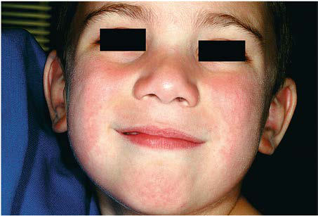
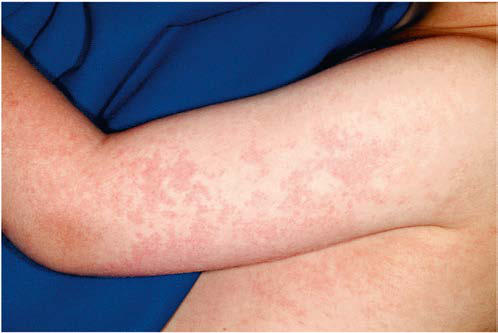

# Chapter 298: Parvoviruses

*William C. Koch*

<!-- p.2547 -->
The parvoviruses are small, single-stranded DNA viruses. They are common infectious agents of a wide variety of animal species, includ ing mammals, birds, and insects. Parvoviruses as a group include a number of important animal pathogens. There are five different types of parvoviruses known to infect humans: the dependoviruses, also called adeno-associated viruses (AAVs), parvovirus B19 (B19V), human bocaviruses (HBoVs), parvovirus 4 (PARV4), and human bufa virus (HBuV). B19V and HBoV are the only two parvoviruses proven to be pathogenic in humans. B19V is the most well studied and clini cally important of the human parvoviruses and the cause of **erythema infectiosum** or **fifth disease**. *Human bocavirus is an emerging human pathogen.*

**ETIOLOGY** The five human parvoviruses are distinct enough from each other to represent five different genera within the Parvoviridae family. B19V is a member of the genus *Erythroparvovirus*, is composed of an icosahedral protein capsid without an envelope, and contains a single-stranded DNA genome of approximately 5.5 kb. It is relatively heat and solvent resistant. It is antigenically distinct from other mammalian parvovi ruses and has only one known serotype, with three distinct genotypes described. The relatively short genome in parvoviruses does not encode a DNA polymerase, so all parvoviruses require either host cell factors present in late S phase or co-infection with another virus to replicate their DNA. B19V can be propagated effectively in vitro only in CD36+ erythroid progenitor cells derived from human bone marrow, umbili cal cord blood, or peripheral blood.

**HBoV** is a member of the genus *Bocaparvovirus*. HBoV was first isolated from nasopharyngeal specimens from children with respira tory tract infection in 2005. It was identified using random polymerase chain reaction (PCR) amplification and sequencing methods specifi cally designed to detect previously unknown viral sequences. Analysis of the gene sequences showed similarities to both *bo*vine and *ca*nine parvoviruses, and thus the virus was named human bocavirus. Later, three other HBoVs were identified in stool samples and designated as HBoV types 2, 3, and 4, with the initial respiratory isolate called HBoV1. The HBoV capsid structure and genome size are similar to those of B19V, but the genomic organization and replication are dif ferent (though not fully characterized to date). HBoVs cannot be propagated in conventional cell culture but have been grown in a pseu dostratified human airway epithelial cell culture system.

The **AAVs** are members of the genus Dependoparvovirus and were the first parvoviruses to be found in humans. They were originally identified as contaminants in laboratory preparations of adenovirus, resulting in the designation “adeno-associated viruses.” They were later isolated directly from human tissue samples, and now several AAV sero types are known to commonly infect humans. AAVs have a unique life cycle that can take one of two paths: (1) a lytic infection with replication of viral DNA and production of new virus, or (2) viral integration into the host cell DNA. In the presence of a “helper” virus, usually an adeno virus or a herpesvirus, AAV can replicate its DNA, produce capsids, and release new virions by cell lysis. In the absence of a helper virus infec tion, the AAV genome becomes integrated into the host cell DNA. This feature has drawn interest in AAVs as potential vectors for gene therapy. Although human infection with AAVs is common, there is only one pos sible disease association (idiopathic hepatitis) (see Chapter 406).

PARV4 was initially identified in 2005 from the blood of an adult patient with acute viral syndrome, who was also an intravenous drug user co-infected with hepatitis C. Subsequently, this virus has been found

in blood donors and donated plasma pools in many different coun tries. It appears to be present in approximately 3% of blood donors in the United States and 4% of plasma pools. There is currently no known disease association or clinical symptomology associated with infection. Likewise, BuV is a parvovirus that was first identified in 2012 in the feces from children <5 years of age with acute diarrhea but has an unclear role as a pathogen. PARV4 has been assigned to the genus *Tetraparvovirus*, and BuV is a member of the genus *Protoparvovirus*. The full epidemiol ogy and clinical relevance of these viruses await further study.

**EPIDEMIOLOGY Parvovirus B19** Infections with B19V are common and occur worldwide. Clinically apparent infections, such as the rash illness of erythema infectiosum and transient aplastic crisis, are most prevalent in school-age children (70% of cases occur in patients between 5 and 15 years of age). Seasonal peaks occur in the late winter and spring, with sporadic infections throughout the year. Seroprevalence increases with age, with 40–60% of adults having evidence of prior infection.

Transmission of B19V is by the respiratory route, presumably via large-droplet spread from nasopharyngeal viral shedding. The trans mission rate is 15–30% among susceptible household contacts, and mothers are more commonly infected than fathers. In outbreaks of ery thema infectiosum in elementary schools, the secondary attack rates range from 10–60%. Nosocomial outbreaks also occur, with secondary attack rates of 30% among susceptible healthcare workers.

Although respiratory spread is the primary mode of transmission, B19V is also transmissible in blood and blood products, as documented among children with hemophilia receiving pooled-donor clotting fac tor. Given the resistance of the virus to solvents, fomite transmission could be important in childcare centers and other group settings, but this mode of transmission has not been definitively established.

**Human Bocaviruses** The majority of published studies have used molecular methods to detect HBoV DNA in respiratory secretions, fecal samples, blood, and other tissues. HBoV DNA (HBoV1) can be found commonly in respiratory secretions from children hospitalized with acute lower respiratory tract infections (LRTIs). It is more prevalent in children younger than 2 years of age and seems to be associated with wheezing respiratory illness. However, it can be isolated from respiratory secretions from asymp tomatic children and can often be found as a co-infection with other common respiratory pathogens of children this age, including respira tory syncytial virus, human metapneumovirus, and rhinoviruses. This has caused some confusion as to the pathogenic role of HBoV in acute LRTI, including whether it can persist in secretions long after a subclini cal infection or requires a helper virus. A limited number of seroepide miologic studies have been performed, and these suggest that infection is common in children younger than 5 years of age. The most recent studies provide evidence that the virus is in fact pathogenic, especially in chil dren younger than 2 years with wheezing and LRTI, because HBoV1 is more likely to be the only virus isolated in these patients and more likely to have an acute antibody response when coupled with specific antibody testing. When quantitative PCR is used, the virus is found to be much higher in titer in these symptomatic cases.

HBoV DNA (HBoV2, HBoV3, and HBoV4) has also been found in fecal samples in studies from various countries, but its role as a cause of viral gastroenteritis is still undetermined.

**PATHOGENESIS Parvovirus B19** The primary target of B19V infection is the erythroid cell line, specifi cally erythroid precursors near the pronormoblast stage. Viral infec tion produces cell lysis, leading to a progressive depletion of erythroid precursors and a transient arrest of erythropoiesis. The virus has no apparent effect on the myeloid cell line. The tropism for erythroid cells is related to the erythrocyte P blood group antigen, which is the pri mary cell receptor for the virus and is also found on endothelial cells, placental cells, and fetal myocardial cells. Thrombocytopenia and

*William C. Koch*

<!-- p.2548 -->
neutropenia are often observed clinically, but the pathogenesis of these abnormalities is not completely understood.

Experimental infection of normal volunteers with B19V revealed a biphasic illness. From 7-11 days after inoculation, subjects had viremia and nasopharyngeal viral shedding with fever, malaise, and rhinor rhea. Reticulocyte counts dropped to undetectable levels but resulted in only a mild, clinically insignificant fall in serum hemoglobin. With the appearance of specific antibodies, symptoms resolved and serum hemoglobin returned to normal. Several subjects experienced a rash associated with arthralgia 17-18 days after inoculation. Some manifes tations of B19 infection, such as transient aplastic crisis, appear to be a direct result of viral infection, whereas others, including the exan them and arthritis, appear to be *postinfectious phenomena* related to the immune response. Skin biopsy of patients with erythema infectiosum reveals edema in the epidermis and a perivascular mononuclear infil trate compatible with an immune-mediated process.

Individuals with **chronic hemolytic anemia** and increased red blood cell (RBC) turnover are very sensitive to minor perturbations in erythropoiesis. Infection with B19V leads to a transient arrest in RBC production and a precipitous fall in serum hemoglobin, often requir ing transfusion. The reticulocyte count drops to undetectable levels, reflecting the lysis of infected erythroid precursors. Humoral immu nity is crucial in controlling infection. Specific immunoglobulin (Ig) M appears within 1-2 days of infection and is followed by anti-B19 IgG, which leads to control of the infection, restoration of reticulocytosis, and a rise in serum hemoglobin.

Individuals with **impaired humoral immunity** are at increased risk for more serious or persistent infection with B19V, which usually manifests as chronic RBC aplasia, although neutropenia, thrombocy topenia, and marrow failure are also described. Children undergoing chemotherapy for leukemia or other forms of cancer, transplant recipi ents, and patients with congenital or acquired immunodeficiency states (including AIDS) are at risk for chronic B19V infections.

Infections in the **fetus** and **neonate** are somewhat analogous to infections in immunocompromised persons. B19V is associated with nonimmune fetal hydrops and stillbirth in women experiencing a primary infection but does not appear to be teratogenic. Like most mammalian parvoviruses, B19V can cross the placenta and cause fetal infection during primary maternal infection. Parvovirus cytopathic effects are seen primarily in erythroblasts of the bone marrow and sites of extramedullary hematopoiesis in the liver and spleen. Fetal infection can presumably occur as early as 6 weeks of gestation, when erythroblasts are first found in the fetal liver; after the fourth month of gestation, hematopoiesis switches to the bone marrow. In some cases, fetal infection leads to profound fetal anemia and subsequent highoutput cardiac failure (see Chapter 138). **Fetal hydrops** ensues and is often associated with fetal death. There may also be a direct effect of the virus on myocardial tissue that contributes to the cardiac failure. However, most infections during pregnancy result in normal deliveries at term. Some of the asymptomatic infants from these deliveries have been reported to have chronic postnatal infection with B19V that is of unknown significance.

**Human Bocaviruses** Mechanisms of HBoV replication and pathogenesis are poorly charac terized to date. Growth of HBoV1 in tissue culture is difficult, though the virus has been cultured in primary respiratory epithelial cells as noted above. The primary site of viral replication appears to be the respiratory tract, because the virus has been detected most frequently and in highest copy numbers here. HBoV1 has also been found occa sionally in the serum, suggesting the potential for systemic spread. HBoV1 has also been detected in stool, but copy numbers are very low. In contrast, HBoV types 2-4 are found predominantly in the stool, but host cell types are not known.

**CLINICAL MANIFESTATIONS Parvovirus B19** Many infections are clinically inapparent (Table 298.1). Infected children characteristically demonstrate the rash illness of erythema

infectiosum. Adults, especially women, frequently experience acute polyarthropathy with or without a rash.

**Erythema Infectiosum (Fifth Disease)** The most common manifestation of B19V is erythema infectiosum, also known as *fifth disease*, which is a benign, self-limited exanthema tous illness of childhood.

The incubation period for erythema infectiosum is 4-28 days (aver age: 16-17 days). The prodromal phase is mild and consists of lowgrade fever in 15–30% of cases, headache, and symptoms of mild upper respiratory tract infection. The hallmark of erythema infectiosum is the characteristic rash, which occurs in three stages that are not always distinguishable. The initial stage is an erythematous facial flushing, often described as a **slapped-cheek appearance** (Fig. 298.1). The rash spreads rapidly or concurrently to the trunk and proximal extremities as a diffuse macular erythema in the second stage. Central clearing of macular lesions occurs promptly, giving the rash a **lacy**, **reticulated appearance** (Fig. 298.2). The rash tends to be more prominent on extensor surfaces, sparing the palms and soles. Affected children are afebrile and do not appear ill. Some have petechiae. Older children and adults often complain of mild pruritus. The rash resolves spon taneously without desquamation but tends to wax and wane over 1-3 weeks. It can recur with exposure to sunlight, heat, exercise, and stress.

Infection

#### **Table 298.1** Clinical Associations with Parvovirus B19

| Category / Parameter | Clinical Details & Findings |
| --- | --- |
| **General** | Asymptomatic infection; Exanthematous disorders; Erythema infectiosum (fifth disease); Papular-purpuric gloves-and-socks syndrome; Asymmetric periflexural exanthem; “Bathing trunk” exanthem; Petechial exanthems; Other disorders; Arthritis; Transient aplastic crises; Chronic anemia; Refractory anemia after solid organ or stem cell transplantation; Hemophagocytic lymphohistiocytosis; Myelodysplastic syndrome; Fetal hydrops; Vasculitis; Neurologic disease, including arterial ischemic stroke,; encephalopathy, encephalitis; Rheumatologic disease; Liver failure; Myocarditis; From Paller AS, Mancini AJ. Hurwitz Clinical Pediatric Dermatology, 6th ed.; Philadelphia: Elsevier; 2022: Box 16.2, p. 452. |

**Fig. 298.1** Erythema infectiosum. Erythema of the bilateral cheeks, which has been likened to a “slapped-cheek” appearance. (From Paller AS, Macini AJ. Hurwitz Clinical Pediatric Dermatology, 3rd ed. Philadel phia: WB Saunders; 2006:431.)

<!-- p.2549 -->
Lymphadenopathy and atypical papular, purpuric and vesicular rashes are also described.

**Arthropathy** Arthritis and arthralgia may occur in isolation or with other symp toms. Joint symptoms are much more common among adults and older adolescents with B19V infection. Females are affected more frequently than males. In one large outbreak of fifth disease, 60% of adults and 80% of adult women reported joint symptoms. Joint symptoms range from diffuse polyarthralgia with morning stiffness to frank arthritis. The joints most often affected are the hands, wrists, knees, and ankles, but practically any joint may be affected. The joint symptoms are selflimited and, in the majority of patients, resolve within 2-4 weeks. Some patients may have a prolonged course of many months, suggesting rheumatoid arthritis. Transient rheumatoid factor positivity is reported in some of these patients but with no joint destruction.

**Transient Aplastic Crisis** The transient arrest of erythropoiesis and absolute reticulocytopenia induced by B19V infection leads to a sudden fall in serum hemoglobin in individuals with chronic hemolytic conditions. This B19V-induced RBC aplasia or transient aplastic crisis occurs in patients with all types of chronic hemolysis and/or rapid RBC turnover, including sickle cell disease, thalassemia, hereditary spherocytosis, and pyruvate kinase deficiency, among others. In contrast to children with erythema infec tiosum only, patients with aplastic crisis are ill at presentation with fever, malaise, and lethargy and have signs and symptoms of profound anemia, including pallor, tachycardia, and tachypnea. Rash is rarely present. The incubation period for transient aplastic crisis is shorter than that for erythema infectiosum because the crisis occurs coinci dent with the viremia. Children with sickle cell hemoglobinopathies may also have a concurrent vasoocclusive pain crisis, further confusing the clinical presentation.

**Immunocompromised Persons** Individuals with impaired humoral immunity are at risk for chronic B19V infection. Chronic anemia is the most common manifesta tion, sometimes accompanied by neutropenia, thrombocytopenia, or complete marrow suppression. Chronic infections occur in per sons receiving cancer chemotherapy or immunosuppressive therapy for transplantation and persons with congenital immunodeficien cies, AIDS, and functional defects in IgG production who are thereby unable to generate neutralizing antibodies.

**Fetal Infection** Primary maternal infection is associated with nonimmune fetal hydrops and intrauterine fetal demise, with the risk for fetal loss when

infection occurs in pregnancy estimated at 2–5%. The mechanism of fetal disease appears to be a viral-induced RBC aplasia at a time when the fetal erythroid fraction is rapidly expanding, leading to profound anemia, high-output cardiac failure, and fetal hydrops. Viral DNA has been detected in infected abortuses. The second trimester seems to be the most sensitive period, but fetal losses are reported at every stage of gestation. If maternal B19V infection is suspected, fetal ultrasonogra phy and measurement of the peak systolic flow velocity of the middle cerebral artery are sensitive, noninvasive procedures to diagnose fetal anemia and hydrops. Most infants infected in utero are born normal at term, including some who have had ultrasonographic evidence of hydrops. A small subset of infants infected in utero may acquire a chronic or persistent postnatal infection with B19V that is of unknown significance. Congenital anemia associated with intrauterine B19V infection has been reported in a few cases, sometimes following intra uterine hydrops. This process may mimic other forms of congenital hypoplastic anemia (e.g., Diamond-Blackfan syndrome). Fetal infec tion with B19V has been associated with bone lesions but has not been associated with other birth defects. B19V is only one of many causes of hydrops fetalis (see Chapter 140).

**Myocarditis** B19V infection has been associated with myocarditis in fetuses, infants, children, and a limited number of adults. Diagnosis has often been based on serologic findings suggestive of a concurrent B19V infection, but in many cases B19V DNA has been demonstrated in cardiac tissue. B19related myocarditis is plausible because fetal myocardial cells are known to express P antigen, the cell receptor for the virus. In the few cases in which histology is reported, a predominantly lymphocytic infiltrate is described. Outcomes have varied from complete recovery to chronic cardiomyopathy to fatal cardiac arrest. Although B19-associated myo carditis seems to be a rare occurrence, there appears to be enough evi dence to consider B19V as a potential cause of lymphocytic myocarditis, especially in infants and immunocompromised persons.

**Other Cutaneous Manifestations** A variety of atypical skin eruptions have been reported with B19V infec tion. Most of these are petechial or purpuric, often with evidence of vasculitis on biopsy. Among these rashes, the **papular-purpuric gloves- and-socks syndrome (PPGSS)** is well established in the dermatologic literature as distinctly associated with B19V infection (Figs. 298.3 and 298.4). PPGSS is characterized by fever, pruritus, and painful edema and erythema localized to the distal extremities in a distinct gloves-and-socks distribution, followed by acral petechiae and oral lesions. The syndrome is self-limited and resolves within a few weeks. Although PPGSS was ini tially described in young adults, a number of reports of the disease in

**Fig. 298.2** Erythema infectiosum. Reticulate erythema on the upper arm of a patient with erythema infectiosum. (From Paller AS, Macini AJ. Hurwitz Clinical Pediatric Dermatology, 3rd ed. Philadelphia: WB Saunders; 2006:431.)

**Fig. 298.3** Papular-purpuric gloves-and-socks syndrome. Petechial purpura of the palms in a patient with parvovirus B19 infection. (From Paller AS, Mancini AJ. Hurwitz Clinical Pediatric Dermatology, 6th ed. Philadelphia: Elsevier; 2022: Fig. 16.18, p. 453.)

<!-- p.2550 -->
children have since been published. In those cases linked to B19V infec tion, the eruption is accompanied by serologic evidence of acute infec tion. Generalized petechial rash has also been reported.

**Human Bocaviruses** Many studies have reported an association between respiratory tract infection and HBoV1 infection as detected by PCR of respiratory secre tions, primarily nasopharyngeal secretions. Clinical manifestations in these studies have ranged from mild upper respiratory symptoms to pneumonia. However, the role of HBoV1 as a pathogen has been chal lenged by the detection of the virus in asymptomatic children and by the frequent detection of other respiratory viruses in the same samples. Nonetheless, studies that have included some combination of quantita tive PCR, serum PCR, and serology have been more convincing about HBoV1 as a human pathogen. The use of a quantitative PCR method also seems to differentiate between HBoV1 infection (and wheezing) and prolonged viral shedding, because patients with higher viral titers were more likely to be symptomatic, to be viremic, and to have HBoV1 isolated without other viruses.

HBoV type 2 DNA has been found in the stool of 3–25% of chil dren with gastroenteritis, but often with another enteric virus. DNA

of HBoV types 2, 3, and 4 has also been found in the stool of healthy, asymptomatic individuals. At present, there are few data linking HBoV2, HBoV3, or HBoV4 to gastroenteritis or any clinical illness. Further studies are required to determine if any of the HBoVs are asso ciated with some cases of childhood gastroenteritis.

**DIAGNOSIS Parvovirus B19 Infection** The diagnosis of erythema infectiosum is usually based on clinical pre sentation of the typical rash and rarely requires virologic confirmation. Similarly, the diagnosis of a typical transient aplastic crisis in a child with sickle cell disease is generally made on clinical grounds without specific virologic testing.

Serologic tests for the diagnosis of B19V infection are available. B19specific IgM develops within 2-3 days after infection and persists up to 6 months (Fig. 298.5). Anti-B19 IgG serves as a marker of current or past infection. Seroconversion of anti-B19 IgG antibodies in paired sera can also be used to confirm recent infection.

Serologic diagnosis is unreliable in immunocompromised persons; diagnosis in these patients requires methods to detect viral DNA. Because the virus cannot be isolated by standard cell culture, methods to detect viral particles or viral DNA, such as PCR are necessary to establish the diagnosis. Viral DNA may be detectable for ∼1 month after infec tion in immunocompetent patients but longer in immune compromised patients. Some reports suggest that prolonged detection of viral DNA (months) may represent DNA but not the complete virus. Prenatal diag nosis of B19V-induced fetal hydrops can be accomplished by detection of viral DNA in fetal blood or amniotic fluid by these methods.

**Human Bocavirus Infections** HBoV1 infections cannot be differentiated from other viral respiratory infections on clinical grounds. HBoV DNA can be readily detected by PCR methods and is now included in several commercially available multiplex respiratory virus PCR assays. Quantitative PCR is useful to differentiate acute infection from persistent viral shedding, because higher viral copy numbers (>104 HBoV1 genomes/mL) correlate with acute illness, but this test is not widely available. Likewise, serologic methods to detect specific IgM and IgG antibodies have been devel oped, but these too are not routinely available and there are problems with cross-reactivity among antibodies to the various HBoV types. The most reliable method to diagnose HBoV1 infection would include detection of viral DNA in serum by PCR and in respiratory tract sam ples by quantitative PCR, with concurrent detection of IgM or a diag nostic IgG response in paired samples.

**Fig. 298.4** Papular-purpuric gloves-and-socks syndrome. Erythema and petechiae of the plantar feet were accompanied by pruritus and sore throat in this young girl with parvovirus B19 infection. (From Paller AS, Mancini AJ. Hurwitz Clinical Pediatric Dermatology, 6th ed. Phila delphia: Elsevier; 2022: Fig. 16.19, p. 454.)

Nonspecific febrile illness

Aplastic crisis

0 7 14 Days

21 28

Virus excretion

Erythema infectiosum

IgM antibody

Viremia

Reticulocytes

**Fig. 298.5** Selected virologic, immunologic, hematologic, and clinical events in parvovirus B19 virus infection. (From Schulte DJ. Human parvovi rus B19. In Kaplan SL, Harrison GJ, Steinbach WJ, Cherry JD, Hotez PJ, eds. Feigin and Cherry’s Textbook of Pediatric Infectious Diseases, 8th ed. Philadelphia: Elsevier, 2019. Fig 152.1.)

<!-- p.2552 -->
