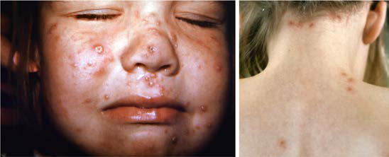

# Chapter 300: Varicella-Zoster Virus*

*Shivang S. Shah, Mona Marin, Philip S. LaRussa, and Anne A. Gershon*

<!-- p.2561 -->
Varicella-zoster virus (VZV) causes primary, latent, and reactivation infections. The primary infection manifests as varicella (chickenpox) and results in establishment of a lifelong latent infection of sensory ganglionic neurons. Reactivation of the latent infection causes herpes zoster (shingles). Although often a mild illness of childhood, varicella can cause substantial morbidity and mortality in otherwise healthy children. Morbidity and mortality are higher in immunocompetent infants, adolescents, and adults, as well as in immunocompromised persons. Varicella predisposes to severe group A streptococcus and staphylococcus infections. Primary clinical disease can be prevented by immunization with live-attenuated varicella vaccine. A clinically modified disease can occur among vaccinated persons (breakthrough varicella), usually with milder presentation. Varicella and herpes zoster can be treated with antiviral drugs. Vaccines are also available to pre vent herpes zoster in older adults.

**ETIOLOGY** VZV is a neurotropic human herpesvirus with similarities to herpes simplex virus. VZV enveloped viruses contain double-stranded DNA genomes that encode 71 proteins, including proteins that are targets of cellular and humoral immunity.

**EPIDEMIOLOGY** Before the introduction of the varicella vaccine in 1995, varicella was an almost universal communicable infection of childhood in the United States. Annual varicella epidemics occurred in winter and spring, and there were about 4 million cases of varicella, 11,000-13,500 hospitalizations, and 100-150 deaths every year in the United States. Most children were infected by 10 years of age, with fewer than 5% of adults remaining susceptible. This pattern of infection at younger ages remains characteristic in all countries in temperate climates. By contrast, in tropical areas, children acquire varicella at older ages and a higher proportion of young adults remain susceptible, leading to a higher proportion of cases occurring among adults. Varicella is a more serious disease in young infants, adults, and immunocompromised per sons, in whom there are higher rates of complications and deaths than in healthy children. Primary varicella is highly transmissible. Within households, transmission of VZV to susceptible individuals occurs at a rate of 65–86%; more casual contact, such as occurs in a school class room, is associated with lower attack rates among susceptible children. Persons with varicella may be contagious 24-48 hours before the rash is evident and until vesicles are crusted, usually 4-7 days after onset of rash, consistent with evidence that VZV is spread by aerosolization of virus in cutaneous lesions; spread from oropharyngeal secretions may occur but to a much lesser extent. Susceptible persons may also acquire varicella after close, direct contact with adults or children who have herpes zoster, again via aerosolization of virus in skin lesions.

Since implementation of the varicella vaccination program in 1995, there have been substantial declines in varicella morbidity and mortality in the United States. By 2006, before implementation of the two-dose program, one-dose vaccination coverage had reached 90% and varicella incidence had declined 90% since 1995 in sites where active surveillance was being conducted; varicella-related hospitalizations had declined 84% from prevaccine years. Varicella-related deaths decreased by 88%

from 1990–1994 to 2005–2007; in persons younger than 20 years of age there was a 97% decline in deaths. Declines in morbidity and mortality were seen in all age groups, including infants younger than 12 months of age who were not eligible for vaccination, indicating protection from exposure by indirect vaccination effects. The continued occurrence of breakthrough infections and of outbreaks in settings with high one-dose varicella vaccine coverage, together with the evidence that one dose is only 82% effective against all varicella, prompted adoption in 2007 of a routine two-dose childhood varicella vaccination program with catchup vaccination of all individuals without evidence of immunity. Further declines in morbidity and mortality occurred during the two-dose pro gram so that by 2019, declines reached more than 97% for incidence and 90% for hospitalizations and deaths. The greatest decline occurred in persons younger than 20 years of age, born during the varicella vac cination program, with 99%, 97%, and >99% reduction in incidence, hospitalizations, and deaths, respectively. Additionally, the two-dose program led to a reduction in the number, size, and duration of varicella outbreaks.  Although the age-specific incidence has declined in all age groups, the median age at infection has increased, with cases occurring predominantly in children in ages 7-10 years rather than in the preschool years. This change in varicella epidemiology highlights the importance of offering vaccine to every susceptible child, adolescent, and adult.

**Herpes zoster** is caused by the reactivation of latent VZV. It is not common in childhood and shows no seasonal variation in incidence. Zoster is not caused by exposure to a patient with varicella; in fact, expo sures to varicella boost the cell-mediated immune response to VZV in individuals with prior infection, decreasing the likelihood of reactivation of latent virus. The lifetime risk for herpes zoster for individuals with a history of varicella is at least 30%, with 75% of cases occurring after 45 years of age. Herpes zoster is unusual in healthy children younger than 10 years of age, with the exception of those infected with VZV in utero or in the first year of life, who have an increased risk for develop ment of zoster in the first few years of life. Herpes zoster in otherwise healthy children tends to be milder than herpes zoster in adults, is less frequently associated with acute pain, and is generally not associated with postherpetic neuralgia. In children receiving immunosuppressive therapy for malignancy or other diseases and in those who have HIV infection, herpes zoster occurs more frequently, occasionally multiple times, and may be severe. The attenuated VZV in the varicella vaccine can establish latent infection and reactivate as herpes zoster. However, the risk for development of subsequent herpes zoster is much lower after vaccination than after natural VZV infection among both healthy and immunocompromised children. Although the Oka vaccine type VZV is attenuated, in children the severity of zoster caused by the Oka strain seems to be similar to or slightly milder than that caused by the natural or wild-type VZV. Vaccinated children who do develop zoster may have disease resulting from either vaccine or wild-type VZV, due to break through varicella or subclinical infection of some vaccinees with wildtype VZV occurring at some point after immunization.

**PATHOGENESIS** Primary infection (varicella) results from inoculation of the virus onto the mucosa of the upper respiratory tract and tonsillar lymphoid tissue. During the early part of the 10- to 21-day incubation period, virus repli cates in the local lymphoid tissue and spreads to T lymphocytes, causing a viremia that delivers the virus to skin where innate immunity controls VZV replication for several days. After innate immunity is overcome in skin, widespread cutaneous lesions develop as the incubation period ends. Adaptive host immune responses, especially cellular immunity, limit viral replication and lead to recovery from infection. In the immu nocompromised child, the failure of adaptive immunity, especially cel lular immune responses, results in continued viral replication that may lead to prolonged and/or disseminated infection with resultant compli cations of infection in the lungs, liver, brain, and other organs.

Latent infection develops during the incubation period or the dis ease itself. VZV is transported in a retrograde manner through sensory axons to the dorsal root ganglia in the spinal cord and to cranial nerve ganglia. Latency may also develop from viremia, infecting spinal and cranial nerve ganglia as well as autonomic ganglia that do not project to

*Shivang S. Shah, Mona Marin, 
 Philip S. LaRussa, and Anne A. Gershon*

* The findings and conclusions in this report are those of the authors and do not necessar ily represent the official position of the Centers for Disease Control and Prevention, U.S. Department of Health and Human Services.

<!-- p.2562 -->
the skin, including the enteric nervous system of the intestine. Latency of VZV occurs only in ganglionic neurons. Subsequent **reactivation** of latent VZV causes **herpes zoster**, usually manifested by a vesicular rash that is unilateral and dermatomal in distribution. Reactivation of VZV may also occur without a rash; examples are unilateral dermato mal pain without rash **(zoster sine herpete)**, aseptic meningitis, and gastrointestinal illness (enteric zoster). During herpes zoster, necrotic changes may be produced in the neurons and surrounding satellite cells in associated ganglia. The skin lesions of varicella and herpes zoster have identical histopathology, and infectious VZV is present in both. Varicella elicits humoral and cell-mediated immunity that is highly protective against symptomatic reinfection. Suppression of cellmediated immunity to VZV correlates with an increased risk for VZV reactivation as herpes zoster.

**CLINICAL MANIFESTATIONS** Varicella is an acute febrile rash illness that was common in children in the United States before the universal childhood vaccination pro gram. It has variable severity but is usually self-limited. It may be associated with severe complications, including bacterial superinfec tion, especially with staphylococci and group A streptococci, pneu monia, encephalitis, bleeding disorders, congenital infection, and life-threatening perinatal infection. Herpes zoster is not common in children and typically causes localized cutaneous symptoms, but may disseminate in immunocompromised patients.

**Varicella in Unvaccinated Individuals** The illness usually begins 14-16 days after exposure, although the incubation period can range from 10-21 days. Subclinical varicella is rare; almost all exposed, susceptible persons experience a rash, albeit so mild in some cases that it may go unnoticed. Prodromal symptoms may be present, particularly in older children and adults. Fever, mal aise, anorexia, headache, and occasionally mild abdominal pain may occur 24-48 hours before the rash appears. Temperature elevation is usually 37.8–38.9°C (100–102°F) but may be as high as 41.1°C (106°F); fever and other systemic symptoms usually resolve within 2-4 days after the onset of the rash.

Varicella lesions often appear first on the scalp, face, or trunk. The initial exanthem consists of intensely pruritic erythematous macules that evolve through the papular stage to form clear, fluid-filled vesicles. Clouding and umbilication of the lesions begin in 24-48 hours. While the initial lesions are crusting, new crops form on the trunk and then the extremities; the simultaneous presence of lesions in various stages of evolution is characteristic of varicella (Fig. 300.1). The distribution of the rash is predominantly central or centripetal, with the greatest concentration on the trunk and proximally on the extremities. Ulcer ative lesions involving the mucosa of the oropharynx and vagina are also common; many children have vesicular lesions on the eyelids and conjunctivae, but corneal involvement and serious ocular disease are

rare. The average number of varicella lesions is about 300, but healthy children may have fewer than 10 to more than 1,500 lesions. In cases resulting from secondary household spread and in older children, more lesions usually occur, and new crops of lesions may continue to develop for more than 7 days. The exanthem may be much more exten sive in children with skin disorders, such as eczema or recent sunburn. Hypopigmentation or hyperpigmentation of lesion sites persists for days to weeks in some children, but severe scarring is unusual unless the lesions were secondarily infected.

The differential diagnosis of varicella includes vesicular rashes caused by other infectious agents, such as herpes simplex virus, entero virus, monkey pox (mpox), rickettsial pox, and *Staphylococcus aureus;* drug reactions; disseminated herpes zoster; contact dermatitis; and insect bites (especially for breakthrough varicella). Severe varicella was the most common illness confused with smallpox before the eradica tion of smallpox.

**Varicelliform Rashes in Vaccinated Individuals** Varicelliform rashes that occur after vaccination could be a result of wild-type VZV, vaccine strain VZV, or other causes (e.g., insect bites, coxsackievirus). During days 0-42 after vaccination, the likelihood of rash from wild-type or vaccine strain VZV varies depending on the stage of a country’s vaccination program. In the early stages of a vac cination program, rash within 1-2 weeks is still most commonly caused by wild-type VZV, reflecting exposure to varicella before vaccination could provide protection. Rash occurring 14-42 days after vaccination is a result of either wild-type or vaccine strains, reflecting exposure and infection before protection from vaccination or an adverse event of vaccination (vaccine-associated rash), respectively. As wild-type vari cella continues to decline as a consequence of the vaccination program, wild-type VZV circulation will also decline and rashes in the inter val 0-42 days after vaccination will be less commonly caused by wildtype VZV, as is the case in the United States. Spread of vaccine type VZV from a vaccinee with skin lesions has occurred but is rare. The resulting illness in contacts is commonly mild with only a few vesicu lar lesions. Clinical reversion of the vaccine virus to virulence has not been described.

**Breakthrough varicella** is disease caused by **wild-type** virus in a vaccinated person, occurring after 42 days past vaccination. One dose of varicella vaccine is 98% effective in preventing moderate and severe varicella and is 82% effective in preventing all disease after exposure to wild-type VZV. This means that after close exposure to VZV, as may occur in a household or an outbreak setting in a school or daycare cen ter, about 1 of every 5 children who received one dose of vaccine may experience breakthrough varicella. Exposure to VZV may also result in asymptomatic infection in the previously immunized child. The rash in breakthrough disease is frequently atypical and predominantly maculopapular, and vesicles are seen less commonly. The illness is most commonly mild with fewer than 50 lesions, shorter duration of rash, fewer complications, and little or no fever. However, approximately 25–30% of breakthrough cases in vaccinees who received one dose are not mild, with clinical features more similar to those of wild-type infection. Breakthrough cases are overall **less contagious** than wildtype infections within household settings, but contagiousness varies proportionally with the number of lesions; typical breakthrough cases (<50 lesions) are about one-third as contagious as disease in unvac cinated cases, whereas breakthrough cases with ≥50 lesions are as con tagious as wild-type cases. Consequently, children with breakthrough disease should be considered potentially infectious and excluded from school until lesions have crusted or, if there are no vesicles present, until no new lesions are occurring. Transmission has been documented to occur from breakthrough cases in household, childcare, and school settings.

Two doses of varicella vaccine provide better protection than a one-dose schedule. One clinical trial estimated the two-dose vac cine efficacy for preventing all disease at 98%; the estimate is 92% in conditions of everyday clinical practice. Institution of two doses rou tinely in the United States substantially reduced the school outbreaks that were occurring among children who had received only one dose.

A B

**Fig. 300.1** A, Varicella lesions in unvaccinated persons display the characteristic “cropping” distribution, or manifest themselves in clus ters; the simultaneous presence of lesions in various stages of evolution is characteristic. B, Breakthrough varicella lesions are predominantly maculopapular, and vesicles are less common; the illness is most com monly mild with <50 lesions. (Courtesy Centers for Disease Control and Prevention and Dr. John Noble, Jr.)

<!-- p.2563 -->
Breakthrough cases have been reported among two-dose vaccinees; however, recipients of two doses of varicella vaccine are less likely to have breakthrough disease than those who received one dose. Addi tionally, data suggest that breakthrough varicella may be further atten uated among two-dose vaccine recipients.

**Neonatal Varicella* Mortality is particularly high in neonates born to susceptible moth ers who contract varicella around the time of delivery.* Infants whose mothers demonstrate varicella in the period from 5 days before deliv ery to 2 days afterward are at high risk for severe varicella. These infants acquire the infection transplacentally as a result of maternal viremia, which may occur up to 48 hours before onset of maternal rash. The infant’s rash usually occurs toward the end of the first week to the early part of the second week of life (although it may be as soon as 2 days). Because the mother has not yet developed a significant antibody response, the infant receives a large dose of virus without the moderating effect of maternal anti-VZV antibody. If the mother demonstrates varicella more than 5 days before delivery, she still may pass virus to the soon-to-be-born child, but infection is attenuated because of transmission of maternal VZV-specific antibody across the placenta. This moderating effect of maternal antibody is present if delivery occurs after about 30 weeks of gestation, when maternal immunoglobulin (Ig) G (IgG) is able to cross the placenta in signifi cant amounts. *The recommendations for use of human varicella-zoster immunoglobulin (VZIG) differ based on when the infant is exposed to varicella.* Newborns whose mothers develop varicella during the period of 5 days before to 2 days after delivery should receive VZIG as soon as possible after birth. Although neonatal varicella may occur in about half of these infants despite administration of VZIG, it is milder than in the absence of VZIG administration. All premature infants born <28 weeks of gestation to a mother with active varicella at delivery (even if the maternal rash has been present for >1 week) should receive VZIG. If VZIG is not available, intravenous immu noglobulin (IVIG) may provide some protection, although varicellaspecific antibody titers may vary from lot to lot. Because perinatally acquired varicella may be life threatening, the infant should usually be treated with acyclovir (10-15 mg/kg every 8 hours IV) when lesions develop. Neonatal varicella can also follow a postpartum exposure of an infant delivered to a mother who was susceptible to VZV, although the frequency of complications declines rapidly in the weeks after birth. Recommendations for VZIG administration for these infants are presented in the postexposure prophylaxis section. Neonates with community-acquired varicella who experience severe varicella, espe cially those who have a complication such as pneumonia, hepatitis, or encephalitis, should also receive treatment with intravenous acy clovir (10 mg/kg every 8 hours). Infants with neonatal varicella who receive prompt antiviral therapy have an excellent prognosis.

**Congenital Varicella Syndrome** In utero transmission of VZV can occur; however, because most adults in temperate climates are immune, pregnancy complicated by varicella is unusual in these settings. When pregnant women do contract vari cella early in pregnancy, experts estimate that as many as 25% of the fetuses may become infected. Fortunately, clinically apparent disease in the infant is uncommon: the congenital varicella syndrome occurs in approximately 0.4% of infants born to women who have varicella during pregnancy before 13 weeks of gestation and in approximately 2% of infants born to women with varicella between 13 and 20 weeks of gestation. Rarely, cases of congenital varicella syndrome have been reported in infants of women infected after 20 weeks of pregnancy, the latest occurring at 28 weeks of gestation. Before availability of varicella vaccine in the United States, 44 cases of congenital varicella syndrome were estimated to occur each year. The congenital varicella syndrome is characterized by cicatricial skin scarring in a zoster-like distribu tion; limb hypoplasia; and abnormalities of the neurologic system (e.g., microcephaly, cortical atrophy, seizures, and intellectual disability), eye (e.g., chorioretinitis, microphthalmia, and cataracts), renal system (e.g., hydroureter and hydronephrosis), and autonomic nervous system

(e.g., neurogenic bladder, swallowing dysfunction, and aspiration pneumonia). Low birthweight is common among infants with con genital varicella syndrome. Most of the manifestations can be attrib uted to virus-induced injury to the nervous system, although there is no obvious explanation why certain regions of the body are preferen tially infected during fetal VZV infection. The characteristic cutaneous lesion has been called a cicatrix, a zigzag scarring, in a *dermatomal* distribution, often associated with atrophy of the affected limb (Fig. 300.2). Many infants with severe manifestations of congenital varicella syndrome (atrophy and scarring of a limb) have significant neurologic deficiencies. Alternatively, there may be neither skin nor limb abnor malities, but the infant may show cataracts or even extensive aplasia of the entire brain.

There are rare case reports of fetal abnormalities after the develop ment of herpes zoster in the mother; whether these cases truly repre sent the congenital varicella syndrome is unclear. If it does occur, the congenital syndrome acquired as a result of maternal herpes zoster is exceedingly rare. Maternal herpes zoster was associated with typical congenital varicella syndrome in one case, but the mother had dissemi nated herpes zoster (at 12 weeks of gestation).

The diagnosis of VZV fetopathy is based mainly on the history of gestational varicella combined with the presence of characteristic abnormalities in the newborn infant. Virus cannot be cultured from the affected newborn, but viral DNA may be detected in tissue samples by polymerase chain reaction (PCR). Because many infants with con genital varicella syndrome develop zoster before a year of age, it may be possible to isolate VZV from that rash. Alternatively, use of PCR to identify VZV DNA in vesicular fluid or scabs from zoster lesions in such an infant may be diagnostic. VZV-specific IgM antibody is detect able in the cord blood sample in some infants, although the IgM titer drops quickly in the postpartum period and can be nonspecifically pos itive. Chorionic villus sampling and fetal blood collection for the detec tion of viral DNA, virus, or antibody have been used in an attempt to diagnose fetal infection and embryopathy. The usefulness of these tests for patient management and counseling has not been defined. Because these tests may not distinguish between infection and disease, their utility may primarily be that of reassurance when the result is negative. Ultrasound may be useful to try to identify limb atrophy, which is com mon in congenital varicella syndrome. A persistently positive VZV IgG antibody titer at 12-18 months of age is a reliable indicator of prenatal

**Fig. 300.2** Newborn with congenital varicella syndrome. The infant had severe malformations of both lower extremities and cicatricial scar ring over his left abdomen.

<!-- p.2564 -->
infection in the asymptomatic child, as is the development of zoster in the first year of life without evidence of postnatal infection.

VZIG has often been administered to the susceptible mother exposed to varicella to modify maternal disease severity; it is uncer tain whether this step modifies infection in the fetus, although some evidence suggests that it may be beneficial for the fetus too. Similarly, acyclovir treatment may be given to the mother with severe varicella. A prospective registry of acyclovir use in the first trimester demon strated that the occurrence of birth defects approximates that found in the general population. Acyclovir is a class B drug for pregnancy and should be considered when the benefit to the mother outweighs the potential risk to the fetus. The efficacy of acyclovir treatment of the pregnant woman in preventing or modifying the severity of congenital varicella is not known, but its use should be considered to protect the mother from severe disease. Because the damage caused by fetal VZV infection does not progress in the postpartum period, antiviral treat ment of infants with congenital VZV syndrome is not indicated.

**COMPLICATIONS* The complications of VZV infection (varicella or zoster) occur more com monly in immunocompromised patients.* In the otherwise healthy child, asymptomatic transient varicella hepatitis is relatively common. Mild thrombocytopenia occurs in 1–2% of children with varicella and may be associated with petechiae. Purpura, hemorrhagic vesicles, hematu ria, and gastrointestinal bleeding are rare complications that may have serious consequences. Other complications of varicella, some of them rare, include acute cerebellar ataxia, encephalitis, pneumonia, nephri tis, nephrotic syndrome, hemolytic-uremic syndrome, arthritis, myo carditis, pericarditis, pancreatitis, orchitis, and acute retinal necrosis. A reduction in the number and rates of varicella-related complications is seen in vaccinated populations. Reports of serious varicella-related complications in vaccinated persons (breakthrough) are rare (menin gitis, pneumonia, acute transverse myelitis, encephalitis [one fatal case in an apparently immunocompetent child], and sepsis). Severe break through varicella can occur among healthy persons, but cases appear to be more common among immunocompromised persons who are usually not recommended to receive varicella vaccine.

Declines in varicella-related hospitalizations and deaths in the United States since implementation of the varicella vaccination pro gram provide supporting evidence that varicella vaccine reduces severe complications from varicella. Approximately 105 deaths (with varicella listed as the underlying cause of death) occurred in the United States annually before the introduction of the varicella vaccine; during 2017– 2019 the annual average number of varicella deaths was 18. In both the pre- and postvaccine eras, the majority of deaths (>80%) have been among persons without high-risk preexisting conditions.

**Bacterial Infections** Secondary bacterial infections of the skin, usually caused by group A streptococcus or *S. aureus,* may occur in children with varicella. These range from impetigo to cellulitis, lymphadenitis, and subcutaneous abscesses. An early manifestation of secondary bacterial infection is erythema of the base of a new vesicle. Recrudescence of fever 3-4 days after the initial exanthem may also herald a secondary bacterial infec tion. Varicella is a well-described risk factor for serious invasive infec tions caused by group A streptococcus, which can have a fatal outcome. The more invasive infections, such as varicella gangrenosa, bacterial sepsis, pneumonia, arthritis, osteomyelitis, cellulitis, and necrotizing fasciitis, account for much of the morbidity and mortality of varicella in otherwise healthy children. Bacterial toxin–mediated diseases (e.g., toxic shock syndrome) also may complicate varicella. A substantial decline in varicella-related invasive bacterial infections is associated with the use of the varicella vaccine.

**Encephalitis and Cerebellar Ataxia** Encephalitis (1 per 50,000 cases of varicella in unvaccinated chil dren) and acute cerebellar ataxia (1 per 4,000 cases of varicella in unvaccinated children) are well-described neurologic complications

of varicella; morbidity from central nervous system complications is highest among patients younger than 5 years and older than 20 years. Nuchal rigidity, altered consciousness, and seizures character ize meningoencephalitis. Patients with cerebellar ataxia have a gradual onset of gait disturbance, nystagmus, and slurred speech. Neurologic symptoms usually begin 2-6 days after the onset of the rash but may occur during the incubation period or after resolution of the rash. Clinical recovery is typically rapid, occurring within 24-72 hours, and is usually complete. Although severe hemorrhagic encephalitis, analo gous to that caused by herpes simplex virus, is very rare in children with varicella, the consequences are similar to those of herpes simplex virus encephalitis. Reye syndrome (hepatic dysfunction with hypogly cemia and encephalopathy) associated with varicella and other viral illnesses such as influenza is rare now that salicylates are no longer used as antipyretics in these situations (see Chapter 405).

**Pneumonia** Varicella pneumonia (viral, due to VZV) is a severe complication that accounts for most of the increased morbidity and mortality from varicella in adults and other high-risk populations, but viral pneumonia may also complicate varicella in young children. Respiratory symptoms, which may include cough, dyspnea, cyanosis, pleuritic chest pain, and hemoptysis, usually begin within 1-6 days after the onset of the rash. Smoking has been described as a risk factor for severe pneumonia complicating varicella. The frequency of varicella pneumonia may be greater in the parturient.

**Progressive Varicella** Progressive varicella, with visceral organ involvement, coagulopathy, severe hemorrhage, and continued vesicular lesion development after 7 days, is a severe complication of primary VZV infection. Severe abdominal pain, which may reflect involvement of mesenteric lymph nodes or the liver, or the appearance of hemorrhagic vesicles in other wise healthy adolescents and adults, immunocompromised children, pregnant women, and newborns, may herald severe, and potentially fatal, disease. Although rare in healthy children, the risk for progres sive varicella is highest in children with congenital cellular immune deficiency disorders and those with malignancy, particularly if chemo therapy, and especially corticosteroids, had been given during the incu bation period and the absolute lymphocyte count is <500 cells/μL. The mortality rate for children who acquired varicella while undergoing treatment for malignancy and who were not treated with antiviral ther apy approached 7%; varicella-related deaths usually occurred within 3 days after the diagnosis of varicella pneumonia. Children who acquire varicella after organ transplantation are also at risk for progressive VZV infection. Children undergoing long-term, low-dose systemic or inhaled corticosteroid therapy are not considered to be at higher risk for severe varicella, but progressive varicella does occur in patients receiving high-dose corticosteroids. There are case reports in patients receiving inhaled corticosteroids as well as in asthmatic patients receiv ing multiple short courses of systemic corticosteroid therapy. Unusual clinical findings of varicella, including lesions that develop a hyper keratotic appearance and continued new lesion formation for weeks or months, have been described in children with untreated, late-stage HIV infection. Immunization of HIV-infected children who have a CD4+ T-lymphocyte percent ≥15%, as well as children with leukemia and solid organ tumors who are in remission and whose chemotherapy can be interrupted for 2 weeks around the time of immunization or has been terminated, have reduced frequency of severe disease. Moreover, since the advent of the universal immunization program in the United States, many children who would become immunocompromised later in life because of disease or treatment are protected before the immu nosuppression occurs; also, as a result of reductions in varicella inci dence, immunocompromised children are less likely to be exposed to varicella.

**Herpes Zoster** Herpes zoster manifests as vesicular lesions clustered within one or, less commonly, two adjacent dermatomes (Fig. 300.3). In the elderly,

<!-- p.2565 -->
herpes zoster typically begins with burning pain or itching followed by clusters of skin lesions in a dermatomal pattern. Almost half of the elderly with herpes zoster experience complications; the most fre quent complication is postherpetic neuralgia, a painful condition that affects the nerves despite resolution of the skin lesions. Approximately 4% of patients suffer a second episode of herpes zoster; three or more episodes are rare. Unlike herpes zoster in adults, zoster in children is infrequently associated with localized pain, hyperesthesia, pruritus, low-grade fever, or complications. In children, the rash is mild, with new lesions appearing for a few days (Fig. 300.4); symptoms of acute neuritis are minimal; and complete resolution usually occurs within 1-2 weeks. Unlike in adults, postherpetic neuralgia is unusual in chil dren. An increased risk for herpes zoster early in childhood has been described in children who acquire infection with VZV in utero or in the first year of life.

*Immunocompromised children may have more severe herpes zos ter, similar to the situation in adults, including postherpetic neuralgia.* Immunocompromised patients may also experience disseminated cutaneous disease that mimics varicella, with or without initial derma tomal rash, as well as visceral dissemination with pneumonia, hepatitis, encephalitis, and disseminated intravascular coagulopathy. Severely immunocompromised children, particularly those with advanced HIV infection, may have unusual, chronic, or relapsing cutaneous disease, retinitis, or central nervous system disease without rash. The finding of a lower risk for herpes zoster among vaccinated children with leu kemia than in those who have had varicella suggested that the vaccine

virus reactivates less commonly than wild-type VZV. A study of HIVinfected vaccinated children found no cases of zoster 4.4 years after immunization, which was significantly different from the rate in chil dren who had experienced varicella. Studies to date indicate that the risk for herpes zoster in healthy children who have received one or more doses of vaccine is 78% lower than in children who had wild-type varicella, with two-dose vaccination providing 50% greater protection than one-dose. Many more years of follow-up are needed to determine whether this lower risk is maintained among older persons who are at greatest risk for herpes zoster.

**DIAGNOSIS** Varicella and herpes zoster are usually diagnosed primarily by their clinical appearance. Laboratory evaluation has not been considered necessary for diagnosis or management. However, as varicella dis ease has declined to low levels, laboratory confirmation has become increasingly necessary. The atypical nature of breakthrough varicella, with a higher proportion of papular rather than vesicular rashes, poses both clinical and laboratory diagnostic challenges.

Rapid laboratory diagnosis of VZV is often important in high-risk patients and can be important for infection control, especially for breakthrough cases that have mild or atypical presentations. Con firmation of VZV infections can be accomplished by many referral hospital laboratories and all state health laboratories. VZV can be identified quickly by either PCR amplification testing (vesicular fluid, crusts) or direct fluorescence assay of cells from cutaneous lesions (vesicular fluid). In the absence of vesicles or scabs, scrapings of mac ulopapular lesions can be collected for PCR or direct fluorescence assay testing. Infectious virus may be recovered by means of tissue culture methods; such methods require specific expertise, and virus may take days to weeks to grow. Of available tests, PCR is the most sensitive and also allows for differentiation of wild-type and vaccine strains. Direct fluorescence assay is specific and less sensitive than PCR but when available allows for rapid diagnosis. Although multi nucleated giant cells can be detected with nonspecific stains (Tzanck smear), they have poor sensitivity and do not differentiate VZV from herpes simplex virus infections. Strain identification (genotyping) can distinguish wild-type VZV from the vaccine strain in a vac cinated child; however, genotyping is available only at specialized reference laboratories. Laboratory tests of lesions cannot be used to distinguish between varicella and disseminated herpes zoster. VZV IgG antibodies can be detected by several methods, and a fourfold or greater rise in IgG antibodies is confirmatory of acute infection (although this requires a 2- to 3-week delay to collect a convalescent specimen). In vaccinated persons, commercially available tests are not sufficiently sensitive to always detect antibodies following immu nization, and a fourfold rise in IgG antibodies may not occur. Test ing for VZV IgM antibodies is not useful for routine confirmation or ruling out of varicella because commercially available methods are unreliable and the kinetics of the IgM response have not been well defined. IgM is inconsistently detected, even among patients with PCR-confirmed disease. Furthermore, IgM detection does not con firm a primary infection because specific IgM antibodies are tran siently produced on each exposure to VZV, whether through primary infection, reinfection, or reactivation from latency, even subclinical. Serologic tests are not useful for the initial diagnosis of herpes zoster, but a significant rise in IgG titer in convalescent titer in the pres ence of an atypical zoster rash is confirmatory. As with any laboratory test, a negative varicella test should be considered in the context of the clinical presentation. Clinicians should use clinical judgment to decide on the best course of therapy. VZV IgG antibody can be useful to determine the immune status of individuals whose clinical history of varicella is unknown or equivocal. However, caution must be taken in interpreting tests for immunity to VZV, especially in immunocom promised patients after a close exposure to VZV. Due to the possibil ity of false-positive results, it is preferable to rely on clinical rather than laboratory information, and if in doubt, assume the individual is susceptible to varicella and proceed accordingly.

**Fig. 300.3** Herpes zoster involving the lumbar dermatome. (From Mandell GL, Bennett JE, Dolin R, eds. Principles and Practice of Infec tious Diseases, 6th ed. Philadelphia: Elsevier; 2005:1783.)

**Fig. 300.4** Many groups of blisters occurring over the arm in a child with herpes zoster. (From Weston WL, Lane AT, Morelli J. Color Text book of Pediatric Dermatology, 3rd ed. St. Louis: Mosby; 2002: Fig. 8-28.)

<!-- p.2566 -->
**TREATMENT** Antiviral treatment with acyclovir or valacyclovir modifies the course of both varicella and herpes zoster. Antiviral drug resistance is rare for VZV but has occurred, primarily in children with HIV infection and other immunocompromising conditions in which frequent relapse of VZV infections has resulted in multiple courses of antiviral therapy. Foscarnet and cidofovir may be useful for the treatment of acyclovirresistant VZV infections, but consultation of an infectious diseases specialist is recommended.

**Varicella** Given the safety profile of acyclovir and valacyclovir, and their dem onstrated efficacy in the treatment of varicella, treatment of all chil dren, adolescents, and adults with varicella is acceptable. Oral therapy with acyclovir (20 mg/kg/dose; maximum: 800 mg/dose) given as four doses/day for 5 days can be used to treat uncomplicated varicella. Therapy is particularly important for individuals at increased risk for moderate to severe varicella: individuals older than 12 years of age; individuals older than 12 months of age with chronic cutaneous or pulmonary disorders; individuals receiving short-term, intermittent, or aerosolized corticosteroid therapy; individuals receiving long-term salicylate therapy; and possibly secondary cases among household contacts. To be most effective, treatment should be initiated as early as possible, preferably within 24 hours of the onset of the exanthem. There is less clinical benefit if treatment is initiated more than 72 hours after onset of the exanthem. Acyclovir therapy does not interfere with the induction of VZV immunity. Acyclovir has been successfully used to treat varicella in pregnant women. Valacyclovir or famciclovir may be given to older children who can swallow tablets. These drugs are highly active against VZV by the same mechanism as acyclovir and are better absorbed by the oral route than acyclovir. Valacyclovir (20 mg/ kg/dose; maximum: 1,000 mg/dose, administered 3 times daily for 5 days) is licensed for treatment of varicella in children 2 to <18 years of age, and both valacyclovir and famciclovir are approved for treatment of herpes zoster in adults. Patients receiving these antivirals should be well hydrated, and for prolonged use, renal function and white blood cell counts (especially neutrophils) should be monitored frequently. Common adverse symptoms during valacyclovir treatment are neu rologic (headache, agitation, dizziness) and gastrointestinal (nausea, abdominal pain).

Intravenous therapy is indicated for severe disease and for vari cella in immunocompromised patients (even if begun more than 72 hours after onset of rash). Any patient who has signs of disseminated VZV, including pneumonia, severe hepatitis, thrombocytopenia, or encephalitis, should receive immediate treatment. Intravenous acyclovir therapy (10 mg/kg or 500 mg/m2 every 8 hours) initiated within 72 hours of development of initial symptoms decreases the likelihood of progressive varicella and visceral dissemination in highrisk patients. Treatment is continued for 7-10 days or until no new lesions have appeared for 48 hours. Delaying antiviral treatment in high-risk individuals until it is obvious that prolonged new lesion formation is occurring is not recommended because visceral dissemi nation occurs during the same period.

Acyclovir-resistant VZV has been identified primarily in children infected with HIV. These children may be treated with intravenous foscarnet (120 mg/kg/day divided every 8 hours). The dose should be modified in the presence of renal insufficiency. Resistance to foscar net has been reported with prolonged use. Cidofovir is also useful in this situation. Because of the increased toxicity profile of foscarnet and cidofovir, these two drugs should be initiated in collaboration with an infectious diseases specialist.

**Herpes Zoster** Antiviral drugs are effective for treatment of herpes zoster. In healthy adults, acyclovir (800 mg 5 times a day PO for 5-7 days), famciclovir (500 mg tid PO for 7 days), and valacyclovir (1,000 mg tid PO for 7 days) reduce the duration of the illness but do not prevent development

of postherpetic neuralgia. In otherwise healthy children, herpes zos ter is a less-severe disease, and postherpetic neuralgia usually does not occur. Therefore treatment of uncomplicated herpes zoster in the child with an antiviral agent may not always be necessary, although some experts would treat with oral acyclovir (20 mg/kg/dose; maximum: 800 mg/dose) to shorten the duration of the illness. It is important to start antiviral therapy as soon as possible. Delay beyond 72 hours from onset of rash limits its effectiveness.

In contrast, herpes zoster in immunocompromised children can be severe, and disseminated disease may be life-threatening. Patients at high risk for disseminated disease should receive intravenous acyclovir (500 mg/m2 or 10 mg/kg every 8 hours). Oral acyclovir, famciclovir, and valacyclovir are options for immunocompromised patients with uncomplicated herpes zoster, who are considered at low risk for vis ceral dissemination. Neuritis with herpes zoster should be managed with appropriate analgesics.

Use of corticosteroids in the treatment of herpes zoster in children is not recommended.

**PROGNOSIS** Primary varicella in unvaccinated persons has a mortality rate of 2-3 per 100,000 cases, with the lowest case fatality rates among children 1-9 years of age (∼1 deaths/100,000 cases). Compared with these age groups, infants have a 4 times greater risk of dying and adults have a 25 times greater risk of dying. The most common complications among people who died from varicella were pneumonia, central ner vous system complications, secondary infections, and hemorrhagic conditions. The mortality rate of untreated primary infection was 7% in immunocompromised children in the 1960s. In the era of antiviral therapy and improved supportive care, the prognosis has improved with treatment administered early in the course of illness, but deaths have continued to occur. Herpes zoster among healthy children has an excellent prognosis and is usually self-limited. Severe presentation with complications and sometimes fatalities can occur in immuno compromised children.

**PREVENTION** VZV transmission is difficult to prevent, especially from persons with varicella, because a person with varicella may be contagious for 24- 48 hours before the rash is apparent. Herpes zoster is less infectious than varicella; nonetheless, transmission has been reported even in the absence of direct contact with the patient. Infection control practices, including caring for patients with varicella in isolation rooms with filtered air systems, are essential. All healthcare workers should have evidence of varicella immunity (Table 300.1). Unvaccinated healthcare workers without other evidence of immunity who have had a close exposure to VZV should be furloughed for days 8-21 after exposure because they are potentially infectious during this period. Routine test ing for VZV antibodies after vaccination is not useful for identifying individuals who are immune to varicella because the tests are insensi tive for this purpose.

**Vaccine** Varicella is a vaccine-preventable disease. Varicella vaccine contains live, attenuated VZV (Oka strain) and is indicated for subcutane ous or intramuscular administration. In the United States, varicella vaccine is recommended for routine administration as a two-dose regimen to healthy children at ages 12-15 months and 4-6 years. Administration of the second dose earlier than 4-6 years of age is acceptable, but it must be at least 3 months after the first dose. Catchup vaccination with the second dose is recommended for children and adolescents who received only one dose. Vaccination with two doses is recommended for all persons without evidence of immunity. The minimum interval between the two doses is 3 months for persons 12 years of age or younger and 4 weeks for older children, adoles cents, and adults. Administration of varicella vaccine within 4 weeks of measles-mumps-rubella (MMR) vaccination is associated with a

<!-- p.2567 -->
higher risk for breakthrough disease; therefore it is recommended that the varicella and MMR vaccines either be administered simulta neously at different sites or be given at least 4 weeks apart. Varicella vaccine can be administered as a monovalent vaccine (for all healthy persons ≥12 months of age) or as the quadrivalent measles-mumpsrubella-varicella (MMRV) vaccine (for children age 12 months through 12 years only).

Varicella vaccine is contraindicated for persons who have a history of anaphylactic reaction to any component of the vaccine; pregnant women; persons with cell-mediated immune deficiencies, including those with leukemia, lymphoma, and other malignant neoplasms affecting the bone marrow or lymphatic systems; persons receiving immunosuppressive therapy; and persons who have a family his tory of congenital or hereditary immunodeficiency in first-degree relatives unless the immune competence of the potential vaccine recipient is demonstrated. Children with isolated humoral immuno deficiencies may receive varicella vaccine. The monovalent varicella vaccine has been studied in clinical trial settings in children with acute lymphocytic leukemia and certain solid tumors who were in remission, but this practice is not recommended except in a research setting. Varicella vaccine can be administered to patients with leuke mia, lymphoma, or other malignancies whose disease is in remission, who have restored immunocompetence, and whose chemotherapy has been terminated for at least 3 months.

The vaccine should be considered for HIV-infected children with a CD4+ T-lymphocyte count ≥200 cells/mm3 or percentage ≥15%. These children should receive two doses of the monovalent vaccine, 3 months apart. Specific guidelines for immunizing these children should be reviewed before vaccination. Data indicate that varicella vaccine is highly effective in preventing herpes zoster among children infected with HIV. MMRV should not be administered as a substitute for the component vaccines in HIV-infected children.

A recombinant subunit (non-live) adjuvanted vaccine is available in the United States for use for prevention of herpes zoster and its related complications among individuals 50 years and older and among those 19 years and older who are or will be immunodeficient or immuno suppressed because of disease or therapy. The zoster vaccine is not

indicated for primary prevention of varicella, or for the treatment of zoster or postherpetic neuralgia.

**Vaccine-Associated Adverse Events** Varicella vaccine is safe and well tolerated. The incidence of injec tion site complaints observed ≤3 days after vaccination was slightly higher after dose 2 (25%) than after dose 1 (22%). A mild vaccineassociated varicelliform rash was reported in approximately 1–5% of healthy vaccinees, consisting of 6-10 papular-vesicular, erythem atous lesions with peak occurrence 8-21 days after vaccination. Seri ous adverse reactions confirmed to be caused by the vaccine strain are rare and include pneumonia, hepatitis, meningitis, recurrent herpes zoster, severe rash, and seven deaths (all deaths occurred in persons with immunocompromising conditions). Transmission of vaccine virus to susceptible contacts is a very rare event from healthy vaccine recipients (13 instances from 11 immunocompe tent varicella vaccine recipients, all in the presence of a rash in the vaccinee, 6 varicella-like and 5 herpes zoster). MMRV vaccine is associated with a greater risk for febrile seizures 5-12 days after the first dose among children 12-23 months of age compared with simultaneous MMR and varicella vaccines (one extra febrile seizure for every 2,500 children vaccinated).

**Postexposure Prophylaxis** Vaccine given to healthy children within 3 and up to 5 days after exposure (as soon as possible is preferred) is effective in preventing or modifying varicella. Varicella vaccine is recommended for postexpo sure use and for outbreak control. Oral acyclovir administered late in the incubation period may modify subsequent varicella in the healthy child; however, its use in this manner is not recommended until it can be further evaluated.

High-titer anti-VZV immune globulin as postexposure prophy laxis is recommended for immunocompromised children, pregnant women, and newborns exposed to varicella. Since 2012 the product licensed for use in the United States is VariZIG. VariZIG is com mercially available from a broad network of specialty distributors in the United States (list available at https://www.varizig.com). The recommended dose is 1 vial (125 units) for each 10-kg increment of body weight (maximum: 625 units), except for infants weighing ≤2 kg who should receive 0.5 vial. VariZIG should be given intra muscularly as soon as possible but may be efficacious up to 10 days after exposure.

Newborns whose mothers have varicella 5 days before to 2 days after delivery should receive VariZIG (0.5 vial for those weighing ≤2 kg and 1 vial for those weighing >2 kg). VariZIG is also indicated for pregnant women and immunocompromised persons without evidence of varicella immunity; hospitalized premature infants born at <28 weeks of gestation (or weight <1,000 g) who were exposed to varicella, regardless of maternal varicella immunity; and hospitalized premature infants born at ≥28 weeks of gestation who were exposed to varicella and whose mothers have no evidence of varicella immunity. Patients given VariZIG should be monitored closely and treated with acyclovir if necessary once lesions develop.

Close contact between a susceptible high-risk patient and a patient with herpes zoster is also an indication for VariZIG prophylaxis. Pas sive antibody administration or treatment does not reduce the risk for herpes zoster or alter the clinical course of varicella or herpes zoster when given after the onset of symptoms.

Although licensed pooled IVIG preparations contain anti-VZV antibodies, the titer varies from lot to lot. In situations in which admin istration of VariZIG is not possible, IVIG can be administered (400 mg/ kg administered once within 10 days of exposure). Immunocompro mised patients who have received high-dose IVIG (>400 mg/kg) for other indications within 3 weeks before VZV exposure can be expected to have serum antibodies to VZV.

*Visit Elsevier eBooks+ at eBooks.Health.Elsevier.com** for Bibliography.*

#### **Table 300.1** Evidence of Immunity to Varicella

| Category / Parameter | Clinical Details & Findings |
| --- | --- |
| **General** | Evidence of immunity to varicella consists of any of the following:; • Documentation of age-appropriate vaccination with a varicella; vaccine:; • Preschool-age children (i.e., age ≥12 mo): one dose; • School-age children, adolescents, and adults: two doses*; • Laboratory evidence of immunity† or laboratory confirmation of; disease; • Birth in the United States before 1980‡; • Diagnosis or verification of a history of varicella disease by a; healthcare provider§; • Diagnosis or verification of a history of herpes zoster by a; healthcare provider; *For children who received their first dose at younger than age 13 years and for; whom the interval between the two doses was 28 or more days, the second dose is; considered valid.; †Commercial assays can be used to assess disease-induced immunity, but they lack; sensitivity to always detect vaccine-induced immunity (i.e., they might yield false-; negative results).; ‡For healthcare personnel, pregnant women, and immunocompromised persons, birth; before 1980 should not be considered evidence of immunity.; §Verification of history or diagnosis of typical disease can be provided by any healthcare; provider (e.g., school or occupational clinic nurse, nurse practitioner, physician; assistant, or physician). For persons reporting a history of, or reporting with, atypical; or mild cases, assessment by a physician or his/her designee is recommended, and; one of the following should be sought: (1) an epidemiologic link to a typical varicella; case or to a laboratory-confirmed case or (2) evidence of laboratory confirmation if; it was performed at the time of acute disease. When such documentation is lacking,; persons should not be considered as having a valid history of disease, because other; diseases might mimic mild atypical varicella. |

<!-- p.2568 -->
