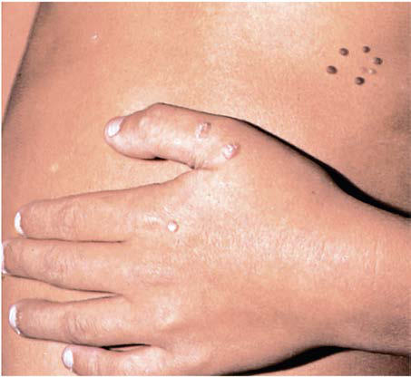
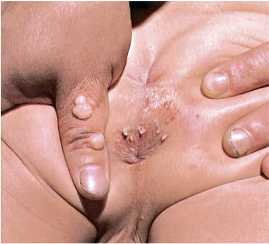

# Chapter 313: Human Papillomaviruses

*Kristen A. Feemster*

<!-- p.2629 -->
42%. Despite being monovalent, the vaccine is effective in prevention of all four common serotypes of human rotavirus.

Preliminary surveillance data on the rotavirus incidence from the U.S. Centers for Disease Control and Prevention suggest that rota virus vaccination greatly reduced the disease burden in the United States during the 2007–2008 rotavirus season and thereafter. Given the incomplete vaccine coverage during this period, the results suggest a degree of “herd immunity” from rotavirus immunization. Studies from several developed countries show greater than 90% protection against severe rotavirus disease. Studies from developing countries show 50–60% protection from severe disease. Vaccine-associated disease has been reported in vaccine recipients who have severe combined immu nodeficiency disease (a contraindication). In addition, vaccine-derived virus may undergo reassortment and become more virulent, producing diarrhea in unvaccinated siblings.

*Visit Elsevier eBooks+ at eBooks.Health.Elsevier.com** for Bibliography.*

See also Chapter 708.

Human papillomaviruses (HPVs) cause a variety of proliferative cutaneous and mucosal lesions, including common skin warts, benign and malignant anogenital tract lesions, oral pharyngeal cancers, and life-threatening respiratory papillomas. Most HPV-related infections in children and adolescents are benign (see also Chapter 708).

**ETIOLOGY** The papillomaviruses are small (55 nm), DNA-containing viruses that are ubiquitous in nature, infecting most mammalian and many non mammalian animal species. Strains are almost always species specific. Viral DNA is divided into an early region, which encodes proteins associated with viral replication and transcription, and a late region, which encodes capsid proteins necessary for virion assembly. These structural proteins are also the immunodominant antigens leading to type-specific immune responses. More than 100 different types of HPVs have been identified through the comparison of sequence homologies. The different HPV types typically cause disease in spe cific anatomic sites; more than 30 HPV types have been identified from genital tract specimens.

**EPIDEMIOLOGY** HPV infections of the skin are common, and most individuals are probably infected with one or more HPV types at some time. There are no animal reservoirs for HPV; all transmission is presumably from per son to person. There is little evidence to suggest that HPV is transmit ted by fomites. Common warts, including palmar and plantar warts, are frequently seen in children and adolescents and typically infect the hands and feet, common areas of frequent minor trauma.

HPV is also the most prevalent viral sexually transmitted infection in the United States. Up to 80% of sexually active women will acquire HPV through sexual transmission; most have their first infection within 3 years of beginning sexual intercourse. Thus HPV dispropor tionately affects youth, with 75% of new infections occurring in 15- to 24-year-olds. The greatest risk for HPV in sexually active adolescents is exposure to new sexual partners, but HPV can still be acquired even with a history of one partner, underscoring the ease of transmission of this virus through sexual contact. It is estimated that after 11 acts of sexual intercourse, 100% of all HPV types infecting an individual will be transmitted to the other sexual partner. Couple studies show that

*Kristen A. Feemster*

there is high concordance in the genital area as well as between the hand and the genital area in the other partner. Whether the DNA detected in HPV on the hand is capable of transmitting infectious particles is unknown. Unlike other sexually transmitted infections, female-tomale transmission appears greater than male-to-female transmission. This may be because males in general have superficial transient infec tions or deposition. In turn, males do not develop an adequate immune response, so reinfections are quite common. The prevalence of HPV in women decreases with time, suggesting immune protection, whereas in men, the prevalence of HPV remains high across all ages.

As with many other genital pathogens, perinatal transmission to newborns can occur. Transmission from caregiver to child during the early childhood years has also been documented. However, both perinatal and early childhood infections appear transient. It remains unclear whether these HPV DNA detections are simply a deposition of caregiver DNA or a true infection. Detection of HPV DNA in older preadolescent children is rare. HPV DNA detection in non–sexually active adolescents has been reported, but a history of sexual activity in adolescents is not always disclosed and is therefore difficult to confirm. Although caregivers can spread HPV to young children, if lesions are detected in a child older than 3 years of age, the possibility of sexual transmission should be raised.

In adolescents, HPV DNA is most commonly detected without evi dence of any lesion. Some of these detections are thought to be the result of partner deposition and hence do not represent a true infec tion. In older women, detection of HPV DNA is more commonly asso ciated with a lesion. This is because the HPV DNA detected in older women reflects those HPV infections that became established persis tent infections. Persistence is now the known necessary prerequisite for the development of significant precancerous lesions and cervical cancer.

Approximately 15–20% of sexually active adolescents have detect able HPV at any given time and have normal cytologic findings. The most common clinically detected lesion in adolescent women is the cervical lesion termed **low-grade squamous intraepithelial lesion (LSIL)** (Table 313.1). LSILs can be found in 25–30% of adolescents infected with HPV. External genital warts are much less common, occurring in <1% of adolescents; the incidence has decreased since introduction of HPV vaccines, but approximately 10% of individu als will develop genital warts in their lifetime. LSIL is a cytologic and histologic term to reflect the benign changes caused by an active viral infection and is likely present in most, if not all, women with HPV infection. However, the majority of women have very minute or subtle lesions not easily detected by cytology. As with HPV DNA detection, most LSILs regress spontaneously in young women and do not require any intervention or therapy. Less commonly, HPV can induce more severe cellular changes, termed **high-grade squamous intraepithelial lesions (HSILs)** (see Chapter 590).

Although HSILs are considered precancerous lesions, they rarely progress to invasive cancer. HSILs occur in approximately 0.4–3% of sexually active women, whereas invasive cervical cancer occurs in 8 cases per 100,000 adult women. In the United States, there are approxi mately 12,000 new cases (∼7 cases/100,000) and 4,000 deaths from cer vical cancer each year. Worldwide, cervical cancer is the fourth most common cause of cancer deaths among women. HPV is also associated with a range of other anogenital cancers, including an estimated 9,000 cases of anal cancer and 44,000 cases of oropharyngeal cancers in men and women.

Some infants may acquire papillomaviruses during passage through an infected birth canal, leading to recurrent **juvenile laryngeal pap illomatosis** (JLP; also referred to as *respiratory papillomatosis*). Cases also have been reported after cesarean section. The incubation period for emergence of clinically apparent lesions (genital warts or laryngeal papillomas) after perinatally acquired infection is unknown but is esti mated to be around 3-6 months (see Chapter 438.2). It may be that infections can also occur during hygienic care from an infected parent.

Genital warts may represent a sexually transmitted infection even in some very young children. Therefore genital warts appearing in childhood should raise suspicion for possible sexual abuse with HPV

<!-- p.2631 -->
transmission during the abusive contact. A child with genital warts should thus be provided with a complete evaluation for evidence of possible abuse (see Chapter 17.1), including the presence of other sexu ally transmitted infections (see Chapter 163). However, the presence of genital warts in a child does not confirm sexual abuse, because peri natally transmitted genital warts may go undetected until the child is older. Typing for specific genital HPV types in children is not helpful in diagnosis or to confirm sexual abuse status, because the same genital types occur in both perinatal transmission and abuse. In true virginal populations, including children who are not sexually abused, rates of clinical disease are close to zero.

**PATHOGENESIS** Initial HPV infection of the cervix or other anogenital surfaces is thought to begin by viral invasion of the basal cells of the epithelium, a process that is enhanced by disruption of the epithelium caused by trauma or inflammation. It is thought that the virus initially remains relatively dormant because virus is present without any evidence of clinical disease. The life cycle of HPV depends on the differentiation program of keratinocytes. The pattern of HPV transcription varies throughout the epithelial layer and through different stages of dis ease (LSIL, HSIL, invasive cancer). Understanding of HPV transcrip tion enhances understanding of its ability to behave as an oncovirus. Early region proteins, E6 and E7, function as transactivating factors that regulate cellular transformation. Complex interactions between E6- and E7-transcribed proteins and host proteins result in the per turbation of normal processes that regulate cellular DNA synthesis. The perturbations caused by E6 and E7 are primarily disruption of the anti-oncoprotein p53 and retinoblastoma protein (Rb), respectively, contributing to the development of anogenital cancers. Disruption of these proteins results in continued cell proliferation, even under the circumstances of DNA damage, which leads to basal cell proliferation, chromosomal abnormalities, and aneuploidy, hallmarks of squamous intraepithelial lesion (SIL) development.

Evidence of productive viral infection occurs in benign lesions such as external genital warts and LSILs, with the abundant expression of viral capsid proteins in the superficial keratinocytes. The appearance of the HPV-associated koilocyte is a result of the expression of E4, a struc tural protein that causes collapse of the cytoskeleton. Low-level expres sion of E6 and E7 proteins results in cell proliferation seen in the basal cell layer of LSILs. LSILs are a manifestation of active viral replication and protein expression. In HSILs, expression of E6 and E7 predomi nates throughout the epithelium, with little expression of the structural proteins L1 and L2. This results in the chromosomal abnormalities and aneuploidy characteristic of the higher-grade lesions. The critical events that lead to cancer have not been verified; however, several mechanisms are thought to be critical, including viral integration into the host chro mosome and activation of telomerase to lengthen chromosomes and avoid physiologic cell senescence. Over 150 HPV types have been doc umented and are classified by extent of their DNA homology into 5 genera, with the different types having different life cycle and disease characteristics. The predominant group is α HPV types, which are asso ciated with cutaneous and mucosal anogenital infections and cancers. β, γ, μ, and ν cause predominantly benign cutaneous lesions but can be difficult to manage in severely immunocompromised individuals. Β types are commonly detected on the skin without any apparent lesions but are associated with the development of skin cancers in those with epidermodysplasia verruciformis or other forms of immunodeficien cies. Genital lesions caused by the α HPV types may be broadly grouped into those with little to no malignant potential (low risk) and those with greater malignant potential (high risk). Low-risk HPV types 6 and 11 are most commonly found in genital warts and are rarely found isolated in malignant lesions. High-risk HPV types are those types that are asso ciated with anogenital cancers, specifically cervical cancer. HPV 16 and 18 are thought to be more oncogenic than other HPV types because they comprise 70% of cervical cancers, whereas each of the other 12 high-risk types (31, 33, 35, 39, 45, 51, 52, 56, 58, 59, 68, and 73) con tribute less than 1–9%. HPV 16 appears to be even more important in anal and HPV-associated oropharyngeal cancers, comprising close to 90% of these cancers. HPV 16 is also commonly found in women without lesions or in those with LSILs, making the connection with cancer confusing. Genital warts and SIL are commonly associated with the detection of multiple HPV types, including a combination of lowand high-risk HPV types. Data show that it is likely that a single lesion arises from a single HPV type. Detection of multiple HPV types reflects the presence of cervical and anal coexisting lesions. Almost all (95%) incident low-risk and high-risk HPV DNA detections, with or without detectable SIL, will spontaneously resolve within 1-3 years. Although HPV 16 has a slower rate of regression than some of the other highrisk types, the majority of incident HPV 16 detections also will resolve. Data suggest that clearance of an HPV type results in natural immune protection against reinfection with that same type. Redetections of the same type are not common and when found are often associated with a history of a new sexual partner, suggesting that these are not reactivated infections but are due to new exposures. These redetections rarely result in high-grade disease. Persistent high-risk–type infections are associ ated with increased risk for development of HSILs and invasive cancer. Progression of HSIL to invasive cancer is still rare, with only 5–15% showing progression. Approximately 50% of HPV 16–associated HSILs and 80% of non–HPV 16 HSILs will spontaneously regress in young women. Genital and common warts in general also resolve without therapy but may take years to do so. Genital warts in only extremely rare conditions can become malignant.

Most infants with recognized genital warts are infected with the low-risk types. In contrast, children with a history of sexual abuse have a clinical picture more like that of adult genital warts, consist ing of mixed low- and high-risk types. There are rare reports of HPVassociated genital malignancies occurring in preadolescent children and adolescents. On the other hand, precancerous HSILs do occur in sexually active adolescents. There is a concern that younger age of sexual debut has contributed to the increase in invasive cervical can cers seen in women younger than 50 years of age in the United States, specifically cervical adenocarcinomas. Persistent HPV infections are considered necessary but not sufficient for the development of invasive

and Histology

#### **Table 313.1** Terminology for Reporting Cervical Cytology

| Category / Parameter | Clinical Details & Findings |
| --- | --- |
| **SQUAMOUS CELL** | Atypical squamous cells of; undetermined significance |
| **(ASC-US)** | Squamous atypia; Atypical squamous cells,; cannot exclude HSIL (ASC-H); Low-grade squamous; intraepithelial lesion (LSIL); Mild dysplasia, condylomatous; atypia, HPV-related changes,; koilocytic atypia, cervical; intraepithelial neoplasia (CIN) 1; High-grade squamous; intraepithelial lesion (HSIL); Moderate dysplasia, CIN 2, severe; dysplasia, CIN 3, carcinoma in situ |
| **GLANDULAR CELL** | Endometrial cells, cytologically benign, in a postmenopausal woman; Atypical; Endocervical cells, NOS; Endometrial cells, NOS; Glandular cells, NOS; Endocervical cells, favor neoplastic; Glandular cells, favor neoplastic |
| **ENDOCERVICAL ADENOCARCINOMA IN SITU** | Adenocarcinoma; Endocervical; Endometrial; Extrauterine |
| **NOS** | NOS, Not otherwise specified. |

<!-- p.2632 -->

**Fig. 313.1** Common warts of the left hand and the chest wall. (From Meneghini CL, Bonifaz E. An Atlas of Pediatric Dermatology, Chicago: Year Book; 1986:45.)

**Fig. 313.2** Common warts of the hand in a mother and perianal con dylomata acuminata in her son. (From Meneghini CL, Bonifaz E. An At las of Pediatric Dermatology, Chicago: Year Book; 1986:44.)

cancers. Other risk factors for which there is relatively strong sugges tive evidence of association include smoking cigarettes, prolonged oral contraceptive use, greater parity, and *Chlamydia trachomatis* and her pes simplex virus infections.

**CLINICAL MANIFESTATIONS** The clinical findings in HPV infection depend on the site of epithelial infection.

**Skin Lesions** The typical HPV-induced lesions of the skin are proliferative, papular, and hyperkeratotic. Common warts are raised circinate lesions with a keratinized surface (Fig. 313.1). Plantar and palmar warts are practi cally flat. Multiple warts are common and may create a mosaic pattern. Flat warts appear as small (1- to 5-mm), flat, flesh-colored papules.

**Genital Warts** Genital warts may be found throughout the perineum around the anus, vagina, and urethra, as well as in the cervical, intravaginal, and intraanal areas (Fig. 313.2). Intraanal warts occur predominantly in patients who

which may occur in men and women without a history of anal sex. Although rare, lesions caused by genital genotypes can also be found on other mucosal surfaces, such as the conjunctivae, tongue, gingivae, and nasal mucosa. They may be single or multiple lesions and are frequently found in multiple anatomic sites, including the cervix. External genital warts can be flat, dome shaped, keratotic, pedunculated, and cauliflower shaped and may occur singly, in clusters, or as plaques. On mucosal epithelium, the lesions are softer. Depending on the size and anatomic location, lesions may be pruritic and painful, may cause burning with urination, may be friable and bleed, or may become superinfected. Adolescents are frequently disturbed by the development of genital lesions. Other rarer lesions caused by HPV of the external genital area include Bowen disease, bowenoid papulosis, squamous cell carcinomas, Buschke-Löwenstein tumors, and vulvar intraepithelial neoplasias.

**Squamous Intraepithelial Lesions and Cancers** SILs detected with cytology are usually invisible to the naked eye and require the aid of colposcopic magnification and acetic acid. With aid, the lesions appear white and show evidence of neovascularity. SILs can occur on the cervix, vagina, vulva, penis, and intraanus. HPVassociated squamous cell lesions can also be found in the oropharynx. Invasive cancers tend to be more exophytic, with aberrant-appearing vasculature. These lesions are rarely found in non–sexually active individuals.

**Laryngeal Papillomatosis** The median age at diagnosis of recurrent laryngeal papillomatosis is 3 years. Children present with hoarseness, an altered cry, and sometimes stridor. Rapid growth of respiratory papillomas can occlude the upper airway, causing respiratory compromise. These lesions may recur within weeks of removal, requiring frequent surgery. The lesions do not become malignant unless treated with irradiation.

**DIAGNOSIS** The diagnosis of external genital warts and common warts may be reliably determined by visual inspection of a lesion by an experienced observer and does not require additional tests for confirmation. A biopsy should be considered if the diagnosis is uncertain, the lesions do not respond to therapy, or the lesions worsen during therapy.

Screening for cervical cancer in young women begins with cytol ogy, which is performed by either Papanicolaou smear or liquid-based cytology and may also include high-risk HPV DNA testing for women age 30-65 years. Screening guidelines were updated in 2018 by the U.S. Preventive Services Task Force (USPSTF) and recommend starting screening at age 21 years. Screening earlier is more likely to result in unnecessary referrals for colposcopy, because most lesions, including both LSILs and HSILs in this age-group, are likely to regress. Guide lines recommend screening with cytology every 3 years through 29 years of age. For women age 30-65 years of age, USPSTF recommends screening every 3 years with cervical cytology alone, or every 5 years with high-risk HPV testing alone or high-risk HPV testing with cytol ogy (co-testing). High-risk HPV testing is not recommended earlier than age 30 years, because HPV infections are extremely common in young women, resulting in a very low positive predictive value in this age-group. These recommendations apply to all persons who have a cervix, regardless of sexual history of HPV vaccination history.

The recommended terminology used for cytologic evaluation is based on the Bethesda system (see Table 313.1). Recent updates to the terminology used for histology uses similar terms. Many clinicians still prefer the World Health Organization terminology using cervical intraepithelial neoplasia (CIN) 1, 2, and 3 (see Table 313.1). Although the purpose of screening is to identify CIN 3+ lesions, the majority of CIN lesions are found in women who were referred for **atypical squamous cells of undetermined significance (ASC-US)** or LSILs on cytology. On the other hand, few CIN 3 or cancers exist in women younger than 24 years of age. Thus, for women 21-24 years of age, ASC- US and LSILs are treated the same.

Consensus guidelines from the American Society of Colposcopy and Cervical Pathology for the management of cervical cancer screening abnormalities were updated in 2019 and used a risk-based (related to

<!-- p.2633 -->
a patient’s risk of CIN 3) rather than test-based algorithm. Treatment guidelines are also dichotomized by age group, 21-24 years and 25 years or older. Women age 21-24 years with ASC-US or LSIL should have repeat cytology at 12 months and 24 months after the initial abnormal result. For persistent ASC-US or LSILs at 2 years of follow-up or for HSIL at any point, referral for colposcopy is recommended. If colpos copy results show LSIL, cytology should be repeated in 1 year. If there are two negative cytology results, routine age-based screening can be resumed. If repeat cytology shows HSIL with CIN2+, observation with repeat colposcopy every 6 months should be performed. If HSIL per sists for 2 years or if CIN 3+ is identified, treatment with an excisional procedure is recommended. In women 25 years of age and older, HSIL can be treated without histologic confirmation. However, this approach should be avoided in those 21-24 years of age, because HSIL is often misdiagnosed in this group or will resolve spontaneously.

In all women age 21 years and older, high-risk HPV testing is accept able to assist in ASC-US triage. This recommendation is based on the observations that adult women with ASC-US and a positive HPV test result for high-risk types are more likely to have CIN 2/3 than women with a negative HPV test result. However, in women with ASC-US and a positive HPV test for high-risk types, repeat cytology is recom mended for confirmation. In women 21-24 years of age referred for colposcopy and found to have no lesion or biopsy-confirmed LSIL after ASC-US or LSIL cytology, repeat cytology is recommended at 12-month intervals as described previously. In women with biopsyconfirmed LSIL after atypical squamous cells of high grade (ASC-H) or HSIL, observation with cytology and colposcopy is recommended at 6-month intervals for up to 2 years. For persistent ASC-H or HSIL at 2 years or progression at any time, treatment is recommended. These guidelines and updates can be found at http://www.asccp.org.

Very sensitive tests for the presence of HPV DNA, RNA, and pro teins are becoming generally available, although they are not required for the diagnosis of external genital warts or related conditions. There are no indications for HPV DNA testing in women younger than 21 years of age or children. HPV DNA testing is also not recommended in women 21-29 years of age but is acceptable for ASC-US triage. Diagno sis of JLP is made based on laryngeal examination. There are no routine screening recommendations for noncervical or oropharyngeal lesions.

**DIFFERENTIAL DIAGNOSIS** A number of other conditions should be considered in the differen tial diagnosis of genital warts, including condyloma latum, sebor rheic keratoses, dysplastic and benign nevi, molluscum contagiosum, pearly penile papules, neoplasms, Bowen disease, bowenoid papulosis, Buschke-Löwenstein tumors, and vulvar intraepithelial neoplasias.

Condyloma latum is caused by secondary syphilis and can be diag nosed with darkfield microscopy and standard serologic tests for syphilis. Seborrheic keratoses are common, localized, hyperpigmented lesions that are rarely associated with malignancy. Molluscum conta giosum is caused by a poxvirus, is highly infectious, and is often umbil icated. Pearly penile papules occur at the penile corona and are normal variants that require no treatment.

**TREATMENT** Most common (plantar, palmar, skin) warts eventually resolve spon taneously (see Chapter 708). Symptomatic lesions should be removed. Removal includes a variety of self-applied therapies, including salicylic acid preparations and provider-applied therapies (cryotherapy, laser therapy, electrosurgery). Genital warts are benign and usually remit, but only over an extended period. It is recommended that genital lesions be treated if the patient or the parent requests therapy. Treat ments for genital warts are categorized into self-applied and providerapplied. No one therapy has been shown to be more efficacious than any other. Recommended patient-applied treatment regimens for external genital warts include topical podofilox, imiquimod, and sine catechins. Podofilox 0.5% solution (using a cotton swab) or gel (using a finger) is applied to visible warts in a cycle of applications twice per day for 3 days followed by 4 days of no therapy, repeated for up to a total of four cycles as needed. The total volume of podofilox used per day should not exceed 0.5 mL, and patients should wash hands before and

after each application. Imiquimod 5% cream is applied at bedtime, 3 times per week, every other day, for up to 16 weeks. Imiquimod 3.75% cream is applied at bedtime every night for up to 8 weeks. For both for mulations, the treated area should be washed with mild soap and water 6-10 hours after treatment. Sinecatechins (15% ointment) is a topical product from green tea extract used for external genital wart treatment that is applied 3 times daily until warts have completely resolved but no longer than 16 weeks. A 0.5-cm strand of ointment should be applied to each wart as a thin layer.

Provider-applied therapies include surgical treatments (electrosur gery, tangential scissor or shave excision, curettage, laser surgery), cryotherapy with liquid nitrogen or a cryoprobe and office-based appli cation of bichloroacetic (BCA) or trichloroacetic acid (TCA) 80–90% solution. Surgical treatments require appropriate training and equip ment but can be most beneficial for patients with large or extensive warts. Surgical removal or cryotherapy are also recommended for urethral meatus warts, while surgical removal, cryotherapy or BCA / TCA is recommended for vaginal, cervical, and intraanal warts. BCA or TCA treatment should be applied only to warts and can be repeated once per week for 3-6 weeks.

Alternative regimens include podophyllin resin, intralesional inter feron, photodynamic therapy, and topical cidofovir, but there are few available data regarding their efficacy. Intralesional interferon is asso ciated with significant adverse effects and is reserved for treatment of recalcitrant cases. Podophyllin resin is no longer recommended because of the availability of other, safer regimens but may be consid ered for provider-administered treatment if there can be strict adher ence to recommendations to prevent complications from systemic absorption.

Many therapies are painful, and children should not undergo pain ful genital treatments unless adequate pain control is provided. Par ents and patients should not be expected to apply painful therapies themselves. None of the patient-applied therapies are approved for use during pregnancy, and podofilox is contraindicated in pregnancy. For any of the nonsurgical treatments, prescription is contraindicated in a patient with any history of hypersensitivity to any product constituents.

If HPV exposure as a result of sexual abuse is suspected or known, the clinician should ensure that the child’s safety has been achieved and is maintained.

When indicated, the most common treatments for CIN 2/3 are abla tive and excisional treatments, including cryotherapy, laser, and loop electrosurgical excisional procedures. Once confirmed by histology with CIN 1, LSILs can be observed as described previously. The deci sion to treat a persistent CIN 1 rests between the provider and patient. Risks of treatment, including premature delivery in a future pregnancy, should be discussed before any treatment decision. Treatment in preg nancy is not recommended unless invasive cancer is present.

JLP is commonly treated with surgical removal of lesions, but laser and microdebriders are also used. However, because of the incidence of scar formation after repeat debridement procedures, medical therapies have been increasingly investigated. Adjunctive treatments have included interferon-α, antivirals such as cidofovir administered locally or systemically, photodynamic therapy, antiinflammatory drugs (celecoxib), heat shock protein, human monoclonal antibodies (beva cizumab), and HPV vaccination. However, the effectiveness of adjunc tive therapies is not consistent.

**COMPLICATIONS** The presence of HPV lesions in the genital area may be a cause of pro found embarrassment to a child or parent. Complications of therapy are uncommon; chronic pain (vulvodynia) or hypoesthesia may occur at the treatment site. Lesions may heal with hypopigmentation or hyperpigmentation and less commonly with depressed or hypertrophic scars. Surgical therapies can lead to infection and scarring. Premature delivery and low birthweight in future pregnancies are complications of excisional therapy for CIN.

It is estimated that 5–15% of untreated CIN 3 lesions will progress to cervical cancer. Most cancer is prevented by early detection and treat ment of these lesions. Despite screening, cervical cancer develops rap idly in a few adolescents and young women. The reason for the rapid

<!-- p.2634 -->
development of cancer in these rare cases remains unknown, but host genetic defects are likely underlying causes. JLPs rarely become malig nant, unless they have been treated with irradiation. Vulvar condylo mas rarely become cancerous. HPV-associated cancers of the vagina, vulva, anus, penis, and oral cavity are much rarer than cervical tumors, and therefore screening for noncervical lesions is not currently recom mended. However, anal, vaginal, and vulvar cancers are more com mon in women with cervical cancer; thus it is recommended to screen women with cervical cancer for other anogenital or oropharyngeal tumors with visual and/or digital inspection

**PROGNOSIS** With all forms of therapy, genital warts commonly recur, and approxi mately half of children and adolescents require a second or third treat ment. Recurrence is also evident in patients with JLP. Patients and parents should be warned of this likelihood. Combination therapy for genital warts (imiquimod and podofilox) does not improve response and may increase complications. Prognosis of cervical disease is bet ter, with 85–90% cure rates after a single treatment with the loop elec trosurgical excision procedure. Cryotherapy has a slightly lower cure rate. Recalcitrant disease should prompt an evaluation and is common in immunocompromised individuals, specifically men and women infected with HIV.

**PREVENTION** The only means of preventing all types of HPV infection is to avoid direct contact with lesions. Condoms may reduce the risk for HPV transmission; condoms also prevent other sexually transmitted infec tions, which are risk factors associated with SIL development. In addi tion, condoms appear to hasten the regression of LSILs in women. Avoiding smoking cigarettes is important in preventing cervical can cer. Prolonged oral contraceptive use and parity have been shown to be risks for cervical cancer. However, the mechanisms associated with these factors have not been identified, and consequently no change in counseling is recommended.

HPV vaccines show efficacy against type-specific persistence and development of type-specific disease, including the cervix, vagina, vulva, and anus. A quadrivalent HPV vaccine containing types 6, 11, 16, and 18 was licensed in the United States in 2006, and a bivalent HPV vaccine containing types 16 and 18 was licensed in the United States in 2009. A 9-valent vaccine containing types 6, 11, 16, 18, 31, 33, 45, 52, and 58 was approved in 2014. Initial licensure was for vaccina tion of persons age 9-26 years. In 2018, the FDA expanded licensure to include men and women age 27-45 years based on quadrivalent HPV vaccine clinical trial results in women age 27-45 years and bridging immunogenicity and safety data in women and men. The bivalent vac cine is indicated for the prevention of cervical precancer and cancer in females. The 4- and 9-valent HPV vaccines are indicated for the pre vention of anal, cervical, vaginal, and vulvar precancers/cancers, as well as genital warts in females and anal precancer cancer and genital warts in males. The indication for the 9-valent HPV vaccine was expanded to include oropharyngeal and other head and neck cancers in 2021.

The types targeted by the nonavalent vaccine account for up to 85% of cervical cancer cases. The efficacy of these vaccines is medi ated by the development of neutralizing antibodies. Prelicensure stud ies demonstrate 90–100% efficacy in the prevention of persistent HPV infection, CIN 2/3, adenocarcinoma in situ, anogenital warts, and pre cancerous vaginal and vulvar lesions. Since vaccine introduction, data from Sweden and Australia show a decrease in national rates of geni tal warts within 4 years of implementing vaccination programs. Data from the United States show significant reductions in the prevalence of the HPV types contained in the quadrivalent vaccine among ado lescent and young adult females in the years 2009–2012 (postvaccine) compared with 2003–2006 (prevaccine). Additionally, the HPV vac cine–type prevalence was 2.1% in vaccinated compared with 16.9% in unvaccinated 14- to 24-year-old sexually active females. A systematic review of 20 studies conducted in nine high-income countries showed reductions of at least 68% in the prevalence of HPV 16 and 18 among

13- to 19-year-olds in countries with HPV vaccination rates >50%. Recent data also demonstrate significant reductions in cervical cancer rates and CIN 3 with the highest reductions among women who were vaccinated at age 12-13 years after implementation of a national HPV vaccination program in the United Kingdom. A 29% reduction in cer vical cancer annual incidence rates from 2003–2006 to 2011–2014 was observed among females age 15-24 years in the United States. Addi tionally, an analysis of data from a population-based cancer registry showed a decline in the incidence of squamous cell carcinoma and adenocarcinoma among young women age 15-29 years, with the larg est reductions in the 15- to 20-year age group. Available effectiveness data suggest that HPV vaccination confers herd immunity in addition to individual protection.

Vaccination in the United States is recommended routinely for all adolescents at 11-12 years of age and is administered intramuscularly in the deltoid region in a two-dose series at 0 and 6-12 months. A twodose series was approved and recommended in 2016 for younger ado lescents who initiate the HPV vaccine series before age 15 years based on immunogenicity data showing a comparable immune response among younger adolescents who receive a two-dose series compared with older adolescents, who receive a three-dose series. The effective ness of one dose has also been evaluated in observational and post-hoc analyses from clinical trials.

It is important that vaccination take place in children before they become sexually active, because the rate of HPV acquisition is high shortly after the onset of sexual activity. Vaccine can be given to ado lescents as young as 9 years of age, and catch-up vaccination is now recommended in all persons through 26 years of age. Vaccination is also recommended for adults 27-45 years using shared clinical decision making if they have not been previously vaccinated. For any adolescent who receives his or her first HPV vaccine dose at age 15 years or older, a three-dose series at 0, 1-2, and 6 months is recommended. The threedose series is also recommended for adolescents and young adults 9-26 years of age who have an immunocompromising condition. Individu als who are already infected with one or more vaccine-related HPV types before vaccination are protected from clinical disease caused by the remaining vaccine HPV types. Therefore a history of prior HPV infection is not a contraindication to vaccine receipt. Currently licensed HPV vaccines are not therapeutic. However, there are thera peutic HPV vaccines under development that are primarily designed to generate a cell-mediated immune response to target infected cells.

Post-licensure vaccine safety surveillance has not identified any seri ous adverse events attributable to HPV vaccine receipt. Three large observational studies and safety monitoring through active and pas sive surveillance networks among more than 1 million individuals have not identified any association between HPV vaccination and outcomes such as autoimmune disorders, stroke, or venous thrombotic emboli. Vaccination can cause fever in approximately 1 in 60 and discomfort at the injection site in 1 in 30 vaccine recipients. Syncope has also been found to be correlated with vaccine administration in 0.1% of vaccine recipients. Therefore it is advised that adolescents remain seated for 15 minutes after vaccination.

Despite an excellent safety and efficacy profile, HPV vaccine uptake has been slow. Immunization rates have consistently lagged behind rates for the other vaccines included in the adolescent immunization platform. In 2020, 75% of 13- to 17-year-olds had received at least one HPV vaccine dose compared with 89% who received at least one dose of the quadrivalent meningococcal vaccine and 92% who received tetanus-diphtheria-acellular pertussis (Tdap) vaccine. Reasons for the slow uptake include inconsistent provider recommendation, lack of knowledge about HPV, parental belief that vaccination is not nec essary for younger adolescents, and misconceptions about vaccine safety, among others. There is a growing body of literature evaluating interventions to improve HPV vaccine uptake. One important strategy is a strong, consistent recommendation in which HPV vaccines are presented in the same way as Tdap and meningococcal vaccines.

*Visit Elsevier eBooks+ at eBooks.Health.Elsevier.com** for Bibliography.*

<!-- p.2635 -->
