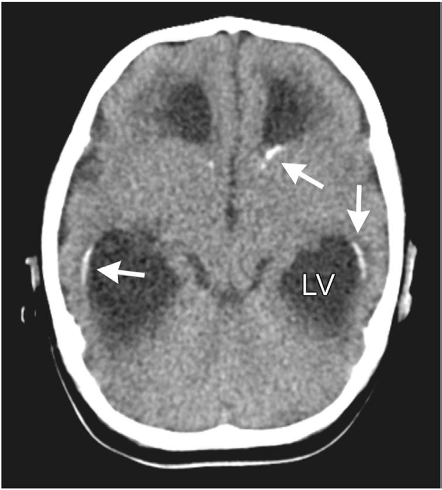

# Chapter 318: Lymphocytic Choriomeningitis Virus

*Daniel J. Bonthius*

<!-- p.2672 -->
Lymphocytic choriomeningitis virus (LCMV) is a prevalent human pathogen and an important cause of meningitis in children and adults. Capable of crossing the placenta and infecting the fetus, LCMV is also an important cause of neurologic birth defects and encephalopathy in the newborn.

**ETIOLOGY** LCMV is a member of the family Arenaviridae, which are enveloped, negative-sense, single-stranded RNA viruses. The name of the arenavi ruses is derived from *arenosus,* the Latin word for “sandy,” because of the fine granularities observed within the virion on ultra-thin electron microscopic sections.

**EPIDEMIOLOGY** Like all arenaviruses, LCMV uses rodents as its reservoir. The common house mouse, *Mus musculus,* is both the natural host and primary res ervoir for the virus, which is transferred vertically from one generation of mice to the next via intrauterine infection. Hamsters and guinea pigs are also potential reservoirs. Although heavily infected with LCMV, rodents that acquire the virus transplacentally often remain asymptom atic because congenital infection provides rodents with immunologic tolerance for the virus. Infected rodents shed the virus in large quantities in nasal secretions, urine, feces, saliva, and milk throughout their lives.

Humans typically acquire LCMV by contacting fomites contami nated with infectious virus or by inhaling aerosolized virus. Most human infections occur during the fall and early winter, when mice move into human habitations. Humans can also acquire the virus via organ transplantation. Congenital LCMV infection occurs when a woman acquires a primary LCMV infection during pregnancy. The virus passes through the placenta to the fetus during maternal viremia. The fetus may also acquire the virus during passage through the birth canal from exposure to infected vaginal secretions. Outside of organ transplantation and vertical transmission during pregnancy, there have been no cases of human-to-human transmission of LCMV.

LCMV is prevalent in the environment, has a great geographic range, and infects large numbers of humans. The virus is found throughout the world’s temperate regions and probably occurs wherever the genus *Mus* has been introduced (which is every continent but Antarctica). An epidemiologic study found that 9% of house mice are infected and that substantial clustering occurs, where the prevalence is higher. Serologic studies demonstrate that approximately 5% of adult humans possess antibodies to LCMV, indicating prior exposure and infection.

**PATHOGENESIS** LCMV is not a cytolytic virus. Thus unlike many other nervous system pathogens that directly damage the brain by killing host brain cells, LCMV pathogenesis involves other underlying mechanisms. Further more, the pathogenic mechanisms are different in postnatal (acquired) infection compared with prenatal (congenital) infection. A critical dif ference in the pathogenesis of postnatal versus prenatal infection is that the virus infects brain parenchyma in the case of prenatal infection but is restricted to the meninges and choroid plexus in postnatal cases.

In postnatal infections, LCMV replicates to high titers in the cho roid plexus and meninges. Viral antigen within these tissues becomes the target of an acute mononuclear cell infiltration driven by CD8+ T lymphocytes. The presence of lymphocytes in large numbers within

the meninges and cerebrospinal fluid (CSF) leads to the symptoms of meningitis that mark acquired LCMV infection. As the lymphocytes clear the virus from the meninges and CSF, the density of lymphocytes declines and the symptoms of meningitis resolve. Thus symptoms of acquired (postnatal) LCMV infection are immune mediated and are a result of the presence of large numbers of lymphocytes.

Prenatal infection likewise inflames the tissues surrounding the brain parenchyma, and this inflammation leads to some of the signs of congenital LCMV. In particular, within the ventricular system, congenital LCMV infection often leads to ependymal inflammation, which may block the egress of CSF at the cerebral aqueduct and lead to hydrocephalus. However, unlike postnatal cases, prenatal infection with LCMV includes infection of the substance of the brain rather than just the meninges or ependyma. This infection of brain parenchyma leads to the substantial neuropathologic changes typically accompa nying congenital LCMV infection. In particular, LCMV infects the mitotically active neuroblasts, located at periventricular sites. Through an unknown mechanism, the presence of the virus kills these periven tricular cells, leading to periventricular calcifications, a radiographic hallmark of this disorder. Within the fetal brain, LCMV infection of neurons and glial cells also disrupts neuronal migration, leading to abnormal gyral patterns, and interferes with neuronal mitosis, leading to microcephaly and cerebellar hypoplasia.

**CLINICAL MANIFESTATIONS** The clinical manifestations of LCMV infection depend on whether the infection occurs prenatally or postnatally. Congenital infection with LCMV is unique, as it involves both the postnatal infection of a preg nant woman and the prenatal infection of a fetus.

**Acquired (Postnatal) Lymphocytic Choriomeningitis Virus Infection** LCMV infection during postnatal life (during childhood or adulthood) typically consists of a brief febrile illness from which the patient fully recovers. The illness classically consists of two clinical phases. In the first phase, the symptoms are those of a nonspecific viral syndrome and include fever, myalgia, malaise, nausea, anorexia, and vomiting. These symptoms usually resolve after several days but are followed by a second phase, consisting of central nervous system disease. The symp toms of this second phase are those of aseptic meningitis, including headache, fever, nuchal rigidity, photophobia, and vomiting. The entire course of the biphasic disease is typically 1-3 weeks.

The clinical spectrum of LCMV infection is broad. One third of postnatal infections are asymptomatic. Other patients develop extra neural disease that extends beyond the usual symptoms and may include orchitis, pneumonitis, myocarditis, parotitis, dermatitis, alo pecia, and pharyngitis. In others, the neurologic disease may be con siderably more severe than usual and may include transverse myelitis, Guillain-Barré syndrome, hydrocephalus, and encephalitis. Recovery from acquired LCMV infection is usually complete, but fatalities occa sionally occur.

LCMV infections acquired via solid organ transplantation always induce severe disease. Several weeks after the transplantation, recipi ents of infected organs develop fever, leukopenia, and lethargy. After these nonspecific symptoms, the course of the disease rapidly pro gresses to multiorgan system failure and shock. These cases are almost always fatal.

**Congenital Lymphocytic Choriomeningitis Virus Infection** LCMV infection during pregnancy can kill the fetus and induce spon taneous abortion. Among surviving fetuses, the two clinical hall marks of congenital LCMV infection are vision impairment and brain dysfunction.

The vision impairment in congenital LCMV infection is a result of **chorioretinitis** and the formation of chorioretinal scars. The scarring is usually bilateral and most commonly located in the periphery of the fundus, but involvement of the macula also occurs.

*Daniel J. Bonthius*

<!-- p.2673 -->
Although the retinal injuries from congenital LCMV infection are often severe, it is the *brain* effects that cause the greatest disability. Pre natal infection with LCMV commonly induces either macrocephaly or microcephaly. **Macrocephaly** after LCMV infection is almost invari ably caused by noncommunicating hydrocephalus, stemming from inflammation within the ventricular system. **Microcephaly** is a result of the virus-induced failure of brain growth. In addition to distur bances of head size, periventricular calcifications are also cardinal fea tures of congenital LCMV infection.

Although hydrocephalus, microencephaly, and periventricular cal cifications are by far the most commonly observed abnormalities of the brain in congenital LCMV, other forms of neuropathology, alone or in combination, can also occur. These include periventricular cysts, porencephalic cysts, encephalomalacia, intraparenchymal calcifica tions, cerebellar hypoplasia, and neuronal migration disturbances.

Infants with congenital LCMV infection typically present during the newborn period with evidence of brain dysfunction. The most com mon signs are lethargy, seizures, irritability, and jitteriness.

Within the fetus, LCMV has a specific tropism for the brain. Thus unlike many other congenital infections, LCMV usually does not induce systemic manifestations. Birthweight is typically appropriate for gesta tional age. Skin rashes and thrombocytopenia, which are common in several other prominent congenital infections, are unusual in congenital LCMV infection. Hepatosplenomegaly is only rarely observed, and serum liver enzyme levels are usually normal. Auditory deficits are unusual.

**LABORATORY FINDINGS** In acquired (postnatal) LCMV infection, the hallmark laboratory abnormality occurs during the second (central nervous system) phase of the disease and is CSF pleocytosis. The CSF typically contains hun dreds to thousands of white blood cells, almost all of which are lym phocytes. However, CSF eosinophilia may also occur. Mild elevations of CSF protein and hypoglycorrhachia are common.

In congenital LCMV infection, laboratory findings in the newborn depend on whether the infant is still infected or not. If the infant still harbors the infection, then examination of the CSF may reveal a lym phocytic pleocytosis. Unlike many other congenital infections, LCMV does not typically induce elevations in liver enzymes, thrombocytope nia, or anemia. In many cases, the most reliably abnormal test is the head CT scan, which typically reveals a combination of microenceph aly, hydrocephalus, and periventricular calcifications (Fig. 318.1).

**DIAGNOSIS AND DIFFERENTIAL DIAGNOSIS** Acute LCMV infections can be diagnosed by isolating the virus from CSF. Polymerase chain reaction has also been used to detect LCMV RNA in patients with active infections. However, by the time of birth, a baby prenatally infected with LCMV may no longer harbor the virus. Thus congenital LCMV infection is more commonly diagnosed by serologic testing. The immunofluorescent antibody test detects both immunoglobulin (Ig) M and IgG and has greater sensitivity than the more widely available complement fixation method. The immunofluo rescent antibody test is commercially available, and its specificity and sensitivity make it an acceptable diagnostic tool. A more sensitive test for detecting congenital LCMV infection is the enzyme-linked immu nosorbent assay, which measures titers of LCMV IgG and IgM and is performed at the Centers for Disease Control and Prevention.

For acquired (postnatal) LCMV infection, the principal items in the differential diagnosis are the other infectious agents that can induce meningitis. These include bacteria, fungi, viruses, and some other forms of pathogens. The most common viral causes of meningitis are the enteroviruses, including coxsackieviruses and echoviruses, and the arbo viruses, including La Crosse encephalitis virus and equine encephalitis virus. Unlike LCMV, which is most common in winter, the enteroviruses and arboviruses are most commonly acquired in summer and early fall.

The principal items in the differential diagnosis of congenital LCMV infection are the other infectious pathogens that can cross the placenta and damage the developing fetus. These infectious agents are linked by the acronym TORCHS and include *Toxoplasma gondii,* rubella virus, cytomegalovirus, herpes simplex virus, and syphilis. Toxoplasmosis,

Zika virus infection, and cytomegalovirus infection are particularly difficult to differentiate from LCMV, because all of these infectious agents can produce microcephaly, intracerebral calcifications, and cho rioretinitis. Although clinical clues may aid in distinguishing one con genital infection from another, definitive identification of the causative infectious agent usually requires laboratory data, including cultures and serologic studies.

**COMPLICATIONS** Complications in children with congenital LCMV infection are nonspe cific and include the medical problems that commonly arise in scenarios involving ventriculoperitoneal shunts, severe seizure disorders, and static encephalopathy. These complications include shunt failure or infection, aspiration pneumonia, injuries from falls, and joint contractures.

**TREATMENT There is no specific treatment for acquired or congenital LCMV infection.** An effective antiviral therapy for LCMV infection has not yet been developed. Ribavirin is active against LCMV and other arena viruses in vitro, but its utility in vivo is unproven. Immunosuppressive therapy, if present, should be reduced.

**Supportive Care** Children with hydrocephalus from congenital LCMV infection often require placement of a ventriculoperitoneal shunt during infancy for treatment of hydrocephalus. Seizures often begin during early post natal life, are often difficult to control, and require administration of multiple antiepileptic medications. The mental retardation induced by congenital LCMV infection is often profound. In most cases, affected children should be referred for educational intervention during early life. The spasticity accompanying congenital LCMV infection is often severe. Although physical therapy can help to maintain the range of motion and minimize painful spasms and contractures, implantation of a baclofen pump is often helpful.

**PROGNOSIS** The great majority of patients with postnatally acquired LCMV infec tion have a full recovery with no permanent sequelae. Rarely, postnatal infections induce hydrocephalus and require shunting. Rarer yet, post natal LCMV infection is fatal.

In contrast to the usual benign outcome of postnatal infections, prenatal infections typically lead to severe and permanent disability.

**Fig. 318.1** Head CT scan from a 2-mo-old microcephalic baby with congenital lymphocytic choriomeningitis virus infection. The scan re veals enlargement of the lateral ventricles (LV) and periventricular cal cifications (arrows).

<!-- p.2675 -->
