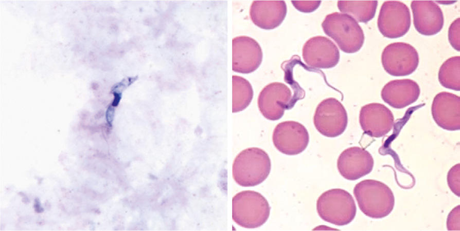

# Chapter 332: African Trypanosomiasis (Sleeping Sickness; Trypanosoma brucei Complex)

*Edsel Maurice T. Salvana and Robert A. Salata*

<!-- p.2769 -->
Sixty-five million people in 36 countries are at risk for infection with *Trypanosoma brucei* complex, the causative agent of sleeping sickness. Also known as **human African trypanosomiasis (HAT)**, this disease is restricted to sub-Saharan Africa, the range of the tsetse fly vector. It is a disease of extreme poverty, with the highest disease burden observed in remote rural areas. HAT comes in two geographically and clinically distinct forms. *Trypanosoma brucei gambiense* causes a chronic infec tion and affects people who live in western and central Africa **(West African sleeping sickness**, **Gambian trypanosomiasis)**. *Trypanosoma brucei rhodesiense* is a zoonosis that presents as an acute illness lasting several weeks and usually occurs in residents or travelers from east ern and southern Africa **(East African sleeping sickness**, **Rhodesian trypanosomiasis)**.

**ETIOLOGY** HAT is a vector-borne disease caused by parasitic, extracellular, flagel lated kinetoplastid protozoans of two subspecies of *T. brucei*. It is trans mitted to humans through the bite of *Glossina,* commonly known as the **tsetse fly**.

Humans usually contract East African HAT when they venture from towns to rural areas to visit woodlands or livestock, highlight ing the importance of zoonotic reservoirs in this disease. West Afri can HAT is contracted closer to settlements and only requires a small vector population, making it difficult to eradicate. Animal reservoirs occur, but the main source of infection remains chronically infected human hosts.

**LIFE CYCLE* T. brucei* undergoes several stages of development in the insect and mammalian host. On ingestion with a blood meal, nonproliferative **short stumpy (SS)** forms of the parasite transform into procyclic forms in the insect’s midgut. These procyclic forms proliferate and undergo further development into epimastigotes, which then become infective metacyclic forms that migrate to the insect’s salivary glands. The life cycle within the tsetse fly takes 15-35 days. On inoculation into the mammalian host, the metacyclic stage transforms into pro liferative **long slender (LS)** forms in the bloodstream and the lym phatics, eventually penetrating the central nervous system (CNS). LS forms appear in waves in the peripheral blood, with each wave followed by a febrile crisis and heralding the formation of a new antigenic variant. Once a critical density of LS forms is reached, a quorum-sensing mechanism causes most of these to transform into nonproliferative SS forms that are ingested by *Glossina* and start the cycle anew. Quorum sensing controls peak parasitemia to ensure that the host survives infection long enough for the parasite to complete its life cycle.

Direct transmission to humans has been reported, either vertically to infants or mechanically through contact with tsetse flies with via ble LS forms on their mouthparts from a recent blood meal from an infected host.

**EPIDEMIOLOGY** HAT occurs mainly in sub-Saharan Africa between latitudes 14 degrees north and 29 degrees south, where the annual rainfall cre ates optimal climatic conditions for *Glossina*. In 2009, new HAT cases annually fell below 10,000 as a result of intensive control efforts. In 2018, new cases fell to 977, the lowest level in 80 years since the start of systematic data collection. In the last 10 years, 70% of cases were reported from the Democratic Republic of Congo. Gambian trypano somiasis is targeted for sustainable elimination as a public health problem by 2030.

*T. brucei rhodesiense* infection is restricted to the eastern third of the endemic area in tropical Africa, stretching from Ethiopia to the north ern boundaries of South Africa. *T. brucei gambiense,* which accounts for 95% of HAT cases, occurs mainly in the western half of the conti nent’s endemic region. Rhodesian HAT, which has an acute and often fatal course, greatly reduces chances of transmission to tsetse flies. The ability of *T. brucei rhodesiense* to multiply rapidly in the bloodstream and infect other species of mammals helps maintain its life cycle. HAT is infrequently reported in non-endemic countries, usually in return ing travelers or migrants.

**PATHOGENESIS** At the site of the *Glossina* bite, tsetse fly salivary antigens, peptides, and proteins promote an immune-tolerant microenvironment that facilitates parasite invasion. Injected metacyclic parasites transform into LS forms, which rapidly divide by binary fission. The parasites, along with the attendant inflammation, cellular debris, and metabolic products, may give rise to a hard, painful, red nodule known as a **trypanosomal chancre** within 5-15 days postinoculation. Parasites directionally migrate from the skin to the lymphatics via an unknown mechanism and pass into the draining lymph node and onward into the main lymphatic ducts. Dissemination into the blood and lym phatic systems follows, with subsequent localization to the CNS. Histopathologic findings in the brain are consistent with meningoen cephalitis. The appearance of **morula** cells of Mott (large, strawberrylike cells, supposedly derived from plasma cells) is a characteristic finding in chronic disease.

Mechanisms underlying virulence in HAT are still incompletely understood but seem to be mediated by a complex interplay of try panosomal, human, and *Glossina* factors. *T. brucei gambiense* uti lizes at least three mechanisms to evade lysis by human sera. These include reduced binding to trypanolytic factor 1 (TLF1) via reduced expression and mutation of a haptoglobin-hemoglobin receptor; expression of a specific glycoprotein TgsGP, which reduces try panosomal membrane fluidity; and a cysteine protease-mediated reduction of sensitivity to apolipoprotein L-1 (APOL1). *T. brucei rhodesiense,* on the other hand, expresses a protein known as serum resistance–associated protein (SRA), which counteracts trypano lytic APOL1 in human serum. APOL1 and the hemoglobin binding protein haptoglobin-related protein (HPR) are major components of two high-density lipoprotein complexes called TLF1 and TLF2, which protect humans against non-human trypanosomes. Trypano somes also secrete a host of biologically active molecules that can dampen immune responses.

Antigenic variation of **variant surface glycoprotein (VSG)** on the trypanosome surface has long been recognized as a major factor in evading acquired immunity during infection. This antigenic diversity is generated by a tightly controlled system of DNA double-stranded breaks with associated homologous recombination. VSG also inhibits complement activation and antibody-mediated aggregation, facilitat ing establishment and maintenance of infection. Soluble VSG is hyper secreted, especially at the peak of parasitemia, and may serve as a decoy for antibodies and complement factor, diverting immune responses away from trypanosomes.

**CLINICAL MANIFESTATIONS** Clinical presentations vary not only because of the two subspecies of organisms but also because of differences in host response in the

*Edsel Maurice T. Salvana and 
 Robert A. Salata*

<!-- p.2770 -->
indigenous population of endemic areas and in newcomers or visitors. Visitors usually suffer more from the acute symptoms, but if untreated, death usually follows for natives and visitors alike. Symptoms usually occur within 2-3 weeks of infection. The clinical syndromes of HAT are trypanosomal chancre, hemolymphatic stage, and meningoencepha litic stage.

**Trypanosomal Chancre** The site of the tsetse fly bite may be the first presenting feature. A nod ule or chancre (3-4 cm) develops in 2-3 days and becomes a painful, hard, red nodule surrounded by an area of erythema and swelling within 1 week. Nodules are typically seen on the lower limbs and some times also on the head. They subside spontaneously in about 2 weeks, leaving no permanent scar.

**Hemolymphatic Stage (Stage 1)** The most common presenting features of acute HAT occur at the time of invasion of the bloodstream by the parasites, 2-3 weeks after infection. Patients usually present with irregular episodes of fever, each lasting up to 7 days, accompanied by headache, sweating, and generalized lymphadenopathy. Attacks may be separated by symptom-free intervals of days or even weeks. Painless, nonmatted **lymphadenopathy**, most often of the posterior cervical and supra clavicular nodes, is one of the most constant signs, particularly in the Gambian form. A common feature of trypanosomiasis is the presence of blotchy, irregular, nonpruritic, erythematous **macules**, which may appear any time after the first febrile episode, usually within 6-8 weeks. The majority of macules have a normal central area, giving the rash a circinate outline. This **rash** is seen mainly on the trunk and is evanescent, fading in one place only to appear at another site. Examination of the blood during this stage may show anemia, leukopenia with relative monocytosis, and elevated levels of immunoglobulin M (IgM). Cardiac manifestations of HAT have also been reported but are generally limited to nonspecific ST-T wave electrocardiographic abnormalities. Histopathologic charac terization shows a lymphomonohistiocytic infiltrate in the intersti tium, with no penetration of the myocardial cells, unlike that for American trypanosomiasis (see Chapter 333). The perimyocarditis is usually self-limited and does not typically progress to congestive heart failure.

**Meningoencephalitic Stage (Stage 2)** Neurologic symptoms and signs are nonspecific, including irritabil ity, insomnia, and irrational and inexplicable anxieties with frequent changes in mood and personality. Neurologic symptoms may precede invasion of the CNS by the organisms. In untreated *T. brucei rhode siense* infections, CNS invasion occurs within 3-6 weeks and is associ ated with recurrent bouts of headache, fever, weakness, and signs of acute toxemia. Death occurs in 6-9 months as a result of secondary infection or cardiac failure.

In Gambian HAT, cerebral symptoms appear within 2 years after the acute symptoms. An increase in drowsiness during the day and insom nia at night reflect the continuous progression of infection and may be accompanied by anemia, leukopenia, and muscle wasting. The chronic, diffuse meningoencephalitis without localizing symptoms is the form referred to as **sleeping sickness**. Drowsiness and an uncontrollable urge to sleep are the major features of this stage and become almost continuous in the terminal stages. Tremor or rigidity with stiff and ataxic gait suggest involvement of the basal ganglia. Psychotic changes occur in one third of untreated patients. Although most untreated dis ease is fatal, in rare cases, individuals remain asymptomatic, clear para sitemia, and become seronegative.

**DIAGNOSIS** Definitive diagnosis can be established during the early stages by exam ination of a fresh, thick blood smear, which permits visualization of the

motile active forms (Fig. 332.1). HAT can also be detected from blood using a variety of sensitive techniques, such as quantitative buffy coat smears and mini anion exchange resins. Dried, Giemsa-stained smears should be examined for the detailed morphologic features of the organ isms. If a thick blood or buffy coat smear is negative, concentration techniques may help. Aspiration of an enlarged lymph node can also be used to obtain material for parasitologic examination. If positive, cerebrospinal fluid (CSF) should also be examined for the organisms. The presence of trypanosomes, or ≥5 white blood cells (WBCs)/μL, or both, is indicative of stage 2 disease. If trypanosomes are absent in the CSF, some authorities use a count of 10-20 WBCs/μL as a cutoff for diagnosing late-stage disease.

The card agglutination trypanosomiasis test (CATT) is of value for epidemiologic purposes and for screening for *T. brucei gambiense*. Lat eral flow formats of CATT have enabled point-of-care testing. Because CATT detects antibodies against particular VSG molecules, it cannot distinguish present from past infection.

Polymerase chain reaction–based tests have been shown to be highly sensitive and specific, but these tests require laboratory facilities. Fieldbased loop-mediated isothermal amplification tests have been devel oped and validated. Other areas of active research for diagnostics include new biomarkers, cytokine profiles, proteomics, and polysom nography, which are being used not only to identify disease but to dif ferentiate disease stages.

**TREATMENT** The choice of chemotherapeutic agents for treatment depends on the stage of the infection and the causative organisms.

**Stage 1 Treatment** Hematogenous forms of both Rhodesian and Gambian HAT have been traditionally treated with either suramin or pentamidine. **Sura min** is a polysulfonated symmetric naphthalene derivative given as a 10% solution for intravenous (IV) administration. A **test dose** (10 mg for children; 100-200 mg for adults) is initially administered to detect rare idiosyncratic reactions of shock and collapse. The dose for subse quent IV injections is 20 mg/kg (maximum 1 g) administered on days 1, 3, 7, 14, and 21. Suramin is nephrotoxic; thus a urinalysis should be performed before each dose. Marked proteinuria, blood, or casts is a contraindication to continuation of suramin. Resistance is rare but has been reported.

**Pentamidine isethionate** (4 mg/kg/day intramuscularly [IM] daily or on alternate days for 7-10 days) concentrates to high levels in trypanosomes and is highly trypanocidal. It is better tolerated than suramin but carries significant risk of hypoglycemia, nephrotoxicity, hypotension, leukopenia, and liver enzyme elevation. Because of its

A B

**Fig. 332.1** Trypanosoma brucei sp. trypomastigotes in thick blood smear stained with Giemsa (A) and thin blood smear stained with Wright-Giemsa (B). (From Centers for Disease Control and Prevention: Laboratory identification of parasites of public health concern. Trypano somiasis, African [website], 2018. https://www.cdc.gov/dpdx/trypanoso miasisafrican/index.html)

<!-- p.2772 -->
