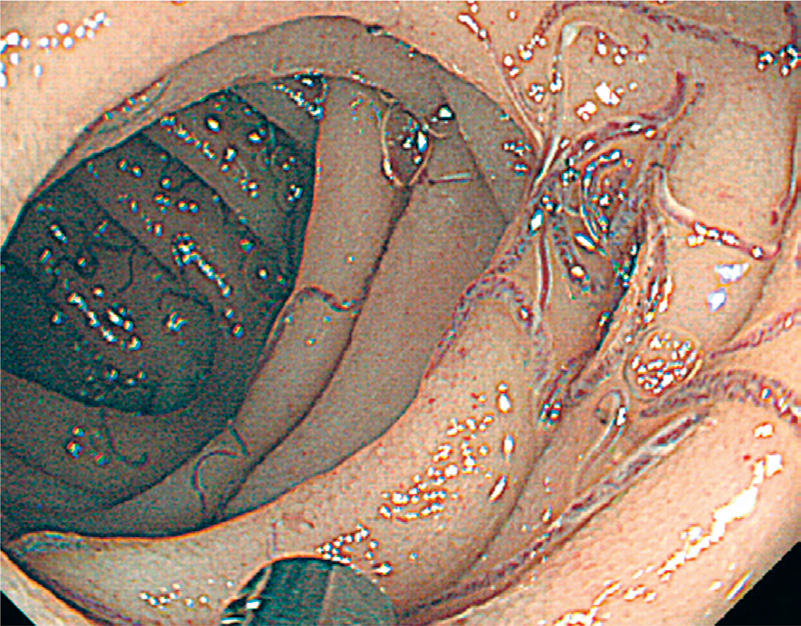
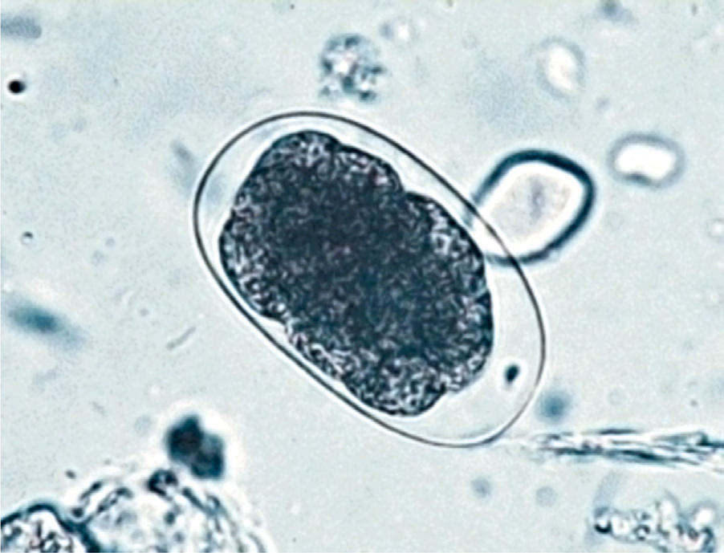

# Chapter 338: Hookworms (Necator americanus and Ancylostoma spp.)

*Peter J. Hotez*

<!-- p.2814 -->
**chemotherapy programs** can be implemented in one of three ways: (1) offering universal treatment to all individuals in an area of high ende micity; (2) offering treatment targeted to groups with high frequency of infection, such as children attending primary school; or (3) offering indi vidual treatment based on intensity of current or past infection. Improv ing education about and practices of sanitary conditions and sewage facilities, discontinuing the practice of using human feces as fertilizer, and education are the most effective long-term preventive measures.

*Visit Elsevier eBooks+ at eBooks.Health.Elsevier.com** for Bibliography.*

#### **Table 337.1** Clinical and Public Health Control of Soil-Transmitted Helminthiasis

| Category / Parameter | Clinical Details & Findings |
| --- | --- |
| **PUBLIC HEALTH CONTROL** | Diagnosis; Individual; Community level (e.g., in select schools); Diagnostic criteria; Parasitologic; Residence in an area with soil-transmitted; helminthiasis prevalence >20%; Treatment approach; Single dose or multiple dose; Single-dose periodic mass treatment; Threshold for treatment; Travel history, symptoms and signs, positive; laboratory test; Estimated prevalence of infection in target; population; Treatment objective; Parasitologic cure; Decreased worm burden; reduction in; transmission; Ancillary treatment; Based on clinical signs and symptoms; Typically, only if included in mass treatment; (e.g., vitamin A supplementation); Follow-up; Parasitologic test of cure; improvement in; associated health conditions; Not usually done; Health education (sanitation/hygiene); Recommended; Recommended; From Jourdan PM, Lamberton PHL, Fenwick A, Addiss DG. Soil-transmitted helminth infections. Lancet. 2018;391:252–262. Table 1. |

*Peter J. Hotez*

**ETIOLOGY** Two major genera of hookworms, which are nematodes, or roundworms, infect humans. *Necator americanus,* the only representative of its genus, is a major **anthropophilic** hookworm and is the most common cause of human hookworm infection. Hookworms of the genus *Ancylostoma* include the anthropophilic hookworm *Ancylostoma duodenale,* which also causes classic hookworm infection, and the less common **zoonotic** species *Ancylostoma ceylanicum* (restricted mostly to Southeast Asia). Human zoonotic infection with the dog hookworm *Ancylostoma cani num* is associated with an eosinophilic enteritis syndrome. The larval stage of *Ancylostoma braziliense,* whose definitive hosts include dogs and cats, is the principal cause of cutaneous larva migrans.

The infective larval stages of the anthropophilic hookworms live in a developmentally arrested state in warm, moist soil. Larvae infect humans either by penetrating through the skin (*N. americanus* and *A. duodenale*) or when they are ingested *(A. duodenale).* Larvae entering the human host by skin penetration undergo **extraintestinal migration** through the venous circulation and lungs before they are swallowed, whereas orally ingested larvae may undergo extraintestinal migration

or remain in the gastrointestinal (GI) tract (Figs. 338.1 and 338.2). Larvae returning to the small intestine undergo two molts to become adult, sexually mature, male and female worms ranging in length from 5-13 mm. The buccal capsule of the adult hookworm is armed with cut ting plates *(N. americanus)* or teeth *(A. duodenale)* to facilitate attach ment to the mucosa and submucosa of the small intestine. Hookworms can remain in the intestine for 1-5 years, where they mate and produce eggs. Although up to 2 months is required for the larval stages of hook worms to undergo extraintestinal migration and develop into mature adults, *A. duodenale* larvae may remain developmentally arrested for many months before resuming development in the intestine. Mature *A. duodenale* female worms produce about 30,000 eggs per day; daily egg production by *N. americanus* is <10,000/day (Fig. 338.3). The eggs are thin shelled and ovoid, measuring approximately 40-60 μm. Eggs that are deposited on soil with adequate moisture and shade develop into first-stage larvae and hatch. Over the ensuing several days and under appropriate conditions, the larvae molt twice to the **infective** stage. Infective larvae are developmentally arrested and nonfeeding. They migrate vertically in the soil until they either infect a new host or exhaust their lipid metabolic reserves and die.

**EPIDEMIOLOGY** Hookworm infection is one of the most prevalent infectious diseases of humans. The Global Burden of Disease Study 2015 reported that approximately 428 million people are infected with hookworms, with further estimates indicating that hookworm infection globally results in 4.1 million disability-adjusted life-years, possibly leading all **neglected tropical diseases** in years lost through disability. In the case of hook worm infection, all the years lost through disability are attributed to ane mia from intestinal blood loss. There is also a massive socioeconomic impact from hookworm infection, with estimates that hookworm can cause up to $139 billion in losses from diminished productivity.

Because of the requirement for adequate soil moisture, shade, and warmth, hookworm infection is usually confined to rural areas, espe cially where human feces are used for fertilizer or where sanitation is inadequate. Hookworm is an infection associated with *economic under development and poverty* throughout the tropics and subtropics. Sub- Saharan Africa, East Asia, and tropical regions of the Americas have the highest prevalence of hookworm infection. High rates of infection are often associated with cultivation of certain agricultural products, such as tea in India; sweet potato, corn, cotton, and mulberry trees in China; coffee in Central and South America; and rubber in Africa. It is not uncommon to find dual *N. americanus* and *A. duodenale* infections. *N. americanus* predominates in Central and South America as well as in southern China and Southeast Asia, whereas *A. duodenale* predominates in North Africa, in northern India, in China north of the Yangtze River,

<!-- p.2816 -->

**Fig. 338.2** Endoscopic images of intestinal hookworm infection. (Courtesy Dr. Kunimitsu Inoue, Nakamura Hospital, Oita, Japan.)

Hookworm

**Fig. 338.3** Soil-transmitted hookworm helminth eggs. (From Bethony J, Brooker S, Albonico M, et al. Soil-transmitted helminth infections: ascariasis, trichuriasis, and hookworm. Lancet. 2006;367:1521–1532.)

Loeffler syndrome caused by larval migration through pulmonary tissue

Indigestion and iron deficiency anemia; sometimes severe

Detection of hookworm eggs by microscopy of stool samples; rarely detection of worms

Hookworm egg

Filariform larva

Adult worm: 0.5-1.5 cm Eggs: 65 µm × 40 µm Larvae: 250 µm × 15 µm

**Fig. 338.1** Transmission of hookworm (Ancylostoma duodenale and Necator americanus): diagnosis and clinical features. (From Jourdan PM, Lamberton PHL, Fenwick A, Addiss DG. Soil-transmitted helminth infections. Lancet. 2018;391:252–262. Fig 2C.)

and among aboriginal people in Australia. The ability of *A. duodenale* to withstand somewhat harsher environmental and climatic conditions may reflect its ability to undergo arrested development in human tissues. *A. ceylanicum* infection occurs in India and Southeast Asia.

**Eosinophilic enteritis** caused by *A. caninum* was first described in Queensland, Australia, with two reported cases in the United States. Because of its global distribution in dogs, it was initially anticipated that human *A. caninum* infections would be identified in many locales, but this has not been found.

**PATHOGENESIS** The major morbidity of human hookworm infection is a direct result of **intestinal blood loss**. Adult hookworms adhere tenaciously to the mucosa and submucosa of the proximal small intestine by using their cutting plates or teeth and a muscular esophagus that creates negative pressure in their buccal capsules. At the attachment site, host inflamma tion is downregulated by the release of antiinflammatory polypeptides by the hookworm. Rupture of capillaries in the lamina propria is followed by blood extravasation, with some of the blood ingested directly by the hookworm. After ingestion, the blood is anticoagulated, the red blood cells are lysed, and the hemoglobin is released and digested. Each adult *A. duodenale* hookworm causes loss of an estimated 0.2 mL of blood/ day; blood loss is less for *N. americanus.* Individuals with light infections have minimal blood loss and thus may have hookworm infection but not hookworm disease. There is a direct correlation between the number of adult hookworms in the gut and the volume of fecal blood loss. Hook worm disease results only when individuals with moderate and heavy infections experience sufficient blood loss to develop iron deficiency and anemia. Hypoalbuminemia and consequent edema and anasarca from the loss of intravascular oncotic pressure can also occur. These features depend heavily on the dietary reserves of the host.

**CLINICAL MANIFESTATIONS** Chronically infected children with moderate and heavy hookworm infections suffer from intestinal blood loss that results in **iron deficiency** and can lead to anemia as well as protein malnutrition. Prolonged iron deficiency associated with hookworms in childhood can lead to physical growth retardation and cognitive and intellectual deficits.

Anthropophilic hookworm larvae elicit dermatitis sometimes referred to as **ground itch** when they penetrate human skin. The vesic ulation and edema of ground itch are exacerbated by repeated infec tion. Infection with a zoonotic hookworm, especially *A. braziliense,* can result in lateral migration of the larvae to cause the characteris tic cutaneous tracts of **cutaneous larva migrans** (see Chapter 338.1). Cough subsequently occurs in *A. duodenale* and *N. americanus* hook worm infection when larvae migrate through the lungs to cause laryn gotracheobronchitis, usually about 1 week after exposure. Pharyngitis also can occur. The onset of eosinophilia coincides with the entry of hookworm larvae into the GI tract. Upper abdominal pain can occur during this period, but it eventually subsides.

Chronic intestinal hookworm infection is not typically associated with specific GI complaints, although pain, anorexia, and diarrhea have been attributed to the presence of hookworms. The major clini cal manifestations are related to intestinal blood loss. Heavily infected children exhibit all the signs and symptoms of **iron-deficiency anemia** and **protein malnutrition**. In some cases, children with chronic hook worm disease acquire a yellow-green pallor known as **chlorosis.**

An infantile form of **ancylostomiasis** resulting from heavy *A. duodenale* infection has been described. Affected infants experience diarrhea, melena, failure to thrive, and profound anemia. Infantile ancylostomiasis has significant mortality.

**Eosinophilic enteritis** caused by *A. caninum* is associated with col icky abdominal pain that begins in the epigastrium and radiates out ward and is usually exacerbated by food. Extreme cases may mimic acute appendicitis.

**DIAGNOSIS** Children with hookworm release eggs that can be detected by direct fecal examination (see Fig. 338.3). Quantitative methods are available

<!-- p.2817 -->
to determine whether a child has a heavy **worm burden** that can cause hookworm disease. The eggs of *N. americanus* and *A. duodenale* are morphologically indistinguishable. Species identification typically requires egg hatching and differentiation of third-stage infective larvae; methods using polymerase chain reaction (PCR) have been developed but are not generally used in clinical practice.

In contrast, eggs are generally not present in the feces of patients with eosinophilic enteritis caused by *A. caninum.* Eosinophilic enteritis is often diagnosed by demonstrating ileal and colonic ulcerations by colonoscopy in the presence of significant blood eosinophilia. An adult canine hook worm may occasionally be recovered during colonoscopic biopsy. Patients with this syndrome develop IgG and IgE serologic responses.

**TREATMENT** The goal of **deworming** is removal of the adult hookworms with an **anthel mintic** drug. The **benzimidazole** anthelmintics, mebendazole and alben dazole, are effective at eliminating hookworms from the intestine, although multiple doses are sometimes required. **Albendazole** (400 mg orally [PO] once, for all ages) often results in cure, although *N. americanus* adult hook worms are sometimes more refractory and require additional doses. **Meben dazole** (100 mg PO twice daily [bid] for 3 days, for all ages) is also effective. In many developing countries, mebendazole is administered as a single dose of 500 mg; however, the cure rates with this regimen can be as low as 10% or less. According to the World Health Organization (WHO), children should be encouraged to chew tablets of albendazole or mebendazole, because forcing very young children to swallow large tablets may cause choking or asphyxiation. Mebendazole is recommended for *A. caninum*–associ ated eosinophilic enteritis, although recurrences are common. Because the benzimidazoles have been reported to be embryotoxic and teratogenic in laboratory animals, their safety during pregnancy and in young children is a potential concern, and the risks vs benefits must be carefully considered. WHO currently supports the use of benzimidazoles in infected children ≥1 year old but at a reduced dose (200 mg for albendazole) in the young est age-group (1-2 years old). The most up to date guidelines for treating these populations are available from the US Centers for Disease Control and Prevention https://www.cdc.gov/parasites/hookworm/health_professionals/ index.html#tx. In some countries, **pyrantel pamoate** (11 mg/kg PO once daily for 3 days; maximum dose: 1 g) is available in liquid form and is an effective alternative to the benzimidazoles. A newer drug known as **triben dimidine** is still under clinical development and may be available in the future. Replacement therapy with oral iron is not usually required to correct hookworm-associated iron deficiency in children.

**PREVENTION** In 2001, the World Health Assembly urged its member states to imple ment programs of periodic deworming so as to control the morbid ity of hookworm and other soil-transmitted helminth infections (see Table 337.1 in Chapter 337). Although anthelmintic drugs are effec tive at eliminating hookworms from the intestine, the high rates of drug failure from single-dose mebendazole or albendazole and post treatment reinfection among children suggest that mass drug admin istration alone is not effective for controlling hookworm in highly endemic areas. Moreover, data suggest that the efficacy of mebenda zole decreases with frequent, periodic use, leading to concerns about the possible emergence of **anthelminthic drug resistance**. To reduce the reliance exclusively on anthelminthic drugs, a recombinant human hookworm vaccine has been developed and is undergoing clinical test ing. Economic development and associated improvements in sanita tion, health education, and avoidance of human feces as fertilizer remain critical for reducing hookworm transmission and endemicity.

*Visit Elsevier eBooks+ at eBooks.Health.Elsevier.com** for Bibliography.*

## 338.1  Cutaneous Larva Migrans Peter J. Hotez

## ETIOLOGY Cutaneous larva migrans (creeping eruption) is caused by the larvae

parasitic for humans. *A. braziliense,* a hookworm of dogs and cats, is the most common cause, but other animal hookworms may also pro duce the disease.

**EPIDEMIOLOGY** Cutaneous larva migrans is usually caused by *A. braziliense,* which is endemic to the southeastern United States and Puerto Rico. Travelers account for a significant percentage of the cases. Recently, autochtho nous cases have been reported from Europe.

**CLINICAL MANIFESTATIONS** After penetrating the skin, larvae localize at the epidermal-dermal junction and migrate in this plane, moving at a rate of 1-2 cm/day. The response to the parasite is characterized by raised, erythema tous, serpiginous tracks, which occasionally form bullae (Fig. 338.4). These lesions may be single or numerous and are usually localized to an extremity, although any area of the body may be affected. As the organism migrates, new areas of involvement may appear every few days. Intense localized pruritus, without any systemic symptoms, may be associated with the lesions. Bacterial superinfection can occur.

**DIAGNOSIS** Cutaneous larva migrans is diagnosed by clinical examination of the skin. Patients are often able to recall the exact time and location of exposure because the larvae produce intense itching at the site of pen etration. Eosinophilia may occur but is uncommon.

**TREATMENT** If left untreated, the larvae die, and the syndrome resolves within a few weeks to several months. Treatment with **ivermectin** (200 μg/kg PO in a single dose for children over 15 kg; considered drug of choice by some investigators), **albendazole** (400 mg PO daily for 3 days, for children over the age of 2 years), or topical **thiabendazole** hastens resolution, if symptoms warrant treatment. The U.S. Food and Drug Administration has not approved these drugs for cutaneous larva migrans. The safety of ivermectin in young children (weighing <15 kg) and pregnant women remains to be established. Albendazole should be taken with a fatty meal. The latest guidelines from the US Centers for Disease Control and Prevention can be found at https://www.cdc.gov/parasites/zoo notichookworm/health_professionals/index.html#tx.

**Fig. 338.4** Creeping eruption of cutaneous larva migrans. (From Kort ing GW. Hautkrankheitenbeikindern und jugendlichen. Stuttgart, Ger many: FK Schattauer Verlag, 1969.)

<!-- p.2818 -->

<!-- p.2819 -->
