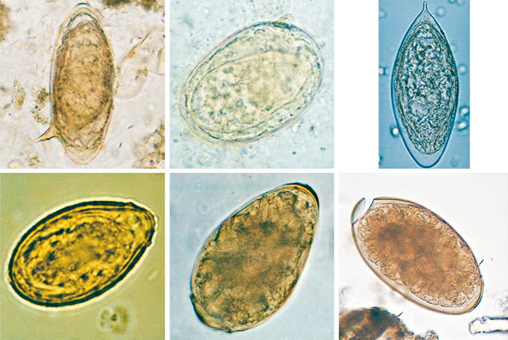

# Chapter 346: Schistosomiasis (Schistosoma)

*Amaya L. Bustinduy, Sophie Pach, and Katja Doerholt*

<!-- p.2836 -->
The term **schistosomiasis** (also known as **bilharzia**) encompasses the acute and chronic inflammatory disorders caused by human infection with *Schistosoma* spp. parasites. Disease is related to both the systemic and the focal effects of schistosome infection and its consequent host immune responses triggered by parasite eggs deposited in the tissues. For the affected individuals, this frequently manifests as disabling chronic morbidity.

**ETIOLOGY* Schistosoma* organisms are trematodes, or **flukes**, that parasitize the bloodstream. Five schistosome species are known to infect humans: *Schistosoma haematobium, S. mansoni, S. japonicum, S. intercalatum,* and *S. mekongi*. Humans are infected through contact with water contaminated with *cercariae*, the free-living infective stage of the parasite. These motile, forked-tail organisms emerge from infected snails and are capable of penetrating intact human skin. As they reach maturity, adult worms migrate to specific anatomic sites characteris tic of each schistosome species: *S. haematobium* adults are found in the perivesical and periureteral venous plexus, *S. mansoni* in the infe rior mesenteric veins, and *S. japonicum* in the superior mesenteric veins. The less common *S. intercalatum* and *S. mekongi* are usually found in the mesenteric vessels. Adult schistosome worms (1-2 cm long) are clearly adapted for an intravascular existence. The female accompanies the male in a groove formed by the lateral edges of its body. On fertilization, female worms begin oviposition in the small venous tributaries. The eggs of the three main schistosome species have characteristic morphologic features: *S. haematobium* has a ter minal spine, *S. mansoni* has a lateral spine, and *S. japonicum* has a smaller size with a short, curved spine (Fig. 346.1). Parasite eggs pro voke a significant granulomatous inflammatory response that allows them to ulcerate through host tissues to reach the lumen of the uri nary tract or the intestines. They are carried to the outside environ ment in urine or feces (depending on the species), where they will hatch if deposited in freshwater. Motile miracidia emerge, infect spe cific freshwater snail intermediate hosts, and divide asexually. After 4-12 weeks, the infective cercariae are released by the snails into the contaminated water.

**EPIDEMIOLOGY** Schistosomiasis affects more than 300 million people worldwide with more than 700 million people at risk, primarily children and young adults. There are 1.8 million disability-adjusted life-years (DALYs) attributed to schistosomiasis, making it the second most disabling parasitic disease after malaria. Prevalence is increasing in many areas as population density increases and new irrigation projects provide broader habitats for the intermediate **snail** hosts. Humans are the main definitive hosts for the five clinically important species of schistosomes, although *S. japonicum* is also a zoonosis, infecting animals such as dogs, rats, pigs, and cattle. *S. haematobium* is prevalent in Africa and the Middle East with cases reported in the Mediterranean (Corsica in France); *S. mansoni* is prevalent in Africa, the Middle East, the Carib bean, and South America; and *S. japonicum* is prevalent in China, the Philippines, and Indonesia, with some sporadic foci in parts of South east Asia. The other two species are less prevalent. *S. intercalatum* is found in West and Central Africa, and *S. mekongi* is found only along the upper Mekong River in Asia.

Transmission depends on water contamination by human excreta (urine and stool), the presence of specific intermediate snail hosts, and the patterns of water contact and social habits of the population (Fig. 346.2). The distribution of infection in endemic areas shows that prevalence increases with age, to a peak at 10-20 years old. Exposure to infected water starts early in life for children living in endemic areas. Passive water contact by infants (accompanying mothers in their daily household activities) evolves to more active water contact as preschool and school-age children pursue recreational activities such as swim ming and wading.

Measuring intensity of infection (by quantitative egg count in urine or feces) demonstrates that the heaviest worm loads are found in school-age and adolescent children. Even though schistosomiasis is most prevalent and most severe in older children and young adults, who are at maximal risk for suffering from its acute and chronic sequelae, preschool children can also exhibit significant disease manifestations.

**PATHOGENESIS** Both early and late manifestations of schistosomiasis are immunologi cally mediated. *Acute* schistosomiasis, known as **snail fever** or **Kata yama syndrome**, is a febrile illness that represents an immune complex disease associated with early infection and oviposition 4-8 weeks after cercarial skin penetration. The major pathology of infection occurs later, with *chronic* schistosomiasis, in which retention of eggs in the host tissues is associated with chronic granulomatous injury. Eggs may be trapped at sites of deposition (urinary bladder, ureters, cer vix, intestine) or may be carried by the bloodstream to ectopic sites, most frequently the liver and less often the lungs and central nervous system (CNS). The host response to these eggs involves local as well as systemic manifestations. The cell-mediated immune response leads to granulomas composed of lymphocytes, macrophages, and eosinophils that surround the entrapped eggs and add significantly to the degree of tissue destruction. Granuloma formation in the bladder wall and at the ureterovesical junction results in the major disease manifesta tions of *S. haematobium* infection: hematuria, dysuria, and obstruc tive uropathy. Granulomata in the genital tissues also contributes to reproductive organ obstruction and local inflammation. Intestinal as well as hepatic granulomas underlie the pathologic sequelae of the other schistosome infections: ulcerations and fibrosis of intestinal wall, hepatosplenomegaly, and portal hypertension caused by presinusoidal obstruction of blood flow. In terms of systemic disease, antischisto some inflammation increases circulating levels of proinflammatory cytokines such as tumor necrosis factor-α and interleukin-6, associated with elevated levels of C-reactive protein. These responses are associ ated with hepcidin-mediated inhibition of iron uptake and use, leading to anemia of chronic inflammation. Schistosomiasis-related undernu trition and decreased cognition may be the result of similar pathways of chronic inflammation. Acquired partial protective immunity against schistosomiasis has been demonstrated in some animal species and may occur in humans.

**CLINICAL MANIFESTATIONS** Two main chronic clinical syndromes arise from *Schistosoma* spp. infection: **urogenital schistosomiasis** caused by *S. haematobium* and **intestinal schistosomiasis** caused by *S. mansoni* or *S. japonicum.* Most chronically infected individuals experience mild symptoms and may not seek medical attention; the more severe symptoms of schistosomia sis occur mainly in those who are heavily infected or who have been infected over longer periods. In addition to organ-specific morbidities, infected patients frequently demonstrate anemia (often complicated by malaria in endemic regions), chronic pain, diarrhea, exercise intoler ance, and chronic undernutrition manifesting as growth stunting. Cer carial penetration of human skin may result in a pruritic papular rash known as **schistosomal dermatitis** or **swimmer’s itch**. Skin manifesta tions are more pronounced in previously exposed individuals and are characterized by edema and intense cellular infiltrates in the dermis and epidermis.

**Acute schistosomiasis** (Katayama syndrome) may occur 4-8 weeks after exposure and is most commonly seen in *S. japonicum* endemic

*Amaya L. Bustinduy, Sophie Pach, and Katja Doerholt*

<!-- p.2837 -->
areas, though it can occur with all species. This is a serum sickness– like syndrome manifested by the acute onset of fever, cough, chills, sweating, abdominal pain, lymphadenopathy, hepatosplenomegaly,

and eosinophilia. Acute schistosomiasis typically presents in first-time visitors to endemic areas who experience primary infection at an older age.

**Chronic schistosomiasis** occurs after granuloma formation in the organs where eggs have entrapped. In urogenital schistosomiasis, caused by *S. haematobium*, symptomatic children usually complain of frequency, dysuria, and macro- and micro-hematuria. Urine examina tion shows erythrocytes, parasite eggs, and occasional eosinophiluria. In endemic areas, moderate to severe pathologic lesions have been demonstrated in the urinary tract of >20% of infected children. The extent of disease correlates with the intensity of infection, but signifi cant morbidity can occur even in lightly infected children, including children under 5 years of age. The advanced stages of urogenital schis tosomiasis are associated with chronic renal failure, secondary infec tions, and squamous cell carcinoma of the bladder.

An important complication of *S. haematobium* infection to con sider, particularly in adolescent females, is **female genital schis tosomiasis (FGS)**. Eggs migrate from the vesical plexus to lodge in the female genital tract, where they induce a granulomatous inflammatory response that can manifest as contact bleeding, pain after sex, ectopic pregnancies, and infertility. Symptoms start before sexual debut and get later confused with those of sexually transmit ted infections. There is a threefold to fourfold greater risk of HIV transmission. Pathognomonic lesions can be visualized in the cervix by colposcopy. **Male genital schistosomiasis (MGS)** can present in adolescent males with hematospermia, pain, erectile dysfunction, and infertility and is likely to contribute to increased male-to-female HIV transmission.

Children with **chronic intestinal schistosomiasis** due to *S. mansoni*, *S. japonicum,* and, less commonly, *S. intercalatum* or *S. mekongi* can present with intestinal symptoms; colicky abdominal pain and bloody diarrhea are the most common. However, the intestinal phase may remain subclinical, and the late syndrome of hepatosplenomegaly, por tal hypertension, ascites, and hematemesis may then be the first clini cal presentation in later years. Liver disease is caused by granuloma formation and subsequent **periportal fibrosis**; no appreciable liver cell injury occurs, and hepatic function may be preserved for a long time. Schistosome eggs can escape into the lungs, causing **pulmonary hypertension** and cor pulmonale. *S. japonicum* worms may migrate to the brain vasculature and produce localized lesions that cause seizures. **Transverse myelitis**, spinal compression, and other CNS involvement (meningoencephalitis) are rare but well-known complications in chil dren or young adults with either acute or chronic *S. haematobium* or *S. mansoni* infection.

Although end-organ scarring is pathognomonic, affected chil dren may also have persistent long-term systemic effects of infection, including poor growth, anemia, decreased aerobic capacity, and cogni tive impairment and poor school performance.

**DIAGNOSIS Parasitologic diagnosis** entails finding schistosome eggs in the excreta of infected individuals; quantitative methods should be used to provide an indication of the burden of infection. For the diagnosis of *S. hae matobium* infection, a volume of 10 mL of urine should be collected around midday, the time of maximal egg excretion, and filtered for microscopic examination. Stool examination by the Kato-Katz thick smear procedure and detection of parasite antigen in patient serum or urine are the methods of choice for diagnosis and quantification of other schistosome infections (*S. mansoni* and *S. japonicum*). More sen sitive **antigenic diagnosis** includes the unique schistosome antigens in urine or plasma: *circulating anodic antigen* (CAA), which is not yet commercially available, and *circulating cathodic antigen* (CCA) from stool for the detection only of *S. mansoni* and *S. japonicum*.

**Morbidity diagnosis** can be ascertained by abdominal ultrasonog raphy; in urogenital schistosomiasis, by the detection of **bladder pol yps** and derived renal complications, and in intestinal schistosomiasis, by the detection of **periportal fibrosis** in the liver. **Colposcopy** and **semen** analysis are useful in adolescent children suspected of having FGS and MGS.

D

E

B

A

C

**Fig. 346.2** Life cycle of Schistosoma mansoni, S. haematobium, and S. japonicum. A, Paired adult worms (larger male enfolding slender fe male). B, Eggs (left to right, S. haematobium, S. mansoni, S. japoni cum). C, Ciliated miracidium. D, Intermediate host snails (left to right, Oncomelania, Biomphalaria, Bulinus). E, Cercariae. (From Colley DG, Bustinduy AL, Secor WE, King CH. Human schistosomiasis. Lancet. 2014;383:2253–2264. Fig 1.)

**Fig. 346.1** Eggs of common human trematodes. Clockwise from up per left: Schistosoma mansoni, S. japonicum, S. haematobium, Clon orchis sinensis, Paragonimus westermani, and Fasciola hepatica (note the partially open operculum). (From Centers for Disease Control and Prevention. DPDx: laboratory identification of parasites of public health concern. http://www.cdc.gov/dpdx/az.html)

<!-- p.2839 -->
