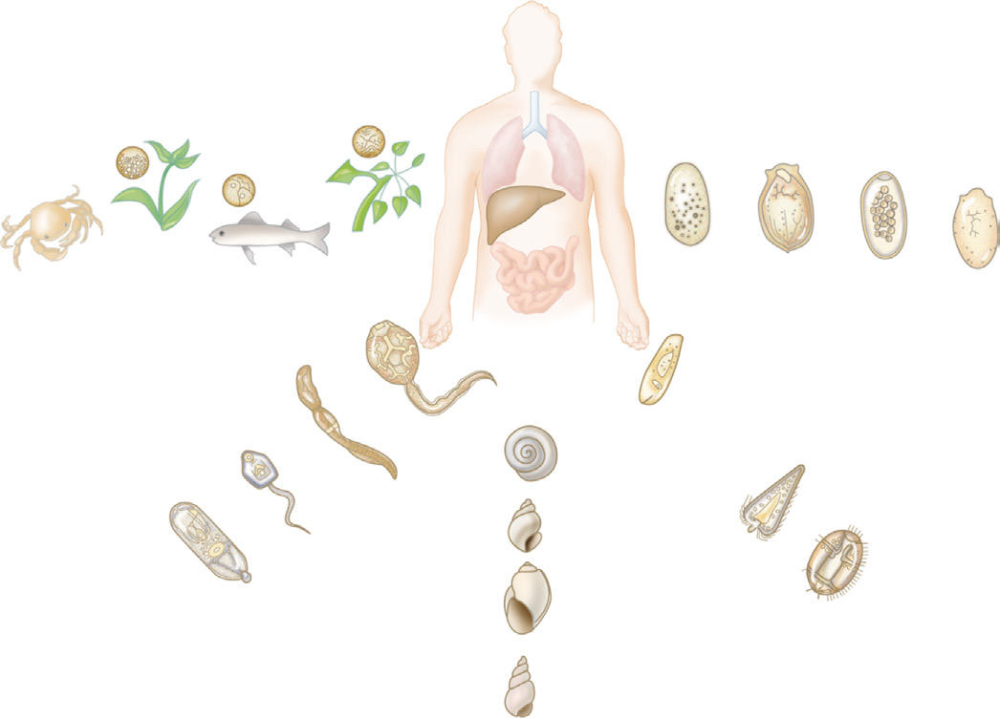

# Chapter 347: Flukes (Liver, Lung, and Intestinal)

*Amaya L. Bustinduy, Sophie Pach, and Katja Doerholt*

<!-- p.2838 -->
**TREATMENT** Treatment of children with schistosomiasis should be based on an appreciation of the intensity of infection and the extent of disease. The World Health Organization (WHO)–recommended treatment for schistosomiasis is **praziquantel.** For infection due to *S. mansoni, S. haematobium*, or *S. intercalatum*, the dose of praziquantel is 40 mg/ kg/day PO divided into two doses for 1 day. For infection due to *S. japonicum* or *S. mekongi*, the dose of praziquantel is 60 mg/kg/day PO divided into three doses for 1 day. A second treatment 4-6 weeks after the first course is advised by some experts, allowing for maturation of immature forms not cleared initially. Praziquantel is well tolerated but can give side effects that correlate with intensity of infection, including abdominal pain and cramps, sweating, and somnolence. Pregnant and lactating women with schistosomiasis can safely be treated with pra ziquantel at usual doses starting at the second trimester of pregnancy.

**PREVENTION** Transmission in endemic areas may be decreased by reducing the para site load in the human population. WHO recommends praziquantel to be given as a single dose to school-age children through mass drug administration programs once or twice a year depending on parasite endemicity levels. Recently, preschool children 2 years and older have also been included in control strategies. When added to national drugbased control programs, other measures such as improved sanitation, antiparasitic treatment given at well child visits, focal application of molluscicidals, and animal vaccination may prove useful in break ing the cycle of transmission. Ultimately, control of schistosomiasis is closely linked to economic and social development.

*Visit Elsevier eBooks+ at eBooks.Health.Elsevier.com** for Bibliography.*

*Amaya L. Bustinduy, Sophie Pach, and Katja Doerholt*

Several different **trematodes**, or flukes, can parasitize humans and cause disease. Flukes are endemic worldwide but are more prevalent in the less developed parts of the world. They include *Schistosoma,* or the blood flukes (see Chapter 346), as well as fluke species that cause infec tion in the human biliary tree, lung tissue, and intestinal tract. These latter trematodes are characterized by complex life cycles (Fig. 347.1). Sexual reproduction of adult worms in the definitive host produces eggs that are passed in the stool. Larvae, called **miracidia**, develop in freshwater. These, in turn, infect certain species of mollusks (aquatic snails or clams), in which asexual multiplication by parasite larvae produces cercariae. Cercariae then seek a second intermediate host, such as an insect, crustacean, or fish, or attach to vegetation to produce infectious **metacercariae**. Humans acquire liver, lung, and intestinal fluke infections by eating uncooked, lightly cooked, pickled, or smoked foods containing these infectious parasite cysts. The “alternation of generations” requires that flukes parasitize more than one host (often three) to complete their life cycle. Because parasitic flukes are depen dent on these nonhuman species for transmission, the distribution of human fluke infection closely matches the ecologic range of the flukes’ intermediate hosts. As a group, these parasites are commonly referred to as **food-borne trematodes**.

**LIVER FLUKES Fascioliasis (Fasciola hepatica)* Fasciola hepatica,* the sheep liver fluke, infects cattle, other ungulates, and occasionally humans. This infection affects approximately 17 mil lion people worldwide and has been reported in many different parts of the world, particularly South America, Europe, Africa, China, Aus tralia, and Cuba. Although *F. hepatica* is enzootic in North America, reported cases are extremely rare. Humans are infected by ingestion of metacercariae attached to vegetation, especially wild watercress, let tuce, and alfalfa. In the duodenum, the parasites excyst and penetrate the intestinal wall, liver capsule, and parenchyma. They wander for a few weeks before entering the bile ducts, where they mature. Adult *F. hepatica* (1-2.5 cm) commence oviposition approximately 12 weeks after infection; the eggs are large (75-140 μm) and operculated. They pass to the intestines with bile and exit the body in the feces (see Fig. 347.1). On reaching freshwater, the eggs mature and hatch into mira cidia, which infect specific snail intermediate hosts to multiply into many cercariae. These then emerge from infected snails and encyst on aquatic grasses and plants.

**Clinical manifestations** usually occur either during the liver migra tory phase of the parasites or after their arrival at their final habitat in upper bile ducts. Fever, right upper quadrant pain, and hepato splenomegaly characterize the first phase of illness. Peripheral blood eosinophilia is usually marked. As the worms enter bile ducts, most of the acute symptoms subside. On rare occasions, patients may have obstructive jaundice or biliary cirrhosis, with signs of cholestasis, ascending cholangitis, cholelithiasis and jaundice and increased liver enzymes, direct bilirubin, and γ-glutamyl transpeptidase. *F. hepatica* infection is diagnosed by identifying the characteristic eggs in fecal smears or duodenal aspirates. **Diagnosis** can be suggested by positive serology and imaging that reveals acute, hypodense liver lesions that change over time. Presentation can be dramatic in children, with fea tures including generalized edema, hepatic cirrhosis with esophageal varices, and in severe cases, death from generalized organ failure.

The recommended **treatment** of fascioliasis is triclabendazole (10 mg/kg orally [PO] once or twice) or bithionol (30-50 mg/kg PO once daily on alternate days for a total of 10-15 doses). In the United States, bithionol is not generally available, but it may be available from com pounding pharmacies.

**Clonorchiasis (Clonorchis sinensis)** Infection of bile passages with *Clonorchis sinensis,* the Chinese or ori ental liver fluke, is endemic in China, South Korea, northern Vietnam,

F.h. F.h., C.s.

C.s. F.b. P.w.

P.w.

**Fig. 347.1** Life cycle of parasitic liver, lung, and intestinal flukes. C.s., Clonorchis sinensis; F.b., Fasciolopsis buski; F.h., Fasciola hepatica; P.w., Paragonimus westermani. (Adapted from Mandell GL, Bennett JE, Do lin R, eds. Principles and Practice of Infectious Diseases, 7th ed. Phila delphia: Elsevier, 2010: Fig 289-2.)

<!-- p.2841 -->
