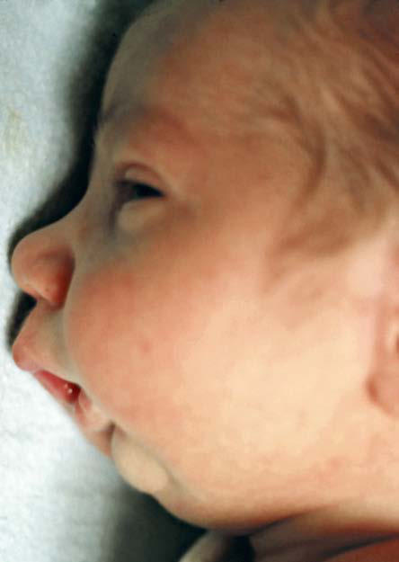

# Chapter 357: Syndromes with Oral Manifestations

*Vineet K. Dhar*

<!-- p.2878 -->
Many syndromes have distinct or accompanying facial, oral, and dental manifestations (see Apert syndrome, Chapter 631.9; Crouzon disease, Chapter 631.9; Down syndrome, Chapter 99.2).

Osteogenesis imperfecta is often accompanied by effects on the teeth, termed **dentinogenesis imperfecta** (see Chapter 353, Fig. 353.2). Depending on the severity of presentation, treatment of the dentition varies from routine preventive and restorative monitoring to covering affected posterior teeth with stainless steel crowns to prevent further tooth loss and improve appearance. Dentinogenesis imperfecta can also occur in isolation without the bony effects.

Another syndrome, **cleidocranial dysplasia,** has orofacial features such as frontal bossing, hypoplastic maxilla, and supernumerary teeth. The primary teeth can be overretained, and the permanent teeth remain unerupted. Supernumerary teeth are common, especially in the premolar area. Extensive dental rehabilitation may be needed to cor rect severe tooth crowding and unerupted and supernumerary teeth.

**Ectodermal dysplasias** are a heterogeneous group of conditions in which oral manifestations range from little or no involvement (the den tition is completely normal) to cases in which the teeth can be totally or partially absent or malformed (see Chapter 690). Because alveolar bone does not develop in the absence of teeth, the alveolar processes can be either totally or partially absent, and the resultant overclosure of the mandible causes the lips to protrude. Facial development is oth erwise not disturbed. Teeth, when present, can range from normal to small and conical. If aplasia of the buccal and labial salivary glands is present, dryness and irritation of the oral mucosa can occur. People with ectodermal dysplasia might need partial or full dentures, even at a very young age. The vertical height between the jaws is thus restored, improving the position of the lips and facial contours, as well as restor ing masticatory function.

**Pierre Robin syndrome** consists of micrognathia and is usually accompanied by a high arched or cleft palate (Fig. 357.1). The tongue is usually of normal size, but the floor of the mouth is foreshortened. The air passages can become obstructed, particularly on inspiration, usually requiring treatment to prevent suffocation. The infant should be maintained in a prone or partially prone position so that the tongue falls forward to relieve respiratory obstruction. Some patients require tracheostomy. Mandibular distraction procedures in the neonate can improve mandibular size, enhance respiration, and facilitate oral feedings.

Sufficient spontaneous mandibular growth can take place within a few months to relieve the potential airway obstruction. Often the growth of the mandible achieves a normal profile in 4-6 years. Of chil dren with Pierre Robin syndrome, 30–50% have **Stickler syndrome** (types I-VI), an autosomal dominant condition that includes other findings such as prominent joints, arthritis, hypotonia, hypermobile joints, mitral valve prolapse, hearing loss, spine problems (scoliosis, kyphosis, platyspondyly), and ocular problems (high myopia, glau coma, cataracts, retinal detachment). Symptoms may vary greatly even within a family. Pathogenic variants are noted in the genes that produce collagen (*COL2A1* in most; *COL11A1* in others) in many, but not all, patients with Stickler syndrome. Other syndromes are associated with Pierre Robin syndrome, including 22Q11.2 deletion syndrome (velo cardiofacial syndrome).

**Mandibulofacial dysostosis** (Treacher Collins syndrome or Franceschetti syndrome) is an autosomal dominant syndrome that

primarily affects the face. The facial appearance varies but is char acterized by downward-sloping palpebral fissures, colobomas of the lower eyelids, sunken cheekbones, blind fistulas opening between the angles of the mouth and the ears, malformed pinnae, atypical hair growth extending toward the cheeks, receding chin, and large mouth. Facial clefts, abnormalities of the ears, and deafness are common. The mandible is usually hypoplastic; the ramus may be deficient, and the coronoid and condylar processes are flat or even aplastic. The palatal vault may be either high or cleft. Dental mal occlusions are common. The teeth may be missing, hypoplastic, or displaced or be in an open bite position. Initially, the primary con cern is breathing and feeding problems. Surgery to restore normal structure of the face can be performed, which may include repair of cleft palate, zygomatic and orbit reconstruction, reconstruction of the lower eyelid, external ear reconstruction, and orthognathic surgery.

**Hemifacial microsomia** presentation can be quite variable but is usually characterized by unilateral hypoplasia of the mandible and can be associated with partial paralysis of the facial nerve, underdeveloped ear, and blind fistulas between the angles of the mouth and the ears. Severe facial asymmetry and malocclusion can develop because of the absence or hypoplasia of the mandibular condyle on the affected side. Congenital condylar deformity tends to increase with age. Early craniofacial surgery may be indicated to minimize the deformity. This disorder can be associated with ocular and vertebral anomalies (oculoauriculovertebral spectrum, includ ing Goldenhar syndrome); therefore radiographs of the vertebrae and ribs should be considered to determine the extent of skeletal involvement.

*Visit Elsevier eBooks+ at eBooks.Health.Elsevier.com** for Bibliography.*

*Vineet K. Dhar*

**Fig. 357.1** Pierre Robin syndrome. (From Clark DA. Atlas of Neona tology. 7th ed. Philadelphia: Saunders; 2000. p. 144.)

<!-- p.2879 -->
