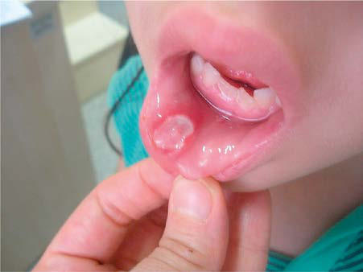
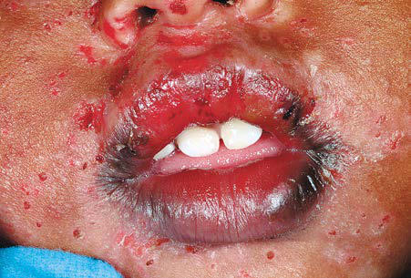

# Chapter 361: Common Lesions of the Oral Soft Tissues

*Vineet K. Dhar*

<!-- p.2888 -->
• Find the tooth. • Briefly rinse the tooth. (Do not scrub the tooth. Do not touch the

root. After plugging the sink drain, hold the tooth by the crown and rinse it under running tap water.) • Insert the tooth into the socket. (Gently place it back into its normal

position. Do not be concerned if the tooth extrudes slightly. If the parent or child is too apprehensive for replantation of the tooth, the tooth should be placed in cold cow’s milk or other cold isotonic solution.) • Go directly to the dentist. (In transit, the child should hold the tooth

in its socket with a finger. The parent should place the child in an age-appropriate child seat, buckle a seatbelt around the child, and drive safely.) After the tooth is replanted, it must be immobilized to facilitate reat tachment; endodontic therapy is always required. The initial signs of complications associated with replantation can appear as early as 1 week after trauma or as late as several years later. Close dental followup is indicated for at least 1 year.

## PREVENTION To minimize the likelihood of dental injuries: • Every child or adolescent who engages in contact sports should wear

a **mouth guard**, which may be constructed by a dentist or purchased at any athletic goods store. • Helmets with face guards should be worn by children or adolescents

with neuromuscular problems or seizure disorders to protect the head and face during falls. • Helmets should also be used during biking, skiing, skating, and

skateboarding. • All children or adolescents with protruding incisors should be

evaluated by a pediatric dentist or orthodontist.

**ADDITIONAL CONSIDERATIONS** Children who experience dental trauma might also have sustained head or neck trauma, and therefore, neurologic assessment is war ranted. Tetanus prophylaxis should be considered with any injury that disrupts the integrity of the oral tissues. The possibility of child abuse should always be considered.

*Visit Elsevier eBooks+ at eBooks.Health.Elsevier.com** for Bibliography.*

**OROPHARYNGEAL CANDIDIASIS** Oropharyngeal infection with *Candida albicans* (thrush, moniliasis) (see Chapter 280.1) is common in neonates from contact with the organism in the birth canal or contact with the breast during breast feeding. The lesions of oropharyngeal candidiasis (OPC) appear as white plaques covering all or part of the oropharyngeal mucosa. These plaques are removable from the underlying surface, which is charac teristically inflamed and has pinpoint hemorrhages. The diagnosis is confirmed by direct microscopic examination on potassium hydrox ide smears and culture of scrapings from lesions. OPC is usually

*Vineet K. Dhar*

self-limited in the healthy newborn infant, but topical application of nystatin to the oral cavity of the baby and to the nipples of breastfeed ing mothers will hasten recovery.

OPC is also a major problem during myelosuppressive therapy. **Systemic candidiasis**, a major cause of morbidity and mortality dur ing myelosuppressive therapy, develops almost exclusively in patients who have had prior oropharyngeal, esophageal, or intestinal candi diasis. This observation implies that prevention of OPC should reduce the incidence of systemic candidiasis. The use of oral rinses of 0.2% chlorhexidine gluconate solution along with systemic antifungals may be effective in preventing OPC, systemic candidiasis, or candidal esophagitis.

**APHTHOUS ULCERS** The aphthous ulcer (canker sore) is a distinct oral lesion (Fig. 361.1), prone to recurrence; Table 361.1 notes the differential diagnosis. Aph thous ulcers are reported to develop in 20% of the population. Their etiology is unclear, but allergic or immunologic reactions, emotional stress, genetics, and injury to the soft tissues in the mouth have been implicated. Aphthous-like lesions may be associated with inflamma tory bowel disease, Behçet disease, gluten-sensitive enteropathy, peri odic fever-aphthae-pharyngitis-adenitis syndrome, Sweet syndrome, HIV infection (especially if ulcers are large and slow to heal), and cyclic neutropenia (see Table 361.1). Clinically, these ulcers are charac terized by well-circumscribed, ulcerative lesions with a white necrotic base surrounded by a red halo. The lesions generally last 10-14 days and heal without scarring. Nonprescription palliative therapies, such as benzocaine and topical lidocaine, are effective, as are topical steroids. Use of soft tissue dental lasers may help manage aphthous ulcers by accelerating wound healing and reducing pain. Tetracycline is benefi cial with severe outbreaks, but caution is necessary in pregnant women, because it is classified as U.S. Food and Drug Administration (FDA) pregnancy category D. In younger children (≤8 years), tetracycline can affect developing teeth and cause permanent staining of the teeth.

**HERPETIC GINGIVOSTOMATITIS** After an initial incubation period of approximately 1 week, the pri mary infection with herpes simplex virus manifests as fever and mal aise, usually in a child younger than 5 years (see Chapter 299). The oral cavity can show various expressions, including the gingiva becoming erythematous, mucosal hemorrhages, and clusters of small vesicles erupting throughout the mouth. There is often involvement of the mucocutaneous margin and perioral skin (Fig. 361.2). The oral symp toms generally are accompanied by fever, lymphadenopathy, and dif ficulty eating and drinking. The symptoms usually regress within 2 weeks without scarring. Fluids should be encouraged because the child may become dehydrated. Analgesics and anesthetic rinses can make

**Fig. 361.1** Major aphthous in a child. (From Gürkan A, Özlü SG, Altiaylik-Özer P, et  al. Recurrent aphthous stomatitis in childhood and adolescence: a single-center experience. Pediatr Dermatol. 2015;32[4]:476–480. Fig. 1.)

<!-- p.2890 -->

#### **Table 361.1** Differential Diagnosis of Oral Ulceration

| Category / Parameter | Clinical Details & Findings |
| --- | --- |
| **COMMON** | Aphthous ulcers (canker sores); Painful circumscribed lesions;; recurrences; Traumatic ulcers; Accidents, chronic cheek biter,; after dental local anesthesia; Hand, foot, and mouth disease; Painful; lesions on tongue, anterior; oral cavity, hands, and feet; Herpangina; Painful; lesions confined to soft; palate and oropharynx; Herpetic gingivostomatitis; Vesicles on mucocutaneous; borders; painful, febrile; Recurrent herpes labialis; Vesicles on lips; painful; Chemical burns; Alkali, acid, aspirin; painful; Heat burns; Hot food, electrical; Medicine effect; NSAIDs, methotrexate, azathioprine,; enalapril, losartan, fluoxetine,; antiretroviral agents |
| **RIME** | Mycoplasma and other agents;; predominant oral ulcerations; with scattered cutaneous lesions |
| **UNCOMMON** | Neutrophil defects; Agranulocytosis, leukemia, cyclic; neutropenia; painful; Systemic lupus erythematosus; Recurrent; may be painless; Behçet syndrome; Resembles aphthous lesions;; associated with genital ulcers,; uveitis; Necrotizing ulcerative; gingivostomatitis; Vincent stomatitis; painful; Syphilis; Chancre or gumma; painless; Oral Crohn disease; Aphthous-like; painful; Histoplasmosis; Lingual; Pemphigus; May be isolated to the oral cavity; Stevens-Johnson syndrome; May be isolated to or appear; initially in the oral cavity; NSAIDs, Nonsteroidal antiinflammatory drugs; RIME, reactive infectious mucotaneous; eruption. |

**Fig. 361.2** Herpetic gingivostomatitis. Lip erosions with multiple perioral herpetic lesions involving the mucocutaneous borders. (From Paller AS, Mancini AJ, eds. Hurwitz Clinical Pediatric Dermatology. 3rd ed. Philadelphia: Saunders; 2006. p. 398.)

the child more comfortable. Oral valacyclovir, if taken within the first 3 days of symptoms in immunocompetent patients, is beneficial in shortening the duration of symptoms. Caution should be exercised to prevent autoinoculation, especially of the eyes.

**RECURRENT HERPES LABIALIS** Approximately 90% of the worldwide population develops antibodies to herpes simplex virus. In periods of quiescence, the virus is thought to remain latent in sensory neurons. Unlike primary herpetic gingi vostomatitis, which manifests as multiple painful vesicles on the lips, tongue, palate, gingiva, and mucosa, recurrent herpes is generally lim ited to the lips. Other than the annoyance of causing pain and being a cosmetic issue, recurrent episodes generally do not involve systemic symptoms. Reactivation of the virus is thought to be the result of expo sure to ultraviolet light, tissue trauma, stress, or fevers. There is little advantage of antiviral therapy over palliative therapies in an otherwise healthy patient affected by recurrent herpes.

**PARULIS** The parulis (gum boil) is a soft reddish papule located adjacent to the root of a chronically abscessed tooth. It occurs at the end-point of a draining dental sinus tract. Treatment consists of diagnosing which tooth is abscessed and extracting it or performing root canal treatment on the offending tooth.

**CHEILITIS** Cheilitis, dryness of the lips followed by scaling and cracking and accom panied by a characteristic burning sensation, is common in children. Chei litis may be caused by sensitivity to contact substances, lip licking, vitamin deficiency, weakened immune system, or fungal or bacterial infections, and often occurs in association with fever. Treatment may include anti fungal or antibacterial agents and frequent application of petroleum jelly.

**ANKYLOGLOSSIA** Ankyloglossia, or tongue-tie, is characterized by an abnormally short lingual frenum that can hinder the tongue movement, but rarely inter feres with feeding or speech. It is possible that the frenum could spon taneously lengthen as the child gets older. If, in the rare event that the extent of the ankyloglossia is severe, speech may be affected and surgi cal correction may be indicated.

**GEOGRAPHIC TONGUE** Geographic tongue (migratory glossitis) is a benign and asymptom atic lesion that is characterized by one or more smooth bright red patches, often showing a yellow, gray, or white membranous margin on the dorsum of an otherwise normally roughened tongue. The condition has no known cause, and no treatment is indicated (see Chapter 705).

**FISSURED TONGUE** The fissured tongue (scrotal tongue) is a malformation manifested clin ically by numerous small furrows or grooves on the dorsal surface (see Chapter 705). If the tongue is painful, brushing the tongue or irrigating with water can reduce the bacteria in the fissures.

**DEVELOPMENTAL (NORMAL) VARIATIONS Bohn Nodules** Bohn nodules are small developmental anomalies located along the buccal and lingual aspects of the mandibular and maxillary ridges and in the hard palate of the neonate. These lesions arise from remnants of mucous gland tissue. Treatment is not necessary as the nodules usually disappear within a few weeks.

**Dental Lamina Cysts** Dental lamina cysts are small cystic lesions located along the crest of the mandibular and maxillary ridges of the neonate. These lesions arise from epithelial remnants of the dental lamina. Treatment is not neces sary; they disappear within a few weeks.

<!-- p.2892 -->
