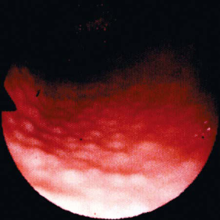

# Chapter 381: Peptic Ulcer Disease in Children

*Samra S. Blanchard and Steven J. Czinn*

<!-- p.2980 -->
Peptic ulcer disease, the end result of inflammation caused by an imbal ance between cytoprotective and cytotoxic factors in the stomach and duodenum, manifests with varying degrees of gastritis or frank ulcer ation. The pathogenesis of peptic ulcer disease is multifactorial, but the final common pathway for the development of ulcers is the action of acid and pepsin-laden contents of the stomach on the gastric and duodenal mucosa and the inability of mucosal defense mechanisms to allay those effects. Abnormalities in the gastric and duodenal mucosa can be visu alized on endoscopy, with or without histologic changes. Deep mucosal lesions that disrupt the muscularis mucosa of the gastric or duodenal wall define **peptic ulcers.** Gastric ulcers are generally located on the lesser cur vature of the stomach, and 90% of duodenal ulcers are found in the duo denal bulb. Rates of peptic ulcer disease in childhood appear to be low. Large pediatric centers anecdotally report an incidence of 5-7 children with gastric or duodenal ulcers per 2,500 hospital admissions each year.

Ulcers in children can be classified as **primary** peptic ulcers, which are chronic and more often duodenal, or **secondary,** which are usually more acute in onset and are more often gastric (Table 381.1). Primary ulcers are most often associated with *Helicobacter pylori* infection. Sec ondary peptic ulcers can result from stress caused by sepsis, shock, or an intracranial lesion (Cushing ulcer), or in response to a severe burn injury (Curling ulcer). Secondary ulcers can also occur as the result of using drugs (nonsteroidal antiinflammatory drugs [NSAIDs], corticosteroids, sodium valproate, iron, potassium supplements, theophylline), hyperse cretory states like Zollinger-Ellison syndrome (see Chapter 381.1), G-cell hyperplasia, short bowel syndrome, and hyperparathyroidism. Infec tions with cytomegalovirus, herpes simplex virus, and tuberculosis and systemic inflammatory diseases like Crohn disease, sarcoidosis, masto cytosis, and eosinophilic gastroenteritis can also cause ulcers.

**PATHOGENESIS Acid Secretion** By 3-4 years of age, gastric acid secretion approximates adult values. Acid initially secreted by the oxyntic cells of the stomach has a pH

of approximately 0.8, whereas the pH of the stomach contents is 1-2. Excessive acid secretion is associated with a large parietal cell mass, hypersecretion by antral G cells, and increased vagal tone, resulting in increased or sustained acid secretion in response to meals and increased secretion during the night. The secretagogues that promote gastric acid production include acetylcholine released by the vagus nerve, hista mine secreted by enterochromaffin cells, and gastrin released by the G cells of the antrum. Mediators that decrease gastric acid secretion and enhance protective mucin production include prostaglandins.

**Mucosal Defense** A continuous layer of mucous gel that serves as a diffusion barrier to hydrogen ions and other chemicals covers the gastrointestinal (GI) mucosa. Mucus production and secretion are stimulated by pros taglandin E2. Underlying the mucous coat, the epithelium forms a second-line barrier, the characteristics of which are determined by the biology of the epithelial cells and their tight junctions. Another important function of epithelial cells is to secrete chemokines when threatened by microbial attack. Secretion of bicarbonate into the mucous coat, which is regulated by prostaglandins, is important for neutralization of hydrogen ions. If mucosal injury occurs, active pro liferation and migration of mucosal cells occurs rapidly, driven by epithelial growth factor, transforming growth factor-α, insulin-like growth factor, gastrin, and bombesin, and covers the area of epithelial damage.

**CLINICAL MANIFESTATIONS** The presenting symptoms of peptic ulcer disease vary with the age of the patient. Hematemesis or melena is reported in up to half of the patients with peptic ulcer disease. School-age children and adolescents more commonly present with epigastric pain and nausea, presenta tions generally seen in adults. Dyspepsia, epigastric abdominal pain or fullness, is seen in older children. Infants and younger children usually present with feeding difficulty, vomiting, crying episodes, hemateme sis, or melena. In the neonatal period, gastric perforation can be the initial presentation.

The classic symptom of peptic ulceration, epigastric pain alleviated by the ingestion of food, is present only in a minority of children. Many pediatric patients present with poorly localized abdominal pain, which may be periumbilical. The vast majority of patients with periumbilical or epigastric pain or discomfort do not have a peptic ulcer, but rather a functional GI disorder, such as irritable bowel syndrome or nonulcer (functional) dyspepsia (see Chapter 389). Patients with peptic ulcer ation rarely present with acute abdominal pain from perforation or symptoms and signs of pancreatitis from a posterior penetrating ulcer. Occasionally, bright red blood per rectum may be seen if the rate of bleeding is brisk and the intestinal transit time is short. Vomiting can be a sign of gastric outlet obstruction.

The pain is often described as dull or aching, rather than sharp or burning, as in adults. It can last from minutes to hours; patients have frequent exacerbations and remissions lasting from weeks to months. Nocturnal pain waking the child is common in older children. A his tory of typical ulcer pain with prompt relief after taking antacids is found in <33% of children. Rarely, in patients with acute or chronic blood loss, penetration of the ulcer into the abdominal cavity or adja cent organs produces shock, anemia, peritonitis, or pancreatitis. If inflammation and edema are extensive, acute or chronic gastric outlet obstruction can occur.

**DIAGNOSIS** Esophagogastroduodenoscopy is the method of choice to establish the diagnosis of peptic ulcer disease. Endoscopy allows the direct visual ization of esophagus, stomach, and duodenum, identifying the specific lesions. Biopsy specimens must be obtained from the esophagus, stom ach, and duodenum for histologic assessment as well as to screen for the presence of *H. pylori* infection. Endoscopy also provides the oppor tunity for hemostatic therapy including clipping, injection, and the use of thermal coagulation.

*Samra S. Blanchard and Steven J. Czinn*

#### **Table 381.1** Etiologic Classification of Peptic Ulcers

| Category / Parameter | Clinical Details & Findings |
| --- | --- |
| **General** | Positive for Helicobacter pylori infection; Drug (NSAID)-induced; H. pylori and NSAID-positive; H. pylori and NSAID-negative*; Acid hypersecretory state (Zollinger-Ellison syndrome); Anastomosis ulcer after subtotal gastric resection; Tumors (cancer, lymphoma, carcinoid syndrome); Crohn disease of the stomach or duodenum; Eosinophilic gastroduodenitis; Systemic mastocytosis; Radiation damage; Viral infections (cytomegalovirus or herpes simplex infection,; particularly in immunocompromised patients); Colonization of stomach with Helicobacter heilmannii; Severe systemic disease; Cameron ulcer (gastric ulcer where a hiatal hernia passes through; the diaphragmatic hiatus); True idiopathic ulcer; *Requires search for other specific causes.; NSAID, Nonsteroidal antiinflammatory drug.; From Vakil N, Megraud F. Eradication therapy for Helicobacter pylori. Gastroenterology.; 2007;133:985–1001. |

<!-- p.2981 -->
**PRIMARY ULCERS Helicobacter pylori Gastritis* H. pylori* is among the most common bacterial infections in humans. It is a gram-negative, S-shaped rod that produces urease, catalase, and oxidase; these enzymes might play a role in the pathogenesis of peptic ulcer disease. The mechanism of acquisition and transmission of *H. pylori* is unclear, although the most likely mode of transmission is fecaloral or oral-oral. Viable *H. pylori* organisms can be cultured from the stool or vomitus of infected patients. Risk factors such as low socioeco nomic status in childhood or affected family members also influence the prevalence. All children infected with *H. pylori* develop histologic chronic active gastritis but are often asymptomatic. In children, *H. pylori* infection can manifest with abdominal pain or vomiting and, less often, refractory iron-deficiency anemia or poor growth. *H. pylori* can be associated, though rarely, with chronic autoimmune thrombo cytopenia. Chronic colonization with *H. pylori* can predispose children to a significantly increased risk of developing a duodenal ulcer, gastric cancer such as adenocarcinoma, or mucosa-associated lymphoid tis sue lymphomas. The relative risk of gastric carcinoma is 2.3-8.7 times greater in infected adults compared with uninfected subjects. *H. pylori* is classified by the World Health Organization as a group I carcinogen.

Anemia, idiopathic thrombocytopenic purpura, short stature, and sudden unexplained infant death (SUID) have also been reported as extragastric manifestations of *H. pylori* infection. In one published study, *H. pylori* infection has been correlated with cases of SUID, but there is no evidence to suggest that *H. pylori* plays a role in the pathogenesis of SUID.

The **diagnosis** of *H. pylori* infection is made histologically by dem onstrating the organism in the biopsy specimens. The current consen sus report does not recommend using antibody-based tests (IgG, IgA) for *H pylori* in serum, whole blood, urine, and saliva in the clinical setting. 13C-urea breath tests and stool antigen tests are reliable non invasive methods of detecting *H. pylori* infection in patients who do not require endoscopic evaluation. Patients should stop proton pump inhibitor (PPI) therapy 2 weeks before testing as they can cause falsenegative results. Nonetheless, for symptomatic children with suspected *H. pylori* infection, an initial upper endoscopy is recommended to evaluate and confirm *H. pylori* disease. The range of endoscopic find ings in children with *H. pylori* infection varies from being grossly nor mal to the presence of nonspecific gastritis with prominent rugal folds, nodularity (Fig. 381.1), or ulcers. Because the antral mucosa appears to be *endoscopically normal* in a significant number of children with primary *H. pylori* gastritis, gastric biopsies should always be obtained from the body and antrum of the stomach regardless of the endoscopic appearance. If *H. pylori* is identified, even in a child with no symptoms, eradication therapy should be offered (Tables 381.2 and 381.3). Suc cessful *H. pylori* eradication is associated with cure of peptic ulcer dis ease and very low risk of relapse. Therefore monitoring the success of therapy is mandatory in these patients 4-6 weeks after stopping antibi otics and at least 2 weeks after stopping PPI therapy. Eradication must be tested with the 13C-urea breath test or stool antigen test. If there is an eradication failure, the patient should receive *rescue* therapy.

**IDIOPATHIC ULCERS* H. pylori*–negative peptic ulcers in children who have no history of tak ing NSAIDs represent 15–20% of pediatric peptic ulcers. The patho genesis of idiopathic ulcer remains uncertain. These patients do not have nodularity in the gastric antrum or histologic evidence of gastri tis. In idiopathic ulcers, acid suppression alone is the preferred effec tive treatment. Either PPIs or H2-receptor antagonists may be used. Idiopathic ulcers have a high recurrence rate after discontinuing anti secretory therapy. These children should be followed closely, and if symptoms recur, antisecretory therapy should be restarted. It is also important to consider uncommon but possible conditions like Crohn disease, cytomegalovirus, and Zollinger-Ellison syndrome.

**SECONDARY ULCERS Aspirin and Other Nonsteroidal Antiinflammatory Drugs** NSAIDs produce mucosal injury by direct local irritation and by inhibiting cyclooxygenase (COX) and prostaglandin

formation. Prostaglandins enhance mucosal resistance to injury; there fore a decrease in prostaglandin production increases the risk of muco sal injury. The severe erosive gastropathy produced by NSAIDs can ultimately result in bleeding ulcers or gastric perforations. The location of these ulcers is more common in the stomach than in the duodenum, and usually in the antrum. The discovery of two isoforms of COX-1 and COX-2 has led to the development of COX-2-selective NSAIDs, but they can still cause ulcerations in the GI tract.

**STRESS ULCERATION** Stress ulceration usually occurs within 24 hours of onset of a critical ill ness in which physiologic stress is present. In many cases, the patients bleed from gastric erosions, rather than ulcers. Approximately 25% of the critically ill children in a pediatric intensive care unit have macro scopic evidence of gastric bleeding. Preterm and term infants in the neonatal intensive care unit can also develop gastric mucosal lesions and can present with upper GI bleeding or perforated ulcers. Although prophylactic measures to prevent stress ulcers in children are not stan dardized, drugs that inhibit gastric acid production (PPIs) are often used in the pediatric intensive care unit to reduce the rate of gastric erosions or ulcers. There is a concern that prophylactic PPI therapy increases the risk of ventilator-associated pneumonia and possibly *Clostridium difficile–*associated disease.

**TREATMENT** The management of acute hemorrhage includes serial monitoring of pulse, blood pressure, and hematocrit to ensure hemodynamic stabil ity and avoid significant hypovolemia and anemia. Normal saline can be used to resuscitate a patient who has poor intravascular volume status. This can be followed by packed red blood cell transfusions for significant symptomatic anemia. The patient’s blood should be typed and cross matched, and a large-bore catheter should be placed for fluid or blood replacement. A nasogastric tube should be placed to deter mine whether the bleeding has stopped. Significant anemia can occur after fluid resuscitation as a consequence of equilibration or contin ued blood loss (which can also cause shock). In adults, a conserva tive threshold for transfusion (<7 g/dL vs 9 g hemoglobin) resulted in improved survival and fewer episodes of rebleeding. Fortunately, most

**Fig. 381.1** Endoscopic view of lymphoid modular hyperplasia of the gastric antrum. Endoscopic hemostatic therapy is indicated for ulcers with active spurting, active oozing, and nonbleeding but visible vessels. Hemostatic therapy may include bipolar electrocoagulation or heater probe, or injectable soluble alcohol. (From Campbell DI, Thomas JE. Helicobacter pylori infection in paediatric practice. Arch Dis Child Educ Pract Ed. 2005;90:ep25–ep30.)

<!-- p.2982 -->

#### **Table 381.2** Recommended Eradication Therapies for Helicobacter pylori–Associated Disease in Children

| Category / Parameter | Clinical Details & Findings |
| --- | --- |
| **DURATION OF TREATMENT** | Proton pump inhibitor; 1 mg/kg/dose twice a day; 1 mo |
| **DURATION OF TREATMENT** | Amoxicillin; 15-24 kg; 500 mg twice a day; 14 days; 25-34 kg; 750 mg twice a day; >35 kg; 1,000 mg twice a day; Clarithromycin; 15-24 kg; 250 mg twice a day; 14 days; 25-34 kg; 500 mg in a.m., 250 mg in p.m.; >35 kg; 500 mg twice a day; Metronidazole; 15-24 kg; 250 mg twice a day; 14 days; 25-34 kg; 500 mg in a.m., 250 mg in p.m.; >35 kg; 500 mg twice a day; Depending on previous antibiotic use history, recommended combinations are amoxicillin + clarithromycin + PPI OR amoxicillin + metronidazole + PPI OR clarithromycin + metronidazole + PPI.; Adapted from Jones NL, Koletzko S, Goodman K, et al. Joint ESPGHAN/NASPGHAN Guidelines for the Management of Helicobacter pylori in Children and Adolescents. J Pediatr; Gastroenterol Nutr. 2017;64(6):991–1003. |

#### **Table 381.3** Antisecretory Therapy with Pediatric Dosages

| Category / Parameter | Clinical Details & Findings |
| --- | --- |
| **H2-RECEPTOR ANTAGONISTS** | Ranitidine; 4-10 mg/kg/day divided 2 or 3 × a day; Pulled from market; Famotidine; 1-2 mg/kg/day divided twice a day; Syrup: 40 mg/5 mL. Tablets: 20, 40 mg; Nizatidine; 5-10 mg/kg/day divided twice a day; Older than 12 yr: 150 mg twice a day; Pulled from market |
| **PROTON PUMP INHIBITORS** | Omeprazole; 1.0-3.3 mg/kg/day; weigh <20 kg: 10 mg/day; weigh >20 kg: 20 mg/day; Approved for use in those older than 1 month; Capsules: 10, 20, 40 mg; Lansoprazole; 0.8-4 mg/kg/day; weigh <30 kg: 15 mg/day; weigh >30 kg: 30 mg/day; Approved for use in those older than 1 yr; Capsules: 15, 30 mg; Powder packet: 15, 30 mg; SoluTab: 15, 30 mg; Rabeprazole; 1-11 yr (weigh <15 kg): 5 mg/day; 1-11 yr (weigh >15 kg): 10 mg/day; >12 yr: 20 mg tablet; Approved for use in those older than 1 yr; Delayed release capsule: 5, 10 mg; Delayed release tablet: 20 mg; Pantoprazole; 1-5 yr: 0.3-1.2 mg/kg/day (limited data); >5 yr of age:; weigh >15 kg to <40 kg: 20 mg/day; weigh >40 kg: 40 mg/day; Approved for use in those older than 1 yr; Tablet: 20, 40 mg; Powder pack: 40 mg; Esomeprazole; 1 mo - < 1 yr old; weigh 3 kg to 5 kg: 2.5 mg; weigh >5 kg to 7.5 kg: 5 mg; weigh >7.5 kg to 12 kg: 10 mg; 1-11 yr old; weigh <20 kg: 10 mg; weigh >20 kg: 20 mg; Approved for use 1 mo and older; Capsules: 20, 40; Delayed-release single-dose packs: 2.5, 5, 10,; 20 mg; Dexlansoprazole; 12-17 yr: 30-60 mg; Approved for use in those older than 12 yr; Capsules: 30, 60; Omeprazole sodium bicarbonate; Safety and efficacy have not been established; for those under 18 yr; Capsules: 20, 40; Powder for oral suspension: 20 mg, 40 mg |
| **CYTOPROTECTIVE AGENTS** | Sucralfate; 40-80 mg/kg/day; Suspension: 1,000 mg/5 mL; Tablet: 1,000 mg |

<!-- p.2983 -->
Patients with suspected peptic ulcer hemorrhage should receive high-dose intravenous (IV) PPI therapy, which lowers the risk of rebleeding. Some centers also use octreotide, which lowers splanchnic blood flow and gastric acid production.

Once the patient is hemodynamically stable, endoscopy is indicated to identify the source of bleeding and to treat a potential bleeding site (Fig. 381.2). Methods used to achieve hemostasis include mechanical devices (clipping), injection therapy (diluted epinephrine 1:100,00), and thermal therapy (heater probe). Ulcer therapy has two goals, ulcer healing and elimination of the primary cause. Other important consid erations are relief of symptoms and prevention of complications. The **first-line drugs** for the treatment of gastritis and peptic ulcer disease in children are PPIs and H2-receptor antagonists (see Table 381.3). PPIs are more potent in ulcer healing. Cytoprotective agents can also be used as adjunct therapy if mucosal lesions are present. Antibiotics in combination with a PPI must be used for the treatment of *H. pylori*– associated ulcers (see Table 381.2).

H2-receptor antagonists (cimetidine, ranitidine, famotidine, nizati dine) competitively inhibit the binding of histamine at the H2 subtype receptor of the gastric parietal cell. PPIs block the gastric parietal cell H+/K+-adenosine triphosphatase pump in a dose-dependent fashion, reducing basal and stimulated gastric acid secretion. Ranitidine and nizatidine were pulled out of the market in April 2020 due to unac ceptable levels of N-nitrosodimethylamine (NDMA), a probable human carcinogen. NDMA impurities have been introduced during the manufacturing processes and as the result of product degradation during storage. Currently, seven PPIs are available in the United States: omeprazole, lansoprazole, pantoprazole, esomeprazole, rabeprazole, dexlansoprazole, and omeprazole/sodium bicarbonate. Apart from the last two, they are all approved in children and adolescents. They are well tolerated with only minor adverse effects, such as diarrhea (1–4%), headache (1–3%), and nausea (1%). When one considers therapeutic efficacy, the evidence suggests that all PPIs have comparable efficacy in treatment of peptic ulcer disease using standard doses and are superior to H2-receptor antagonists. PPIs have their greatest effect when given before a meal. Pantoprazole and esomeprazole are the only PPI avail able in IV form in United States. IV PPI should be used in acute upper GI bleeding. Studies in adults have demonstrated that twice a day IV PPI is as effective as continuous infusion, and the current recommen dation is to start with IV PPI and change to the oral form after evaluat ing their rebleeding risk at the time of endoscopy.

**Treatment of Helicobacter pylori–Related Peptic Ulcer Disease** In pediatrics, antibiotics and bismuth salts have been used in combination with PPIs to treat *H. pylori* infection (see Table 381.2). Eradication rates in children range from 68–92% when the dual or triple therapy is used for 14 days. The ulcer healing rate ranges from 91–100%. Triple therapy yields a higher cure rate than dual therapy. The optimal regimen for the

eradication of *H. pylori* infection in children has yet to be established, but the use of a PPI in combination with clarithromycin and amoxicillin or metronidazole for 2 weeks is a well-tolerated and recommended triple therapy (see Table 381.2). Although children younger than 5 years of age can become reinfected, the most common reason for treatment failure is poor compliance or antibiotic resistance. *H. pylori* has become more resis tant to clarithromycin or metronidazole as a consequence of the exten sive use of these antibiotics for other infections. In the case of resistant *H. pylori* infection, *bismuth-based quadruple therapy* or *sequential treatment* with different antibiotics or rescue therapy are acceptable options. The sequential treatment regimen is a 10-day treatment consisting of a PPI and amoxicillin (both twice daily) administered for the first 5 days followed by triple therapy consisting of a PPI, clarithromycin, and metronidazole for the remaining 5 days. Levofloxacin, rifabutin, or furazolidone can be used with amoxicillin and bismuth as a rescue therapy depending on the age of the patient. Fidaxomicin has equivalent efficacy to vancomycin in adults. Knowledge of the community’s *H. pylori* resistance pattern to clarithromy cin or metronidazole might help choose the initial or rescue therapy. In adults with persistent *H. pylori* infection, a combination of rifabutin with amoxicillin and esomperazole was effective in eradicating *H. pylori*.

**Surgical Therapy** Since the discovery of *H. pylori* and the availability of modern medi cal management, peptic ulcer disease requiring surgical treatment has become extremely rare. The indications for surgery remain uncon trolled bleeding, perforation, and obstruction.

*Visit Elsevier eBooks+ at eBooks.Health.Elsevier.com** for Bibliography.*

## 381.1  Zollinger-Ellison Syndrome Samra S. Blanchard and Steven J. Czinn

Zollinger-Ellison syndrome is a rare syndrome characterized by refrac tory, severe peptic ulcer disease caused by gastric hypersecretion due to the autonomous secretion of gastrin by a neuroendocrine tumor (gastrinoma). Clinical presentations are similar to those of peptic ulcer disease with the addition of diarrhea. The diagnosis is suspected by the presence of recurrent, multiple, or atypically located ulcers. More than 98% of patients have elevated fasting gastrin levels. Zollinger-Ellison syndrome is common in patients with **multiple endocrine neoplasia 1** and rare with **neurofibromatosis** and **tuberous sclerosis**. Prompt and effective management of increased gastric acid secretion is essential in the management. PPIs are the drug of choice due to their long duration of action and potency. H2-receptor antagonists are also effective, but higher doses are required than those used in peptic ulcer disease.

*Visit Elsevier eBooks+ at eBooks.Health.Elsevier.com** for Bibliography.*

Active bleeding or visible vessel

Endoscopic

therapy

High-dose PPI therapy*

Adherent clot

No recommendation

for or against endoscopic therapy

High-dose PPI therapy*

Flat pigmented

spot

No endoscopic

therapy

No endoscopic

therapy

Standard PPI therapy†

Clean base

Standard PPI therapy†

**Endoscopic features**

**Endoscopic therapy**

**Medical therapy**

**Fig. 381.2** Endoscopic and medical therapy algorithm for ulcer bleeding based on endoscopic features of ulcer. *For continuous regimen, 80-mg bolus followed by 8-mg/min infusion for 3 days is recommended. For intermittent regimens, doses of 40 mg 2 to 4 times daily for 3 days are suggest ed, given orally if feasible, and an initial bolus of 80 mg may be appropriate. †Standard PPI therapy (e.g., oral PPI once daily) has been recommended by previous guidelines. PPI, Proton pump inhibitor. (From Laine L, Barkun AN, Saltzman JR, et al. ACG clinical guideline: upper gastrointestinal and ulcer bleeding. Am J Gastrointerol. 2021;116:899–917. Fig. 3.)

<!-- p.2984 -->

<!-- p.2985 -->
