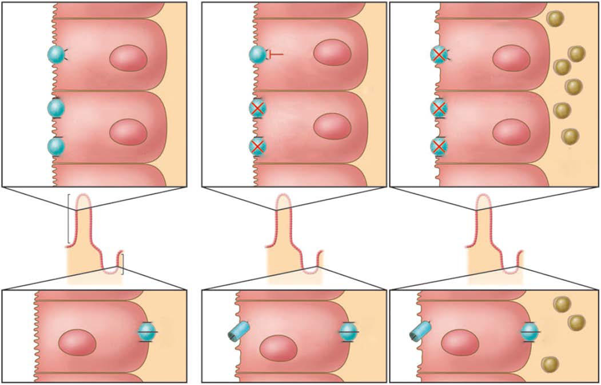

# Chapter 387: Acute Gastroenteritis in Children

*E. Adrianne Hammershaimb and Karen L. Kotloff*

<!-- p.3048 -->
The term *gastroenteritis* denotes inflammation of the gastrointestinal tract, most commonly the result of infections with bacterial, viral, or parasitic pathogens (Tables 387.1-387.3). Many of these infections are food-borne illnesses (Table 387.4). Several clinical syndromes are often described because they have different (albeit overlapping) etiologies, outcomes, and treatments. **Acute gastroenteritis** (AGE) captures the bulk of infectious cases of diarrhea. The most common manifestations are diarrhea and vomiting, which can also be associated with systemic features such as abdominal pain and fever. **Dysentery** refers to a syn drome characterized by frequent small stools containing visible blood, often accompanied by fever, tenesmus, and abdominal pain. This should be distinguished from bloody diarrhea (larger volume bloody stools with less systemic illness) because the etiologies may differ. **Pro longed** (lasting 7-13 days) and **persistent diarrhea** (lasting 14 days or longer) are important because of their impact on growth and nutrition.

**BURDEN OF CHILDHOOD DIARRHEA** Although global mortality due to diarrheal diseases has declined substantially (39%) during the past 2 decades, it remains unaccept ably high. In 2019 diarrheal disease caused an estimated 500,000, or 10% of all deaths in children under 5 years, making it the third lead ing cause of under-5 child mortality worldwide. Approximately 88% of those deaths occurred in sub-Saharan Africa and South Asia (71% and 17%, respectively). Over the same period, a smaller decline (10%) was observed in the incidence of diarrheal disease among children younger than 5 years. Almost 1 billion episodes occurred in 2019 worldwide, resulting in an estimated 45.5 million childhood disabilityadjusted life years. The decline in diarrheal mortality, despite the lack of significant changes in incidence, is the result of preventive rotavi rus vaccination and improved case management of diarrhea, as well as improved nutrition of infants and children. These interventions have included widespread home- and hospital-based oral rehydration solu tion (ORS) therapy and improved nutritional management of children with diarrhea.

In addition to the risk of mortality, high rates of diarrhea can be associated with long-term adverse outcomes. Diarrheal illnesses, espe cially episodes among young children that are recurrent, prolonged, or persistent, can be associated with malnutrition, stunting, micronutri ent deficiencies, and significant deficits in psychomotor and cognitive development.

**PATHOGENS** Rotavirus is the most common cause of AGE among children through out the world. Several other viruses occur less frequently. Norovirus and sapovirus are the two genera of *caliciviruses* that cause AGE. Noro virus genogroup II, genotype 4 (GII.4) has predominated globally since the mid-1990s. Among the more than 50 serotypes of adenovirus, 40 and 41 are most often associated with diarrhea. Astroviruses are iden tified less often (see Table 387.1). SARS-CoV-2 is also recognized as a cause of AGE in adults and in children, both as a manifestation of COVID-19 and as a symptom of multisystem inflammatory syndrome in children (MIS-C).

The major bacterial pathogens that cause AGE are nontyphoidal *Salmonella* (NTS), *Shigella, Campylobacter*, and *Yersinia* (see Table 387.2). Five pathotypes of *Escherichia coli* infect humans: Shiga toxin–producing (STEC), also known as enterohemorrhagic (EHEC),

enterotoxigenic (ETEC), enteropathogenic (EPEC), enteroaggregative (EAEC), and enteroinvasive (EIEC). Two serogroups of *Vibrio cholerae* (O1 and O139) produce epidemic cholera and cause nearly all sporadic cases. *Clostridioides difficile* (formerly *Clostridium difficile*) disease can be both nosocomial and community acquired in children. Bacterial pathogens that cause food-borne illness due to their ability to produce emetic and/or enterotoxins include *Bacillus cereus*, *Clostridium perfrin gens*, and *Staphylococcus aureus.* The significance of isolating *Aeromo nas* and *Plesiomonas* in a diarrheal stool remains uncertain.

*Giardia duodenalis, Cryptosporidium* spp.*, Cyclospora cayetanensis*, and *Entamoeba histolytica* are the most common parasites that cause diarrhea in the United States (see Table 387.3). At least 13 species of *Cryptosporidium* are associated with human disease, but *C. hominis* and, to a lesser extent, *C. parvum* are most common*.* The genus *Ent amoeba* comprises six species that colonize humans, but only *E. his tolytica* is considered a human pathogen*. G. duodenalis* (formerly *G. lamblia* and *G. intestinalis*) is a flagellate protozoan that infects the small intestine and biliary tract. Other protozoa that uncommonly cause AGE are *Cystoisospora belli* (formerly *Isospora belli*) and *Blasto cystis hominis.*

**EPIDEMIOLOGY IN THE UNITED STATES AND OTHER MIDDLE- AND HIGH-INCOME COUNTRIES Risk Factors Related to Economic Development** Insufficient access to adequate hygiene, sanitation, and clean drink ing water are the main factors leading to the heavy burden of AGE in developing countries. Although the severe consequences have become uncommon, infectious AGE remains ubiquitous in middle- and highincome countries. Economic development poses its own risks for trans mission of enteric pathogens. The ability to mass produce and widely distribute food has led to large multistate outbreaks of AGE due to NTS, STEC, and other agents (see Table 387.4). Globalization has cultivated a taste for tropical fruits and vegetables, creating a mechanism for impor tation of novel pathogens. The increasing frequency of antimicrobial resistance among bacteria that cause AGE has been linked to the use of antibiotics as growth promotors for animals bred for food. Recreational swimming facilities and water treatment systems have provided a vehicle for massive outbreaks of *Cryptosporidium*, a chlorine-resistant organism. Venues serving catered food to large groups of people, such as hotels and cruise ships, are conducive to outbreaks, as are institutions where hygiene is compromised, such as daycare centers, prisons, and nursing homes. Hospitalization and modern medical therapy have created a niche for nosocomial *C. difficile* toxin infection. Childcare and schoolbased outbreaks are often due to norovirus and *Shigella* spp.

**Endemic Diarrhea** In the United States, rotavirus was the most common cause of medically attended AGE among children younger than 5 years until the introduc tion of rotavirus vaccine for routine immunization of infants in 2006. Before 2006, annual epidemics swept across the country beginning in the southwest in November and reaching the northeast by May, affect ing nearly every child by the age of 2 years. Since vaccine introduction, healthcare utilization for AGE has decreased markedly at a consider able cost savings. Norovirus is now the leading cause of AGE among children in the United States seeking healthcare, followed by sapovirus, adenoviruses 40 and 41, and astrovirus (see Table 387.1).

**Laboratory-Based Surveillance for Food-Borne Pathogens** The most comprehensive resource for describing the burden of bac terial and protozoal diarrhea in the United States is the Foodborne Diseases Active Surveillance Network (FoodNet) maintained by the Centers for Disease Control and Prevention (CDC) (see Table 387.4). FoodNet performs active laboratory-based surveillance of nine bacterial and protozoal enteric pathogens commonly transmitted by food. Among children 0-19 years of age in 2019, NTS was most common, followed by *Campylobacter*, STEC, and *Shigella*. *Vibrio* and *Yersinia* were the least common. As of January 1, 2018, Food Net has stopped conducting active surveillance for *Cryptosporidium*;

*E. Adrianne Hammershaimb and 
 Karen L. Kotloff*

<!-- p.3049 -->
in 2015, *Cryptosporidium* was the fourth most commonly identified food-borne pathogen in U.S. children less than 19 years of age. Chil dren younger than 5 years have the highest incidence of food-borne diarrheal disease, whereas the elderly have the highest frequency of hospitalization and death. Only 5% of these infections are associated with recognized outbreaks.

Toxin-mediated food-borne gastroenteritis may be infectious or noninfectious. Pathogens that cause toxin-mediated foodborne gastroenteritis include *S. aureus*, *B. cereus*, and *C. perfrin gens*. Ingestion of food contaminated with the preformed *S. aureus* heat-stable enterotoxin types A to E causes staphylococcal food poisoning. *B. cereus* produces two forms of gastrointestinal illness, one resembling staphylococcal food poisoning and caused by a preformed emetic toxin, and the other caused by a group of three enterotoxins formed in  vivo. Ingested *C. perfringens* sporulates in the small intestine, releasing a heat-labile, single-polypeptide enterotoxin. Noninfectious agents may also cause food-borne gastrointestinal symptoms due to a direct toxic effect of the food (mushrooms), contamination (heavy metals), or fish or shellfish toxins (Table 387.5).

**Diarrhea Outbreaks** The U.S. Foodborne Disease Outbreak Surveillance System quanti fies enteric infections associated with food-borne outbreaks. In 2017, among all age-groups, norovirus was the most common agent (49%), followed by NTS (19%). Less common were *C*. *perfringens* (6%)*, Cam pylobacter* (4%)*,* STEC (3%), *S*. *aureus* (2%), and *B*. *cereus* (2%), fol lowed much less often (each 1%) by *Clostridium botulinum, Shigella, Cryptosporidium, Yersinia, Listeria, Vibrio parahaemolyticus,* and *Shi gella*. Outbreaks of enteric pathogens propagated by direct person-toperson contact are most often caused by norovirus and *Shigella* species; other pathogens include NTS, rotavirus, *Giardia*, *Cryptosporidium*, *C*. *difficile,* and *Campylobacter jejuni.*

**Nosocomial Diarrhea* C. difficile* is the most common cause of healthcare-associated infec tion in the United States. Severe disease occurs most often in those with predisposing conditions (e.g., recent antibiotics, gastric acid suppression, immunosuppression, gastrointestinal comorbidities). In contrast to adults, rates of colostomy and in-hospital mortality have not increased in children despite increasing rates of community and

#### **Table 387.1** Etiologies of Viral Gastroenteritis

| Category / Parameter | Clinical Details & Findings |
| --- | --- |
| **DIAGNOSTIC TEST** | Caliciviruses; (including; noroviruses and; sapoviruses); 12-48 hr; Nausea, vomiting,; abdominal; cramping, diarrhea,; fever, myalgia, and; some headache; 1-3 days; Person-to-person; (fecal-oral and; aerosolized; vomit), and; food, water,; and fomites; contaminated; with human feces; Very contagious; (chlorine and; heat resistant);; produces large; outbreaks in; closed settings; such as cruise; ships, daycares,; schools, and; restaurants; Shellfish; Multiplex PCR; RT-qPCR of stool; and vomit is the; preferred method; for outbreak; investigation,; available in public; health laboratories; Immunoassays for; norovirus have; poor sensitivity; Norovirus; genotyping (GI and; GII) is performed; by CDC; Rotavirus; (groups A-C),; astrovirus, and; enteric; adenovirus; (serotypes 40; and 41); 2-4 days; Often begins with; vomiting, followed; by watery diarrhea,; low-grade fever; 3-8 days; Person-to-person; (fecal-oral),; fomites; Aerosol; transmission of; rotavirus may be; possible; Nearly all infants; and children; worldwide; were infected; by 2 yr of age; before vaccine; introduction; Multiplex PCR; Immunoassays for; rotavirus and; enteric adenovirus; SARS-CoV-2; 2-14 days; Acute COVID-19:; Fever, chills, cough,; shortness of breath,; difficulty breathing,; fatigue, myalgia,; headache, anosmia,; dysgeusia, sore; throat, congestion,; runny nose, nausea,; vomiting, diarrhea is; usually nonbloody; but may be blood; tinged; MIS-C: fever,; abdominal pain,; vomiting, diarrhea,; rash,; conjunctivitis,; dizziness or; light-headedness; Acute COVID-19:; May be self-; limited, less; than 2 wk; Prolonged; symptoms may; last months; (e.g., fatigue,; anosmia,; dysgeusia); MIS-C: unclear;; often fatal if; untreated; Respiratory; aerosols and; droplets; airborne; precautions; recommended; Unvaccinated; immune status; Local; epidemiology; and lack of; transmission; mitigating; precautions; RT-PCR (may be; included in a; multiplex PCR); Antigen; immunoassay; Serology (may be; useful for the; diagnosis of MIS-C; but not for acute |
| **COVID-19)** | Note: Commercially available denotes that the diagnostic tests have been cleared by the U.S. Food and Drug Administration; RT, Real-time reverse transcriptase; PCR, polymerase chain reaction; CDC, Centers for Disease Control and Prevention; MIS-C, multisystem inflammatory syndrome in children.; Adapted from Centers for Disease Control and Prevention: Diagnosis and management of foodborne illnesses. MMWR. 2004;53(RR-4):1–33. |

<!-- p.3050 -->
**ETIOLOGY**

**INCUBATION**

**PERIOD**

**SIGNS AND 
 SYMPTOMS**

**DURATION OF ILLNESS**

**PRINCIPAL VEHICLE AND TRANSMISSION**

**RISK 
 FACTORS**

**COMMERCIALLY**

**AVAILABLE 
 DIAGNOSTIC TEST**

*Bacillus cereus*

(preformed emetic toxin)

1-6 hr Sudden onset of severe

nausea and vomiting; diarrhea may be present

24 hr Soil and water Improperly

refrigerated cooked or fried rice, meats

Routine stool culture

to look for overabundance of pathogen, does not detect toxins Reference laboratory

used for outbreaks

*B. cereus*

(enterotoxins formed in vivo)

8-16 hr Abdominal cramps, watery

diarrhea; nausea and vomiting may be present

1-2 days Soil and water Meats, stews,

gravies, vanilla sauce

Routine stool culture

to look for overab undance of pathogen, does not detect toxins Reference laboratory

used for outbreaks

*Campylobacter 
*

*jejuni*

1-5 days Diarrhea, (10–20% of

episodes are prolonged), cramps, fever, and vomiting; bloody diarrhea, bacteremia, extraintestinal infections, severe disease in immunocompromised

5-7 days (sometimes >10 days) usually selflimiting

Wild and

domestic animals and animal products

Raw and undercooked

poultry, unpasteurized milk, untreated surface water

Stool culture on

selective agar, microaerobic conditions, and incubation at 42°C Antigen detection

by EIA Multiplex PCR

*Clostridioides 
*

*difficile toxin*

Unknown Can appear

weeks after antibiotic cessation

Mild to moderate watery

diarrhea that can progress to severe, pseudomembranous colitis with systemic toxicity

Variable Person-to-person

(fecal-oral), mostly within healthcare facilities

Immunosuppression,

intestinal disease or surgery, prolonged hospitalization, antibiotics

PCR,† immunoassay Multistep approach

using EIA for GDH and toxins A and B ± NAAT

*Clostridium 
*

*perfringens* toxin

8-16 hr Watery diarrhea, nausea,

abdominal cramps; fever is rare

1-2 days Environment,

human and animal intestines

Meats, poultry, gravy,

dried or precooked foods with poor temperature control

None Reference laboratory

used for outbreaks

*Escherichia coli*

O157:H7 and other *Shiga* toxin–producing *E. coli* (STEC)

1-9 days (usually 3-4 days)

Watery diarrhea that

becomes bloody in 1-4 days in ∼40% of infections; in contrast to dysentery, bloody stools are large volume and fever/toxicity is minimal More common in

children <4 yr old

4-7 days Food and water

contaminated with feces from ruminants; infected people and animals (fecal-oral); predominantly high-resource countries

Undercooked beef

especially hamburger, unpasteurized milk and juice, raw fruits, and petting zoos, recreational swimming, daycare Antimotility agents

and antibiotics increase risk of hemolytic uremic syndrome

Multiplex PCR to

detect *E. coli* O157:H7 and non-O157:H7 *Shiga* toxin genes simultaneously with stool culture on sorbitol-MacConkey agar Immunoassay

for O157:H7; presumptive *E. coli* O157:H7 isolates and all *Shiga* toxin-positive stool specimens that did not yield a presumptive *E. coli* O157:H7 isolate should be sent to a public health laboratory to identify non-O157:H7 STEC and for serotyping and whole genome sequencing

Enterotoxigenic

*E. coli* (ETEC)

1-5 days Watery diarrhea,

abdominal cramps, some vomiting

3-7 days Water or food

contaminated with human feces

Infants and young

children in LMIC and travelers

Multiplex PCR,†or

reference laboratory

*Salmonella*,

nontyphoidal

1-5 days Diarrhea, (10–20%

prolonged), cramps, fever, and vomiting; bloody diarrhea, bacteremia, extraintestinal infections, severe disease in immunocompromised

5-7 days (sometimes >10 days) usually self-limiting

Domestic

poultry, cattle, reptiles, amphibians, birds

Ingestion of raw or

undercooked food, improper food handling, travelers, immunosuppression, hemolytic anemia, achlorhydria, contact with

Multiplex PCR Routine stool culture

<!-- p.3051 -->

#### **Table 387.2** Etiologies of Bacterial Gastroenteritis—cont’d

| Category / Parameter | Clinical Details & Findings |
| --- | --- |
| **DIAGNOSTIC TEST** | Shigella spp.; 1-5 days; (up to 10; days for S.; dysenteriae; type 1); Abdominal cramps, fever,; diarrhea; Begins with watery; stools that can be the; only manifestation or; proceed to dysentery; 5-7 days; Infected people; or fecally; contaminated; surfaces; (fecal-oral); Poor hygiene and; sanitation,; crowding, travelers,; daycare, MSM,; prisoners; Multiplex PCR; Routine stool culture; Staphylococcus; aureus; (preformed; enterotoxin); 1-6 hours; Sudden onset of severe; nausea and vomiting; Abdominal cramps; Diarrhea and fever may be; present; 1-3 days; Birds, mammals,; dairy, and; environment; Unrefrigerated or; improperly; refrigerated meats,; potato and egg; salads, cream; pastries; Routine stool; culture to look for; overabundance of; pathogen, does; not detect toxins; Reference laboratory; used for outbreaks; Vibrio cholerae; O1 and O139; 1-5 days; Watery diarrhea and; vomiting, which can; be profuse and lead to; severe dehydration and; death within hours; 3-7 days; Food and water; contaminated; with human; feces; Contaminated water,; fish, shellfish,; street-vended food; from endemic or; epidemic settings;; blood group O,; vitamin A deficiency; Stool culture; (requires special; TCBS media so; laboratory must be; notified); Rapid test is useful; in epidemics but; does not provide; susceptibility or; subtype so should; not be used for; routine diagnosis.; FDA-approved; multiplex PCR; Vibrio; parahaemolyticus; 2-48 hr; Watery diarrhea,; abdominal cramps,; nausea, vomiting; Bacteremia and wound; infections occur; uncommonly, especially; in high-risk patients,; e.g., with liver disease; and diabetes; 2-5 days; Estuaries; and marine; environments;; currently; undergoing; pandemic; spread; Undercooked or raw; seafood, such as; fish, shellfish; Culture of stool,; wound, or blood; depending on; suspected source; Requires special; TCBS media so; laboratory must be; notified; Multiplex PCR; Vibrio vulnificus; 1-7 days; Vomiting, diarrhea,; abdominal pain; Bacteremia and wound; infections, particularly; in patients with chronic; liver disease (presents; with septic shock and; hemorrhagic bullous skin; lesions); 2-8 days; Estuaries; and marine; environments; Undercooked or raw; shellfish, especially; oysters, other; contaminated; seafood, and open; wounds exposed to; seawater; Culture of stool,; wound, or blood; depending on; suspected source; Requires special; TCBS media so; laboratory must be; notified; Multiplex PCR; Yersinia; enterocolitica; and Y. pseudo; tuberculosis; 1-5 days; Diarrhea, (10–20%; prolonged), cramps, fever,; and vomiting; bloody; diarrhea, bacteremia,; extraintestinal infections,; severe disease in; immunocompromised;; pseudoappendicitis; occurs primarily in older; children; 5-7 days; (sometimes; >10 days); usually; self-limiting; Swine products,; occasionally; person-to-; person and; animal-to-; humans,; water-borne,; blood-borne; (can multiply; during; refrigeration); Undercooked; pork, improper; food handling,; unpasteurized milk,; tofu, contaminated; water, transfusion; from a bacteremic; person, cirrhosis,; chelation therapy; Stool culture or; multiplex PCR; Culture requires; special media and; incubation at 25°C.; Not performed in; many laboratories; unless requested; When clinically; relevant, can; isolate from vomit,; blood, throat,; lymph nodes, joint; fluid, urine, and; bile; †FDA-cleared multiplex PCR assays are available but cannot determine antimicrobial susceptibility to guide treatment or speciate the organism for outbreak investigation.; EIA, Enzyme immunoassays; PCR, polymerase chain reaction; GDH, glutamate dehydrogenase; NAAT, nucleic acid amplification test; LMIC, low- and middle-income countries; MSM,; men who have sex with men; TCBS, thiosulfate-citrate-bile salts-sucrose agar; FDA, U.S. Food and Drug Administration.; Adapted from Centers for Disease Control and Prevention: Diagnosis and management of foodborne illnesses. MMWR. 2004;53(RR-4):1–33. |

<!-- p.3052 -->
hospital-acquired *C. difficile* infection, suggesting that *C. difficile* may be less pathogenic in children. Moreover, high rates of asymptomatic carriage among children younger than 2 years create diagnostic uncer tainty, so children <1 year should never be routinely tested; testing and treatment in children 1-2 years of age should be reserved for those in whom noninfectious or other infectious causes have been ruled out, and children ≥2 years may be tested if they have prolonged or worsen ing diarrhea and relevant risk factors or exposures (see Table 387.2).

**Zoonotic Transmission** Many diarrheal pathogens are acquired from animal reservoirs (see Tables 387.1-387.3). The ability of NTS to undergo transovar ian passage in hens allows infection of intact grade A pasteurized eggs, a source of multiple large outbreaks. Although *Campylobacter* is prevalent in poultry, its lower outbreak potential has been attrib uted to its lack of transovarian spread in hens and stringent growth requirements, which limit its ability to replicate in foods. On the other hand, *Campylobacter* has an extensive reservoir in domestic and wild animals and remains a major cause of sporadic bacterial foodborne disease in industrialized countries, usually from consumption of contaminated chicken meat, beef, and milk. Its ubiquitous animal reservoir also has resulted in widespread contamination of surface waters, resulting in diarrhea among hikers and campers who drink from streams, ponds, and lakes in wilderness areas. The predilection

for STEC to asymptomatically colonize the intestines of ruminant animals explains why unpasteurized dairy products, fruits harvested from fields where cattle graze, and undercooked hamburger are com mon vehicles. The major animal reservoir for *Yersinia* is pigs, so inges tion of raw or undercooked pork products is an important risk factor. Pets can be the source of NTS (asymptomatic young birds, amphib ians, and reptiles), *Campylobacter,* and *Yersinia* (puppies and kittens that are usually ill with diarrhea).

**Seasonality** Seasonality provides a clue to implicate specific pathogens, although patterns may differ in tropical and temperate climates. Rotavirus and norovirus peak in cool seasons, while enteric adenovirus infections occur throughout the year, with some increase in summer. *Salmonella, Shigella,* and *Campylobacter* favor warm weather, whereas the tendency for *Yersinia* to tolerate cold manifests as a winter seasonality, with higher prevalence in northern countries, and the ability to survive in contaminated blood products during refrigeration.

**EPIDEMIOLOGY IN LOW- AND MIDDLE-INCOME COUNTRIES** Large epidemiologic studies conducted during the previous decade have advanced our understanding of the etiology of diarrheal disease among children in low-resource countries. The Global Enteric Multicenter

#### **Table 387.3** Etiologies of Parasitic Gastroenteritis

| Category / Parameter | Clinical Details & Findings |
| --- | --- |
| **DIAGNOSTIC TEST** | Cryptosporidium; 1-11 days; Diarrhea (usually; watery), bloating,; flatulence, cramps,; malabsorption,; weight loss, and; fatigue may wax; and wane; Persons with AIDS; or malnutrition; have more severe; disease; 1-2 wk; may be; remitting and; relapsing over; weeks to months; Person-to-person; (fecal-oral),; contaminated; food and water; (including; municipal and; recreational; water; contaminated; with human; feces); Infants 6-18 mo of; age living in; endemic; settings in LMIC,; patients with; AIDS, childcare; settings,; drinking; unfiltered surface; water, MSM, Ig; deficiency; Immunoassays, PCR,; and multiplex PCR; are most sensitive; Microscopy (direct; fluorescent; antibody staining is; preferable to; modified acid fast); Cyclospora; cayetanensis; 1-11 days; Same as; Cryptosporidium; Same as; Cryptosporidium; Fresh produce; (imported; berries, lettuce); Travelers,; consumption of; fresh produce; imported from; the tropics; Fecal microscopy,; multiplex PCR; May need to; examine water or; food; Entamoeba; histolytica; 2-4 wk; Gradual onset of; cramps, watery; diarrhea and often; dysentery with; cramps but rarely; fever; Can wax and wane; with weight loss; Dissemination to live; and other organs; can occur; Variable; may; be protracted; (several weeks to; several months); Fecal-oral; transmission; Any uncooked; food or food; contaminated; by an ill food; handler after; cooking;; drinking water; Persons living in or; traveling to LMIC,; institutionalized; persons, MSM; Immunoassay or; multiplex PCR are; preferred; Fecal microscopy; of fresh stool for; cysts and parasites; on at least three; samples can also; be performed; Serology for; extraintestinal; infections; Giardia; duodenalis; 1-4 wk; Diarrhea, stomach; cramps, gas, weight; loss; symptoms may; wax and wane; 2-4 wk; Any uncooked; food or food; contaminated; by an ill food; handler after; cooking;; drinking water; Hikers; drinking; unfiltered surface; water, persons; living in or; traveling to; LMIC, MSM, IgA; deficiency; Immunoassay or; multiplex PCR; preferred; Fecal microscopy for; ova and parasites; can be performed; at; least three samples; recommended; LMIC, Low- and middle-income countries; PCR, polymerase chain reaction; MSM, men having sex with men. |

<!-- p.3053 -->
Study (GEMS) evaluated children younger than 5 years living in seven low-income countries in sub-Saharan Africa and South Asia and seek ing healthcare for moderate to severe diarrhea (Fig. 387.1). Although a broad array of pathogens was identified, most episodes of moderate to severe diarrhea were attributed to four pathogens: rotavirus, *Crypto sporidium, Shigella*, and ETEC producing heat-stable toxin (ST) either alone or in combination with heat-labile toxin (LT), herein termed ST- ETEC and LT-ETEC, and, to a lesser extent, adenoviruses 40 and 41. On the other hand, several etiologic agents that are common causes of AGE in high-resource settings are notable for their low frequency in resource-limited settings: NTS, STEC, norovirus, and *C. difficile* toxin. The three agents associated with most deaths among children <5 years are rotavirus (29%), *Cryptosporidium* (12%), and *Shigella* (11%). The Etiology, Risk Factors, and Interactions of Enteric Infections and Mal nutrition and the Consequences for Child Health and Development Project (MAL-ED) was a study of less severe, community-based diar rhea. Viral causes predominated (36.4% of the overall incidence), but *Shigella* had the single highest attributable incidence (26.1 attributable episodes per 100 child-years).

**Host Risk Factors** Most pathogens show an age predilection. The incidence of rotavi rus and NTS are highest in infancy. Endemic shigellosis peaks in 1to 4-year olds, whereas *Campylobacter* and *Cryptosporidium* show a bimodal distribution with the greatest number of reported cases in infants and young children with a secondary peak in young adults. Pandemic *V. cholerae* and *Shigella. dysenteriae* type 1 produce high attack rates and mortality in all age-groups and often afflict displaced persons in emergency settings. Some agents (e.g., NTS, *Shigella, Cam pylobacter, Yersinia,* and *Cryptosporidium*) are more frequent and more severe when the host is immunocompromised or malnourished.

Additional risks factors for AGE include immunodeficiency, mea sles, malnutrition, and lack of exclusive or predominant breastfeeding. Malnutrition increases the risk of diarrhea and associated mortal ity, and moderate to severe stunting increases the odds of diarrheaassociated mortality. The fraction of such infectious diarrhea deaths that are attributable to nutritional deficiencies varies with the preva lence of deficiencies; the highest attributable fractions are in sub- Saharan Africa, South Asia, and Andean Latin America. The risks are especially high with malnutrition, particularly when associated with micronutrient deficiency. Vitamin A deficiency accounts for 157,000 deaths from diarrhea, measles, and malaria. Zinc deficiency is esti mated to cause 116,000 deaths from diarrhea and pneumonia.

**PATHOGENESIS OF INFECTIOUS GASTROENTERITIS** Intrinsic properties of the organism help to define the mode of trans mission and incubation period (Table 387.6). Enteropathogens that are infectious in small inocula (*Shigella,* STEC*,* norovirus, rotavirus, *G. duodenalis, Cryptosporidium* spp.*, C. difficile, E. histolytica*) are read ily transmitted by person-to-person contact via the fecal-oral route. Pathogens with larger infectious doses, such as cholera, NTS, ETEC, and *Campylobacter*, generally require food or water vehicles (see Tables 387.1-387.3). Pathogens that produce preformed toxins (*S. aureus, B. cereus* emetic toxin) have shorter incubation periods (1-6 hours) com pared with 8-16 hours for those that must elaborate enterotoxins in situ (e.g., *C. perfringens* and *B. cereus* enterotoxin). Incubation periods of 1-5 days are seen with pathogens that attach to the epithelium and elab orate enterotoxins (e.g., *V. cholerae*, ETEC) or cytotoxins (e.g., *S*. *dysen teriae* type 1 and STEC) or those that invade and disrupt the intestinal epithelium (*Shigella*, NTS, *Campylobacter*, and *Yersinia*). The require ment for protozoa to progress through a life cycle to trigger patho genic processes results in a more extended incubation period. Other

Outbreak-Associated Infections, and Crude Incidence by Pathogen — Foodborne Diseases Active Surveillance Network, 10 U.S. sites,* 2021†

#### **Table 387.4** Number of Laboratory-Diagnosed Bacterial and Parasitic Infections, Hospitalizations, Deaths,

| Category / Parameter | Clinical Details & Findings |
| --- | --- |
| **INFECTIONS††** | Total; 22,019; 5,359 (24); 153 (0.7); 861 (4); —; Campylobacter; 8,974; 1,822 (20); 33 (0.4); 51 (0.6); 17.8; Salmonella; 7,148; 1,974 (28); 52 (0.7); 597 (8); 14.2 |
| **STEC** | 2,542; 600 (24); 10 (0.4); 79 (3); 5.0; Shigella; 1,699; 532 (31); 8 (0.5); 67 (4); 3.4; Yersinia; 683; 146 (21); 3 (0.4); 2 (0.3); 1.4; Vibrio; 461; 117 (25); 9 (2); 8 (2); 0.9; Listeria; 148; 140 (95); 37 (25); 9 (6); 0.3; Cyclospora; 364; 28 (8); 1 (0.3); 48 (13); 0.7; *Data were obtained from laboratories in Connecticut, Georgia, Maryland, Minnesota, New Mexico, Oregon, Tennessee, and selected counties in California, Colorado, and New; York.† 2021 data are preliminary.§ Bacterial infections diagnosed by culture or CIDT. Cyclospora infections diagnosed by microcopy or polymerase chain reaction.¶ Admission to an; inpatient unit or an observation stay of >24 hours within 7 days before or after specimen collection or determined to be related to the infection if beyond this time frame. Absolute; change in percentage of infections resulting in hospitalization during 2021 compared with annual average for 2016–2018: Campylobacter (0.3), Salmonella (0.3), STEC (1), Shigella; (8), Yersinia (−4), Vibrio (−5), Listeria (−2), Cyclospora (2), and overall (0.6). Unknown hospitalization status (10% of infections during 2021 and 4% during 2016–2018) was classified as; not hospitalized.; **Attributed to infection when deaths occurred during hospitalization or within 7 days after specimen collection for nonhospitalized patients. Absolute change in percentage of; infections resulting in death during 2021 compared with annual average for 2016–2018: Campylobacter (<0.1), Salmonella (0.3), STEC (<0.1), Shigella (0.4), Yersinia (−0.7), Vibrio; (−0.2), Listeria (6), Cyclospora (0.1), and overall (0.2). Unknown death status (8% of infections during 2021 and 3% during 2016–2018) was not classified as a death.†† Generally; defined as two or more cases of similar illness associated with a common exposure; some sites also stipulate that illnesses be from more than one household. Absolute change in; percentage of outbreak-associated infections during 2021 compared with annual average for 2016–2018: Campylobacter (0.2), Salmonella (1), STEC (−1), Shigella (−1), Yersinia (0.2),; Vibrio (−2), Listeria (1), Cyclospora (−10), and overall (<0.1). Unknown outbreak-association status (0.02% of infections during 2021 and 0% during 2016–2018) was classified as not; outbreak-associated.§§ Cases per 100,000 population. Domestic incidences (cases with no or unknown travel) by pathogen during 2021: Campylobacter (17.0), Salmonella (13.1),; STEC (4.6), Shigella (3.0), Yersinia (1.3), Vibrio (0.8), Listeria (0.3), and Cyclospora (0.6).; CIDT, Culture-independent diagnostic test; STEC, Shiga toxin–producing E. coli.; Modified from Collins JP, Shah HJ, Weller DL, et al. Preliminary incidence and trends of infections caused by pathogens transmitted commonly through food – foodborne diseases; active surveillance network, 10 U.S. sites, 2016-2021. MMWR. 2022;71(4):1260–1263. |

<!-- p.3054 -->
properties affecting transmissibility are bioavailability as conferred by a copious and/or prolonged fecal shedding, extended infectivity in the environment, and resistance to disinfection (all exhibited by norovirus and *Cryptosporidium*), or a large environmental or animal reservoir (e.g., *Campylobacter*). The ability to circumvent immune surveillance by frequent antigenic changes resulting from recombinational events (e.g., norovirus) or a large serotype diversity (e.g., *Shigella*) maintains a susceptible host population.

Viral AGE causes a cytolytic infection of the small intestinal villus tips resulting in decreased absorption of water, disaccharide malab sorption, inflammation, and cytokine activation. The rotavirus protein NSP4 acts as a viral enterotoxin that causes secretory diarrhea. In addi tion, rotavirus activates the enteric nervous system, causing decreased gastric emptying and increased intestinal mobility. There is a genetic susceptibility to both rotavirus and norovirus infection that is medi ated by histo-blood group antigens on the epithelial cell surface and in mucus secretions (Fig. 387.2).

Pathogens primarily manifesting as secretory diarrhea attach to the surface of the epithelium and stimulate secretion of water and electrolytes by activating adenylate cyclase and raising intracellular cAMP (*V. chol erae* and LT-ETEC) and/or cGMP (ST-ETEC) (Figs. 387.3 and 387.4). The diarrheagenic phenotype of *C. difficile* is attributed to production of toxins A (an enterotoxin) and B (an enterotoxin and cytotoxin). The

epidemic hypervirulent NAP1 *C. difficile* also makes binary toxin, which may enhance colonization and augment toxin production.

*Shigella*, NTS, *Campylobacter*, and *Yersinia* all possess an invasive phenotype and elicit diarrhea by a variety of mechanisms that gen erally involves elicitation of inflammatory cytokines with or without associated toxin production (Fig. 387.5). The pathogenesis of *Shigella*, the most common cause of bacillary dysentery, has been character ized in greatest detail. Following invasion, *Shigella* induces extensive destruction and inflammation of the intestinal epithelium, producing ulcers and microabscesses that manifest with diarrheal stools contain ing blood and pus. Production of enterotoxins contributes to secretory diarrhea, which can be seen early in shigellosis or as the sole manifesta tion. A single serotype of *Shigella*, *S*. *dysenteriae* type 1, elaborates the Shiga toxin, which increases the severity of illness and is responsible for the development of hemolytic uremic syndrome (HUS).

*Cryptosporidia* sporozoites released from ingested cysts penetrate intestinal epithelial cells and develop into trophozoites within the intracellular but extracytoplasmic environment. After undergoing asexual multiplication and sexual development, they are released in the colon as infectious oocysts capable of causing autoinfection. Host factors, in particular T-cell function, play a critical role in disease severity. *Cyclospora* cysts are not infectious in freshly passed stools but must sporulate in the environment for 1-2 weeks to become

**Fig. 387.1** Attributable incidence of pathogen-specific moderate to severe diarrhea per 100 child-years by age stratum, all sites combined. The bars show the incidence rates and the error bars show the 95% confidence intervals. ST/LT-ETEC, heat-stable toxin (ST) / heat labile toxin (LT)-enterotoxigenic Escherichia coli; tEPEC, traditional (t) enteropathogenic Escherichia coli. (From Kotloff KL, Nataro JP, Blackwelder WC, et al. Burden and aetiology of diarrhoeal disease in infants and young children in developing countries [the Global Enteric Multicenter Study, GEMS]: a prospective, case-control study. Lancet. 2013;382:209–222. Fig. 4.)

<!-- p.3055 -->

#### **Table 387.5** Food-Borne Noninfectious Illnesses

| Category / Parameter | Clinical Details & Findings |
| --- | --- |
| **TREATMENT** | Antimony; 5 min-8 hr; usually <1 hr; Vomiting, metallic; taste; Usually; self-limited; Metallic container; Identification of; metal in; beverage or; food; Supportive care; Arsenic; Few hours; Vomiting, colic,; diarrhea; Several days; Contaminated; food; Urine; Can cause; eosinophilia; Gastric lavage, BAL; (dimercaprol); Cadmium; 5 min-8 hr; usually <1 hr; Nausea, vomiting,; myalgia, increase in; salivation, stomach; pain; Usually; self-limited; Seafood, oysters,; clams, lobster,; grains, peanuts; Identification of; metal in food; Supportive care; Ciguatera fish; poisoning; (ciguatera toxin); 2-6 hr; GI: abdominal pain,; nausea, vomiting,; diarrhea; Days to weeks; to months; A variety of large; reef fish:; grouper, red; snapper,; amberjack, and; barracuda (most; common); Radioassay for; toxin in fish or a; consistent history; Supportive care, IV; mannitol; Children more; vulnerable; 3 hr; Neurologic:; paresthesias,; reversal of hot or; cold, pain, weakness; 2-5 days; Cardiovascular:; bradycardia,; hypotension,; increase in T-wave; abnormalities; Copper; 5 min-8 hr; usually <1 hr; Nausea, vomiting,; blue or green; vomitus; Usually; self-limited; Metallic container; Identification of; metal in beverage; or food; Supportive care; Mercury; 1 wk or longer; Numbness, weakness; of legs, spastic; paralysis, impaired; vision, blindness,; coma; Pregnant women; and the developing; fetus are especially; vulnerable; May be; protracted; Fish exposed to; organic mercury,; grains treated; with mercury; fungicides; Analysis of blood,; hair; Supportive care; Mushroom toxins,; short-acting; (muscimol,; muscarine,; psilocybin, Coprinus; atramentaria,; ibotenic acid); <2 hr; Vomiting, diarrhea,; confusion, visual; disturbance,; salivation,; diaphoresis,; hallucinations,; disulfiram-like; reaction, confusion,; visual disturbance; Self-limited; Wild mushrooms; (cooking might; not destroy; these toxins); Typical syndrome; and mushroom; identified or; demonstration of; the toxin; Supportive care; Mushroom toxins,; long-acting; (amanitin); 4-8 hr diarrhea;; 24-48 hr liver; failure; Diarrhea, abdominal; cramps, leading to; hepatic and renal; failure; Often fatal; Mushrooms; Typical syndrome; and mushroom; identified and/or; demonstration of; the toxin; Supportive care,; life-threatening,; may need life; support; Nitrite poisoning; 1-2 hr; Nausea, vomiting,; cyanosis, headache,; dizziness, weakness,; loss of consciousness,; chocolate-brown; blood; Usually; self-limited; Cured meats, any; contaminated; foods, spinach; exposed to; excessive; nitrification; Analysis of the; food, blood; Supportive care,; methylene blue |

<!-- p.3056 -->

#### **Table 387.5** Food-Borne Noninfectious Illnesses—cont’d

| Category / Parameter | Clinical Details & Findings |
| --- | --- |
| **TREATMENT** | Pesticides; (organophosphates; or carbamates); Few minutes; to few hours; Nausea, vomiting,; abdominal cramps,; diarrhea, headache,; nervousness, blurred; vision, twitching,; convulsions,; salivation, meiosis; Usually; self-limited; Any contaminated; food; Analysis of the; food, blood; Atropine; 2-PAM; (pralidoxime); is used when; atropine is not; able to control; symptoms;; rarely necessary; in carbamate; poisoning; Puffer fish; (tetrodotoxin); <30 min; Paresthesias,; vomiting, diarrhea,; abdominal pain,; ascending paralysis,; respiratory failure; Death usually; in 4-6 hr; Puffer fish; Detection of; tetrodotoxin in; fish; Life-threatening,; may need; respiratory; support; Scombroid; (histamine); 1 min-3 hr; Flushing, rash, burning; sensation of skin,; mouth and throat,; dizziness, urticaria,; paresthesias; 3-6 hr; Fish: bluefin,; tuna, skipjack,; mackerel,; marlin, escolar,; and mahi; Demonstration; of histamine in; food or clinical; diagnosis; Supportive care,; antihistamines; Shellfish toxins; (diarrheic,; neurotoxic,; amnesic); Diarrheic; shellfish; poisoning:; 30 min-2 hr; Nausea, vomiting,; diarrhea, and; abdominal pain; accompanied by; chills, headache, and; fever; Hours to 2-3; days; A variety of; shellfish, primarily; mussels,; oysters,; scallops, and; shellfish from; the Florida coast; and the Gulf of; Mexico; Detection of the; toxin in shellfish;; high-pressure; liquid; chromatography; Supportive care,; generally; self-limiting; Neurotoxic; shellfish; poisoning:; few minutes; to hours; Tingling and; numbness of lips,; tongue, and throat,; muscular aches,; dizziness, reversal of; the sensations of hot; and cold, diarrhea,; and vomiting; Amnesic; shellfish; poisoning:; 24-48 hr; Vomiting, diarrhea,; abdominal pain; and neurologic; problems such as; confusion, memory; loss, disorientation,; seizure, coma; Elderly are; especially; sensitive to; amnesic shellfish; poisoning; Shellfish toxins; (paralytic shellfish; poisoning); 30 min-3 hr; Diarrhea, nausea,; vomiting leading; to paresthesias of; mouth and lips,; weakness,; dysphasia,; dysphonia,; respiratory paralysis; Days; Scallops,; mussels, clams,; cockles; Detection of toxin; in food or water; where fish are; located; high-; pressure liquid; chromatography; Life-threatening,; may need; respiratory; support; Sodium fluoride; Few minutes; to 2 hr; Salty or soapy taste,; numbness of mouth,; vomiting, diarrhea,; dilated pupils,; spasms, pallor,; shock, collapse; Usually; self-limited; Dry foods (e.g., dry; milk, flour, baking; powder, cake; mixes); contaminated with; NaF-containing; insecticides and; rodenticides; Testing of vomitus; or gastric; washings; Analysis of the; food; Supportive care; Thallium; Few hours; Nausea, vomiting,; diarrhea, painful; paresthesias, motor; polyneuropathy, hair; loss; Several days; Contaminated; food; Urine, hair; Supportive care; Tin; 5 min-8 hr; usually <1 hr; Nausea, vomiting,; diarrhea; Usually; self-limited; Metallic container; Analysis of the; food; Supportive care |

<!-- p.3057 -->
infectious; they are usually transmitted in contaminated produce and water (see Table 387.3).

**CLINICAL MANIFESTATION OF ACUTE GASTROENTERITIS General Findings** Diarrhea is usually defined as the passage of three or more abnormally loose or liquid stools per day. Frequent passage of formed stools is not diarrhea, nor is the passing of loose, pasty stools by breastfed babies. Clinical clues as to the possible etiology of AGE are noted in Tables 387.1-387.3 and Table 387.7. In the past, many guidelines divided patients into subgroups for mild (3–5%), moderate (6–9%), and severe (≥10%) dehydration; however, it is difficult to distinguish between mild and moderate dehydration based on clinical signs alone. Therefore current guidelines combine mild and moderate dehydration and simply use none, some, and severe dehydration. Commonly used guidelines include the World Health Organization (WHO) Integrated Management of Childhood Illness scale, the Clinical Dehydration Scale, the Modified Vesikari Score, and the Gorelick scale, but the accuracy and applicability of these scales varies by clinical setting and by the individual assigning the patients’ scores. The signs that best predict dehydration are prolonged capillary

refill time >2 seconds, abnormal skin turgor, hyperpnea (deep, rapid breathing suggesting acidosis), dry mucous membranes, absent tears, and general appearance (including activity level and thirst). As the number of signs increases, so does the likelihood of dehydration. Tachycardia, altered level of consciousness, and cold extremities with or without hypotension suggest severe dehydration.

**Viral Diarrhea** Symptoms of rotavirus AGE usually begin with vomiting followed by fre quent passage of watery, nonbloody stools associated with fever in about half the cases (see Table 387.1). The diarrhea lacks fecal leukocytes, but stools from 20% of cases contain mucus. Recovery with complete resolution of symptoms generally occurs within 7 days. Although disaccharide mal absorption is found in 10–20% of episodes, it is rarely clinically significant.

Other viral agents elicit similar symptoms and cannot be distin guished from rotavirus based on clinical findings. In an outbreak setting, the pattern of a brief incubation period (12-48 hours), short duration of illness, and clustering of cases is shared by caliciviruses and preformed bacterial toxin. However, unlike preformed toxins, caliciviruses cause secondary infections, which confirm the contagious nature of the outbreak. Diarrheal illnesses caused by enteric adenovi rus infections tend to be more prolonged than rotavirus (7-10 days),

#### **Table 387.5** Food-Borne Noninfectious Illnesses—cont’d

| Category / Parameter | Clinical Details & Findings |
| --- | --- |
| **TREATMENT** | Vomitoxin; Few minutes; to 3 hr; Nausea, headache,; abdominal pain,; vomiting; Usually; self-limited; Grains such as; wheat, corn,; barley; Analysis of the; food; Supportive care; Zinc; Few hours; Stomach cramps,; nausea, vomiting,; diarrhea, myalgias; Usually self-; limited; Metallic container; Analysis of the; food, blood and; feces, saliva or; urine; Supportive care; BAL, Bronchoalveolar lavage; GI, gastrointestinal.; From Centers for Disease Control and Prevention: Diagnosis and management of foodborne illnesses, MMWR. 53(RR-4):1–33, 2004. |

#### **Table 387.6** Comparison of Three General Pathogenic Mechanisms of Enteric Infection

| Category / Parameter | Clinical Details & Findings |
| --- | --- |
| **TYPE OF INFECTION** | Mechanism; Noninflammatory (enterotoxin or; adherence/superficial invasion); Inflammatory, epithelial; destruction (invasion, cytotoxin); Penetrating; Location; Proximal small bowel; Colon; Distal small bowel; Illness; Watery diarrhea; Dysentery; Enteric fever; Stool examination; No fecal leukocytes; Mild or no ↑ lactoferrin; Fecal polymorphonuclear; leukocytes; ↑↑ Lactoferrin; Fecal mononuclear leukocytes; Examples; Vibrio cholerae |
| **ETEC** | Clostridium perfringens; Bacillus cereus; Staphylococcus aureus; Also*:; Giardia duodenalis; Rotavirus; Noroviruses; Cryptosporidium spp. |
| **EPEC, EAEC** | Cyclospora cayetanensis; Shigella |
| **STEC** | Vibrio parahaemolyticus; Clostridioides difficile; Campylobacter jejuni; Entamoeba histolytica† |
| **NTS** | Yersinia enterocolitica; Campylobacter fetus; *Although not typically enterotoxic, these pathogens alter bowel physiology via adherence, superficial cell entry, cytokine induction, or toxins that inhibit cell function.; †Although amebic dysentery involves tissue inflammation, the leukocytes are characteristically pyknotic or absent, having been destroyed by the virulent amebae.; EAEC, Enteroaggregative E. coli; EIEC, enteroinvasive E. coli; EPEC, enteropathogenic E. coli; ETEC, enterotoxigenic E. coli, STEC, Shiga toxin–producing E. coli; NTS: nontyphoidal; Salmonella. |

<!-- p.3058 -->
nCa2+ disrupts cytoskeleton

nCa2+ from ER stores

nCa2+ from ER stores

NSP4

PLC

IP3

NSP4

NSP4

Directly or via ENS activation

Para-cellular water flow Increased Cl secretion

Replication

Disrupts TJ

Enterocyte Crypt cell

Rotavirus

**Fig. 387.2** Pathogenesis of rotavirus infection and diarrhea. ENS, Enteric nervous system; ER, endoplasmic reticulum; IP3, inositol trisphosphate; PLC, phospholipase C; TJ, tight junction. (Adapted from Ramig RF. Pathogenesis of intestinal and systemic rotavirus infection. J Virol. 2004;78:10213–10220.)

Cl− secretion from CFTR

Zinc

Adenylate cyclase

cAMP

cGMP

PK

GM1

CT LT

Bacterial toxins (Cholera, E. coli)

STa EAST1 Guanylin Uroguanylin

GC-C

YoPs

Yersinia spp.

**Fig. 387.3** Mechanism of secretory and penetrating diarrhea. cAMP, Cyclic adenosine monophosphate; CFTR, cystic fibrosis transmembrane conductance regulator through which chloride is secreted; cGMP, cyclic guanosine monophosphate; YoPs, Yersinia outer proteins that alter host cell functions to promote disease; CT, cholera toxin; EAST1, entero aggregative E. coli ST; GC-C, guanylate cyclase, the transmembrane receptor for STa and other toxins; GM1, a ganglioside containing one sialic acid residue that serves as the receptor for CT and LT; LT, heat labile toxin; PK, protein kinase; STa, heat stable toxin A. (Modified from Thapar M, Sanderson IR. Diarrhoea in children: an interface between developing and developed countries. Lancet. 2004;363:641–653; and Montes M, DuPont HL. Enteritis, enterocolitis and infectious diarrhea syndromes. In Cohen J, Powderly WG, Opal SM, et al., eds. Infectious Diseases, 2nd ed. London: Mosby; 2004. pp. 31–52.)

whereas astroviruses cause a shorter course (∼5 days), usually without significant vomiting. The incubation period of SARS-CoV-2 varies depending on circulating variant and the host’s vaccination status and immunocompetence with symptoms of acute COVID-19 developing 2-14 days after exposure and symptoms of MIS-C developing approxi mately ∼4 weeks after exposure, with or without preceding known symptomatic COVID-19. Acute COVID-19 encompasses a spectrum of disease ranging from mild congestion and headache to acute respi ratory failure, hypercoagulability, and multisystem organ failure, but it may be limited to AGE in some patients. Other gastrointestinal manifestations of acute COVID-19 include colitis, mesenteric adeni tis, and pseudoappendicitis as a manifestation of mesenteric adenitis. Whereas fever is present in fewer than half of acute COVID-19 cases in children, it is a diagnostic criterion of MIS-C, in which abdomi nal pain and other gastrointestinal symptoms are a prominent feature, often accompanied by rash, conjunctivitis, and lymphadenopathy, and which may rapidly progress to cardiogenic shock if not identified and treated promptly.

**Bacterial Diarrhea** Although there is considerable overlap, high fever >40°C, overt fecal blood, abdominal pain, no vomiting before diarrhea onset, and high stool frequency (>10 per day) are more common with bacterial patho gens (see Table 387.2). Although high fever and overt fecal blood are often absent in bacterial enteritis, when present, there is a high prob ability of a bacterial etiology. The classical bacterial agents, NTS, *Shi gella, Campylobacter,* and *Yersinia,* present with one of five syndromes. 1.	Acute diarrhea, the most common presentation, may be accompa

nied by fever and vomiting. Clinically silent bacteremia associated with uncomplicated NTS AGE can be seen among otherwise healthy children younger than 2 years living in industrialized countries. 2.	Bloody diarrhea or frank dysentery is classically caused by *Shigella.*

Watery diarrhea typically precedes dysentery and is often the sole clinical manifestation of mild infection. Progression to dysentery indicates colitis and may occur within hours to days. Patients with severe infection may pass more than 20 dysenteric stools in one day. Dysenteric illnesses due to *Campylobacter* have been confused with inflammatory bowel disease. 3.	Invasive, nonfocal disease (enteric fever) is a febrile illness associated

with bacteremia without localized infection. Diarrhea may be mini

mal or absent. Although classically the result of *S.* Typhi or Paratyphi A and B, enteric fever can result from systemic spread of the clas sical bacterial enteropathogens. Whereas enteric fever caused by *S.* Typhi or Paratyphi A and B primarily affect preschool and schoolage children in endemic countries, other bacterial enteropathogens most often cause disease in infants (particularly <3 months), the immunocompromised, and children with malnutrition. Additional risk factors include hemolytic anemia and intravascular lesions for NTS, and iron overload, cirrhosis, and chelation therapy for *Yersinia* sepsis. The distinct clones of NTS that have arisen in sub-Saharan Africa described earlier often cause enteric-fever type illnesses in the absence of AGE. *Shigella* sepsis is rare and is seen most often in mal nourished and immunocompromised hosts. 4.	Localized extraintestinal invasive infections can result from either

local invasion or bacteremic spread (see Table 387.7). Examples of local invasion include mesenteric adenitis, appendicitis, and rarely cholecystitis, mesenteric venous thrombosis, pancreatitis, and he patic or splenic abscess. Bacteremic spread may result in pneumo nia, osteomyelitis, meningitis (three conditions seen most common ly with NTS), abscesses, cellulitis, septic arthritis, and endocarditis. *Shigella* can cause noninvasive contiguous infections such as vagini tis and urinary tract infections. 5.	Vertical transmission of *Shigella,* NTS, and *Campylobacter* can pro

duce perinatal infection resulting in a spectrum of illness from iso lated diarrhea or hematochezia to fulminant neonatal sepsis. One species of *Campylobacter, C. fetus,* is particularly virulent in preg nant women and can result in chorioamnionitis, abortion, and neo natal sepsis and meningitis. Crampy abdominal pain and nonbloody diarrhea are the first symp toms of STEC infection, sometimes with vomiting. Within several days, diarrhea becomes bloody, and abdominal pain worsens. Bloody diarrhea lasts between 1 and 22 days (median 4 days). In contrast to

<!-- p.3059 -->
**Lumen of**

**small intestine**

**Lumen of small intestine**

Glucose

Glucose

Villus

Crypt

Na+

Na+

Na+

Na+ Na+

Cl− Cl−

H+ H+

2Cl− Cl−

Cl−

K+ K+

Na+ Na+

2Cl− Cl−

K+ K+

Na+ Na+

Cl−

2Cl− Cl−

K+ K+

Na+ Na+

HCO3− HCO3−

Glucose

cAMP

cAMP

cAMP

Glucose

Na+

Na+

Na+

Na+ Na+

Cl− Cl−

H+ H+

HCO3− HCO3−

Glucose

Glucose

Na+

Na+

Na+

Na+ Na+

Inflammatory Toxigenic

A B

Inflammatory

cell

Cl− Cl−

H+ H+

HCO3− HCO3−

**Fig. 387.4** Movement of Na+ and Cl− in the small intestine. A, Movement in normal subjects. Na+ is absorbed by two different mechanisms in absorptive cells from villi: glucose-stimulated absorption and electroneutral absorption (which represents the coupling of Na+/H+ and Cl−/HCO3− exchanges). B, Movement during diarrhea caused by a toxin and inflammation. (From Petri WA, Miller M, Binder HJ, et al. Enteric infections, diarrhea and their impact on function and development. J Clin Invest. 2008;118:1277–1290.)

**Fig. 387.5** Pathogenesis of Shigella infection and diarrhea. IL, Interleukin. (Adapted from Opal SM, Keusch GT. Host responses to infection. In: Cohen J, Powderly WG, Opal SM, et al., eds. Infectious Diseases, 2nd ed. London: Mosby; 2004. pp. 31–52.)

Shigella bacilli

Colon enterocyte

Cell-cell and basolateral invasion Macrophage to undergo apoptosis

IL-8, other mediators

Neutrophils attraction and transmigration

Epithelial barrier damage and more Shigella enter

M cell

<!-- p.3060 -->
dysentery, the stools associated with STEC hemorrhagic colitis are large volume and rarely accompanied by high fever. ETEC causes a secretory watery diarrhea that affects infants and young children in developing countries and is the major causative agents of traveler’s diarrhea, accounting for about half of all episodes in some studies. EPEC remains a leading cause of persistent diarrhea associated with malnutrition among infants from developing countries. EIEC, which is genetically, biochemically, and clinically nearly identical to *Shigella,* causes rare food-borne outbreaks in industrialized countries. EAEC has been associated with persistent diarrhea in immunocompromised persons and sporadic diarrhea in infants in countries with varying lev els of economic development; however, some other studies have not found an association with disease.

*C. difficile* toxin is associated with several clinical syndromes. The most common is mild to moderate watery diarrhea, low-grade fever, and mild abdominal pain. Occasionally, the illness will progress to fullblown pseudomembranous colitis characterized by diarrhea, abdomi nal cramps, and fever. The colonic mucosa contains 2-5 mm raised, yellowish plaques. Fatal cases are associated with toxic megacolon, sys temic toxicity, and multisystem organ failure, possibly related to sys temic absorption of toxin. The illness associated with *S. aureus* and *B. cereus* emetic toxin is dominated by vomiting, whereas diarrhea is the major manifestation of *C. perfringens* and *B. cereus* enterotoxins.

**Protozoal Diarrhea** Illnesses due to intestinal protozoa tend to be more prolonged, some times for 2 weeks or more, but are usually self-limited in the otherwise healthy host (see Table 387.3). In general, the duration and severity of *Cryptosporidium* diarrhea is strongly influenced by the immune and nutritional status of the host. A protozoal etiology should be suspected when there is a prolonged diarrheal illness characterized by episodes of sometimes explosive diarrhea with nausea, abdominal cramps, and abdominal bloating. The stools are usually watery but can be greasy and foul smelling due to concomitant malabsorption of fats, which is more likely to occur if the parasite load is high. Occasionally, diarrhea may alternate with constipation.

In addition to diarrhea, *E. histolytica* causes a range of other syn dromes. Amebic dysentery is characterized by bloody or mucoid diar rhea, which may be profuse and lead to dehydration or electrolyte imbalances. Amebic granulomas (amebomas) may form in the colon, and extraintestinal disease most commonly manifests as liver abscesses but may also spread to the lungs, pericardium, genitourinary tract, skin, and, hematogenously, to the brain or other sites. Extraintestinal *Entamoeba* disease may occur with or without intestinal disease.

**INTESTINAL AND EXTRAINTESTINAL COMPLICATIONS** The major complications of diarrhea from any cause are dehydration and electrolyte or acid-base derangements, which can be life-threatening (see Table 387.7). Avoiding delays in diagnosis and treatment and pro viding appropriate supportive care using either oral, enteral, or intrave nous hydration can prevent or treat most of these conditions. Children who experience frequent episodes of acute diarrhea or prolonged or persistent episodes (seen especially in low-resource settings) are at risk for poor growth and nutrition and complications such as second ary infections and micronutrient deficiencies (iron, zinc, vitamin A). Ensuring continued nutritional support during diarrheal episodes is important because prolonged limitation of the diet may extend diar rheal symptoms. Reestablishing a normal diet generally restores villous anatomy and function with resolution of loose stools.

Viral AGE illnesses are usually self-limited and resolve after several days. Rarely, **intussusception** is triggered by lymphoid hyperplasia associated with viral AGE. Complications of bacterial AGE may be the result of local or systemic spread of the organism; in malnourished children and HIV-infected populations, associated **bacteremia** is well recognized. Toxic megacolon, intestinal perforation, and rectal pro lapse can occur, particularly in association with *Shigella* in developing countries and *C. difficile*. The most dreaded complication of pediat ric diarrhea in the United States is HUS, the leading cause of acquired

renal failure in children, which develops in 5–10% of patients infected with STEC. It is usually diagnosed 2-14 days after the onset of diarrhea. HUS is unlikely to occur once diarrhea has remained resolved for 2 or 3 days with no evidence of hemolysis. Risk factors include age 6 months to 4 years, bloody diarrhea, fever, elevated leukocyte count, and treat ment with antibiotics and antimotility agents. Patients may no longer excrete the organism at the time they develop HUS (see Chapter 560.5).

**Pseudoappendicitis** secondary to mesenteric adenitis is a notable complication of *Yersinia*, sometimes *Campylobacter* and COVID-19. Older children and adolescents are most often affected. It typically presents with fever and abdominal pain with tenderness localized to the right lower quadrant, with or without diarrhea, and can be con fused with appendicitis. When available, ultrasound is the preferred method for diagnosing true appendicitis; abdominal CT or MRI may be helpful when ultrasound is not available.

Immune-mediated complications that are thought to result from immunologic cross reactivity between bacterial antigens and host tis sues are more often seen in adults than children. These include reactive arthritis following infection with the classical bacterial enteropatho gens and Guillain-Barré syndrome following *Campylobacter* infection.

Protozoan illnesses, when persistent, can lead to poor weight gain in the young and in immunocompromised individuals, weight loss, mal nutrition, or vitamin deficiencies. Infection with *Entamoeba* can cause severe ulcerating colitis, colonic dilation, and perforation. The parasite may spread systemically, most commonly causing liver abscesses. In high-risk settings, it is critical to exclude *Entamoeba* infection and tuber culosis before initiating corticosteroids for presumed ulcerative colitis.

**DIFFERENTIAL DIAGNOSIS** The physician should also consider noninfectious diseases that can present with bright red blood per rectum or hematochezia (Table 387.8). In an infant or young child without systemic symptoms, these may include anal fissures, intermittent intussusception, juvenile pol yps, and Meckel diverticulum. Necrotizing enterocolitis can cause lower gastrointestinal bleeding in infants, especially premature neo nates. Inflammatory bowel disease should be considered in older chil dren. Examples of noninfectious causes of nonbloody diarrhea include congenital secretory diarrheas, endocrine disorders (hyperthyroid ism), neoplasms, food intolerance, and medications (particularly anti biotics). Noninfectious causes of chronic or relapsing diarrhea include cystic fibrosis, celiac disease, milk protein, lactose, fructose, or sucrose intolerance and other food allergies, congenital or acquired disaccha ridase deficiency, and functional gastrointestinal disorders. Significant abdominal pain should raise suspicion of other infectious processes in the abdomen such as appendicitis and pelvic inflammatory disease. Prominent vomiting with or without abdominal pain can be a manifes tation of pyloric stenosis, intestinal obstruction, pancreatitis, appendi citis, and cholecystitis*.*

**Clinical Evaluation of Diarrhea** In the initial evaluation of all patients with AGE, the physician should focus on the patient’s hydration status and electrolyte balance, as well as evidence of sepsis or invasive bacterial infection, which could com plicate bacterial AGE (Fig. 387.6). Once the patient is stabilized, the history and physical examination can focus on detecting risk factors and exposures, as well as the clinical features that may suggest specific etiologic agents.

Important elements of the medical history include the duration of diarrhea and a description of stools (frequency, amount, presence of blood or mucus), fever (duration, magnitude, pattern), vomiting (onset, amount, and frequency), and the amount and type of solid and liquid oral intake. Clinical signs of dehydration should be evaluated (Table 387.9): urine output (number of wet diapers per day and time since the last urination), whether eyes appear sunken, whether the child is active, whether the child drinks vigorously, and the date and value of the most recent weight measurement. A documented weight loss can be used to calculate the fluid deficit. The past medical history should identify comorbidities that might increase the risk or severity of AGE.

<!-- p.3061 -->
Certain physical signs are best assessed before approaching the child directly, so the child remains calm, including general appear ance (activity, response to stimulation) and respiratory patterns. Skin turgor is assessed by pinching a small skinfold on the lateral abdominal wall at the level of the umbilicus. If the fold does not promptly return to normal after release, the recoil time is quantified as delayed slightly or ≥2 seconds. Excess subcutaneous tissue and hypernatremia may produce a false-negative test, and malnutrition can prolong the recoil time. To measure capillary refill time, the palmar surface of the child’s distal fingertip is pressed until blanch ing occurs, with the child’s arm at heart level. The time elapsed until restoration of normal color after release usually exceeds 2

seconds in the presence of dehydration. Mucous membrane mois ture level, presence of tears, and extremity temperature should also be assessed.

**Laboratory Diagnosis** Most cases of AGE do not require diagnostic laboratory testing. Stool specimens may be examined for mucus, blood, neutrophils, or fecal lactoferrin, a neutrophil product. The finding of more than five leuko cytes per high-power field or a positive lactoferrin assay in an infant not breastfeeding suggests an infection with a classical bacterial entero pathogen; patients infected with STEC and *E. histolytica* usually have negative tests*.*

#### **Table 387.7** Intestinal and Extraintestinal Complications of Enteric Infections

| Category / Parameter | Clinical Details & Findings |
| --- | --- |
| **INTESTINAL COMPLICATIONS** | Persistent diarrhea; All causes; Recurrent diarrhea (usually immunocompromised persons); Shigella spp., NTS, Campylobacter spp., Clostridioides difficile, Yersinia; spp., Entamoeba histolytica, Cryptosporidium spp.; Postinfectious irritable bowel syndrome; Shigella spp., NTS, Campylobacter spp., C. difficile; Protein-losing enteropathy; Shigella and Salmonella spp. rotavirus, CMV, Giardiasis, Strongyloides; stercoralis, tuberculosis, HIV; Toxic megacolon; Shigella spp., NTS, Campylobacter spp., C. difficile, Yersinia spp.,; E. histolytica, STEC; Intestinal perforation; Shigella spp., NTS, C. difficile, Yersinia spp., E. histolytica, STEC; Rectal prolapse; Shigella spp., NTS, Campylobacter spp., C. difficile, E. histolytica, STEC; Pseudomembranous colitis; Shigella spp., NTS, C. difficile, Yersinia spp., STEC; Appendicitis; Shigella spp., NTS, Yersinia spp., Schistosoma spp., Strongyloides; stercoralis, SARS-CoV-2; Intussusception; Shigella spp., NTS, Campylobacter spp., Yersinia spp., STEC; Chronic carriage |
| **EXTRAINTESTINAL COMPLICATIONS** | Dehydration, metabolic abnormalities, malnutrition, micronutrient; deficiency; All causes; Systemic invasion with bacteremia/parasitemia ± distant foci; Shigella spp., NTS, Campylobacter spp., Yersinia spp., E. histolytica; Local invasion; Mesenteric adenitis; Cholecystitis; Campylobacter spp. (rarely), Yersinia spp., COVID-19; NTS, SARS-CoV-2; Local noninvasive spread; Vulvovaginitis; Urinary tract infection; Shigella spp.; Shigella spp., Yersinia spp.; Seizures, encephalopathy; Shigella spp., STEC; Leukemoid reaction, bandemia; Shigella spp., Yersinia spp.; Pharyngitis, adenopathy, rash; Yersinia spp., SARS-CoV-2*; Fetal/placental infection; Campylobacter fetus, Shigella spp. |
| **POSTINFECTIOUS COMPLICATIONS** | Reactive arthritis; Shigella spp., NTS, Campylobacter spp., C. difficile, Yersinia spp.; Guillain-Barré syndrome; Campylobacter spp.; Hemolytic uremic syndrome; Shigella dysenteriae type 1, STEC; Glomerulonephritis, myocarditis, pericarditis; Campylobacter spp., Yersinia spp., SARS-CoV-2; Immunoglobulin A (IgA) nephropathy; Campylobacter spp.; Erythema nodosum; NTS, Campylobacter spp., Yersinia spp.; Hemolytic anemia; Campylobacter spp., Yersinia spp.; *Yersinia spp. is associated with a scarlatiniform rash, cervical adenopathy, and exudative pharyngitis whereas SARS-CoV-2 is typically associated with a nonexudative pharyngitis and; diffuse lymphadenopathy, and the rash of SARS-CoV-2 can be polymorphous.; NTS, Nontyphoidal Salmonella spp.; CMV, cytomegalovirus; STEC, Shiga toxin–producing E. coli. |

<!-- p.3062 -->
Laboratory diagnosis of viral AGE may be helpful when an outbreak is suspected, cases are linked to a suspected outbreak, or when cohort ing of patients is considered to limit the spread of infection. The pre ferred method of testing norovirus is real-time reverse-transcription quantitative polymerase chain reaction (RT-qPCR), available at most public health and virology laboratories. Commercial multiplex PCR tests are available in the United States for the diagnosis of bacterial, parasitic, and viral enteric pathogens, including rotavirus, enteric adenoviruses, astrovirus, norovirus, and sapovirus (see Table 387.1). Although SARS-CoV-2 has been identified in enteric specimens in research settings, the mainstay of clinical diagnosis remains upper respiratory sampling for either PCR or immunoassay.

Stool cultures for detection of bacterial agents are costly, so requests should be restricted to patients with clinical features predictive of bacterial AGE, have moderate or severe disease, are immunocompro mised, in outbreaks with suspected HUS**,** or have a highly suggestive epidemiologic history. To optimize recovery of pathogens, stool speci mens for culture need to be transported and plated quickly; if the lat ter is not quickly available, specimens might need to be transported in special transport media. If antibiotics will be administered and the child has not produced a stool sample, a rectal swab should be collected promptly so as not to delay initiation of antibiotics. After dipping the cotton tip into the medium that will be used for transport, it is gently inserted into the child’s rectum and rotated 360 degrees. A properly collected rectal swab is stained or covered with fecal material. Standard stool culture methods performed in clinical microbiology laboratories recover *Shigella* and *Salmonella* species. If *Campylobacter*, *Yersinia*, or *Vibrio* species are suspected, the laboratory should be notified unless media are routinely used for their detection. All bloody stools should also be inoculated into media specific for detection of *E. coli* 0157:H7 or directly tested for the presence of Shiga-like toxin (or both). Except for *C. difficile*, nosocomial acquisition of a bacterial enteric pathogen is very unlikely. Nucleic acid amplification tests (NAAT) have replaced stool culture in some settings; reflex culture is necessary to identify

Inflammatory Enterocolitis

**Does the child have diarrhea?**

**If yes, ask: Look and feel:**

**Classify diarrhea**

**For dehydration**

**Severe dehydration**

**And if diarrhea 14 days or more**

**And if blood**

**in stool**

• For how long?

• Is there blood in the stool?

Look at the child’s general condition. Is the child:

Lethargic or unconscious? Restless and irritable?

Look for sunken eyes.

Offer the child fluid. Is the child:

Not able to drink or drinking poorly? Drinking eagerly, thirsty?

Pinch the skin of the abdomen. Does it go back:

Very slowly (longer than 2 seconds)? Slowly?

Two of the following signs:

• Lethargic or unconscious • Sunken eyes • Not able to drink or drinking poorly • Skin pinch goes back very slowly.

OR

•

•

If child has no other severe classification: -Give fluid for severe dehydration (Plan C).

**If child also has another severe classification:    - Refer URGENTLY to hospital with mother      giving frequent sips of ORS on the way.      Advise the mother to continue breastfeeding.**

**If child is two years or older and there is cholera in your area, give antibiotic for cholera.**

**Some dehydration**

Two of the following signs:

• Restless irritable • Sunken eyes • Drinks eagerly, thirsty • Skin pinch goes back slowly.

•

• •

Give fluid and food for some dehydration (Plan B).

**If child also has a severe classification:    - Refer URGENTLY to hospital with mother      giving frequent sips of ORS on the way.      Advise the mother to continue breastfeeding.**

Advise mother when to return immediately. Follow-up in 2 days if not improving.

**No dehydration**

Not enough signs to classify as some or severe dehydration

• • •

Give fluid and food to treat diarrhea at home (Plan A). Advise mother when to return immediately. Follow-up in 2 days if not improving.

**Severe persistent**

**diarrhea**

• Dehydration present •

•

Treat dehydration before referral unless the child has another severe classification. Refer to hospital.

**Persistent**

**diarrhea**

• No dehydration •

• • •

Advise the mother on feeding a child who has PERSISTENT DIARRHEA. Give multivitamin, mineral supplement for two weeks Advise mother when to return immediately Follow-up in 5 days.

**Dysentery**

• Blood in the stool •

• •

**Treat for 5 days with an oral antibiotic recommended for Shigella.** Advise mother when to return immediately Follow-up in 5 days.

#### **Table 387.8** Differential Diagnosis of Acute Dysentery and

| Category / Parameter | Clinical Details & Findings |
| --- | --- |
| **SPECIFIC INFECTIOUS PROCESSES** | Bacillary dysentery (Shigella spp.; invasive Escherichia coli); Campylobacteriosis (Campylobacter jejuni); Amebic dysentery (Entamoeba histolytica); Bilharzial dysentery (Schistosoma japonicum, S. mansoni); Vibriosis (Vibrio cholera); Salmonellosis (nontyphoidal Salmonella); Enteric fever (Salmonella Typhi, Salmonella Paratyphi A, B, and C); Yersiniosis (Yersinia enterocolitica) |
| **PROCTITIS** | Gonococcal (Neisseria gonorrhoeae); Herpetic (herpes simplex virus); Chlamydial (Chlamydia trachomatis); Syphilitic (Treponema pallidum) |
| **OTHER SYNDROMES** | Necrotizing enterocolitis of the newborn; Enteritis necroticans; Pseudomembranous enterocolitis (Clostridioides difficile); Typhlitis |
| **CHRONIC INFLAMMATORY PROCESSES** | Enteropathogenic and enteroaggregative Escherichia coli; Gastrointestinal tuberculosis; Gastrointestinal mycosis; Parasitic enteritis |
| **SYNDROMES WITHOUT KNOWN INFECTIOUS CAUSE** | Idiopathic ulcerative colitis; Crohn disease; Radiation enteritis; Ischemic colitis; Allergic enteritis |

**Fig. 387.6** Algorithm showing the Integrated Management of Childhood Illnesses (IMCI) protocol for the recognition and management of diarrhea in developing countries. ORS, Oral rehydration solution.

<!-- p.3063 -->
antimicrobial sensitivities. Hence, stool microbiologic assays are gener ally not indicated for patients in whom diarrhea develops more than 3 days after admission unless the patient is immunocompromised or to investigate a hospital outbreak (see Table 387.2).

For children older than 2 years who have recently received antibiot ics or have other risk factors, evaluation for *C. difficile* infection may be appropriate. The cytotoxin assay detects toxin B, but testing for toxin A is also available in some laboratories; however, this test is laborious. Several tests are commercially available to detect toxin-producing *C. difficile* in stool, including enzyme immunoassays (EIA) for toxins A and B, cell culture cytotoxicity assay, PCR, and glutamate dehydroge nase (GDH) immunoassay. The sensitivities of cell culture, PCR, and GDH EIA are superior to that of toxin EIA. A multistep diagnostic approach combining toxin testing with NAAT and/or GDH EIA may improve the sensitivity, specificity, and positive predictive value of *C. difficile* testing. Testing for *C*. *difficile* toxin in children younger than 2 years is discouraged because the organism and its toxins are commonly detected in asymptomatic infants (see Table 387.2).

Evaluation for intestinal protozoa that cause diarrhea is usually indi cated in patients who recently traveled to an endemic area, had contact with untreated water, and manifest suggestive symptoms. Previously, the most commonly used method was direct microscopy of stool for cysts and trophozoites. However, this approach is time-consuming and lacks sensitivity, in part because shedding can be intermittent. Analyz ing three specimens from separate days is optimal, and fecal concen tration techniques provide some benefit. The sensitivity and specificity of microscopy is substantially improved using immunofluorescence antibodies that are commercially available for visualization of *Crypto sporidium* and *Giardia* cysts. In addition, EIAs are available for *Crypto sporidium, Giardia,* and *Entamoeba* that are more sensitive and specific than direct microscopy and provide a useful diagnostic tool. (Not all commercial kits distinguish between pathogenic *E. histolytica* and non pathogenic *E. dispar.*) Molecular methods (NAATs and multiplex PCR assays) have largely replaced microscopy and EIAs (see Table 387.3)

Several culture-independent rapid multiplex molecular panels for detection of viral, bacterial, and protozoal gastrointestinal pathogens

directly from stool samples are approved by the U.S. Food and Drug Administration (FDA), including xTag GPP (14 pathogens), Verigene EP (9 pathogens), and the FilmArray GI Panel (22 pathogens). These methods offer several advantages over conventional diagnostics, includ ing reduced sample volume requirements, broad coverage without the need to select specific tests, enhanced ability to detect co-infections, increased sensitivity, and rapid turnaround. However, the available tests do not provide strain specificity or susceptibility testing, so culture is still necessary to guide outbreak detection and treatment decisions.

Most episodes of diarrheal dehydration are isonatremic and do not warrant serum electrolyte measurements. Electrolyte measurements are most useful in children with severe dehydration, when intravenous fluids are administered, when there is a history of frequent watery stools, yet the skin pinch feels doughy without delayed recoil, which suggests hypernatremia, when the child is unable to drink due to anorexia or emesis, and when inappropriate or inadequate rehydration fluids have been administered at home. A suspicion for HUS prompts a complete blood count with review of the peripheral smear, serum electrolytes, and renal function tests. Patients with shigellosis can dem onstrate bandemia or even a leukemoid reaction. Blood culture should be obtained if there is concern for systemic bacterial infection. This includes infants and children with fever and/or blood in the stool who are younger than 3 months, are immunocompromised, or have hemo lytic anemia or other risk factors. If diarrhea persists with no cause identified, endoscopic evaluation may be indicated. Biopsy specimens help in diagnosing inflammatory bowel disease or identifying infecting agents that may mimic it. A sweat test is warranted if cystic fibrosis is suspected.

**TREATMENT** The broad principles of management of AGE in children include rehy dration and maintenance ORS plus replacement of continued losses in diarrheal stools and vomitus after rehydration, continued breastfeed ing, and refeeding with an age-appropriate, unrestricted diet as soon as dehydration is corrected. Zinc supplementation is recommended for children in developing countries.

#### **Table 387.9** Signs and Symptoms Associated with Dehydration

| Category / Parameter | Clinical Details & Findings |
| --- | --- |
| **SEVERE DEHYDRATION** | Mental statusC,G4,W; Well; alert; Normal, fatigued or restless,; irritable; Apathetic, lethargic, limp,; unconscious/comatose; ThirstW; Drinks normally; might refuse; liquids; Thirsty; eager to drink; Drinks poorly; unable to drink; Heart rateG10; Normal; Normal to increased; Tachycardia, with bradycardia in; most severe cases; Quality of pulsesG10; Normal; Normal to decreased; Weak, thready, or impalpable; Breathing G10; Normal; Normal; fast; Deep, fast; EyesC,G10,W; Normal; Slightly sunken; Deeply sunken; TearsC,G4; Present; Decreased; Absent; Mouth and tongue/mucous; membranesC,G4; Moist; Dry, “sticky” or “tacky”; Parched; SkinfoldG10,W; Instant recoil; Recoil in <2 sec (slow); Recoil in >2 sec (very slow); Capillary refillG4; Normal; Prolonged; Prolonged; minimal; Extremities; Warm; Cool; Cold; mottled; cyanotic; Urine outputG10; Normal to decreased; Decreased; Minimal; CDenotes inclusion in Clinical Dehydration Scale (CDS); CDS scores each category from 0 to 2 with an overall score of 0 = no dehydration (<3%), 1-4 = some dehydration (<6%).; G4Denotes inclusion in 4-point and 10-point Gorelick scales: ≥2 Clinical Signs ≥5% ΔBW; ≥3 Clinical Signs ≥10% ΔBW.; G10Denotes items included in 10-point Gorelick scale but not in the 4-point Gorelick scale: ≥3 Clinical Signs ≥5% ΔBW; ≥7 Clinical Signs ≥10% ΔBW. Gorelick Scale uses “no or; minimal dehydration” and “moderate to severe dehydration.”; WDenotes inclusion in the World Health Organization (WHO) scale.; BW, Body weight. |

<!-- p.3064 -->
**Hydration** Children, especially infants, are more susceptible than adults to dehy dration because of the greater basal fluid and electrolyte requirements per kilogram and because they are dependent on others to meet these demands (Table 387.10). Dehydration must be evaluated rapidly and corrected in 4-6 hours according to the degree of dehydration and estimated daily requirements. When there is emesis, small volumes of ORS can be given initially by a dropper, teaspoon, or syringe, begin ning with as little as 5 mL at a time. The volume is increased as toler ated. The low-osmolality WHO ORS containing 75 mEq of sodium, 64 mEq of chloride, 20 mEq of potassium, and 75 mmol of glucose/L, with total osmolarity of 245 mOsm/L, is now the global standard of care and more effective than home fluids. Soda beverages, fruit juices, and tea and other home fluids are not suitable for rehydration or maintenance therapy because they have inappropriately high glucose concentration and osmolalities and low sodium concentrations. Tables 387.9 and 387.10 outline a clinical evaluation plan and management strategy for children with moderate to severe diarrhea. Replacement for emesis or stool losses is noted in Table 387.10. Oral rehydration can also be given by a nasogastric tube if needed.

A small minority of children, including those with severe dehydra tion or unable to tolerate oral fluids, require initial intravenous rehy dration, but oral rehydration is the preferred mode of rehydration and replacement of ongoing losses. Signs of severe dehydration that might necessitate intravenous resuscitation include are shown in Table 387.9. Limitations to ORS include shock, decreased level of consciousness, ileus, intussusception, carbohydrate intolerance (rare), severe emesis, and high stool output (>10 mL/kg/hr).

**Enteral Feeding and Diet Selection** Continued breastfeeding and refeeding with an age-appropriate, unre stricted diet as soon as dehydration is corrected aids in recovery from the episode. Foods with complex carbohydrates (rice, wheat, potatoes, bread, and cereals), fresh fruits, lean meats, yogurt, and vegetables should be reintroduced while ORS is given to replace ongoing losses from emesis or stools and for maintenance. Fatty foods or foods high in

simple sugars (juices, carbonated sodas) should be avoided. The usual energy density of any diet used for the therapy of diarrhea should be around 1 kcal/g, aiming to provide an energy intake of a minimum of 100 kcal/kg/day and a protein intake of 2-3 g/kg/day. In selected cir cumstances when adequate intake of energy-dense food is problematic, the addition of amylase to the diet through germination techniques can also be helpful.

If the normal diet includes infant formula, it should not be diluted, or changed to a lactose-free preparation unless lactose malabsorption is evident. With the exception of acute lactose intolerance in a small subgroup, most children with diarrhea are able to tolerate milk and lactose-containing diets. Withdrawal of milk and replacement with specialized lactose-free formulations are unnecessary. Although chil dren with persistent diarrhea are not lactose intolerant, administration of a lactose load exceeding 5 g/kg/day may be associated with higher purging rates and treatment failure. Alternative strategies for reducing the lactose load while feeding malnourished children who have pro longed diarrhea include addition of milk to cereals and replacement of milk with fermented milk products such as yogurt.

Rarely, when dietary intolerance precludes the administration of cow’s milk–based formulations or whole milk, it may be necessary to administer specialized milk-free diets such as a comminuted or blend erized chicken-based diet or an elemental formulation. Although effective in some settings, the latter are unaffordable in most develop ing countries. In addition to rice-lentil formulations, the addition of green banana or pectin to the diet has also been shown to be effective in the treatment of persistent diarrhea. Figure 387.7 provides an algo rithm for managing children with prolonged diarrhea in developing countries.

Among children in low- and middle-income countries, where the dual burden of diarrhea and malnutrition is greatest and where access to proprietary formulas and specialized ingredients is limited, the use of locally available age-appropriate foods should be promoted for the majority of acute diarrhea cases. Even among those children for whom lactose avoidance may be necessary, nutritionally complete diets com prised of locally available ingredients can be used at least as effectively

#### **Table 387.10** Summary of Treatment Based on Degree of Dehydration

| Category / Parameter | Clinical Details & Findings |
| --- | --- |
| **REPLACEMENT OF LOSSES** | Some dehydration; Infants and children: ORS, 75 mL/kg over 3-4 hr. Continue; breastfeeding. After 4 hr, give food every 3-4 hr for; children who normally receive solid foods.; Infants and children:; <2 yr old: 50-100 mL ORS for each diarrheal stool; or vomiting episode, up to ∼500 mL/day; ≥2 yr old: 100-200 mL ORS for each diarrheal; stool or vomiting episode, up to ∼1 L/day; Replace losses as above as long as diarrhea or; vomiting continues; Severe dehydration; Malnourished infants may benefit from smaller-volume,; frequent boluses of 5-10 mL/kg body weight due to; reduced capacity to increase cardiac output with larger; volume resuscitation.; Infants (<12 mo) and children (12 mo to 5 yr) without; malnutrition: Give 20-30 mL/kg boluses of IV isotonic; crystalloid solution (e.g., Ringer lactate or normal saline; solution) over 30-60 min. Repeat boluses as necessary; to restore adequate perfusion. Then give 70 mL/kg over; 2.5-5 hr. (Note the slower infusion times are for infants.); If IV hydration is not possible, administer ORS 20 mL/kg/; hr × 6 hours via nasogastric tube. Reassess the infant or; child frequently and adjust infusion rate if needed.; Give ORS as soon as the child can drink. Allow to feed; (breast milk or solid food) as described for some; dehydration. Adjust electrolytes and administer dextrose; based on chemistry values.; Infants and children:; <10 kg body weight (children <2 yr): 50-100; mL ORS for each diarrheal stool or vomiting; episode; >10 kg body weight (children ≥2 yr): 100-200; mL ORS for each diarrheal stool or vomiting; episode; Adolescents and adults:; Ad libitum; Replace losses as above as long as diarrhea or; vomiting continue; If unable to drink, either administer ORS through; a nasogastric tube or give dextrose-containing; IV fluids as appropriate based on chemistry; values; Note: Low-osmolarity ORS can be given to all age-groups, with any cause of diarrhea. It is safe in the presence of hypernatremia, as well as hyponatremia (except when edema; is present). Some commercially available formulations that can be used as ORS include Pedialyte Liters (Abbott Nutrition), CeraLyte (Cera Products), and Enfalac Lytren (Mead; Johnson). Popular beverages that should not be used for rehydration include apple juice, Gatorade, and commercial soft drinks.; ORS, Oral rehydration solution; IV, intravenous. |

<!-- p.3065 -->
as commercial preparations or specialized ingredients. These same conclusions may also apply to the dietary management of children with persistent diarrhea, but the evidence remains limited.

**Zinc Supplementation** Zinc supplementation in children with diarrhea in developing coun tries leads to reduced duration and severity of diarrhea and could potentially prevent a large proportion of cases from recurring. Zinc administration for diarrhea management can significantly reduce allcause mortality by 46% and hospital admission by 23%. In addition to improving diarrhea recovery rates, administration of zinc in commu nity settings leads to increased use of ORS and reduction in the inap propriate use of antimicrobials. All children older than 6 months of age with acute diarrhea in at-risk areas should receive oral zinc (20 mg/day is recommended by most guidelines, but 5 mg/day and 10 mg/day may be better tolerated and equally effective) in some form for 10-14 days during and continued after diarrhea. The role of zinc in well-nourished, zinc replete populations in developed countries is less certain.

**Additional Therapies** The use of probiotic nonpathogenic bacteria for prevention and ther apy of diarrhea has been successful in some settings, although the evidence does not support a recommendation for their use in all set tings. A variety of organisms *(Lactobacillus, Bifidobacterium)* have a good safety record; therapy has not been standardized, and the most effective (and safe) organism has not been identified. *Saccharomyces boulardii* is effective in antibiotic-associated and in *C. difficile* diarrhea, and there is some evidence that it might prevent diarrhea in daycare centers. Two large randomized placebo-controlled trials evaluating the efficacy of two *Lactobacillus*-based probiotic formulations failed to reduce a clinical severity score in Canadian infants and preschool children with AGE. *Lactobacillus rhamnosus* GG or a combination pro biotic product containing *L. rhamnosus* R0011 and *L. helveticus* R0052 has shown variable efficacy; reduction is more evident in cases of child hood rotavirus diarrhea.

Ondansetron (oral mucosal absorption preparation) reduces the incidence of emesis, thus permitting more effective oral rehydration, and is well established in emergency management of AGE in highresource settings, reducing intravenous fluid requirements and hos pitalization. Because persistent vomiting can limit oral rehydration therapy, a single sublingual dose of an oral dissolvable tablet of ondan setron (2 mg for children 8-15 kg, 4 mg for children 16-30 kg, and 8 mg for children >31 kg) may be given off-label. However, most children do not require specific antiemetic therapy; careful ORS is usually suffi cient. Antimotility agents (loperamide) are contraindicated in children with dysentery and probably have no role in the management of acute watery diarrhea in otherwise healthy children. Similarly, antiemetic agents, such as the phenothiazines, are of little value and are associ ated with potentially serious side effects (lethargy, dystonia, malignant hyperpyrexia).

**Antibiotic Therapy** Judicious antibiotic therapy for suspected or proven bacterial infec tions can reduce the duration and severity of illness and prevent com plications (Table 387.11). Several factors justify limited use. First, most episodes of AGE are self-limited among otherwise healthy children. Second, the increasing prevalence of antibiotic resistance has prompted restricted use of these drugs. Third, antibiotics may worsen outcomes, as some studies have shown that antibiotic therapy with STEC infec tion increases the risk of HUS and prolongs excretion of NTS without improving clinical outcomes. Therefore antibiotics are used primarily to treat severe infections, prevent complications in high-risk hosts, or to limit the spread of infection. Microbiologic (culture) confirmation of the etiology and susceptibility testing should be sought before treat ment if possible.

Treatment of *C. difficile* infection warrants special consideration (see Table 387.11). Removal of the offending antibiotic, if possible, is the first step. Antibiotic therapy directed against *C. difficile* should be instituted if the symptoms are severe or persistent. In children, oral vancomycin and metronidazole for 7-14 days (first-line agents)

**Fig. 387.7** Management algorithm for persistent diarrhea. ORS, Oral re hydration solution.

**Persistent diarrhea** (diarrhea ≥14 days without severe malnutrition)*

**Assessment, resuscitation, and early stabilization** Intravenous and/or oral rehydration (hypo-osmolar ORS)

Treat electrolyte imbalance Screen and treat associated systemic infections

Treat persistent diarrhea with blood in the stools with an oral antibiotic effective for Shigella.

**Continued breastfeeding Reduced lactose load by** • Milk-cereal (usually rice-based) diet or • Replacement of milk with yogurt Micronutrient supplementation (zinc, vitamin A, folate)

**Continued or recurrent diarrhea**

**Poor weight gain**

**Reinvestigate for infections Second-line dietary therapy (comminuted chicken or elemental diets)**

**Continued diarrhea and dehydration**

Reinvestigate to exclude **intractable diarrhea of infancy**

Intravenous hyperalimentation plus Slow or continuous enteral alimentation

**Recovery**

**Follow-up for growth**

**SUSPECTED**

**SOME OR**

**SEVERE DEHYDRATION**

<!-- p.3066 -->
displayed equivalent efficacy in a prospective randomized trial; however, metronidazole may be preferred because of lower cost and concerns about inducing vancomycin-resistant enterococci. Twenty percent of patients treated for *C. difficile* diarrhea have a relapse. The first relapse should be treated with another course of antibiotics based on severity of illness. For multiply recurrent disease, taper ing and/or pulsed regimen of oral vancomycin over a 4- to 6-week period has been proposed. Rifaximin is an alternative option in children ≥12 years to treat persistent or recurrent *C. difficile* colitis, and fecal microbiota transplant is being explored. Fidaxomicin is an alternate agent approved for patients >6 months of age. The phase 3, multicenter, randomized, single-blind SUNSHINE trial demon strated equivalent clinical cure rates in pediatric patients receiving either oral vancomycin or fidaxomicin and increased rates of global cure in the fidaxomicin arm, but the study excluded patients with life-threatening and fulminant infection. In patients ≥18 years old, it is now preferred over vancomycin as the first-line therapy for the ini tial episode (whether severe or nonsevere) and recurrences. Bezlo toxumab, a monoclonal antibody against *C. difficile* toxins A and B,

has been shown to reduce the recurrence rate and is recommended in addition to standard antibiotic therapy for adults experiencing a recurrence, but it has not been approved for use in children. Studies are underway to determine the safety, tolerability, pharmacokinetics, and efficacy of bezlotoxumab in children. In the absence of ongoing symptoms, a test of cure is not necessary. The role of probiotics in the prevention of *C. difficile*-associated diarrhea in children has not been established.

Antimicrobial therapy for parasitic infections is shown in Table 387.11. Antivirals such as remdesivir have not been studied for efficacy in the treatment of AGE related to SARS-CoV-2 infection.

**PREVENTION Promotion of Exclusive Breastfeeding and Vitamin A** Exclusive breastfeeding (administration of no other fluids or foods for the first 6 months of life) protects young infants from diarrheal disease through the promotion of passive immunity and through reduction in the intake of potentially contaminated food and water. In developing countries, exclusive breastfeeding for the first 6 months of life is widely

*Continued*

#### **Table 387.11** Antimicrobial Therapy for Infectious Diarrhea

| Category / Parameter | Clinical Details & Findings |
| --- | --- |
| **DOSAGE AND DURATION OF TREATMENT** | Shigella spp.; In high-income countries, judicious treatment; is recommended to curtail growing antibiotic; resistance because most shigellosis is; self-limited. Treatment should be reserved; for severe disease (require hospitalization,; have systemic disease or complications),; immunocompromised, or to prevent or; mitigate outbreaks in certain settings (e.g.,; childcare or food handling). Also consider; treating patients with significant discomfort,; intestinal; comorbidities, institutional settings, or; household exposure to high-risk individuals.; WHO recommends empiric antibiotics for all; children in developing countries with dysentery; assuming that most cases are caused by; Shigella. |
| **First line:** | • Ciprofloxacin* 20 mg/kg/day PO bid × 3 days (max. 1.5 g/day); OR; • Azithromycin†12 mg/kg once on first day, then 6 mg/kg once daily on; days 2 through 4 (total course: 4 days); OR; • Ceftriaxone 50-100 mg/kg/day IV or IM, qd × 3 days for severe illness; requiring parenteral therapy. |
| **Second line:** | • Cefixime 8 mg/kg once daily for 3 days if susceptibility is known or; likely based on local data; OR; • Trimethoprim (TMP)-sulfamethoxazole (SMX): 4 mg/kg/day of TMP and; 20 mg/kg/day SMX twice a day for 5 days (if susceptibility known or; likely based on local data); OR; • Ampicillin 100 mg PO, divided qid, max 2 g/day for 5 days if; susceptibility known or likely based on local data (amoxicillin is not; effective presumably due to rapid gut absorption) |
| **ETEC** | Watery diarrhea in a traveler returning from an; endemic area that interferes with planned; activities or is persistent (>14 days). |
| **First line:** | • Azithromycin* 12 mg/kg once on first day, then 6 mg/kg once daily on; days 2 and 3 (total course: 3 days) |
| **Second line:** | • Ciprofloxacin† 15 mg/kg/day PO bid × 3 days; OR; • Children ≥12 yr: Rifaximin 600 mg/day (not per kilogram), divided tid ×; 3 days |
| **STEC** | Avoid antimicrobials and antimotility drugs.; Salmonella,; nontyphoidal; Antibiotics for uncomplicated gastroenteritis; in normal hosts are ineffective, may prolong; excretion, and are not recommended.; Infection in infants younger than 3 mo and; patients with immunocompromise, malignancy,; chronic GI disease, severe colitis hemolytic; anemia, or HIV infection; Most strains are resistant to multiple antibiotics.; See treatment of Shigella. Patients without bacteremia can be treated; orally for 5-7 days. Patients with bacteremia (proven or until blood; culture results are available in a high-risk host) should be treated; parenterally until blood cultures clear and then transitioned to PO to; complete a total 7- to 10-day course. Focal or disseminated invasive; infections (e.g., osteomyelitis, meningitis) and bacteremic patients with; HIV/AIDS should be treated parenterally for 4-6 wk. Depending on; susceptibilities, ampicillin, TMP-SMX, or fluoroquinolones may be used.; Yersinia spp.; Antibiotics are not usually required for diarrhea,; which is usually self-limited and clinical benefits; of antibiotics are not established.; Neonates and immunocompromised patients; and patients with bacteremia and/or focal; invasive infections should be treated.; Deferoxamine therapy should be withheld for; severe infections or associated bacteremia.; For bacteremia or focal invasive infections, use parenteral third-; generation cephalosporins. Can also consider TMP-SMX,; aminoglycosides, fluoroquinolones, tetracycline or doxycycline, or; chloramphenicol. Begin IV then switch to oral when clinically stable, for; a total course of 2-6 wk. |

<!-- p.3067 -->

#### **Table 387.11** Antimicrobial Therapy for Infectious Diarrhea—cont’d

| Category / Parameter | Clinical Details & Findings |
| --- | --- |
| **DOSAGE AND DURATION OF TREATMENT** | Campylobacter; spp.; Dysentery, moderate and severe gastroenteritis; or at risk for severe disease (e.g., elderly,; pregnant, or immunocompromised), and; bacteremia or focal invasive infection.; Treatment of gastroenteritis appears effective if; given within 3 days of onset of illness. |
| **For gastroenteritis or dysentery:** | • Erythromycin PO 40 mg/kg/day divided qid × 5 days; • Azithromycin PO 10 mg/kg/day × 3 days |
| **For bacteremia or focal invasive infection:** | • Consider parenteral macrolides or carbapenems pending susceptibility; results. Fluoroquinolone resistance is >50% in some areas of the world.; Clostridioides; difficile; Colitis; • Discontinue inciting antibiotics if possible.; • Infectious disease consult suggested if; disease is persistent or recurrent. |
| **First occurrence** | Mild-moderate:; • Metronidazole PO (or IV) 7.5 mg/kg/dose tid or qid × 10 days; max 500; mg per dose; • If failure to respond in 5-7 days, consider switch to vancomycin PO 40; mg/kg/day divided qid × 10 days; max 125 mg/dose; • For metronidazole-intolerant patients, start with vancomycin PO as; above; • For patients in whom oral therapy cannot reach the colon, add; vancomycin PR 500 mg/100 mL normal saline q8h prn until improvement; Severe:; • Vancomycin PO as above; Severe and complicated:; • Vancomycin PO as above PLUS metronidazole IV 30 mg/kg/day divided; qid, max 500 mg/dose; • If complicated with ileus or toxic colitis and/or significant abdominal; distension, give vancomycin PO PLUS metronidazole IV PLUS vancomycin; PR as above × 10 days |
| **First recurrence** | Mild-moderate:; • Same regimen as for first occurrence; Severe:; • Vancomycin PO as above |
| **Subsequent recurrences:** | • DO NOT use metronidazole due to risk of neurotoxicity with repeated; or prolonged use; • Vancomycin PO pulsed or prolonged taper (recommend consulting ID; or GI for choice of regimen), OR; • Vancomycin × 10 days followed by rifaximin 400 mg/dose tid × 14-20; days (N.B. that rifaximin is not approved in the United States for; children <12 yr old), OR; • Fidaxomicin × 10 days; Children 6 mo to 5 yr: 16 mg/kg/dose (max 200 mg/dose) bid; Children 6 yr and older: 200 mg/dose bid; Entamoeba; histolytica; • Asymptomatic cyst excreters; • Mild to moderate intestinal disease; • Severe intestinal or extraintestinal disease; (including liver abscess); Asymptomatic cyst excreters:; • Iodoquinol PO 30-40 mg/kg/day, (max 650 mg/dose) divided tid × 20; days; OR; • Paromomycin PO 25-35 mg/kg/day divided tid × 7 days; OR; • Diloxanide furoate 20 mg/kg/day (max 500 mg/dose), orally, divided tid; × 10 days; Mild to moderate intestinal disease and severe intestinal or extraintestinal; disease:; • Metronidazole PO 30-50 mg/kg/day divided tid × 7-10 days; OR; • Children ≥3 yr: Tinidazole PO 50 mg/kg, single dose, max 2 g × 3 days,; OR 5 days for severe disease; FOLLOWED BY EITHER (to prevent relapse); Iodoquinol PO 30-40 mg/kg/day (max. 650 mg/dose) divided tid × 20 days; |
| **OR** | Paromomycin PO 25-35 mg/kg/day divided tid × 7 days; Giardia; duodenalis; Persistent symptoms; • Tinidazole PO 50 mg/kg, single dose, max 2 g (for children ≥3 yr); • Nitazoxanide PO; Age 1-3 yr: 100 mg bid × 3 days; Age 4-11 yr: 200 mg bid × 3 days; Age over 11 yr: 500 mg bid × 3 days; • Metronidazole PO 15 mg/kg/day (max 250 mg/dose), divided tid × 5–7; days; Cryptosporidium; spp.; Treat immunocompromised and HIV-infected; hosts, although efficacy is equivocal.; Treatment may not be needed in normal hosts.; Immunocompetent children:; • Nitazoxanide, as for Giardia; Solid organ transplants:; • Nitazoxanide, as for Giardia, × 14 days or longer; HIV-infected children:; • Combined antiretroviral therapy is the primary treatment; • Nitazoxanide, as for Giardia; • Paromomycin |

<!-- p.3068 -->
regarded as one of the most effective interventions to reduce the risk of premature childhood mortality and has the potential to prevent 12% of all deaths of children younger than 5 years of age. Vitamin A supple mentation reduces all-cause childhood mortality by 25% and diarrheaspecific mortality by 30%.

**Rotavirus Immunization** Five live-attenuated oral **rotavirus** vaccines are available internation ally and WHO prequalified: the three-dose pentavalent G1, G2, G3, G4, P[8] human-bovine vaccine (RotaTeq), the two-dose monovalent human G1P[8] vaccine (Rotarix), the three-dose monovalent humanbovine 116E G6P[11] vaccine (Rotavac), and two formulations of the three-dose pentavalent G1, G2, G3, G4, G9 human-bovine vaccine (Rotasiil and Rotasiil Thermo). The result has been substantial reduc tions in rotavirus-associated and all-cause hospitalizations for diarrheal disease in both vaccinated infants (direct protection) and unvaccinated individuals (indirect, or herd protection), as well as reductions in office visits for less severe rotavirus diarrhea. Reductions in all-cause diar rhea deaths have been demonstrated in some countries since the intro duction of these vaccines.

Programmatic uptake is lagging in low-resource settings where most severe disease and death occurs; however, Gavi, the Vaccine Alliance, has supported introduction of rotavirus vaccine into approximately 45 countries. Even though vaccine efficacy against severe rotavirus AGE is lower (50–64%) in low-resource compared with high- resource coun tries; the number of severe rotavirus AGE prevented per vaccinated child is higher because of the substantially greater baseline rate of severe rotavirus gastroenteritis in developing countries. Vaccine (live virus)-associated rotavirus infection has been reported in children with severe combined immunodeficiency disease, but the vaccine has been shown to be safe in HIV-infected populations. Because of sub optimal efficacy, alternative vaccine formulations are being explored, including parenteral and neonatal vaccines.

Two licensed, efficacious two-dose oral inactivated cholera vaccines (Dukoral for children 2 years and older and Shanchol for children 1 year or older) are available in many countries but currently have no specific indication in endemic and epidemic settings where they could potentially reduce the burden of severe diarrhea and mortality in young children. For travelers, a single-dose live oral cholera vaccine (Vaxchora) is licensed for adults in the United States.

**Improved Water and Sanitary Facilities and 
 Promotion of Personal and Domestic Hygiene** Much of the reduction in diarrhea prevalence in the developed world is the result of improvement in standards of hygiene, sanitation, and water supply. Strikingly, an estimated 88% of all diarrheal deaths

worldwide can be attributed to unsafe water, inadequate sanitation, and poor hygiene. Handwashing with soap and safe excreta disposal can reduce the risk of diarrhea by 48% and 36%, respectively, whereas a 17% reduction is estimated as a result of improvements in water quality.

*Visit Elsevier eBooks+ at eBooks.Health.Elsevier.com** for Bibliography.*

## 387.1  Traveler’s Diarrhea E. Adrianne Hammershaimb and Karen L. Kotloff

Traveler’s diarrhea is a common complication of visitors to developing countries and is caused by a variety of pathogens, in part depending on the season and the region visited. It is the most common (28%) travelassociated health problem in children. Traveler’s diarrhea can manifest with watery diarrhea or as dysentery. Without treatment, 90% will have resolved within a week and 98% within a month of onset. Some indi viduals develop more severe or persistent diarrhea and become dehy drated or unwell and may experience complications such as bacteremia and intestinal perforation. Children younger than 2 years are at higher risk for traveler’s diarrhea, as well as more severe disease. According to FoodNet, the pathogens identified most commonly in travelers in the United States were ETEC, *C. jejuni, Shigella* spp., and NTS. EAEC and *G. duodenalis* are also important.

**TREATMENT For infants and children, rehydration, as discussed in Chapter 387, is appropriate, followed by a standard diet.** Adolescents and adults should increase their intake of electrolyte-rich fluids. Kaolin-pectin, anticholinergic agents, *Lactobacillus,* and bismuth salicylate are not effective therapies. Loperamide, an antimotility and antisecretory agent, reduces the number of stools in older children with watery diar rhea and improves outcomes when used in combination with antibiot ics in traveler’s diarrhea. However, loperamide should not be used in febrile or toxic patients with dysentery, in those with bloody diarrhea, and in children younger than 6 years.

The effectiveness of antibiotics depends on the pathogen and its sus ceptibility profile. In forming a treatment plan, the potential side effects should be weighed against the treatment need for a short-lasting and self-limiting disease such as traveler’s diarrhea. Antibiotics are not rec ommended for mild diarrhea that is tolerable, is not distressing, and does not interfere with planned activities but may be considered for moderate diarrhea that is distressing and interferes with planned activ ities. Antibiotics are recommended for treatment of severe diarrhea that is incapacitating or completely prevents planned activities and

#### **Table 387.11** Antimicrobial Therapy for Infectious Diarrhea—cont’d

| Category / Parameter | Clinical Details & Findings |
| --- | --- |
| **DOSAGE AND DURATION OF TREATMENT** | Cyclospora spp.; All symptomatic children; Age >2 mo: 8-10 mg/kg/day TMP and 40-50 mg/kg/day SMX PO divided; bid × 7-10 days (HIV-infected children may need longer courses); Cystoisospora; spp.; Immunocompromised patients, symptoms; that do not resolve after 5-7 days; treat; prophylactically in HIV-infected patients with; CD4+ count <200 cells/mm3; • Age >2 mo: 8-10 mg/kg/day TMP and 40-50 mg/kg/day SMX PO; divided bid × 7-10 days;; • Adults: 50-75 mg/day pyrimethamine PO, either qd or divided bid; PLUS 10-25 mg/day leucovorin PO; OR; • Ciprofloxacin 500 mg PO bid × 7 days; Blastocystis; hominis; The significance of B. hominis as a cause; of disease is controversial, so treatment; should be reserved for those with suggestive; symptoms and no other pathogen that could; be the cause.; • Metronidazole PO 35-50 mg/kg/day divided tid × 10 days (max 500-750; mg/dose); OR; • Age >2 mo: 8 mg/kg/day TMP and 40 mg/kg/day SMX PO divided BID; × 7 days; OR; • Nitazoxanide, as for Giardia, × 3 days; OR; • Age ≥3 yr: 50 mg/kg (max 2 g) tinidazole PO once; *Azithromycin and fluoroquinolones should be avoided in patients taking the antimalarial artemether. These drugs can prolong the QT interval on electrocardiogram and trigger; arrhythmias.; WHO, World Health Organization; PO, by mouth; prn, as needed; bid, two times a day; IV, intravenous; IM, intramuscular; qd, every day; ETEC, enterotoxigenic E. coli; qid, four times; a day; STEC, Shiga toxin–producing E. coli; SGI, gastrointestinal; tid, three times a day; ID, infectious diseases; GI, gastrointestinal; N.B., nota bene. |

<!-- p.3069 -->

<!-- p.3070 -->
Centers for Disease Control and Prevention. Surveillance for foodborne disease out

breaks—United States, 2006. MMWR Morb Mortal Wkly Rep. 2009;58(22):609– 614. Centers for Disease Control and Prevention. Surveillance for foodborne dis

ease outbreaks—United States, 2009-2010. MMWR Morb Mortal Wkly Rep. 2013;62(3):41–48. Centers for Disease Control and Prevention (CDC). Surveillance for Foodborne Dis

ease Outbreaks, United States, 2017, Annual Report. Atlanta, Georgia: U.S. Depart ment of Health and Human Services, CDC; 2019. Centers for Disease Control and Prevention. Surveillance waterborne disease out

breaks associated with drinking water and other nonrecreational water—United States, 2009-2010. MMWR Morb Mortal Wkly Rep. 2013;62(35):714–720. Centers for Disease Control and Prevention. Updated norovirus outbreak management

and disease prevention guidelines. MMWR Recomm Rep. 2011;60(RR–3):1–18. Christopher PR, David KV, John SM, Sankarapandian V. Antibiotic therapy for Shi

gella dysentery. Cochrane Database Syst Rev. 2010;2010(8):CD006784. Conners EE, Miller AD, Balachandran N, et al. Giardiasis outbreaks – United States,

2012-2017. MMWR. 2021;70(9):304–307. Das JK, Ali A, Salam RA, et al. Antibiotics for the treatment of cholera, Shigella and

Cryptosporidium in children. BMC Public Health. 2013;13(suppl 3):S10. Das JK, Kumar R, Salam RA, et al. The effect of antiemetics in childhood gastroenteri

tis. BMC Public Health. 2013;13(suppl 3):S9. Das JK, Lassi ZS, Salam RA, et al. Effect of community based interventions on child

hood diarrhea and pneumonia: uptake of treatment modalities and impact on mortality. BMC Public Health. 2013;13(suppl 3):S29. Das JK, Tripathi A, Ali A, et al. Vaccines for the prevention of diarrhea due to cholera,

shigella, ETEC and rotavirus. BMC Public Health. 2013;13(Suppl 3):S11. Dhingra U, Kisenge R, Sudfeld CR, et al. Lower-dose zinc for childhood diarrhea—

a randomized, multicenter trial. N Engl J Med 2020;383:1231–1241. Fagundes-Neto U. Persistent diarrhea: still a serious public health problem in devel

oping countries. Curr Gastroenterol Rep. 2013;15(9):1–6. Feldstein LR, Tenforde MW, Friedman KG, et al. Characteristics and Outcomes of US

Children and Adolescents With Multisystem Inflammatory Syndrome in Children (MIS-C) Compared With Severe Acute COVID-19. JAMA. 2021;325(11):1074– 1087. Feliciano L, Li J, Lee J, et al. Efficacies of sodium hypochlorite and quaternary am

monium sanitizers for reduction of norovirus and selected bacteria during warewashing operations. PLoS ONE. 2012;7(12):e50273. Food and Drug Administration: FDA permits marketing of first test that can simul

taneously identify 11 causes of infectious gastroenteritis. [Press release]. Retrieved from: http://www.fda.gov/newsevents/newsroom/pressannouncements/ucm3352 74.htm. 2013. Freedman SB, Ali S, Oleszczuk M, et al. Treatment of acute gastroenteritis in children:

an overview of systematic reviews of interventions commonly used in developed countries. Evid Based Child Health. 2013;8(4):1123–1137. Freedman SB, Eltorky M, Gorelick M, Pediatric Emergency Research Canada Gas

troenteritis Study Group. Evaluation of a gastroenteritis severity score for use in outpatient settings. Pediatrics. 2010;125(6):e1278–e1285. Freedman SB, Vandermeer B, Milne A, Hartling L, Pediatric Emergency Research

Canada Gastroenteritis Study Group. Diagnosing clinically significant dehydration in children with acute gastroenteritis using noninvasive methods: a meta-analysis. J Pediatr. 2015;166(4):908-16.e166. https://doi.org/10.1016/j.jpeds.2014.12.029. Glass RI, Parashar UD, Estes MK. Norovirus gastroenteritis. N Engl J Med.

2009;361:1776–1784. Global Burden of Disease Collaborative Network. Global Burden of Disease Study

2019 (GBD 2019) GBD Results Tool. Seattle, United States of America: Institute for Health Metrics and Evaluation (IHME); 2021. Goldman RD, Friedman JN, Parkin PC. Validation of the clinical dehydration scale

for children with acute gastroenteritis. Pediatrics. 2008;122:545–549. Gonzales-Luna AJ, Carlson TJ, Garey KW. Antibiotic Therapies for Clostridioides

difficile Infection in Children. J Pediatric Infect Dis Soc. 2021;10(Supplement 3):S52–S57. Gould LH, Rosenblum I, Nicholas D, et  al. Contributing Factors in restaurant-

associated foodborne disease outbreaks, FoodNet Sites, 2006 and 2007. J Food Prot. 2013;76(11):1824–1828. Grytdal SP, DeBess E, Lee LE, et al. Incidence of Norovirus and Other Viral Patho

gens That Cause Acute Gastroenteritis (AGE) among Kaiser Permanente Member Populations in the United States, 2012-2013. PLoS One. 2016;11(4):e0148395. Guarino A, Lo Vecchio A, Dias JA, et al. Universal Recommendations for the Man

agement of Acute Diarrhea in Nonmalnourished Children. J Pediatr Gastroenterol Nutr. 2018;67(5):586–593. Hallowell BD, Chavers T, Parashar U, Tate JE. Global Estimates of Rotavirus Hos

pitalizations Among Children Below 5 Years in 2019 and Current and Projected Impacts of Rotavirus Vaccination [published online ahead of print, 2021 Dec 14]. J Pediatric Infect Dis Soc. 2021;piab114. Haselbeck AH, Tadesse BT, Park J, et al. Evaluation of Typhoid Conjugate Vaccine Ef

fectiveness in Ghana (TyVEGHA) Using a Cluster-Randomized Controlled Phase

IV Trial: Trial Design and Population Baseline Characteristics. Vaccines (Basel). 2021;9(3):281. Holshue ML, DeBolt C, Lindquist S, et al. First Case of 2019 Novel Coronavirus in the

United States. N Engl J Med. 2020;382(10):929–936. Johnson S, Lavergne V, Skinner AM, et al. Clinical Practice Guideline by the In

fectious Diseases Society of America (IDSA) and Society for Healthcare Epide miology of America (SHEA): 2021 Focused Update Guidelines on Management of Clostridioides difficile Infection in Adults. Clin Infect Dis. 2021;73(5):e1029– e1044. Kinlin LM, Freedman SB. Evaluation of a clinical dehydration scale in children re

quiring intravenous rehydration. Pediatrics. 2012;129(5):e1211–e1219. Kotloff KL, Blackwelder WC, Nasrin D, et al. The Global Enteric Multicenter Study

(GEMS) of diarrheal disease in infants and young children in developing coun tries: epidemiologic and clinical methods of the case/control study [published cor rection appears in Clin Infect Dis. 2013;57(1):165]. Clin Infect Dis. 2012;55 Suppl 4(suppl 4):S232–S245. Kotloff KL, James PN, William CB, et al. Burden and aetiology of diarrhoeal disease in

infants and young children in developing countries (the Global Enteric Multicent er Study, GEMS): a prospective, case-control study. Lancet. 2013;382(9888):209– 222. Kotloff KL, Riddle MS, Platts-Mills JA, Pavlinac P, Zaidi AKM. Shigellosis, Lancet.

2018;391(1012):801–812. Lamberti LM, Walker CLF, Black RE. Systematic review of diarrhea duration and

severity in children and adults in low-and middle-income countries. BMC Public Health. 2012;12(1):276. Lanata CF, Fischer-Walker CL, Olascoaga AC, et  al. Global causes of diarrheal

disease mortality in children ,5 years of age: a systematic review. PLoS ONE. 2013;8(9):e72788. Lenters LM, Das JK, Bhutta ZA. Systematic review of strategies to increase use of oral

rehydration solution at the household level. BMC Public Health. 2013;13(suppl 3):S28. Liang Y, Zhang L, Zeng L, Gordon M, Wen J. Racecadotril for acute diarrhoea in

children. Cochrane Database Syst Rev. 2019;12(12):CD009359. Lin L, Jiang X, Zhang Z, et al. Gastrointestinal symptoms of 95 cases with SARS-

CoV-2 infection. Gut. 2020;69(6):997–1001. Lo Vecchio A, Garazzino S, Smarrazzo A, et al. Factors Associated With Severe Gas

trointestinal Diagnoses in Children With SARS-CoV-2 Infection or Multisystem Inflammatory Syndrome. JAMA Netw Open. 2021;4(12):e2139974. Lochlainn LMN, Sane J, Schimmer B, et al. Risk factor for sporadic cryptosporidi

osis in the Netherlands: analysis of a 3-year population-based case-control study coupled with genotyping, 2013-2016. JID. 2019;219:1121–1129. MAL-ED Network Investigators. The MAL-ED study: a multinational and multi

disciplinary approach to understand the relationship between enteric pathogens, malnutrition, gut physiology, physical growth, cognitive development, and im mune responses in infants and children up to 2 years of age in resource-poor envi ronments. Clin Infect Dis. 2014;59(suppl 4):S193–S206. Mattison CP, Calderwood LE, Marsh ZA, et al: Childcare and school acute gastroen

teritis outbreaks: 2009-2020. Pediatrics 150(5):e20211056002. McDonald LC, Gerding DN, Johnson S, et  al. Clinical Practice Guidelines for

Clostridium difficile Infection in Adults and Children: 2017 Update by the Infec tious Diseases Society of America (IDSA) and Society for Healthcare Epidemiol ogy of America (SHEA). Clin Infect Dis. 2018;66(7):e1–e48. Meiring JE, Laurens MB, Patel P, et al. Typhoid Vaccine Acceleration Consortium

Malawi: A Phase III, Randomized, Double-blind, Controlled Trial of the Clinical Efficacy of Typhoid Conjugate Vaccine Among Children in Blantyre, Malawi. Clin Infect Dis. 2019;68(Suppl 2):S50–S58. Moritz ED, Ebrahim-Zadeh SD, Wittry B, et al. Foodborne illness outbreaks at retail

food establishments—national environmental assessment reporting system, 25 state and local health departments, 2017-2019. MMWR. 2023;72(6):1–11. Mettee Zarecki SL, Bennett SD, Hall J, et al. US outbreak of human Salmonella infec

tions associated with aquatic frogs, 2008-2011. Pediatrics. 2013;131(4):724–731. Munos MK, Walker CLF, Black RE. The effect of oral rehydration solution and rec

ommended home fluids on diarrhoea mortality. Int J Epidemiol. 2010;39(suppl 1):i75–i87. Munos MK, Walker CLF, Black RE. The effect of rotavirus vaccine on diarrhoea mor

tality. Int J Epidemiol. 2010;39(suppl 1):i56–i62. Murray CJL, Vos T, Lozano R, et al. Disability-Adjusted Life Years (DALYs) for 291

diseases and injuries in 21 regions, 1990-2010: a systematic analysis for the Global Burden of Disease Study 2010. Lancet. 2013;380(9859):2197–2223. Nicholson MR, van Horn GT, Tang Y-W, Vinjé J, Payne DC, Edwards KM, Chapell

JD. Using multiplex molecular testing to determine the etiology of acute gastroen teritis in children. J Pediatr. 2016;176:50–56, e2. Osterholm MT. Foodborne disease in 2011—the rest of the story. N Engl J Med.

2011;2364(10):889–891. Overcoming COVID-19 Investigators; CDC COVID-19 Response Team. Multisys

tem Inflammatory Syndrome in U.S. Children and Adolescents Painter JA, Hoek stra RM, Ayers T, et al: Attribution of foodborne illnesses, hospitalizations, and

<!-- p.3071 -->
deaths to food commodities by using outbreak data, United States, 1998–2008. Emerg Infect Dis. 2013;19(3):407–415. Parasa S, Desai M, Thoguluva Chandrasekar V, et al. Prevalence of Gastrointestinal

Symptoms and Fecal Viral Shedding in Patients With Coronavirus Disease 2019: A Systematic Review and Meta-analysis. JAMA Netw Open. 2020;3(6):e2011335. Patel PD, Patel P, Liang Y, et al. Safety and Efficacy of a Typhoid Conjugate Vaccine

in Malawian Children. N Engl J Med. 2021;385(12):1104–1115. Patro B, Szymanski H, Szajewska H. Oral zinc for the treatment of acute, gastroen

teritis in Polish children: a randomized, double-blind, placebo-controlled trial. J Pediatr. 2010;157:984–988. Paulke-Korinek M, Kollaritsch H. Treatment of traveler’s diarrhea. Curr Opin Infect

Dis. 2013;1–7. Payne DC, Vinjé J, Szilagyi PG, et al. Norovirus and medically attended gastroenteri

tis in U.S. children. N Engl J Med. 2013;368(12):1121–1130. Poonai N, Powell EC, Schnadower D, et al. Variables Associated With Intrave

nous Rehydration and Hospitalization in Children With Acute Gastroenteri tis: A Secondary Analysis of 2 Randomized Clinical Trials [published correc tion appears in JAMA Netw Open. 2021;4(6):e2116800]. JAMA Netw Open. 2021;4(4):e216433. Probiotics revisited. Med Lett Drugs Ther. 2012;55(1407):3–4. Qadir MI, Arshad A, Ahmad B. Zinc: Role in the management of diarrhea and chol

era. World J Clin Cases. 2013;1(4):140. Qadri F, Khanam F, Liu X, et al. Protection by vaccination of children against typhoid

fever with a Vi-tetanus toxoid conjugate vaccine in urban Bangladesh: a clusterrandomised trial. Lancet. 2021;398(10301):675–684. Quee FA, de Hoog MLA, Schuurman R, Bruijning-Verhagen P. Community burden

and transmission of acute gastroenteritis caused by norovirus and rotavirus in the Netherlands (RotaFam): a prospective household-based cohort study. Lancet. 2020;20(5):598–606. Richardson V, Hernandez-Pichardo J, Quintanar-Solares M, et  al. Effect of rota

virus vaccination on death from childhood diarrhea in Mexico. N Engl J Med. 2010;362:299–305. Ross AGP, Olds GR, Cripps AW, et al. Enteropathogens and chronic illness in re

turning travelers. N Engl J Med. 2013;368:1817–1824. Rossignol JF, Abu-Zakry M, Hussein A, et al. Effect of nitazoxanide for treatment

of severe rotavirus diarrhoea: randomized double-blind placebo-controlled trial. Lancet. 2006;368:124–129. Rouhani S, Meloney L, Ahn R, et al. Alternative rehydration methods: a systematic

review and lessons for resource-limited care. Pediatrics. 2011;127:e748–e757. Sabot O, Schroder K, Yamey G, et al. Scaling up oral rehydration salts and zinc for the

treatment of diarrhoea. BMJ. 2012;344:e940. Santos M, Maraon R, Miguez C, et al. Use of racecadotril as outpatient treatment

for acute gastroenteritis: a prospective, randomized, parallel study. J Pediatr. 2009;155:62–67.

Schnadower D, Tarr PI, Gorelick MH, et al. Validation of the modified Vesikari score

in children with gastroenteritis in 5 US emergency departments. J Pediatr Gastro enterol Nutr. 2013;57(4):514–519. Shakya M, Voysey M, Theiss-Nyland K, et al. Efficacy of typhoid conjugate vaccine in

Nepal: final results of a phase 3, randomised, controlled trial. Lancet Glob Health. 2021;9(11):e1561–e1568. Shane AL, Mody RK, Crump JA, et al. 2017 Infectious Diseases Society of America

Clinical Practice Guidelines for the Diagnosis and Management of Infectious Di arrhea. Clin Infect Dis. 2017;65(12):e45–e80. Sirima SB, Ouedraogo A, Barry N, et al. Safety and immunogenicity of Vi-typhoid

conjugate vaccine co-administration with routine 9-month vaccination in Burkina Faso: a randomized controlled phase 2 trial. Int J Infect Dis. 2021;108:465–472. Sotir MJ, Ewald G, Kimura AC, et al. Outbreak of Salmonella wandsworth and ty

phimurium infections in infants and toddlers traced to a commercial vegetablecoated snack food. Pediatr Infect Dis J. 2009;28:1041–1046. Spandorfer PR, Alessandrini EA, Joffe MD, et al. Oral versus intravenous rehydra

tion of moderately dehydrated children: a randomized, controlled trial. Pediatrics. 2005;115:295–301. Stachan NJC, Forbes KJ. The growing UK epidemic of human campylobacteriosis.

Lancet. 2010;376:665–666. Tack DM, Ray L, Griffin PM, et al. Preliminary Incidence and Trends of Infections

with Pathogens Transmitted Commonly Through Food - Foodborne Diseases Ac tive Surveillance Network, 10 U.S. Sites, 2016-2019. MMWR Morb Mortal Wkly Rep. 2020;69(17):509–514. Walker CLF, Black RE. Zinc for the treatment of diarrhoea: effect on diarrhoea mor

bidity, mortality and incidence of future episodes. Int J Epidemiol. 2010;39(suppl 1):i63–i69. Walker CLF, Perin J, Aryee MJ, et  al. Diarrhea incidence in low-and middle-

income countries in 1990 and 2010: a systematic review. BMC Public Health. 2012;12(1):220. Walker CLF, Rudan I, Liu L, et al. Global burden of childhood pneumonia and diar

rhoea. Lancet. 2013;381(9875):1405–1416. Williams PCM, Berkley JA. Guidelines for the treatment of dysentery (shigellosis): a

systematic review of the evidence. Paediatr Int Child Health. 2018;38(sup1):S50–S65. Wolf J, Kalocsai K, Fortuny C, et al. Safety and Efficacy of Fidaxomicin and Vancomycin

in Children and Adolescents with Clostridioides (Clostridium) difficile Infection: A Phase 3, Multicenter, Randomized, Single-blind Clinical Trial (SUNSHINE). Clin Infect Dis. 2020;71(10):2581–2588. https://doi.org/10.1093/cid/ciz1149. World Health Organization. WHO recommends use of first typhoid conjugate vac

cine. 2018. https://www.who.int/news/item/03-04-2018-who-recommends-useof-first-typhoid-conjugate-vaccine. Accessed February 13, 2022. Zanger P, Nurjadi D, Gabor J, et al. Effectiveness of rifaximin in prevention of diarrhea

in diarrhoea in individuals travelling to south and southeast Asia: a randomized, double-blind, placebo-controlled, phase 3 trial. Lancet. 2013;13(11):946–954.

<!-- p.3073 -->
