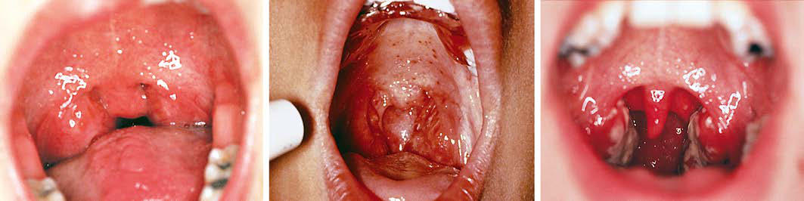

# Chapter 431: Tonsils and Adenoids

*Karen B. Zur*

<!-- p.3210 -->
pharyngitis (>1 week) can occur in infectious mononucleosis and Lemierre syndrome, but it also suggests the possibility of another dis order such as neutropenia, a recurrent fever syndrome, or an autoim mune disease such as SLE or IBD. In such instances, pharyngitis would be one of a number of clinical findings that together should suggest the underlying diagnosis.

**COMPLICATIONS AND PROGNOSIS** Viral respiratory tract infections can predispose to bacterial middle ear infections and bacterial sinusitis. The complications of GAS phar yngitis include local suppurative complications, such as parapharyn geal abscess, and subsequent nonsuppurative illnesses, such as ARF, APSGN, poststreptococcal reactive arthritis, and possibly pediatric autoimmune neuropsychiatric disorders associated with streptococci (PANDAS, sometimes referred to as *CANS* [childhood acute neuro psychiatric symptoms] or *PANS* [pediatric acute-onset neuropsychiat ric syndrome], recognizing that many infections other than GAS may predispose to these syndromes).

**PREVENTION** Vaccines intended to prevent infection with various viruses (e.g., RSV) and GAS are being developed. A recombinant multivalent GAS M-type vaccine uses the terminal portions of various M proteins to take advantage of their immunogenicity. Other GAS vaccines are based on more conserved epitopes in order to avoid the necessity of matching the vaccine with the M types prevalent in a community or target population. None of the investigational GAS vaccines are near licensing for use. A recent comprehensive study of the immune response to childhood GAS pharyngeal acquisition raises questions about how to best design effective vaccines. This is complicated by the variety of clinical scenarios and clinical syndromes associated with GAS and the need to determine the intended clinical benefit(s) of vaccination. Antimicrobial prophylaxis with daily oral penicillin pre vents recurrent GAS infections but is recommended only to prevent recurrences of ARF.

*Visit Elsevier eBooks+ at eBooks.Health.Elsevier.com** for Bibliography.*

The *Waldeyer ring* (the lymphoid tissue surrounding the opening of the oral and nasal cavities into the pharynx) comprises the palatine tonsils, the pharyngeal tonsil or adenoid, lymphoid tissue surrounding the eustachian tube orifice in the lateral walls of the nasopharynx, the lingual tonsil at the base of the tongue, and scattered lymphoid tissue throughout the remainder of the pharynx, particularly behind the pos terior pharyngeal pillars and along the posterior pharyngeal wall. The *palatine tonsil* consists of lymphoid tissue located between the pala toglossal fold (anterior tonsillar pillar) and the palatopharyngeal fold (posterior tonsillar pillar)*.* This lymphoid tissue is separated from the surrounding pharyngeal musculature by a thick fibrous capsule. The *adenoid* is a single aggregation of lymphoid tissue that occupies the space between the nasal septum and the posterior pharyngeal wall. A thin fibrous capsule separates it from the underlying structures; the adenoid does not contain the complex crypts that are found in the palatine tonsils, but rather more simple crypts. Lymphoid tissue at the base of the tongue forms the *lingual tonsil* that also contains simple tonsillar crypts.

*Karen B. Zur*

**NORMAL FUNCTION** Located at the opening of the pharynx to the external environment, the tonsils and adenoid are well situated to provide primary defense against foreign matter. The immunologic role of the tonsils and ade noids is to induce secretory immunity and to regulate the production of the secretory immunoglobulins. Deep crevices within tonsillar tis sue form tonsillar crypts that are lined with squamous epithelium and host a concentration of lymphocytes at their bases. The lymphoid tissue of the Waldeyer ring is most immunologically active between 4 and 10 years of age, with a decrease after puberty. Adenotonsillar hypertrophy is greatest between ages 3 and 6 years; in most children tonsils begin to involute after age 8 years. No major immunologic deficiency has been demonstrated after removal of either or both of the tonsils and adenoid.

**PATHOLOGY Acute Infection** Most episodes of acute pharyngotonsillitis are caused by viruses (see Chapter 430). Group A β-hemolytic streptococcus (GABHS) is the most common cause of bacterial infection in the pharynx (see Chapter 229).

**Chronic Infection** The tonsils and adenoids can be chronically infected by multiple microbes, which can include a high incidence of β-lactamase–produc ing organisms. Both aerobic species, such as streptococci and *Hae mophilus influenzae,* and anaerobic species, such as *Peptostreptococcus, Prevotella,* and *Fusobacterium,* contribute. The tonsillar crypts can accumulate desquamated epithelial cells, lymphocytes, bacteria, and other debris, causing cryptic tonsillitis. With time, these cryptic plugs can calcify into tonsillar concretions or tonsilloliths. Biofilms appear to play a role in chronic inflammation of the tonsils.

**Upper Airway Obstruction** Enlargement of the tonsils and/or adenoids is a major cause of upper airway obstruction in children. Airway obstruction in children is typi cally manifested in sleep-disordered breathing, including obstructive sleep apnea, obstructive sleep hypopnea, and upper airway resistance syndrome (see Chapter 31). Sleep-disordered breathing secondary to adenotonsillar hypertrophy is a cause of growth failure. Solid dyspha gia can also be seen in this group of patients, with symptoms such as prolonged chewing, pocketing of solids in the mouth, choking or gag ging when swallowing solids, and weight loss.

**Tonsillar Neoplasm** Rapid enlargement of one tonsil is highly suggestive of a tonsillar malignancy, typically lymphoma, in children.

**CLINICAL MANIFESTATIONS Acute Infection** Symptoms of GABHS infection include odynophagia, dry throat, mal aise, fever and chills, dysphagia, referred otalgia, headache, muscular aches, and enlarged cervical nodes. Signs include dry tongue, erythem atous enlarged tonsils, tonsillar or pharyngeal exudate, palatine pete chiae, and enlargement and tenderness of the jugulodigastric lymph nodes (Fig. 431.1; see Chapter 229).

**Chronic Infection** Children with chronic or cryptic tonsillitis often present with halito sis, chronic sore throats, foreign-body sensation, or a history of expel ling foul-tasting and foul-smelling cheesy lumps. Examination reveals tonsils of a range of sizes, often containing copious debris within the crypts. The offending organism is not usually GABHS.

**Airway Obstruction** The diagnosis of airway obstruction (see Chapter 31) can frequently be made by history and physical examination. Daytime symptoms of airway obstruction secondary to adenotonsillar hypertrophy include chronic mouth breathing, nasal obstruction, hyponasal speech, hyposmia,

<!-- p.3212 -->
B C A

**Fig. 431.1** Pharyngotonsillitis. This common condition has a number of causative pathogens and a wide spectrum of severity. A, The diffuse tonsil lar and pharyngeal erythema seen here is a nonspecific finding that can be produced by a variety of pathogens. B, This intense erythema, seen in as sociation with acute tonsillar enlargement and palatal petechiae, is highly suggestive of group A β-streptococcal infection, though other pathogens can produce these findings. C, This picture of exudative tonsillitis is most commonly seen with either group A streptococcal or Epstein-Barr virus infection. (B courtesy Michael Sherlock, MD, Lutherville, MD. From Yellon RF, McBride TP, Davis HW. Otolaryngology. In Zitelli BJ, Davis HW, eds. Atlas of Pediatric Physical Diagnosis, 4th ed. Philadelphia: Mosby; 2002:852.)

decreased appetite, poor school performance, hyperactivity, and, rarely, symptoms of right-sided heart failure. Nighttime symptoms consist of loud snoring, choking, gasping, frank apnea, restless sleep, abnormal sleep posi tions, sleep walking, night terrors, diaphoresis, enuresis, and sleep talking. Large tonsils are typically seen on examination, although the absolute size might not indicate the degree of obstruction. The size of the adenoid tissue can be demonstrated on a lateral neck radiograph or with flexible endos copy. Other signs that can contribute to airway obstruction include the presence of a craniofacial syndrome or hypotonia.

These daytime and nocturnal comorbidities should be explored in patients with enlarged tonsils and/or adenoids. Sleep studies (poly somnograms, PSG) are not routinely recommended unless significant co-morbidities exist.

**Tonsillar Neoplasm** The rapid unilateral enlargement of a tonsil, especially if accompanied by systemic signs of night sweats, fever, weight loss, and lymphadenopathy, is highly suggestive of a tonsillar malignancy. The diagnosis of a tonsil lar malignancy should also be entertained if the tonsil appears grossly abnormal. Among 54,901 patients undergoing tonsillectomy, 54 malig nancies were identified (0.087% prevalence); all but 6 malignancies had been suspected based on suspicious anatomic features preoperatively.

**TREATMENT Medical Management** The treatment of acute pharyngotonsillitis is discussed in Chapter 430 and antibiotic treatment of GABHS in Chapters 229 and 430. Because copathogens such as staphylococci or anaerobes can produce β-lactamase that can inactivate penicillin, the use of cephalosporins or clindamycin may be more efficacious in the treatment of *chronic* throat infections. A tonsillolith or debris may be expressed manually with either a cotton-tipped applicator, gargling after meals, or the use of a water jet.

**Tonsillectomy** The American Academy of Otolaryngology (AAO)–Head and Neck Surgery *Taskforce on Clinical Practice Guidelines: Tonsillectomy in Chil dren* most recently issued evidence-based guidelines in 2019 (Table 431.1, Fig. 431.2). Tonsillectomy alone is most often performed for recurrent or chronic pharyngotonsillitis, and in young children is often accompanied by an adenoidectomy (see next section). Tonsillectomy has been shown to be effective in reducing the number of infections and the symptoms of chronic tonsillitis such as halitosis, persistent or recurrent sore throats, and recurrent cervical adenitis in severely affected patients. In resis tant cases of cryptic tonsillitis, tonsillectomy may be curative. The 2019 guidelines recommend watchful waiting for recurrent throat infections

#### **Table 431.1** Paradise Criteria for Tonsillectomy

| Category / Parameter | Clinical Details & Findings |
| --- | --- |
| **DEFINITION** | Minimum; frequency of; sore throat; episodes; At least seven episodes in the previous year OR; at least five episodes in each of the previous; 2 years OR at least three episodes in each of; the previous 3 years; Clinical features; Sore throat plus at least one of the following; features qualifies as a counting episode:; • Temperature of greater than 38.3°C (101°F) OR; • Cervical adenopathy (tender lymph nodes; or lymph node size >2 cm) OR; • Tonsillar exudate OR; • Culture positive for group A β-hemolytic; streptococcus; Treatment; Antibiotics had been administered in the; conventional dosage for proven or suspected; streptococcal episodes; Documentation; Each episode of throat infection and its qualifying; features substantiated by contemporaneous; notation in a medical record |
| **OR** | If the episodes are not fully documented in the; patient record, subsequent observation by a; physician of two episodes of throat infection; with patterns of frequency and clinical features; consistent with the initial history*; *Allows for tonsillectomy recommendation in patients who meet all but the; documentation criterion. A 12-mo observation period is usually recommended before; consideration of tonsillectomy because of the tendency to improve with time.; Adapted from Mitchell RB, Archer SM, Ishman SL, et al. Clinical practice guideline:; tonsillectomy in children (update). Otolaryngol Head Neck Surg. 2019;160(1S):S1–S42,; Table 5. |

if there have been <7 episodes in the past year, <5 episodes/yr in the past 2 years, or <3 episodes/yr in the past 3 years (see Table 431.1 and Fig. 431.2).

Rarely in children, tonsillectomy is indicated for biopsy of a unilater ally enlarged tonsil to exclude a neoplasm or to treat recurrent hemor rhage from superficial tonsillar blood vessels.

Tonsillectomy has not been shown to offer clinical benefit over con servative treatment in children with mild infectious symptoms 2 years after surgery unless other factors or comorbidities exist. However, the 2019 Clinical Practice Guidelines did recommend assessing for addi tional modifying factors that may favor the need for a tonsillectomy,

<!-- p.3213 -->
Tonsillectomy candidate

**Primary reason for considering tonsillectomy**

**Obstructive sleep disordered breathing (oSDB)**

**Other reason not discussed**

**in guideline Recurrent throat**

**infection**

**PSG**

Age under 2 years, Down syndrome, obesity, craniofacial abnormality, neuromuscular disorder, sickle cell disease, or

mucopolysaccharidosis?

At least 7 in past year; 5/year for 2

years; or 3/year for 3 years?

Each episode documented in the

medical record?

PFAPA, history of peritonsillar abscess, or multiple

antibiotic allergy/intolerance?

Watchful waiting with documentation of any

future infections or change in condition

**No**

**No**

**Yes Yes**

**No No**

**No**

**Yes**

**Yes**

**No**

**Yes**

**Yes**

**Yes**

**No**

**No**

**Yes**

Individual decisions

Need for surgery is uncertain, or there is discordance between tonsillar size on physical exam

and reported severity of oSDB?

Does child have growth retardation, poor school performance, enuresis, or behavioral

problems?

Option of tonsillectomy

OSA diagnosed

on PSG?

Dysphonia, Dysphagia, Suspected malignancy, Chronic tonsillitis, Halitosis, Tonsilloliths

Refer for overnight

polysomnography

Decision to proceed with tonsillectomy

Tonsillectomy Perioperative pain counseling

Preoperative counseling about possible OSA persistence after

surgery if OSA is present

Decision against surgery

Follow-up to document

primary or secondary

hemorrhage

Ambulatory setting

In-patient setting

Determine personal rates of hemorrhage

at least annually

Shared decision-making regarding decision to proceed with surgery

Recommend tonsillectomy

**DO**

**DO** give acetaminophen,

ibuprofen, or both

give intra-operative steroid **DO NOT**

**DO NOT** give post-operative codeine

give peri-operative antibiotics Meets criteria for inpatient surgery, age under 3 years,

or severe OSA?

**Fig. 431.2** Tonsillectomy in children: clinical practice algorithm. OSA, Obstructive sleep apnea; PFAPA, periodic fever, aphthous stomatitis, phar yngitis, and adenitis; PSG, polysomnography. (Modified from Mitchell RB, Archer SM, Ishman SL, et al. Clinical practice guideline: tonsillectomy in children, update. Otolaryngol Head Neck Surg. 2019;160:S1–S42, Fig. 2.)

including intolerance or allergies to antibiotics, PFAPA (periodic fever, aphthous stomatitis, pharyngitis, adenitis), or a history of more than one peritonsillar abscess (PTA).

**Adenoidectomy** Adenoidectomy alone may be indicated for the treatment of chronic nasal infection (chronic adenoiditis), chronic sinus infections that have failed medical management, and recurrent bouts of acute otitis media, including those in children with tympanostomy tubes who suffer from recurrent otorrhea. Adenoidectomy may be helpful in children with chronic or recurrent otitis media with effusion. Adenoidectomy alone may be curative in the management of patients with nasal obstruction, chronic mouth breathing, and loud snoring suggesting sleep-disordered

breathing. Adenoidectomy may also be indicated for children in whom upper airway obstruction is suspected of causing craniofacial or occlu sive developmental abnormalities.

**Tonsillectomy and Adenoidectomy** The criteria for a tonsillectomy and adenoidectomy (T&A) for recur rent infections are the same as those for tonsillectomy alone. The other major indication for performing both procedures together is upper air way obstruction secondary to adenotonsillar hypertrophy that results in sleep-disordered breathing, failure to thrive, craniofacial or occlu sive developmental abnormalities, speech abnormalities, or, rarely, cor pulmonale. A high proportion of children with failure to thrive in the context of adenotonsillar hypertrophy resulting in sleep-disordered

<!-- p.3214 -->
breathing experience significant growth acceleration after a T&A. Most children do not require a sleep study before surgery; however, in a high-risk population, polysomnography may help in the decision for or against surgery (Table 431.2). High risk factors include age under 2 years, Down syndrome, obesity, craniofacial abnormality, neuromus cular disorder, sickle cell disease, and mucopolysaccharidosis.

**COMPLICATIONS Poststreptococcal Glomerulonephritis and Acute Rheumatic Fever** The two major complications of untreated GABHS infection are poststreptococcal glomerulonephritis and acute rheumatic fever (see Chapters 559.4 and 229).

**Peritonsillar Infection** Peritonsillar infection can occur as either cellulitis or a frank abscess in the region superior and lateral to the tonsillar capsule (see Chapter 432). These infections usually occur in children with a history of recur rent tonsillar infection and are polymicrobial, including both aerobes and anaerobes. Unilateral throat pain, referred otalgia, drooling, and trismus are presenting symptoms. The affected tonsil is displaced down and medially with swelling of the anterior tonsillar pillar and palate. The diagnosis of an abscess can be confirmed by CT or by needle aspi ration, the contents of which should be sent for culture.

**Retropharyngeal Space Infection** Infections in the retropharyngeal space develop in the lymph nodes that drain the oropharynx, nose, and nasopharynx (see Chapter 432).

**Parapharyngeal Space Infection** Tonsillar infection can extend into the parapharyngeal space, caus ing symptoms of fever, neck pain and stiffness, and signs of swell ing of the lateral pharyngeal wall and neck on the affected side. The diagnosis is confirmed by contrast medium–enhanced CT, and treatment includes intravenous antibiotics and external incision and

drainage if an abscess is demonstrated on CT (see Chapter 432). Septic thrombophlebitis of the jugular vein, **Lemierre syndrome**, manifests with fever, toxicity, neck pain and stiffness, and respira tory distress caused by multiple septic pulmonary emboli and is a complication of a parapharyngeal space or odontogenic infection from *Fusobacterium necrophorum.* Concurrent Epstein-Barr virus mononucleosis (see Chapter 301) can be a predisposing event before the sudden onset of fever, chills, and respiratory distress in an ado lescent patient. Treatment includes high-dose intravenous antibiotics (ampicillin-sulbactam, clindamycin, penicillin, or ciprofloxacin) and anticoagulation.

**Recurrent or Chronic Pharyngotonsillitis** See Chapter 430.

**CHRONIC AIRWAY OBSTRUCTION** Although rare, children with chronic airway obstruction from enlarged tonsils and adenoids can present with cor pulmonale.

The effects of chronic airway obstruction and mouth breathing on facial growth remain a subject of controversy. Studies of chronic mouth breathing, both in humans and animals, have shown changes in facial development, including prolongation of the total anterior facial height and a tendency toward a retrognathic mandible, the so-called *adenoid facies*. Adenotonsillectomy can reverse some of these abnormalities. Other studies have disputed these findings.

**Tonsillectomy and Adenoidectomy** The risks and potential benefits of surgery must be considered (Table 431.3). The mortality is low (~0.007%); most often associated with other complex medical conditions. Dehydration caused by odynophagia (painful swal lowing) is not uncommon in the first postoperative week. The child is encouraged to drink liquids; however, early resumption of a solid diet is also recommended to help with the pain and return of oral function.

Postoperative pain needs to be managed, and opioid-free tonsil lectomies are now recommended. Clinicians are encouraged to counsel the caregivers about the importance of hydration and man aging postoperative pain with nonsteroidal antiinflammatory drugs (NSAIDs) and acetaminophen and to reinforce this information on the day of surgery. The child is encouraged to hydrate, chew, and rest. Codeine is associated with excessive sedation and fatalities and *is not* recommended.

Populations Before Tonsillectomy for oSDB

#### **Table 431.2** Role of PSG in Assessing High-Risk

| Category / Parameter | Clinical Details & Findings |
| --- | --- |
| **RATIONALE** | Avoid unnecessary or ineffective; surgery in children with; primarily nonobstructive events; Identify primarily nonobstructive; events or central apnea that; may not have been suspected; before the study and may not; benefit from surgery; Confirm the presence of; obstructive events that would; benefit from surgery; The increased morbidity of; surgery in high-risk children; requires diagnostic certainty; before proceeding; Define the severity of oSDB to; assist in preoperative planning; Children with severe OSA may; require preoperative cardiac; assessment, pulmonary; consultation, anesthesia; evaluation, or postoperative; inpatient monitoring in an; intensive care setting; Provide a baseline PSG for; comparison after surgery; Persistent OSA despite surgery; is more common in high-risk; patients than in otherwise; healthy children; Document the baseline severity; of oSDB; High-risk patients are more; prone to complications of; surgery or anesthesia; OSA, Obstructive sleep apnea; oSDB, obstructive sleep-disordered breathing; PSG,; polysomnography.; From Mitchell RB, Archer SM, Ishman SL, et al. Clinical practice guideline: tonsillectomy; in children (update). Otolaryngol Head Neck Surg. 2019;160(IS):S1–S42, Table 6. |

Both

#### **Table 431.3** Risks of Tonsillectomy or Adenoidectomy or

| Category / Parameter | Clinical Details & Findings |
| --- | --- |
| **General** | Cost; Risk of anesthetic events; • Malignant hyperthermia; • Cardiac arrhythmia; • Vocal cord trauma; • Aspiration with resulting bronchopulmonary obstruction or; infection; • Postoperative nausea and vomiting (PONV); Risk of miscellaneous surgical or postoperative complications; • Pain; • Dysphagia; • Hemorrhage; • Airway obstruction from edema of tongue, palate, or; nasopharynx, or retropharyngeal hematoma; • Prolonged muscular paralysis; • Dehydration; • Palatopharyngeal insufficiency; • Facial edema; • Trauma: dental, larynx, vessels, pharyngeal wall, soft palate; • Laryngospasm; • Mediastinitis; • Cardiac arrest; Modified from Bluestone CD, ed. Pediatric Otolaryngology, 4th ed. Philadelphia: WB; Saunders; 2003:1213. |

<!-- p.3216 -->
