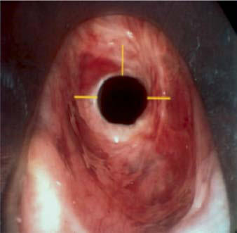

# Chapter 434: Congenital Anomalies of the Larynx, Trachea, and Bronchi

*Michael Gorelik and James W. Schroeder Jr.*

<!-- p.3225 -->
**TREATMENT** Appropriate antimicrobial therapy, which usually includes anti staphylococcal agents, should be instituted in any patient whose course suggests bacterial tracheitis. Empiric therapy recommenda tions for bacterial tracheitis include vancomycin or clindamycin and a third- or fourth-generation cephalosporin (e.g., ceftriax one or cefepime). When bacterial tracheitis is diagnosed by direct laryngoscopy or is highly suspected on clinical grounds, an artificial airway should be strongly considered. Supplemental oxygen is usu ally necessary.

**COMPLICATIONS** Chest radiographs often show patchy infiltrates and may show focal densities. Subglottic narrowing and a rough and ragged tracheal air column can often be demonstrated radiographically. If airway manage ment is not optimal, cardiorespiratory arrest can occur. Toxic shock syndrome has been associated with staphylococcal and group A strep tococcal tracheitis (see Chapter 227.2).

**PROGNOSIS** The prognosis for most patients is excellent. Patients usually become afebrile within 2-3 days of the institution of appropriate antimicrobial therapy, but prolonged hospitalization may be nec essary. In recent years, there appears to be a trend toward a less morbid condition. With a decrease in mucosal edema and purulent secretions, extubation can be accomplished safely, and the patient should be observed carefully while antibiotics and oxygen therapy are continued.

*Visit Elsevier eBooks+ at eBooks.Health.Elsevier.com** for Bibliography.*

The larynx functions as a breathing passage, a valve to protect the lungs during swallowing, and the primary organ of communication. Symptoms related to congenital anomalies of the larynx include air way obstruction, noisy breathing, difficulty feeding, and abnormalities of phonation (see Chapter 421). Obstructive congenital lesions of the upper airway create turbulent airflow according to the laws of fluid dynamics. Turbulent airflow across a narrowed segment of the respira tory tract produces distinctive sounds that are diagnostically useful. The location of the obstruction produces characteristic changes in the sound of inspiration and/or expiration. Intrathoracic lesions typi cally cause expiratory wheezing and/or stridor, often masquerading as asthma or other pulmonary processes. The expiratory wheezing con trasts to the inspiratory stridor caused by the extrathoracic lesions of congenital laryngeal anomalies, specifically laryngomalacia and bilat eral vocal cord paralysis. Stertor describes the low-pitched inspiratory snoring sound typically produced by soft tissue from nasal or nasopha ryngeal obstruction.

*Michael Gorelik and James W. Schroeder Jr.*

*The timing of noisy breathing in relation to the sleep–wake cycle is important.* Obstruction of the pharyngeal airway (by enlarged tonsils, adenoids, pharyngeal soft tissue, tongue, or syndromes with midface hypoplasia) typically produces worse obstruction during sleep than during waking. Obstruction that is worse when awake is typically laryngeal, tracheal, or bronchial and is exacerbated by exertion. The location of the obstruction dictates the respiratory phase, tone, and nature of the sound, and these qualities direct the differential diagnosis.

With airway obstruction, the degree of the obstructing lesion and the resulting work of breathing determine the necessity for diagnos tic procedures and surgical intervention. Obstructive symptoms vary from mild to severe stertor or stridor with episodes of apnea, cyanosis, suprasternal (tracheal tugging) and subcostal retractions, dyspnea, and tachypnea. Significant congenital anomalies of the trachea and bronchi can create serious respiratory difficulties from the first minute of life and may sometimes be diagnosed in the prenatal period. If a severe obstruction is suspected prenatally, an airway birth plan should be developed by a high-risk maternal–fetal medicine expert, a neonatolo gist, and a pediatric airway surgeon. *Congenital high airway obstruction syndrome,* or *CHAOS,* can lead to immediate postnatal distress (see Chapters 117 and 118). Chronic obstruction can cause failure to thrive and chronic hypoxemia and may have long-term effects on growth and development.

*Visit Elsevier eBooks+ at eBooks.Health.Elsevier.com** for Bibliography.*

## 434.1  Laryngomalacia Michael Gorelik and James W. Schroeder Jr.

Laryngomalacia accounts for 45–75% of congenital laryngeal anoma lies in children with stridor. Stridor is inspiratory and can vary from high- to low-pitched. It can be present at rest and exacerbated by any exertion: crying, agitation, or feeding. The stridor is caused, in part, by decreased laryngeal tone leading to supraglottic collapse during inspi ration, which creates a narrow airway and turbulent airflow. Symp toms usually appear within the first 2 weeks and increase in severity for up to 6 months, although gradual improvement can begin at any time. Many infants who do not require surgical intervention often have spontaneous resolution of stridor around 7-9 months of age, and the majority will have complete resolution of stridor by 18 months of age. Gastroesophageal reflux disease, laryngopharyngeal reflux disease, and neurologic disease with associated muscle hypotonia can influence the severity of the disease and thereby the clinical course.

**DIAGNOSIS** The diagnosis is made primarily based on clinical symptoms and is con firmed by outpatient, awake flexible laryngoscopy (Fig. 434.1). When the work of breathing is moderate to severe, airway films and chest radiographs are indicated. Laryngomalacia can contribute to feeding difficulties and dysphagia in some children because of decreased laryn geal sensation and poor suck-swallow-breath coordination. When the inspiratory stridor sounds wet or is associated with a cough or when there is a history of repeat upper respiratory illness or pneumonia, dys phagia should be considered. When dysphagia is suspected, a contrast swallow study and/or a fiberoptic endoscopic evaluation of swallowing (FEES) may be considered. Because 15–60% of infants with laryngo malacia have synchronous airway anomalies, complete bronchoscopy is undertaken for patients with moderate to severe obstruction.

**TREATMENT** Expectant observation is suitable for most infants because most symp toms resolve spontaneously as the child and airway grow. Laryngo pharyngeal reflux is managed with antireflux medications, such as histamine H2-receptor antagonists or proton pump inhibitors (PPIs).

<!-- p.3227 -->

<!-- p.3228 -->

**Fig. 434.1** Endoscopic example of laryngomalacia. On inspiration, the epiglottic folds collapse into the airway. The lateral tips of the epi glottis are also collapsing inward (arrow). (From Slovis T, ed. Caffey’s Pediatric Diagnostic Imaging, 11th ed. Philadelphia: Mosby; 2008.)

The risk-to-benefit ratio should be assessed in each patient because these medications, particularly PPIs, have been associated with irondeficiency anemia and increased incidence of pneumonia, gastroen teritis, and *Clostridium difficile* infections, among others. In 15–20% of patients with laryngomalacia, symptoms are severe enough to cause progressive respiratory distress, cyanosis, failure to thrive, or cor pul monale. In these patients, surgical intervention via supraglottoplasty is considered. Supraglottoplasty is 90% successful in relieving upper airway obstruction caused by laryngomalacia. Some comorbidities, such as cardiac disease, neurologic disease, pulmonary disorders, or craniofacial anomalies, may be poor prognostic indicators that would suggest earlier intervention.

*Visit Elsevier eBooks+ at eBooks.Health.Elsevier.com** for Bibliography.*

## 434.2  Congenital Subglottic Stenosis Michael Gorelik and James W. Schroeder Jr.

Congenital subglottic stenosis is the second most common cause of stridor. The subglottis is the narrowest part of the upper airway in a child and is located in the space extending from the undersurface of the true vocal folds to the inferior margin of the cricoid cartilage. Subglot tic stenosis is a narrowing of the subglottic larynx and in a term new born is defined as a cricoid diameter of less than 3.5 mm resulting from malformation of the cricoid cartilage. Subglottic stenosis manifests in the infant with respiratory distress and biphasic or primarily inspira tory stridor. It may be congenital or acquired. Symptoms may pres ent spontaneously with a higher degree of stenosis but manifest after a respiratory tract infection because of edema and thickened secretions of a narrow and already compromised airway leading to recurrent or persistent crouplike symptoms.

Biphasic or primarily inspiratory stridor is the typical presenting symptom for congenital subglottic stenosis. In a child with recurrent bronchiolitis or croup, a diagnosis of congenital subglottic stenosis should be considered. The stenosis can be caused by an abnormally shaped elliptical cricoid cartilage; by a first tracheal ring that becomes trapped underneath the cricoid cartilage; or by soft tissue thicken ing caused by ductal cysts, submucosal gland hyperplasia, or fibrosis.

Acquired subglottic stenosis refers to stenosis caused by extrinsic fac tors, most commonly resulting from prolonged intubation, and is dis cussed in further detail in Chapter 436.

**DIAGNOSIS** The diagnosis made by airway radiographs is confirmed by direct laryngoscopy and bronchoscopy. During diagnostic laryngoscopy, the subglottic larynx is visualized directly and sized objectively using endo tracheal tubes (Fig. 434.2). The percentage of stenosis is determined by comparing the size of the patients’ larynx to a standard of laryngeal dimensions based on age. Stenosis >50% is usually symptomatic and often requires treatment. As with all cases of upper airway obstruction, tracheostomy is avoided when possible. Subglottic stenosis is typically measured using the Myer-Cotton system, with grade I through grade IV subglottic stenosis indicating the severity of narrowing. Other fac tors to consider aside from the degree of narrowing are whether the stenotic segment is soft or firm, which can determine the appropriate type of surgical intervention. Dilation and endoscopic laser surgery can be attempted in grade I and II, although they may not be effective because most congenital stenoses are cartilaginous. Anterior cricoid split, anterior-posterior cricoid split, tracheostomy, or laryngotracheal reconstruction with cartilage graft augmentation are surgical options typically reserved for grade III and IV subglottic stenosis. The differen tial diagnosis includes other anatomic anomalies, as well as a subglottic hemangiomas or respiratory papillomatosis.

*Visit Elsevier eBooks+ at eBooks.Health.Elsevier.com** for Bibliography.*

## 434.3  Vocal Cord Paralysis Michael Gorelik and James W. Schroeder Jr.

Vocal cord paralysis is the third most common congenital laryngeal anomaly that produces stridor in infants and children. Congenital central nervous system lesions such as Chiari malformation, myelome ningocele, and hydrocephalus or birth trauma may be associated with bilateral paralysis. Additionally, congenital anomalies of the heart or great vessels can be associated with vocal cord paralysis. Bilateral vocal cord paralysis produces airway obstruction at the level of the glottis and is manifested by respiratory distress and high-pitched inspiratory stridor, aphonatory or dysphonic sound, or inspiratory weak cry. More than 50% of cases of vocal cord paralysis in children are bilateral.

Unilateral vocal cord paralysis is most often iatrogenic, as a result of surgical treatment for aerodigestive (tracheoesophageal fistula) and cardiovascular (patent ductus arteriosus repair) anomalies and thyroid or parathyroid surgery, although it may also be idiopathic. Unilateral paralysis can lead to aspiration, coughing, and choking. Often the cry is weak and breathy, whereas stridor and other symptoms of airway obstruction are less common. Vocal cord paralysis in older children may be the result of a Chiari malformation or tumors compressing the vagus or recurrent laryngeal nerve. Vocal cord paralysis/palsies have also been reported in patients with Guillain-Barré syndrome (GBS) and its Miller Fisher variant either as an isolated finding or associ ated with other features of GBS. Other neurologic disorders produc ing vocal cord paralysis include stroke, multiple sclerosis, and other polyneuropathies. The prognosis for spontaneous recovery is better for unilateral, acquired, and right-sided paralysis.

**DIAGNOSIS** The diagnosis of vocal cord paralysis is made by awake flexible laryngoscopy. The examination will demonstrate an inability or weakness to abduct the involved vocal cord. A thorough investi gation for the underlying primary cause is indicated. Because of the association with other congenital lesions, evaluation includes neurology and cardiology consultations, imaging of the course of the recurrent laryngeal nerve, and diagnostic endoscopy of the lar ynx, trachea, and bronchi. During endoscopy, it is critical to pal pate the cricoarytenoid joint to rule out joint fixation, which can be

<!-- p.3229 -->

<!-- p.3230 -->

<!-- p.3231 -->
mistaken for bilateral vocal fold paralysis. Intraoperative laryngeal electromyography (EMG) is the most specific and sensitive test to determine the presence of vocal cord paralysis.

**TREATMENT** Treatment is based on the severity of the symptoms. Idiopathic vocal cord paralysis in infants usually resolves spontaneously within 6-12 months. If it is not resolved by 2-3 years of age, function typically does not recover. Patients with unilateral vocal cord paralysis often do not require intervention secondary to spontaneous recovery or compensation for the contralateral vocal cord. If there is persistent dysphonia or aspiration, surgical options include vocal fold injec tion, surgical medialization, or reinnervation using the ansa cervi calis, which has been successful in regaining unilateral vocal cord function. Postoperative voice therapy is helpful to achieve optimum results.

Bilateral paralysis may require temporary tracheotomy in 50% of patients. Airway augmentation procedures in bilateral vocal cord paralysis typically focus on widening the posterior glottis, such as an endoscopically placed or open posterior glottis cartilage graft, arytenoidectomy, or arytenoid lateralization, sometimes in con junction with cordotomy. These procedures are generally successful in reducing the obstruction; however, they may result in dysphagia and aspiration.

*Visit Elsevier eBooks+ at eBooks.Health.Elsevier.com** for Bibliography.*

## 434.4  Congenital Laryngeal Webs and Atresia Michael Gorelik and James W. Schroeder Jr.

Congenital laryngeal webs account for about 5% of congenital laryngeal anomalies. They are typically located in the anterior glot tis with subglottic extension and associated subglottic stenosis. During early embryogenesis, laryngeal webs form if the laryngo tracheal lumen fails to fully recannulate. The clinical presentation ranges from asymptomatic, to dysphonia, to severe airway com promise secondary to the degree of obstruction caused by the web. Laryngeal webs are categorized from type I to type IV, which is the most severe.

Laryngeal atresia occurs as a complete glottic web due to failure of laryngeal and tracheal recanalization and may be associated with tracheal agenesis and tracheoesophageal fistula. Laryngeal atresia may be detected in the prenatal period, and preparations should be made for establishment of definitive airway, either before or at birth. Other times, congenital laryngeal atresia is a cause of respi ratory distress in the newborn and is diagnosed only upon initial direct laryngoscopy.

Diagnosis is made by direct laryngoscopy (Fig. 434.3). Thick webs may be suspected in lateral radiographs of the airway. Chromosomal and congenital cardiovascular anomalies, as well as chromosome 22q11 deletion, are common in patients with laryngeal webs. Treat ment may require only incision or dilation for thin webs. Thick webs can require laryngofissure and temporary stenting. Webs with associ ated subglottic stenosis are likely to require cartilage augmentation of the cricoid cartilage (laryngotracheal reconstruction). Voice outcomes are variable after surgical management.

*Visit Elsevier eBooks+ at eBooks.Health.Elsevier.com** for Bibliography.*

A

C B

**Fig. 434.2** Endoscopic repair of subglottic stenosis with radial cuts at 12, 3, and 9 o’clock positions using a laryngeal sickle knife or laser. A, Preop erative view. B, Diagram of planned incisions. C, After cuts and balloon dilation. (From Lawlor CM, Rahbar R, Choi SS. Glottic and subglottic stenosis and related voice disorders. In: Lesperance MM, ed. Cummings Pediatric Otolaryngology, 2nd ed. Philadelphia: Elsevier; 2022: Fig. 28.8, p. 409.)

**Fig. 434.3** Anterior glottic web, endoscopic view. (Courtesy Dr. Jeff Rastatter, Division of Pediatric Otolaryngology, Lurie Children’s Hospi tal, Chicago, IL.)

<!-- p.3232 -->

<!-- p.3233 -->

<!-- p.3234 -->

## 434.5  Congenital Subglottic Hemangioma Michael Gorelik and James W. Schroeder Jr.

See also Chapter 438.3.

Subglottic infantile hemangiomas are benign vascular malforma tions and a rare cause of early infancy respiratory distress. They present more commonly in females than in males, with symptoms of a barky cough and inspiratory or biphasic stridor in the absence of dysphonia. Symptoms typically present within the first 1-6 months of life. The most common presenting symptom is biphasic stridor, somewhat more prominent during inspiration. This is exacerbated by crying and acute viral illnesses. A barking cough, hoarseness, and symptoms of recurrent or persistent croup are typical and can mask the diagnosis. Roughly 50% of those with a subglottic heman gioma will have a cutaneous hemangioma, but only 1% of children who have cutaneous hemangiomas will have a subglottic heman gioma (see Chapter 691). However, a facial hemangioma in the beard distribution (preauricular area, lips, chin, and neck) is associ ated with a much higher incidence of subglottic hemangiomas and, when present, should prompt further investigation. Chest and neck radiographs can show the characteristic asymmetric narrowing of the subglottic larynx. CT and MRI can also assist with the diagno sis. Airway vascular lesions may also be associated with **PHACES syndrome**, characterized by posterior fossa malformations, hem angioma, arterial lesions of the head and neck, cardiac anomalies, eye anomalies, and sternal cleft (see Chapter 691). More than 50% of children with PHACES syndrome have an airway vascular lesion. Treatment options range from conservative monitoring, medical management, steroid injection, laser treatment, and open surgical resection to tracheotomy and airway reconstruction. Propranolol has become a mainstay in initial therapy of subglottic hemangioma; however, it is estimated that up to 50% of patients with subglottic hemangioma may not have a long-term response to propranolol, indicating a need for close airway monitoring in these patients (Fig. 434.4). Treatment is further discussed in Chapter 438.3.

*Visit Elsevier eBooks+ at eBooks.Health.Elsevier.com** for Bibliography.*

## 434.6  Laryngoceles and Saccular Cysts Michael Gorelik and James W. Schroeder Jr.

Saccular cysts and laryngoceles are uncommon etiologies of pedi atric airway obstruction. A laryngocele is an abnormal air-filled dilation of the laryngeal saccule that arises vertically between the false vocal cord, the base of the epiglottis, and the inner surface of the thyroid cartilage. As there is open communication with the laryngeal lumen when it intermittently fills with air, this can lead

to hoarseness and dyspnea. Laryngoceles may be confined to the larynx or extend into the neck and are described as internal, exter nal, or both. A saccular cyst (congenital cyst of the larynx) is dis tinguished from the laryngocele in that its lumen is isolated from the interior of the larynx and it contains mucus, not air. Saccular cysts can be located in the anterior and lateral portions of the glottis and supraglottis. In infants and children, laryngoceles cause hoarse ness and dyspnea that may increase with crying. Saccular cysts may cause respiratory distress and stridor at birth and may require early airway intervention. Infection of saccular cysts can lead to rapid expansion and acute airway compromise. Intubation can be chal lenging because the supraglottic and laryngeal anatomy may be distorted. In addition, complete airway obstruction may occur on induction with neuromuscular blockade because of decreased laryngeal tone. A saccular cyst may be visible on radiography, but the diagnosis is made by laryngoscopy (Fig. 434.5). Needle aspira tion of the cyst confirms the diagnosis but rarely provides a cure. Surgical excision is the therapy of choice for management of sac cular cysts and laryngoceles. Approaches include endoscopic CO2 laser excision, endoscopic extended ventriculotomy (marsupializa tion or unroofing), or, traditionally, external excision.

*Visit Elsevier eBooks+ at eBooks.Health.Elsevier.com** for Bibliography.*

## 434.7  Posterior Laryngeal Cleft and Laryngotracheoesophageal Cleft Michael Gorelik and James W. Schroeder Jr.

The posterior laryngeal cleft is the result of a deficiency in the mid line of the posterior larynx caused by a failure of fusion of the pos terior cricoid lamina. This results in an abnormal communication between the posterior larynx and esophagus leading to aspiration. Posterior laryngeal clefts are categorized into four types depending how far inferiorly the cleft extends. A **type I cleft** extends to, but not beyond, the vocal cords. A **type II cleft** extends beyond the vocal cords to, but not through, the cricoid cartilage. A **type III cleft** extends through the cricoid cartilage into the cervical trachea. A

A B

**Fig. 434.4** A and B, Case of tracheal hemangioma prepropranolol and postpropranolol therapy (pictures 2 weeks apart). (From Bush A, Abel R, Chitty L, et al. Congenital lung disease. In: Wilmott RW, Deterd ing RR, Li A, et al., eds. Kendig’s Disorders of the Respiratory Tract in Children, 9th ed. Philadelphia: Elsevier; 2019: Fig. 18.18, p. 308.)

**Fig. 434.5** Endoscopic photograph of a saccular cyst. (From Ahmad SM, Soliman AMS. Congenital anomalies of the larynx. Otolaryngol Clin North Am. 2007;40:177–191, Fig. 3.)

<!-- p.3235 -->

<!-- p.3236 -->
**type IV cleft** extends into the thoracic trachea. Laryngeal clefts can occur in families and are likely to be associated with tracheal agen esis, tracheoesophageal fistula, and multiple congenital anomalies, including Opitz-Frias syndrome, Townes-Brock syndrome, chro mosome 1q43 deletion, trisomy 21, and Pallister-Hall syndrome.

Type I clefts may cause mild symptoms, but at least 60% of these will cause no symptoms and will not require surgical repair. Type I and, more commonly, type II clefts can present with feeding prob lems, recurrent aspiration, pneumonias, or respiratory complaints. Infants with type III and IV clefts will present more commonly in the newborn period with significant aspiration and respiratory distress.

Diagnostic workup includes an esophagogram, which is under taken to evaluate the presence of aspiration or laryngeal penetration of ingested contrast material. A FEES exam may be undertaken by an otolaryngologist with the assistance of a speech-language and pathol ogy team to observe patterns of liquid spillage during swallow and may identify a cleft. However, the gold standard of diagnosis remains opera tive laryngoscopy and bronchoscopy with palpation of the posterior larynx. This assists in determining the length of the cleft and guides treatment options.

Treatment is based on the cleft type and the symptoms; in general, a type I cleft may be managed endoscopically, whereas higher grades may require an open procedure. Stabilization of the airway is the first priority. Gastroesophageal reflux must be controlled, and a care ful assessment for other congenital anomalies is undertaken before repair. Several endoscopic and open cervical and transthoracic surgical repairs have been described.

*Visit Elsevier eBooks+ at eBooks.Health.Elsevier.com** for Bibliography.*

## 434.8  Vascular and Cardiac Anomalies Michael Gorelik and James W. Schroeder Jr.

Aberrant cardiopulmonary vascular anatomy may directly affect the trachea and bronchi, resulting in respiratory and feeding prob lems (Fig. 434.6). The aberrant innominate artery is the most com mon cause of secondary tracheomalacia (see Chapter 481). It may be asymptomatic and discovered incidentally, or it may cause severe symptoms. Expiratory wheezing and cough occur and, rarely, reflex apnea or “dying spells.” Surgical intervention is rarely necessary. Infants are most commonly treated expectantly because the prob lem is often self-limited.

The term *vascular ring* is used to describe vascular anomalies that result from abnormal development of the aortic arch complex. Vas cular rings are categorized as complete or incomplete. Double aortic arch is the most common type of complete vascular ring, followed by right aortic arch with aberrant left subclavian artery and left ligamentum arteriosum. These account for more than 95% of com plete rings. The double aortic arch encircles and compresses both the trachea and esophagus. With few exceptions, these patients are symptomatic by 3 months of age. Respiratory symptoms predomi nate, but dysphagia may be present. The diagnosis is established by barium esophagogram that shows a posterior indentation of the esophagus by the vascular ring (see Fig. 434.6). CT or MRI with angiography provides the cardiothoracic surgeon the information needed. Surgical treatment for symptomatic patients entails divi sion of the vascular ring.

Other vascular anomalies include the pulmonary artery sling, which also requires surgical correction. The most common open

(incomplete) vascular ring is the left aortic arch with aberrant right subclavian artery. It is usually asymptomatic, although dyspha gia lusoria has been described. This is characterized as dysphagia caused by an aberrant subclavian artery coursing behind the esoph agus, leading to esophageal compression and difficulty with bolus transit.

Congenital cardiac defects are likely to compress the left main bron chus or lower trachea. Any condition that produces significant pulmo nary hypertension increases the size of the pulmonary arteries, which in turn causes compression of the left main bronchus. Surgical correc tion of the underlying pathology to relieve pulmonary hypertension relieves the airway compression.

*Visit Elsevier eBooks+ at eBooks.Health.Elsevier.com** for Bibliography.*

## 434.9  Tracheal Stenoses, Webs, and Atresia Michael Gorelik and James W. Schroeder Jr.

Long-segment congenital tracheal stenosis with *complete* tracheal rings typically presents within the first year of life, usually after a crisis has been precipitated by an acute respiratory illness. The diagnosis may be suggested by plain radiographs. CT with contrast delineates associated intrathoracic anomalies such as the pulmo nary artery sling (in ~30%) or other cardiac anomalies (in about 25%), which can occur in one third of patients to one fourth of patients, respectively. Bronchoscopy is the best method to define the degree and extent of the stenosis and the associated abnormal bronchial branching pattern. Care must be taken to avoid traumatic passage of a telescope or bronchoscope through a stenotic or edem atous segment, as even minor mucosal trauma may precipitate com plete airway obstruction. Treatment of clinically significant stenosis involves tracheal resection of short-segment stenosis, slide tracheo plasty for long-segment stenosis, or tracheal rings. Total autologous tracheal replacement is another option. Congenital soft tissue ste nosis and thin webs are rare. Dilation may be all that is required.

*Visit Elsevier eBooks+ at eBooks.Health.Elsevier.com** for Bibliography.*

## 434.10  Foregut Cysts Michael Gorelik and James W. Schroeder Jr.

The embryologic foregut gives rise to the pharynx, lower respira tory tract, esophagus, stomach, duodenum, and hepatobiliary tract. Foregut duplication cysts arise if heterotopic rests of foregut-derived epithelium persist anywhere along this tract. Foregut duplications account for approximately one third of all duplications. The bron chogenic cyst, intramural esophageal cyst (esophageal duplication), and enteric cyst can all produce symptoms of respiratory obstruc tion and dysphagia. The diagnosis is suspected when chest radio graphs or CT scan delineates the mass and, in the case of enteric cyst, the associated vertebral anomaly. The treatment of all foregut cysts is surgical excision.

*Visit Elsevier eBooks+ at eBooks.Health.Elsevier.com** for Bibliography.*

## 434.11  Tracheomalacia and Bronchomalacia

See Chapter 437.

<!-- p.3237 -->

<!-- p.3238 -->

<!-- p.3240 -->

<!-- p.3242 -->
