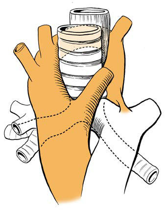

# Chapter 435: Foreign Bodies in the Airway

*Michael Gorelik and James W. Schroeder Jr.*

<!-- p.3239 -->
A

Trachea

Left common carotid artery

Esophagus

Left subclavian artery Right subclavian

artery Right common

carotid artery

Double aortic arch

Aorta

Pulmonary trunk

B

Trachea Esophagus

Left aberrant subclavian artery

Left ligamentum arteriosum

Left common carotid artery

Right subclavian

artery

Right common

carotid artery

Double aortic arch

Aorta

Pulmonary trunk

C

Trachea

Esophagus

Left subclavian artery

Left common carotid artery Right aberrant innominate artery

Aortic arch

Aorta

D

Trachea

Esophagus

Left pulmonary artery sling

Pulmonary

trunk

**Fig. 434.6** Vascular rings. A, Double aortic arch. B, Right aortic arch with aberrant left subclavian artery and left ligamentum arteriosum. C, Aber rant innominate artery. D, Left pulmonary artery sling. (From Green GF, Ohye RG. Diagnosis and management of tracheal anomalies and tracheal stenosis. In: Lesperance MM, ed. Cummings Pediatric Otolaryngology, 2nd ed. Philadelphia: Elsevier; 2022: Fig. 30.6, p. 445.)

Choking is a leading cause of morbidity and mortality among children, especially those younger than 4 years of age. From 2001 to 2009, an average of 12,435 children ages 0-14 years in the United States were treated in emergency departments for choking on food without fatal ity. The majority of children found to have foreign body aspiration are older infants and toddlers (Fig. 435.1), with males being 1.7 times more likely than females to aspirate a foreign body. Roughly 80% of airway foreign body aspirations occur in children younger than 3 years old, with a peak in incidence between ages 1 and 2. Food items ranging from nuts, seeds, popcorn, and food particles to hardware and pieces of toys account for 59.5–81% of all cases. Nonfood and inorganic objects such as coins, paper clips, pen caps, or small toys are more commonly

*Michael Gorelik and James W. Schroeder Jr.*

aspirated by older children. Globular, compressible, or round objects such as hot dogs, grapes, nuts, balloons, marshmallows, meats, and candies are particularly hazardous because of their ability to com pletely occlude the airway.

Age (year)

Number of fatalities

<1 1 0

5

10

15

20

25

30

35

2 3 4 5 6 7 8 9 10 11 12 13 14

**Fig. 435.1** Number of fatalities versus victim age, all fatality types. (From Milkovich SM, Altkorn R, Chen X, et al. Development of the small parts cylinder: lessons learned. Laryngoscope. 2008;118[11]:2082– 2086.)

<!-- p.3241 -->

<!-- p.3243 -->
Younger children are at a higher risk for foreign body aspiration largely secondary to their developmental vulnerabilities and imma ture swallow function. Infants and toddlers often use their mouths to explore their surroundings, and children are more likely to be dis tracted, playing, or ambulatory while eating. Infants have the ability to suck and swallow and are equipped with basic involuntary reflexes (gag, cough, and glottis closure) that help to protect against aspiration during swallowing. Dentition develops at approximately 6 months of age with the eruption of the incisors, whereas molars do not erupt until approximately 1.5 years of age. Mature mastication takes longer to develop.

Despite these various protective mechanisms, a child’s airway is more vulnerable to obstruction than an adult’s airway. Young chil dren are more likely to experience significant obstruction by small foreign bodies because of the smaller diameter of the pediatric airway. Mucus and secretions may form a seal around the foreign body, making it more difficult to dislodge by forced exhalation. In addition, the force of air generated by an infant’s or young child’s cough is less effective in dislodging an airway obstruction. For these reasons, it is recommended that children younger than 5 years of age avoid foods like hard candy or chewing gum and that raw fruits and vegetables be cut into small pieces. Additionally, children with developmental delays or neurologic and muscular disorders are at higher risk for foreign body aspiration.

**CLINICAL MANIFESTATIONS** Foreign bodies of the airway have variable presentations and complica tions, depending on the characteristics, duration, and location of the foreign body. The clinical manifestations range from an asymptomatic state to severe respiratory distress. A high index of suspicion is often required, as delayed presentation is common, with more than 50% of cases presenting after 24 hours of the suspected aspiration event. The most serious complication of foreign body aspiration is complete obstruction of the airway, which may be recognized in the conscious child as sudden respiratory distress followed by an inability to speak or cough.

There are typically three stages of symptoms that result from aspira tion of an object into the airway: 1.	**Initial event:** Paroxysms of coughing, choking, gagging, and pos

sible airway obstruction occur immediately after aspiration of the foreign body. This may be accompanied by tachypnea and stridor. The child is sometimes able to expel the foreign body during this stage. 2.	**Asymptomatic interval:** The foreign body becomes lodged, reflexes

fatigue, and the immediate irritating symptoms subside. The lack of symptoms can be particularly misleading to the provider when a child presents in this stage and accounts for a large percentage of de layed diagnoses and overlooked foreign bodies. Some patients with delayed presentation may eventually develop dyspnea, wheezing, or chronic cough. 3.	**Complications:** Obstruction, erosion, or infection develops,

which again directs attention to the presence of a foreign body. In this third stage, complications include fever, cough, hemoptysis, pneumonia, and atelectasis. Acute or chronic complications have been reported in almost 15% of cases of foreign bodies of the airway.

**DIAGNOSIS** The clinical history is the most important factor in determining the need for operative bronchoscopy. A positive history must never be ignored, but a negative history can be misleading. Because nuts and seeds are the most common bronchial foreign bodies, the physician should specifically question the child’s parents about these items, though it is important to keep in mind that aspiration events can be unwitnessed. Choking or coughing episodes accompanied by

new-onset wheezing and asymmetric breath sounds are highly sug gestive of a foreign body in the airway, and bronchoscopy should be carried out promptly. A comprehensive physical exam is also essential, including examination of the nose, oral cavity, pharynx, neck, and lungs. Several reliable physical exam findings for airway foreign bodies include cough, decreased lung sounds, and wheez ing. In addition to history and physical examination, radiology studies have an important role in diagnosing foreign bodies in the airway. Plain films are typically recommended first, although many foreign bodies are radiolucent (80–96%), and therefore providers often must rely on secondary findings (such as air trapping, asym metric hyperinflation, obstructive emphysema, atelectasis, medi astinal shift, and consolidation) to indicate suspicion of a foreign body. Expiratory or lateral decubitus films can assist in revealing these suggestive secondary findings. The indication for computed tomography of the chest is currently being explored because of its high sensitivity and specificity, its ability to detect radiolucent objects, and its potential to eliminate the need for anesthesia and a procedure. However, with the known risks of radiation and the time-sensitive need for intervention, advanced imaging is rarely obtained. However, even in the absence of radiologic evidence on plain films, when the history and physical examination are sugges tive of aspiration, bronchoscopy should be pursued.

**TREATMENT** The treatment of choice for airway foreign bodies is prompt endo scopic removal with rigid instruments by a specialist (otolaryngolo gist or pulmonologist). Bronchoscopy is deferred only until providers have obtained preoperative studies and the patient has been prepared by adequate hydration and emptying of the stomach, though this can depend on the acuity of the clinical scenario. Airway foreign bodies are usually removed the same day the diagnosis is first considered. As with any treatment modality, providers must give careful con sideration to the risks and benefits of the bronchoscopy procedure when the diagnosis is unclear. Potential complications of rigid bron choscopy include bronchospasm, desaturation, bleeding, and airway edema; need for intubation; repeat procedures; and the inherent risks of anesthesia. Many surgeons maintain a lower threshold for inter vention with the appropriate clinical history given the high risk of complications for a missed foreign body. Beyond the understand ing of diagnosis and management of airway foreign bodies, there is a strong need and push for awareness, education, and prevention among caregivers, healthcare providers, and manufacturers of food and toys.

## 435.1  Laryngeal Foreign Bodies Michael Gorelik and James W. Schroeder Jr.

Although laryngeal foreign bodies are less common (2–12% of cases) than bronchial or tracheal foreign bodies, they are particu larly dangerous because of the risk of complete laryngeal obstruc tion, which can lead to asphyxiation unless it is promptly relieved with the Heimlich maneuver (see Chapter 79 and Figs. 79.6 and 79.7). As with airway foreign bodies in other locations, the present ing symptoms of laryngeal foreign bodies are determined by the size, shape, nature, and degree of obstruction. Objects that con form to the larynx can lead to complete obstruction, whereas with smaller objects the presentation can range from dysphonia, apho nia, stridor, cough, dyspnea, cyanosis, hemoptysis, and crouplike symptoms.

Clinical history is critical to establish an early diagnosis, and prompt intervention is critical.

<!-- p.3245 -->
