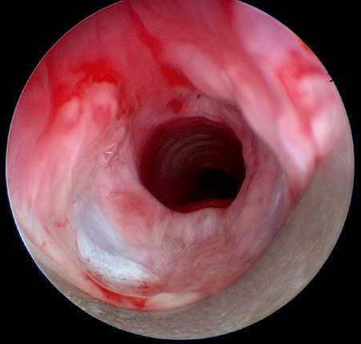
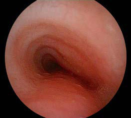

# Chapter 437: Bronchomalacia and Tracheomalacia

*Jonathan D. Finder*

<!-- p.3246 -->

**Fig. 436.1** Bronchoscopy in a 2-mo-old infant showing mucosal ero sion and cartilage exposure in the subglottic region. The child was intu bated with an age-appropriate tube but with an excess of air in the cuff. (Courtesy Dr. Taher S. Valika, Division of Pediatric Otolaryngology, Ann & Robert H. Lurie Children’s Hospital of Chicago.)

## 436.2  Acquired Laryngotracheal Stenosis Taher S. Valika and James W. Schroeder Jr.

Ninety percent of acquired stenoses are a result of endotracheal intu bation. The narrowest portion of the pediatric larynx is the subglottic region because of the narrow cricoid cartilage. When the pressure of the endotracheal tube against the cricoid mucosa is greater than the capillary pressure, ischemia occurs, followed by necrosis and ulcer ation. Secondary infection and perichondritis develop with exposure of cartilage (Fig. 436.1). Granulation tissue forms around the ulcer ations. These changes and edema throughout the larynx usually resolve spontaneously after extubation. Chronic edema and fibrous stenosis develop in only a small percentage of cases.

A number of factors predispose to the development of laryngeal ste nosis. Laryngopharyngeal reflux of acid and pepsin from the stomach is known to exacerbate endotracheal tube trauma. More damage is caused in areas left unprotected, owing to loss of mucosa. Congenital subglot tic stenosis narrows the larynx, which makes the patient more likely to develop acquired subglottic stenosis because significant injury is more likely to occur with use of an endotracheal tube of age-appropriate size. *Other risk factors for the development of acquired subglottic stenosis include sepsis, malnutrition, chronic inflammatory disorders, and immu nosuppression.* An oversized endotracheal tube is the most common factor contributing to laryngeal injury. A tube that allows a small air leak at the end of the inspiratory cycle minimizes potential trauma. Other extrinsic factors—traumatic intubation, multiple reintubations, movement of the endotracheal tube, and duration of intubation—can contribute to varying degrees in individual patients.

**CLINICAL MANIFESTATIONS** Symptoms of acquired and congenital stenosis are similar. Spasmodic croup, the sudden onset of severe croup in the early morning hours, is usually caused by laryngopharyngeal reflux with transient laryngo spasm and subsequent laryngeal edema. These frightening episodes resolve rapidly, often before the family and child reach the emergency department. Other presentations can also involve neonates who fail extubation, despite multiple attempts, and children with permanent dyspnea, stridor, or dysphonia.

**DIAGNOSIS** The diagnosis can be made by posteroanterior and lateral airway radio graphs. The gold standard to confirm the diagnosis is via direct laryn goscopy and bronchoscopy in the operating room. High-resolution CT imaging and ultrasonography are of limited value. This is similar to the workup associated with congenital subglottic stenosis.

**TREATMENT** The severity, location, and type (cartilaginous or soft tissue) of the stenosis determine the treatment. Mild cases can be managed with out operative intervention because the airway will improve as the child grows. Moderate soft tissue stenosis is treated by endoscopy using gentle dilations or CO2 laser. Severe laryngotracheal stenosis is likely to require laryngotracheal reconstructive (expansion) surgery or resec tion of the narrowed portion of the laryngeal and tracheal airway (cri cotracheal resection). Every effort is made to avoid tracheotomy using endoscopic techniques or open surgical procedures.

Fundamental knowledge of the airway can help reduce the inci dence of stenoses. The use of age-appropriate tubes and cuffless tubes, treatment of gastroesophageal reflux, and reducing the duration of mechanical ventilation have led to an overall decrease in laryngotra cheal stenoses in the past decade.

*Visit Elsevier eBooks+ at eBooks.Health.Elsevier.com** for Bibliography.*

Tracheomalacia and bronchomalacia refer to *chondromalacia* of a cen tral airway, leading to insufficient cartilage to maintain airway patency throughout the respiratory cycle. These are common causes of persistent wheezing in infancy. Tracheomalacia and bronchomalacia can be either primary or secondary (Table 437.1). Primary tracheomalacia and bron chomalacia are often seen in premature infants, although most affected patients are born at term. Secondary tracheomalacia and bronchoma lacia refer to the situation in which the central airway is compressed by an adjacent structure (e.g., vascular ring; see Fig. 434.6) or is deficient in cartilage because of tracheoesophageal fistula (see Chapter 365). Bron chomalacia is common after lung transplantation, assumed to be sec ondary to the loss of bronchial artery supply leading to ischemia of the bronchial cartilage. This form of bronchomalacia may take months to

*Jonathan D. Finder*

#### **Table 437.1** Classification of Tracheomalacia

| Category / Parameter | Clinical Details & Findings |
| --- | --- |
| **PRIMARY TRACHEOMALACIA** | Congenital absence of tracheal-supporting cartilages |
| **SECONDARY TRACHEOMALACIA** | Esophageal atresia, tracheoesophageal fistula; Vascular rings (double aortic arch); Tracheal compression from an aberrant innominate artery; Tracheal compression from mediastinal masses; Abnormally soft tracheal cartilages associated with connective tissue; disorders; Prolonged mechanical ventilation, chronic lung disease; From McNamara VM, Crabbe DC. Tracheomalacia. Paediatr Respir Rev. 2004;5:147–154. |

<!-- p.3248 -->
A B C D

**Fig. 437.1** Four examples of tracheomalacia appearances. A, Comma-shaped trachea caused by innominate artery compression requiring aor topexy. B, Bunched-up trachealis muscle and compressed trachea caused by a double aortic arch. C, Flattened trachea and increased trachealis diameter with a tracheoesophageal fistula in the posterior wall. D, Ovoid-shaped trachea from external compression by the innominate artery. (From Deacon JWF, Widger J, Soma MA. Paediatric tracheomalacia—a review of clinical features and comparison of diagnostic imaging techniques. Int J Pediatr Otorhinolaryngol. 2017;98:75–81.)

present after transplantation. Laryngomalacia can accompany primary bronchomalacia or tracheomalacia. Involvement of the entire central air way (laryngotracheobronchomalacia) is also seen.

**CLINICAL MANIFESTATIONS** Primary tracheomalacia and bronchomalacia are principally disorders of infants, with a male:female ratio of 2:1. The dominant finding—lowpitched, monophonic wheezing heard predominantly during expira tion—is most prominent over the central airways. Parents often describe persistent respiratory congestion even in the absence of a viral respiratory infection. When the lesion involves only one main bronchus (more com monly the left), the wheezing is louder on that side and there may be uni lateral palpable fremitus. In cases of tracheomalacia, the wheeze is loudest over the trachea. Hyperinflation and/or subcostal retractions do not occur unless the patient has concurrent dysphagia with chronic aspiration, viral bronchiolitis, asthma, or other causes of peripheral airway obstruction. In the absence of asthma, patients with tracheomalacia and bronchomalacia are not helped by administration of a bronchodilator. Acquired tracheo malacia and bronchomalacia are seen in association with vascular com pression (vascular rings, slings, and innominate artery compression) or in association with the loss of bronchial artery supply in lung transplantation. Persistent tracheomalacia is the rule after correction of tracheoesopha geal fistula. Other causes of acquired tracheomalacia and bronchomalacia (especially left-sided) include cardiomegaly. The importance of the physi cal exam cannot be understated; one study found that pediatric pulmon ologists made a correct assessment of malacia based on symptoms, history, and lung function before bronchoscopy in ∼70% of cases. The cough in tracheomalacia and bronchomalacia can lead to collapse of the airway, which can lead to difficulty in airway clearance. The cough in tracheo malacia and bronchomalacia often has a barking, croupy quality. This can be managed in older patients with handheld positive expiratory pressure devices. Persistent cough in older children with tracheomalacia can cause irritation of the airway mucosa from the physical trauma and induce some degree of habitual cough.

**DIAGNOSIS** Definitive diagnoses of tracheomalacia and bronchomalacia are established by flexible or rigid bronchoscopy (Fig. 437.1). The lesion is difficult to detect on plain radiographs. Although fluoroscopy can

demonstrate dynamic collapse and avoid the need for invasive diag nostic techniques, it is poorly sensitive. Pulmonary function testing can show a pattern of decreased peak flow and flattening of the flowvolume loop. Other important diagnostic modalities include MRI and CT scanning. Dynamic airway assessment using three-dimensional CT reconstruction at end-inspiration and end-expiration can be diagnos tic and avoid the need for invasive evaluation. MRI with angiography is especially useful when there is a possibility of vascular ring and should be performed when a right aortic arch is seen on plain film radiography.

**TREATMENT** Postural drainage can help with clearance of secretions. β-Adrenergic agents *should be avoided* in the absence of asthma because they can exacerbate loss of airway patency due to decreased airway tone. Nebu lized ipratropium bromide may be useful. Endobronchial stents have been used in severely affected patients but have a high incidence of complications, ranging from airway obstruction caused by granulation tissue to erosion into adjacent vascular structures. Continuous positive airway pressure via tracheostomy may be indicated for severe cases. A surgical approach (aortopexy and bronchopexy) is rarely required and only for patients who have life-threatening apnea, cyanosis, and bradycardia (cyanotic spells) from airway obstruction and/or who demonstrated vascular compression. Reports of creation and use of three-dimensional (3D) printed, bioresorbable external tracheobron chial stents in pediatric patients with life-threatening tracheobroncho malacia have shown great promise.

**PROGNOSIS** Primary bronchomalacia and tracheomalacia have excellent prognoses because airflow improves as the child and the airways grow. Patients with primary airway malacia usually take longer to recover from common respiratory infections. Wheezing at rest usually resolves by age 3 years. Prolonged bacterial bronchitis has been reported as a complication of bronchomalacia. The prognosis in secondary and acquired forms varies with cause. Patients with concurrent asthma need considerable support ive treatment and careful monitoring of respiratory status.

*Visit Elsevier eBooks+ at eBooks.Health.Elsevier.com** for Bibliography.*

<!-- p.3249 -->
