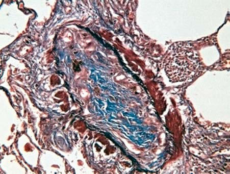

# Chapter 443: Other Distal Airway Diseases

<!-- p.3272 -->

## 443.1  Bronchiolitis Obliterans

*Catherine Kier and Steven R. Boas*

Bronchiolitis obliterans (BO) is a histopathologic diagnosis charac terized by chronic obstructive lung disease of the bronchioles and smaller airways resulting from an insult to the lower respiratory tract leading to inflammation and fibrosis of the small airways. In the nontransplant patient, BO most commonly occurs in the pediat ric population after respiratory infections, particularly adenovirus (see Chapter 309), but also *Mycoplasma pneumoniae* (see Chapter 269), measles (see Chapter 293), *Legionella pneumophila* (see Chap ter 254), influenza (see Chapter 305), and pertussis (see Chapter 243); other causes include inflammatory diseases (juvenile idio pathic arthritis, systemic lupus erythematosus [see Chapter 199], scleroderma [see Chapter 201], Stevens-Johnson syndrome [see Chapter 193]) and inhalation of toxic fumes or particulate exposure (NO2, incinerator fly ash, NH3, diacetyl flavorings from microwave popcorn, papaverine, fiberglass) (Table 443.1). Postinfectious BO (PIBO) may be more common in the Southern Hemisphere. BO is also commonly seen in post lung or bone marrow transplant recipients.

**Bronchiolitis obliterans syndrome (BOS)** is a clinical diagnosis related to graft deterioration after transplantation, defined as a pro gressive decline in lung function based on forced expiratory volume in 1 second (FEV1). The airway obstruction is generally irrevers ible. BOS is considered once other causes of airway obstruction are excluded. It is recognized as a long-term complication of both lung and bone marrow transplantation, with more than one third of sur vivors of lung transplantation developing this disorder. Risk factors for the development of BOS include the presence of cytomegalo virus (CMV) pneumonitis, *Aspergillus* colonization, primary graft dysfunction, gastroesophageal reflux, and community-acquired respiratory viruses, as well as prolonged transplantation ischemic time.

**PATHOGENESIS** After the initial insult, inflammation affecting terminal bronchi oles, respiratory bronchioles, and alveolar ducts can result in the obliteration of the airway lumen (Fig. 443.1). Epithelial damage resulting in abnormal repair is characteristic of BO. Complete or partial obstruction of the airway lumen can result in air trapping or atelectasis. Parenchymal involvement is not seen. **Bronchiolitis obliterans organizing pneumonia (BOOP)**, or what is now termed **cryptogenic organizing pneumonia (COP)**, is a histopathologic diagnosis. Although it is similar to many of the histologic features of BO, COP is also characterized by extension of the inflammatory process from distal alveolar ducts into alveoli with proliferation of fibroblasts (parenchymal involvement).

**CLINICAL MANIFESTATIONS AND DIAGNOSIS** Cough, fever, cyanosis, dyspnea, chest pain, and respiratory dis tress followed by initial or no improvement with antibiotics may be the early signs of BO. In this phase, BO is easily confused with pneumonia, bronchitis, or bronchiolitis. Progression of the disease can ensue, with increasing dyspnea, chronic cough, sputum pro duction, and wheezing. Physical examination findings are usually

nonspecific and can include wheezing, hypoxemia, and crackles. Chest radiographs may be relatively normal compared with the extent of physical findings but can demonstrate hyperlucency and patchy infiltrates. Occasionally, Swyer-James syndrome (unilateral hyperlucent lung; see Chapter 441) develops. Pulmonary function tests demonstrate variable findings but typically show signs of air way obstruction with a variable degree of bronchodilator response, although more commonly irreversible. Exercise testing shows reduced exercise capacity and impaired oxygen consumption. Ventilation-perfusion scans reveal a typical moth-eaten appearance of multiple matched defects in ventilation and perfusion. Highresolution chest CT often demonstrates patchy areas or a mosaic pattern of hyperlucency, air trapping, and bronchiectasis (Fig. 443.2). Table 443.2 provides an overview of CT findings of BO and related disorders. Physical and radiologic signs can wax and wane over weeks or months. Open lung biopsy or transbronchial biopsy remains the best means of establishing the diagnosis of BO or COP.

**TREATMENT** Treatment is a combination of optimal supportive care and anti inflammatory therapy to impair lymphocyte proliferation. For PIBO, it is recommended that bronchoscopy with bronchoalveolar lavage be performed to rule out persistent viral, bacterial, or fun gal pathogens before initiation of systemic antiinflammatory treat ment. Corticosteroids should be given early, pulse steroid therapy with methylprednisolone is preferred, and a prolonged course of oral steroids should be avoided to minimize severe side effects and complications or mortality from infections. Immunomodulatory agents, such as sirolimus, tacrolimus, aerosolized cyclosporine, hydroxychloroquine, and macrolide antibiotics, have been used in post–lung transplantation recipients with BO with variable success. Supportive measures with oxygen, antibiotics for secondary infec tions, and bronchodilators are adjunct therapies. The role of gas troesophageal reflux and its association with BO has been raised, with treatment suggested whenever the diagnosis is made. Azithro mycin may be effective in patients with BOS. A combination of fluticasone, azithromycin, montelukast, and pulse steroid may halt pulmonary progression of BOS. Potential future treatment options include using mesenchymal stem/stromal cells (MSCs) for immu nomodulatory and possibly profibrotic effects and extracorporeal photopheresis (ECP) and total lymphoid irradiation (TLI) for BOS, but additional trials and studies are needed. Patients with asymp tomatic or nonprogressive COP can be observed.

**PROGNOSIS** Some patients with BO experience rapid deterioration in their con dition and die within weeks of the initial symptoms; most nontrans plant patients survive with chronic disability. BO tends to be severe once progression ensues. In contrast to BO, a better prognosis exists for patients with COP, with complete recovery seen in many patients, although outcome depends on the underlying systemic disease. COP can relapse, especially if treatment duration is <1 year; COP is amenable to repeat courses of oral corticosteroids. Unlike the more common idiopathic COP, progressive COP characterized by acute respiratory distress syndrome is rare but is aggressive in its clinical course, leading to death.

*Visit Elsevier eBooks+ at eBooks.Health.Elsevier.com** for Bibliography.*

## 443.2  Follicular Bronchitis Catherine Kier and Steven R. Boas

Follicular bronchitis and pediatric lymphocytic interstitial pneumonia are lymphoproliferative lung disorders characterized by the presence of lymphoid follicles alongside the airways (bronchi or bronchioles) and

<!-- p.3273 -->

<!-- p.3274 -->
infiltration of the walls of bronchi and bronchioles. The disease pres ents early and is associated with immune dysregulation. Autoantibodies have been found in some children, and in a few patients, disease-causing pathogenic variants have been found in *COPA*. Most children present with symptoms in the first 2 years of life, but with a lag time of diagnosis to about 4 years. Cough, moderate respiratory distress, fever, and fine crackles are common clinical findings. Fine crackles generally persist over time, and recurrence of symptoms is common. Chest radiographs may be relatively benign initially (air trapping, peribronchial thicken ing) but evolve into the typical interstitial pattern. Chest CT can show hilar lymphadenopathy, pulmonary nodules, ground-glass opacity, focal consolidation, and bronchiectasis but can also appear normal (see Table 443.2). Definitive diagnosis is made by open lung biopsy (Fig. 443.3). Treatment is limited—systemic steroids, intravenous pulse or oral, showed high response rates. Prognosis is related to early diagnosis and treatment, which are critical to improve the outcome. Some patients have significant progression of pulmonary disease, and others develop only mild obstructive airway disease.

*Visit Elsevier eBooks+ at eBooks.Health.Elsevier.com** for Bibliography.*

## 443.3  Pulmonary Alveolar Microlithiasis Catherine Kier and Steven R. Boas

Pulmonary alveolar microlithiasis (PAM) is a rare disease character ized by the formation of lamellar concretions of calcium phosphate, or “microliths,” within the alveoli, creating a classic pattern on the radio graph (Fig. 443.4).

**EPIDEMIOLOGY AND ETIOLOGY** Although the mean age at the time of diagnosis is in the mid-30s, the onset of the disease can occur in childhood and in newborns. PAM is inherited in an autosomal recessive disorder and is caused by a pathogenic variant in the type II sodium phosphate cotrans porter NPT2b *(SCL34A2).* To date, there are 27 identified patho genic variants. This gene is expressed in high levels in the lungs,

#### **Table 443.1** Etiology of Bronchiolitis Obliterans

| Category / Parameter | Clinical Details & Findings |
| --- | --- |
| **POSTINFECTION** | Adenovirus types 3, 7, and 21; Influenza; Parainfluenza; Measles; Respiratory syncytial virus; Varicella; Mycoplasma pneumoniae |
| **POSTTRANSPLANTATION** | Chronic rejection of lung or heart/lung transplantation; Graft versus host disease associated with bone marrow; transplantation |
| **CONNECTIVE TISSUE DISEASE/INFLAMMATORY** | Juvenile idiopathic arthritis; Sjögren syndrome; Scleroderma; Systemic lupus erythematosus; Castleman disease; Inflammatory bowel disease |
| **NH3** | Diacetyl flavorings (microwave popcorn); Sulfur mustards; Fly ash (incinerator); Fiberglass |
| **CHRONIC HYPERSENSITIVITY PNEUMONITIS** | Avian antigens; Mold |
| **ASPIRATION** | Stomach contents: gastroesophageal reflux; Foreign bodies |
| **DRUGS** | Penicillamine; Cocaine |
| **STEVENS-JOHNSON SYNDROME** | Idiopathic; Drug induced; Infection related; From Moonnumakal SP, Fan LL. Bronchiolitis obliterans in children. Curr Opin Pediatr.; 2008;20:272–278. |

**Fig. 443.1** Complete obliteration of airway lumen with fibromyxoid tissue in lung transplant recipient with bronchiolitis obliterans. (From Kurland G, Michelson P. Bronchiolitis obliterans in children. Pediatr Pul monol. 2005;39:193–208.)

**Fig. 443.2** High-resolution CT scan of the chest of a child with bron chiolitis obliterans demonstrating mosaic perfusion and vascular at tenuation. Air-trapping is demonstrated by lack of increase in attention or decrease in lung volume in dependent lung. (Image courtesy Alan Brody, MD, Cincinnati Children’s Hospital Medical Center, Cincinnati, Ohio.)

<!-- p.3275 -->

<!-- p.3276 -->
predominantly on the surface of alveolar type II cells. Although the precise role of this protein is unknown, it is speculated that it helps to remove phosphate generated from surfactant metabolism in the alveolar space, as well as functioning as a phosphate regulator in other organs.

In some families, progression of disease is rapid. An equal male and female incidence is noted. Although PAM is found throughout the world, there is a high incidence in Turkey and a lesser incidence in Italy and Japan.

**CLINICAL MANIFESTATIONS** In early stages of the disease, patients are usually asymptom atic. When symptomatic, patients with PAM usually complain of dyspnea on exertion, nonproductive cough, and fever. Physical examination of the lungs can reveal fine inspiratory crackles and diminished breath sounds. Clubbing occurs, although this is usu ally a more advanced sign. Discordance between the clinical and radiographic manifestations is common. Many children are often asymptomatic on initial presentation and present with symptoms during adulthood. Complications of pneumothorax, pleural adhe sions and calcifications, pleural fibrosis, apical bullae, and extrapul monary sites of microliths have been reported (kidneys, prostate, gallbladder, sympathetic chain, and testes). Progression to respira tory failure may occur.

**DIAGNOSIS** Chest radiography typically reveals bilateral infiltrates with a fine micronodular appearance or sandstorm appearance with greater density in the lower and middle lung fields (see Fig. 443.4). CT of the chest shows diffuse micronodular calcified densities, with thickening of the microliths along the septa and around distal bron chioles, especially in the inferior and posterior regions (see Table 443.2). Diffuse uptake of technetium-99 methylene diphosphonate by nuclear scan has been reported. Bronchoalveolar lavage (BAL) may be helpful. Open lung and transbronchial lung biopsy reveal 0.1- to 0.3-mm laminated calcific concretions within the alveoli. Although the alveoli are often normal initially, progression to pul monary fibrosis with advancing disease usually ensues. Sputum expectoration might reveal small microliths, although this finding is not diagnostic for PAM and is not typically seen in children. Detec tion of calcium deposits in BAL fluid on bronchoscopy supports the diagnosis. Pulmonary function testing reveals restrictive lung disease with impaired diffusing capacity as the disease progresses, whereas exercise testing demonstrates arterial oxygen desaturation.

#### **Table 443.2** High-Resolution CT Patterns in a Child with Interstitial Lung Disease

| Category / Parameter | Clinical Details & Findings |
| --- | --- |
| **HONEYCOMBING** | Bronchiolitis obliterans; 4; —; —; — |
| **X** | —; Nonspecific interstitial; pneumonitis; 6 |
| **X** | —; —; — |
| **X** | Desquamative; interstitial; pneumonitis; 4 |
| **X** | —; —; — |
| **X** | Follicular bronchitis; or neuroendocrine; cell hyperplasia of; infancy; 4 |
| **X** | —; — |
| **X** | —; Lymphocytic interstitial; pneumonitis; 4; —; — |
| **X** | —; —; Lymphangiomatosis; 2; — |
| **X** | —; —; —; Lymphangiectasia; 2; — |
| **X** | —; —; —; Pulmonary alveolar; proteinosis; 2 |
| **X** | —; —; —; From Long FR. Interstitial lung disease. In: Slovis T, ed. Caffey’s Pediatric Diagnostic Imaging, 11th ed. Philadelphia: Mosby; 2008: Table 74.1; original data from Lynch DA, Hay T,; Newell JD Jr, et al. Pediatric diffuse lung disease: diagnosis and classification using high-resolution CT. AJR Am J Roentgenol. 1999;173:713–718; and Copley SJ, Coren M, Nicholson; AG, et al. Diagnostic accuracy of thin-section CT and chest radiography of pediatric interstitial lung disease. AJR Am J Roentgenol. 2000;174:549–554. |

**Fig 443.3**  Follicular bronchiolitis in a 3-year-old child with mosaic attenuation and cylindrical bronchiectasis. CT findings suggested bronchiolitis obliterans, but a biopsy documented the presence of follicular bronchiolitis. *(From Long FR, Druhan SM, Kuhn JP. Diseases of the bronchi and pulmonary aeration. In Slovis T, ed. Caffey’s Pedi atric Diagnostic Imaging, 11th ed. Philadelphia: Mosby; 2008: Fig. 73.71.)*

<!-- p.3277 -->
The diagnosis can usually be established radiographically. However, lung tissue biopsy, BAL, and detection of a pathogenic variant in the *SCL34A2* gene can also be used to help confirm the diagnosis. The differential diagnosis includes sarcoidosis, miliary tuberculo sis, hemosiderosis, healed disseminated histoplasmosis, pulmonary calcinosis, and metastatic pulmonary calcifications.

**TREATMENT** No specific treatment is effective, although some clinicians have used glucocorticosteroids, etidronate disodium, and bronchopul monary lavage with limited success. Lung transplantation has been

performed for this condition without recurrence in the transplanted lung.

**PROGNOSIS** Progressive cardiopulmonary disease can ensue, leading to cor pul monale, superimposed infections, and subsequent death in midadulthood. Because of the familial nature of this disease, counseling and chest radiographs of family members are indicated.

*Visit Elsevier eBooks+ at eBooks.Health.Elsevier.com** for Bibliography.*

A B C

E F D

**Fig. 443.4** Pulmonary alveolar microlithiasis. Chest radiograph and high-resolution CT performed at the age of 1 year and 8 years. A, Chest radio graph shows bilateral alveolo-interstitial opacities with middle lobe consolidation. Chest CT imaging shows diffuse but patchy ground-glass opaci ties, alveolar consolidations in the middle and lower lobes, and calcifications in the lower lobes, at parenchymal (B) and mediastinal (C) windows. D, Chest radiograph shows diffuse, even predominant in the lower and middle lobes, dense reticulonodular opacities. Chest CT imaging shows patchy ground-glass opacities, homogenous miliary consolidations with micronodular calcifications and subpleural and interlobular reticulations, parenchy mal retractions, and architectural distortion suggestive of fibrosis onset mostly in the upper lobes, at parenchymal (E) and mediastinal (F) windows. (From Sigur E, Roditis L, Labouret G, et al. Pulmonary alveolar microlithiasis in children less than 5 years of age. J Pediatr. 2020;217:158–164.e1, Fig. 1.)

<!-- p.3278 -->
