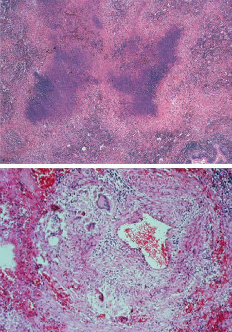

# Chapter 448: Immune and Inflammatory Lung Disease

<!-- p.3302 -->
of more secretions than usual. In addition, it bypasses the natural defenses of the upper airways while it exposes the lower airways directly to the environment, thus increasing the possibility of in fection. Its major advantage is that it provides easy access for the suctioning of the lower airways. Most importantly, it provides a secure airway from which positive pressure can be applied, avoid ing the risks of emergency endotracheal intubations. It should be considered for patients at high risk for recurrent severe respiratory failure.

*Visit Elsevier eBooks+ at eBooks.Health.Elsevier.com** for Bibliography.*

## 448.1  Hypersensitivity Pneumonia Michelle L. Hernandez and Stephanie D. Davis

Hypersensitivity pneumonia (HP), aptly called *extrinsic allergic alveolitis* because the inciting agent is almost uniformly inhaled from the environment, is a complex immunologic-mediated syn drome of the pulmonary alveoli and interstitium. There are numer ous specific disease names based on the origin of the inhaled offending antigen to describe HP. Prompt recognition of the signs and symptoms allows for complete reversal of the disease without long-term adverse consequences if the source of the exposure is rec ognized and abated. Failure to recognize the disease early may lead to chronic irreversible lung changes with persistent symptoms in the patient.

**ETIOLOGY** The most common sources of offending agents that cause HP include agricultural aerosols, inhaled protein antigens from ani mals, antigens from microorganisms of bacteria, fungi, or pro tozoan origin, and chemicals of low and high molecular weight (Table 448.1). Many of these inciting agents are associated with *occupational diseases,* which occur in locations where children do not regularly work. However, these same diseases can occur in children because of exposures to many similar antigen sources in nonoccupational environments, or in occupational environments with teenage workers. In addition to HP, the same antigens (i.e., antigens from animal proteins and contaminated metal working fluids or other inhaled antigens) may lead to allergic asthma or chronic bronchitis.

More than 300 antigens have been associated with HP. In chil dren, the primary sources have been the result of exposure to **pet birds** (or feathers in bedding and pillows) such as parakeets, canar ies, cockatiels, or cockatoos. Aerosol spread of bird droppings can also occur through the vent of a clothes dryer or through heat ing vents from a garage where the birds were housed. Humidifiers and hot tubs are notorious for contamination with **thermophilic organisms** (bacteria and mold) as well as *Mycobacterium avium* complex. Buildings with inadequate ventilation and insufficient air turnover present an increased risk of mold exposure from prior flooding or damp condensation. Despite exposures to the same antigen sources, members of the same family may exhibit different presentations of allergic disease. For instance, some family mem bers may have symptoms of asthma or rhinitis, whereas another may have HP.

**PATHOGENESIS** The pathogenesis of HP is complex and appears to have a genetic com ponent. Recurrent exposures to environmental agents associated with HP (see Table 448.1) trigger an inflammatory response promoting the development of immune complexes. These immune complexes activate the complement pathway, ultimately resulting in the accumulation of neutrophils in the airway that release enzymes such as neutrophil elas tase that damage surrounding lung tissue. Activated macrophages in the lung promote recruitment of lymphocytes into the tissues. Pathology shows alveolitis with a mixed cellular infiltration composed of lympho cytes, macrophage, plasma cells, and neutrophils. Continued exposure to the offending antigen results in the formation of loose, noncaseating granulomas located near the respiratory or terminal bronchioles. Some patients with chronic exposure develop progressive pulmonary fibrosis similar to patients with interstitial pulmonary fibrosis (IPF). Although the mechanisms are not entirely clear, this is thought to occur sec ondary to recruitment and activation of fibroblasts and uncontrolled production of extracellular matrix cytokines, including transforming growth factor beta (TGF-ß). It is critical when a biopsy is being per formed (transbronchial or surgical) that the pathologist knows that HP is being considered because there are other **interstitial lung dis eases** that produce similar granulomas with subtle location differences depending on their disease origin. Genetic predisposition also appears to be important, primarily in genes involved with antigen processing and presentation (such as major histocompatibility complex [MHC] I and II), lung homeostasis and wound repair, and telomere-related gene mutations.

**Clinical Manifestations and Classification** The prevalence of HP is higher among older individuals but can affect children and young adults. It is estimated that HP accounts for 50% of all childhood idiopathic lung diseases (ILDs). HP had been traditionally classified as acute, subacute, or chronic. How ever, because of the great variability and overlap in the presentation and course of HP, the American Thoracic Society, Japanese Respi ratory Society, and Asociación Latinoamericana de Tórax (ATS/ JRS/ALAT) guidelines recategorized HP into two phenotypes based on the predominant presence or absence of fibrosis on imaging or histopathologic examination: (1) **nonfibrotic phenotype** and (2) **fibrotic phenotype**.

Regardless of fibrotic or nonfibrotic phenotype, common symp toms include cough and dyspnea after exposure. The time to symptom presentation after exposure can vary from hours to years and may be recurrent in nature. Acute symptoms can be confused with bacterial or viral disease leading to treatment with antibiotics. For example, as early as 4-8 hours after exposure, patients can present with the abrupt onset of cough, chest tightness, dyspnea, fever, chills, body aches, and fatigue (Table 448.2). Rarely, findings of wheezing are present on the initial examination. Rather, tachypnea with fine crackles may be heard by aus cultation in the lung bases and presence of mid-inspiratory squeaks. The duration of symptoms has not been definitively associated with the fibrotic or nonfibrotic phenotype.

The long-term prognosis of HP is quite variable, with some patients developing progressive shortness of breath, cough (pro ductive), weight loss, malaise, loss of appetite, hypoxia, and clubbing of the fingers. Those who have been diagnosed with non fibrotic HP and are able to avoid exposure to the responsible agent may achieve stabilization or full recovery. In contrast, fibrotic HP is associated with reduced survival secondary to respiratory fail ure, especially among those with a usual interstitial pneumonia (UIP)–like pattern.

**Diagnosis** A diagnosis of HP is certain when the known exposure with the asso ciated immune response to the offending antigen is identified, the medical history and physical examination findings are abnormal on examination, and the pattern of the high-resolution computed tomog raphy (HRCT) of the chest and bronchoalveolar lavage (BAL) findings

<!-- p.3304 -->
**HYPERSENSITIVITY 
 PNEUMONITIS ANTIGEN SOURCE**

Bagassosis (mold on pressed

sugar cane)

*Thermoactinomyces sacchar*i *Thermoactinomyces vulgaris*

Bat lung (bat droppings) Bat serum protein

Bible printer’s lung Moldy typesetting water

Bird fancier’s lung (parakeets,

budgerigars, pigeons, parrots, cockatiels, geese)

Droppings, feathers, serum

proteins

Byssinosis (“brown lung”)

(unclear if a true cause of hypersensitivity pneumonitis; asthma is common)

Cotton mill dust (carding and

spinning areas of cotton, flax, and soft hemp)

Canary fancier’s lung Serum proteins

Cheese washer’s lung (moldy

cheese)

*Penicillium casei Aspergillus clavatus*

Chemical hypersensitivity

pneumonitis

Diphenylmethane diisocyanate (MDI) Toluene diisocyanate (TDI)

Coffee worker’s lung Coffee bean dust

Composter’s lung *T. vulgaris Aspergillus* species

Contaminated basement

(sewage) pneumonitis

*Cephalosporium*

Coptic lung (mummy handler’s

lung)

Cloth wrappings of mummies

Detergent worker’s lung

(washing powder lung)

*Bacillus subtilis* enzymes

Dry rot lung *Merulius lacrymans*

Duck fever Feathers, serum proteins

Epoxy resin lung Phthalic anhydride (heated epoxy

resin)

Esparto dust (mold in plaster

dust)

*Aspergillus fumigatus* Thermophilic actinomycetes

Feather duvet lung (feather

bed, pillow, duvet)

Avian proteins on feathers

Fish meal worker’s lung Fish meal

Furrier’s lung (sewing furs;

animal fur dust)

Animal pelts

Grain measurer’s lung Cereal grain *(Sporobolomyces)* Grain dust (mixture of dust, silica,

fungi, insects, and mites) Hot tub lung (mists; mold on

ceiling and around tub)

*Cladosporium* spp.

*Mycobacterium avium* complex

Humidifier fever *Thermoactinomyces (T. vulgaris, T.*

*sacchari, T. candidus) Klebsiella oxytoca Naegleria gruberi Acanthamoeba polyphaga Acanthamoeba castellani*

Laboratory worker’s lung (rats,

gerbils)

Urine, serum, pelts, proteins

Lifeguard lung Aerosolized endotoxin from pool-

water sprays and fountains

Lycoperdonosis (*Lycoperdon*

puffballs)

Puffball spores

Machine operator’s lung *Pseudomonas fluorescens* Aerosolized metal working fluid

Malt worker’s disease (moldy

*Aspergillus fumigatus, Aspergillus*

**HYPERSENSITIVITY 
 PNEUMONITIS ANTIGEN SOURCE**

Maple bark disease (moldy

maple bark)

*Cryptostroma corticale*

Miller’s lung (dust-

contaminated grain)

*Sitophilus granarius* (i.e., wheat

weevil)

Moldy hay, grain, silage

(farmer’s lung)

Thermophilic actinomycetes Fungi (e.g., *Aspergillus umbrosus*)

Mollusk shell hypersensitivity

pneumonitis

Sea snail shell

Mushroom worker’s lung Mushroom spores Thermophilic actinomycetes

Paprika slicer’s lung (moldy

paprika pods)

*Mucor stolonifer*

Pauli reagent alveolitis Sodium diazobenzene sulfate

Pearl oyster shell pneumonitis Oyster shells

Pituitary snuff taker’s disease Dried, powdered cattle or pig

pituitary proteins

Potato riddler’s lung (moldy

hay around potatoes)

Thermophilic actinomycetes *T. vulgaris Faenia rectivirgula Aspergillus spp.*

Poultry worker’s lung (feather

plucker’s disease)

Serum proteins (chicken products)

Pyrethrum (pesticide) Pyrethrum

Sauna taker’s lung *Aureobasidium* spp., other sources

Sequoiosis (moldy wood dust) *Graphium Pullularia Trichoderma spp. Aureobasidium pullulans*

Suberosis (moldy cork dust) *Thermoactinomyces viridis Penicillium glabrum Aspergillus conidia*

Summer-type pneumonitis *Trichosporon cutaneum*

Tea grower’s lung Tea plants

Thatched-roof lung (huts in

New Guinea)

*Saccharomonospora viridis* (dead

grasses and leaves)

Tobacco grower’s lung *Aspergillus* spp.

*Scopulariopsis brevicaulis*

Turkey handling disease Serum proteins (turkey products)

Unventilated shower *Epicoccum nigrum*

Upholstery fabric (nylon

filament, cotton/polyester, and latex adhesive)

Aflatoxin-producing fungus,

*Fusarium* spp.

Velvet worker’s lung Unknown (? nylon velvet fiber,

tannic acid, potato starch)

Vineyard sprayer’s lung Copper sulfate (Bordeaux mixture)

Wine maker’s lung (mold on

grapes)

*Botrytis cinerea*

Wood dust pneumonitis (oak,

cedar, and mahogany dust, pine and spruce pulp)

*Alternaria* spp.

*Bacillus subtilis*

Wood pulp worker’s disease

(oak and maple trees)

*Penicillium* spp.

Wood trimmer’s disease

(contaminated wood trimmings)

*Rhizopus* spp., *Mucor* spp.

<!-- p.3305 -->
are consistent with HP (Table 448.3). These findings must prompt the clinician to identify the exposure in order to secure the diagnosis and eliminate the offending antigen. Without therapy, the progressive inflammatory response leads to air trapping, honeycombing, emphy sema, and mild fibrosis in the chronic state. Diagnostic components are reviewed next.

**LABORATORY** Most of the abnormal laboratory findings in HP are not specific and represent evidence of activated inflammatory markers or lung injury. For example, nonspecific elevation of immune globulins or the eryth rocyte sedimentation rate and C-reactive protein may be found. Circu lating immune complexes may be detected. Lactate dehydrogenase may be elevated in the presence of lung inflammation and normalizes with response to therapy.

Serum IgG precipitins to the offending agent are frequently posi tive and have a poor positive predictive value for disease. For exam ple, among asymptomatic pigeon breeders, precipitating antibodies are nearly universal. False negatives can also be seen as a result of fluctuating serum antibody levels over time and a lack of standard ized commercial antigens and reagents available for laboratory test ing. It is critical that laboratories familiar with the performance of these tests be used. Those laboratories often recognize the value of processing antigens for precipitation from the environmental source directly as the test substrate with patient serum. Skin test ing for immunoglobulin E (IgE)-mediated disease is not warranted unless there is evidence of mixed lung pathology such as asthma and interstitial lung opacities.

**Radiology** Chest radiograph almost always precedes the use of HRCT of the chest in children because of the need for sedation and concerns regarding the risk of being exposed to an increased radiation dose from HRCT. The plain radiograph may demonstrate a ground-glass appearance, interstitial prominence, with a predominant location in the upper and middle lung fields. It is common for a chest radio graph to be considered normal by a radiologist early in the disease. Late in the disease, interstitial fibrosis may become prominent in the presence of increasing dyspnea, hypoxemia on room air, and even clubbing of the fingers. Mediastinum widening from lymph adenopathy is not usually present; when present, the lymph nodes are prominent along the airway near the carina, suggesting that the antigen source is inhaled, and this represents the response of the immune system.

HRCT of the chest is important in distinguishing nonfibrotic from fibrotic HP and may reduce the need for a lung biopsy. HRCT of the chest in **nonfibrotic HP** demonstrates (1) at least one abnormality

revealing evidence of parenchymal infiltration (such as ground-glass opacities or mosaic attenuation) and (2) at least one abnormality reveal ing evidence of small airway disease (such as ill-defined, centrilobular nodules or air trapping), both distributed in a diffuse pattern. **Fibrotic HP** is characterized by (1) a lung fibrosis (irregular linear opacities/ coarse reticulation; traction bronchiectasis and honeycombing) located in a random or mid-lung zone and (2) at least one abnormality that is consistent with small airway disease.

Hypersensitivity Pneumonitis

#### **Table 448.2** Clinical History Leading to a Diagnosis of

| Category / Parameter | Clinical Details & Findings |
| --- | --- |
| **General** | Recurrent pneumonia; Pneumonia after repeat exposures (week, season, situation); Cough, fever, and chest symptoms after making a job change or; home change; Cough, fever, wheezing after return to school or only at school; Pet exposure (especially birds that shed dust such as pigeons,; canaries, cockatiels, cockatoos); Bird contaminant exposure (e.g., pigeon infestation); Farm exposure to birds and hay; History of water damage; Use of hot tub, sauna, swimming pool; Other family members or workers with similar recurrent symptoms; Improvement after temporary environment change (e.g., vacation) |

Hypersensitivity Pneumonitis

#### **Table 448.3** Criteria Used in the Diagnosis of

| Category / Parameter | Clinical Details & Findings |
| --- | --- |
| **General** | 1.	 Identified exposure to offending antigen(s) by:; • Medical history of exposure to suspected antigen in the patient’s; living environment; • Investigations of the environment confirm the presence of an; inciting antigen; • Identification of specific immune responses (immunoglobulin; G serum precipitin antibodies against the identified antigen) are; suggestive of the potential etiology but are insufficient in isolation; to confirm a diagnosis; • Abnormal response to an inhalation challenge testing to the; offending antigen via reexposure to the environment or inhalation; challenge to the suspected antigen; 2.	 Clinical, radiographic, or physiologic findings compatible with; hypersensitivity pneumonitis:; • Respiratory and often constitutional signs and symptoms; • Cough; • Breathlessness; • Crackles on auscultation of the chest; • Weight loss; • Episodic fever; • Wheezing; • Fatigue; NOTE: These findings are especially suggestive of hypersensitivity; pneumonitis when they appear or worsen several hours after; antigen exposure.; • High-resolution chest CT findings typical of HP:; • Nonfibrotic HP pattern:; • At least one HRCT abnormality indicative of parenchymal; infiltration (such as ground-glass opacities or mosaic attenuation); in a diffuse distribution; • At least one HRCT abnormality indicative of small airway disease; (such as ill-defined, centrilobular nodules or air trapping) in a; diffuse distribution; • Fibrotic HP pattern:; • Lung fibrosis (irregular linear opacities/coarse reticulation with; lung distortion; traction bronchiectasis and honeycombing) in; a random or mid-lung zone predominant location; • At least one abnormality that is indicative of small airway; disease; 3.	Bronchoalveolar lavage with lymphocytosis (>20%, often >50%):; • Usually with low CD4:CD8 ratio (i.e., CD8 is higher than normal); 4.	Histopathology showing compatible changes with nonfibrotic or; fibrotic hypersensitivity pneumonitis and the absence of features; in any biopsy site to suggest an alternative diagnosis; • Nonfibrotic HP (purely inflammatory):; • Cellular interstitial pneumonia; • Chronic cellular bronchiolitis with a lymphocytic peribronchial; infiltration; • Poorly formed nonnecrotizing granulomas located near; respiratory or terminal bronchioles; • Fibrotic HP (mixed inflammatory plus fibrotic or purely fibrotic):; • Chronic fibrosing interstitial pneumonia; • Airway-centered fibrosis; • Poorly formed nonnecrotizing granulomas; Data from Raghu G, Remy-Jardin M, Ryerson CJ, et al. Diagnosis of hypersensitivity; pneumonitis in adults. An official ATS/JRS/ALAT clinical practice guideline [published; correction appears in Am J Respir Crit Care Med. 2021 Jan 1;203(1):150–151] [published; correction appears in Am J Respir Crit Care Med. 2022 Aug 15;206(4):518]. Am J Respir; Crit Care Med. 2020;202(3):e36–e69. |

<!-- p.3306 -->
**Bronchoalveolar Lavage** BAL is one of the most sensitive tests in supporting the diagnosis of HP. Lymphocytosis frequently exceeding 50% of the recovered cells is seen in the BAL fluid and should alert the clinician to the possibility of HP. Sarcoid, IPF, cryptogenic organizing pneumonia, berylliosis, granite workers lung disease, amiodarone pneumonia, lymphoma, and Langerhans cell histiocytosis may demonstrate lymphocytosis on BAL. All BAL specimens should have *flow cytometry* measurements of T-cell markers (CD3, CD4, and CD8 at a minimum). The predomi nant phenotype of the lymphocytosis is CD3+/CD8+/CD56+/CD57+/ CD10−. In the normal circulation, lymphocytes with CD4 markers predominate at a ratio of approximately 2:1 compared with CD8 lymphocytes. *In HP, this ratio becomes approximately equal to or less than 1 (CD4:CD8 ≤**1) with either an increase in CD8 lymphocytes or a decline in CD4 lymphocytes.* Although this ratio helps the clinician in making a diagnosis of HP, this BAL finding is not 100% diagnostic for HP. Cryptogenic organizing pneumonia, a rare disease in children, also may present with BAL, where the CD4:CD8 is ≤1, and may be confused initially with HP. This is in sharp contrast to other lympho cytic granulomatous diseases, like sarcoidosis, where the CD4:CD8 is ≥2.

**Lung Biopsy** Lung biopsy is necessary to confirm a diagnosis of HP when criti cal elements are not present, including antigen exposure, a medical history classic for HP, characteristic physical exam findings, chest HRCT findings, and CD8+ lymphocytes in the BAL. Open lung biopsy is often the route of choice in young children because of the difficulty in safely obtaining satisfactory amounts of tissue by trans bronchial biopsy. Lack of positive serum precipitins to an offend ing antigen and lack of an exposure history are common reasons for obtaining lung biopsies. It is crucial to inform the pathologist about the suspicion of HP so that the findings can be interpreted appropriately.

Histopathologic examination of **nonfibrotic HP (purely inflam matory)** demonstrates three primary features: (1) cellular interstitial pneumonia, (2) chronic cellular bronchiolitis with a lymphocytic peri bronchial infiltration, and (3) nonnecrotizing granulomas near respi ratory or terminal bronchioles. **Fibrotic HP (mixed inflammatory plus fibrotic or purely fibrotic)** is histologically characterized by (1) chronic fibrosing interstitial pneumonia, (2) airway-centered fibrosis, and (3) poorly formed nonnecrotizing granulomas. Furthermore, there is an absence of features in any biopsy site to suggest an alternative diagnosis.

Of note, poorly formed noncaseating granulomas and multinucle ated giant cells are seen in HP. This is in sharp contrast to the wellformed granulomas seen in sarcoidosis.

**Antigen Challenge by Inhalation** Inhalation challenge can support the diagnosis of HP by demonstrating a causal relationship between environmental exposure and symptoms. Inhalation challenge can be performed by two methods: (1) reexposure to the environment where the suspected antigen is present and (2) a direct inhalation challenge at the hospital to material collected from the suspected source of the antigen. As the second method has resulted in severe exacerbation of disease in some individuals, performing this challenge is discouraged.

Two abnormal response patterns may be seen. Most commonly, where there is **HP without asthma**, symptoms occur 8-12 hours after direct challenge in the hospital or after reexposure to the source of the antigen. The challenges replicate some or all of the symptoms observed in the acute syndrome with fever, dyspnea, fatigue, and crackles on lung auscultation. Blood drawn before challenge and then repeated during these symptoms often demonstrates an increased neutrophil count compared to baseline. Pulmonary function tests demonstrate a fall in forced vital capacity (FVC) and often a concurrent fall in the

forced expiratory volume at 1 second (FEV1), with a stable or increas ing ratio of FEV1:FVC reflecting a restrictive defect. Hypoxemia may accompany this decline in pulmonary function along with a fall in the diffusion capacity of carbon monoxide (DLCO). To see the complete effect, exercise during this period may show a considerable fall in oxy genation despite normal arterial blood gas oxygen tension and normal pulse oximetry at rest. This finding denotes the onset of worsening restrictive lung disease.

Where there is **HP with concomitant allergic asthma**, these patients may experience a biphasic response to the inhalation challenge. These patients may develop an early reduction in FEV1, followed by a sec ond drop in FEV1 and FVC 4-6 hours later. The patient may also have accompanying fever and leukocytosis.

**TREATMENT** The control of environmental exposure to the offending antigen is key to curing HP and remains the ideal method of treatment and prevention of recurrence. The clinical and pathologic manifesta tions of nonfibrotic (purely inflammatory) HP are reversible with removal of the offending antigen. Counseling parents and children about the risk of exposure to birds and feathered bedding or other environmental antigens, biologic aerosols, or agricultural dusts that are known to induce HP is important. Certainly, the source of the antigen and type of antigen appear to affect the response to treat ment and long-term prognosis. Older individuals who contract farmer’s lung are likely to recover with minimal permanent residual effect, whereas individuals with bird fancier’s lungs from antigens produced by pigeons have a worse prognosis, especially if fibrosis is detected on lung biopsy. The pediatrician should advise—in the strongest terms—removal of the antigen source from the affected child’s environment. This may be an extraordinary challenge given various children’s living circumstances and lack of independent control of the environment in which they live.

In addition, pediatricians should be familiar with recommendations about the maintenance of heating, ventilation, and air conditioning systems, in addition to humidifiers and vaporizers. Daily drainage, cleansing of residue, and routine cleaning with hydrogen peroxide or bleach help rid humidifiers and vaporizers of harmful pathogens such as thermophiles that cause HP.

Removal of the antigen alone is sufficient to normalize lung func tion in most patients, but symptoms and pulmonary functions return to normal faster with the use of glucocorticoids. Among those with nonfibrotic HP, glucocorticoids at a dose of 0.5 mg/kg/day of pred nisone or equivalent (up to a maximum dose of 30 mg prednisone daily) will reduce the immune inflammatory response in the lungs. Comparative trials in adults demonstrate that the use of 4 weeks of therapy is as effective as 12 weeks of therapy. Because of the rapid reversal of symptoms, successful abatement of the environment is sometimes compromised when the family sees improvement before the antigen source removal.

As with nonfibrotic HP, removal of the offending antigen is also recommended for fibrotic HP. However, there is a paucity of clinical trial data outlining the best immunomodulatory strategies for fibrotic HP. Among those patients with fibrotic HP with inflammatory features present, a trial of glucocorticoids may be pursued at a dose of 0.5 mg/ kg per day (up to 30 mg per day) for 4-8 weeks, followed by tapering for 3 months. For patients who have not responded to both antigen removal and corticosteroid treatment, azathioprine and mycopheno late mofetil have been used, but their efficacy has not been tested in clinical trials. Case reports have also reported the use of rituximab for HP treatment because of its ability to reduce immune cell complexes. Results have reported mixed clinical efficacy. Antifibrotic drugs that are used for IPF such as nintedanib or pirfenidone are being tested in clinical trials.

*Visit Elsevier eBooks+ at eBooks.Health.Elsevier.com** for Bibliography.*

<!-- p.3307 -->

<!-- p.3308 -->

## 448.2  Occupational and Environmental Lung Disease Michelle L. Hernandez and Stephanie D. Davis

Although occupational and environmental lung diseases include **occu pational asthma**, **irritant-induced asthma**, HP, hard metal inhalation lung disease, berylliosis, and air pollution, this chapter focuses on occu pational asthma and irritant-induced asthma. Berylliosis has a propen sity to form granulomas (see Chapter 448.3). Although some diseases will be seen with regularity, the important role that a workplace, school, daycare, neighbors’ housing, multiple family housing, and indoor and outdoor environments may have in the causation of signs and symp toms in the patient is often not considered by the clinician.

Occupational asthma *differs* from work-exacerbated asthma. Indi viduals with occupational asthma develop asthma after exposure to immunologic or nonimmunologic stimuli found in the workplace, whereas those with work-exacerbated asthma already have asthma that worsens in the workplace because of a myriad of exposures.

The vast array of exposures that may cause disease of the lungs is daunting, such as the inhalation of baking flour or household clean ing fluids causing asthma, microwave popcorn that uses diacetyl flavor ing resulting in bronchiolitis obliterans, and exposure to thermophilic organisms or mold resulting in HP. The acute eosinophilic pneumonias associated with the new onset of smoking and chemical inhalation of 1,1,1-trichloroethane (Scotchgard) require a high index of suspicion and unique lines of questioning. The same antigen encountered in a work, school, home, or outdoor environment may result in different disease presentations among patients because of host factors, dose exposure, and genetic susceptibility. One of the most prominent examples is an investigation of workers who inhaled metal working fluid. Despite simi lar exposures, some developed HP, others developed asthma, and some displayed no symptoms at all. Immunologic evaluation in some expo sures has shown similar immune responses in different individuals, but a wide range of disease provocation. When high molecular weight pro teins cause asthma, symptoms of rhinoconjunctivitis frequently precede the onset of pulmonary symptoms. The medical history in occupational and environmental lung diseases has used an expanded construct with a simple acronym, **WHACOS** (Table 448.4).

**CLASSIFICATION AND PATHOGENESIS** Occupational and environmental lung diseases include numerous syn dromes of human lung disease such as **occupational asthma**, **irritant- induced asthma**, reactive upper airway disease syndrome, HP (see Chapter 448.1), air pollution–induced disease, hard metal inhalation lung disease, berylliosis, occupation-induced lung cancer (e.g., meso thelioma from asbestosis), and chronic obstructive pulmonary disease. Most of these diseases are not problematic for children, but adoles cents may be at risk to develop lung disease through exposure through part-or full-time work or by single exposures, as seen in some types of irritant-induced asthma.

**Occupational and Environmental Asthma** It is important to remember that in patients with occupational- or environmental-induced disease, the onset of symptoms has a lag time between exposure and symptoms. In **occupational asthma**, there may be an immediate response within 30 minutes to 2 hours of exposure, demonstrated as a decline in pulmonary function, specifically the FEV1. Usually, lung function returns to normal spontaneously unless persistent exposure occurs. Some patients demonstrate no immediate reduction in lung function, but rather experience a delayed response of 4-6 hours after the exposure. Treating physicians can take advantage of this physiology by using spirometry before and after work or school or using peak flow measurements hourly during exposure and after leav ing the exposure. Because workers and school children have prolonged periods of exposure followed by a number of days without exposure, the use of pulmonary function plus nonspecific bronchial responsive ness (e.g., methacholine) testing is helpful. For example, pulmonary function tests before starting work or school on a Monday of a typical week may be normal. By Friday of this typical work or school week, the baseline pulmonary function indices may have fallen, and nonspecific bronchial responsiveness may have become more sensitive to a lower concentration of histamine, methacholine, or mannitol. By Monday, the tests may have returned to normal or near normal with no change other than reduced exposure.

**High molecular weight** causes of occupational and environmen tal asthma can be characterized as allergens, which are normally pro teins and enzymes, inhaled from multiple sources (Table 448.5). These include various animals, shellfish, fish, enzymes (e.g., *Bacillus subtilis* in laundry detergent), and flour or cereals. Occupational and environ mental asthma is also caused by a number of low molecular weight agents, including reactive chemicals, transition metals, and wood dusts (Table 448.6). These **low molecular weight agents** are sufficient to induce an immune response, but often *not by an IgE-mediated mecha nism.* These low molecular weight chemicals appear to act as haptens that bind directly to human proteins, causing an immune response in the human host.

The pathogenesis of asthma in patients exposed to **high molecular weight** antigens follows the experience of nonoccupational asthma in patients where atopy, sex, genetics, concentration of antigen, duration of exposure, and other individual factors all contribute to the develop ment of disease. Most individuals require a concentration and duration of exposure sufficient to cause IgE antibody sensitization to the offend ing allergen with development of bronchial hyperresponsiveness and airway inflammatory disease upon reexposure. If the allergen expo sure is sufficient, these proteins can drive the immune response to a T-lymphocyte type 2 phenotype (Th2), even in patients without prior atopic disposition. This occurred in the case of latex allergy, where many nonatopic individuals and patients exposed to allergen in their personal healthcare environment developed occupational allergy to multiple proteins from natural rubber latex. Atopic individuals are at the highest risk of developing latex allergy. A longitudinal study dem onstrated that powdered latex gloves with high allergen content were the reason for the epidemic of latex allergy and occupational asthma. Unfortunately, despite primary removal of the offending sensitizing agent, symptoms caused by asthma and bronchial hyperresponsiveness continue in roughly 70% of individuals.

**Diagnosis of Occupational Asthma** Occupational asthma should be assessed with a full history, physical examination and objective confirmation of an asthma diagnosis using spirometry, and nonspecific bronchial responsiveness. The negative predictive value of methacholine challenge while the patient is still in the workplace is high (98%): a negative methacholine challenge makes the diagnosis of occupational asthma very unlikely in a patient who is continuously exposed to the suspected causative agent. In addition to comparing measures of nonspecific bronchial responsiveness while on and off work, induced sputum and fractional exhaled nitric oxide (FeNO) can increase the diagnostic sensitivity to 94% through iden tifying the presence of eosinophilic inflammation. Specific IgE testing

Used in Medical Interviewing of Patients, Coworkers, and Family Members when Environmental or Occupational Lung Disease Is Being Considered

#### **Table 448.4** A Construct (WHACOS) that Has Been

| Category / Parameter | Clinical Details & Findings |
| --- | --- |
| **A** | Are symptoms Acute or are they Chronic? |
| **C** | Do any Coworkers, family, classmates, or friends have the; same symptoms? |
| **O** | Do you have any hobbies, travel, or animal/pet exposures |
| **S** | Are you Satisfied with work or school? |

<!-- p.3309 -->
**OCCUPATION OR 
 ENVIRONMENT SOURCE**

ANIMAL-DERIVED ANTIGENS Agricultural worker Cow dander

Bakery Lactalbumin

Butcher Cow bone dust, pig, goat dander

Cook Raw beef

Dairy industry Lactoserum, lactalbumin

Egg producer Egg protein

Farmer Deer dander, mink urine

Frog catcher Frog

Hairdresser Sericin

Ivory worker Ivory dust

Laboratory technician Bovine serum albumin, laboratory

animal, monkey dander

Nacre buttons Nacre dust

Pharmacist Endocrine glands

Pork producer Pig gut (vapor from soaking water)

Poultry worker Chicken

Tanner Casein (cow’s milk)

Various Bat guano

Veterinarian Goat dander

Zookeeper Birds

CRUSTACEANS, SEAFOOD, FISH Canning factory Octopus

Diet product Shark cartilage

Fish food factory Gammarus shrimp

Fish processor Clam, shrimp, crab, prawn, salmon,

trout, lobster, turbot, various fishes

Fisherman Red soft coral, cuttlefish

Jewelry polisher Cuttlefish bone

Laboratory grinder Marine sponge

Oyster farm Hoya (oyster farm prawn or sea-squirt)

Restaurant seafood handler Scallop and shrimp

Scallop plant processor King scallop and queen scallop

Technician Shrimp meal *(Artemia salina)*

ARTHROPODS Agronomist Bruchus lentis

Bottling Ground bug

Chicken breeder Herring worm *(Anisakis simplex)*

Engineer at electric power

plant

Caddis flies *(Phryganeidae)*

Entomologist Lesser mealworm (*Alphitobius*

*diaperinus* Panzer), moth, butterfly

Farmer Grain pests (*Eurygaster* and *Pyrale*)

Fish bait handler Insect larvae *(Galleria mellonella)*,

mealworm larvae *(Tenebrio molitor)*, green bottle fly larvae *(Lucila caesar)*, daphnia, fish-feed Echinodorus larva *(Echinodorus plasmosus)*, Chiromids midge *(Chironomus thummi thummi)*

Fish processing Herring worm *(Anisakis simplex)*

**OCCUPATION OR 
 ENVIRONMENT SOURCE**

Flight crew Screw worm fly *(Cochliomyia*

*hominivorax)*

Honey processors Honeybee

Laboratory worker Cricket, fruit fly, grasshopper *(Locusta*

*migratoria)*, locust

Mechanic in a rye plant Confused flour beetle *(Tribolium*

*confusum)*

Museum curator Beetles (Coleoptera)

Seed house Mexican bean weevil *(Zabrotes*

*subfasciatus)*

Sericulture Silkworm, larva of silkworm

Sewage plant worker Sewer fly *(Psychoda alternata)*

Technician Arthropods *(Chrysoperla carnea,*

*Leptinotarsa decemlineata, Ostrinia nubilalis,* and *Ephestia kuehniella)*, sheep blowfly *(Lucilia cuprina)*

Wool worker *Dermestidae* spp.

ACARIANS Apple grower Fruit tree red spider mite *(Panonychus*

*ulmi)*

Citrus farmer Citrus red mite *(Panonychus citri)*

Farmer Barn mite, two-spotted spider mite

*(Tetranychus urticae)*, grain mite

Flour handler Mites and parasites

Grain-store worker Grain mite

Horticulturist *Amblyseius cucumeris*

Poultry worker Fowl mite

Vine grower McDaniel spider mite *(Tetranychus*

*mcdanieli)*

MOLDS Agriculture *Plasmopara viticola*

Baker *Alternaria, Aspergillus* (unspecified)

Beet sugar worker *Aspergillus* (unspecified)

Coal miner *Rhizopus nigricans*

Coffee maker *Chrysonilia sitophila*

*Laborer Sooty molds (Ascomycetes*,

deuteromycetes)

Logging worker *Chrysonilia sitophila*

Plywood factory worker *Neurospora*

Sausage processing *Penicillium nalgiovense*

Sawmill worker *Trichoderma koningii*

Stucco worker *Mucor* spp. (contaminating esparto

fibers)

Technician *Dictyostelium* discoideum (mold),

*Aspergillus niger*

MUSHROOMS Agriculture *Agaricus bisporus* (white mushroom)

Baker Baker’s yeast *(Saccharomyces*

*cerevisiae), Boletus edulis*

Greenhouse worker Sweet pea *(Lathyrus odoratus)*

Hotel manager *Boletus edulis*

Mushroom producer *Pleurotus cornucopiae*

<!-- p.3310 -->

#### **Table 448.5** High Molecular Weight Antigens Known to Induce Occupational or Environmental Asthma—cont’d

| Category / Parameter | Clinical Details & Findings |
| --- | --- |
| **SOURCE** | Mushroom soup processor; Mushroom unspecified; Office worker; Boletus edulis; Seller; Pleurotus ostreatus (spores of white; spongy rot) |
| **ALGAE** | Pharmacist; Chlorella; Thalassotherapist; Algae (species unspecified) |
| **FLOURS** | Animal fodder; Marigold flour (Tagetes erecta); Baker; Wheat, rye, soya, and buckwheat; flour; Konjac flour; white pea flour; (Lathyrus sativus); Food processing; White Lupin flour (Lupinus albus) |
| **POLLENS** | Florist; Cyclamen, rose; Gardener; Canary island date palm (Phoenix; canariensis), bell of Ireland; (Moluccella laevis), bell pepper,; chrysanthemum, eggplant (Solanum; melongena), Brassica oleracea; (cauliflower and broccoli); Laboratory worker; Sunflower (Helianthus spp.), thale cress; (Arabidopsis thaliana); Olive farmers; White mustard (Sinapis alba); Processing worker; Helianthus annuus |
| **PLANTS** | Brewery chemist; Hops; Brush-makers; Tampico fiber in agave leaves; Butcher; Aromatic herb; Chemist; Linseed oilcake, Voacanga africana; seed dust; Cosmetics; Dusts from seeds of sacha inchi; (Plukenetia volubilis), chamomile; (unspecified); Decorator; Cacoon seed (Entage gigas); Floral worker; Decorative flower, safflower; (Carthamus tinctorius) and yarrow; (Achillea millefolium), spathe flower,; statice (Limonium tataricum), baby’s; breath (Gypsophila paniculata), ivy; (Hedera helix), flower (various), sea; lavender (Limonium sinuatum); Food industry; Aniseed, fenugreek, peach, garlic dust,; asparagus, coffee bean, sesame seed,; grain dust, carrot (Daucus carota L.),; green bean (Phaseolus multiflorus),; lima bean (Phaseolus lunatus), onion,; potato, Swiss chard (Beta vulgaris; L.), courgette, carob bean, spinach; powder, cauliflower, cabbage, chicory,; fennel seed, onion seeds (Allium; cepa, red onion), rice, saffron (Crocus; sativus), spices, grain dust; Gardener; Copperleaf (Acalypha wilkesiana),; grass juice, weeping fig (Ficus; benjamina), umbrella tree (Schefflera; spp.), amaryllis (Hippeastrum spp.),; Madagascar jasmine sap (Stephanotis; floribunda), vetch (Vicia sativa) |
| **SOURCE** | Hairdresser; Henna (unspecified); Herbal tea processor; Herbal tea, sarsaparilla root, sanyak; (Dioscorea batatas), Korean ginseng; (Panax ginseng), tea plant dust; (Camellia sinensis), chamomile; (unspecified); Herbalist; Licorice roots (Glycyrrhiza spp.), wonji; (Polygala tenuifolia), herb material; Horticulture; Freesia (Freesia hybrida), paprika; (Capsicum annuum), Brazil ginseng; (Pfaffia paniculata); Laborer; Citrus food handling (dl-limonene,; l-citronellol, and dichlorophen); Oil industry; Castor bean, olive oil cake; Pharmaceutical; Rose hip, passion flower (Passiflora; alata), cascara sagrada (Rhamnus; purshiana); Powder; Lycopodium powder; Sewer; Kapok; Sheller; Almond shell dust; Stucco handler; Esparto (Stipa tenacissima and; Lygeum spartum); Tobacco manufacturer; Tobacco leaf |
| **PLANT-DERIVED NATURAL PRODUCTS** | Baker; Gluten, soybean lecithin; Candy maker; Pectin; Glove manufacturer; Latex; Health professional; Latex; Rose extraction; Rose oil |
| **BIOLOGIC ENZYMES** | Baker; Fungal amylase, fungal; amyloglucosidase and; hemicellulase; Cheese producer; Various enzymes in rennet production; (proteases, pepsine, chymosins); Detergent industry; Esterase, Bacillus subtilis; Factory worker; Bacillus subtilis; Fruit processor; Pectinase and glucanase; Hospital personnel; Empynase (pronase B); Laboratory worker; Xylanase, phytase from Aspergillus; niger; Pharmaceutical; Bromelin, flaviastase, lactase,; pancreatin, papain, pepsin, serratia; peptidase, and lysozyme chloride;; egg lysozyme, trypsin; Plastic; Trypsin |
| **VEGETABLE GUMS** | Carpet manufacturing; Guar; Dental hygienist; Gutta-percha; Gum importer; Tragacanth; Hairdresser; Karaya; Printer; Acacia |

<!-- p.3311 -->
(via percutaneous skin testing or serum IgE) to the causative agent is often impractical given the lack of commercial extracts to the over 300 known causative agents for occupational asthma (see Table 448.5).

**Treatment of Occupational Asthma** The management of occupational asthma is centered on exposure reduction and optimized pharmacotherapy with inhaled cortico steroids (ICS) following the National Asthma Education and Pre vention Program (NAEPP) and the Global Initiative for Asthma (GINA) guidelines (reviewed in Chapter 185). Ideally, patients would be completely removed from the exposure for the best outcomes. However, in cases where this is not feasible, respiratory protection devices and work accommodations to reduce the exposure should be pursued under the guidance of an occupational hygienist. Because of a lack of commercially available extracts for the causative agent,

allergen-specific immunotherapy has limited applicability for the treatment of occupational asthma for patients who cannot avoid the exposure. For these reasons, omalizumab therapy has been success fully used in small case series to attenuate the IgE response, resulting in reduced exacerbations and systemic and/or inhaled corticosteroid requirements.

**Irritant-Induced Asthma and Reactive Airways 
 Disease Syndrome** Irritant-induced asthma is also a form of work-related asthma and has both **acute and subacute** phenotypes. As opposed to occupa tional asthma, irritant-induced asthma results from **nonimmuno logic** provocation of bronchial hyperresponsiveness with airflow obstruction.

The most well-characterized presentation of **acute irritant-induced asthma** is **reactive airways dysfunction syndrome (RADS)**, where patients present with acute respiratory symptoms within minutes or hours after a single inhalation of an *elevated concentration* of irritant aerosol, gas, or smoke. Many of these exposures are accidental in nature. The clinical manifestations and pathophysiology of RADS have been studied through experimental design or epidemiology studies involving exposure to chlorine gas, acetic acid, dimethylaminoethanol, chlorofluorocarbons, epichlorohydrin, and diisocyanates. Patients with RADS typically can pinpoint the exact time of onset of symptoms and the exact number of hours post exposure. The symptoms are so severe that nearly 80% of subjects in one study presented to an emergency department for care. The lower airway symptoms of cough, dyspnea, chest tightness, and wheezing are prominent features in RADS, with cough being most prevalent. Because of the toxic nature of the inhaled chemical, it is predictable that an upper airway syndrome of throat and nose burning will often accompany the lower airway symptoms. This part of the complex has been referred to as **respiratory upper airway dysfunction syndrome**.

Predisposing factors for the development of RADS are not well characterized. Cigarette smoking may increase the risk of develop ing RADS when exposure through inhalation of irritant chemicals occurs. In addition to host factors, the type of chemical appears to be important. Higher concentrations of chemicals, the type of chemical (vapor or wet aerosols), and bleaching agents are the most offending agents to cause RADS. Dry particle aerosols are less likely to cause RADS. Analysis of the World Trade Center firefight ers indicates that the presence of bronchial hyperresponsiveness before this catastrophe did not increase the risk for an individual to develop RADS.

The pathogenesis of RADS follows a typical pattern, driven by the initial injury to the airway epithelium. Initial histology demonstrates rapid mucosal denudation accompanied by a submucosal fibrinous, hemorrhagic exudate. Subepithelial edema subsequently occurs with epithelial layer regeneration, basal and parabasal cells increase, and eventually areas of fibrosis form. The desquamation, fibrosis, basement membrane thickening, and basal cell regeneration are more character istic of RADS than occupational asthma. This may explain the limited response to bronchodilator therapy in this syndrome compared to asthma.

In contrast to the acute onset of symptoms after exposure seen with RADS, individuals with **subacute irritant-induced asthma** present with a more insidious onset of symptoms. Because of the recurrent nature of the low concentration of the chemical exposure, patients may initially not be able to identify the underlying trigger. **Subacute irritant-induced asthma** has been described through epidemiologic studies and characterized by (1) the insidious onset of symptoms occur ring after *multiple high exposures to irritants* (such as what occurred among some rescue workers at the World Trade Center) or (2) single or multiple exposures to irritant chemicals in *low concentrations*. Similar to allergic rhinitis, patients may describe nasal congestion, rhinorrhea, sneezing, postnasal drip, ocular irritation, and conjunctival injec tion. Pulmonary symptoms include those typically seen with asthma exacerbations.

to Induce Occupational or Environmental Asthma

#### **Table 448.6** Low Molecular Weight Chemicals Known

| Category / Parameter | Clinical Details & Findings |
| --- | --- |
| **Diisocyanates** | • Diphenylmethane; • Hexamethylene; • Naphthalene; • Toluene; • Polyurethane; • Roofing materials; • Insulations; • Paint |
| **Anhydrides** | Manufacturers or users; • Trimellitic; • Phthalic; • Paint; • Plastics; • Epoxy resins |
| **Dyes** | Personal or business use of dyes; • Anthraquinone; • Carmine; • Henna; • Persulfate; • Hair dye; • Fur dye; • Fabric dye |
| **Glue or resin** | Plastic; • Methacrylate; • Acrylates; • Epoxy; • Manufacturers; • Healthcare professionals; • Orthopedic specialists |
| **Metals** | Metal work; • Chromic acid; • Potassium dichromate; • Nickel sulfate; • Vanadium; • Platinum salts; • Plating; • Welding |
| **Drugs** | Exposure to drugs in; environment; • β-Lactams; • Opioids; • Other; • Pharmaceutical workers; • Farmers; • Healthcare workers |
| **Chemicals** | Exposure in the healthcare field; • Formaldehyde; • Glutaraldehyde; • Ethylene oxide; • Laboratory work; • Healthcare professionals |
| **Wood dust** | Workers/hobbyists; • Western red cedar (plicatic; acid); • Exotic woods; • Maple; • Oak; • Sawmill; • Carpentry; • Woodworking |

<!-- p.3312 -->
**Diagnosis of Irritant-Induced Asthma** Initial evaluation of the patient with acute (RADS) or subacute irritantinduced asthma usually includes the medical history, physical exami nation, and pulse oximetry. Because of the acute nature of RADS, a chest radiograph is obtained in order to rule out other acute causes of dyspnea, including pneumonia or pulmonary edema. In patients with both acute and subacute irritant-induced asthma, the chest radiograph is frequently normal or may reveal hyperinflation. Ideally, if the patient is not in significant distress, complete pulmonary function testing with spirometry, assessment of bronchodilator reversibility, and nonspe cific bronchial provocation with methacholine are helpful in the initial evaluation.

#### **Table 448.7** lists the criteria for a diagnosis of RADS. Asthma-like symptoms and airway hyperresponsiveness occur and often persist for prolonged periods. Unlike typical asthma, RADS is often not reversible after administration of a bronchodilator. This is probably a consequence of the direct injury to the epithelium and subsequent submucosal fibrosis.

**Treatment of RADS and Irritant-Induced Asthma** Treatment of acute (RADS) and subacute irritant-induced asthma focuses on prevention of exposure. Because the exposure in RADS is often associated with a single known exposure, this task is readily accomplished. The low, persistent exposures associated with subacute irritant-induced asthma are more challenging to identify and remove.

Implementing treatment guidelines for asthma is recommended when intervention is required beyond antigen removal. Managing an acute presentation of RADS is exactly the same as managing an acute asthma exacerbation. Short-acting β-agonist treatment may not be effective; a trial of inhaled ipratropium may add benefit in the short term. For moderate to severe symptoms and FEV1 values that are less than 70% of predicted, administration of systemic glucocorticoids (2 mg/kg prednisone equivalent, up to 60 mg daily) can be beneficial based on some clinical case studies and animal studies. Unlike the typical 5-day courses of systemic glucocorticoids for asthma exacer bations, many patients remain symptomatic beyond 5 days as a result of the extent of the airway epithelial injury. Steroid treatment may be prolonged up to 10-15 days after the onset of symptoms; a slow taper of corticosteroids may be implemented after the 10-15 days. High-dose ICS therapy with or without long-acting β**-**agonists may be added while the systemic steroids are being tapered. The initial high-dose ICS regimens are based on the NAEPP and the GINA guidelines. For patients whose initial symptoms are not as severe and/or spirometry demonstrates milder airway obstruction (FEV1 greater than or equal to 70% of predicted), high-dose ICS therapy alone can be started without requiring systemic corticosteroid treat ment. Once patients’ asthma symptoms are improved, ICS doses can be tapered by increments of 25–50% over a period of up to 6 months in some case series based on patient symptoms. However, prolonged ICS treatment beyond 6 months has also been noted.

*Visit Elsevier eBooks+ at eBooks.Health.Elsevier.com** for Bibliography.*

## 448.3  Granulomatous Lung Disease Timothy J. Vece, Eveline Y. Wu, and Stephanie D. Davis

**GRANULOMATOSIS WITH POLYANGIITIS** Granulomatosis with polyangiitis (GPA), formerly *Wegener granulo matosis,* is a disease that involves both the lower and upper respiratory tracts with granulomatous inflammation of small- to medium-sized vessels (see Chapter 210). Pulmonary disease is frequently associated with glomerulonephritis. The simultaneous presence of pulmonary and renal disease should immediately raise the suspicion for GPA, micro scopic polyangiitis, or anti–glomerular basement membrane (anti- GBM) disease (see Chapter 448.5).

**Epidemiology** The prevalence of GPA during childhood is rare, but epidemiologic data suggest an increase in cases in the last 2 decades. The median age at diagnosis is 10-14 years, and there is a female predominance of 3-4:1. Improved clinical recognition, disease classification, and tests, such as antineutrophil cytoplasmic antibodies (ANCAs), have helped in the diagnosis of this rare disorder.

**Etiology and Pathogenesis** In GPA, the development of both upper and lower airway disease with granulomas implies that exposure to antigens in the airways of an endogenous or exogenous source is involved with aberrant innate and adaptive immune responses. Neutrophils are a key effector cell. There is also a predominantly T-lymphocyte type 1 response with overexpres sion of interferon-γ (IFN-γ) and tumor necrosis factor (TNF). In vitro studies demonstrate a skewed T-lymphocyte type 17 response by blood CD4+ T cells in GPA, suggesting there is an immune regulatory defect that leads to excessive production of T-lymphocyte type 1 and type 17 cytokines (interleukin [IL]-17, TNF, and IFN-γ). Such an inflammatory response may be sufficient to induce and sustain granuloma formation.

*ANCAs are autoantibodies reactive against proteins in the cytoplasmic granules of neutrophils and monocytes* and are found in 90% of patients with GPA. The most common ANCAs in GPA have a cytoplasmic fluo rescence pattern (c-ANCA) and usually indicate antibodies against proteinase-3 (PR3-ANCA). Perinuclear fluorescence (p-ANCA) usu ally indicate antibodies directed toward myeloperoxidase (MPO- ANCA), which are less common in GPA. Approximately 5–10% of children develop the clinical phenotype of GPA in the absence of detectable ANCA.

**Clinical Manifestations** Children with GPA present with respiratory complaints accompanied by fever, loss of energy, and vague joint symptoms. Some may present with severe nasal disease manifested as ulceration, septal perforation, pain, sinusitis, and/or epistaxis. The septal perforation may lead to deformation of the nasal bridge from erosion of the underlying car tilage, but this is more common in adults. Sinusitis may be present, and pulmonary disease occurs in the majority of patients. Symptoms range from cough, hemoptysis (seen in less than 50% of pediatric patients), dyspnea, and chest discomfort to asymptomatic infiltrates on chest radiography. Occasionally, patients with GPA will present with hemoptysis or recurrent fleeting infiltrates from *pulmonary hem orrhage*. The pathology is confusing because granulomatous disease may be difficult to demonstrate, and *pulmonary capillaritis,* the other main component seen on histology, can be seen in other disorders, including anti-GBM disease, microscopic polyangiitis, idiopathic pulmonary capillaritis, and IgA vasculitis (Henoch-Schönlein pur pura). Distinguishing GPA from other pulmonary-renal syndromes is easiest when there are classical symptoms of upper airway disease (nasal/sinus), lower airway disease with necrosis and granulomas on lung biopsy along with vasculitis, and renal disease consistent with glomerulonephritis.

As many as 20% of patients with GPA will present with subglottic or endobronchial stenosis from scarring and inflammatory changes.

(Dysfunction) Syndrome

#### **Table 448.7** Criteria for Reactive Airways Disease

| Category / Parameter | Clinical Details & Findings |
| --- | --- |
| **General** | • Documented absence of preceding respiratory symptoms; • Onset after single specific high-level exposure incident; • Exposure to very high concentration of gas, smoke, fumes, or; vapors with irritant properties; • Onset of symptoms within 24 hours after exposure with; persistence for ≥3 months; • Symptoms similar to asthma with cough, wheeze, and dyspnea; • Presence of airflow obstruction on pulmonary function ±; nonspecific bronchial (methacholine) hyper-responsiveness; • Other pulmonary disease excluded; Data from Varney VA, Evans J, Bansal. Successful treatment of reactive airways; dysfunction syndrome by high-dose vitamin D. J Asthma Allergy. 2011;4:87–91. |

<!-- p.3313 -->

<!-- p.3314 -->
Although it may be the presenting symptom, it often occurs in con junction with other disease manifestations. Dyspnea and voice changes are common complaints from patients.

Skin, ocular (uveitis), and joint symptoms are common in GPA and have been found to accompany the lung and renal disease up to 50% of the time. Biopsy of the skin may show nonspecific leukocytoclastic vasculitis, venulitis, or capillaritis.

**Laboratory and Pathology** PR3-ANCA are found in 70–90% of children with GPA, and in the correct clinical situation are sufficient for the diagnosis of ANCAassociated vasculitis, although it may be difficult to differentiate GPA from MPA. In unusual or uncertain cases, tissue diagnosis is required. In lung tissue, the usual pathology demonstrates multiple parenchymal nodules that may be located in either the bronchial, vascular, or inter stitial tissues (Fig. 448.1). The granulomatous inflammation is often found in areas of necrosis and/or vasculitis.

Renal biopsy rarely demonstrates granulomas or vasculitis. Rather, kidney tissues may show focal, segmental, or necrotizing glomerulone phritis without deposits of immune complexes. Kidney biopsy is pre ferred when a histopathologic diagnosis is required, as kidney biopsy has a lower morbidity and mortality than lung biopsy. When the tis sues fail to demonstrate classical findings, a variety of diseases (e.g., tuberculosis, sarcoid, microscopic polyangiitis, malignancy, and other autoimmune disorders) must be considered in the evaluation.

**Radiology** Chest imaging findings are quite variable in GPA. Chest radiography may reveal multiple infiltrates, nodules, cavitary lesions, or ILD. Fleet ing infiltrates may be seen when recurrent hemorrhage is a clinical manifestation. HRCT of the chest often demonstrates more extensive lung disease and the cavitation associated with the necrotizing nature of the disease (Fig. 448.2).

**Treatment** Rapidly progressive, debilitating disease may occur if there is a fail ure to diagnose GPA. One early series of patients reported that death occurred in 90% of patients within 2 years of diagnosis. Glucocorticoid therapy alone resulted in relapses and inadequate control of disease in many subjects.

Therapy is divided into *induction* and *maintenance* phases. Systemic corticosteroids, while ineffective as monotherapy, are a mainstay of therapy in conjunction with other immune-suppressive agents. Pred nisone can be given orally. Alternatively, intravenous methylpredniso lone may be used at a dosage of 10-30 mg/kg (max 1 g) administered weekly or for 3 consecutive days monthly. Combination therapy tradi tionally includes cyclophosphamide given either orally at 2 mg/kg/day or intravenous dosing at 15 mg/kg monthly. Rituximab, an anti-CD20 antibody, is as effective as cyclophosphamide in inducing remission of GPA. Rituximab dosing is either 350 mg/m2 given weekly for the first 4 weeks or 750 mg/m2 given on initiation of therapy and 2 weeks after initiation. A second dose of 500 mg/m2 is often given 6 months after the first course of rituximab. Induction therapy should be continued for 3-6 months.

Continued therapy is required past the initial induction phase to maintain remission. Because of the toxicity of cyclophosphamide, other immune-suppressive agents are preferred. Methotrexate and azathioprine have been shown to be noninferior to cyclophospha mide in maintaining remission, whereas mycophenolate mofetil has higher relapse rates than azathioprine. Rituximab is also used for maintenance remission and is associated with lower risk of major relapse compared with azathioprine, particularly for patients with GPA and PR3-ANCA. Systemic steroid dosages should be progres sively weaned at the beginning of the maintenance phase of therapy to a dosage of 5-10 mg/day. Maintenance therapy should be contin ued for an additional 1.5-2 years.

Adjuvant therapy with plasma exchange may be considered when life-threatening GPA disease presents. This is advocated on the prem ise that ANCAs are inducing disease and will be removed from the

circulation with this intervention; its use has been favorably evaluated in GPA-induced renal disease. Adjuvant plasma exchange has been studied mainly in patients with severe renal vasculitis, but there are also reports of success in severe pulmonary hemorrhage. The results

A

B

**Fig. 448.1** A, Low-power view of granulomatous inflammation and geographic necrosis (arrow) in a lung biopsy from a patient with GPA. B, Granulomatous vasculitis involving a small pulmonary artery in the lung of a patient with GPA. The vessel wall is markedly thickened with an inflammatory infiltrate that includes multinucleated giant cells. (From Sneller MC, Fontana JR, Shelhamer JH. Immunologic nonasthmatic dis eases of the lung. In Adkinson NF Jr, Bochner BS, Burks AW, et al., eds. Middleton’s Allergy Principles and Practice, 8th ed. Philadelphia: Elsevier; 2014: Fig. 62.1B and C.)

**Fig. 448.2** Chest CT scan of a patient with granulomatosis with polyangiitis shows typical nodular lung infiltrate with cavitation. (From Sneller MC, Fontana JR, Shelhamer JH. Immunologic nonasthmatic dis eases of the lung. In Adkinson NF Jr, Bochner BS, Burks AW, et al., eds. Middleton’s Allergy Principles and Practice, 8th ed. Philadelphia: Elsevier; 2014: Fig. 62.1A.)

<!-- p.3315 -->
of a meta-analysis of patients with renal vasculitis in nine trials sug gest that adjuvant plasma exchange may be associated with improved renal outcome. Other adjuvant therapy includes high-dose intravenous immunoglobulin (IVIG) in recalcitrant disease, which acts to crosslink IgG and likely decrease circulating ANCA antibodies.

*Recurrent disease* remains a major problem, with relapse rates of up to 50% reported in most studies. ANCA levels do not always correlate with disease activity or severity. Patients with isolated disease of the sinuses and nose may not require such toxic therapy. Therapy with topical corti costeroid and antibiotics for infection appear to be warranted. If unsuc cessful, steroids with methotrexate appear to be an effective therapy.

The development of subglottic stenosis requires specific treatment. Use of cyclophosphamide with oral corticosteroid may only partially treat the airway disease or not treat the airway disease at all. Local injection of a prolonged-acting corticosteroid may reduce the inflam mation and prevent further scarring. If this complication is found at presentation, simultaneous airway intervention with induction of cor ticosteroid and cyclophosphamide is warranted and encouraged.

**SARCOIDOSIS** Sarcoidosis is an idiopathic multisystem inflammatory disease with a characteristic histology of *noncaseating granulomas* (see Chapter 209). It has been postulated that sarcoidosis represents an exaggerated immune response to a yet-to-be-identified agent from the environ ment that is likely inhaled in a susceptible host. Sarcoidosis remains a diagnosis of exclusion from other diseases, with granuloma forma tion noted on histology, such as chronic granulomatous disease (CGD), granulomatous lymphocytic interstitial lung disease (GLILD) associ ated with common variable immune deficiency (CVID), HP associ ated with some drugs and inhalation agents, GPA, typical and atypical *Mycobacterium, Pneumocystis jiroveci,* and malignancy.

**Epidemiology and Pathogenesis** The Black population is disproportionately affected by sarcoid osis; however, it can present in any group. Because an asymptomatic sarcoid-like distribution of noncaseating granulomas may be found at autopsy, the contribution of the granulomas to the disease is not clear. In countries that perform chest radiograph screening, up to 50% of people diagnosed with sarcoidosis are asymptomatic. The mortal ity and severity of sarcoidosis are poorer among Black patients; this is likely multifactorial, with racism and healthcare inequities playing a significant role. Sarcoidosis is more endemic in the Southeastern and South Central United States. There have been clusters of disease in fam ilies, and genetic testing suggests that the MHC linkage on the short arm of chromosome 6 is most likely to be observed.

Unrecognized infection or inhalation of an immune response– inducing antigen continues to be at the forefront of consideration as a cause of the disease. Clusters of sarcoidosis in small populations, vari able prevalence by geography and race, the transfer of disease by organ transplant, and the reproducible noncaseating granuloma formation only noted in patients with sarcoidosis in the skin when homogenized lymph node tissue from patients with sarcoid is injected intradermally (Kveim-Siltzbach test) have supported this hypothesis.

**Clinical Manifestations** Sarcoidosis is rarely found in young children. Skin rash, uveitis, and arthritis are seen most often in younger children without pulmonary symptoms. In older children, the presentation is similar to adults, with multisystem disease being the most common. In Northern Europe, erythema nodosum with the ocular involvement of iridocyclitis is seen most frequently. Despite the lack of symptoms, chest radiography may be abnormal in approximately 90% of children. The pulmonary disease can be less progressive compared with adults, and patients can recover spontaneously without corticosteroids. Rarely, pulmonary disease may progress to fibrosis. Ocular disease is more likely to be progressive and warrant intervention, as the inflammatory response may lead to blind ness from complications of iritis.

Patients may present with malaise, fever, and weight loss. Those with lung disease are more likely to be asymptomatic as the presentation. When symptomatic, patients demonstrate shortness of breath, cough,

and dyspnea. Younger children are more likely to manifest the disease as iridocyclitis, skin rash, and arthritis. Black children appear to have more frequent lymph node involvement, nonspecific elevations of gamma globulin, erythema nodosum, and hypercalcemia.

Physical exam may reveal only an elevated respiratory rate without crackles or rales by auscultation. Pleural involvement has been seen but is uncommon. When present, a lymphocytic predominant exudate may be observed in the pleural fluid. Unusual but reported findings include cases of pneumothorax, hemothorax, and chylothorax. One specific syndrome, **Lofgren syndrome**, with hilar lymphadenopathy, erythema nodosum, and migratory polyarthralgias, is almost exclusively seen in females. This syndrome has a strong association with HLA-DQB1*0201 and polymorphisms in the C-C chemokine receptor 2 (CCR2); these genetic markers are a predictor of a good outcome.

Although almost 90% of patients with sarcoidosis demonstrate parenchymal or mediastinal disease on chest radiography, there are many who have minimal to no symptoms. Approximately 40% of adults with stage 1 disease have endobronchial involvement found at bronchoscopy. The higher the staging level of the disease, the more likely patients are to have airway involvement.

**Diagnostic Laboratory Testing** The most common but nonspecific findings are hypergammaglobu linemia, elevated acute-phase reactants, hypercalciuria, hypercalce mia, elevated alkaline phosphatase when liver disease is present, and, occasionally, anemia of chronic disease. Serum angiotensin-converting enzyme may be elevated in 75% of patients with untreated sarcoidosis. False-positive tests occur from other diseases, so it is not considered a diagnostic test but may be used for monitoring disease activity.

Pulmonary function tests can be performed accurately in most children older than the age of 4 years. There are no specific diag nostic findings of spirometry, lung volumes, or diffusion capacity in sarcoidosis. Restrictive lung disease has been reported, but obstruc tion may be present because of an airway granuloma or lymph node compression. A decline in diffusion capacity when alveolitis is pres ent in hypersensitivity pneumonitis could help diagnostically when attempting to differentiate sarcoidosis from HP before biopsy.

**BAL** is of great help when differentiating other diseases from sar coidosis. BAL in sarcoidosis shows a marked predominance of CD4+ T cells. *A lymphocyte percentage >16% on BAL, a CD4:CD8 ratio >4:1, and noncaseating granulomas on bronchial biopsy in the presence of abnormal angiotensin-converting enzyme levels are nearly completely diagnostic for sarcoidosis.* In addition, T cells are activated on BAL in sarcoidosis. BAL in HP shows a significant change in the balance of CD4+ to CD8+ T cells, with the two cell types being nearly equal compared with the normal mild predominance of CD4+ T cells in the circulation. A ratio of CD4:CD8 of <1 predicts 100% of patients with BAL lymphocytosis to *not* have sarcoidosis. Neutrophil counts >2% and/or eosinophil counts >1% exclude the diagnosis of sarcoidosis.

The analysis of D-dimers in BAL fluid from subjects with sarcoidosis demonstrates an elevation in 80% of patients compared with no detect able D-dimers in unaffected controls.

**Histopathology** The characteristic feature of sarcoidosis is the noncaseating granu loma formation in the lung (Fig. 448.3). These granulomas are found in the bronchial walls, alveolar septa, and vascular walls of pulmo nary arteries and veins. The formation of noncaseating granulomas is likely preceded by alveolitis involving the interstitium more than the alveolar spaces. There is an accumulation of inflammatory cells, including monocytes, macrophages, and lymphocytes, that accompa nies the granulomas. Multinucleated giant cells are frequently found among the epithelioid cells within the granuloma follicle. These may show cytoplasmic inclusions (e.g., asteroid bodies and Schaumann bodies) and some birefringent crystalline particles made of calcium oxalate and other calcium salts. These are most often identified in the upper lobes of the lungs, which may lead to confusion with dis eases such as HP, eosinophilic granuloma, collagen vascular disease, pneumoconiosis, and infectious disease such as tuberculosis or histoplasmosis.

<!-- p.3316 -->
**Radiology** Pulmonary imaging in sarcoidosis has included plain chest radiography, HRCT of the chest, positron emission tomography using fluorine-18fluorodeoxyglucose, or radiotracer using gallium-67. The staging of sar coidosis is performed using plain radiography and is outlined as follows: • Stage I—Bilateral hilar lymphadenopathy accompanied by right par

atracheal lymphadenopathy. • Stage II—Bilateral hilar lymphadenopathy accompanied by reticular

opacities. If symptomatic, patients have cough and dyspnea. Occa sional fever and fatigue accompany the respiratory symptoms. • Stage III—Reticular opacities are found predominantly in the upper

lobes with regression of hilar lymphadenopathy. • Stage IV—Reticular opacities start to coalesce and lead to volume loss in

the lung fields and traction bronchiectasis from conglomeration of the inflamed tissues. Extensive calcium deposits may be seen at this stage. HRCT of the chest may be helpful in further staging of the disease and in revealing abnormalities not appreciated on chest radiography. Findings in patients with sarcoidosis by HRCT of the chest include hilar lymph adenopathy, paratracheal nodules, middle to upper lung parenchymal ground-glass appearance, bronchial wall thickening, bronchiectasis, cystic changes, and fibrosis. The ground-glass appearance suggests that alveolitis, as seen in hypersensitivity pneumonitis, may be present. Biopsy has usu ally shown granuloma formation as the predominant histologic finding.

**Treatment** Because pulmonary sarcoidosis spontaneously resolves without ther apy in almost 75% of patients, clear guidelines for treatment focused on minimizing therapeutic side effects is imperative. Glucocorticoste roids (GCSs) have long been the mainstay of therapy in sarcoidosis and are often used because of extrapulmonary disease. When pulmonary disease is progressive, GCS therapy is aimed at the prevention of fibro sis, honeycombing, and irreversible lung disease. Assuring that dis seminated infections, heart failure, thromboembolism, or pulmonary hypertension are not present is important. In addition to HRCT of the chest, performance of pulmonary function tests, electrocardiogram, and echocardiogram should be considered before starting GCS therapy.

GCS therapy is often not started in the asymptomatic patient with stage I or II disease. This scrutiny of the benefit of therapy was high lighted when a prospective evaluation of GCS therapy for pulmonary disease found that nearly 50% of patients receiving GCSs had active or relapsing disease 2 years later. In contrast, 90% of patients who did not receive GCSs had spontaneous remission of disease, with the other 10% needing intervention 2 years later. Absolute indications include progressive stage III disease with symptoms of shortness of breath, cough, or other chest symptoms such as pain. Progressive restriction shown on pulmonary function testing is an indication for therapy. Spe cific pulmonary function changes where lung capacity declines a total

of 10% or greater, FVC declines 15% or more, or diffusion capacity deg radation is noted to be ≥20% are all indications for GCS intervention.

Initially, patients are treated with oral prednisone depending on the severity of symptoms. Stability is usually achieved within 6-8 weeks, after which slow, progressive tapering of GCS may occur every 4-8 weeks. Many favor the use of alternate-day steroids to reduce the side effects of GCSs, but little data exist to show efficacy.

For patients who do not tolerate GCSs or develop progressive dis ease, alternative immunosuppressive agents may add benefit to the reg imen. Progressive disease also is a reminder for the clinician to reassess the diagnosis of sarcoidosis and review the possibility that beryllium or an infection may be the underlying reason for the progressive disease.

**BERYLLIOSIS** Chronic berylliosis disease (CBD), a rare disease, is caused almost exclusively by environmental, and specifically occupational, exposure to beryllium. Examples of these high-risk industries include beryllium and beryllium alloy production, nuclear weapon development, the den tal industry, and aircraft/automotive manufacturing. CBD is similar in appearance and pathogenesis to sarcoidosis; however, patients have had a previous exposure to beryllium. Although uncommon in pediatrics, CBD is important to consider in adolescents who work in high-risk industries.

**Diagnosis** The most important step in the diagnosis of CBD is establishing a beryllium exposure by performing a thorough history. Special atten tion should be given to the patient’s work history, and in younger chil dren, the work history of the parents, as there are reports of secondary exposure to beryllium causing CBD in at-risk patients. Symptom his tory is nonspecific, with the most common being dry cough, shortness of breath particularly on exertion, and weight loss. Workplace screen ing for beryllium sensitization is now implemented in high-risk profes sions. Given this, the majority of patients are often asymptomatic at the time of diagnosis. The physical exam is also nonspecific in CBD, with most patients having a normal examination; however, crackles and digital clubbing may develop as the disease progresses.

Laboratory testing is a critical step in establishing a diagnosis. Beryl lium sensitization is established by performing a beryllium lymphocyte proliferation test (BeLPT). This test is performed by isolating mono nuclear cells from patients (either through blood or bronchoalveolar lavage fluid [BALF]) and culturing these cells in different concentra tions of beryllium salts. Results are reported as a ratio of stimulated lymphocytes in the beryllium culture versus a control. A BeLPT is con sidered positive if two or more of the six stimulation indices exceed normal. A diagnosis of beryllium sensitization is confirmed by two positive blood BeLPT tests or one positive BALF BeLPT test. BeLPT screening is performed for employees in high-risk occupations.

**Fig. 448.3** Transbronchial biopsy specimen showing a sarcoid granuloma. A, The granulomas are located below the bronchiolar epithelial layer that appears at the top of the frame. B, A higher-power view of the same biopsy specimen. The epithelioid granuloma is tightly packed and contains multiple multinucleated giant cells. There is no caseous necrosis. Special stains for acid-fast bacilli and fungi were negative. (From Sneller MC, Fon tana JR, Shelhamer JH. Immunologic nonasthmatic diseases of the lung. In Adkinson NF Jr, Bochner BS, Burks AW, et al., eds. Middleton’s Allergy Principles and Practice, 8th ed. Philadelphia: Elsevier; 2014: Fig. 62.6.)

<!-- p.3317 -->
Radiography is often obtained but may be nonspecific. Chest x-rays are often not sensitive enough to diagnose CBD. Computed tomogra phy (CT) of the chest reveals a pattern similar to sarcoidosis, with nod ules following a bronchovascular distribution. Hilar lymphadenopathy is less common in CBD compared to sarcoidosis. In later stages of the disease, evidence of fibrosis may be seen on the CT scan of the chest.

Pulmonary function testing (PFT) is also commonly performed in the evaluation of CBD. As a result of increased screening with BeLPT, most patients with CBD are now diagnosed before PFT abnormalities become apparent. If PFT abnormalities are noted, these changes are vari able, demonstrating an obstructive, restrictive, or mixed pattern. Diffu sion capacity for carbon monoxide is often low, especially in advanced disease. Finally, exercise stress testing is also abnormal in advanced CBD.

Bronchoscopy and BAL are important in the evaluation of CBD. BALF often reveals lymphocyte counts above 20%. Furthermore, BeLPT can be performed on BALF, which can confirm beryllium sensitivity. In con junction with a positive BeLPT and a history of beryllium exposure, lung biopsy is needed to establish a definitive diagnosis of CBD. Biopsy can be obtained either through transbronchial biopsies or surgical lung biopsy. Unlike most pediatric ILDs, transbronchial biopsies are acceptable because of the bronchovascular distribution of CBD. Biopsies reveal noncaseating granulomas with a core of epithelial histiocytes surrounded by a rim of CD4+ lymphocytes. Although lung biopsy is essential for diagnosis, a pre sumptive diagnosis of CBD can be made with a combination of a history of symptoms consistent with CBD, beryllium exposure, beryllium sensitiza tion, PFT abnormalities, radiography changes, and BALF abnormalities.

**Treatment** Treatment is not well studied in CBD. Most physicians do not treat asymptomatic patients with normal lung function indices. If lung function declines, first-line therapy is often systemic corticosteroids. Although some patients can stop corticosteroids over time, many will continue to progress without systemic treatment. In patients with per sistent disease despite corticosteroids or in those patients who require ongoing treatment and would benefit from steroid-sparing therapy, other medications have been used such as azathioprine, methotrexate, mycophenolate, infliximab, or cyclophosphamide.

**GRANULOMATOUS LUNG DISEASE IN PRIMARY IMMUNE DEFICIENCY** Primary immune deficiency (PID) often presents with recurrent or persis tent pulmonary symptoms. Patients may experience recurrent infections, pneumonia, bronchiectasis, and ILD with or without fibrosis. Immune dysregulation occurs in many of the PIDs and may manifest with develop ment of granulomatous lung disease and an autoimmune response. Most effort is focused on identifying the infectious pathogens in the PID that may be leading to the pulmonary symptoms; however, immune dysregula tion may be the primary problem. This requires counterintuitive therapies with suppression of the immune system concurrently with immune defi ciency therapy such as IVIG. The two most prominent PIDs associated with granulomatous lung disease are **chronic granulomatous disease** (see Chapter 170) and **common variable immune deficiency** (see Chapter 166.2). The classic organism causing granuloma formation in the lung is *Mycobacterium tuberculosis*. Nontuberculous mycobacterial infections also can cause granulomas in the presence of a specific PID. These infec tions have been seen in patients with defective IL-12, IL-23, and IFN-γ signaling or when there are autoantibodies to IFN-γ. Defective regula tion of nuclear factor-kappa B (nuclear factor-kappa B essential modifier defects) have also been reported in patients with nontuberculous myco bacteria. The clinician must be certain that this low-virulence organism is not causing disease before therapy for immune dysregulation is con sidered. Another PID associated with granulomatous disease involves defects in the INF-γ pathway. These disorders are grouped under the name **Mendelian susceptibility to mycobacterial disease**.

**Pathogenesis** In CGD, there are defects in the phagocytic nicotinamide adenine dinu cleotide phosphate oxidase system. These defects lead to impairment in

the respiratory burst capacity to generate reactive oxygen species (see Chapter 170).

Patients with CVID have abnormalities in B lymphocytes and hypo gammaglobulinemia. Pulmonary manifestations of CVID include organizing pneumonia, ILD, mucosa-associated lymphoid tissue lymphoma, and noncaseating granulomas in **granulomatous and lymphocytic interstitial lung disease (GLILD)** (see Chapter 166.2). Elevated levels of TNF from polymorphisms have been implicated as a possible mechanism. GLILD is becoming recognized more frequently in CVID and other immune disorders. It is defined by the presence of a granulomatous and a lymphocytic proliferative pattern in the lung. Granulomas may be found in other organs, including the bone marrow, spleen, gastrointestinal tract, skin, and liver in GLILD.

The etiology of GLILD is unknown. In a case cohort study, a major ity of subjects with pathology diagnostic of GLILD were found to have human herpesvirus-8 infection of the lung. These findings in this sub group of patients with GLILD may point to a mechanism underlying the development of pulmonary granulomas.

GLILD is sometimes misdiagnosed as sarcoidosis initially because both involve pulmonary granuloma, often accompanied by hilar and/ or mediastinal lymphadenopathy. Sarcoidosis has several features that distinguish it from GLILD, such as normal or elevated serum immuno globulin levels and frequent spontaneous remissions.

**Clinical Manifestations of Granulomatous Lung Disease in Primary Immune Deficiency** Chronic respiratory disease as a result of recurrent infections is common in CGD. This is accompanied by clubbing in some patients and additional organ manifestations in the skin, liver, and genitourinary and gastrointes tinal tracts. Granulomas are especially problematic in the gastrointestinal and genitourinary tracts. The inhalation of fungal spores and hyphae has led to acute pneumonia in CGD with rapid progression to respiratory failure, with hypoxemia, dyspnea, and fever. This entity, characterized as *mulch pneumonia,* appears to be best treated with antifungal medications and corticosteroids. Patients with GLILD present with progressive exercise intolerance and hypoxemia.

**Radiography** Hilar and/or mediastinal lymphadenopathy occur with granulomatous lung involvement. These may manifest as parenchymal nodules and/ or ground-glass abnormalities and can be seen commonly in CVID and CGD. Differentiating infectious causes of pulmonary infiltration in PID is often difficult on chest radiography; HRCT of the chest is often mandatory in the initial evaluation of the patients with CVID as a result of nonspecific findings on chest radiograph.

**Laboratory and Pulmonary Function Testing** A definitive diagnosis of GLILD is made by lung biopsy with granulo matous disease. Transbronchial biopsy in children is often insufficient, and lung biopsy by video-assisted thoracoscopy or open biopsy is pre ferred. Unless the patient’s underlying immune deficiency is unknown, other laboratory testing (except testing for infectious organisms) does not contribute significantly to the diagnosis of GLILD. When the child is old enough, complete PFT with spirometry, lung volumes, and diffu sion capacity should be obtained at baseline and then followed serially to assess therapeutic response or progression of disease.

**Therapy** The presence of GLILD in CVID can be associated with significant morbidity and possibly death. Without therapy, progressive pulmonary fibrosis and respiratory failure may occur in GLILD. The parenchymal disease may not always be controlled or relieved by glucocorticoid treatment. Other treatments include TNF antagonists, cyclosporine, or a combination therapy with rituximab and azathioprine. Response to therapy is monitored clinically and by interval HRCT of the chest and PFT, including spirometry, lung volumes, and diffusing capacity.

*Visit Elsevier eBooks+ at eBooks.Health.Elsevier.com** for Bibliography.*

<!-- p.3318 -->

<!-- p.3319 -->

## 448.4  Eosinophilic Lung Disease Timothy J. Vece and Stephanie D. Davis

The eosinophilic lung diseases are a group of heterogeneous pulmo nary disorders with a predominant diffuse infiltration of eosinophils in the alveolar spaces or interstitial pulmonary spaces. Collectively, the disorders are often referred to as *pulmonary infiltrates with eosinophilia* and include acute eosinophilic pneumonia, chronic eosinophilic pneu monia, simple eosinophilic pneumonia (also known as *Loeffler eosino philic pneumonia*), and eosinophilic granulomatosis with polyangiitis (previously Churg-Strauss). The lung architecture is well preserved throughout the inflammatory response, often with complete reversal of the inflammation without long-term sequelae in the majority of cases. The peripheral white blood cell count often (but not always) reveals elevated eosinophils, and BALF shows an elevation in eosinophils. Prompt recognition of these diseases allows for lifesaving interven tions in idiopathic **acute eosinophilic pneumonia (AEP) syndrome** or resolution of persistent symptoms in patients with chronic disease.

**ETIOLOGY** Eosinophilic lung diseases are often classified under two subheadings: idiopathic disease and known causation (Tables 448.8-448.10). They are frequently further subdivided into acute and chronic or infectious and noninfectious. The division of acute or chronic is arbitrary based on the length of symptoms present but is relevant to the clinician in determin ing the etiology of the symptoms (Table 448.11). Loeffler eosinophilic pneumonia, induced by *Ascaris lumbricoides, Strongyloides,* and other ascarids, produces transient symptoms that self-resolve and is classified as neither acute nor chronic.

**PATHOLOGY AND PATHOGENESIS** Eosinophilic lung disease, regardless of the stage of disease or etiology, shows mixed cellular infiltration of the alveoli and interstitial spaces with a predominance of eosinophils when open lung biopsy is per formed. This may be accompanied by a fibrinous exudate with intact lung architecture. Other findings include eosinophilic microabscesses, a nonnecrotizing nongranulomatous vasculitis, and occasional multi nucleated giant cells, again without granuloma formation. BAL is the diagnostic procedure of choice, especially with the acute types of eosin ophilic pneumonia, where peripheral eosinophilia is often absent; the differential cell count on the BAL is ≥20% eosinophils and is often more than 40%. This highly sensitive and specific test has allowed clinicians to forego lung biopsy.

Eosinophils are filled with numerous toxic granules. Evidence of eosinophil degranulation may be found by electron microscopy, biopsy, urine excretion, and BALF. Most commonly, eosinophil-derived neu rotoxin, leukotriene E4, and other granule proteins, such as major basic protein, Charcot Leyden crystals, or proinflammatory cytokines, are identified and support the evidence that eosinophils are not only pres ent but contributing to the disease process.

**CLINICAL MANIFESTATIONS** Specific eosinophilic lung diseases present with a variable clinical pic ture; however, there are some common findings across many of the eosinophilic diseases. Dyspnea is the most common and prevalent symptom in patients with acute or chronic eosinophilic pneumonia and is accompanied by cough in the majority of patients (90%). Rhini tis and sinusitis symptoms are of lower prevalence with wide variability in children with eosinophilic pulmonary disease. **Acute eosinophilic pneumonia** often presents with respiratory failure and the requirement for mechanical ventilation at high levels of positive end expiratory pressure and high concentrations of oxygen, whereas chronic eosino philic pneumonia has a more indolent presentation (see Table 448.11). Although malignancy (e.g., eosinophilic leukemia) and organizing pneumonia may present with a need for mechanical ventilation, this is uncommon. A history of asthma is common in the chronic eosino philic pneumonias and in **allergic bronchopulmonary aspergillosis (ABPA)**; it often precedes the diagnosis of these two conditions.

Other symptoms of fever, myalgia, fatigue, weight loss, poor appe tite, and night sweats may accompany the acute or chronic eosino philic pneumonias. When abnormalities of the liver are detected, or if arthralgia, skin changes, pericardial effusion, or peripheral neuropa thy accompany the disease presentation, a diagnosis of **eosinophilic granulomatosis with polyangiitis (EGPA)** (formerly known as *Churg- Strauss syndrome*) or **hypereosinophilic syndrome (HES)** should be aggressively investigated.

**Chest Imaging** The chest radiograph is one of the most helpful tests for evaluating the child with dyspnea. The characteristic feature of fluffy alveolar

Laboratory Findings, and Physical Exam to Raise Clinical Suspicion for Diagnostic Testing to Confirm Eosinophilic Lung Disease

#### **Table 448.8** Key Elements in the Medical History,

| Category / Parameter | Clinical Details & Findings |
| --- | --- |
| **MEDICAL HISTORY AND EXAMINATION** | • Drug exposure (especially antibiotics, NSAIDs, antiepileptics,; antileukotriene modifiers in EGPA); • Environmental inhalation exposures to dust or inhaled chemicals; • New onset of smoking cigarettes; • Travel or immigration status from areas endemic with various; parasites or coccidioidomycosis; • Asthma (may be severe or poorly controlled with ABPA, CSS, or is; relatively new in onset with IAEP); • ABPA concurrent in 7–15% of patients with cystic fibrosis; • Extrapulmonary symptoms suggestive of vasculitis, neuropathy,; heart failure, or neoplasm; • Rash (creeping eruption in visceral larval migrans disease or; ulceration in EGPA) |
| **DIAGNOSTIC IMAGING AND TESTING** | • Radiography helpful in AEP, CEP, and ABPA; • Radiography not diagnostic in EGPA or drug-induced; eosinophilic disease of the lung; • Simple chest radiography findings; • Nonlobar infiltrate; • Classic description as mirror image of pulmonary edema with; peripheral infiltrates; • Bilateral pleural effusion in AEP; • Central bronchiectasis in ABPA; • High-resolution computed tomography of the chest; • Middle and upper lobe nonlobar infiltrates with areas of; ground-glass appearance; • Mucus plugging in ABPA; • Central bronchiectasis in ABPA (confused with cystic fibrosis); • Blood eosinophil count; • Elevated in many eosinophilic lung diseases; • Magnitude of eosinophil blood count does not distinguish; different pulmonary diseases; • Not elevated in AEP; • May occasionally not be elevated in CEP or after use of; corticosteroids; • Total serum IgE elevated in ABPA but not always in patients with; cystic fibrosis with ABPA; • Serology for helminthic infections or parasites may be diagnostic; but are usually not available acutely; • P-ANCA (MPO ANCA) is positive in 40–70% of EGPA (CSS); • BAL eosinophil percentage; • ≥25% eosinophils diagnostic in AEP; • ≥40% eosinophils diagnostic in CEP or tropical pulmonary; eosinophilia; • Eosinophil percentages below these criteria may require lung; biopsy; • <25% eosinophils seen in connective tissue disease, sarcoid,; drug-induced disease, histiocytosis X of pulmonary Langerhans; cells, and interstitial pulmonary fibrosis; ABPA, Allergic bronchopulmonary aspergillosis; AEP, acute eosinophilic pneumonia;; BAL, bronchoalveolar lavage; CEP, chronic eosinophilic pneumonia; CSS,; Churg-Strauss syndrome; EGPA, eosinophilic granulomatosis with polyangiitis;; IAEP, idiopathic acute eosinophilic pneumonia; MPO ANCA, myeloperoxidase; antineutrophil cytoplasmic antibody; NSAID, nonsteroidal antiinflammatory drug;; P-ANCA, perinuclear antineutrophil cytoplasmic antibody. |

<!-- p.3320 -->
infiltrates in the peripheral lung field is classic (Fig. 448.4). The images may be easily recognizable by astute clinicians who have identified the etiology of the disease without elevated blood eosinophil counts or BAL.

HRCT of the chest is the best advanced imaging modality for eosinophilic lung disease. Spontaneous migration of lung opacities is commonly seen in the chronic pneumonias. Most often HRCT of the chest shows simultaneous evidence of bilateral alveolar infiltrates with both confluent consolidations and ground-glass appearance. The most prominent areas of abnormality are visualized in the upper lobes and subpleural regions. Specific diseases have unique findings, such as *proximal bronchiectasis* in **ABPA** and pleural effusion in acute eosino philic pneumonia. HRCT of the chest is most sensitive in identifying the correct etiology of the disease when chest radiographic findings are nonspecific.

**LOEFFLER SYNDROME** The **transient pulmonary infiltrates with eosinophilia syndrome** that is most often seen in children (formerly known as Loeffler syndrome) is characterized by migrating pulmonary infiltrates with peripheral blood eosinophilia. This syndrome is caused by helminthic infections. *A. lumbricoides* or roundworm is the most common parasite causing this disease in the United States. When a fertilized egg is ingested from contaminated food from areas with poor sanitation, it becomes a lar val worm that can penetrate the duodenum of the small intestine and migrate in the circulation to the liver, heart, and lungs. In the pulmo nary venous circulation, the larvae can break through the interstitial space to the alveoli. The juvenile larva may subsequently migrate to the trachea, where they are expectorated and swallowed. Other nematodes cannot mature in the intestinal tract, so their disease is limited to a single passage into the lungs.

**Visceral larva migrans** from multiple nematodes may cause eosinophilic lung disease. The most common etiologies are the dog roundworm, *Toxocara canis,* but *Toxocara cati, Strongyloides stercora lis, Baylisascaris procyonis,* and *Lagochilascaris minor* can all produce visceral larva migrans. Outside the United States, the common lung fluke, *Paragonimus westermani,* may cause a similar pulmonary dis ease in older children and adolescents. Western Africa, Central and South America, and East Asia are regions where paragonimiasis may be found, especially in those who eat raw crabs or crawfish. Many other parasites may have a transient pulmonary syndrome, but their manifes tations are most commonly in other organs.

The pulmonary syndrome is classic with cough, dyspnea, migratory peripheral pulmonary infiltrates, and blood eosinophilia that is selflimited. Young children most often have a history of pica and eating dirt that is contaminated with the eggs. Because the larva can migrate to other organs and multiply in the intestinal and biliary tract, symptoms of abdominal pain, vomiting, rarely obstruction, cholecystitis, and pan creatitis may be found. Diagnosis is frequently made by examination of the stool, where the eggs may be detected microscopically. Treatment is aimed at the intestinal disease and not the pulmonary disease per se. It is possible that anthelminthic treatment of other organ disease during the pulmonary phase will increase the inflammatory response in the lung, leading to the need for treatment with corticosteroids.

**ACUTE EOSINOPHILIC PNEUMONIA** A unique and dramatic presentation of the eosinophilic pneumonias is **AEP** (see Table 448.11). AEP mimics infectious pneumonia or acute respiratory distress syndrome with its rapid onset and marked hypox emia. This disease most frequently occurs in the teenage and young adult populations. Essentially all patients present within 7 days of symptom onset with dyspnea, fever, and cough, and more than 50% have chest pain. Myalgia and abdominal pain also frequently accom pany this disease. Rarely, patients have presented up to 4-5 weeks after the onset of symptoms. Physical exam demonstrates tachypnea, tachy cardia, and crackles in the lung fields. Many patients rapidly deteriorate and require mechanical ventilation.

There is an *absence* of circulating eosinophilia, which contrasts with the dramatic number of eosinophils seen in the BAL representing at

in Clinical Practice

#### **Table 448.9** Classification of the Eosinophilic Pneumonias

| Category / Parameter | Clinical Details & Findings |
| --- | --- |
| **Eosinophilic Pneumonias of Unknown Cause** | Solitary idiopathic eosinophilic pneumonias; Idiopathic chronic eosinophilic pneumonia; Idiopathic acute eosinophilic pneumonia; Eosinophilic pneumonia in systemic syndromes; Eosinophilic granulomatosis with polyangiitis; Idiopathic hypereosinophilic syndromes (lymphocytic or; myeloproliferative variant) |
| **Eosinophilic Pneumonias of Known Cause** | Allergic bronchopulmonary aspergillosis and related syndromes; (including bronchocentric granulomatosis); Eosinophilic pneumonias of parasitic origin; Eosinophilic pneumonias of other infectious causes; Drug-induced eosinophilic pneumonias |
| **Eosinophilic Airways Diseases** | Idiopathic hypereosinophilic constrictive bronchitis |
| **Other Pulmonary Syndromes with Possible (Usually Mild) Eosinophilia** | Organizing pneumonia, asthma, idiopathic pulmonary fibrosis,; Langerhans cell histiocytosis, malignancies, and so forth; From Cottin V. Eosinophilic lung diseases. Clin Chest Med. 2016;37:535–556, Box 1,; p. 536. |

Pneumonia

#### **Table 448.10** Drugs Commonly Causing Eosinophilic

| Category / Parameter | Clinical Details & Findings |
| --- | --- |
| **General** | Antiinflammatory drugs and related drugs: acetylsalicylic acid,; diclofenac, ibuprofen, naproxen, phenylbutazone, piroxicam,; sulindac, and tolfenamic acid; Antibiotics: ethambutol, fenbufen, minocycline, nitrofurantoin,; penicillins, pyrimethamine, sulfamides, sulfonamides, and; trimethoprim-sulfamethoxazole; Other drugs: captopril, carbamazepine, and GM-CSF; A more extensive list of drugs reported to cause eosinophilic; pneumonia may be found at www.pneumotox.com.; From Cottin V, Cordier JF. Eosinophilic lung diseases. Immunol Allergy Clin North Am.; 2012;32(4):557–586, Box 6, p. 575. |

Eosinophilic Pneumonia and for Idiopathic Acute Eosinophilic Pneumonia

≥40% (or peripheral blood eosinophils ≥1,000/mm3). 3.	 Respiratory symptoms present for at least 2-4 wk. 4.	 Absence of other known causes of eosinophilic lung disease

#### **Table 448.11** Diagnostic Criteria for Idiopathic Chronic

| Category / Parameter | Clinical Details & Findings |
| --- | --- |
| **IDIOPATHIC CHRONIC EOSINOPHILIC PNEUMONIA** | 1.	 Diffuse pulmonary alveolar consolidation with air bronchogram; and/or ground-glass opacities at chest imaging, especially with; peripheral predominance.; 2.	 Eosinophilia at bronchoalveolar lavage differential cell count; (especially exposure to drug susceptible to induce pulmonary; eosinophilia). |
| **IDIOPATHIC ACUTE EOSINOPHILIC PNEUMONIA** | 1.	 Acute onset with febrile respiratory manifestations (≤1 mo, and; especially ≤7 days duration before medical examination).; 2.	 Bilateral diffuse infiltrates on imaging.; 3.	 Pao2 on room air ≤60 mm Hg (8 kPa), or Pao2/Fio2 ≤300 mm Hg; (40 kPa), or oxygen saturation on room air <90%.; 4.	 Lung eosinophilia, with ≥25% eosinophils at BAL differential cell; count (or eosinophilic pneumonia at lung biopsy when done).; 5.	 Absence of determined cause of acute eosinophilic pneumonia; (including infection or exposure to drugs known to induce; pulmonary eosinophilia). Recent onset of tobacco smoking or; exposure to inhaled dusts may be present.; BAL, Bronchoalveolar lavage.; From Cottin V. Eosinophilic lung diseases. Clin Chest Med. 2016;37:535–556, Box 2, p.; 538. |

<!-- p.3321 -->
least 20% of the inflammatory cells (often 40–55%) (Fig. 448.5). This feature helps distinguish it from the chronic pulmonary disease of eosinophilic origin.

Although this disease has been labeled as idiopathic, there have been identifiable exposures (e.g., 1,1,1-trichloroethane or Scotch gard). Numerous reports link the onset of smoking tobacco, change in smoking frequency, reinitiation of smoking in young male ado lescents or adults, and even massive secondary smoke exposure as critical associations with the onset of AEP. World Trade Center dust is associated with development of AEP. A single smoke challenge study is associated with recurrence. Some medications are also linked to the onset of AEP. The most complete and current resource for medi cations linked to pulmonary disease is “The Drug-Induced Respira tory Disease Website” (http://www.pneumotox.com). When AEP is identified in a patient, the pediatrician should educate the patient and family about the link to smoking exposure and the risk of AEP upon reexposure.

In addition to smoke exposure, AEP has been reported after smok ing cocaine; typically, within hours to days after use. Whether this is a unique eosinophilic response to cocaine that represents one manifesta tion of *crack lung* or is a separate disease is unknown. Crack lung refers to diffuse alveolitis with pulmonary hemorrhage from an unknown mechanism that occurs within 48 hours of cocaine smoke inhalation.

Lung function has not been measured frequently in the disease because the patients have proceeded rapidly to the intensive care unit (ICU) for mechanical ventilation. When measured, a restrictive pattern of lung disease and reduced diffusion capacity are the usual findings.

Arterial blood gases will also show a significant increase in the alveolararterial gradient.

The criteria for diagnosis include the acute onset of disease, bilateral pulmonary infiltrates, reduced oxygen saturation or Pao2 ≤60 mm Hg, BAL of ≥25% eosinophils, and absence of a determined cause of eosino philia (see Table 448.11). The recent onset of tobacco exposure, dust, or chemical inhalation are supporting factors in confirming a diagnosis.

Treatment has uniformly been the use of a corticosteroid (e.g., methylprednisolone 1-2 mg/kg/day) either intravenously or orally. A minimum or maximum treatment time has not been determined. Rare fatalities have been reported. Complete recovery has been seen in days, with resolution of pleural effusions within 4 weeks of treat ment. Most important, relapse and persistent symptoms are rare, which sharply contrasts with the idiopathic chronic eosinophilic pneumonias. Follow-up testing of pulmonary function is usually normal, which sup ports the contention that lung parenchyma heals without evidence of compromise or fibrosis.

**CHRONIC EOSINOPHILIC PNEUMONIA** Chronic eosinophilic pneumonia is another idiopathic pulmonary con dition without a known exposure to toxin, dust, or chemical inhalation. Eosinophils infiltrate the lung parenchyma resulting in dyspnea, cough, fever, and weight loss. It is primarily a problem for adults, with a female predominance (2:1 female:male) and usually in patients who are non smokers. Chest examination reveals tachypnea, crackles, and wheez ing; a diagnosis of asthma is a common finding. The classic finding on chest x-ray of the *radiographic negative of pulmonary edema* is found in these patients: central clear lung fields but fluffy, patchy peripheral infiltrates; however, this is not seen in all cases.

When compared to AEP, the onset of disease is indolent and sub tle, but the accompanying fever and weight loss may lead the clini cian toward a concern for an underlying malignancy before the chest radiograph and laboratory investigation. *Peripheral* blood eosinophilia is commonly as high as 5,000/mm3 or greater, accompanied by BAL eosinophilia >40% on the differential count (see Table 448.11). The peripheral eosinophilia sharply contrasts with the lack of eosinophils seen in the blood in AEP. HRCT scan of the chest contrasts with the AEP, with pleural effusion as a rare finding, as well as rare cavitation.

In contrast to AEP, PFT shows a mixed obstructive and restrictive pattern, especially given that asthma often occurs concurrently with this disease.

Inflammatory markers associated with migration and activation of eosinophils are predictably found in BAL and the urine. These include the T-lymphocyte type 2 cytokines of IL-4, IL-5, IL-6, IL-10, IL-13, and IL-18. However, T-lymphocyte type 1 cytokines of IL-2 and IL-12 are also present with many of the potent eosinophilic che moattractants such as CCL5 (RANTES [regulated upon activation, normal T-cell expressed and secreted]) and CCL11 (eotaxin-1).

**Fig. 448.5** Light microscopy of eosinophils in bronchoalveolar lavage fluid.

**Fig. 448.4** A, Acute eosinophil ic pneumonia demonstrating the mirror image pulmonary edema with a right pleural effusion on admission. B, Complete clearing upon discharge from the hospital after corticosteroid usage.

A B

<!-- p.3322 -->
Toxic granule proteins of major basic protein, eosinophil-derived neurotoxin, and eosinophil cationic protein are frequently present. Unfortunately, these important molecules help confirm the eosino philic nature of the disease, but their presence adds no additional sensitivity or specificity over the presence of eosinophils on BAL.

Treatment is similar to most eosinophilic lung syndromes, where corticosteroids (oral) are the mainstay of treatment. The minimum dose of steroid needed to induce remission is not known, but most clinicians recommend prednisone (or equivalent) at 0.5 mg/kg/day for 2 weeks. The dose is reduced to half (0.025 mg/kg/day) for an additional 2 weeks if symptoms have abated. The remaining dose of steroid may need to be weaned over 6 months. Alternatively, IV methylprednisolone is used, starting with 10-30 mg/kg/dose (maxi mum 1 g) given either 3 consecutive days per month or 1 day per week. Symptoms and pulmonary infiltrates rapidly disappear after initiation of this treatment but frequently recur with tapering of the steroid. Asthma that occurs concurrently in patients with chronic eosinophilic pneumonia represents a phenotype of the disease that appears to have lower relapse risk, yet up to 50% of all identified patients with chronic eosinophilic pneumonia relapse during or after corticosteroid taper.

Many believe that this disease is a precursor to the development of EGPA (formerly Churg-Strauss syndrome). The utility of ICS in chronic eosinophilic pneumonia is unknown but is warranted for the persistent asthma phenotype of the disease. A subset of patients devel ops permanent lower airway obstruction without reversibility, which requires patients with this disease to have close follow-up and monitor ing of pulmonary function tests.

**EOSINOPHILIC GRANULOMATOSIS WITH POLYANGIITIS (CHURG-STRAUSS SYNDROME)** EGPA syndrome is a systemic disease involving multiple organs but most prominently the lung. Patients present with difficult-to-control asthma, allergic rhinitis, and peripheral eosinophilia (>10% or >1,500 cells/μL) in the blood. Evidence of vasculitis must be present in at least two organs. The polyangiitis appears later in the disease process, with asthma being the precursor symptom in more than 90% of the cases reported. EGPA affects multiple organs, including the skin, heart, gastrointestinal tract, kidneys, and central nervous system (Table 448.12). Rhinitis and upper airway disease are present in 75% of the patients but are not specific. Symptoms of fever, weight loss, fatigue, arthralgia, and myalgia may be seen in approximately two thirds of patients. Cardiac and renal involvement is insidious in onset, and screening should occur for these manifestations. The multiple organ involvement results in the morbidity and mortality of this disease. The typical progression of the disease is in three phases: rhinitis and asthma first, tissue eosinophilia second, and, finally, sys temic vasculitis of small and medium vessels.

The pathogenesis of EGPA is still unknown but several factors are suspected to contribute to the development of the disease. The possible link between leukotriene-receptor antagonists (zafirlukast, montelukast, or pranlukast) is controversial but still considered possible. It is suspected that use of this class of adjunctive medica tions in severe asthma allows for the reduction in the use of corti costeroids leading to the full-blown (unmasking) manifestation of EGPA. Many refrain from use of leukotriene-receptor antagonists when EGPA syndrome has been diagnosed.

Clinical and laboratory findings pinpoint the diagnosis with high specificity (99.7%) and sensitivity (85%) when at least four of six criteria developed by the American College of Rheumatology are met (asthma, eosinophilia >10%, mononeuropathy or polyneuropa thy, nonfixed pulmonary infiltrates, paranasal sinus abnormalities, and biopsy findings of extravascular eosinophil infiltrates). In con trast to GPA, the rhinitis is not destructive, and nasal septal perfo ration does not occur in EGPA.

Radiography of the chest or HRCT of the chest demonstrates migratory, peripheral predominant opacities, ground-glass appear ance, nodules, bronchiectasis, and bronchial wall thickening. Pleural effusion should raise suspicion for the presence of heart failure from cardiomyopathy.

Laboratory findings include striking eosinophilia, with values gen erally between 5,000 and 20,000/mm3 at the time of diagnosis. These counts often parallel vasculitis activity. The BAL shows striking eosino philia with differential counts often >60%. Biopsies of other organ sys tems reflect the activity of eosinophils and are not specific for the EGPA diagnosis.

ANCAs may be present in EGPA syndrome. The perinuclear- ANCA targeting myeloperoxidase is specifically found in EGPA in approximately 40% of the patients; the absence of myeloperoxidase- ANCA does not exclude the diagnosis. Those patients with eosino philic pneumonia, fever, and cardiac involvement are less likely to have myeloperoxidase-ANCA detected. Those with peripheral neu ropathy, renal glomerular disease, and skin purpura usually have detectable myeloperoxidase-ANCAs (see Table 448.12).

Pulmonary function tests show an obstructive pattern caused by the asthma component. The pulmonary obstruction is responsive to oral corticosteroid use, but often mild obstruction persists.

Treatment of EGPA with systemic oral corticosteroids remains the mainstay of therapy at a starting dose of 0.5 to 1 mg/kg/day. This therapy is often required for up to 12 months or longer, with a steady taper in dosage over that time. EGPA resistant to cortico steroids has responded to cyclophosphamide, IFN-α, cyclosporine, IVIG, and plasmapheresis. The use of anti–IL-5 (mepolizumab) has been encouraging and may be used as a steroid-sparing agent in the future.

#### **Table 448.12** Eosinophilic Granulomatosis with Polyangiitis

| Category / Parameter | Clinical Details & Findings |
| --- | --- |
| **PHENOTYPE** | Respective frequency; ∼40%; ∼60% |
| **ANCA** | Present (mostly perinuclear-ANCA with anti-; MPO specificity); Absent; Predominant manifestations; Glomerular renal disease; Peripheral neuropathy; Purpura; Biopsy-proven vasculitis; Cardiac involvement (eosinophilic myocarditis); Eosinophilic pneumonia; Fever; ANCA, Antineutrophil cytoplasmic antibody; MPO, myeloperoxidase.; Data from Sablé-Fourtassou R, Cohen P, Mahr A, et al. Antineutrophil cytoplasmic antibodies and the Churg-Strauss syndrome. Ann Intern Med. 2005;143:632–638; and Sinico RA, Di; Toma L, Maggiore U, et al. Prevalence and clinical significance of antineutrophil cytoplasmic antibodies in Churg-Strauss syndrome. Arthritis Rheum. 2005;52:2926–2935.; From Cottin V, Cordier JF. Eosinophilic lung diseases. Immunol Allergy Clin North Am. 2012;32(4):557–586, Table 2, p. 569. |

<!-- p.3323 -->
**ALLERGIC BRONCHOPULMONARY ASPERGILLOSIS** ABPA is a complex hypersensitivity reaction that occurs in the lungs and bronchi in response to exposure and colonization of *Aspergil lus* species (usually *Aspergillus fumigatus*; see Chapter 283). This disease occurs in patients with preexisting asthma and up to 15% of patients with cystic fibrosis (see Chapter 454). The quantity of *Aspergillus* exposure does not correlate with the severity of disease.

The clinical pattern of disease (Table 448.13) is remarkably simi lar with a presentation of difficult-to-treat asthma. The patient suf fers from periods of acute obstructive lung disease with bronchial mucous plugs, elevated total IgE antibody, elevated specific IgE and IgG anti-*Aspergillus* antibodies, skin prick test reactions to *Aspergil lus* species, precipitating antibodies to *Aspergillus* species, and proxi mal bronchiectasis. Other clinical manifestations include dyspnea, cough, shortness of breath, and peripheral eosinophilia, along with pulmonary eosinophilia seen on BAL with infiltration of the paren chyma. The use of systemic corticosteroids may lower the total IgE antibody levels such that a diagnosis may be in question when the initial tests are conducted.

ABPA should be considered in patients with cystic fibrosis when clinical deterioration occurs without evidence of an identifiable cause. Symptoms heralding such deterioration include increasing cough, wheezing, loss of exercise tolerance, worsening exercise-induced asthma, reduction of pulmonary function, or increased sputum pro duction without another discernible reason. Clinical findings of ele vated total IgE antibody, anti-*Aspergillus* IgE antibodies, precipitating antibodies to *A. fumigatus,* and/or new abnormalities on chest radiog raphy that fail to clear with antibiotics should alert the clinician to the possibility of ABPA.

When evaluating a child with asthma symptoms, the clinician must distinguish asthma from ABPA. If the diagnosis is suspected, skin prick test for evidence of IgE-specific antibody directed against *A. fumigatus* is essential. Intradermal skin testing, when the skin prick test is negative, although not routinely performed because of poor specificity, may be conducted. The absence of a positive skin prick test and intradermal test to *A. fumigatus* excludes the diag nosis of ABPA. The prevalence of ABPA in patients with an exist ing diagnosis of asthma and an abnormal immediate skin prick test response to *A. fumigatus* has been evaluated. Between 2% and 32% of patients with asthma with concurrent skin prick test–positive reactions to *Aspergillus* have evidence of ABPA.

Patients with cystic fibrosis who are less than 6 years of age rarely develop ABPA. When the total IgE antibody in patients with cystic fibrosis exceeds 500 IU/mL (1,200 ng/mL), a strong clinical suspicion of ABPA is necessary.

ABPA pathology has characteristic findings of mucoid bronchi impaction, eosinophilic pneumonia, and granulomas. Histologic fea tures characteristic of asthma are also present. Septated hyphae are often found in the mucus-impacted bronchial tree. However, the fungi are not invasive in this unique disease. *Aspergillus* may be cultured from sputum in more than 60% of patients. Interestingly, hyphae may not be detected on microscopy.

Staging of the disease (Table 448.14) represents distinct phases; how ever, progression does not necessary occur in sequence from stage 1 to stage 5. Staging of ABPA is important for treatment considerations. In many hypersensitivity diseases where IgE antibody contributes to the pathogenesis (e.g., asthma), total IgE is often used to screen for an atopic state but is not a test that helps the clinician with serial measures. In sharp contrast, the measurement of IgE during acute exacerbations, remission, and recurrent ABPA disease is helpful in identifying the activity of disease and may herald the recurrence. During stage 1 dis ease, the level of IgE antibody is often very high. During stage 2 remis sion, a fall in the levels may be as much as 35% or more. Recurrence of activity may result in a marked rise of total IgE with a doubling of the baseline level seen during remission. During the use of glucocorti coid therapy, monthly or bimonthly levels of IgE are followed serially to assist the clinician in tapering therapy. Because exacerbations of ABPA are not accompanied by changes in symptoms in approximately 25% of the recurrences, serial IgE accompanied by chest radiography is helpful to the clinician to guide therapy.

**Radiography** Plain chest x-ray shows evidence of infiltrates, especially in the upper lobes and the classic findings of bronchiectasis (Fig. 448.6). HRCT of the chest demonstrates central bronchiectasis (Fig. 448.7) and mucus impaction of the airways (finger-in-glove appearance). HRCT may add value for the patient with a positive skin prick test and normal chest radiograph to detect characteristic abnormalities of ABPA.

**Treatment** The mainstay of therapy for ABPA has been systemic glucocorti coids with adjunct therapy including antifungal medications and anti-IgE therapy with omalizumab. Exacerbations in stages 1 and 3

Bronchopulmonary Aspergillosis

#### **Table 448.13** Criteria for the Diagnosis of Allergic

| Category / Parameter | Clinical Details & Findings |
| --- | --- |
| **BRONCHIECTASIS** | • Medical history of asthma*; • Immediate skin prick test reaction to Aspergillus antigens*; • Precipitating (IgG) serum antibodies to Aspergillus fumigatus*; • Total IgE concentration >500 IU/mL (>1,000 ng/mL)*; • Central bronchiectasis on chest CT*; • Peripheral blood eosinophilia >500/mm3; • Lung infiltrates on chest x-ray or chest HRCT; • Elevated specific serum IgE and IgG to A. fumigatus |
| **SEROPOSITIVE†** | • Medical history of asthma†; • Immediate skin prick test reaction to A. fumigatus antigens†; • Precipitating (IgG) serum antibodies to A. fumigatus†; • Total IgE concentration >417 IU/mL (>1,000 ng/mL)†; *The criteria required for a diagnosis of ABPA with central bronchiectasis.; †The first four criteria are required for a diagnosis of seropositive ABPA.; ABPA, Allergic bronchopulmonary aspergillosis; CSD, corticosteroid dependent; HRCT,; high-resolution computed tomography. |

#### **Table 448.14** Staging of Allergic Bronchopulmonary Aspergillosis

| Category / Parameter | Clinical Details & Findings |
| --- | --- |
| **General** | Stage 1; Acute; Upper and middle lobe infiltration; High IgE; Stage 2; Remission; No infiltrate off steroids >6 mo; Normal to high IgE; Stage 3; Exacerbation; Upper and middle lobe infiltration; High IgE; Stage 4; CSD asthma; Minimal infiltrate; Normal to high IgE; Stage 5; End stage; Fibrosis and/or bullae; Normal; CSD, Corticosteroid dependent. |

<!-- p.3324 -->
may be treated for 14 days with 0.5-1 mg/kg of glucocorticoids fol lowed by every-other-day usage and tapering over 3 months or as long as 6 months. Stage 2 remission phase and stage 5 where fibrosis has occurred do not require glucocorticoid therapy. Stage 4 denotes a state where glucocorticoid weaning has not been successful and continued long-term therapy is required.

Antifungal therapy with a 16-week course of itraconazole improves the response rate during exacerbations, allowing the reduction of glu cocorticoid dosage by 50% and resulting in a reduction of total serum IgE of 25% or more. The proposed mechanisms of action have been to either reduce the antigen load driving the immune response or possibly raising the corticosteroid serum levels by slowing the metabolism of the steroid. This latter mechanism would be true for prednisone, which is methylated in the liver, but not for methylprednisolone, which does not require methylation.

The adult dosage recommendation for itraconazole is 200 mg 3 times per day for 3 days followed by 200 mg twice daily for the remainder of the 16 weeks. Children should receive 5 mg/kg/day in a single dose. If the proper calculated dose exceeds 200 mg, then the total dose should be divided equally and given twice daily. Serum levels of itraconazole are necessary to ensure proper drug absorption when in capsule form.

The liquid form is more readily absorbed and has achieved substan tially higher levels. The use of proton pump inhibitors and histamine 2 antagonists may reduce absorption of itraconazole. Voriconazole has been used as a substitute antifungal medication. Proper dosing has been established for invasive *Aspergillus* disease but not for ABPA. Hepatotoxicity may occur with these drugs so liver function must be monitored.

Omalizumab, an anti-IgE humanized monoclonal antibody, has been used in a case series of patients with cystic fibrosis and ABPA and in a small cohort of adults without cystic fibrosis but with ABPA. Both case series demonstrated significant reductions in asthma exacer bations, ABPA exacerbations, and glucocorticoid usage. The dose pre scribed has been 300-375 mg every 2 weeks by subcutaneous injection.

**HYPEREOSINOPHILIC SYNDROME** See Chapter 169.

HES is a descriptive name of a group of disorders that are charac terized by the persistent overproduction of eosinophils accompanied by eosinophil infiltration in multiple organs with end-organ damage from mediator release. The term *HES* should only be used when there is eosinophilia with end-organ damage from the eosinophils and not from another cause. The discovery of underlying genetic, bio chemical, or neoplastic reasons for HES has led to the classification of primary, secondary, and idiopathic HES (Table 448.15). Specific

**Fig. 448.7** A, Central bron chiectasis in patient with ABPA (arrows). B, Central bronchiecta sis in the upper lobes (arrows). (From Douglass JA, Sandrini A, Holgate ST, O’Hehir RE. Allergic bronchopulmonary aspergillosis and hypersensitivity pneumonitis. In Adkinson NF Jr, Bochner BS, Burks AW, et al., eds. Middleton’s Allergy Principles and Practice, 8th ed. Philadelphia: Elsevier; 2014: Fig. 61.3.)

A B

#### **Table 448.15** Hypereosinophilic Syndrome Variants

| Category / Parameter | Clinical Details & Findings |
| --- | --- |
| **General** | Myeloproliferative; Nonclonal; Clonal–F1P1L1/PDGFRA-positive chronic; eosinophilic leukemia; Lymphocytic; Nonclonal T cells; Clonal T-cell expansion with T-cell activation; Overlap; Organ restricted; Familial; Family history of eosinophilia without known; cause; Associated; Eosinophilia in chronic disease like; inflammatory bowel disease or EGPA (Churg-; Strauss syndrome); Undefined; Asymptomatic; Cyclic angioedema with eosinophilia (Gleich; syndrome); Symptomatic without myeloproliferation or; lymphocytic form; EGPA, Eosinophilic granulomatosis with polyangiitis; PDGFRA, platelet-derived growth; factor receptor-α. |

**Fig. 448.6** Transitory opacities (white arrows) and lobar collapse (black arrow) in patient with allergic bronchopulmonary aspergillosis. (From Douglass JA, Sandrini A, Holgate ST, O’Hehir RE. Allergic bron chopulmonary aspergillosis and hypersensitivity pneumonitis. In Ad kinson NF Jr, Bochner BS, Burks AW, et al., eds. Middleton’s Allergy Principles and Practice, 8th ed. Philadelphia: Elsevier; 2014: Fig. 61.2.)

<!-- p.3325 -->
syndromes such as EGPA have eosinophilia, but the contribution of eosinophils to the organ damage is incompletely understood.

Some variants of HES have pathogenic variants in tyrosine kinase receptor platelet-derived growth factor receptor-α (*PDGFRA)*; males are almost exclusively affected. *PDGFRA* can also form a fusion gene with *FIP1L1* in some patients with HES. Patients with *PDGFRA- PIP1L1* are more likely to be responsive to imatinib, a tyrosine kinase inhibitor. Otherwise, HES appears to be distributed equally among females and males.

Hypereosinophilia is defined as an absolute eosinophil number in the blood that exceeds 1.5 × 109 eosinophils on two separate occasions separated by at least 1 month and/or a tissue diagnosis of hypereosino philia. Tissues are abnormal when more than 20% of nucleated cells in the bone marrow are of eosinophil origin, a pathologist determines the presence of eosinophilia, or the presence of extensive eosinophilic granule proteins are determined on biopsy to be deposited in large quantities. These disorders can be subclassified into primary (neoplas tic), secondary (reactive), and idiopathic (Fig. 448.8).

Clinical manifestations of HES include organ involvement of the heart (5%), gastrointestinal tract (14%), skin (37%), and respiratory system (25–63%). HES is complicated by thrombosis and/or neuro logic disease in many patients, although the exact prevalence of this problem is incompletely categorized. Peripheral neuropathy, encepha lopathy, transverse sinus thrombosis, or cerebral emboli are the most common neurologic complications. The exact mechanism of the mani festations is unclear, especially in major artery thrombosis such as the femoral artery.

The most frequent pulmonary symptoms include cough and dyspnea. Many patients have obstructive lung disease with clinical wheezing. Evidence of pulmonary fibrosis and pulmonary emboli are seen with regularity. Because biopsy shows eosinophilic infil trates similar to other pulmonary eosinophilic diseases of the lung, it is the constellation of other organ involvement or thromboem bolic phenomena that leads the clinician to a high index of suspi cion for HES.

Laboratory evaluation should include evaluation of liver enzymes, kidney function tests, creatine kinase, and troponin. The extent of cardiac involvement should be evaluated by electrocardiogram and echocardiogram. Some unique biomarkers may be tested when evaluating the myeloproliferative and T-lymphocyte HES diagno ses. Vitamin B12 and serum tryptase may be elevated, especially the latter, when the myeloproliferative disease is accompanied by mas tocytosis. These two biomarkers are most frequently elevated when the *FIP1L1-PDGFRA* fusion pathogenic variant is present.

Because of the extensive pulmonary disease that is seen in HES, pul monary function tests (spirometry, lung volumes) should be performed at diagnosis. Dead space ventilation may be significantly elevated in patients with pulmonary emboli. Pulse oximetry may be helpful in the evaluation as well.

Chest radiography and CT of the chest are helpful in the evaluation. Spiral chest CT should also be performed when pulmonary emboli are being considered. In one series of patients, nearly half of the patients with HES had evidence of pulmonary abnormalities, including groundglass–appearing infiltrates, pulmonary emboli, mediastinal lymphade nopathy, and/or pleural effusion.

Treatment of HES depends on the type of variant (myeloprolif erative, lymphocytic forms, undefined, associated with systemic diseases such as EGPA, or familial). Rarely, some patients present with marked eosinophilia, where the total count exceeds 100,000 cells/μL, and vascular insufficiency symptoms. Prednisone is indi cated to acutely reduce the eosinophil count after diagnostic tests are performed and when safe. If the patient is unstable, the gluco corticoid should be administered to prevent progression of symp toms. Other acute therapies aimed at reduction of eosinophil counts include vincristine, imatinib mesylate, or even leukapheresis. Imatinib is especially used in patients found to have the *FIP1L1- PDGFRA* fusion variant.

When eosinophil counts are not as dramatically elevated, therapy begins with glucocorticoids at 1 mg/kg for patients who do not have the *FIP1L1-PDGFRA* variant. Patients with this variant are resistant

Hypereosinophilic syndromes (HESs)

**Myeloproliferative**

**forms**

**Myeloproliferative**

**HES CEL Benign Episodic Other Clonal T cells**

**No T cell**

**clone**

**Lymphocytic**

**forms**

**Overlap Undefined Associated Familial**

Features of myeloprolliferative

disease without proof of clonality

Clonal eosinophilia,

including

*FIP1L1/ PDGFRA* positive CEL

Asymptomatic

with no evidence of

organ involvement

Cyclic angioedema

and eosinophilia

Symptomatic without features of

myeloproliferative

or lymphocytic

forms

T cells often

exhibit an abnormal

immunophenotype

Aberrant immunophenotype evidence of marked T cell

activation

Populations of T

cells secreting

eosinophil hematopoietins

Organ restricted

eosinophilic

disorders

Eosinophilia in association with a defined diagnosis,

such as IBD or

CSS

Family history of documented

persistent eosinophilia

of unknown

cause

**Fig. 448.8** A revised classification of hypereosinophilic syndrome (HES). Changes from the previous classification are indicated in red type. Dashed arrows identify HES forms in some patients who have T-cell–driven disease. Classification of myeloproliferative forms has been simplified, and pa tients with HES and eosinophil hematopoietin-producing T cells in the absence of a T-cell clone are included in the lymphocytic forms of HES. CSS, Churg-Strauss syndrome; IBD, inflammatory bowel disease. (From Simon H, Rothenberg ME, Bochner BS, et al. Refining the definition of hypere osinophilic syndrome. J Allergy Clin Immunol. 2010;126:45–49, Fig. 1.)

<!-- p.3326 -->
to glucocorticoids, and initial treatment should begin with imatinib, a tyrosine kinase inhibitor. In cases where genetic testing for *FIP1L1- PDGFRA* is not readily available, surrogate markers for the presence of this variant are vitamin B12 levels >2,000 pg/mL or serum tryptase >11.5 ng/mL. These findings denote the presence of resistant disease that should initially be treated with imatinib. The goal of therapy is to reduce and maintain eosinophil counts below 1.5 × 109 at the lowest dose of prednisone possible to reduce or avoid corticosteroid-related side effects. If corticosteroid doses cannot be lowered below 10 mg/ day, then imatinib can be added as combination therapy in order to spare the dose of steroid. Caution must be used in the presence of cardiac disease, as introduction of imatinib has precipitated left ven tricular failure.

Additional or alternative adjunct therapies that have shown promise include hydroxyurea, IFN-α, anti–IL-5 monoclonal antibody therapy, and a monoclonal antibody directed against CD52. Failure of these modalities may signal a need for hematopoietic stem cell transplanta tion. This therapy has been successful in some patients.

*Visit Elsevier eBooks+ at eBooks.Health.Elsevier.com** for Bibliography.*

## 448.5  Interstitial Lung Disease Timothy J. Vece and Stephanie D. Davis

**Interstitial lung disease in children (chILD)** is caused by a large group of rare, heterogeneous, familial, or sporadic diseases that involve the pulmonary parenchyma and cause significant impair ment of gas exchange (Tables 448.16-448.18). Although there are some shared diseases, childhood ILD is often different from ILD in adults, especially notable for the absence of IPF in children. Further more, certain ILDs only occur in children (e.g., neuroendocrine cell hyperplasia of infancy, pulmonary interstitial glycogenosis). Despite wide variations in cause, these disorders are classified together because of the similar clinical, physiologic, radiographic, and patho logic processes involving disruption of the alveolar interstitium and/ or airways. Prevalence estimates vary widely with a range of 0.13- 16.2 cases/100,000 children. This large range in prevalence is likely a result of the lack of standardization of the diseases that are included in the definition of ILD in children. The pathophysiology is more complex than that of adult disease because pulmonary injury occurs during the process of lung growth and differentiation. In ILD, the initial injury causes damage to the alveolar epithelium and capil lary endothelium. Genetic causes of ILD are becoming increasingly important, especially the disorders of surfactant metabolism (DSM) and immune dysregulatory disorders.

**CLASSIFICATION AND PATHOLOGY** Through the work of the children’s ILD research network in the United States and the children’s ILD-European Union group, con sensus on a classification scheme has been reached. The classifica tion is broken down based on histologic pattern and by age, with 2 years of age serving as a cutoff. The classification scheme was first applied to biopsies from children less than 2 years of age and was later extended to children greater than 2 years of age (see Tables 448.16 and 448.17). Growth disorders such as alveolar simplifica tion, unique diseases of infancy such as neuroendocrine cell hyper plasia of infancy **(NEHI)**, and disorders of surfactant metabolism **(DSM)** are common in children less than 2 years of age. In contrast, disorders of the immunocompromised host, such as ILD related to immune deficiency, and disorders of systemic diseases such as the collagen vascular disorders, are much more common in older children.

**Neuroendocrine Cell Hyperplasia of Infancy** See Chapter 448.6.

Children Under 2 Years of Age

#### **Table 448.16** The Pediatric Interstitial Lung Diseases in

| Category / Parameter | Clinical Details & Findings |
| --- | --- |
| **EARLY CHILDHOOD** | Diffuse developmental disorders; Acinar dysplasia; Congenital alveolar dysplasia; Alveolar capillary dysplasia with misalignment of pulmonary veins; (some caused by FOXF1 pathogenic variants); Growth abnormalities reflecting deficient alveolarization; Pulmonary hypoplasia; Chronic neonatal lung disease; Chromosomal disorders; Congenital heart disease; Neuroendocrine cell hyperplasia of infancy; Pulmonary interstitial glycogenosis (infantile cellular interstitial; pneumonia); Surfactant dysfunction disorders (pulmonary alveolar proteinosis); Surfactant protein B variant; Surfactant protein C variant; ABCA3 variant; Granulocyte-macrophage colony-stimulating factor receptor; (CSF2RA) variant; NKX2.1 (transcription factor for SP-B, SPC, ABCA3) |
| **INTERSTITIAL LUNG DISEASE DISORDERS WITH KNOWN CAUSES** | Infectious/postinfectious processes; Adenovirus viruses; Influenza viruses; Chlamydia pneumoniae; Mycoplasma pneumoniae; Environmental agents; Hypersensitivity pneumonitis; Toxic inhalation; Aspiration syndromes |
| **SECONDARY IMMUNE DEFICIENCY** | Opportunistic infections; Granulomatous lymphocytic interstitial lung disease associated with; common variable immunodeficiency syndrome; Lymphoid intestinal pneumonia (HIV infection); Therapeutic interventions: chemotherapy, radiation, transplantation,; and rejection |
| **IDIOPATHIC INTERSTITIAL LUNG DISEASES** | Desquamative interstitial pneumonitis; Lymphocytic interstitial pneumonitis and related disorders; Nonspecific interstitial pneumonitis (cellular/fibrotic); Eosinophilic pneumonia; Bronchiolitis obliterans syndrome; Pulmonary hemosiderosis and acute idiopathic pulmonary; hemorrhage of infancy; Pulmonary vascular disorders; Pulmonary lymphatic disorders; Pulmonary microlithiasis |
| **SYSTEMIC DISORDERS WITH PULMONARY MANIFESTATIONS** | Anti-GBM disease; Granulomatosis with polyangiitis; Microscopic polyangiitis; Idiopathic pulmonary capillaritis; Gaucher disease and other storage diseases; Malignant infiltrates; Hemophagocytic lymphohistiocytosis; Langerhans cell histiocytosis; Sarcoidosis; Systemic sclerosis; Polymyositis/dermatomyositis; Systemic lupus erythematosus; Rheumatoid arthritis; Lymphangioleiomyomatosis; Pulmonary hemangiomatosis; Neurocutaneous syndromes; Hermansky-Pudlak syndrome; Modified from Deutsch GH, Young LR, Deterding RR, et al. Diffuse lung disease in |

<!-- p.3327 -->

<!-- p.3328 -->
Children over 2 Years of Age

#### **Table 448.17** The Pediatric Interstitial Lung Diseases in

| Category / Parameter | Clinical Details & Findings |
| --- | --- |
| **Disorders of Infancy** | Growth abnormalities |
| **NEHI** | Disorders of surfactant metabolism |
| **Systemic Disease** | Immune-mediated disorders; • Connective tissue disease related lung disease; • Pulmonary hemorrhage syndromes; Storage diseases; Sarcoidosis |
| **DISORDERS OF THE IMMUNOCOMPROMISED HOST** | Opportunistic infections; Related to treatment; • Chemotherapy; • Radiation; Drug hypersensitivity; Related to transplantation; • Rejection |
| **• PTLD** | Lymphoid Infiltrates; GVHD, Graft-versus-host disease; NEHI, neuroendocrine cell hyperplasia of infancy;; PTLD, posttransplant lymphoproliferative disease.; Modified from Fan LL, Dishop MK, Galambos C, et al. Diffuse lung disease in biopsied; children 2 to 18 years of age. Application of the chILD Classification Scheme. Ann Am; Thorac Soc. 2015;12(10):1498–1505. |

**Disorders of Surfactant Metabolism** One of the more important groups of disorders in childhood ILD is the **DSM** (Table 448.19). These disorders likely account for previ ously unknown cases of neonatal respiratory distress in full-term infants. Surfactant protein B deficiency, caused by pathogenic variants in the surfactant protein B gene, leads to severe neonatal respiratory distress. Chest CT imaging often reveals a pattern of diffuse ground-glass opacities with septal thickening. Histopa thology reveals alveolar proteinosis with interstitial widening, and electron microscopy shows disorganized lamellar bodies. Most chil dren die within the first 2 months of life without a lung transplant. Surfactant protein C deficiency can cause disease in older infants, children, or adults. Chest CT imaging reveals diffuse ground-glass opacities with septal thickening early in the disease or significant fibrosis and honeycombing with cyst formation in more advanced disease. Histopathologic findings vary with age, with alveolar pro teinosis and interstitial widening seen in young children, and fibro sis seen in older children and adults. Electron microscopy reveals normal lamellar bodies. *ABCA3* variants cause variable lung disease in children, with some having severe disease similar to surfactant protein B deficiency, whereas others have less severe disease simi lar to surfactant protein C. Chest CT imaging most often reveals diffuse ground-glass opacities with septal thickening early in the disease (Fig. 448.9). Histopathology depends on the age of the child; however, electron microscopy shows characteristic changes in the lamellar bodies with an eccentric electron dense body without the characteristic concentric circles, the so-called *fried egg appearance*. **DSM** caused by pathogenic variants in the gene *NKX2.1* has also been described. *NKX2.1* encodes for thyroid transcription factor 1 (TTF-1), which is a major regulator of surfactant protein tran scription. Pathogenic variants in *NKX2.1* cause variable disease in the lungs, brain, and thyroid **(brain-lung-thyroid syndrome)** (see Table 448.19). Lung disease is variable and can present similar to surfactant protein B deficiency, similar to surfactant protein C

deficiency, or as recurrent pulmonary infections. Finally, variants in the α and β subunits of the granulocyte-macrophage colonystimulating factor (GM-CSF) receptor leads to alterations in sur factant catabolism. Alveolar macrophages are critical for surfactant recycling and are unable to perform this function effectively in patients with these variants. The inability to recycle surfactant leads to subsequent accumulation of proteinaceous material and pulmo nary alveolar proteinosis.

**Interstitial Lung Disease Due to Systemic Disease** ILD due to systemic disease is more common in older children with diffuse lung disease. The most common lung disease seen on biopsy is nonspecific interstitial pneumonia; however, other patterns are seen depending on the underlying disorder. For example, lympho cytic interstitial pneumonia may be seen in Sjögren syndrome or cryptogenic organizing pneumonia in dermatomyositis. Findings on chest CT scans depend on the underlying ILD, with nonspecific interstitial pneumonia revealing areas of ground-glass opacities and septal thickening in the early cellular phase of the disease (Fig. 448.10) and progressing to diffuse fibrosis with traction bronchiec tasis and peripheral cysts in the later fibrotic stage of the disease. The exact mechanism for disease is unknown but likely is caused by autoantibodies to respiratory tissue.

Pulmonary vasculitis, either caused by granulomatosis with poly angiitis, microscopic polyangiitis, idiopathic pulmonary capillaritis, or anti-GBM syndrome (formerly Goodpasture disease), is another common manifestation of systemic diseases. The disease is likely the result of autoantibody stimulation of lymphocytes with resul tant inflammation of pulmonary endothelium causing interstitial changes and pulmonary hemorrhage. Histopathology reveals diffuse alveolar hemorrhage, interstitial widening, and with the exception of anti-GBM disease, neutrophilic inflammation of the pulmonary vasculature.

Genetic causes of immune dysregulation may also be respon sible for ILD in children. Pathogenic variants in both *STAT3b* and *LRBA* have been shown to cause lymphocytic interstitial pneumonia and lymphoproliferative disease. Pathogenic variants in coatomerassociated protein-alpha *(COPA)*, a protein involved in endoplasmic reticulum to Golgi transport, cause familial pulmonary hemorrhage and/or ILD.

Persistent pulmonary symptoms can occur after respiratory infections caused by adenoviruses, influenza viruses, *Chlamydia pneumoniae,* and *Mycoplasma pneumoniae*. The resultant pulmo nary disease is called **bronchiolitis obliterans** and is characterized by obstructive lung disease and obliteration or constriction of the bronchioles on lung biopsy. There is a characteristic appearance on HRCT of the chest with mosaicism, vascular attenuation, and central bronchiectasis, which if present, can obviate the need for lung biopsy (Fig. 448.11). Aspiration is a frequent cause of chronic lung disease in childhood and can mimic ILD. Children with devel opmental delay or neuromuscular weakness are at an increased risk for aspiration of food, saliva, or foreign matter secondary to swallowing dysfunction and/or gastroesophageal reflux (GER). An undiagnosed tracheoesophageal fistula can also result in pulmo nary complications related to aspiration of gastric contents leading to interstitial pneumonia.

Children experiencing an exaggerated immunologic response to organic dust, molds, or bird antigens may demonstrate hypersensitivity pneumonitis. Children with malignancies may have ILD related to the primary malignancy, an opportunistic infection, or related to chemo therapy or radiation treatment.

**CLINICAL MANIFESTATIONS** A detailed history is needed to assess the severity of symptoms and the possibility of an underlying systemic disease in a patient with suspected ILD. One should also ask about any family history of lung disease. Identification of precipitating factors, such as exposure to

<!-- p.3329 -->

#### **Table 448.18** Pathogenic Variants Associated with Children’s Interstitial and Diffuse Lung Disease

| Category / Parameter | Clinical Details & Findings |
| --- | --- |
| **TREATMENT APPROACH** | ABCA3 deficiency (ABCA3); Autosomal recessive; Loss of functional protein causes severe; respiratory failure in newborn babies; or gradual development of respiratory; symptoms in older children and adults; Reported responses to; immune suppression; with hydroxychloroquine;; azithromycin; lung; transplantation considered; COPA syndrome (COPA); Autosomal dominant; Autoimmune interstitial lung, joint, and; kidney disease arising in the first 2; decades of life; Janus kinase inhibitors; lung; transplantation considered; Pulmonary alveolar proteinosis; (colony stimulating factor 2; receptor α [CSF2RA]); X-linked; Primary PAP; dyspnea and cough in early; childhood; Whole lung lavage; Pulmonary alveolar proteinosis; (colony-stimulating factor 2; receptor β [CSF2RB]); Autosomal recessive; Primary PAP; dyspnea and cough in early; childhood; Whole lung lavage; Filamin A syndrome (FLNA); X-linked recessive; Dyspnea in infancy; Symptomatic; lung; transplantation considered; Alveolar capillary dysplasia with; misalignment of the pulmonary; veins (FOXF1); Autosomal dominant; (usually with paternal; imprinting); Acute respiratory distress within first few; hr of birth; without transplant few survive; to 1 yr; Lung transplantation considered; Immunodeficiency 21: profound; deficiency with pulmonary; alveolar proteinosis (GATA2); PAP form is autosomal; dominant; Profound B-cell loss with normal T-cell; numbers leads to opportunistic infection; and PAP; Hematopoietic stem cell; transplantation; Interstitial lung and liver disease; (MARS [methionyl-tRNA; synthetase]); Autosomal recessive; Failure to thrive, hypotonia, intermittent; lactic acidosis, severe cirrhosis,; respiratory failure (PAP), and interstitial; lung disease in infancy or early; childhood; Symptomatic; whole lung lavage; considered; Brain-lung-thyroid syndrome |
| **(NKX2-1)** | Autosomal dominant; Infant respiratory distress and recurrent; pulmonary infection with associated; hypothyroidism and neurologic; impairment; Symptomatic; lung; transplantation considered; Lung disease, immunodeficiency,; and chromosome breakage; syndrome (NSMCE3); Autosomal recessive; Failure to thrive in infancy with; immunodeficiency and viral-induced; fatal lung disease; Hematopoietic stem cell; transplantation; Infantile-onset pulmonary alveolar; proteinosis (OAS1); Autosomal dominant; Onset of dyspnea and respiratory; distress often associated with a viral; infection; hypogammaglobulinemia and; splenomegaly; Hematopoietic stem cell; transplantation; Surfactant protein B deficiency |
| **(SFTPB)** | Autosomal recessive; Acute neonatal fatal respiratory distress;; some reports of dyspnea in older; children; Symptomatic; lung; transplantation considered; Surfactant protein C mutation |
| **(SFTPC)** | Autosomal dominant; Acute neonatal respiratory distress, but; also presents in older children and; adults; Consider corticosteroids and; hydroxychloroquine; lung; transplantation considered in; severe or progressive cases; Lysinuric protein intolerance |
| **(SLC7A7)** | Autosomal recessive; Short stature, hepatosplenomegaly;; recurrent infection; early childhood; respiratory failure in some (PAP);; pulmonary fibrosis in a third in later life; Poor response to GMCSF;; low-protein diet and citrulline; supplementation; Acinar dysplasia (TBX4); Autosomal dominant; Acute fatal neonatal respiratory; insufficiency; patellar aplasia or; hypoplasia syndrome; pulmonary arterial; hypertension; Lung transplantation considered; STING associated vasculopathy; with onset in infancy (TMEM173); Autosomal dominant; Infant-onset systemic inflammation; with skin lesions, vasculopathy, and; pulmonary fibrosis; Janus kinase inhibitors; PAP, Pulmonary alveolar proteinosis; GMCSF, granulocyte-macrophage colony-stimulating factor.; From Cunningham S, Jaffe A, Young LR. Children’s interstitial and diffuse lung disease. Lancet Child Adolesc. 2019;3:568–577. |

<!-- p.3330 -->
molds or birds and a severe lower respiratory infection, is impor tant in establishing the diagnosis and instituting potential avoid ance measures. Patients may develop hypoxia and hypercarbia. Tachypnea, crackles on auscultation, retractions, and digital club bing may be noted on physical examination in children with ILD. However, chest physical examination findings can be normal. Fail ure to thrive, likely because of increased work of breathing leading to high caloric needs, is also common in ILD. Wheeze and fever are less common but have been noted in childhood ILD, especially in bronchiolitis obliterans. Cyanosis accompanied by a prominent P2 heart sound is indicative of severe disease with the development of secondary pulmonary hypertension. Anemia or hemoptysis sug gests a pulmonary vascular disease or pulmonary hemosiderosis. Rashes or joint complaints are consistent with an underlying con nective tissue disease.

**DIAGNOSIS Radiography** Chest radiographic abnormalities can be classified as interstitial, reticu lar, nodular, reticulonodular, or honeycombed. The chest radiographic appearance may also be normal despite significant clinical impairment and may correlate poorly with the extent of disease. HRCT of the chest better defines the extent and distribution of disease and can provide specific information for selection of a biopsy site. Chest CT imag ing may reveal air trapping, ground-glass patterns, mosaic patterns of attenuation, hyperinflation, bronchiectasis, cysts, and/or nodular opacities. Serial HRCT scans have been beneficial in monitoring dis ease progression and severity.

**Pulmonary Function Tests** Pulmonary function tests are important in defining the degree of respiratory dysfunction and in following the response to treatment. In ILD, pulmonary function abnormalities demonstrate a restric tive ventilatory deficit with decreased lung volumes and reduced

Surfactant Protein Dysfunction Syndromes (SPDS)

#### **Table 448.19** Clinical Features, Age, and Onset of

| Category / Parameter | Clinical Details & Findings |
| --- | --- |
| **SFTPB** | Neonatal; • Respiratory distress; Neonate, acute |
| **ABCA3** | Neonatal; • Respiratory distress; Infancy; • Cough; • Tachypnoea, hypoxemia; • Failure to thrive; Childhood; • Wheeze, crackles; • Exercise intolerance; • Dyspnea; • Retractions, crackles,; digital clubbing; • Low body weight; Neonate, acute; Infancy and childhood,; subacute; Late childhood and; adulthood, chronic |
| **SFTPC** | Neonatal; • Respiratory distress; Childhood; • Cough; • Tachypnea, hypoxemia; Neonate, acute; (infrequent); Infancy and childhood,; subacute; Late childhood and; adulthood, chronic |
| **NKX2.1** | Respiratory; • Neonatal respiratory; distress; • Recurrent infections; • Chronic interstitial lung; disease; Neurologic; • Chorea; • Ataxia; • Developmental delay; • Hypotonia; • Hypothyroidism; Any age; Acute or chronic |
| **GMCSFR** | Infancy; Respiratory distress; Cough; Infancy; Chronic; Anti- |
| **GMCSF** | antibodies; Respiratory; Cough; Exercise intolerance; Hypoxemia; Teenage years; Chronic; ABCA3, ATP binding cassette number A3.; From Gupta A, Zheng SL. Genetic disorders of surfactant protein dysfunction: when to; consider and how to investigate. Arch Dis Child. 2017;102:84–90, Table 2, p. 86. |

**Fig. 448.9** Chest CT from a 2-year-old with a disorder of surfactant metabolism from pathogenic variants in ABCA3. Note the ground-glass opacities (white arrow), septal thickening (circle), and early cyst forma tion (black arrow). (Courtesy R. Paul Guillerman, MD.)

**Fig. 448.10** Chest CT from an 11-yr-old patient with systemic scle rosis and cellular nonspecific interstitial pneumonia. Note the areas of ground-glass opacities in the periphery (arrows). (Courtesy R. Paul Guill erman, MD.)

<!-- p.3331 -->
lung compliance. However, obstructive impairment may be seen in some forms of ILD such as bronchiolitis obliterans. The functional residual capacity is often reduced but is usually less affected than vital capacity and total lung capacity (TLC). The residual volume (RV) is usually maintained; therefore ratios of functional residual capacity:total lung capacity and RV:TLC are increased. Diffusion capacity of the lung is often reduced. Exercise testing may detect pulmonary dysfunction, even in the early stage of ILD, with a decline in oxygen saturation.

**Bronchoalveolar Lavage** BAL may provide helpful information regarding secondary infection, bleeding, and aspiration and allows cytology and molecular analyses. Evaluation of cell counts, differential, and lymphocyte markers may be helpful in determining the presence of hypersensitivity pneumo nitis or sarcoid. Although BAL does not usually determine the exact diagnosis, it can be diagnostic for disorders such as pulmonary alveolar proteinosis.

**Lung Biopsy** Lung biopsy for histopathology by conventional thoracotomy or videoassisted thoracoscopy *is sometimes the final step and is often neces sary for a diagnosis*. Biopsy yields a diagnosis in greater than 80% of patients. Because of the low diagnostic yield, transbronchial biopsies

are not recommended for the evaluation of ILD in children. Evaluation for possible systemic disease may also be necessary.

**Molecular Diagnosis** For those genetic-based disorders, gene panels or whole exome sequencing may yield a rapid diagnosis (see Table 448.18).

**TREATMENT** Supportive care of patients with ILD is essential and includes sup plemental oxygen for hypoxia and adequate nutrition for growth failure. Antimicrobial treatment may be necessary for secondary infections. Some children may receive symptomatic relief from the use of bronchodilators. Antiinflammatory treatment with cortico steroids remains the initial treatment of choice for many forms of childhood ILD. Controlled trials in children are lacking, however, and the clinical responses reported in case studies are variable. The usual dose of prednisone is 1-2 mg/kg/24 hr or 10-30 mg/kg of IV methylprednisolone given either weekly or for 3 consecutive days per month. Treatment length varies but is often initially given for 3-6 months with tapering of dosage dictated by clinical response. Alternative but not adequately evaluated agents include hydroxy chloroquine, azathioprine, cyclophosphamide, cyclosporine, meth otrexate, and IVIG. Investigational approaches involve specific agents directed against the action of cytokines, growth factors, or oxidants. In severe, progressive, or end-stage ILD, lung transplanta tion is an option, and outcomes are similar to other end-stage lung diseases in children. Appropriate treatment for underlying systemic disease or aspiration syndrome is indicated. Preventive measures include avoidance of all inhalation irritants, such as tobacco smoke and, when appropriate, molds and bird antigens. Supervised pulmo nary rehabilitation programs may be helpful.

For those disorders with fibrotic ILD, antifibrotic therapy may be another option. The greatest experience with antifibrotic therapy has been in adults with IPF. Other indications for antifibrotic therapy include fibrosing ILD, autoimmune ILD, hypersensitivity pneumonitis, and nonspecific ILD. Nintedanib and pirfenidone have been approved for patients ≥18 years; both have demonstrated efficacy in slowing the decline in pulmonary function.

**Genetic Counseling** A high incidence of ILD in some families suggests a genetic predisposi tion to either development of the disease or severity of the disorder. Genetic counseling may be beneficial if a positive familial history is obtained.

**PROGNOSIS** The overall mortality of ILD is variable and depends on the specific diagnosis. Some children recover spontaneously without treatment, but other children steadily progress to death. Pulmonary hypertension and severe fibrosis are considered poor prognostic indicators.

**ANTI–GLOMERULAR BASEMENT MEMBRANE DISEASE (ANTI-GBM DISEASE) Anti-GBM disease**, formerly known as Goodpasture disease, is the prototypical immunologic-mediated ILD (see Chapter 560.4). Because of the concurrent presentation of renal (glomerulonephritis) and pulmonary (alveolar hemorrhage) disease, the differential diag nosis focuses on distinguishing anti-GBM disease from vasculitis, infection, and other syndromes such as GPA, microscopic polyangi itis, Henoch-Schönlein purpura, and idiopathic pulmonary hemor rhage syndromes.

**Pathophysiology Immunology Factors** The development of anti-GBM antibodies against antigens that are present on the basement membranes of the glomerulus and alveolar directly correlates with the development of pulmonary and renal

B

A

**Fig. 448.11** Chest CT from an 11-yr-old patient with bronchiolitis obliterans after Stevens-Johnson syndrome. A, Volumetric scan at full inspiration shows central bronchiectasis (arrow) and mosaic attenuation. B, High-resolution image taken in exhalation better highlights the mo saic attenuation and vascular attenuation (circle).

<!-- p.3332 -->
disease. Removal of such antibodies by plasmapheresis results in improvement of the disease process in some patients but not in all.

**Genetic Factors** Genetics appears to contribute strongly to the development of this dis ease, with the presence of MHC class II alleles DR15, DR4, DRB1*1501, DRB1*04, and DRB1*03 predisposing to disease. The disease is trig gered by environmental factors in those with a genetic predisposition. There may be other genetic factors as well, and our understanding of the genetics involved in anti-GBM disease is evolving.

**Environmental Factors** Exposure to cigarette smoke appears to be a strong factor in the devel opment anti-GBM disease. Whether smoking alters the ultrastruc ture of the basement membrane or exogenous particles or noxious substances in smoke alter the type IV collagen is unknown. Smokers are more likely to develop pulmonary hemorrhage than nonsmok ers who have anti-GBM disease. Other injuries to the alveoli from infection, hydrocarbon inhalation, or cocaine inhalation have been reported as associated events before the development of anti-GBM disease.

**Clinical Manifestations** The majority of patients present with many days or weeks of cough, dyspnea, and fatigue, and up to 60% present with hemoptysis. Young children tend to swallow small amounts of blood from hemoptysis and may present with vomiting blood. Occasionally, the hemoptysis is large and resultant anemia is a consequence of large quantities of blood loss. Younger patients tend to present with both the pulmonary and renal syndrome concurrently. Adults are less likely to develop pulmonary disease.

**Laboratory** Serologic detection of anti-GBM antibodies is positive in more than 90% of patients with anti-GBM disease. A complete blood count may show anemia that is normocytic and normochromic, as seen in chronic inflammatory disease. Urinalysis may reveal hematuria and protein uria, and blood tests demonstrate renal compromise with elevated blood urea nitrogen and creatinine. Studies for ANCAs should also be performed and are positive in approximately 25–30% of patients con currently with anti-GBM antibodies. The ANCA that is often positive is anti–myeloperoxidase ANCA.

**Chest Radiography** Chest radiography in anti-GBM disease will often show widely scat tered patches of pulmonary infiltrates. If these infiltrates are in the periphery of the lung, they may be difficult to distinguish from the eosinophilic lung diseases. Interstitial patterns of thickening may be found as well. HRCT of the chest reveals a diffuse ground-glass pattern or opacities.

**Pulmonary Function Testing** Spirometry may be suggestive of a restrictive defect with reduction in FVC and FEV1. DLCO is a valuable test when pulmonary hemor rhage is a strong consideration. The intent of this test is to measure the ability of the lung to transfer inhaled gas to the red blood cell in the pulmonary capillary bed. This test takes advantage of hemoglo bin’s high affinity to bind carbon monoxide. Current data suggest that DLCO directly correlates with the volume of blood in the pul monary capillary bed. In pulmonary hemorrhage syndromes, blood in the alveoli plus the blood in the capillary bed increase the DLCO significantly and should alert the clinician to the possibility of pul monary hemorrhage.

**Bronchoscopy and Bronchoalveolar Lavage** Defining pulmonary hemorrhage can often be best assessed through bronchoscopy with BAL. The visual presence of blood during bron choscopy will be obvious. Infections must be ruled out in many

cases. The cytology from the BAL may reveal hemosiderin-laden macrophages through Prussian blue staining. These macrophages would have engulfed and broken down the red blood cells, leaving iron in these cells.

**Tissue Histopathology** The most common tissue obtained for diagnosis is a kidney biopsy. Kid ney biopsies most commonly reveal crescentic glomerulonephritis with positive anti-GBM. Staining for IgG and complement is found by immu nofluorescence along the basement membrane in a linear pattern. This antibody deposition pattern led to the investigation of endogenous anti gens in the basement membrane. Although less likely to be performed in anti-GBM disease, lung biopsy in patients with active disease reveals capillaritis from neutrophils, hemosiderin-laden macrophages, type II pneumocyte hyperplasia, and interstitial thickening at the level of the alveolus.

**Treatment** More than half of patients with anti-GBM disease who forego treat ment die within 2 years from either respiratory failure, renal failure, or both. After a diagnosis is made, therapy with corticosteroids cou pled with oral cyclophosphamide is initiated. The addition of daily plasmapheresis may accelerate improvement. Alternative therapies are rituximab or mycophenolate. Anti-GBM antibodies are moni tored during treatment. Survival is affected by the need for ongoing dialysis. Kidney transplant is an option for those with significant renal impairment. Patients who do not require persistent dialysis have a survival rate at 1 year of 80% or more.

*Visit Elsevier eBooks+ at eBooks.Health.Elsevier.com** for Bibliography.*

## 448.6  Neuroendocrine Cell Hyperplasia of Infancy W. Adam Gower

NEHI is an idiopathic form of diffuse lung disease that typically presents during the first year of life with persistent tachypnea, retractions, hypoxemia, crackles, and failure to thrive. Initial descriptions of NEHI used the term *persistent tachypnea of infancy*; some authors now use this to refer to both NEHI and pulmonary interstitial glycogenosis. Characteristic findings are seen on chest imaging studies and lung histopathology. Pulmonary function studies typically demonstrate an obstructive pattern with air trap ping. *There are no effective specific therapies for NEHI, and the usual approach is supportive care.* The natural course is typically one of gradual improvement of symptoms, although exacerbations may occur throughout childhood, and potentially into adulthood. The long-term consequences of this disorder are not well-delineated.

**EPIDEMIOLOGY** The prevalence of NEHI is not known, but it is generally consid ered to be a rare lung disease. Some studies have noted a slight male predominance. Otherwise, no other clear maternal or patient-level risk factors have been identified. Cases of NEHI have been reported in the literature from North and South America, Europe, Asia, and Australia.

**PATHOPHYSIOLOGY** The primary clue to the pathophysiology of NEHI is increased numbers of neuroendocrine cells (NECs) in the airways of affected children. NECs are normally found in the airways, where they exist as both as individual cells and innervated clusters known as *neuro endocrine bodies* (NEBs), and secrete factors such as gastrin releas ing peptide (GRP) and serotonin (5-HT). They are thought to be involved in local oxygen sensing and may transmit signals to other cells. Increases in NECs are seen in several respiratory disorders

<!-- p.3333 -->

<!-- p.3334 -->
of childhood, usually with other additional findings, where they are thought to be reactive to other primary pathology. It is unclear whether their presence in increased numbers in NEHI causes the clinical picture or is the result of abnormal pulmonary physiol ogy secondary to some other primary factor. Increased numbers of NECs seem to be associated with increased small airway obstruc tion in those with NEHI.

Although most cases appear to be sporadic, familial NEHI has been described, suggesting a possible inherited mechanism and/or shared environmental factors between affected siblings. The association of NEHI with heterozygosity for a variant in the gene *Nkx2.1* has been described in one kindred. Variants in this gene are also known to cause a wide spectrum of disorders, including more severe forms of diffuse lung disease (see Chapter 448.5).

**CLINICAL PRESENTATION** The symptoms of NEHI characteristically appear during infancy, although the diagnosis may be delayed until after the first year of life. The typical presentation includes persistent tachypnea, hypox emia, retractions, and poor weight gain in an otherwise healthy infant. The exam reveals crackles or clear lung sounds, and cough, wheezing, and digital clubbing are not typical.

**DIAGNOSIS** The diagnosis of NEHI requires that other more common causes of the presenting symptoms be ruled out. Strong consideration should be given to consultation with a pediatric pulmonologist when pos sible. Although children with NEHI may have comorbid GER and/ or swallowing dysfunction, this is thought to be secondary to tachy pnea and increased work of breathing rather than the cause of respi ratory symptoms. Plain chest films may show hyperinflation. When biopsy material from the lung is stained with immunohistochemi cal reagents highlighting bombesin, increased numbers of positivestaining cells are noted in the airways. In general, biopsies from children with NEHI are remarkably void of fibrosis, inflammation, or signs of injury (Fig. 448.12).

Although the pattern of NEC hyperplasia seen in histopathology has classically been the gold standard for diagnosis of NEHI, HRCT of the chest has a high specificity, such that biopsy may be avoided in most cases. The classic pattern seen on chest CT is ground-glass opacities

in the lingula, right middle lobe, and perihilar regions, with air trap ping on expiratory images. The lungs otherwise appear normal (Fig. 448.13). If a patient with clinically diagnosed NEHI has a more severe clinical course than expected, biopsy may be helpful to rule out other pathology.

The diagnosis of NEHI is supported by an obstructive pattern that does not reverse with bronchodilators, on either infant pulmonary function testing (iPFT) or standard spirometry. Static lung volumes may show air trapping with increased RV relative to the TLC. BAL findings are notable for lack of inflammatory markers, as compared to other pulmonary diseases of infancy.

Genetic testing may be useful to rule out disorders of surfactant metabolism and other causes of infant diffuse lung disease. Targeted testing for variants in *Nkx2.1* can be considered, but as this association has been found in only one kindred thus far, the diagnostic value of such testing is limited.

A

B

**Fig. 448.13** A, Neuroendocrine cell hyperplasia of infancy in a 15-mo-old. Chest radiograph demonstrates pulmonary hyperinflation and parahilar opacities resembling reactive airways disease or bronchi olitis. B, Neuroendocrine cell hyperplasia of infancy. Axial expiratory CT image shows characteristic geographic ground-glass opacities in volving the paramediastinal right middle lobe and lingula and the right lower lobe. (From Zucker EJ, Lee EY. Diffuse lung disease. In Coley BD, ed. Caffey’s Pediatric Diagnostic Imaging, 13th ed. Philadelphia: Else vier; 2019: Figs. 56.7 and 56.8, p. 541.)

A B

**Fig. 448.12** Neuroendocrine cell hyperplasia of infancy. A, A small airway showing only minimal chronic inflammation on routine stain ing. B, Staining for bombesin shows increased numbers of neuroen docrine cells within the surface epithelium. (From Corrin B, Nichol son AG. Pathology of the Lungs, 3rd ed. Philadelphia: Churchill Livingstone; 2011: Fig. 2.19.)

<!-- p.3335 -->
**NATURAL COURSE AND TREATMENT** Because the symptoms of NEHI typically improve and eventually largely resolve over the first few years of life, the standard approach to treatment of NEHI is supportive. The time frame for clinical improve ment in NEHI is variable. Symptoms with rest may improve, whereas those on exertion or with sleep persist. Affected children may require supplemental oxygen to maintain normal saturations, sometimes only with sleep or illnesses, but often at all times. Clinicians should have a low threshold to evaluate for sleep-related breathing disorders, and these should be treated accordingly. Inhaled or systemic corti costeroids are generally not thought to be helpful in treating the pri mary manifestations of NEHI.

Because they may expend more energy to breathe, children with NEHI may have difficulty gaining weight and often require supplemen tal nutrition. This may be delivered by gastrostomy tube. Management of GER and/or dysfunctional swallowing, when present, may be help ful. Mild abnormalities of the immune system may be seen in some patients with NEHI and, when present, may be addressed with spe cific therapy such as prophylactic antibiotics and/or immunoglobulin replacement.

When clinical symptoms improve, the need for supplemental oxygen and/or nutritional support typically decreases, and patients may be weaned as tolerated*.* Children with NEHI whose symptoms have improved may experience exacerbations later in childhood. These episodes may be associated with increased air trapping.

Although the symptoms of NEHI typically resolve during child hood, limited data suggest that some may persist into the adult years. This may manifest as exercise intolerance or an asthma-like picture. Obstruction with air trapping may be seen on PFT, and persistent abnormalities may be identified on chest imaging. No cases of respira tory failure, need for lung transplantation, or death caused by NEHI have been reported.

*Visit Elsevier eBooks+ at eBooks.Health.Elsevier.com** for Bibliography.*

## 448.7  Fibrotic Lung Disease Deborah R. Liptzin, Jason P. Weinman, and Robin R. Deterding

Pulmonary fibrosis is scarring in the lung parenchyma (as opposed to bronchiectasis, which is scarring of the airways). Idiopathic pul monary fibrosis is a common form of fibrotic lung disease in adults. This presents with usual interstitial pneumonia (a pathologic find ing with patchy interstitial fibrosis, fibroblastic foci, and honey comb change) (see Chapter 448.5). Additional adult fibrotic lung diseases include sarcoidosis, silicosis, coal worker’s pneumoconio sis, and hypersensitivity pneumonitis (e.g., farmer’s lung). In chil dren, fibrotic lung disease is rare, and *idiopathic* pulmonary fibrosis has not been described. The differential diagnosis of *fibrotic* lung disease includes surfactant dysfunction pathogenic variants (see Chapter 444); immunocompromised patients with opportunistic infections, radiation-induced fibrosis, or status-post hematopoietic stem cell transplantation; patients with systemic disease processes that can lead to pulmonary fibrosis (systemic vasculitis, collagen vascular disease, juvenile idiopathic arthritis, storage diseases, Langerhans cell histiocytosis, sarcoidosis, systemic lupus erythema tosus, systemic sclerosis, and nonspecific interstitial pneumonia); and pleuropulmonary fibroelastosis. Airway fibrosis can be seen in bronchiolitis obliterans (see Chapter 443.1) and aspiration (see Chapter 446) (Tables 448.20-448.22).

**CLINICAL PRESENTATION** Pulmonary fibrosis classically presents with nonspecific respiratory symptoms such as cough, crackles, wheezes, prolonged expiratory phase, exercise intolerance, and hypoxemia, especially at nighttime.

Symptom onset can be insidious or rapid. In children, oxygen desatu ration with activity may be the earliest sign of fibrotic lung disease, and cough, crackles, and wheezes may be later findings. Children with sur factant dysfunction pathogenic variants can present with respiratory failure in the neonatal period.

**EVALUATION** Pulmonary function tests typically show restriction and reduced dif fusion capacity. Air trapping can also be seen. Patients may desaturate with exercise challenges such as 6-minute walks, and this may be the first indication of disease in children.

There are a variety of findings on CT scan that suggest pulmo nary fibrosis, and these findings can evolve over time. In surfactant dysfunction variants, ground-glass opacities are prominent early on with subsequent evolution to more typical findings of fibrosis such as reticular abnormalities, honeycombing, architectural dis tortion, and/or traction bronchiectasis. Typical findings in pediat ric nonspecific interstitial pneumonia include subpleural sparing, ground-glass opacities, cystic change, reticular abnormalities, and bronchiectasis (Fig. 448.14). Novel measures of quantifying fibro sis have been described in the literature, and CT findings consis tent with fibrosis are being used as criteria for study enrollment. Of note, CT findings and pulmonary function tests can be discrep ant with stable pulmonary function tests over time, whereas the CT scan can evolve over the same period.

In certain disease processes such as surfactant deficiency (posi tive genetic testing) or genetic disorders of surfactant metabolism, biopsy is not necessary for diagnosis of fibrosis. Cryobiopsy is becoming popular in the adult pulmonary landscape but is in its infancy in the pediatric pulmonary field. In the absence of a defini tive diagnosis, a thoracoscopic wedge biopsy is necessary for diag nosis and to guide treatment. Transbronchial biopsies in pediatrics are of limited utility because the small instruments typically obtain inadequate tissue specimens; transbronchial biopsies in pediatrics are limited to monitoring post–lung transplantation and for diag nosis of sarcoidosis. Pathologic findings in pulmonary fibrosis are variable, depending on the duration and etiology of disease (see Table 448.21), but typically include a component of interstitial inflammation, interstitial expansion by dense collagen, and lobular

#### **Table 448.20** Diseases Associated with Pulmonary Fibrosis

| Category / Parameter | Clinical Details & Findings |
| --- | --- |
| **General** | • Idiopathic pulmonary fibrosis/nonspecific interstitial pneumonia; • Familial pulmonary fibrosis/familial interstitial pneumonia; • Hypersensitivity pneumonitis (many agents); • Cryptogenic organizing pneumonia; • Adverse reaction to therapy (drugs, radiation); • Pleuroparenchymal fibroelastosis; • Hermansky-Pudlak syndrome; • Sarcoidosis; • Eosinophilic pneumonia (primary or parasitic); • Langerhans cell histiocytosis; • Dyskeratosis congenita; • Tuberous sclerosis; • Neurofibromatosis; • Erdheim-Chester disease; • Gaucher disease; • Niemann-Pick disease; • Familial hypocalciuric hypercalcemia; • Lysinuric protein intolerance; • IgG4-mediated immune disorder; • Myelodysplastic syndrome; • Progressive systemic sclerosis; • Other connective tissue diseases (SLE, dermatomyositis); • Granulomatosis with polyangiitis; • Eosinophilic granulomatosis with polyangiitis |

<!-- p.3336 -->

<!-- p.3337 -->

#### **Table 448.21** Pediatric Fibrotic Lung Diseases

| Category / Parameter | Clinical Details & Findings |
| --- | --- |
| **TREATMENT** | Surfactant dysfunction |
| **Early: Diffuse ground-** | glass opacities, septal; thickening (crazy paving) |
| **Chronic: Decreased** | ground-glass opacities; with reticulation and; cystic lucencies; Variable: fibrosis, honeycomb; cysts at end stage, NSIP, CPI, few; globules of pulmonary alveolar; proteinosis, foamy macrophages; and cholesterol clefts; (endogenous lipoid pneumonia); Genetic testing; Supportive care; (nutrition, respiratory; support, vaccinations),; antifibrotic therapy plus; hydroxychloroquine,; azithromycin, high-dose; intravenous steroids;; genetic counseling; Aspiration |
| **Acute: Consolidation** | and centrilobular (tree; in bud) nodules with a; dependent distribution |
| **Chronic: bronchiectasis,** | architectural distortion; Airway-centered lesions/; bronchiolitis, food particles with; or without granulomas, foamy; macrophages (endogenous; lipoid pneumonia), organizing; pneumonia; Video; fluoroscopic; or fiberoptic; endoscopic; swallow; evaluation; Stop aspiration through; thickening feeds, gastric; feeds, cleft repair; Radiation fibrosis; Architectural distortion,; volume loss, traction; bronchiectasis; often with; geometric distribution; related to radiation field; Pleural, septal, and paraseptal; fibrosis; reactive atypia of alveolar; epithelium and endothelium; Steroids may help; Bronchopulmonary; dysplasia; Hyperlucent regions, cystic; lucencies, architectural; distortion (linear and; subpleural triangular; opacities); Alveolar simplification and; enlargement; patchy; hyperinflation; interstitial fibrosis,; with or without interlobular septal; fibrosis; Consider; evaluation for; pulmonary; hypertension; and/or; aspiration; Consider inhaled; corticosteroids, inhaled; steroids, diuretics; Nonspecific interstitial; pneumonia (NSIP); Basilar predominant; findings of ground-glass; opacities (often with; subpleural sparing),; reticulation, architectural; distortion, and traction; bronchiectasis; Interstitial lymphocytic; inflammation and fibrosis with; homogenous distribution; Consider steroids; Hypersensitivity; pneumonitis (chronic); Patchy and often parahilar; reticulation, ground-glass; opacities, centrilobular; nodules; honeycombing; (rare); Airway-centered small; noncaseating granulomas,; multinucleated giant cells,; lymphocytic bronchiolitis and; peribronchiolitis, airway fibrosis,; organizing pneumonia; Lymphocytosis in; bronchoalveolar; lavage,; precipitins to; specific antigen; Remove trigger,; intravenous steroids; Autoimmune connective; tissue disorders (collagen; vascular disease); See NSIP; honeycombing; (rare); NSIP; lymphoid hyperplasia; fibrosis; and cystic change; pleuritis and; pleural fibrosis (variable); chronic; vasculopathy (variable); airway; fibrosis (variable); Serologic studies; Disease-specific immune; modulation; Drug reactions; Peripheral predominant; consolidation or ground; glass opacities; reverse; halo sign; see NSIP;; honeycombing (rare); Variable: organizing pneumonia,; NSIP, UIP, DAD, pulmonary; hemorrhage, eosinophilic; pneumonia; Drug avoidance; Infection |
| **Acute: Consolidation and** | centrilobular (tree in bud); nodules; appearance; and distribution vary with; type of infection |
| **Chronic: May progress** | to IPF/UIP with; honeycombing |
| **Acute: Neutrophilic alveolitis** | (bacterial) or lymphocytic; bronchiolitis (viral) |
| **Chronic: Variable airway fibrosis** | (constrictive/obliterative; bronchiolitis) and interstitial; fibrosis; Antimicrobials; Immunodeficiency; Bronchiectasis,; consolidation,; centrilobular nodules; Follicular bronchiolitis or diffuse; lymphoid hyperplasia; NSIP; LIP; |
| **GLILD** | Immunologic and; genetic testing; Treat underlying; immunodeficiency; Usual interstitial; pneumonia (UIP); Honeycombing,; reticulation, traction; bronchiectasis, ground-; glass opacities (less; prominent than NSIP); Fibroblast foci; interstitial,; septal, and pleural fibrosis with; heterogenous distribution;; minimal to absent inflammation; Genetic testing |

<!-- p.3338 -->
remodeling (parenchymal architectural distortion and honeycomb cysts). Interlobular septal fibrosis, pleural fibrosis, and chronic pulmonary arteriopathy are common associated findings. Dense

globules of pulmonary alveolar proteinosis material in infancy may indicate a genetic disorder of surfactant metabolism. Reac tive lymphoid follicles suggest an immunologic process, such as autoimmune disease or immunodeficiency. Organizing pneumonia (polypoid aggregates of fibroblasts, *Masson bodies*) is a common feature in hypersensitivity pneumonitis and autoimmune diseases. The usual interstitial pneumonia pattern signaled by fibroblast foci arising within a background of dense interstitial fibrosis is almost never seen in children. Connective tissue stains, such as Masson trichrome, elastic Verhoff von Giesen, and Movat pentachrome, aid in determining the severity and distribution of collagen deposition.

**TREATMENT** Treatment varies based on disease process (see Tables 448.20-448.22). Because of the nature of rare disease, treatment regimens are largely based on expert opinion, as controlled clinical trials are challenging to perform. *Antifibrotic agents approved in adults with fibrotic lung disease include pirfenidone and nintedanib, and weight-based dosing of nintedanib has been shown to have an acceptable safety profile in children.*

Monitoring may include evaluation of pulmonary function (spi rometry, lung volumes, and diffusion capacity); functional evaluation of exercise (6-minute walk); and screening for comorbidities such as pulmonary hypertension, aspiration, poor weight gain, and sleepassociated breathing disorders. Respiratory support varies depending on each patient’s needs, from no support to oxygen via nasal cannula and with ventilation (noninvasive or invasive); treatments may occur only with exercise and/or sleep or may be all the time. Comorbidities such as pulmonary hypertension or aspiration should be treated appro priately. Genetic counseling and recurrence risk should be provided with genetic forms of fibrotic lung disease. Patients should be coun seled about preventing further lung damage from infection (up-to-date on vaccines, including pneumococcus, influenza, SARS-CoV-2, and respiratory syncytial virus) or particulate matter (air pollution, wild fires, wood-burning stoves, and environmental exposure to tobacco or marijuana).

*Visit Elsevier eBooks+ at eBooks.Health.Elsevier.com** for Bibliography.*

Idiopathic Pulmonary Fibrosis

#### **Table 448.22** Genes Associated with Familial* or

| Category / Parameter | Clinical Details & Findings |
| --- | --- |
| **IL1RN** | Inhibitor of proinflammatory effect of IL-1α and; IL-1β |
| **IL8** | Proinflammatory cytokine |
| **FAM13A** | Signal transduction |
| **TLR3** | Pathogen recognition and activation of innate; immunity |
| **TERT** | Enzyme in telomerase complex maintaining; telomere length |
| **HLA-DRB1** | Major histocompatibility complex—immune; system |
| **DSP** | Tightly links adjacent cells |
| **OBFC1** | Stimulates the activity of DNA polymerase-α-; primase |
| **MUC5B** | Influence on rheological properties of airway; mucus, mucociliary transport, and airway; defense |
| **MUC2** | Mucin production |
| **TOLLIP** | Regulator of innate immune responses; mediated by toll-like receptor and the; transforming growth factor β signaling; pathway |
| **ATP11A** | Phospholipid translocation |
| **MDGA2** | Cell-cell interaction |
| **MAPT** | Promotes microtubule assembly and stability |
| **SPPL2C** | Protein cleavage |
| **DPP9** | Cell-cell adhesion |
| **TGFB1** | Set of peptides that controls proliferation,; differentiation, and other functions in many; cell types |
| **SFTPC†** | Component of surfactant fluid |
| **SFTPA2†** | To modulate innate and adaptive immunity |
| **ABCA3†** | Transport of lipids across plasma membrane |
| **TERC†** | Template in telomerase complex |
| **DKC1†** | Stabilization of the template in telomerase; complex |
| **TINF2†** | Telomere maintenance |
| **RTELI†** | DNA helicase |
| **PARN†** | mRNA stability; *Also called familial interstitial pneumonia.; †Rarer variant.; Adapted from Kaur A, Mathai SK, Schwartz DA. Genetics in idiopathic pulmonary; fibrosis pathogenesis, prognosis, and treatment. Frontiers Med. 2017;4:154, Tables 1; and 2. |

**Fig. 448.14** Chest CT demonstrates typical CT findings in a pediatric pa tient with nonspecific interstitial pneumonia, including basilar-predominant ground-glass opacities (blue arrows), reticulation (yellow arrows), mild cyst ic change (green arrows), and bronchiectasis (orange arrow).

<!-- p.3339 -->
